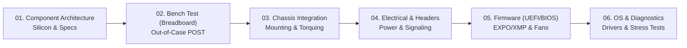
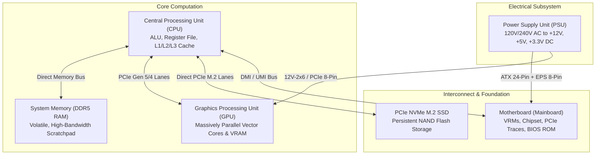
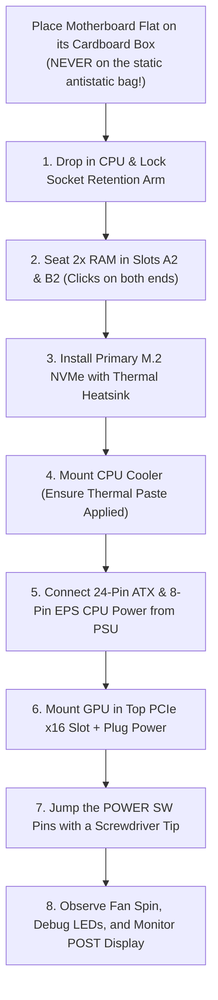
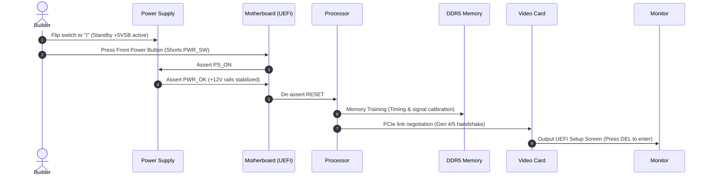
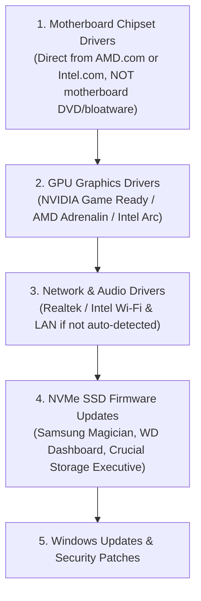
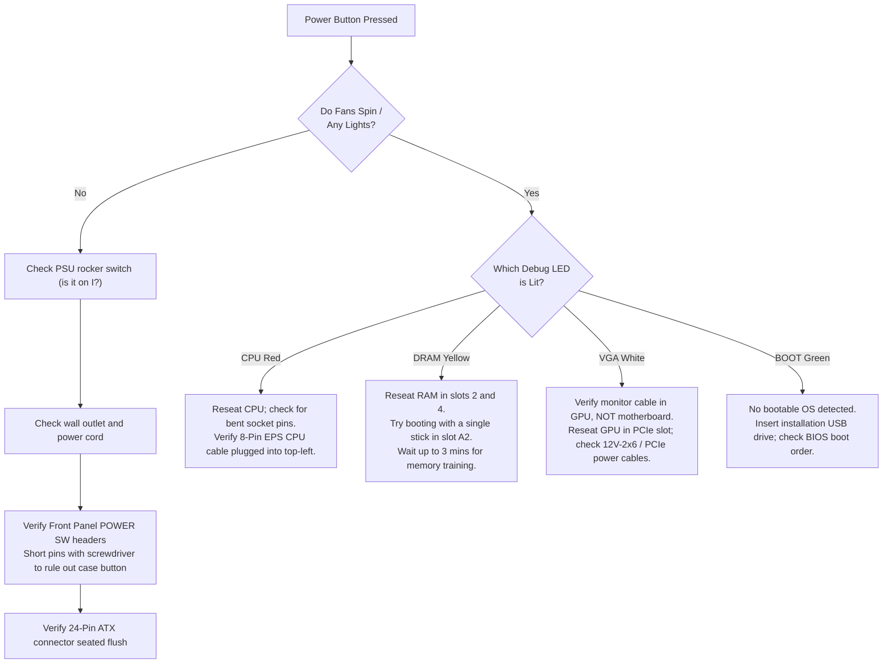

# Building a PC: From Silicon to First Boot

Building a computer is often compared to snapping together high-tech LEGO bricks. While modern standardization (ATX form factors, keyed connectors, and fool-proof notches) makes physical assembly accessible to anyone with a screwdriver, true mastery requires understanding the **first principles of computer hardware**: signal integrity, thermal dissipation, electrical delivery, and firmware handshakes.

When you purchase a pre-built desktop, you pay a steep markup for generic power delivery, OEM motherboard compromises, and locked firmware. When you build your own machine, you control every variable: VRM phase headroom, airflow static pressure, memory sub-timings, and storage throughput.

This lesson takes you on the complete journey from bare silicon to the first Windows or Linux desktop login.

<div className="my-6 aspect-video w-full overflow-hidden rounded-xl border border-border shadow-md">
  <iframe
    className="h-full w-full"
    src="https://www.youtube-nocookie.com/embed/V38NoO2xiVw"
    title="How to Build a PC, Step by Step, Slow & Easy Computer Build Guide"
    allow="accelerometer; autoplay; clipboard-write; encrypted-media; gyroscope; picture-in-picture; web-share"
    allowFullScreen
  />
</div>

<Callout type="info">
  **Companion Video Masterclass:** Follow along visually with [_How to Build a
  PC, Step by Step, Slow & Easy Computer Build Guide_ by **Nerd
  Sidekick**](https://youtu.be/V38NoO2xiVw). This thorough, patient walkthrough
  shows real-time hands-on socket handling, pin alignments, cable seating, and
  POST testing to complement the engineering deep dive below.
</Callout>



---

## 01 — The Anatomy of a Modern PC

Every personal computer is a collection of specialized sub-systems communicating across high-speed electrical buses. Before turning a single screw, you must understand what each component does, how they bottleneck each other, and how they physically interlock.



### 1. The Central Processing Unit (CPU)

The CPU is the central brain executing instruction pipelines, operating system kernels, and logic branches.

- **Microarchitecture:** Consists of arithmetic logic units (ALUs), branch predictors, and high-speed multi-level caches (L1, L2, and shared L3, including specialized 3D V-Cache dies).
- **Socket Types:**
  - **LGA (Land Grid Array):** The pins reside inside the motherboard socket; the CPU has flat gold contact pads (e.g., AMD AM5, Intel LGA1700/LGA1851). _Extreme caution is required: bent motherboard pins can ruin the board._
  - **PGA (Pin Grid Array):** Pins are attached to the underside of the processor chip (legacy AMD AM4).
- **Thermal Design Power (TDP / PBO / PL2):** The sustained heat output under continuous workload. Modern CPUs dynamically scale clock frequencies until they hit thermal thresholds (e.g., $95^\circ\text{C}$ on modern AMD Ryzen, $100^\circ\text{C}$ on Intel Core), demanding robust cooling.

### 2. The Motherboard (Mainboard)

The motherboard is the nervous system, providing the printed circuit board (PCB) traces through which data flows at gigahertz frequencies.

- **Form Factors:**
  - **ATX ($305 \times 244\text{ mm}$):** Standard desktop size, 4 RAM slots, multiple PCIe slots, comprehensive heatsinks.
  - **Micro-ATX / mATX ($244 \times 244\text{ mm}$):** Cost-effective, compact, usually 4 RAM slots and 2–3 expansion slots.
  - **Mini-ITX ($170 \times 170\text{ mm}$):** Ultra-compact Small Form Factor (SFF), only 2 RAM slots and 1 PCIe slot.
- **Voltage Regulator Modules (VRM):** Converts the PSU's $+12\text{V}$ rail into clean, micro-adjusted $\approx 1.1\text{V} - 1.4\text{V}$ power for the CPU silicon. Quality motherboards feature $12+2+1$ or higher power phase designs with heavy aluminum heatsinks to prevent thermal throttling.
- **PCIe Lane Topologies:** The CPU supplies $16$ to $24$ direct PCIe lanes (dedicated to the primary GPU slot and primary M.2 slot). Secondary slots and peripheral ports route through the **Chipset** via a multiplexed uplink.

### 3. System Memory (RAM)

Volatile storage holding operational memory for the OS and active programs.

- **DDR4 vs DDR5:** Modern builds prioritize DDR5, featuring dual 32-bit subchannels per stick, On-Die ECC (Error Correction Code), and operating frequencies from $5200\text{ MT/s}$ to $7200+\text{ MT/s}$.
- **Channel Topology & Slot Population:** Most consumer boards have 4 physical slots operating across 2 memory channels ($A$ and $B$). When running two sticks, **always install them in slots A2 and B2 (Slots 2 and 4 from the CPU socket)**. This terminates the high-frequency daisy-chain bus traces properly, preventing signal reflections and memory instability.

### 4. Solid State Drive (Storage - NVMe M.2)

- Modern systems use M.2 NVMe (Non-Volatile Memory Express) SSDs that communicate directly over the PCIe bus using the M.2 2280 form factor ($22\text{ mm}$ wide, $80\text{ mm}$ long).
- **PCIe Gen 4 vs Gen 5:** Gen 4 tops out around $7,400\text{ MB/s}$, which is practically indistinguishable from Gen 5 ($14,000\text{ MB/s}$) in real-world OS responsiveness and gaming load times, but Gen 5 produces significantly more heat and requires active or heavy passive cooling.

### 5. Graphics Processing Unit (GPU / Video Card)

Massively parallel computational array featuring thousands of lightweight stream cores designed for matrix multiplication, rasterization, and ray tracing.

- Connects to the **top PCIe x16 slot** (which wires directly to the CPU with minimum electrical latency).
- Demands massive power (up to $450\text{W}+$ for flagship cards) delivered via traditional PCIe 8-pin connectors or modern ATX 3.0/3.1 high-density cables.

### 6. Power Supply Unit (PSU)

The unsung hero of PC stability. Converts household alternating current ($110\text{V} / 230\text{V}$ AC) into regulated direct current ($+12\text{V}$, $+5\text{V}$, $+3.3\text{V}$ DC).

- **Modularity:**
  - _Non-Modular:_ All cables permanently attached (cheap, cable management nightmare).
  - _Semi-Modular:_ Essential motherboard/CPU cables attached; peripheral cables detachable.
  - _Fully Modular:_ Every cable attaches via a port on the PSU housing. Only install the exact cables your build needs.
- **Efficiency Standards (80 PLUS / Cybenetics):** Ratings (Bronze, Gold, Platinum, Titanium) reflect how much power is drawn from the wall versus lost as waste heat at $20\%$, $50\%$, and $100\%$ load.
- **ATX 3.0 / ATX 3.1 & PCIe 5.0 (12V-2x6):** Modern GPUs produce microsecond electrical spikes (**transient power excursions**) up to $2\times$ their rated TDP. ATX 3.0/3.1 PSUs are engineered to absorb these spikes without tripping over-current protection (OCP).

### 7. Cooling Systems & Thermal Interfaces

Every watt of electrical energy consumed by your computer is converted into heat.

- **Air Coolers:** Copper heat pipes containing a vacuum-sealed liquid phase-change working fluid transfer heat from the baseplate to aluminum fin stacks cooled by high static pressure fans. Highly reliable (no pumps, cannot leak).
- **All-in-One (AIO) Liquid Coolers:** Closed liquid loops circulating coolant from a copper CPU waterblock/pump combo to a $240\text{ mm}$, $280\text{ mm}$, or $360\text{ mm}$ radiator mounted against case intake/exhaust ports.

---

## 02 — Workspace Preparation & Safety Rules

Before unboxing hardware, prepare an environment that protects both you and the sensitive microelectronics.

| Danger / Risk                     | Underlying Physics                                                                                                    | Practical Countermeasure                                                                                                                                                                   |
| :-------------------------------- | :-------------------------------------------------------------------------------------------------------------------- | :----------------------------------------------------------------------------------------------------------------------------------------------------------------------------------------- |
| **Electrostatic Discharge (ESD)** | Static charges on skin ($\approx 3,000\text{V}$) can puncture microscopic silicon transistor gates ($< 1.5\text{V}$). | Work on a wood or hard plastic table (never on carpet). Periodically touch the bare metal casing of your plugged-in (but switched off) PSU to discharge static harmlessly to Earth ground. |
| **Bent Socket Pins**              | LGA socket pins are spring-loaded beryllium copper needles angled at precise degrees.                                 | Never touch exposed LGA pins with fingers, cloth, or cables. Only remove the socket protective plastic cap _during or immediately after_ CPU installation.                                 |
| **Peel-Off Plastic Films**        | Transparent protective stickers on cooler bases and M.2 heatsinks insulate heat transfer.                             | Always check and strip every plastic protective film before mounting heatsinks. Leaving the cooler base sticker on causes instant thermal throttling ($100^\circ\text{C}$).                |
| **Mechanical Torque Stripping**   | Fine threads in aluminum standoffs and PCB mounting holes strip under excessive force.                                | Hand-tighten until snug using a standard magnetic #2 Phillips screwdriver. Never use electric drill drivers on PC components.                                                              |

### Required Tools Checklist

- **#2 Phillips Magnetic Screwdriver** (with a $150\text{ mm}$ or longer shaft to reach deep into case frames).
- **Cable Ties or Velcro Straps** for clean wire harnessing.
- **Isopropyl Alcohol ($90\%+$ purity) & Lint-Free Microfiber Cloth** (for thermal paste cleanup if remounting is needed).
- **Flashlight or Smartphone Light** to inspect small motherboard pin markings.

---

## 03 — The "Out-of-Case" Bench Test (Breadboarding)

> **The Golden Law of System Builders:** _Never install hardware into the chassis until you have verified that the core subsystem posts to screen on the test bench._

Disassembling a fully plumbed, cable-managed PC inside a tight chassis just to discover a dead CPU or defective motherboard slot is a soul-crushing experience. Testing outside takes 15 minutes and guarantees the core platform is functional.



<Callout type="error">
  **Why you must NEVER rest the motherboard on the outside of the antistatic
  bag:** The outside coating of silver antistatic bags contains a microscopic
  conductive nickel/carbon layer designed to dissipate static around the
  exterior of the bag. Powering a motherboard on top of that bag can short
  circuit underlying PCB solder joints! Always place the motherboard directly
  onto its non-conductive cardboard packaging box.
</Callout>

---

## 04 — Detailed Assembly Walkthrough

Follow this step-by-step sequence for a clean, damage-free build.

### Step 1: Installing the CPU

1. Open the motherboard socket by pressing the retention load lever down, swinging it outward past the retaining catch, and lifting it open.
2. Inspect the CPU socket under direct light for any bent or misaligned pins.
3. Locate the **gold alignment triangle** in one corner of the CPU package. Match it to the triangular embossing etched into the motherboard socket corner.
4. Hold the CPU by its PCB substrate edges with your thumb and index finger. Lower it straight down into the socket vertically without sliding or angling it. It must seat completely flat with zero force (**Zero Insertion Force — ZIF**).
5. Lower the metal load bracket down over the CPU heat spreader.
6. Press the load lever down until it locks into the retention notch. You will feel noticeable mechanical resistance as the spring plate applies hundreds of pounds of downward pressure to ensure solid pin contact. The plastic protective socket cover will pop off automatically—keep it safe in the motherboard box for future warranty returns.

```
       AMD AM5 / Intel LGA Orientation:
       +-------------------------------+
       | [▲] (Gold Triangle)           |
       |                               |
       |       INTEGRATED HEAT         |
       |       SPREADER (IHS)          |
       |                               |
       |                        Notch  |
       +-------------------------------+
```

### Step 2: Installing the Memory (RAM)

1. Locate memory channels **A2** and **B2** (typically the 2nd and 4th slots counting away from the CPU socket).
2. Open the retention clips at the ends of the selected RAM slots (some modern boards feature one fixed latch and one movable latch).
3. Align the notch along the gold contact pins of the RAM module with the plastic key tab in the motherboard slot. Memory is keyed asymmetrically and cannot be inserted backwards.
4. Press straight down firmly with even pressure on both ends of the RAM stick until the latches click into place automatically.

### Step 3: Installing the Primary M.2 NVMe SSD

1. Locate the top M.2 slot immediately below the CPU socket. This slot is linked directly to the processor's dedicated high-speed PCIe lanes.
2. Remove the motherboard manufacturer's aluminum heatsink covering the slot.
3. **Crucial check:** Peel off the blue or transparent plastic film protecting the thermal pad on the underside of the heatsink!
4. Insert the M.2 SSD into the slot at roughly a $30^\circ$ angle until the gold pins are fully recessed into the connector.
5. Push the floating end of the SSD down against the standoff and lock it in place using the rotational latch (Q-Latch) or tiny M.2 screw.
6. Reinstall the aluminum heatsink and secure its screws.

```
                   M.2 Slot Installation:
     Insert at 30° angle
           \  [ NVMe SSD ]
            \----------> [ M.2 Socket ]
                 |
                 v Press down to standoff & secure screw/latch
```

### Step 4: Mounting the CPU Cooler

1. **Thermal Paste Application:**
   - If using a cooler with pre-applied paste, skip manual application.
   - For bare coolers, apply thermal paste to the center of the CPU Integrated Heat Spreader (IHS). Use the **pea-sized drop** or a **cross ($X$) pattern**. When the cooler is torqued down, the clamping pressure spreads the paste into a sub-millimeter film that fills microscopic surface imperfections.
2. **Mounting:**
   - Position the cooler bracket over the mounting standoffs.
   - Tighten mounting screws in an **alternating diagonal cross-pattern** (top-left, bottom-right, top-right, bottom-left), rotating each screw 2–3 turns at a time. This prevents uneven pressure, which can push thermal paste out of one side or cause memory channel connection failures.
3. Plug the cooler's fan cable into the motherboard header labeled `CPU_FAN` (not `SYS_FAN` or `PUMP_FAN`), ensuring the BIOS reads the processor's primary tachometer signal.

---

### Step 5: Preparing the Chassis

1. **Remove both side panels** and set them on a soft surface (especially tempered glass panels—never set tempered glass on tile or stone floors, which cause rapid stress fractures).
2. **Motherboard Standoffs:** Verify that the brass standoffs in the case tray match the form factor of your motherboard (ATX vs mATX). An extra or misplaced standoff behind the motherboard will cause a dead short against electrical solder points.
3. **I/O Shield:** If your motherboard has a separate steel I/O plate (rather than an integrated rear shield), snap it into the rear cutout from inside the case until all four corners click securely.

```
       Correct Airflow Principle:
       [Front / Bottom Intake: MESH] ---> [Cool Air] ---> [CPU / GPU] ---> [Rear / Top Exhaust]
```

### Step 6: Installing the Power Supply Unit (PSU)

1. Before inserting the PSU into the bottom chamber, plug in all modular cables you will need:
   - $1\times$ **24-pin ATX Main Power**
   - $1\times$ or $2\times$ **8-pin EPS / CPU Power**
   - $1\times$ or $2\times$ **PCIe 8-pin** or $1\times$ **12V-2x6** cable for your GPU
   - SATA power cables (only if using mechanical hard drives or SATA-powered fan hubs)
2. Orient the PSU fan:
   - If the case has a bottom intake dust filter, orient the PSU fan **facing downward** so it draws isolated cold air from outside the case and exhausts out the rear.
   - If placing the PC on thick carpet, point the fan **upward** into the main chamber to prevent dust starvation.
3. Slide the PSU in and torque the four mounting screws into the rear chassis bracket.

### Step 7: Dropping in the Motherboard

1. Route the **8-pin EPS CPU cable** through the upper-left cable pass-through hole in the chassis tray _before_ securing the motherboard if the top clearance between the cooler and chassis ceiling is tight.
2. Lower the motherboard into the chassis, gently guiding the rear I/O ports into the corresponding holes of the rear I/O shield.
3. Align the central alignment peg (or center screw hole) with the tray standoffs.
4. Drive in all motherboard mounting screws in a cross pattern until comfortably snug.

### Step 8: Front Panel Connectors & Peripheral Cabling

The front panel connectors link your case's external buttons and LEDs to the motherboard.

```
      Standard Front Panel Pinout (JFP1 / F_PANEL):
      Pin 1: + PWR LED -  |  Pin 3: + POWER SW -
      Pin 2: + HDD LED -  |  Pin 4: + RESET SW -
      ------------------------------------------
      [ 1 ] [ 3 ] [ 5 ] [ 7 ] [ 9 ] (Empty Key)
      [ 2 ] [ 4 ] [ 6 ] [ 8 ]
```

- **Power Switch (`POWER SW`) & Reset Switch (`RESET SW`):** Momentary switches. Polarity ($+/-$) does not matter; closing the circuit triggers the power state change.
- **Power LED (`PWR LED`) & Drive Activity (`HDD LED`):** Diodes have polarity ($+$ must connect to positive, $-$ to negative).
- **Front Panel Audio (`HD_AUDIO`):** Keys into the bottom-left header with one missing pin.
- **USB 3.0 Header (19-Pin Blue Header):** Has an alignment notch on one edge. _Push straight in with great care—the internal copper pins bend easily under shear pressure._
- **USB Type-C Front Header (Key-A):** Reversible rectangular keyed connector.

---

### Step 9: Installing the Graphics Card (GPU)

The GPU is installed last to maximize working room for cables and headers.

1. Remove the metal PCIe expansion slot covers from the rear chassis frame matching your card's width (typically 2 to 3.5 slots down from the top slot).
2. Push down the plastic PCIe latch on the right edge of the top PCIe x16 motherboard slot to open it.
3. Align the GPU gold contact fingers with the slot. Push down evenly with firm pressure until the slot latch snaps upward with an audible click.
4. Fasten the GPU metal bracket to the chassis frame with screws.
5. If the graphics card is long and heavy ($>280\text{ mm}$), install an **anti-sag bracket or pillar** underneath the outer corner to prevent PCB flex and PCIe socket strain over time.
6. **Connect the Power:**
   - **PCIe 8-Pin:** Use separate, dedicated cables running back to the PSU whenever possible. Avoid daisy-chaining ("pigtail") cables on high-power cards.
   - **12V-2x6 / 12VHPWR (PCIe 5.0):** **Push firmly until the latch snaps fully shut with no gap visible between the connector housings.** A loose connection creates high localized resistance, leading to thermal buildup and melted plastic. Ensure the cable extends straight for at least $35\text{ mm}$ before any bend.

```
         Proper 12V-2x6 / 12VHPWR Cable Seating:
     [ INCORRECT: Visible Gap ]       [ CORRECT: Fully Flush ]
          +---+   +---+                    +---+---+
          |===|   |===|                    |=======|
          +---+   +---+                    +---+---+
          No click / angled                Audible click / zero gap
```

---

## 05 — The First Boot & BIOS/UEFI Setup

Now comes the moment of truth.

1. Connect your monitor to the **video port on the graphics card**—_never to the motherboard HDMI/DisplayPort_ (unless your system has an iGPU and no dedicated card installed).
2. Connect keyboard and mouse.
3. Flip the PSU rear rocker switch from `O` (Off) to `I` (On).
4. Tap the chassis Power button.

### What Happens During POST?

The motherboard performs its **Power-On Self-Test (POST)**. Most modern motherboards have four diagnostic LEDs near the top-right corner:

- **CPU (Red):** Initializing and checking CPU registers and microcode.
- **DRAM (Orange/Yellow):** Performing memory training. _On DDR5 platforms, first boot memory training can take up to 2–3 minutes while the system verifies signal eye diagrams and sets impedance levels. Be patient and do not power down!_
- **VGA (White):** Verifying GPU handshake and video BIOS.
- **BOOT (Green):** Verifying valid boot drive presence.

Once all four LEDs extinguish, your display will light up with the manufacturer splash screen. Press `Delete` or `F2` repeatedly to enter the **UEFI BIOS Utility**.



### Essential BIOS Configurations

Before installing an operating system, tune these three fundamental settings:

1. **Enable Memory Overclocking (XMP / EXPO):**
   - By default, all RAM boots at standard JEDEC baseline speeds ($4800\text{ MT/s}$ or $2133\text{ MT/s}$).
   - Locate the **XMP (Extreme Memory Profile)** toggle on Intel or **EXPO (Extended Profiles for Overclocking)** on AMD and switch it to **Profile 1**. This unlocks the memory's advertised speed (e.g., DDR5-6000 CL30) and applies validated manufacturer voltages.
2. **Enable Resizable BAR (ReBAR) & Above 4G Decoding:**
   - Gives the CPU direct access to the entire GPU VRAM buffer at once instead of in small $256\text{ MB}$ chunks, yielding a $5\% - 15\%$ performance uplift in modern games.
3. **Configure Fan Curves:**
   - Set all case fan headers to **PWM mode** (4-pin) rather than DC mode.
   - Adjust fan curves to tie chassis fans to the CPU or Motherboard temperature sensor. Add a 2–3 second temperature smoothing hysteresis to prevent fans from ramping up noisily during brief background CPU spikes.
4. **Save & Exit:** Press `F10` to save configuration settings and restart.

---

## 06 — Operating System Installation & Driver Sequencing

### 1. Preparing the Installation Media

On a separate computer, download the official **Windows Media Creation Tool** or write a clean Linux distribution ISO (Ubuntu, Fedora, Arch) to an $8\text{GB}+$ USB flash drive using tools like **Rufus** or **Ventoy**. Ensure the partition scheme is set to **GPT (GUID Partition Table)** for modern UEFI booting.

### 2. Operating System Setup

1. Insert the USB flash drive into a rear I/O port directly on the motherboard.
2. Boot the PC. It should detect the bootable media automatically. If not, press `F8` or `F11` during boot to open the boot device selector.
3. Select **Custom: Install Windows only (advanced)**.
4. Select the unallocated space on your primary NVMe SSD and click **Next**. The installer will automatically format the drive with an EFI System Partition (ESP), MSR, and primary NTFS/Btrfs partition.

### 3. The Strict Driver Hierarchy

Once on the desktop, install drivers in this specific architectural order to prevent stability issues:



<Callout type="warn">
  **Avoid Motherboard Companion Suites:** Do not install manufacturer software
  bundles (e.g., Asus Armoury Crate, MSI Center, Gigabyte App Center). These
  utility suites install aggressive background telemetry services, custom power
  schemes that override Windows scheduler logic, and bloatware that degrades
  system latency. Control RGB lighting with lightweight open-source alternatives
  like **OpenRGB** or **SignalRGB**.
</Callout>

---

## 07 — Thermal Validation & Stress Testing

Never assume a newly built machine is stable under sustained load just because it boots into the desktop. Perform systematic burn-in testing to verify cooling performance, thermal paste coverage, and power delivery headroom.

### 1. Monitoring Hardware Telemetry

Download **HWiNFO64** (free, industry-standard hardware telemetry). Launch it in **Sensors-only mode** to monitor:

- **CPU Tctl/Tdie / Package Temperature**
- **CPU Vcore & Package Power (Watts)**
- **GPU Core Temp & GPU Memory Junction Temp / Hot Spot Temp**
- **DIMM Memory Temperatures**

### 2. Stability Benchmarking Suite

| Component                     | Software Tool                                                      | Duration          | Success Criteria                                                                                                                                |
| :---------------------------- | :----------------------------------------------------------------- | :---------------- | :---------------------------------------------------------------------------------------------------------------------------------------------- |
| **CPU Thermals & Throttling** | **Cinebench 2024**                                                 | 10-Minute Loop    | Temperatures stabilize below $85^\circ\text{C}-90^\circ\text{C}$ (air) or $80^\circ\text{C}$ (liquid). No thermal throttling flags in HWiNFO64. |
| **Memory / IMC Stability**    | **TestMem5 (TM5)** with _Anta777 Extreme_ profile or **MemTest86** | 3 Cycles / 1 Hour | Exactly $0$ errors. (Any error indicates unstable EXPO/XMP timings or inadequate SoC/VDD voltages).                                             |
| **GPU Core & VRAM Thermals**  | **3DMark Time Spy / Steel Nomad Stress Test**                      | 20 Loops          | Frame rate stability $\ge 97\%$. GPU hotspot delta under $15^\circ\text{C}-20^\circ\text{C}$ relative to core temp.                             |
| **Full System Power Peak**    | **OCCT Power Supply Test**                                         | 15 Minutes        | Both CPU and GPU pinned at maximum simultaneous power draw. No system shutdowns, restarts, or PCIe bus errors.                                  |

---

## 08 — Diagnostic Troubleshooting Matrix

When a build fails to start, panic is the enemy. Approach every issue methodically using this diagnostic tree:



### Deep Dive: Common Real-World Failure Scenarios

#### Symptom 1: Fans spin for half a second, then click off immediately

- **Root Cause:** A short circuit has tripped the PSU's Over-Current Protection (OCP) or Short-Circuit Protection (SCP).
- **Fix:** Look for an extra metal standoff behind the motherboard, a stray screw dropped into the chassis, or an incorrectly pinned EPS cable forced into a PCIe slot (EPS and PCIe 8-pin have completely different ground/voltage pin assignments!).

#### Symptom 2: PC turns on, fans run, but monitor says "No Signal"

- **Check 1:** Ensure the DisplayPort/HDMI cable is plugged into the **GPU ports**, not the motherboard I/O panel.
- **Check 2:** On modern graphics cards, the monitor must be powered on _before_ you turn on the PC so the GPU detects display handshake impedance over DisplayID/EDID.
- **Check 3:** Check that the DisplayPort cable is inserted all the way—thick chassis metal around PCIe slots can sometimes block the cable connector housing from seating fully into the card.

#### Symptom 3: CPU hits 100°C immediately upon booting or opening a browser

- **Root Cause:** The plastic protective peel on the copper base of the CPU cooler was left on, or the AIO cooler pump tachometer is disconnected.
- **Fix:** Unmount the cooler, peel off the transparent plastic warning label, re-clean the surfaces with isopropyl alcohol, reapply fresh thermal paste, and remount. Verify the AIO pump cable is connected to `AIO_PUMP` running at $100\%$ speed.

---

## 09 — Final Master Assembly Checklist

Keep this summary checklist beside you on build day:

- [ ] **Workspace:** Flat, solid non-conductive surface; bare metal grounded touch point identified.
- [ ] **Motherboard Prep:** Board placed directly on cardboard box; LGA socket inspected for straight pins.
- [ ] **Core Hardware Seated:** CPU locked with zero insertion force; RAM clicked firmly into slots **A2 and B2**.
- [ ] **M.2 Heatsinks:** Protective plastic peels stripped from all M.2 heatsink thermal pads.
- [ ] **Cooler Base:** Transparent protective sticker stripped from the copper cooler baseplate.
- [ ] **Thermal Paste:** Thin, even pattern applied; cooler torqued in a diagonal criss-cross pattern.
- [ ] **Case Standoffs:** Only standoffs matching the motherboard form factor are present.
- [ ] **PSU Cables:** 24-pin ATX, 8-pin EPS CPU, and GPU power lines routed _before_ obstructions occur.
- [ ] **Front Panel:** `POWER SW`, `RESET SW`, USB 3.0, and `HD_AUDIO` seated in their respective pinouts.
- [ ] **GPU Power:** 12V-2x6 connector pushed in until the locking tab snaps completely flush with zero gap.
- [ ] **Display Output:** Monitor DisplayPort cable plugged directly into the discrete graphics card.
- [ ] **Firmware Configuration:** EXPO/XMP profile enabled; ReBAR enabled; fan curves tuned to PWM mode.
- [ ] **OS & Stability:** Clean OS installed; chipset and graphics drivers loaded; Cinebench & MemTest86 passed with zero errors.

---

## Knowledge Check

<TryIt
  question="When installing two sticks of DDR5 memory on a motherboard with four DIMM slots, which slots should you populate for optimal stability and signal integrity?"
  options={[
    "Slots 1 and 2 (A1 and A2) closest to the CPU socket",
    "Slots 2 and 4 (A2 and B2) to minimize reflection and maximize dual-channel trace routing",
    "Slots 3 and 4 (B1 and B2)",
    "Any random slots; modern motherboards configure memory topology automatically",
  ]}
  answer="B"
  why="Motherboards use daisy-chain memory trace topology. Terminating the trace ends by populating slots 2 and 4 (A2 and B2) prevents signal reflection interference, which is critical for DDR5 EXPO/XMP stability."
/>

<TryIt
  question="A newly built PC turns on, fans spin, but the display shows 'No Signal' and the motherboard white VGA debug LED remains illuminated. What is the most common cause?"
  options={[
    "The monitor cable is plugged into the motherboard HDMI/DisplayPort port rather than the discrete GPU port",
    "The CPU has exceeded its maximum TDP rating",
    "The NVMe SSD is unformatted",
    "The chassis power switch is wired backwards",
  ]}
  answer="A"
  why="Motherboard display outputs route to the integrated GPU (if present). When a discrete graphics card is installed, connecting to the motherboard often yields no display output or triggers a VGA POST warning."
/>
