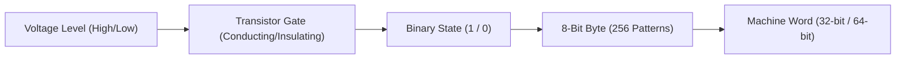
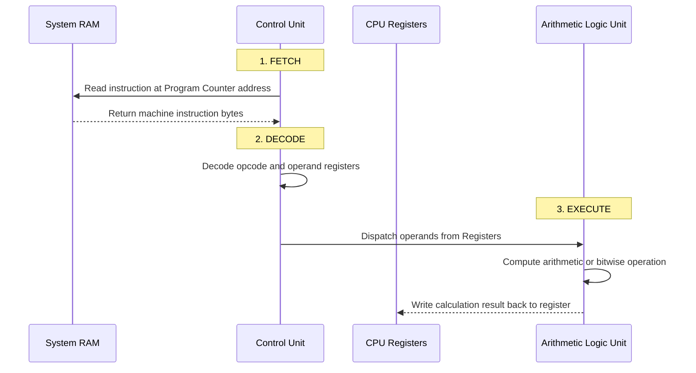
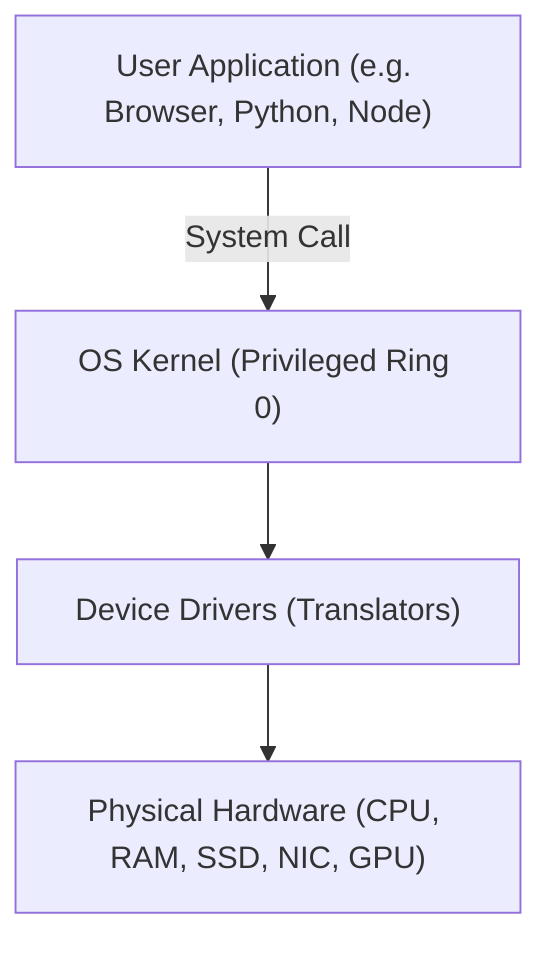
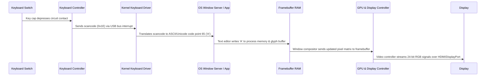

<Concepts
  items={[
    "transistor switches",
    "bits & bytes",
    "CPU & ALU",
    "Control Unit & Registers",
    "fetch-decode-execute",
    "RAM vs ROM",
    "memory architecture & hierarchy",
    "kernel & Ring 0",
  ]}
/>

<LessonIntro>

Before there was a laptop, a smartphone, or a cloud server, there was a thought experiment. In 1936, Alan Turing conceptualized an infinitely long strip of paper tape divided into cells, alongside a read/write head governed by a finite table of mechanical rules.

That abstract mathematical construct — the **Turing machine** — proved that a simple state-machine manipulating discrete symbols on cells could compute anything computable. A modern computer is physically different, but architecturally identical: it is a lightning-fast, microscopic implementation of Turing's machine built from billions of microscopic silicon switches.

</LessonIntro>

## Why this matters

Every variable allocation, database index search, API request, and microservice call you will encounter across software engineering ultimately reduces to transistor flips, memory bus cycles, and register transfers.

When a backend container crashes with an out-of-memory (OOM) error, when a real-time game stutters due to cache misses, or when a high-throughput pipeline stalls on bus I/O, you are not debugging abstract syntax — you are debugging physical hardware constraints. Understanding the hardware layer removes the "magic" from software execution.

---

## 01 — Physical Reality: Switches Become Bits and Bytes

A computer contains no innate understanding of text, audio, mathematics, or imagery. At the atomic hardware level, modern computers are constructed from **transistors** — solid-state microscopic electronic switches fabricated from silicon.

### What is a Transistor?

A **transistor** is a microscopic semiconductor electronic component that regulates or switches electrical current. In modern digital computing, it operates as an ultra-fast electronic switch with no moving parts:

- **Switch ON (Binary `1`):** When a control voltage is applied, electricity flows freely through the channel.
- **Switch OFF (Binary `0`):** When voltage is removed, electrical current is blocked.

_Figure 1.1 — Discrete electronic transistors. Early computing used individual components like these; modern microchips pack tens of billions of microscopic transistors onto a single silicon chip._

_Figure 1.2 — Cross-section of a Metal-Oxide-Semiconductor Field-Effect Transistor (MOSFET). Applying voltage to the Gate (G) allows current to conduct between the Source (S) and Drain (D)._

_Figure 1.3 — Monocrystalline silicon wafer. Modern microchips are photolithographically fabricated in cleanrooms across silicon wafers before being sliced into individual processor dies._

### From Transistors to the Binary Bit and Byte

- **The Transistor:** Modern processors pack tens of billions of microscopic Field-Effect Transistors (MOSFETs) onto a chip the size of a fingernail. When a control voltage is applied to the gate, current flows (state `1`, or "on"); when voltage is removed, current is blocked (state `0`, or "off").
- **The Bit:** That single binary choice (`0` or `1`) is a **bit** (binary digit), the fundamental atomic unit of information.
- **The Byte:** Because a single bit can only communicate two possibilities, hardware bundles eight contiguous bits together into a **byte**:

$$\text{Total Combinations} = 2^8 = 256\text{ values } (00000000_2 \text{ to } 11111111_2 \text{, or } 0 \text{ to } 255)$$

A byte is the universal baseline: enough distinct patterns to encode every standard Latin keyboard character, a basic color intensity channel ($0\text{--}255$), or a machine-language instruction opcode.

---

## 02 — The Thinking Engine: CPU Architecture & The Instruction Cycle

The **Central Processing Unit (CPU)** is the computational engine and primary "brain" of the computer. It executes instructions through a perpetual, high-speed rhythmic cycle synchronized by an internal quartz clock oscillator. Its primary responsibility is to fetch binary instructions from memory, decode what action they require, and execute those instructions at billions of cycles per second.

_Figure 1.4 — Microprocessor package. The ceramic casing protects the internal silicon die, and bottom contact pins bridge the CPU directly to the motherboard's system buses._

_Figure 1.5 — Microscopic processor die. The etched silicon houses billions of interconnected logic gates grouped into core ALUs, control logic, and high-speed SRAM cache banks._

### Inside the CPU Core: Key Functional Subunits

A modern CPU core is divided into three primary functional subunits that work in lockstep:

1. **Control Unit (CU):** The conductor and manager of the CPU. The Control Unit directs the entire flow of electrical signals across the processor. It does not perform mathematical calculations itself; instead, it fetches machine instructions from RAM, decodes their binary operation codes (opcodes), and coordinates the ALU, registers, and external memory buses by sending synchronized control signals.
2. **Arithmetic Logic Unit (ALU):** The mathematical calculator and comparison engine. It carries out all basic arithmetic calculations (addition, subtraction, multiplication) and logical decisions (AND, OR, NOT, comparisons, bitwise shifts).
3. **Registers:** A CPU register is a very small, very fast storage location inside the CPU used to hold data, instructions, or addresses while the CPU is executing a program. It is the fastest storage in a computer, much faster than RAM or even cache.
   - **Why registers exist:** The CPU's ALU (arithmetic logic unit) and control unit need data immediately. Fetching from RAM every time would be too slow. So registers act like the CPU's "workbench": values are loaded into registers, operated on, and then stored back to memory.
   - **How they are built:** Registers are made from flip-flops or latches, which are built from transistors. A 64-bit register contains 64 flip-flops, each storing 1 bit.
   - **Speed & Quantity:** Registers are accessed within the CPU clock cycle, so they are extremely fast ($< 1\text{ ns}$, or $1\text{ clock cycle}$). A CPU has only a small number of registers — typically dozens to a few hundred, depending on architecture.
   - **Key Registers include:**
     - **Program Counter (PC):** Holds the memory address of the next instruction waiting to be fetched.
     - **Instruction Register (IR):** Holds the binary bytecode of the current instruction being executed.
     - **Accumulator (ACC) / General-Purpose Registers:** Stores intermediate calculation results from the ALU.
     - **Memory Address Register (MAR) & Memory Data Register (MDR):** Holds the address and data being transferred across the memory bus to or from RAM.

### The Fetch-Decode-Execute Cycle

Every program — whether compiled C++, interpreted Python, or browser JavaScript — executes this continuous cycle:

1. **Fetch:** The Control Unit reads the memory address stored in the **Program Counter (PC)**, queries the system bus, and retrieves the raw instruction byte sequence from RAM into the Instruction Register. The PC increments to point to the next instruction.
2. **Decode:** The instruction decoder translates the binary opcode into electrical switching configurations (e.g., `0x01` maps to an `ADD` operation).
3. **Execute:** The ALU receives the data operands, executes the operation, and routes the output into a destination register.
4. **Store (Writeback):** If required, the calculated result is transferred across the memory bus back into system RAM.

<Callout type="info" title="Clock Speed vs Instructions Per Cycle (IPC)">
A $3.5\text{ GHz}$ CPU oscillates its clock $3.5\text{ billion times per second}$. However, raw gigahertz alone does not determine real-world speed. Modern processors use **instruction pipelining**, **out-of-order execution**, and **superscalar architecture** to execute multiple instructions concurrently per clock cycle.
</Callout>

---

## 03 — Memory Architecture: The Hierarchy & Funnel

The **Memory Architecture** describes the multi-tiered structure computers use to balance speed, storage capacity, and manufacturing cost.

One of the fundamental engineering trade-offs in computer science is that:

- Memory that is extremely fast (like CPU registers and SRAM cache) is physically bulky, power-hungry, and expensive.
- Storage that is large and inexpensive (like SSDs and HDDs) is thousands of times slower to read from and write to.

Modern computer architectures resolve this dilemma through a tiered **memory hierarchy pyramid**:

_Figure 1.4 — The memory pyramid: data funnels downward from vast, slow non-volatile storage toward lightning-fast CPU registers._

### Comparing Memory Tiers

| Memory Tier                 | Typical Size                    | Access Latency                                                    | Volatility   | Technology         |
| :-------------------------- | :------------------------------ | :---------------------------------------------------------------- | :----------- | :----------------- |
| **CPU Registers**           | $\approx 1\text{--}2\text{ KB}$ | $< 1\text{ ns}$ ($1\text{ cycle}$)                                | Volatile     | On-die flip-flops  |
| **L1 Cache**                | $64\text{--}128\text{ KB}$      | $\approx 1\text{--}2\text{ ns}$ ($4\text{ cycles}$)               | Volatile     | Static RAM (SRAM)  |
| **L2 Cache**                | $512\text{ KB -- }2\text{ MB}$  | $\approx 3\text{--}10\text{ ns}$ ($12\text{ cycles}$)             | Volatile     | Static RAM (SRAM)  |
| **L3 Cache**                | $16\text{--}96\text{ MB}$       | $\approx 10\text{--}25\text{ ns}$ ($40\text{ cycles}$)            | Volatile     | Shared on-die SRAM |
| **Main System RAM**         | $8\text{--}64\text{ GB}$        | $\approx 60\text{--}100\text{ ns}$ ($200\text{ cycles}$)          | Volatile     | Dynamic RAM (DRAM) |
| **Solid-State Drive (SSD)** | $512\text{ GB -- }4\text{ TB}$  | $\approx 50\text{--}150\ \mu\text{s}$ ($100{,}000\text{ cycles}$) | Non-volatile | NAND Flash         |
| **Hard Disk Drive (HDD)**   | $1\text{--}16\text{ TB}$        | $\approx 5\text{--}15\text{ ms}$ ($10{,}000{,}000\text{ cycles}$) | Non-volatile | Magnetic platters  |

_Figure 1.5 — The fundamental engineering trade-off: moving closer to the CPU increases cost and speed while decreasing capacity._

### Primary Storage: RAM vs ROM

To properly understand working memory, we must distinguish between **RAM** and **ROM**:

_Figure 1.6 — Random Access Memory (RAM) sticks with DRAM integrated circuit chips seated on a printed circuit board._

_Figure 1.7 — An Erasable Programmable Read-Only Memory (EPROM) chip. The quartz window allowed erasing stored binary code using ultraviolet light; modern computers use flash EEPROM chips for BIOS/UEFI firmware._

#### 1. RAM (Random Access Memory)

- **Definition:** High-speed, **volatile** working memory used to hold the operating system kernel, running program code, and currently active data.
- **Why "Random Access"?** Reading or writing any arbitrary byte takes the exact same amount of time regardless of where it is physically located on the chip, because the memory controller accesses addresses electrically via rows and columns rather than mechanical seeking.
- **Volatility:** RAM requires continuous electrical power to maintain its stored capacitor charges. When the computer shuts down or loses power, all data in RAM disappears instantly.

#### 2. ROM (Read-Only Memory)

- **Definition:** Permanent, **non-volatile** storage whose contents can be quickly read by the processor, but cannot be easily altered or overwritten during normal system operation.
- **Role in Bootstrapping (BIOS/UEFI):** When you first turn on a computer, RAM is empty. The CPU immediately looks at a fixed, hard-wired ROM memory address to execute the **BIOS (Basic Input/Output System)** or **UEFI** firmware. This code runs a Power-On Self-Test (POST), detects hardware components, and loads the operating system bootloader from storage into RAM.
- **Non-Volatility:** ROM retains its binary contents permanently, even when the computer is powered off for years.

| Feature            | RAM (Random Access Memory)                 | ROM (Read-Only Memory)                                      |
| :----------------- | :----------------------------------------- | :---------------------------------------------------------- |
| **Data Retention** | **Volatile** (data lost when powered off)  | **Non-volatile** (data preserved permanently without power) |
| **Read / Write**   | Read and Write at ultra-high speeds        | Read-only during standard system operation                  |
| **Primary Role**   | Active workspace for running OS & programs | Firmware, bootstrap code (BIOS/UEFI), hardware init         |
| **Modifiability**  | Constantly rewritten billions of times/sec | Altered only via specialized firmware flashing              |

---

## 04 — Input/Output & The Operating System Kernel

Software cannot interact with silicon directly without creating catastrophic chaos. If two user applications attempted to write raw voltages to the same memory addresses or display drivers concurrently, the system would immediately crash.

### The Role of Privilege Rings

Modern CPUs enforce hardware-level privilege separation:

- **Ring 3 (User Space):** Where user applications live (VS Code, web browsers, Python runtimes). Code in Ring 3 is restricted: it cannot directly execute hardware I/O instructions or access arbitrary physical memory addresses.
- **Ring 0 (Kernel Space):** The highest privilege level. Only the core **Operating System Kernel** (Linux, Windows NT, XNU/Darwin) executes here. The kernel owns the hardware, schedules CPU time across processes, maps virtual memory pages to physical RAM, and enforces security boundaries.

### System Calls & Device Drivers

When a program wants to read a file, output sound, or send a network packet, it must make a **System Call (syscall)**:

1. The user program sets up arguments in CPU registers and issues a software interrupt or CPU instruction (like `syscall` on x86-64).
2. The CPU switches privilege levels from Ring 3 to Ring 0.
3. The kernel validates permissions and delegates the request to the appropriate **Device Driver** — a specialized software translator designed to communicate with a specific manufacturer's hardware controller.

---

## 05 — Tracing Reality: What Happens When You Press "A"?

To synthesize this hardware mental model, trace the physical chain of events when you type the single character `"A"` in a text editor:

_Figure 1.8 — Mechanical keyboard switch. Depressing the keycap pushes down the cross-stem against a coil spring, bridging internal copper contact leaves to register an electrical keypress._

1. **Mechanical Switch:** The physical keycap depresses a spring contact, completing an electrical circuit.
2. **Scancode Generation:** The keyboard's on-board microcontroller detects the matrix coordinate, generates a hardware **scancode** (e.g., `0x1E`), and raises an interrupt over the USB serial bus.
3. **Kernel Interrupt Handler:** The CPU pauses its current task, switches to Ring 0, and runs the kernel's keyboard interrupt service routine. The device driver maps the scancode against the current keyboard layout, converting it to character code point `65`.
4. **Application Buffer:** The OS window manager delivers a key event to the focused text editor process. The editor stores byte `0x41` in its document buffer in RAM.
5. **Rendering & Framebuffer:** The font engine rasters the character glyph into a pixel matrix, writing RGB values to the graphic framebuffer.
6. **Display Output:** The GPU scans the framebuffer at $60\text{--}144\text{ Hz}$, transmitting digital signals across the display bus (HDMI/DisplayPort) to light up the liquid crystals or OLED sub-pixels on your monitor.

---

## Summary Checklist: Hardware Foundations Mental Model

1. **Computers are discrete state machines:** Billions of microscopic transistor switches represent binary bits (`0` and `1`), bundled into 8-bit bytes ($256$ possible patterns).
2. **The CPU is rhythmic:** It continuously performs the Fetch-Decode-Execute cycle, fetching instructions from memory, decoding opcodes, and executing calculations via the ALU and registers.
3. **Memory is hierarchical:** Registers are fastest ($<1\text{ ns}$), followed by on-die caches (L1/L2/L3), main system RAM ($\approx 100\text{ ns}$), and persistent storage (SSDs/HDDs, $\mu\text{s}$ to $\text{ms}$).
4. **Privilege separation prevents chaos:** User software operates in unprivileged Ring 3 and must make system calls to the OS Kernel in Ring 0 to interact with hardware.
5. **I/O bridges the abstract to the physical:** Device drivers translate high-level software requests into low-level bus commands that drive keyboard controllers, storage controllers, network cards, and display buffers.

---

## Knowledge Check

<TryIt
  question="Why does the CPU maintain internal registers rather than executing arithmetic directly against values in RAM?"
  options={[
    "RAM cannot store numbers that are used in arithmetic calculations",
    "Registers reside directly on the processor die and operate within a clock cycle (under 1 ns), avoiding high memory bus latency",
    "The CPU Control Unit cannot decode instructions that reference RAM memory addresses",
    "RAM requires elevated Ring 0 kernel privileges to access during mathematical calculations",
  ]}
  answer="B"
  why="Registers operate in less than 1 nanosecond right beside the ALU, whereas fetching data over the external memory bus from RAM costs ~50-100 nanoseconds, which would stall CPU pipelines."
/>

<TryIt
  question="When an application running in user space (Ring 3) attempts to read a sector directly from an NVMe SSD, what happens?"
  options={[
    "The SSD firmware intercepts the command and executes it immediately",
    "The CPU hardware raises a privilege violation fault because Ring 3 code cannot execute raw I/O instructions; it must make a syscall to the Ring 0 kernel",
    "The operating system silently translates the program into Ring 0 machine code and writes to the drive",
    "The data is written to the L1 cache instead of the persistent storage drive",
  ]}
  answer="B"
  why="Hardware privilege separation prevents user-space code from issuing raw I/O instructions. Programs must request the OS Kernel (Ring 0) via a system call to read or write disk hardware."
/>
