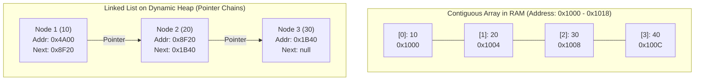
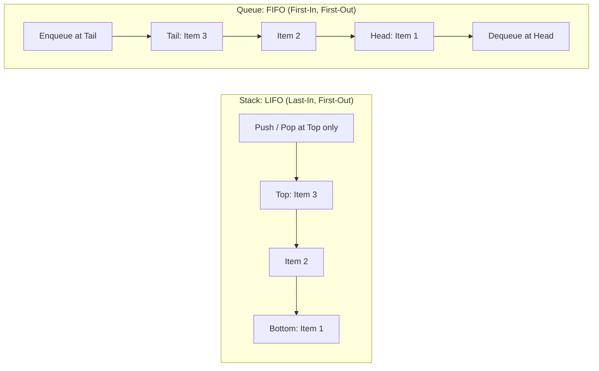
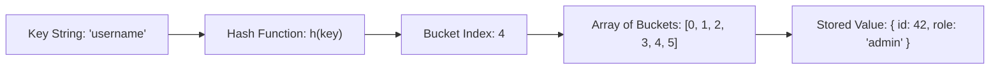
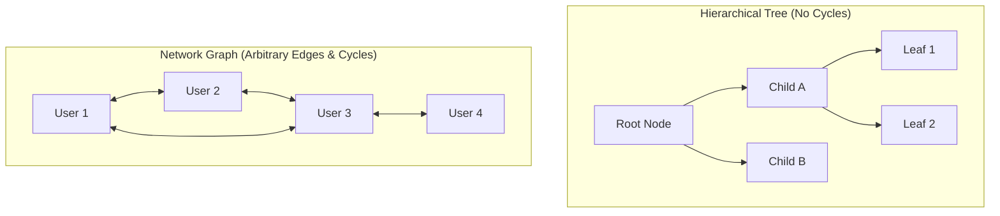

<Concepts items={["contiguous vs node-based", "arrays & linked lists", "stacks (LIFO) & queues (FIFO)", "hash tables & collision resolution", "trees (hierarchies) & graphs (networks)"]} />

<LessonIntro>

A **Data Structure** is a specialized format for organizing, storing, and accessing data in computer memory. In software engineering, choosing the right data structure is one of the most leveraged architectural decisions you can make.

The difference between a service that responds in 2 milliseconds and one that locks up for 20 minutes on a million records rarely comes down to CPU clock speeds or compiler flags — it comes down to choosing between an $O(n)$ linear array scan and an $O(1)$ constant-time hash map lookup. There is no single "best" data structure: each represents a mathematically calculated trade-off between read speed, insertion cost, and physical memory footprint.

</LessonIntro>

## Why this matters

In production systems, algorithms operate on data structures:
* **Databases:** Relational database indexes (PostgreSQL, MySQL) are organized as **B-Trees**, reducing disk reads from millions to three hops.
* **Network Routers:** Subnet routing tables use **Trie trees** for longest-prefix match lookups.
* **Message Brokers:** Distributed streaming platforms like Apache Kafka and RabbitMQ rely on persistent **FIFO Queues** to buffer asynchronous workloads.
* **Cache Layers:** Redis key-value storage relies on high-speed **Hash Tables** and **Skip Lists**.

---

## 01 — Linear Memory: Contiguous Arrays vs Linked Lists

The most fundamental architectural decision in data layout is whether items live **contiguously** side-by-side or **scattered** across the heap connected by pointers:

### Contiguous Arrays: The Speed of Offset Math

#### What is a Contiguous Array?
A **Contiguous Array** is a linear data structure where elements of the same data type are stored in one single, unbroken block of adjacent physical memory addresses.

*Figure 6.1 — Contiguous array in memory: each integer element occupies adjacent 4-byte memory addresses (`1703664`, `1703668`, `1703672`), enabling instant address calculation.*

* **Instant Direct Indexing ($O(1)$):** Locating element at index $i$ requires zero searching or traversing. The CPU calculates the physical memory address in a single clock cycle using simple multiplication and addition:

$$\text{Address}(i) = \text{Base Memory Address} + (i \times \text{Size of Element})$$

* **CPU Cache Locality:** Because array elements sit physically adjacent in RAM, when the CPU loads `array[0]`, hardware pre-fetchers automatically load the entire 64-byte **cache line** containing adjacent elements (`array[1]`, `array[2]`, etc.) into ultra-fast L1/L2 caches before they are even requested.
* **Downside:** Inserting or deleting an element at index 0 requires an expensive $O(n)$ operation to shift every subsequent element one slot over. Resizing dynamic arrays also requires allocating a larger block and copying all elements.

### Linked Lists: Dynamic Pointers

#### What is a Linked List?
A **Linked List** is a linear collection of data elements called **Nodes**, where each node contains two components:
1. **Data Value:** The actual payload (number, string, or object).
2. **Pointer (Reference):** The memory address pointing to the next node in the chain.

*Figure 6.2 — Singly linked list: each node stores its value alongside a pointer linking directly to the next node in memory, terminating with a `null` reference.*

* **Dynamic Heap Allocation:** Unlike arrays, linked list nodes do not require contiguous memory blocks. Each node is independently allocated anywhere on the system heap, allowing the list to grow and shrink dynamically without reallocating large memory slabs.
* **Cheap Insertion/Deletion ($O(1)$):** Inserting or removing a node at the head (or tail if maintaining a tail pointer) simply updates pointer references. Zero element shifting occurs.
* **Sequential Access Penalty ($O(n)$):** To access the 500th element, the CPU cannot jump directly via math; it must start at the `head` and traverse 499 pointer links sequentially one-by-one.
* **Cache Hostility & Memory Overhead:** Because nodes are scattered randomly across the heap, following pointers triggers frequent CPU cache misses. Additionally, each node requires extra memory to store pointer addresses (e.g., 8 bytes per pointer on 64-bit systems).

---

## 02 — Constrained Access Patterns: Stacks & Queues

By deliberately constraining where data can enter and exit a linear structure, computer scientists created two indispensable operational primitives:

### The Stack (LIFO: Last-In, First-Out)

#### What is a Stack?
A **Stack** is a linear data structure that follows the **Last-In, First-Out (LIFO)** principle. The last element added to the stack is the first element to be removed, much like a stack of cafeteria trays or plates.

*Figure 6.3 — Stack data structure: elements are added to the top via `Push` and removed from the top via `Pop`.*

* **Core Operations:**
  * `push(x)`: Places a new item on the top of the stack ($O(1)$).
  * `pop()`: Removes and returns the top item from the stack ($O(1)$).
  * `peek()` / `top()`: Inspects the top element without removing it ($O(1)$).
* **Everyday Applications:** 
  * The CPU **Call Stack** (managing function execution contexts, return addresses, and local variable scopes).
  * The Browser **History Stack** (tracking URL navigation for "Back" and "Forward" buttons).
  * Syntax validation (matching opening and closing brackets `{ [ ( ) ] }` in compiler parsers).
  * Undo/Redo operations in text and graphics editors.

### The Queue (FIFO: First-In, First-Out)

#### What is a Queue?
A **Queue** is a linear data structure that operates under the **First-In, First-Out (FIFO)** principle. The first element inserted into the queue is the first one processed and removed, identical to a line of people waiting at a ticket counter.

*Figure 6.4 — Queue data structure: new elements enter at the rear via `Enqueue`, and elements leave from the front via `Dequeue`.*

* **Core Operations:**
  * `enqueue(x)`: Appends an item to the tail/back of the queue ($O(1)$).
  * `dequeue()`: Removes and returns the item from the front/head of the queue ($O(1)$).
  * `front()` / `peek()`: Inspects the first item without removing it ($O(1)$).
* **Everyday Applications:**
  * Operating System process and CPU scheduling queues.
  * Node.js **Event Loop Task Queues** (managing asynchronous I/O and timer callbacks).
  * Print spoolers and distributed job processing pipelines (Celery, BullMQ, Amazon SQS).
  * Network packet buffering in routers and switches.

---

## 03 — Constant-Time Lookups: Hash Tables & Sets

A **Hash Table** (known as a Dictionary in Python, Object/Map in JavaScript, or HashMap in Java) delivers near-instantaneous $O(1)$ key-value retrieval regardless of whether the collection stores 10 items or 10 million:

### What is a Hash Function?

A **Hash Function** is a mathematical algorithm that transforms an arbitrary input key of any length (such as a string, username, or file) into a fixed-size numeric integer (called a **hash code** or hash value).

*Figure 6.5 — Hash function converting arbitrary string keys ("John Smith", "Lisa Smith") into bucket index numbers inside an array.*

#### Key Properties of an Effective Hash Function:
1. **Deterministic:** Passing the exact same input key must always return the exact same integer output.
2. **Fast Computation ($O(1)$):** Calculating the hash value must take minimal CPU cycles.
3. **Uniform Distribution:** It should disperse keys evenly across all available buckets to avoid clustering and reduce collisions.

#### Index Mapping via Modulo Arithmetic:
Once the hash function generates a large integer, the hash table maps that integer onto a valid index inside its internal storage array using modulo arithmetic:

$$\text{Bucket Index} = \text{Hash}(\text{Key}) \pmod{\text{Total Array Capacity}}$$

### Handling Hash Collisions

Because the universe of possible string keys is infinite while array capacity is finite, two different keys will eventually hash to the same bucket index (the Pigeonhole Principle):

* **Separate Chaining:** Each bucket stores a linked list or small binary tree. Colliding items are simply chained together at that index.
* **Open Addressing (Linear Probing):** If bucket 4 is occupied, the algorithm checks bucket 5, then bucket 6, until an empty slot is found.

> [!NOTE] What is a Set?
> A **Set** is simply a Hash Table where each entry stores only the key, with no associated value. It provides instantaneous $O(1)$ duplicate checking and membership tests (`item in set`).

---

## 04 — Non-Linear Data: Trees & Graphs

When relationships are hierarchical or form complex interconnected networks, linear sequences are insufficient.

### Trees: Hierarchies Without Loops

A **Tree** begins at a single **Root** node and branches downward into child nodes without any circular loops:
* **Binary Search Tree (BST):** Every node has at most two children. The left subtree contains only smaller values; the right subtree contains only larger values. Searching an evenly balanced BST cuts the problem in half at every step ($O(\log n)$).
* **The Document Object Model (DOM):** Web browsers represent HTML pages as a hierarchical tree of nodes (`<html>` $\rightarrow$ `<body>` $\rightarrow$ `
`).

### Graphs: Arbitrary Networks

A **Graph** consists of **Vertices (Nodes)** connected by **Edges**:
* **Directed vs Undirected:** Twitter follow relationships are directed (A follows B, but B might not follow A); Facebook friendships are undirected (two-way).
* **Weighted Graphs:** Edges carry numerical values, such as road distances in Google Maps or packet latencies between internet routers.

---

## 05 — The Master Data Structures Complexity Matrix

| Data Structure | Access by Index | Search by Value | Insertion (Head/Tail) | Deletion | Primary Real-World Use Case |
| :--- | :---: | :---: | :---: | :---: | :--- |
| **Array** | $O(1)$ | $O(n)$ | $O(n)$ / $O(1)^*$ | $O(n)$ | Linear scan, indexed lookups, cache efficiency |
| **Linked List** | $O(n)$ | $O(n)$ | $O(1)$ | $O(1)$ | Fast pre-pending, building blocks for queues |
| **Stack** | $O(n)$ | $O(n)$ | $O(1)$ | $O(1)$ | Undo operations, call stacks, syntax parsers |
| **Queue** | $O(n)$ | $O(n)$ | $O(1)$ | $O(1)$ | Task buffering, asynchronous message streams |
| **Hash Table** | N/A | $O(1)$ avg | $O(1)$ avg | $O(1)$ avg | Instant key-value caching, symbol tables |
| **Binary Search Tree**| $O(\log n)$ | $O(\log n)$ | $O(\log n)$ | $O(\log n)$ | Sorted collections, range queries, DB indexing |

$^*$*Amortized constant time when appending to dynamic arrays.*

---

## Summary Checklist: Data Structures Mental Model

1. **Arrays excel at indexed reads:** Contiguous RAM placement gives $O(1)$ direct offset access and maximum CPU cache locality.
2. **Linked lists excel at insertions:** Node pointer chaining provides $O(1)$ inserts at the head without memory shifting, but suffers $O(n)$ lookup penalties.
3. **Stacks enforce LIFO; Queues enforce FIFO:** Stacks power execution call stacks and undo buffers; queues regulate asynchronous task pipelines.
4. **Hash maps trade memory for $O(1)$ speed:** Mathematical hash functions map keys to array bucket indices, resolving collisions via chaining or probing.
5. **Trees and graphs model complex relationships:** Trees power hierarchical filesystems and database search indexes; graphs model arbitrary social networks, road maps, and routing topologies.
