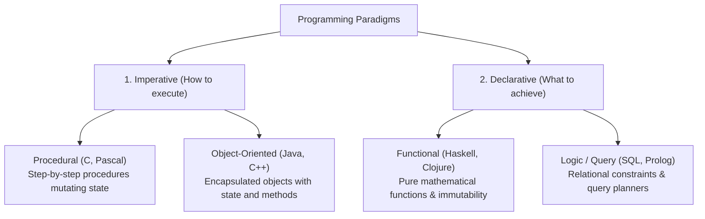
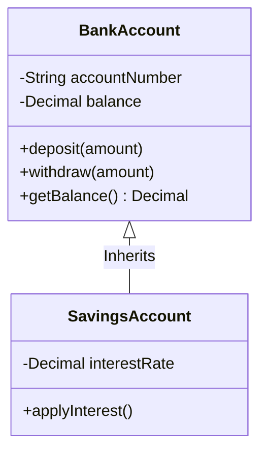
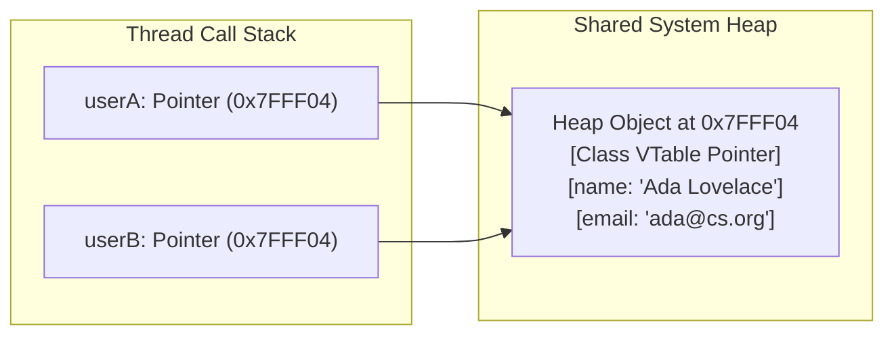
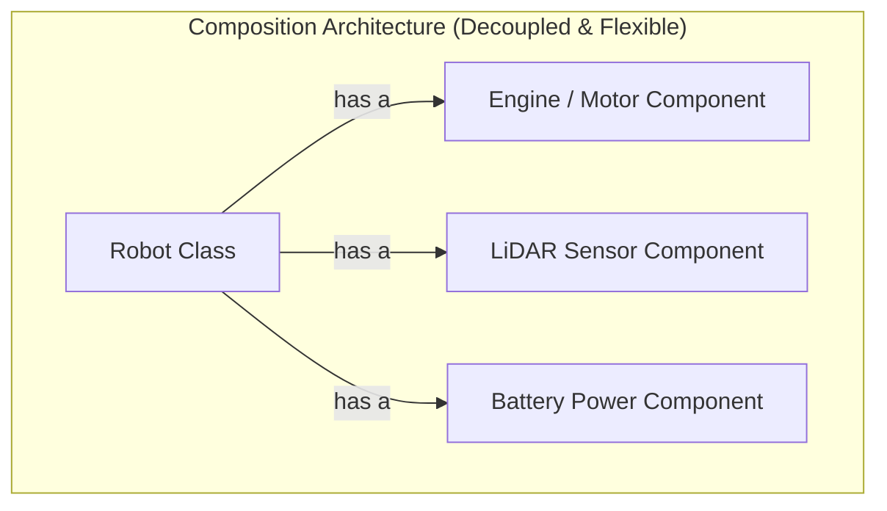

<Concepts
  items={[
    "imperative vs declarative",
    "encapsulation & abstraction",
    "inheritance vs composition",
    "polymorphism & vtables",
    "pass-by-reference & heap objects",
  ]}
/>

<LessonIntro>

There is always more than one way to instruct a computer to solve a problem. A **Programming Paradigm** is a philosophical framework and mental model for organizing code, managing state, and structuring computation.

At opposite ends of the spectrum sit **Imperative Programming** (which commands the CPU with explicit step-by-step state mutations: _how_ to execute) and **Declarative Programming** (which specifies the desired end result: _what_ to produce). Between them lies **Object-Oriented Programming (OOP)** — an architecture that groups related state data and behaviors into cohesive, self-protecting capsules called objects.

</LessonIntro>

## Why this matters

The paradigm you select dictates how a codebase evolves as team size grows from one developer to five hundred:

- **Maintainability:** Untamed global state in procedural scripts turns multi-developer codebases into a fragile house of cards where modifying one variable silently breaks an unrelated module.
- **Architecture Resilience:** Overusing rigid inheritance hierarchies creates the infamous "fragile base class" problem, whereas mastering **Composition over Inheritance** enables frictionless refactoring.
- **Bug Prevention:** In modern multi-threaded and distributed cloud systems, embracing declarative immutability eliminates an entire class of shared-memory race condition bugs.

---

## 01 — The Spectrum of Programming Paradigms



### Imperative vs Declarative in Practice

Consider filtering an array of numbers to retain only even values and doubling them:

```python
# Imperative Approach: Explicit loop counters, manual mutations, step-by-step HOW
numbers = [1, 2, 3, 4, 5, 6]
result = []
for n in numbers:
    if n % 2 == 0:
        result.append(n * 2)

# Declarative Approach: High-level intent, engine handles iteration WHAT
result = [n * 2 for n in numbers if n % 2 == 0]
```

In SQL, declarative programming reaches its purest form:

```sql
SELECT email FROM users WHERE active = true AND country = 'US';
```

You never specify whether the database engine should read sequentially, scan an index, or utilize parallel worker threads — the database query optimizer inspects table statistics and devises the optimal physical plan.

---

## 02 — The Four Pillars of Object-Oriented Programming (OOP)

OOP models problem domains by grouping data attributes (**properties**) and executable operations (**methods**) into a unified construct called a **Class** (the reusable blueprint), which is instantiated as concrete **Objects** in RAM.


_Figure 9.1 — The four pillars supporting robust object-oriented architecture: Encapsulation, Abstraction, Inheritance, and Polymorphism._


_Figure 9.2 — A class serves as the generic blueprint (e.g., Car), while instantiated objects are distinct concrete entities in memory (e.g., Polo, Mini, Beetle)._



<OopSimulator />

### 1. Encapsulation (Information Hiding & State Protection)

**Definition:** Encapsulation is the practice of bundling data fields and the methods that operate on them inside a single class unit, while restricting direct outside access to internal state variables.

- **Why it matters:** It prevents external code from putting an object into an invalid state. Callers interact exclusively through validated public methods rather than directly mutating fields.

```python
class BankAccount:
    """Encapsulation: Bundles balance data and safeguards mutations."""
    def __init__(self, owner: str, initial_deposit: float = 0.0):
        self.owner = owner
        self.__balance = max(0.0, initial_deposit)  # Private attribute

    def deposit(self, amount: float) -> None:
        if amount <= 0:
            raise ValueError("Deposit amount must be positive.")
        self.__balance += amount

    def withdraw(self, amount: float) -> bool:
        if 0 < amount <= self.__balance:
            self.__balance -= amount
            return True
        return False  # Insufficient funds or invalid amount

    def get_balance(self) -> float:
        return self.__balance

# Usage
account = BankAccount("Alice", 100.0)
account.deposit(50.0)
print(account.get_balance())  # 150.0

# Direct access to private variable is prevented by Python name-mangling:
# account.__balance = -999999  -> Creates separate variable, doesn't corrupt state!
```

### 2. Abstraction (Hiding Complexity Behind Clean Interfaces)

**Definition:** Abstraction is the technique of hiding intricate, low-level internal mechanics from the user, exposing only a clean, minimal interface of essential features.

- **Everyday Analogy:** You press the brake pedal in a car without having to understand hydraulic master cylinders, ABS fluid pulsation, or disc heat dissipation.
- **Why it matters:** Software consumers only need to know _what_ a component does, not _how_ it accomplishes it internally.

```python
from abc import ABC, abstractmethod

class PaymentProcessor(ABC):
    """Abstraction: Defines the public contract without exposing gateway internals."""
    @abstractmethod
    def process_payment(self, amount: float) -> bool:
        pass

class StripePaymentProcessor(PaymentProcessor):
    def process_payment(self, amount: float) -> bool:
        # Complex API handshakes, token verification, and HMAC signing happen invisibly:
        self.__verify_ssl_handshake()
        self.__transmit_encrypted_payload(amount)
        return True

    def __verify_ssl_handshake(self) -> None:
        pass  # Internal private mechanics

    def __transmit_encrypted_payload(self, amount: float) -> None:
        pass  # Internal private mechanics

# High-level client code only interacts with the clean abstraction:
def checkout(gateway: PaymentProcessor, total: float):
    if gateway.process_payment(total):
        print("Payment successful!")
```

### 3. Inheritance (Code Reuse & Hierarchy)

**Definition:** Inheritance is the mechanism allowing a new child class (**subclass**) to automatically acquire fields and behaviors from an existing parent class (**superclass**), enabling extension and specialization without repeating code.

- **Why it matters:** Common functionality is written once in a shared base class, avoiding copy-pasting code across related domain models.

```python
class Vehicle:
    """Parent base class with shared vehicle behaviors."""
    def __init__(self, brand: str, max_speed: int):
        self.brand = brand
        self.max_speed = max_speed

    def drive(self) -> str:
        return f"{self.brand} is moving at up to {self.max_speed} km/h."

class ElectricCar(Vehicle):
    """Child subclass inheriting Vehicle and adding battery capabilities."""
    def __init__(self, brand: str, max_speed: int, battery_kwh: int):
        super().__init__(brand, max_speed)  # Reuses parent initialization
        self.battery_kwh = battery_kwh

    def charge(self) -> str:
        return f"Charging {self.brand}'s {self.battery_kwh} kWh battery pack."

# Usage
tesla = ElectricCar("Tesla Model 3", 225, 75)
print(tesla.drive())   # Inherited from Vehicle: "Tesla Model 3 is moving at up to 225 km/h."
print(tesla.charge())  # Specialized in ElectricCar: "Charging Tesla Model 3's 75 kWh battery pack."
```

### 4. Polymorphism (One Interface, Multiple Forms)

**Definition:** Polymorphism (Greek for "many forms") allows different classes to implement methods with the same name, enabling client code to treat them interchangeably through a uniform interface while each class executes its own specialized behavior.

- **Why it matters:** Calling code does not need complex `if/else` ladders checking object types; it simply calls the method, and the runtime dispatches the appropriate class implementation.

```python
class Dog:
    def speak(self) -> str:
        return "Woof! Woof!"

class Cat:
    def speak(self) -> str:
        return "Meow! Purr!"

class Bird:
    def speak(self) -> str:
        return "Chirp! Tweet!"

# Polymorphic dispatch: one uniform loop interacts seamlessly with diverse types
animals = [Dog(), Cat(), Bird()]

for animal in animals:
    # animal.speak() automatically resolves to the concrete class implementation:
    print(f"{animal.__class__.__name__}: {animal.speak()}")

# Output:
# Dog: Woof! Woof!
# Cat: Meow! Purr!
# Bird: Chirp! Tweet!
```

---

## 03 — Memory Under the Hood: Heap Allocation & Pass-by-Reference

In object-oriented languages (Java, C#, Python, JavaScript), objects do not live on the CPU call stack — they are dynamically allocated on the **Heap**.



### The Pass-by-Reference Mutation Trap

When you assign an existing object to a new variable or pass it into a function, the language **passes the reference (memory address)**, not an independent copy:

```python
class Team:
    def __init__(self, name):
        self.members = []

# Instantiate object on the heap
team_alpha = Team("Alpha")

# Both variables point to the exact same heap memory address:
team_beta = team_alpha
team_beta.members.append("Alice")

# SURPRISE MUTATION:
print(team_alpha.members)  # ['Alice'] - team_alpha was mutated!
```

Because both variables alias the exact same heap memory address, modifying `team_beta` mutates `team_alpha`. In multi-threaded applications, uncontrolled shared mutable references cause severe data corruption.

---

## 04 — Modern Software Architecture: Composition over Inheritance

While classic OOP heavily promoted deep inheritance hierarchies, four decades of production experience revealed the **Fragile Base Class Problem**:

<Callout
  type="error"
  title={'The "Gorilla and the Banana" Dilemma (Joe Armstrong)'}
>
  *"The problem with object-oriented languages is they’ve got all this implicit
  environment that they carry around with them. You wanted a banana, but what
  you got was a gorilla holding the banana and the entire jungle."*
</Callout>

```
ANTI-PATTERN: Deep Fragile Inheritance Tree
LivingThing
  └── Animal
        └── Mammal
              └── Carnivore
                    └── Dog
                          └── GuideDog (Inherits 5 layers of fragile coupled state!)
```

### The Modern Standard: Composition over Inheritance

Instead of designing classes based on what they _are_ (inheritance), design them based on what they _have_ or _do_ (**Composition**):



By injecting interchangeable component objects through constructors (Dependency Injection), you can swap a `GasEngine` for an `ElectricMotor` at runtime without rewriting or breaking class hierarchies.

---

## 05 — The Functional Paradigm: Pure Functions & Immutability

To eliminate the bugs inherent in shared mutable state, modern software engineering increasingly adopts functional programming principles:

| Core Concept              | How It Works in Practice                                                   | Architectural Benefit                                         |
| :------------------------ | :------------------------------------------------------------------------- | :------------------------------------------------------------ |
| **Immutability**          | Once created, data structures cannot be altered; changes return a new copy | Eliminates race conditions in multi-threaded systems          |
| **Pure Functions**        | Output depends exclusively on arguments; zero side effects                 | Trivially unit-tested and safely cached (memoization)         |
| **First-Class Functions** | Functions can be passed as arguments, assigned to variables, and returned  | Enables expressive data pipelines (`map`, `filter`, `reduce`) |

```javascript
// Declarative Functional Pipeline (Clean, Immutable, Thread-Safe)
const activeUserEmails = users
  .filter((user) => user.isActive)
  .map((user) => user.email.toLowerCase())
  .sort();
```

---

## Summary Checklist: Programming Paradigms Mental Model

1. **Paradigms represent distinct philosophies:** Imperative focuses on _how_ to change state step-by-step; Declarative specifies _what_ output is desired.
2. **Encapsulation enforces data integrity:** Private fields guarded by public methods ensure external callers cannot corrupt internal business rules.
3. **Objects reside on the heap:** Variables store memory references (pointers); assigning an object aliases the same underlying memory block.
4. **Prefer Composition over Inheritance:** Deep class trees become brittle; build flexible systems by assembling loosely coupled components.
5. **Functional principles eliminate state bugs:** Pure functions and immutable data structures prevent shared-memory concurrency collisions in distributed systems.
