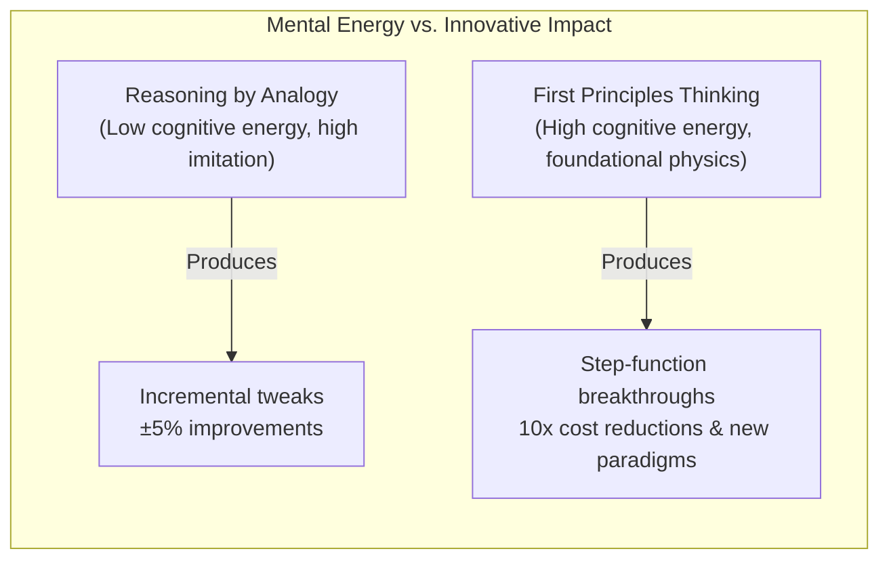
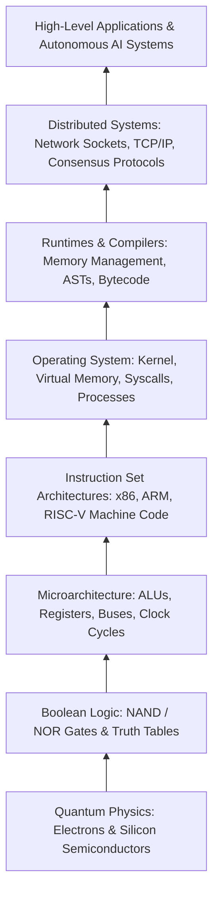
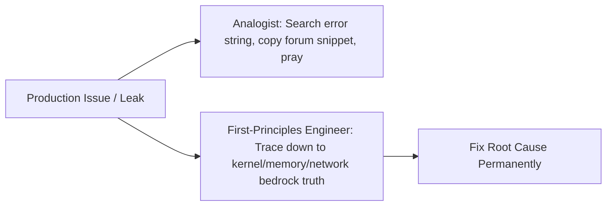
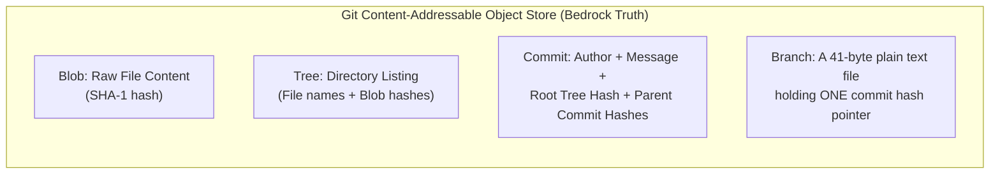
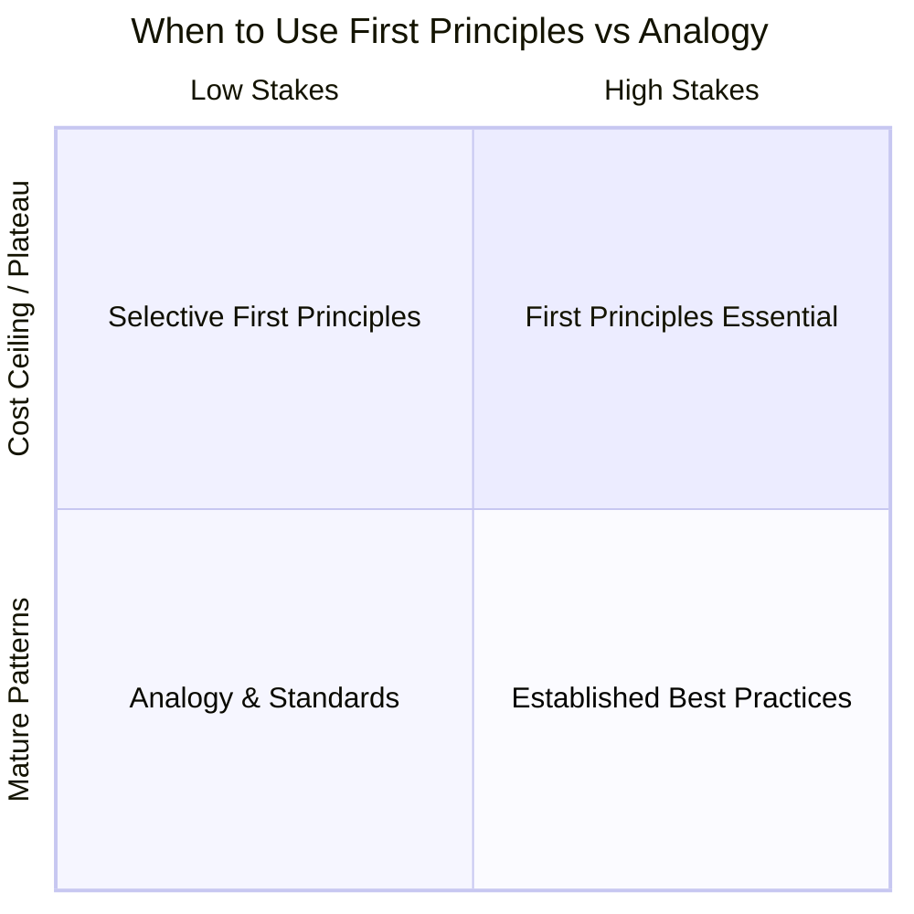

# First Principles Thinking

> "In every systematic inquiry where there are first principles, or causes, or elements, knowledge and science result from acquiring knowledge of these; for we think that we know something in each case only when we are acquainted with its first causes and its first principles, down to its elements."
> — **Aristotle**, _Physics_, Book I, 184a

First principles thinking is the practice of systematically questioning every assumption you think you know about a problem, breaking it down into its most fundamental, indisputable truths (axioms), and reasoning upward from there to build an original conclusion.

It is the direct antidote to **reasoning by analogy** — the default human habit of copying what everyone else is doing with minor cosmetic adjustments ("me-too" ideas and slight iterations on a theme).


---

## 01 — Philosophical Roots: From Aristotle to Feynman

First principles thinking is not a recent buzzword; it is a 2,400-year-old intellectual foundation shared by classical philosophy, the scientific revolution, and modern computational engineering.

### 1. Aristotle: The Bedrock Axiom (_Archē_)

Aristotle defined a first principle (_archē_) as the primary foundation from which a thing is known. In Aristotelian logic, you cannot have an infinite chain of "because X, because Y, because Z." At some point, your explanation must anchor into an unprovable, self-evident truth — an **axiom**. If your foundation rests on someone else's untested opinion, every layer of logic built on top of it will collapse under pressure.

### 2. René Descartes: Radical Methodological Doubt

In 1641, René Descartes sat by his fire and realized that many beliefs he had held since childhood were demonstrably false. He resolved to sweep away all his opinions and start again from the ground up:

> "If you would be a real seeker after truth, it is necessary that at least once in your life you doubt, as far as possible, all things."
> — **René Descartes**, _Meditations on First Philosophy_

Descartes systematically doubted sensory perception, physical matter, and conventional teaching until he arrived at the single irreducible truth he could not doubt: _Cogito, ergo sum_ ("I think, therefore I am"). In engineering, Cartesian doubt means refusing to accept that an architectural pattern or cloud bill is inevitable just because an industry leader or vendor said so.

### 3. Richard Feynman: Scientific Integrity & The Physics Mindset

Nobel Prize-winning physicist Richard Feynman distilled first principles into the cornerstone of scientific discovery:

> "The first principle is that you must not fool yourself — and you are the easiest person to fool."
> — **Richard Feynman**, _Cargo Cult Science_ (1974)

Feynman warned against **Cargo Cult Science**: mimicking the outward rituals of serious work (wearing lab coats, drawing complex microservice diagrams, importing massive framework ecosystems) without understanding the physical mechanism that produces real outcomes.

---

## 02 — The Cognitive Divide: Analogy vs. First Principles

In a landmark conversation on foundational reasoning, Elon Musk explained the cognitive contrast between how humans normally live and how a physics framework operates:

> **The Physics View of the World:**
>
> _"The normal way that we conduct our lives is we reason by analogy. We're doing this because it's like something else that was done, or it's like what other people are doing — 'me-too' type ideas, slight iterations on a theme._
>
> _And it's because it's kind of mentally easier to reason by analogy rather than from first principles. But first principles is kind of a physics way of looking at the world, and what that really means is you kind of boil things down to the most fundamental truths and say, 'Okay, what are we sure is true — or as sure as possible is true?' and then reason up from there._
>
> _That takes a lot more mental energy."_



### The "Horse vs. Automobile" Fallacy

Why does reasoning by analogy prevent real innovation? Because if you evaluate the future through the lens of what currently exists, you trap yourself in legacy assumptions:

> _"If you applied reasoning by analogy to anything new, you wouldn't ever be able to get to that new thing. You can't say: 'Nobody wants a car because horses are great, we're used to them, they can eat grass and there's lots of grass all over the place, and there's no gasoline that people can buy, so people are never going to get cars.' People did say that."_

When you reason by analogy, you see the missing infrastructure (no gas stations, no paved roads) and conclude the automobile is an impossible fantasy. When you reason from first principles, you look at thermodynamics, energy density, mechanical wear, and physics: an internal combustion engine converts fuel to kinetic energy at orders of magnitude higher power-to-weight efficiency than biological muscle. The gas stations are just an engineering logistics problem to solve along the way.

### The Cook vs. The Chef

Writer Tim Urban (_Wait But Why_) popularized this distinction through the metaphor of **The Cook vs. The Chef**:

| Dimension               | The Cook (Reasoning by Analogy)                                | The Chef (First Principles Reasoning)                          |
| :---------------------- | :------------------------------------------------------------- | :------------------------------------------------------------- |
| **Source of Truth**     | Existing recipes; "Industry best practices"                    | Flavor chemistry, thermodynamics, molecular interaction        |
| **Method**              | Follows step-by-step instructions mechanically                 | Experiments with raw ingredients based on elemental properties |
| **Response to Novelty** | Paralyzed when missing an ingredient or facing new constraints | Combines base components to invent a new dish                  |
| **Cognitive Cost**      | Low energy; relies on mental shortcuts and social proof        | High energy; requires active deconstruction and synthesis      |
| **Core Output**         | "Me-too" variations, slight iterations on a theme              | Entirely new culinary genres and novel techniques              |
| **Failure Mode**        | Blindly cargo-culting obsolete practices that no longer apply  | Overthinking simple commodity tasks ("reinventing salt")       |

---

## 03 — The Anatomy of Computing: Built on Layered First Principles

Computer Science is the purest living manifestation of first principles thinking in human history. Every software application is an unbroken chain of irreducible physical and logical truths stacked into reliable abstractions:



### Joel Spolsky's Law of Leaky Abstractions

In 2002, Joel Spolsky formulated a foundational insight for developers:

> "All non-trivial abstractions, to some degree, are leaky."

When an abstraction leaks — when an ORM issues a disastrous $N+1$ query that locks a database, when an async loop starves a Node.js process, or when a distributed cluster suffers cascading timeouts — developers who reason by analogy panic. They search error strings on Google and apply band-aids.

Developers who understand first principles know what is actually happening underneath:

1. **An ORM** is just string serialization over an open TCP socket to a relational database engine reading pages from disk.
2. **A JavaScript event loop** is a single-threaded queue scheduled against kernel epoll/kqueue file descriptors.
3. **A network timeout** is governed by physical packet propagation delay, TCP window scaling, and switch buffer bloat.



---

## 04 — The 4-Step Framework: How to Use First Principles Properly

Applying first principles thinking is a disciplined, repeatable operational framework:


### Step 1: Identify the Goal and Surface Hidden Assumptions

Start by defining the real problem in raw functional terms, independent of current tools or products.

Ask yourself:

- _What am I actually trying to accomplish?_ (e.g., "Transmit state between two machines in under 5 milliseconds" vs. "Add a Kafka cluster").
- _What parts of this problem are dictated by physics or math, and what parts are merely industry conventions or legacy habits?_

#### The Socratic Questioning Method

Use the six classical Socratic question types to pressure-test every assumption:

1. **Clarification:** What do you mean when you say this system "needs microservices"?
2. **Probing Assumptions:** What are we assuming about our throughput, team size, and failure boundaries?
3. **Probing Reasons & Evidence:** What empirical data proves that a single relational database cannot handle this transaction load?
4. **Questioning Viewpoints:** How would an embedded systems engineer or an operating systems developer solve this memory layout problem?
5. **Probing Implications:** If we eliminate this cloud service entirely, what is the exact physical failure mechanism?
6. **Questioning the Question:** Why are we asking "Which vendor cache should we buy?" instead of "Why are our queries reading redundant data in the first place?"

### Step 2: Deconstruct to Irreducible Bedrock Truths

Break the system down until you reach facts that cannot be deduced or challenged any further.

In computer systems, bedrock truths are governed by physics and mathematics:

- **Speed of light in fiber:** $\sim 5\mu s$ per kilometer. You cannot send a packet from New York to London faster than $\approx 28\text{ ms}$ round trip, regardless of software architecture.
- **Hardware memory hierarchy latencies (Peter Norvig):**
  - L1 cache reference: ~0.5 ns
  - Main RAM memory reference: ~100 ns (~200× slower than L1)
  - NVMe SSD random read: ~100 µs (~1,000× slower than RAM)
  - Cross-continental network round-trip: ~150 ms (~1,500,000× slower than RAM)
- **Shannon-Hartley Theorem:** The maximum data rate of a channel is mathematically bound by bandwidth and noise.
- **CAP / PACELC Theorems:** In a network partition, you must mathematically trade consistency for availability.

When you deconstruct your system to these invariant realities, corporate dogmas and marketing slogans vanish.

### Step 3: Reconstruct Upward from Scratch (Zero-Based Synthesis)

With the fundamental truths on the table, design the solution upward without copying existing implementations.

Ask:

- _If nobody had ever solved this problem before, and we only had these raw truths, what is the simplest, most direct mechanism to achieve the goal?_
- _What is the theoretical minimum work required?_ (minimum algorithmic complexity $\mathcal{O}$, minimum bytes sent over the wire, minimum I/O operations).

### Step 4: Empirically Verify and Falsify

A first-principles solution is an empirical hypothesis. You must verify it against real-world measurements:

- Benchmark with realistic workloads and cache-thrashing distributions.
- Profile CPU cycle utilization, cache misses, allocations, and network overhead.
- Attempt to break your own assumptions through fault-injection testing.

---

## 05 — Canonical Case Studies: First Principles in Action

### Case Study 1: The Battery Pack Deconstruction (From $600/kWh Down to $80/kWh)

This is the definitive modern demonstration of first principles thinking applied to engineering economics:

#### The Conventional Wisdom (Reasoning by Analogy)

In the early days of electric vehicles, industry experts declared that mass-market electric cars were impossible because battery packs were too expensive:

> _"Historically, batteries have cost $600 per kilowatt-hour. That's just the way they will always be, because that's the way they've been in the past. It's not going to be much better than that in the future."_

Under analogical reasoning, an 85 kWh long-range battery pack would cost over **$51,000** just for the battery itself — making an affordable electric car an economic impossibility.

```mermaid
flowchart TD
    subgraph AnalogyPath["Reasoning by Analogy"]
        A_Old["Historical Cost: $600/kWh"] --> A_Conclusion["'Batteries are inherently expensive.<br/>They will never get much cheaper.'"]
        A_Conclusion --> A_DeadEnd["Result: Electric cars stay niche luxury toys"]
    end

    subgraph FirstPrinciplesPath["First Principles Deconstruction"]
        FP_Q1["What is a battery made of?"] --> FP_List["Material Constituents:<br/>Cobalt, Nickel, Aluminum, Carbon,<br/>Polymers for separation, Steel can"]
        FP_List --> FP_LME["What do these cost on the London Metal Exchange?"]
        FP_LME --> FP_Truth["Raw material value: ~$80 / kWh!"]
        FP_Truth --> FP_Action["Action: Invent clever ways to combine raw materials into cells"]
        FP_Action --> FP_Win["Result: Massive cost collapse -> Mass-market EV viable"]
    end
```



#### The First-Principles Deconstruction

Instead of accepting historical prices, the problem was boiled down to elemental physics and raw materials:

1. **What are the material constituents of a battery?**
   - Cobalt
   - Nickel
   - Aluminum
   - Carbon
   - Polymers (for separation)
   - Steel can (casing)
2. **What is the spot market value of those constituents?**
   If you bought those raw elements on the **London Metal Exchange (LME)**, what would they cost per kilowatt-hour?

   $$\text{Raw Material Cost} \approx 80 \text{ USD / kWh}$$

#### The Conclusion

The fundamental limit of a battery pack is not `$600/kWh`; it is `$80/kWh`.

The gap between `$600` and `$80` was not a law of physics — it was an artifact of inefficient supply chains, middleman markups, sub-optimal manufacturing steps, and outdated cell form factors. The engineering task became clear: **invent clever, high-speed ways to take those raw materials and combine them into the shape of a battery cell.**

Today, utility and EV battery pack costs have dropped below `$100`–`$130/kWh`, validating the first-principles derivation.

---

### Case Study 2: Linus Torvalds & The Creation of Git (2005)

#### The Conventional Wisdom (Analogy)

In 2005, version control systems (CVS, SVN, BitKeeper) viewed source control as **tracking file diffs across time**. Every commit stored a delta against the previous file version. Branching required computing delta trees, and merging was an error-prone nightmare that grew exponentially slower as repositories expanded.

#### Linus's First-Principles Insight

Linus Torvalds rejected the entire "file diff" paradigm. He asked: _What is a version control system at its elemental mathematical core?_

1. Source code is just a directory tree of byte arrays at a specific instant in time.
2. A cryptographic hash (SHA-1) uniquely identifies any sequence of bytes.
3. Therefore, a filesystem snapshot can be represented as an immutable Directed Acyclic Graph (DAG) of cryptographic objects.



By rebuilding version control from the first principle of a **content-addressable directed acyclic graph**:

- Creating a branch is not copying files; it is writing 41 bytes to a text file (`.git/refs/heads/feature`).
- Merging is finding the lowest common ancestor in a graph using 3-way merge algorithms.
- Checking integrity is calculating a hash.

Result: Git revolutionized software development globally and performs operations in milliseconds that took previous tools hours.

---

### Case Study 3: Salvatore Sanfilippo & Redis

#### The Conventional Wisdom (Analogy)

In 2009, web applications handled scalability bottlenecks by putting relational database query caches (like MySQL query cache or front-facing file caches) in front of SQL queries. Cache invalidation was fragile, serialization overhead was high, and disk spindle contention remained the bottleneck.

#### The First-Principles Deconstruction

Salvatore Sanfilippo (antirez) analyzed the physical properties of modern servers:

- **RAM access latency:** Nanoseconds.
- **Disk access latency:** Milliseconds (~100,000× slower).
- **Concurrency overhead:** Multi-threaded locking, mutex contention, and context switching consume massive CPU time and introduce race conditions.

#### The Reconstruction

_What if we build a database where:_

1. The dataset lives entirely in physical memory as native data structures (strings, hashes, linked lists, sets, sorted sets).
2. The execution engine runs on a **single-threaded event loop** (using `epoll` / `kqueue`), completely eliminating thread lock contention, deadlocks, and race conditions.
3. Persistence is decoupled to asynchronous background forks (`bgsave`) writing snapshots to disk.

Result: A single Redis instance easily serves 100,000+ operations per second on modest hardware with sub-millisecond response times.

---

## 06 — The Traps: When NOT to Use First Principles

First principles thinking is an exceptional tool for breakthroughs, but applying it indiscriminately leads to severe dysfunctions.



| Quadrant                          | Recommended Approach           | Focus Area                                                                     |
| :-------------------------------- | :----------------------------- | :----------------------------------------------------------------------------- |
| **High Stakes + Cost Ceiling**    | **First Principles Essential** | Core competitive advantages, novel breakthroughs, intractable bottlenecks      |
| **Low Stakes + Cost Ceiling**     | **Selective First Principles** | Targeted trade-off evaluations, isolated performance spikes                    |
| **High Stakes + Mature Patterns** | **Established Best Practices** | Security, cryptography, mission-critical plumbing (respect Chesterton's Fence) |
| **Low Stakes + Mature Patterns**  | **Analogy & Standards**        | Commodity plumbing, standard auth, boilerplate schemas, routine tooling        |

### 1. The "Reinventing the Square Wheel" Fallacy

If you use first principles to design your own cryptographic hashing algorithm, custom authentication protocol, date-time parser, or USB driver, you will almost certainly fail catastrophically.

Existing solutions in mature domains encode decades of discovered edge cases, hardware quirks, and security vulnerabilities that are invisible to a naive first-principles derivation.

### 2. Chesterton's Fence

Philosopher G.K. Chesterton formulated this classic rule of reform:

> "There exists in such a case a certain institution or law; let us say, for the sake of simplicity, a fence or gate erected across a road. The more modern type of reformer goes gaily up to it and says, 'I don't see the use of this; let us clear it away.' To which the more intelligent type of reformer will do well to answer: 'If you don't see the use of it, I certainly won't let you clear it away. Go away and think. Then, when you can come back and tell me that you do see the use of it, I may allow you to destroy it.'"

Before discarding an existing design or architecture as "legacy stupidity," you must first understand the exact historical constraints, hardware limits, and trade-offs that caused smart engineers to build it that way in the first place.

### 3. Cognitive Exhaustion & Velocity Collapse

First-principles reasoning is computationally demanding. If a team demands a first-principles derivation for every pull request, CSS framework choice, or button styling, velocity drops to zero.

**The Golden Heuristic:**

- **Reason by Analogy** for the 95% of your system that is commodity plumbing (standard auth, CI/CD pipelines, boilerplate schemas).
- **Reason from First Principles** for the 5% that forms your core competitive advantage, your primary performance bottleneck, or your runaway cost center.

---

## 07 — The Engineer's First-Principles Field Checklist

Before designing your next architecture, refactoring a legacy subsystem, or making an expensive infrastructure decision, run through this field checklist:

```markdown
[ ] 1. Core Problem Statement - What functional outcome must occur in the real world? - Can I state this goal without referencing any specific tool, brand, or vendor?

[ ] 2. Assumption Audit - Which requirements are non-negotiable physical/mathematical laws? - Which requirements are "best practices" inherited from another company's scale? - Have I asked "Why?" at least 5 times down to the hardware, network, or data layer?

[ ] 3. Cost & Bottleneck Deconstruction - What is the raw, theoretical minimum resource cost (CPU cycles, RAM bytes, network RTT)? - What is the ratio between theoretical minimum work and what our current system does? - Where is the 10x-100x efficiency loss hiding?

[ ] 4. Chesterton's Fence Check - Why was the current system built this way originally? - What trade-offs or historical limitations were the previous creators facing? - Does my proposed design account for the edge cases they solved?

[ ] 5. Empirical Falsification - What single experiment or benchmark would prove my hypothesis wrong? - Have I tested this against ground truth rather than architectural theory?
```

---

## Summary Takeaways

1. **Reasoning by analogy** is mentally easier because it copies existing recipes with minor iterations ("me-too" ideas). **First principles thinking** takes significantly more mental energy because it boils systems down to elemental truths and reasons upward from physics and mathematics.
2. If you evaluate novel problems through analogy, you fall into the **"Horse vs. Automobile" trap** — believing new things are impossible because the supporting ecosystem does not exist yet.
3. The battery pack breakthrough proved that historical pricing (`$600/kWh`) was not a physical constant. Deconstructing to raw spot metal costs on the London Metal Exchange (cobalt, nickel, aluminum, carbon, polymers, steel can $\approx$ `$80/kWh`) turned an impossible EV battery into an engineered reality.
4. Apply the **95/5 rule**: use analogy and battle-tested industry standards for commodity plumbing, and deploy first principles where you face cost ceilings, performance bottlenecks, or novel breakthroughs.
