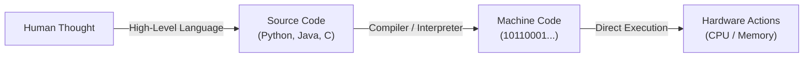

<Concepts
  items={[
    "literal execution",
    "binary & machine code",
    "programming languages",
    "compilers & interpreters",
    "language levels",
  ]}
/>

<LessonIntro>
  A computer is extraordinarily fast, entirely literal, and has zero common
  sense. Programming is the process of getting a machine to perform a specific
  task without errors by providing instructions so precise that there is no room
  for guessing.
</LessonIntro>

## The Literal Machine

Humans communicate with context, assumptions, and shorthand. If you tell a friend to _"grab lunch"_, they intuitively decide where, what, and how to get there.

A computer cannot do this. If an instruction misses a single detail, the program fails or produces nonsense.

<AnalogyCard name="The Literal Builder">
  

    <strong>Human Communication</strong>
    

      <em>"Put the red brick near the middle."</em>
    

    

      A person fills in the blanks using intuition, visual context, and past
      experience.
    

  

  

    <strong>Machine Instruction</strong>
    

      <code>place_brick(color="red", shape="2x4", x=12, y=8, rotation=90)</code>
    

    

      The computer executes only the parameters given. Omit one detail, and it
      halts or crashes.
    

  

</AnalogyCard>

---

## Why Can't We Just Use Plain English?

Computers do not understand human words; their circuitry only processes electrical charges representing **binary** (`0`s and `1`s).

- **Machine Code (Binary):** Strings of `0`s and `1`s that map directly to CPU registers and transistors. Writing millions of bits by hand is impossible for humans.
- **Programming Languages:** A readable middle ground. They let humans express algorithmic logic with mathematical clarity, which automated tools translate into binary.

<LessonDiagram id="itp-m1" />

---

## High-Level vs. Low-Level Languages

Languages are categorized by **abstraction level** — how close they sit to the physical silicon:

| Level          | Examples                 | Strengths                                                            | Trade-offs                                                  | Typical Use Cases                                             |
| -------------- | ------------------------ | -------------------------------------------------------------------- | ----------------------------------------------------------- | ------------------------------------------------------------- |
| **Low-Level**  | Assembly, C, C++         | Direct memory access, zero runtime overhead, blazing speed           | Verbose syntax, manual memory management, hardware-specific | Operating systems, game engines, embedded robotics            |
| **High-Level** | Python, JavaScript, Java | Human-friendly syntax, automatic memory management, fast development | Higher memory footprint, slight performance overhead        | Web apps, data science, automation scripts, business software |

<LessonNote variant="myth" title="Level indicates quality">
**Misconception:** *"High-level languages are newer and better; low-level languages are obsolete."*

**Reality:** Level measures **closeness to hardware**, not quality. The Python interpreter itself is written in C. You choose low-level when you need microsecond precision or direct chip control, and high-level when you want rapid prototyping and readable logic.

</LessonNote>

---

## Step-by-Step: The Program Execution Lifecycle

<Steps>
  <Step>
    **Decompose the Task** Break the overall goal down into sequential steps
    with zero ambiguity.
  </Step>
  <Step>
    **Write Source Code** Express those steps in a chosen programming language
    following its syntax rules.
  </Step>
  <Step>
    **Translate to Binary** A compiler (ahead-of-time) or interpreter
    (line-by-line) turns the text into machine code.
  </Step>
  <Step>
    **Hardware Executes** The CPU runs the instructions faithfully. If the
    output is wrong, the instructions were flawed — never the computer.
  </Step>
</Steps>

<TryIt
  question="Why can't computers execute Python or Java code directly without a translation step?"
  options={[
    "Because high-level code is stored in Unicode text which CPU hardware cannot physically parse without conversion to binary",
    "Because computers only run programs written in the current year",
    "Because high-level languages do not have mathematical operators",
    "Because operating systems disable direct code execution for security",
  ]}
  answer="A"
  why="CPUs only respond to electronic voltage switches representing binary 1s and 0s. All human-readable code must be translated by an interpreter or compiler before physical execution."
/>

<Takeaway>
  The computer does not care about what you *meant* to say; it only executes
  what you *actually* wrote. Precision is your primary job.
</Takeaway>
