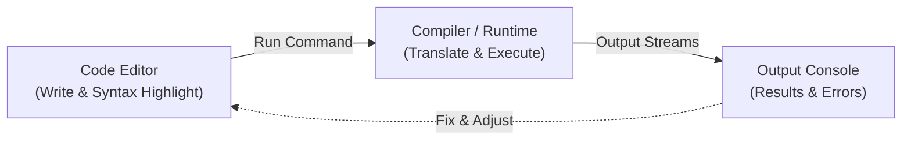

<Concepts
  items={[
    "IDE workbench",
    "syntax rules",
    "input & output",
    "print statements",
    "arithmetic & modulo",
  ]}
/>

<LessonIntro>
  Writing software is not typing incantations into a plain text file. It happens
  on a structured workbench called an **IDE**, where you compose code following
  strict syntax rules, execute it, and inspect output via the console.
</LessonIntro>

## The Developer's Workbench: The IDE

An **Integrated Development Environment (IDE)** (such as VS Code, PyCharm, or IntelliJ) bundles everything you need to create software into one screen:



<AnalogyCard name="The Restaurant Kitchen">
  <div>
    <strong>The Code Editor (Prep Station)</strong>
    <p>
      Where ingredients are chopped, recipes are followed, and warnings are
      flagged before cooking.
    </p>
  </div>
  <div>
    <strong>The Console (Serving Counter)</strong>
    <p>
      Where finished plates arrive and feedback or burnt-dish errors are
      immediately visible.
    </p>
  </div>
</AnalogyCard>

<LessonDiagram id="itp-m2" />

---

## 1. Syntax: The Grammar of Code

Every programming language has strict spelling, punctuation, and capitalization rules known as **syntax**:

- In English: _"The dog barked"_ and _"dog barked the"_ can be deciphered by a listener.
- In Code: Leaving out a parenthesis `)`, forgetting quotes around text `"hello"`, or typing `Print` instead of `print` halts execution immediately with a **SyntaxError**.

---

## 2. Making Computations Visible: Print & Input

Computers process calculations invisibly in memory. Unless you explicitly instruct the program to output the result, the work remains hidden.

```python
# Invisible computation: 4 + 3 is computed, but discarded from screen
4 + 3

# Visible computation: Output explicitly piped to the console
print(4 + 3)  # Output: 7
```

### Essential Operators

| Operator | Name               | Example  | Result | Notes                                                              |
| -------- | ------------------ | -------- | ------ | ------------------------------------------------------------------ |
| `+`      | Addition           | `4 + 3`  | `7`    | Concatenates text if used with strings: `"a" + "b" == "ab"`        |
| `-`      | Subtraction        | `10 - 4` | `6`    | Standard difference                                                |
| `*`      | Multiplication     | `6 * 7`  | `42`   | Uses asterisk, not `x`                                             |
| `/`      | True Division      | `7 / 2`  | `3.5`  | Always returns a float                                             |
| `//`     | Floor Division     | `7 // 2` | `3`    | Discards the decimal remainder                                     |
| `%`      | Modulo (Remainder) | `7 % 2`  | `1`    | Remainder after division. Useful for even/odd checks: `n % 2 == 0` |

---

## Code in Action: Multi-Language Comparison

<Tabs items={["Python", "JavaScript", "TypeScript", "Java", "C"]}>
  <Tab value="Python">
```python
# 1. Output text and numbers
print("Hello, world!")
print(4 + 3)          # 7

# 2. Modulo operator (remainder)

print(50 % 2) # 0 -> remainder is 0, so 50 is even
print(7 % 2) # 1 -> remainder is 1, so 7 is odd

# 3. Taking interactive user input

user_name = input("Enter your name: ")
print("Welcome, " + user_name + "!")

````
  </Tab>
  <Tab value="JavaScript">
```javascript
// 1. Output text and numbers
console.log("Hello, world!");
console.log(4 + 3);          // 7

// 2. Modulo operator (remainder)
console.log(50 % 2);         // 0 -> remainder is 0, so 50 is even
console.log(7 % 2);          // 1 -> remainder is 1, so 7 is odd

// 3. String concatenation / template literals
const userName = "Ada";
console.log(`Welcome, ${userName}!`);
````

  </Tab>
  <Tab value="TypeScript">
```typescript
// 1. Output text and numbers with explicit types
const greeting: string = "Hello, world!";
const sum: number = 4 + 3;
console.log(greeting);
console.log(sum);            // 7

// 2. Modulo operator (remainder)
const isEven: boolean = (50 % 2) === 0;
console.log(50 % 2); // 0 (even)
console.log(7 % 2); // 1 (odd)

// 3. Typed variable and template literal
const userName: string = "Ada";
console.log(`Welcome, ${userName}!`);

````
  </Tab>
  <Tab value="Java">
```java
import java.util.Scanner;

public class Main {
    public static void main(String[] args) {
        // 1. Output text and numbers
        System.out.println("Hello, world!");
        System.out.println(4 + 3);       // 7

        // 2. Modulo operator (remainder)
        System.out.println(50 % 2);      // 0 (even)
        System.out.println(7 % 2);       // 1 (odd)

        // 3. Taking interactive user input
        Scanner scanner = new Scanner(System.in);
        System.out.print("Enter your name: ");
        String userName = scanner.nextLine();
        System.out.println("Welcome, " + userName + "!");
        scanner.close();
    }
}
````

  </Tab>
  <Tab value="C">
```c
#include <stdio.h>

int main(void) {
// 1. Output text and numbers
printf("Hello, world!\n");
printf("%d\n", 4 + 3); // 7

    // 2. Modulo operator (remainder)
    printf("%d\n", 50 % 2);         // 0 (even)
    printf("%d\n", 7 % 2);          // 1 (odd)

    // 3. Taking interactive user input
    char userName[50];
    printf("Enter your name: ");
    if (scanf("%49s", userName) == 1) {
        printf("Welcome, %s!\n", userName);
    }

    return 0;

}

```
  </Tab>
</Tabs>

---

## The Core Edit-Run-Read Feedback Loop

<Steps>
  <Step>
    **Edit**
    Write instructions in the code editor, paying close attention to syntax hints and wavy red underlines.
  </Step>
  <Step>
    **Run**
    Trigger the run action. The IDE translates your text into binary commands.
  </Step>
  <Step>
    **Inspect the Console**
    Check what printed. If nothing printed, add a `print()` call. If an error printed, read the line number.
  </Step>
  <Step>
    **Adjust & Repeat**
    Refine your logic and rerun until the output matches requirements.
  </Step>
</Steps>

<LessonNote variant="myth" title="Running without errors = Correct code">
**Misconception:** *"If my code ran without the IDE showing red errors, my program works correctly."*

**Reality:** Clearing syntax errors only proves your code follows grammatical rules. If you calculate `area = length + width` instead of `length * width`, the program runs happily, but gives completely wrong numbers (a **logic error**).
</LessonNote>

<LessonNote variant="tip" title="Print is your best debugging tool">
Even senior software engineers at top tech companies use simple print statements to inspect variables in real time when diagnosing bugs. It provides direct visibility into what the CPU holds.
</LessonNote>

<TryIt
  question="What is the output of the expression 19 % 4 in Python, Java, or C?"
  options={[
    "4 (the quotient)",
    "3 (the remainder: 19 = 4 * 4 + 3)",
    "4.75 (the floating point result)",
    "0 (modulo rounds to zero)"
  ]}
  answer="B"
  why="Modulo (%) calculates the integer remainder after division. 19 divided by 4 is 4 with a remainder of 3."
/>

<Takeaway>
The write-run-read console cycle is the heartbeat of software development. Every complex application is built by chaining small, verified print statements together.
</Takeaway>
```
