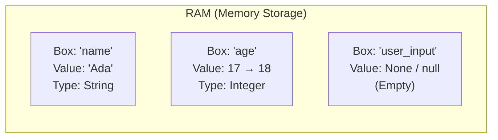

<Concepts
  items={[
    "variables",
    "data types",
    "memory storage",
    "reassignment",
    "null & None",
  ]}
/>

<LessonIntro>
  Programs must remember values to be useful. A **variable** is a labeled box in
  your computer's RAM that holds exactly one piece of information at a time. To
  change what is stored, you replace the content inside the box.
</LessonIntro>

## The Storage Box Mental Model

When you write `age = 17`, the computer reserves a small chunk of memory, attaches the label `age` to it, and places the number `17` inside:



<AnalogyCard name="Storage Boxes">
  <div>
    <strong>The Label (Variable Name)</strong>
    <p>
      Written in permanent marker on the outside of the box. Once established,
      the name stays consistent.
    </p>
  </div>
  <div>
    <strong>The Sheet Inside (Value)</strong>
    <p>
      A slip of paper with data written on it. To update a variable, you discard
      the old paper and slide in a new one.
    </p>
  </div>
</AnalogyCard>

<LessonDiagram id="itp-m3" />

---

## The Variable Lifecycle

Working with variables involves four key actions:

1. **Declare:** Reserve a named slot in memory (specifying a data type in statically typed languages like Java or C++).
2. **Initialize:** Place the very first value into the box.
3. **Read:** Look up the value by referencing the variable's name.
4. **Reassign (Update):** Overwrite the previous value with a new one.

```python
# 1 & 2: Declare and Initialize
score = 100

# 3: Read
print(score)  # 100

# 4: Reassign
score = 150
print(score)  # 150 (the old 100 is replaced)
```

---

## Core Data Types

The type of a variable dictates how many bits of RAM it occupies and what operations are valid:

| Data Type                     | Description                          | Size / Precision             | Example             | Valid Operations             |
| ----------------------------- | ------------------------------------ | ---------------------------- | ------------------- | ---------------------------- |
| **Integer (`int`)**           | Whole numbers (positive or negative) | Typically 32 or 64 bits      | `42`, `-7`, `0`     | `+`, `-`, `*`, `/`, `%`      |
| **Float (`float`)**           | Decimal numbers                      | 32-bit single precision      | `3.14`, `0.005`     | Arithmetic                   |
| **Double (`double`)**         | High-precision decimals              | 64-bit double precision      | `3.141592653589793` | High-precision math          |
| **String (`str` / `String`)** | Text sequence wrapped in quotes      | Variable (depends on length) | `"Alice"`, `"Code"` | Concatenation (`+`), length  |
| **Boolean (`bool`)**          | Logical truth value                  | 1 bit (`true` or `false`)    | `True`, `False`     | `and`, `or`, `not`           |
| **Char (`char`)**             | Single textual symbol                | Typically 8 or 16 bits       | `'A'`, `'%'`, `'7'` | Comparison, ASCII conversion |

---

## Code Comparison: Static vs. Dynamic Typing

<Tabs items={["Python (Dynamic)", "JavaScript (Dynamic)", "TypeScript (Static)", "Java (Static)", "C (Static / Low-Level)"]}>
  <Tab value="Python (Dynamic)">
```python
# Types are inferred automatically at runtime
age = 17              # int
price = 19.99         # float
name = "Ada"          # str
is_student = True     # bool

# Reassigning to update value

age = 18 # birthday!
print("Age is:", age)

# Checking types dynamically

print(type(name)) # <class 'str'>
print(type(age)) # <class 'int'>

# The Empty Box: None

user_input = None
print(user_input) # None

````
  </Tab>
  <Tab value="JavaScript (Dynamic)">
```javascript
// Types are inferred automatically at runtime
let age = 17;              // number
let price = 19.99;         // number
let name = "Ada";          // string
let isStudent = true;      // boolean

// Reassigning to update value
age = 18;                  // birthday!
console.log("Age is:", age);

// Checking types dynamically
console.log(typeof name);  // "string"
console.log(typeof age);   // "number"

// The Empty Box: null & undefined
let userInput = null;
console.log(userInput);    // null
````

  </Tab>
  <Tab value="TypeScript (Static)">
```typescript
// Explicit static types verified at compile time
let age: number = 17;
let price: number = 19.99;
let name: string = "Ada";
let isStudent: boolean = true;

// Reassigning to update value
age = 18;
console.log("Age is:", age);

// Compile-time guardrail:
// age = "eighteen"; // Error: Type 'string' is not assignable to 'number'

// The Empty Box: explicit nullable union type
let userInput: string | null = null;
console.log(userInput);

````
  </Tab>
  <Tab value="Java (Static)">
```java
public class TypesDemo {
    public static void main(String[] args) {
        // Must declare the explicit type beforehand
        int age = 17;
        double price = 19.99;
        String name = "Ada";
        boolean isStudent = true;

        // Reassigning
        age = 18;
        System.out.println("Age is: " + age);

        // Empty box in Java
        String userInput = null;
        // System.out.println(userInput.length()); // Throws NullPointerException!
    }
}
````

  </Tab>
  <Tab value="C (Static / Low-Level)">
```c
#include <stdio.h>
#include <stdbool.h>

int main(void) {
// Explicit static types fixed at compile time
int age = 17;
double price = 19.99;
char name[] = "Ada";
bool isStudent = true;

    // Reassigning to update value
    age = 18;
    printf("Age is: %d\n", age);

    // Empty pointer box in C: NULL
    char *userInput = NULL;
    // printf("%c\n", *userInput); // Segfault / crash dereferencing NULL!

    return 0;

}

```
  </Tab>
</Tabs>

---

## The Danger of Empty Boxes: `null` and `None`

You can create a labeled box without putting anything in it yet (for example, awaiting user input).

- In Java, C, and JavaScript, this empty state is called **`null`**.
- In Python, it is called **`None`**.

<LessonNote variant="warning" title="Null Pointer Exception / AttributeError">
If you attempt to read or invoke methods on an empty box — such as asking for `user_input.toUpperCase()` when `user_input` is `null` — the program crashes immediately. The machine is reaching into the box, finding no paper, and panicking.
</LessonNote>

<LessonNote variant="myth" title="Variables holding multiple items">
**Misconception:** *"I can store a user's entire shopping list by squeezing multiple items into a single string variable."*

**Reality:** While you *could* write `groceries = "milk, eggs, bread"`, you cannot easily search, sort, count, or remove single items from it. One variable holds **one single value**. To store collections of values, you need **arrays or lists** (covered in Module 4).
</LessonNote>

<TryIt
  question="Consider this code: x = 10; y = x; x = 20. What is the value of y?"
  options={[
    "20 (y stays linked to x)",
    "10 (y received a copy of the value 10 when assigned)",
    "None (x was overwritten)",
    "Error (variables cannot be assigned to each other)"
  ]}
  answer="B"
  why="In primitive variable assignment, the computer copies the value from box x into box y. When box x is later updated to 20, box y still holds its own copy: 10."
/>

<Takeaway>
A variable is a single named slot in memory. Understand its type, initialize it before use, and never reach inside an empty box without checking for null.
</Takeaway>
```
