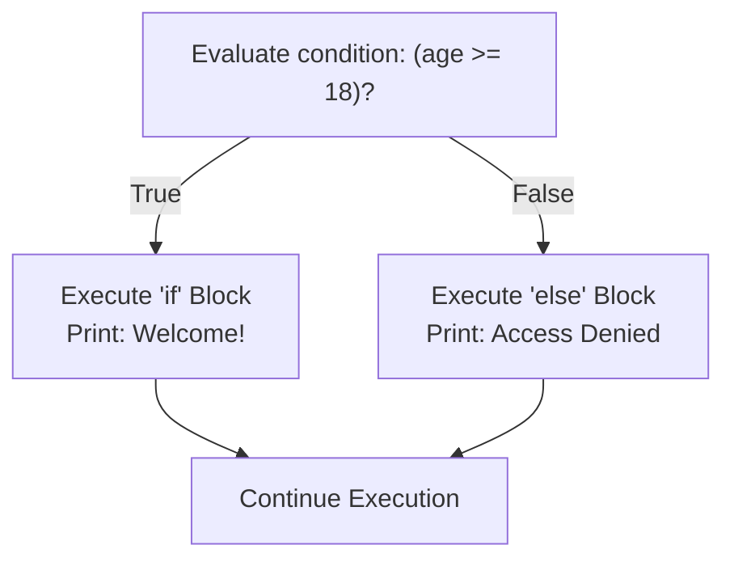
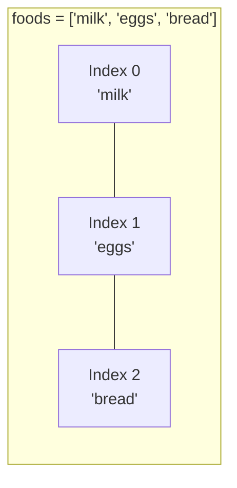

<Concepts
  items={[
    "conditionals",
    "if / else branching",
    "boolean expressions",
    "arrays & lists",
    "zero-based indexing",
    "2D arrays",
  ]}
/>

<LessonIntro>
  Programs become intelligent when they can make choices and manage collections
  of data. **Conditionals** allow code to choose which path to execute, while
  **arrays** store ordered lists of related values in memory under a single
  name.
</LessonIntro>

## Part 1: Conditionals (The Railway Switch)

A conditional checks whether an expression evaluates to `true` or `false`. Depending on the answer, the CPU takes one path and skips the other.



<AnalogyCard name="The Railway Switch">
  <div>
    <strong>The Condition Test</strong>
    <p>
      A railway track switch ahead of an oncoming train. The track only points
      left or right — never both.
    </p>
  </div>
  <div>
    <strong>Branch Execution</strong>
    <p>
      The train (execution pointer) travels down exactly one chosen track. The
      alternate branch is completely ignored.
    </p>
  </div>
</AnalogyCard>

<LessonDiagram id="itp-m4" />
<LessonDiagram
  id="itp-m4-trace"
  caption="Condition trace: When condition evaluates to true, the left branch executes; otherwise the right branch executes."
/>

### Chaining Choices: `if`, `else if`, and `else`

When there are multiple mutually exclusive outcomes, conditions chain sequentially. The computer tests them in order and stops at the first match:

```python
score = 85

if score >= 90:
    print("Grade: A")
elif score >= 80:
    print("Grade: B")  # Matches here! Prints B and exits chain
elif score >= 70:
    print("Grade: C")
else:
    print("Grade: Needs Improvement")
```

---

## Part 2: Arrays & Lists (Storing Collections)

When managing multiple pieces of related data (e.g. 100 student test scores or a grocery cart), creating 100 individual variables (`item1`, `item2`, ...) is unmanageable.

An **array** (or list) groups multiple values into a single sequence of ordered slots in memory:



### Zero-Based Indexing

In almost all major programming languages, array slot numbering starts at **0**, not 1:

| Index | Value     | Explanation                            |
| ----- | --------- | -------------------------------------- |
| `0`   | `"milk"`  | First element (offset of 0 from start) |
| `1`   | `"eggs"`  | Second element (offset of 1)           |
| `2`   | `"bread"` | Third element (offset of 2)            |

<LessonNote variant="tip" title="Why start at zero?">
  Index numbers historically represent a memory **offset**: how many memory
  slots to jump forward from the array's starting memory address. The very first
  item is at offset zero!
</LessonNote>

---

## Code in Action: Multi-Language Comparison

<Tabs items={["Python", "JavaScript", "TypeScript", "Java", "C"]}>
  <Tab value="Python">
```python
# 1. Conditionals: Even / Odd Check
n = 7
if n % 2 == 0:
    print("Even")
else:
    print("Odd")  # Output: Odd

# 2. Lists (Dynamic Arrays)

foods = ["milk", "eggs", "bread"]
print(foods[0]) # "milk" - index 0
print(foods[1]) # "eggs" - index 1
print(len(foods)) # 3 items total

# Appending new elements

foods.append("butter")
print(foods) # ['milk', 'eggs', 'bread', 'butter']

# 3. 2D Arrays (Matrix / Grid / Seating Chart)

seats = [
["A1", "A2", "A3"],
["B1", "B2", "B3"]
]

# Access row 1 (second row), column 0 (first seat):

print(seats[1][0]) # "B1"

````
  </Tab>
  <Tab value="JavaScript">
```javascript
// 1. Conditionals: Even / Odd Check
const n = 7;
if (n % 2 === 0) {
    console.log("Even");
} else {
    console.log("Odd");  // Output: Odd
}

// 2. Arrays (Dynamic)
const foods = ["milk", "eggs", "bread"];
console.log(foods[0]);   // "milk" - index 0
console.log(foods[1]);   // "eggs" - index 1
console.log(foods.length); // 3 items total

// Appending new elements
foods.push("butter");
console.log(foods);      // ['milk', 'eggs', 'bread', 'butter']

// 3. 2D Arrays (Matrix / Grid)
const seats = [
    ["A1", "A2", "A3"],
    ["B1", "B2", "B3"]
];
// Access row 1 (second row), column 0 (first seat):
console.log(seats[1][0]); // "B1"
````

  </Tab>
  <Tab value="TypeScript">
```typescript
// 1. Conditionals: Even / Odd Check
const n: number = 7;
if (n % 2 === 0) {
    console.log("Even");
} else {
    console.log("Odd");  // Output: Odd
}

// 2. Typed Arrays
const foods: string[] = ["milk", "eggs", "bread"];
console.log(foods[0]); // "milk"
console.log(foods[1]); // "eggs"
console.log(foods.length); // 3

// Appending with type checking (cannot push a number into string[])
foods.push("butter");
console.log(foods);

// 3. Typed 2D Array
const seats: string[][] = [
["A1", "A2", "A3"],
["B1", "B2", "B3"]
];
console.log(seats[1][0]); // "B1"

````
  </Tab>
  <Tab value="Java">
```java
public class ArraysDemo {
    public static void main(String[] args) {
        // 1. Conditionals
        int n = 7;
        if (n % 2 == 0) {
            System.out.println("Even");
        } else {
            System.out.println("Odd");
        }

        // 2. Fixed-size Java Array
        String[] foods = {"milk", "eggs", "bread"};
        System.out.println(foods[0]); // "milk"
        System.out.println(foods[1]); // "eggs"

        // 3. 2D Arrays (Matrix / Grid)
        String[][] seats = {
            {"A1", "A2", "A3"},
            {"B1", "B2", "B3"}
        };
        System.out.println(seats[1][0]); // "B1"

        // Out-of-bounds danger:
        // System.out.println(foods[3]); // Throws ArrayIndexOutOfBoundsException!
    }
}
````

  </Tab>
  <Tab value="C">
```c
#include <stdio.h>

int main(void) {
// 1. Conditionals: Even / Odd Check
int n = 7;
if (n % 2 == 0) {
printf("Even\n");
} else {
printf("Odd\n"); // Output: Odd
}

    // 2. Fixed-size C Array
    const char *foods[3] = {"milk", "eggs", "bread"};
    printf("%s\n", foods[0]); // "milk" - index 0
    printf("%s\n", foods[1]); // "eggs" - index 1

    // 3. 2D Arrays (Matrix / Grid)
    const char *seats[2][3] = {
        {"A1", "A2", "A3"},
        {"B1", "B2", "B3"}
    };
    // Access row 1 (second row), column 0 (first seat):
    printf("%s\n", seats[1][0]); // "B1"

    // Out-of-bounds danger:
    // foods[3] causes undefined behavior or segmentation fault!

    return 0;

}

```
  </Tab>
</Tabs>

---

## Common Pitfalls & Guardrails

<LessonNote variant="myth" title="The computer evaluates both branches">
**Misconception:** *"The computer checks all `else if` conditions to see which one is best."*

**Reality:** Execution stops immediately at the **very first condition that evaluates to `True`**. Any subsequent `elif` blocks are completely skipped, even if their conditions would also be true.
</LessonNote>

<LessonNote variant="warning" title="Off-by-One / Index Out of Bounds">
If an array has 3 elements, its valid indexes are `0`, `1`, and `2`. Trying to access `foods[3]` causes an **IndexError** or **ArrayIndexOutOfBoundsException**. The computer does not guess; it halts.
</LessonNote>

<TryIt
  question="Given items = ['apple', 'banana', 'cherry'], what does items[1] return?"
  options={[
    "'apple'",
    "'banana'",
    "'cherry'",
    "An IndexError"
  ]}
  answer="B"
  why="Because counting starts at 0, items[0] is 'apple' and items[1] is 'banana'."
/>

<Takeaway>
Conditionals give your software the power to make decisions; arrays give it the capacity to organize collections. Together, they form the foundation of every interactive program.
</Takeaway>
```
