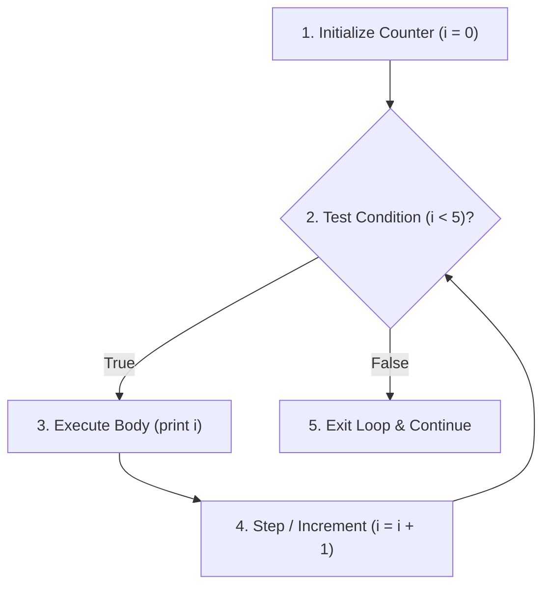

<Concepts
  items={[
    "for loops",
    "while loops",
    "infinite loops",
    "syntax errors",
    "runtime errors",
    "logic errors",
  ]}
/>

<LessonIntro>
  Copying code fifteen times is tedious; copying it ten thousand times is
  impossible. **Loops** instruct the computer to execute a block of code
  repeatedly until a condition changes. But with repetition comes risk:
  understanding how programs fail is essential to writing code that survives.
</LessonIntro>

## Part 1: Loops (Repeat Without Copying)

There are two primary loop mechanisms in modern programming:



<AnalogyCard name="The Washing Machine">
  <div>
    <strong>Automated Loop</strong>
    <p>A wash cycle checks: <em>"Is clothes timer > 0?"</em> If yes, agitates for 1 minute, steps timer down, and checks again. When timer hits 0, it stops.</p>
  </div>
  <div>
    <strong>The Infinite Loop Trap</strong>
    <p>If the timer dial is broken and never ticks down, the machine runs forever until power is cut or the motor burns out.</p>
  </div>
</AnalogyCard>

<LessonDiagram id="itp-m5" />
<LessonDiagram
  id="itp-m5-counter"
  caption="Loop counter: Starting at 0, testing condition, running body, stepping forward, and exiting once the condition evaluates to false."
/>

---

### `for` Loop vs. `while` Loop

| Loop Type        | When to Use                                                                              | Typical Pattern                                       |
| ---------------- | ---------------------------------------------------------------------------------------- | ----------------------------------------------------- |
| **`for` loop**   | When you know how many times to repeat, or are walking through a list/array              | `for item in items:` or `for (int i = 0; i < n; i++)` |
| **`while` loop** | When repetition depends on an external condition (e.g. waiting for input or a game flag) | `while balance > 0:` or `while (running == true)`     |

---

## Code in Action: Multi-Language Comparison

<Tabs items={["Python", "JavaScript", "TypeScript", "Java", "C"]}>
  <Tab value="Python">
```python
# 1. for loop: Repeating a set number of times
for i in range(5):
    print("Count:", i)  # Prints 0, 1, 2, 3, 4

# 2. Iterating through a list

foods = ["milk", "eggs", "bread"]
for item in foods:
print("Buy:", item)

# 3. while loop: Repeating until condition turns False

count = 0
while count < 3:
print("While count:", count)
count += 1 # Crucial! Omitting this line causes an infinite loop!

````
  </Tab>
  <Tab value="JavaScript">
```javascript
// 1. for loop: Repeating a set number of times
for (let i = 0; i < 5; i++) {
    console.log("Count:", i);  // Prints 0, 1, 2, 3, 4
}

// 2. Iterating through an array (for...of)
const foods = ["milk", "eggs", "bread"];
for (const item of foods) {
    console.log("Buy:", item);
}

// 3. while loop: Repeating until condition turns false
let count = 0;
while (count < 3) {
    console.log("While count:", count);
    count++; // Crucial step forward
}
````

  </Tab>
  <Tab value="TypeScript">
```typescript
// 1. for loop with typed index
for (let i: number = 0; i < 5; i++) {
    console.log("Count:", i);
}

// 2. Iterating through a typed string array
const foods: string[] = ["milk", "eggs", "bread"];
for (const item of foods) {
console.log("Buy:", item);
}

// 3. while loop with typed condition
let count: number = 0;
while (count < 3) {
console.log("While count:", count);
count++;
}

````
  </Tab>
  <Tab value="Java">
```java
public class LoopsDemo {
    public static void main(String[] args) {
        // 1. for loop: (start; condition; step)
        for (int i = 0; i < 5; i++) {
            System.out.println("Count: " + i);
        }

        // 2. Iterating through an array
        String[] foods = {"milk", "eggs", "bread"};
        for (String item : foods) {
            System.out.println("Buy: " + item);
        }

        // 3. while loop
        int count = 0;
        while (count < 3) {
            System.out.println("While count: " + count);
            count++; // Step forward
        }
    }
}
````

  </Tab>
  <Tab value="C">
```c
#include <stdio.h>

int main(void) {
// 1. for loop: Repeating a set number of times
for (int i = 0; i < 5; i++) {
printf("Count: %d\n", i); // Prints 0, 1, 2, 3, 4
}

    // 2. Iterating through an array
    const char *foods[3] = {"milk", "eggs", "bread"};
    for (int i = 0; i < 3; i++) {
        printf("Buy: %s\n", foods[i]);
    }

    // 3. while loop: Repeating until condition turns false
    int count = 0;
    while (count < 3) {
        printf("While count: %d\n", count);
        count++;  // Crucial! Omitting this line causes an infinite loop!
    }

    return 0;

}

````
  </Tab>
</Tabs>

---

## Part 2: The Three Types of Errors

Every software bug in computer science falls into one of three distinct categories:

```mermaid
flowchart LR
    A["Code Written"] --> B{"Syntax Valid?"}
    B -->|No| E1["1. Syntax Error<br/>(IDE red squiggles, won't run)"]
    B -->|Yes| C{"Runs to completion?"}
    C -->|Crashes / Infinite| E2["2. Runtime Error<br/>(Crashes during execution)"]
    C -->|Finishes| D{"Output correct?"}
    D -->|Wrong result| E3["3. Logic Error<br/>(Silent flaw in thinking)"]
    D -->|Matches goal| Success["Working Program!"]
````

| Error Type           | When Detected          | What Happens                                                                 | Example                                                                                                  | How to Fix                                                     |
| -------------------- | ---------------------- | ---------------------------------------------------------------------------- | -------------------------------------------------------------------------------------------------------- | -------------------------------------------------------------- |
| **1. Syntax Error**  | Before / at launch     | The language grammar is broken. Program refuses to start.                    | Misspelling `prnt()`, missing a quote `""`, or using illegal spaces in variable names (`my score = 10`). | Read the IDE line number and fix typing/punctuation.           |
| **2. Runtime Error** | While running          | Code syntax is valid, but the CPU is asked to perform an impossible action.  | Dividing by zero (`10 / 0`), accessing an out-of-bounds index, or running an infinite loop.              | Add guard conditions (e.g. `if denominator != 0`).             |
| **3. Logic Error**   | Silent (Never crashes) | The program runs successfully to completion, but produces incorrect results. | Writing `total = price - discount` as `total = price + discount`.                                        | Print variable states, trace inputs step-by-step, write tests. |

<LessonNote variant="myth" title="Runtime and Logic errors are the same">
**Misconception:** *"Any bug that happens when I run my program is a runtime error."*

**Reality:** A **runtime error** causes an explicit crash (the program terminates with an exception). A **logic error** does _not_ crash; it smiles, prints the wrong number, and deceives the user. Logic errors are by far the hardest bugs to track down.

</LessonNote>

<TryIt
  question="A student writes: area = width + height instead of width * height. The program runs and displays a number. Which type of error is this?"
  options={[
    "Syntax Error",
    "Runtime Error",
    "Logic Error",
    "Compilation Error",
  ]}
  answer="C"
  why="The syntax is valid and the machine can perform addition without crashing, but the calculation logic is mathematically incorrect."
/>

<Takeaway>
  Loops multiply your leverage by automating repetition. When things go wrong,
  classify the bug immediately: is it syntax (grammar), runtime (crash), or
  logic (bad math)?
</Takeaway>
