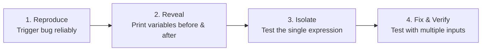
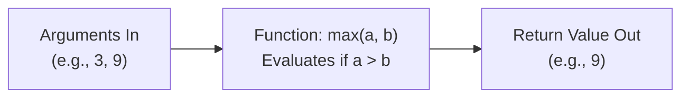

<Concepts
  items={[
    "debugging workflow",
    "print debugging",
    "functions",
    "parameters vs arguments",
    "return values",
  ]}
/>

<LessonIntro>
  Debugging is not an innate talent — it is a repeatable procedure. Once you
  track down a bug and prove that a piece of logic works, you wrap it in a
  **function** so you never have to solve that specific problem again.
</LessonIntro>

## Part 1: The Systematic Debugging Protocol

When a program produces incorrect output (a logic error), staring at the entire screen of code is overwhelming. Instead, use a structured 4-step protocol:



<Steps>
  <Step>
    **Reproduce the Failure Reliably**
    Find the specific input that triggers the incorrect output.
  </Step>
  <Step>
    **Make the Invisible Visible**
    Insert temporary print statements before and inside suspect conditionals or loops to see what the machine actually holds:
    ```python
    print("DEBUG: balance =", balance, "amount =", amount)
    ```
  </Step>
  <Step>
    **Isolate the Suspect Line**
    Check operators carefully: did you type `+` instead of `*`, or `>=` instead of `>`?
  </Step>
  <Step>
    **Remove Scaffolding**
    Once the bug is corrected, clean up your debug prints and verify with multiple test cases.
  </Step>
</Steps>

<LessonNote variant="myth" title="Adding prints is bad practice">
**Misconception:** *"Professional developers only use complex debugger tools; adding print statements is amateur."*

**Reality:** Adding strategic, temporary print statements to inspect variables in the console is the fastest and most widely used technique across the software industry. It provides instant observability into the running CPU state.

</LessonNote>

---

## Part 2: Functions (Package Once, Reuse Everywhere)

A **function** is a named, self-contained bundle of instructions. You define it once and call it as many times as needed across your application.



<AnalogyCard name="The Restaurant Order Counter">
  <div>
    <strong>Parameters & Arguments (The Order Ticket)</strong>
    <p>
      When you order at a burger counter, you hand over specifications (burger,
      fries, drink). Those are your <strong>arguments</strong>. If the cashier
      requires an order and you say nothing, they cannot proceed.
    </p>
  </div>
  <div>
    <strong>Return Values (The Food Tray)</strong>
    <p>
      The kitchen prepares the meal and hands back a tray (the{" "}
      <strong>return value</strong>). If you walk away without catching the
      tray, the meal is lost.
    </p>
  </div>
</AnalogyCard>

<LessonDiagram id="itp-m6" />

---

### Parameters vs. Arguments vs. Return

- **Parameters:** The variable placeholders defined in the function signature (e.g. `def calculate_tax(price, rate)`).
- **Arguments:** The actual values passed in during an invocation (e.g. `calculate_tax(100.0, 0.08)`).
- **Return Value:** The value handed back to the caller to be stored, calculated with, or displayed.

---

## Code in Action: Multi-Language Comparison

<Tabs items={["Python", "JavaScript", "TypeScript", "Java", "C"]}>
  <Tab value="Python">
```python
# 1. Defining a function with parameters and a return value
def find_max(a, b):
    if a > b:
        return a
    else:
        return b

# 2. Calling with arguments and capturing the return value

result = find_max(14, 42)
print("The larger number is:", result) # 42

# 3. Using the returned value in further computations

total = find_max(5, 10) \* 2
print("Total:", total) # 20

# 4. What happens if you forget to return?

def greet(name):
print("Hello, " + name) # Prints, but returns None!

val = greet("Ada")
print("Value of val:", val) # Output: None

````
  </Tab>
  <Tab value="JavaScript">
```javascript
// 1. Defining a function with parameters and return value
function findMax(a, b) {
    if (a > b) {
        return a;
    } else {
        return b;
    }
}

// 2. Calling with arguments and capturing the return value
const result = findMax(14, 42);
console.log("The larger number is:", result); // 42

// 3. Using the returned value in further computations
const total = findMax(5, 10) * 2;
console.log("Total:", total);                 // 20

// 4. Functions without return yield undefined
function greet(name) {
    console.log("Hello, " + name); // Prints, but returns undefined!
}

const val = greet("Ada");
console.log("Value of val:", val); // undefined
````

  </Tab>
  <Tab value="TypeScript">
```typescript
// 1. Explicit parameter types and return type
function findMax(a: number, b: number): number {
    if (a > b) {
        return a;
    } else {
        return b;
    }
}

// 2. Calling with type-checked arguments
const result: number = findMax(14, 42);
console.log("The larger number is:", result); // 42

// 3. Using the returned value in further computations
const total: number = findMax(5, 10) \* 2;
console.log("Total:", total); // 20

// 4. Void return type for functions that produce no value
function greet(name: string): void {
console.log("Hello, " + name);
}

greet("Ada");

````
  </Tab>
  <Tab value="Java">
```java
public class FunctionsDemo {
    // 1. Declares return type (int) and parameter types
    public static int findMax(int a, int b) {
        if (a > b) {
            return a;
        } else {
            return b;
        }
    }

    // 4. Void functions do not return a value
    public static void greet(String name) {
        System.out.println("Hello, " + name);
    }

    public static void main(String[] args) {
        // 2. Calling with arguments
        int result = findMax(14, 42);
        System.out.println("Max is: " + result); // 42

        // 3. Using the returned value in further computations
        int total = findMax(5, 10) * 2;
        System.out.println("Total: " + total);   // 20

        greet("Ada");
    }
}
````

  </Tab>
  <Tab value="C">
```c
#include <stdio.h>

// 1. Defining a function with explicit parameter and return types
int find_max(int a, int b) {
if (a > b) {
return a;
} else {
return b;
}
}

// 4. Void functions do not return a value
void greet(const char \*name) {
printf("Hello, %s!\n", name);
}

int main(void) {
// 2. Calling with arguments and capturing the return value
int result = find_max(14, 42);
printf("The larger number is: %d\n", result); // 42

    // 3. Using the returned value in further computations
    int total = find_max(5, 10) * 2;
    printf("Total: %d\n", total);                 // 20

    greet("Ada");
    return 0;

}

```
  </Tab>
</Tabs>

---

## Printing vs. Returning: The Critical Distinction

Beginners frequently confuse `print()` inside a function with `return`:

| Action | `print(value)` inside function | `return value` from function |
|---|---|---|
| **What it does** | Displays text on the human console screen | Hands the computed data back to the calling code |
| **Can you save it?** | ❌ No. Variable receiving it becomes `None` / `null` | ✅ Yes. `x = calculate()` stores the actual number |
| **Can you calculate with it?**| ❌ No. You cannot add `10` to console text | ✅ Yes. `total = calculate() + 10` |

<TryIt
  question="What is the result of running: def add(x, y): print(x + y); result = add(3, 4); print(result)?"
  options={[
    "Prints 7, then prints 7",
    "Prints 7, then prints None (because add had no return statement)",
    "Prints 7, then throws an error",
    "Prints nothing"
  ]}
  answer="B"
  why="add(3, 4) prints 7 to the console as a side-effect, but because it lacks an explicit return statement, it returns None. Hence print(result) prints None."
/>

<Takeaway>
Debug by revealing state with console prints. Once verified, wrap that logic into a function with clear inputs and a return value so it becomes an infallible building block.
</Takeaway>
```
