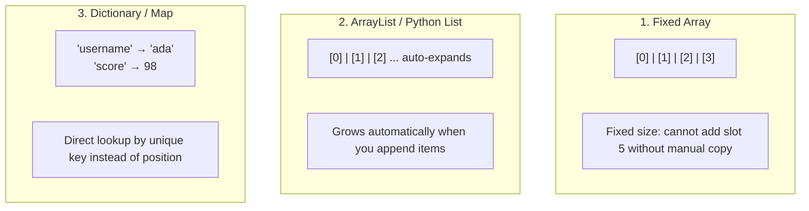

<Concepts
  items={[
    "libraries & imports",
    "void vs returning functions",
    "fixed arrays",
    "dynamic ArrayLists",
    "dictionaries & hash maps",
  ]}
/>

<LessonIntro>
  Professional software development is rarely solo invention from scratch. It is
  the disciplined assembly of proven external **libraries** paired with flexible
  data **containers** that scale as user data grows.
</LessonIntro>

## Part 1: Borrowing Tools (Libraries & Imports)

A **library** is a pre-tested collection of functions written and optimized by other engineers. When you need complex calculations, graphics, or networking, you import an existing library rather than writing thousands of lines yourself.

```python
# Blanket import: Hauls in the entire workshop
import math

# Targeted import: Borrows just the specific tool you need
from math import factorial

print(factorial(5))  # 120 (5 * 4 * 3 * 2 * 1)
```

<LessonNote variant="tip" title="Targeted imports improve performance">
  Importing specific functions (`from module import function`) keeps your
  namespace clean, reduces memory footprint, and makes it instantly obvious to
  other engineers which external tools your script depends upon.
</LessonNote>

---

## Part 2: Container Evolution: Beyond Fixed Arrays

In Module 4, we saw that primitive arrays store lists of items. However, real-world data is unpredictable: you rarely know in advance if 5 or 50,000 users will sign up today.



<AnalogyCard name="Container Shapes">
  <div>
    <strong>Fixed Array vs. Dynamic List</strong>
    <p>
      An <strong>egg carton</strong> has 12 rigid slots. If you buy a 13th egg,
      you must buy a completely new carton. An{" "}
      <strong>expandable accordion folder</strong> dynamically widens as you
      slip in more pages.
    </p>
  </div>
  <div>
    <strong>Dictionary (Key-Value)</strong>
    <p>
      A <strong>labeled filing cabinet</strong>. You don't ask for "drawer slot
      #37"; you ask directly for the folder labeled <em>"Invoice #1042"</em>.
    </p>
  </div>
</AnalogyCard>

<LessonDiagram id="itp-m7" />

---

### Choosing the Right Data Container

| Container                           | Order                            | Access Method             | Resizing                                       | Ideal Use Case                                                                |
| ----------------------------------- | -------------------------------- | ------------------------- | ---------------------------------------------- | ----------------------------------------------------------------------------- |
| **Fixed Array**                     | Ordered                          | Numeric index (`arr[0]`)  | Fixed size in memory                           | Fixed counts known ahead of time (e.g. 7 days of the week, 12 months)         |
| **Dynamic List (`ArrayList`)**      | Ordered                          | Numeric index (`list[i]`) | Automatically expands as elements are appended | Unknown quantity of items that arrive sequentially (e.g. user shopping cart)  |
| **Dictionary (`dict` / `HashMap`)** | Unordered (or insertion-ordered) | Unique Key (`dict["id"]`) | Automatically expands                          | Looking up data by identity or attribute (e.g. user profile, database record) |

---

## Code in Action: Multi-Language Comparison

<Tabs items={["Python", "JavaScript", "TypeScript", "Java", "C"]}>
  <Tab value="Python">
```python
# 1. Dynamic Lists: Expand effortlessly
scores = []           # Starts empty
scores.append(95)     # Adds item
scores.append(88)     # Adds another item
scores.append(100)
print(scores)         # [95, 88, 100]

# 2. Dictionaries: Key-Value storage

user_profile = {
"username": "ada_lovelace",
"role": "engineer",
"login_count": 42
}

# Access directly by key

print("User role:", user_profile["role"])

# Add or update attributes

user_profile["verified"] = True
print(user_profile)

````
  </Tab>
  <Tab value="JavaScript">
```javascript
// 1. Dynamic Arrays: Expand effortlessly
const scores = [];
scores.push(95);
scores.push(88);
scores.push(100);
console.log(scores); // [95, 88, 100]

// 2. Objects: Key-Value dictionary storage
const userProfile = {
    username: "ada_lovelace",
    role: "engineer",
    loginCount: 42
};

// Access directly by key property
console.log("User role:", userProfile.role);

// Add or update attributes
userProfile.verified = true;
console.log(userProfile);
````

  </Tab>
  <Tab value="TypeScript">
```typescript
// 1. Typed Dynamic Array
const scores: number[] = [];
scores.push(95);
scores.push(88);
scores.push(100);
console.log(scores); // [95, 88, 100]

// 2. Typed Interface for structured key-value containers
interface UserProfile {
username: string;
role: string;
loginCount: number;
verified?: boolean;
}

const userProfile: UserProfile = {
username: "ada_lovelace",
role: "engineer",
loginCount: 42
};

console.log("User role:", userProfile.role);
userProfile.verified = true;

````
  </Tab>
  <Tab value="Java">
```java
import java.util.ArrayList;
import java.util.HashMap;

public class ContainersDemo {
    public static void main(String[] args) {
        // 1. ArrayList: Dynamically growing collection
        ArrayList<Integer> scores = new ArrayList<>();
        scores.add(95);
        scores.add(88);
        scores.add(100);
        System.out.println("First score: " + scores.get(0));

        // 2. HashMap: Key-Value association
        HashMap<String, String> userProfile = new HashMap<>();
        userProfile.put("username", "ada_lovelace");
        userProfile.put("role", "engineer");
        System.out.println("Role: " + userProfile.get("role"));
    }
}
````

  </Tab>
  <Tab value="C">
```c
#include <stdio.h>
#include <stdlib.h>
#include <stdbool.h>

// In C, custom records are defined using structs
typedef struct {
char username[32];
char role[32];
int login_count;
bool verified;
} UserProfile;

int main(void) {
// 1. Dynamic Array: Manually allocated on the Heap
int capacity = 2;
int size = 0;
int _scores = malloc(capacity _ sizeof(int));

    scores[size++] = 95;
    scores[size++] = 88;

    // Expanding capacity dynamically with realloc
    capacity *= 2;
    scores = realloc(scores, capacity * sizeof(int));
    scores[size++] = 100;

    printf("First score: %d\n", scores[0]);
    free(scores); // Crucial in C: Always release heap memory!

    // 2. Struct: Labeled fields (C counterpart to key-value objects)
    UserProfile user_profile = {"ada_lovelace", "engineer", 42, false};
    printf("Role: %s\n", user_profile.role);

    user_profile.verified = true;
    return 0;

}

```
  </Tab>
</Tabs>

---

<LessonNote variant="myth" title="Blanket imports are harmless">
**Misconception:** *"Importing everything (`from module import *`) is easier and saves typing."*

**Reality:** Wildcard imports pollute your namespace, can cause silent variable collisions where external names overwrite your own, and make code difficult to debug. Always import specific identifiers.
</LessonNote>

<TryIt
  question="You need to store 10,000 customer records and quickly look up any customer by their Social Security Number or unique ID. Which data container is best suited?"
  options={[
    "A fixed-size array",
    "A linked list",
    "A key-value dictionary (hash map) where the ID is the key",
    "A single concatenated string"
  ]}
  answer="C"
  why="Dictionaries provide near-instant direct lookup by key (O(1) average time), avoiding having to search sequentially through 10,000 array slots."
/>

<Takeaway>
Don't reinvent existing wheelbases: import proven tools. Match your data to the right container: use dynamic lists for sequential collections and dictionaries for direct key lookups.
</Takeaway>
```
