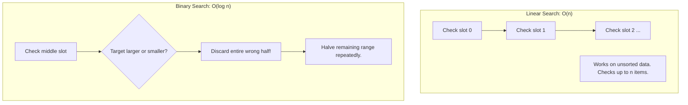
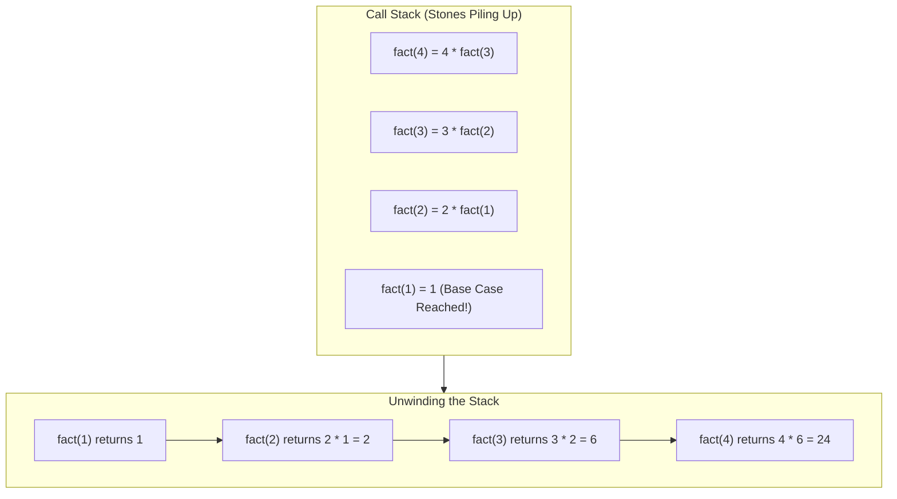

<Concepts
  items={[
    "linear search",
    "binary search",
    "Big O notation",
    "recursion",
    "base cases",
    "the call stack",
  ]}
/>

<LessonIntro>
  Storing data is only half the battle; finding items efficiently when
  collections scale to millions of entries is what separates amateur scripts
  from production systems. This module introduces search algorithms, Big O
  growth, and the mechanics of recursion.
</LessonIntro>

## Part 1: Linear Search vs. Binary Search

How do you find a specific name in a list of $n$ items?



<AnalogyCard name="The Phone Book Lookup">
  <div>
    <strong>Linear Search (Page by Page)</strong>
    <p>
      Starting at page 1 and scanning every single name until you find{" "}
      <em>"Smith"</em>. Honest and simple, but takes hundreds of tedious page
      turns.
    </p>
  </div>
  <div>
    <strong>Binary Search (Halving the Book)</strong>
    <p>
      Opening to the exact middle (letter M). Since S comes after M, you
      immediately rip away the first half of the book. Repeat with the remaining
      half.
    </p>
  </div>
</AnalogyCard>

<LessonDiagram id="itp-m8" />
<LessonDiagram
  id="itp-m8-halving"
  caption="Binary search halving: Each comparison eliminates half of the remaining candidates, reaching the target in logarithmic time."
/>

---

### The Power of Big O: $O(n)$ vs. $O(\log n)$

**Big O notation** measures how the runtime of an algorithm scales as the dataset size ($n$) explodes:

| Dataset Size ($n$)        | Linear Search checks (Worst Case: $O(n)$) | Binary Search checks (Worst Case: $O(\log_2 n)$) | Speedup Ratio                  |
| ------------------------- | ----------------------------------------- | ------------------------------------------------ | ------------------------------ |
| **$10$** items            | $10$ checks                               | $\approx 4$ checks                               | $2.5\times$                    |
| **$1,000$** items         | $1,000$ checks                            | $\approx 10$ checks                              | $100\times$                    |
| **$1,000,000$** items     | $1,000,000$ checks                        | $\approx 20$ checks                              | **$50,000\times$ faster!**     |
| **$1,000,000,000$** items | $1,000,000,000$ checks                    | $\approx 30$ checks                              | **$33,000,000\times$ faster!** |

<LessonNote variant="myth" title="Binary search is always preferable">
**Misconception:** *"I should always use binary search because it is $O(\log n)$."*

**Reality:** Binary search **requires the list to be sorted**. If your list is unsorted, sorting it first takes $O(n \log n)$ time. For a single search on an unsorted list, a simple linear scan is faster.

</LessonNote>

---

## Part 2: Recursion & The Call Stack

**Recursion** occurs when a function solves a problem by calling itself on a smaller instance of the same problem.

Every recursive function requires two essential parts:

1. **The Base Case:** The exit condition where the recursion stops and returns a concrete answer.
2. **The Recursive Step:** The function calling itself with a smaller input.



<LessonNote variant="warning" title="Stack Overflow: Missing the Base Case">
  If you forget the base case, the function calls itself indefinitely. Each call
  allocates a stack frame in memory until the CPU exhausts all allocated stack
  space and crashes with a **`StackOverflowError`** (or `RecursionError` in
  Python).
</LessonNote>

---

## Code in Action: Multi-Language Comparison

<Tabs items={["Python", "JavaScript", "TypeScript", "Java", "C"]}>
  <Tab value="Python">
```python
# 1. Linear Search: Works on both sorted and unsorted lists
def linear_search(items, target):
    for i in range(len(items)):
        if items[i] == target:
            return i  # Found at index i
    return -1         # Not found

print(linear_search(["Alice", "Bob", "Charlie"], "Bob")) # 1

# 2. Binary Search: Requires SORTED list, runs in O(log n)

def binary_search(sorted_items, target):
lo = 0
hi = len(sorted_items) - 1

    while lo <= hi:
        mid = (lo + hi) // 2
        if sorted_items[mid] == target:
            return mid
        elif sorted_items[mid] < target:
            lo = mid + 1   # Target is in the right half
        else:
            hi = mid - 1   # Target is in the left half
    return -1

sorted_names = ["Ada", "Bob", "Carl", "Mia", "Zoe"]
print(binary_search(sorted_names, "Mia")) # 3

# 3. Recursion: Factorial (4! = 4 _ 3 _ 2 \* 1 = 24)

def factorial(n): # 1. Base case: Stops the chain
if n <= 1:
return 1 # 2. Recursive step: Smaller problem
return n \* factorial(n - 1)

print(factorial(4)) # 24

````
  </Tab>
  <Tab value="JavaScript">
```javascript
// 1. Linear Search: Works on both sorted and unsorted lists
function linearSearch(items, target) {
    for (let i = 0; i < items.length; i++) {
        if (items[i] === target) {
            return i; // Found at index i
        }
    }
    return -1; // Not found
}

console.log(linearSearch(["Alice", "Bob", "Charlie"], "Bob")); // 1

// 2. Binary Search: Requires SORTED list, runs in O(log n)
function binarySearch(sortedItems, target) {
    let lo = 0;
    let hi = sortedItems.length - 1;

    while (lo <= hi) {
        const mid = Math.floor((lo + hi) / 2);
        if (sortedItems[mid] === target) {
            return mid;
        } else if (sortedItems[mid] < target) {
            lo = mid + 1; // Right half
        } else {
            hi = mid - 1; // Left half
        }
    }
    return -1;
}

const sortedNames = ["Ada", "Bob", "Carl", "Mia", "Zoe"];
console.log(binarySearch(sortedNames, "Mia")); // 3

// 3. Recursion: Factorial (4! = 24)
function factorial(n) {
    // 1. Base case: Stops the chain
    if (n <= 1) {
        return 1;
    }
    // 2. Recursive step: Smaller problem
    return n * factorial(n - 1);
}

console.log(factorial(4)); // 24
````

  </Tab>
  <Tab value="TypeScript">
```typescript
// 1. Linear Search with generics
function linearSearch<T>(items: T[], target: T): number {
    for (let i = 0; i < items.length; i++) {
        if (items[i] === target) {
            return i;
        }
    }
    return -1;
}

console.log(linearSearch(["Alice", "Bob", "Charlie"], "Bob")); // 1

// 2. Binary Search on sorted array
function binarySearch(sortedItems: string[], target: string): number {
let lo: number = 0;
let hi: number = sortedItems.length - 1;

    while (lo <= hi) {
        const mid: number = Math.floor((lo + hi) / 2);
        if (sortedItems[mid] === target) {
            return mid;
        } else if (sortedItems[mid] < target) {
            lo = mid + 1;
        } else {
            hi = mid - 1;
        }
    }
    return -1;

}

const sortedNames: string[] = ["Ada", "Bob", "Carl", "Mia", "Zoe"];
console.log(binarySearch(sortedNames, "Mia")); // 3

// 3. Typed Recursion: Factorial
function factorial(n: number): number {
if (n <= 1) {
return 1; // Base case
}
return n \* factorial(n - 1); // Recursive step
}

console.log(factorial(4)); // 24

````
  </Tab>
  <Tab value="Java">
```java
public class SearchRecursionDemo {
    // 1. Linear Search
    public static int linearSearch(String[] items, String target) {
        for (int i = 0; i < items.length; i++) {
            if (items[i].equals(target)) {
                return i; // Found at index i
            }
        }
        return -1; // Not found
    }

    // 2. Binary Search: Requires SORTED array, runs in O(log n)
    public static int binarySearch(String[] sortedItems, String target) {
        int lo = 0;
        int hi = sortedItems.length - 1;

        while (lo <= hi) {
            int mid = lo + (hi - lo) / 2;
            int cmp = sortedItems[mid].compareTo(target);
            if (cmp == 0) {
                return mid;
            } else if (cmp < 0) {
                lo = mid + 1; // Right half
            } else {
                hi = mid - 1; // Left half
            }
        }
        return -1;
    }

    // 3. Recursion: Factorial (4! = 24)
    public static long factorial(int n) {
        // Base case
        if (n <= 1) {
            return 1;
        }
        // Recursive step
        return n * factorial(n - 1);
    }

    public static void main(String[] args) {
        String[] names = {"Alice", "Bob", "Charlie"};
        System.out.println(linearSearch(names, "Bob")); // 1

        String[] sortedNames = {"Ada", "Bob", "Carl", "Mia", "Zoe"};
        System.out.println(binarySearch(sortedNames, "Mia")); // 3

        System.out.println(factorial(4)); // 24
    }
}
````

  </Tab>
  <Tab value="C">
```c
#include <stdio.h>
#include <string.h>

// 1. Linear Search: Works on both sorted and unsorted arrays
int linear_search(const char *items[], int size, const char *target) {
for (int i = 0; i < size; i++) {
if (strcmp(items[i], target) == 0) {
return i; // Found at index i
}
}
return -1; // Not found
}

// 2. Binary Search: Requires SORTED array, runs in O(log n)
int binary_search(const char *sorted_items[], int size, const char *target) {
int lo = 0;
int hi = size - 1;

    while (lo <= hi) {
        int mid = lo + (hi - lo) / 2;
        int cmp = strcmp(sorted_items[mid], target);
        if (cmp == 0) {
            return mid;
        } else if (cmp < 0) {
            lo = mid + 1; // Target is in the right half
        } else {
            hi = mid - 1; // Target is in the left half
        }
    }
    return -1;

}

// 3. Recursion: Factorial (4! = 24)
long long factorial(int n) {
// Base case: Stops the call chain
if (n <= 1) {
return 1;
}
// Recursive step: Calls itself with smaller input
return n \* factorial(n - 1);
}

int main(void) {
const char \*names[] = {"Alice", "Bob", "Charlie"};
printf("Linear search: %d\n", linear_search(names, 3, "Bob")); // 1

    const char *sorted_names[] = {"Ada", "Bob", "Carl", "Mia", "Zoe"};
    printf("Binary search: %d\n", binary_search(sorted_names, 5, "Mia")); // 3

    printf("Factorial(4): %lld\n", factorial(4)); // 24
    return 0;

}

```
  </Tab>
</Tabs>

---

<TryIt
  question="If an array contains 1,024 sorted numbers, what is the maximum number of checks binary search needs to find any number or confirm it is absent?"
  options={[
    "1,024 checks",
    "512 checks",
    "11 checks (since 2^10 = 1,024)",
    "1 check"
  ]}
  answer="C"
  why="Because binary search cuts the remaining items in half on every step, log2(1024) = 10, meaning at most 10 or 11 checks are ever needed."
/>

<Takeaway>
Linear search works anywhere but slows down linearly ($O(n)$). Binary search is lightning-fast ($O(\log n)$) on sorted data. When writing recursion, always define your base case first.
</Takeaway>
```
