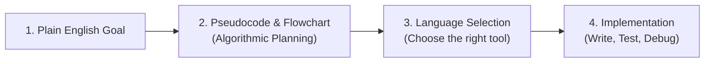

<Concepts
  items={[
    "pseudocode",
    "flowcharts",
    "planning algorithms",
    "language ecosystem",
    "shipping projects",
  ]}
/>

<LessonIntro>
  No professional engineer starts a project by blindly typing in the IDE.
  Writing software begins with planning: mapping algorithmic steps with
  **pseudocode** and **flowcharts** before choosing the language best suited for
  the task.
</LessonIntro>

## Part 1: Plan Before You Type

Trying to design logic while simultaneously worrying about semicolons, type signatures, and syntax rules overloads working memory.



<AnalogyCard name="The Road Trip Plan">
  <div>
    <strong>Planning in Daylight (Pseudocode)</strong>
    <p>
      Mapping your highway routes, gas stations, and hotel stops before packing
      the car. Catching a missing road on paper costs zero dollars.
    </p>
  </div>
  <div>
    <strong>Driving in the Dark (Blind Coding)</strong>
    <p>
      Starting the car and speeding down highways hoping you find lodging. When
      you hit a dead end, backtracking is frustrating and costly.
    </p>
  </div>
</AnalogyCard>

<LessonDiagram id="itp-m9" />

---

### What is Pseudocode?

Pseudocode is informal, human-readable language structured like code, with zero syntax constraints:

```text
ALGORITHM DivideTwoNumbers:
  Prompt user for number A
  Prompt user for number B
  IF B is equal to 0 THEN
    Display "Error: Division by zero is undefined"
  ELSE
    Calculate Result = A / B
    Display Result
  END IF
```

Notice how writing this immediately exposes the **edge case** (what if $B=0$?) _before_ writing a single line of Python or Java!

---

## Part 2: The Programming Language Landscape

There is no single "best" programming language. Each was engineered to optimize specific trade-offs:

| Category                          | Languages                | Best For                                                     | Characteristics                                                          |
| --------------------------------- | ------------------------ | ------------------------------------------------------------ | ------------------------------------------------------------------------ |
| **Web Presentation**              | HTML, CSS                | Structuring and styling web pages                            | Markup and design rules; not general programming                         |
| **Scripting & Rapid Prototyping** | Python, JavaScript, Ruby | Web development, automation scripts, data science, AI        | Fast to write, interpreted, forgiving syntax, massive package ecosystems |
| **General Purpose & Enterprise**  | Java, C#, Go             | Large enterprise backends, Android apps, microservices       | Strongly typed, robust tooling, maintainable across large teams          |
| **Systems & High Performance**    | C, C++, Rust             | Operating systems, game engines, embedded robotics, browsers | Direct memory control, zero runtime overhead, strict compilation         |

<LessonNote variant="myth" title="Planning wastes coding time">
**Misconception:** *"Time spent writing pseudocode or drawing diagrams is wasted time not writing code."*

**Reality:** Skipping the planning phase always incurs a massive penalty later in frustrating hours spent debugging flawed architecture. Planning catches logic flaws when they are cheapest to fix.

</LessonNote>

---

## Capstone Project: From Pseudocode to Code

Here is the divider algorithm and score evaluator implemented across Python, JavaScript, TypeScript, Java, and C, complete with input validation and zero-division guardrails:

<Tabs items={["Python", "JavaScript", "TypeScript", "Java", "C"]}>
  <Tab value="Python">
```python
# 1. The Core Function with defensive guardrails
def safe_divide(a, b):
    if b == 0:
        return "Error: Cannot divide by zero!"
    return a / b

# 2. Testing with predictable assertions

print(safe_divide(10, 2)) # 5.0
print(safe_divide(10, 0)) # Error: Cannot divide by zero!

# 3. Mini-capstone combining Conditionals, Loops, and Functions:

def evaluate_student_score(score):
if score >= 90:
return "A"
elif score >= 80:
return "B"
elif score >= 70:
return "C"
return "F"

# Process a batch of test scores

class_scores = [95, 82, 67, 100, 74]

for score in class_scores:
grade = evaluate_student_score(score)
print(f"Score {score} -> Grade {grade}")

````
  </Tab>
  <Tab value="JavaScript">
```javascript
// 1. Core Function with defensive guardrails
function safeDivide(a, b) {
    if (b === 0) {
        return "Error: Cannot divide by zero!";
    }
    return a / b;
}

// 2. Testing with predictable assertions
console.log(safeDivide(10, 2)); // 5
console.log(safeDivide(10, 0)); // Error: Cannot divide by zero!

// 3. Mini-capstone combining Conditionals, Loops, and Functions:
function evaluateStudentScore(score) {
    if (score >= 90) return "A";
    if (score >= 80) return "B";
    if (score >= 70) return "C";
    return "F";
}

// Process a batch of test scores
const classScores = [95, 82, 67, 100, 74];
for (const score of classScores) {
    const grade = evaluateStudentScore(score);
    console.log(`Score ${score} -> Grade ${grade}`);
}
````

  </Tab>
  <Tab value="TypeScript">
```typescript
// 1. Core Function with typed signatures and guardrails
function safeDivide(a: number, b: number): number | string {
    if (b === 0) {
        return "Error: Cannot divide by zero!";
    }
    return a / b;
}

// 2. Testing
console.log(safeDivide(10, 2)); // 5
console.log(safeDivide(10, 0)); // Error: Cannot divide by zero!

// 3. Mini-capstone with strict union return type
type LetterGrade = "A" | "B" | "C" | "F";

function evaluateStudentScore(score: number): LetterGrade {
if (score >= 90) return "A";
if (score >= 80) return "B";
if (score >= 70) return "C";
return "F";
}

const classScores: number[] = [95, 82, 67, 100, 74];
for (const score of classScores) {
const grade: LetterGrade = evaluateStudentScore(score);
console.log(`Score ${score} -> Grade ${grade}`);
}

````
  </Tab>
  <Tab value="Java">
```java
public class CapstoneDemo {
    // 1. The Core Function with defensive guardrails
    public static double safeDivide(double a, double b) {
        if (b == 0.0) {
            System.err.println("Error: Cannot divide by zero!");
            return Double.NaN;
        }
        return a / b;
    }

    // 2. Mini-capstone combining Conditionals and Functions
    public static char evaluateStudentScore(int score) {
        if (score >= 90) return 'A';
        if (score >= 80) return 'B';
        if (score >= 70) return 'C';
        return 'F';
    }

    public static void main(String[] args) {
        System.out.println("10 / 2 = " + safeDivide(10, 2));
        safeDivide(10, 0);

        int[] classScores = {95, 82, 67, 100, 74};
        for (int score : classScores) {
            char grade = evaluateStudentScore(score);
            System.out.println("Score " + score + " -> Grade " + grade);
        }
    }
}
````

  </Tab>
  <Tab value="C">
```c
#include <stdio.h>
#include <stdbool.h>

// 1. The Core Function with defensive guardrails
bool safe_divide(double a, double b, double *result) {
if (b == 0.0) {
printf("Error: Cannot divide by zero!\n");
return false;
}
*result = a / b;
return true;
}

// 2. Mini-capstone combining Conditionals and Functions
char evaluate_student_score(int score) {
if (score >= 90) return 'A';
if (score >= 80) return 'B';
if (score >= 70) return 'C';
return 'F';
}

int main(void) {
double res;
if (safe_divide(10.0, 2.0, &res)) {
printf("10 / 2 = %.1f\n", res); // 5.0
}
safe_divide(10.0, 0.0, &res); // Error: Cannot divide by zero!

    int class_scores[] = {95, 82, 67, 100, 74};
    int count = sizeof(class_scores) / sizeof(class_scores[0]);

    for (int i = 0; i < count; i++) {
        char grade = evaluate_student_score(class_scores[i]);
        printf("Score %d -> Grade %c\n", class_scores[i], grade);
    }

    return 0;

}

```
  </Tab>
</Tabs>

---

<TryIt
  question="You want to build a quick script to organize 5,000 files in a folder by date. Which language family is best suited for this task?"
  options={[
    "HTML and CSS",
    "A high-level scripting language like Python or Bash",
    "A low-level systems language like Assembly or C",
    "SQL (Structured Query Language)"
  ]}
  answer="B"
  why="Scripting languages provide built-in file system libraries, require minimal boilerplate, and let you write and run the automation in just a few lines."
/>

<Takeaway>
Plan before you type. Sketch your algorithm in pseudocode, consider the edge cases, pick the language that fits your domain, and start by building something small.
</Takeaway>
```
