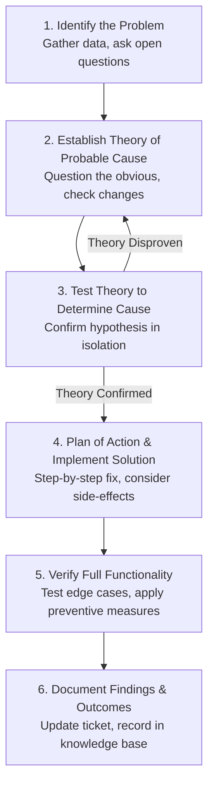
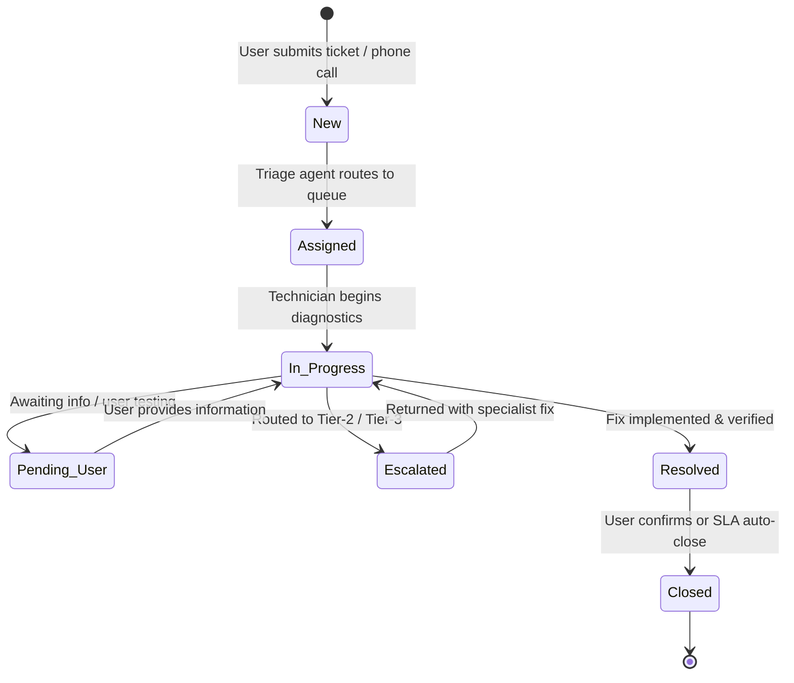

<Concepts
  items={[
    "6-step troubleshooting methodology",
    "root cause analysis",
    "isolating variables",
    "cookie crumb method",
    "avoiding autopilot",
    "ticketing lifecycle",
    "SLA tiers",
    "knowledge base documentation",
    "active listening",
  ]}
/>

<LessonIntro>

No technician, regardless of certifications or experience, knows the exact solution to every computer problem before they sit down at the desk. Hardware glitches, software conflicts, corrupted configurations, and human error interact in billions of unpredictable permutations. What separates an elite IT support professional from an amateur is not memorized fixes, but a disciplined, scientific diagnostic methodology.

This lesson explores the operational core of front-line technical support: the industry-standard 6-stage troubleshooting framework, practical root-cause isolation techniques, ticketing systems (ServiceNow, Jira, Zendesk), SLA priorities, documentation best practices, and the soft skills required to de-escalate stressed users during critical system outages.

</LessonIntro>

## Why this matters

- **Stopping "Autopilot" Guesswork:** Technicians who rely on gut instinct waste hours swapping random components or rebooting machines without understanding the underlying failure, frequently destroying forensic logs or causing data loss.
- **Minimizing Downtime:** Methodical triage narrows a universe of millions of possible points of failure down to a single faulty subsystem in minutes through systematic isolation.
- **Knowledge Sharing Across the Enterprise:** High-quality ticket documentation prevents "tribal knowledge" siloing. When an engineer documents an obscure printer driver bug or software incompatibility, the entire global helpdesk resolves identical issues immediately.
- **User Trust & De-escalation:** Technology failures trigger workplace anxiety and missed deadlines. Empathy, active listening, and clear communication transform stressful technical incidents into positive customer experiences.

---

## 01 — The 6-Stage IT Troubleshooting Framework

Adopted universally by Google IT Support, CompTIA A+, and ITIL service frameworks, this 6-stage lifecycle forms the mental backbone of technical support.


_Figure 19.1 — The 6-stage diagnostic cycle from initial customer contact to closing documentation._



### Stage 1: Identify the Problem

Before touching a keyboard or opening a screwdriver kit, gather comprehensive facts without making assumptions:

1. **Question the User with Open-Ended Inquiries:** Start broadly. Ask _"What specifically happens when you attempt to perform this action?"_ rather than _"Is the internet down?"_ Ask _"When was the last time this worked properly?"_ and _"Were there any error dialogs or unusual noises?"_
2. **Identify Recent Changes:** Ask _"Has anything changed on the computer or workspace recently?"_ Did the user install a software update, relocate their docking station, change their account password, or spill coffee near the keyboard?
3. **Review System & Application Logs:** Check Windows Event Viewer (System and Application logs) or Linux `/var/log/syslog` and `journalctl` to inspect timestamps corresponding to the reported failure.
4. **Reproduce the Issue:** Attempt to duplicate the error under the same conditions to observe the exact failure mode first-hand.

### Stage 2: Establish a Theory of Probable Cause

Formulate a logical hypothesis rooted in hardware and software fundamentals:

- **Question the Obvious First:** Are power cables plugged in securely? Is the monitor turned on? Is the physical Wi-Fi switch toggled off? Is caps lock enabled on the password screen? Over 30% of helpdesk calls trace back to simple physical disconnects.
- **Consider the Layers (Bottom-Up or Top-Down):** Use the physical-to-logical mental model. Check physical connections (cables, lights, ports) before inspecting operating system drivers, network IP configurations, or cloud application authentication.
- _(Need to verify network transport? Link out to our comprehensive [Computer Networking: Foundations](/docs/computer-networking/01-foundations) and [Layer 3 IP Routing](/docs/computer-networking/03-ip-addressing-and-routing) modules)._

### Stage 3: Test the Theory to Determine Cause

Test your hypothesis in isolation without introducing new variables:

- If your theory is that the display cable is damaged, swap _only_ the cable with a known-good cable. If the display works, your theory is confirmed.
- If your theory is disproven (the display still stays black with the new cable), **do not panic**. Revert the test cable, return to **Stage 2**, and formulate a new theory (e.g., monitor backlight failure or GPU driver crash).
- If an issue falls outside your technical permissions or scope (such as core firewall routing or database server corruption), escalate the ticket to Tier 2/Tier 3 engineering with your gathered testing evidence.

### Stage 4: Establish a Plan of Action & Implement the Solution

Once the root cause is confirmed, plan your repair systematically:

- **Assess Scope and Impact:** Will this fix require rebooting a production server, interrupting other users on the local network, or uninstalling mission-critical software?
- **Formulate a Rollback Plan:** Always know how to revert your changes if the fix fails or introduces collateral bugs (e.g., creating a system restore point or configuration backup).
- **Implement the Fix:** Apply the driver patch, replace the RAM stick, adjust the Windows Registry, or modify group permissions.

### Stage 5: Verify Full System Functionality & Implement Prevention

A fix is incomplete until the entire system operates normally:

- **Verify Beyond the Immediate Symptom:** If a laptop had malware removed, verify that antivirus definitions update properly, web browsers open corporate intranet sites, and network shares mount correctly.
- **Have the End-User Test:** Always have the user sit at their machine and perform their daily workflow (opening their specific spreadsheet or printing a test page). Their confirmation is the ultimate sign-off.
- **Implement Preventive Measures:** Prevent recurrence. If the problem was a ransomware infection from an unpatched browser, enforce automated browser updates or configure tighter endpoint security policies.

### Stage 6: Document Findings, Actions, and Outcomes

Documentation preserves solutions for the entire organization:

- Record the original symptom, the confirmed root cause, and the exact steps taken to remediate the problem in the ticketing system.
- Update or publish an article in the IT Knowledge Base (KB) so future technicians can resolve the issue in seconds.

---

## 02 — Essential Diagnostic Techniques

<ConceptCard name="Isolating Variables (Divide & Conquer)" category="Technique">

**What it is.** Testing one single component or software layer at a time to definitively pinpoint the source of failure.

**How it works.** If a user cannot connect to a website, an inexperienced tech might change the DNS server, reinstall Chrome, replace the Ethernet cable, and reset the router simultaneously. If connectivity returns, you have no idea which action resolved the issue, and you may have introduced three new misconfigurations. Test one variable, observe the result, and either keep or revert the change before moving to the next.

</ConceptCard>

### The Cookie Crumb / Reverse Breadcrumb Method

When troubleshooting an application or workflow that used to work but suddenly stopped, trace backwards step-by-step from the current broken state to the last known working state:

1. When was the last time the workflow completed successfully? (e.g., yesterday at 4 PM).
2. What happened between 4 PM yesterday and 9 AM today?
   - Did Windows Update install a patch overnight?
   - Did the user change their domain password?
   - Was a network switch restarted in the wiring closet?
3. Step backwards through the change timeline until you identify the delta (the difference that introduced the flaw).

### Avoiding Autopilot

<LessonNote variant="warning" title="The Trap of Diagnostic Autopilot">

**Autopilot** occurs when an IT technician encounters a symptom they have seen twenty times before and jumps immediately to their favorite fix without validating:

- _"Oh, Outlook won't open? Let me recreate your entire Outlook mail profile immediately."_
- Recreating the profile deletes local signatures, archives, and cached preferences. If the actual issue was a temporary Microsoft 365 cloud service outage, the technician just wasted 45 minutes and erased user data for nothing.
- **Rule:** Always check service status dashboards and verify the basics before executing destructive or time-intensive operations.

</LessonNote>

---

## 03 — Helpdesk Operations & The Ticketing Lifecycle

Modern enterprise IT departments manage thousands of support requests concurrently using centralized **ITSM (IT Service Management)** ticketing platforms such as Jira Service Management, ServiceNow, and Zendesk.



### Ticket Status Definitions

| Ticket Status              | Operational Meaning                                                                                                     | Action Required                                                                         |
| :------------------------- | :---------------------------------------------------------------------------------------------------------------------- | :-------------------------------------------------------------------------------------- |
| **New / Open**             | Ticket submitted via portal, email, or automated monitoring alert; unassigned.                                          | Triage lead reviews priority, categorizes category, and assigns to technician queue.    |
| **Assigned / In Progress** | A technician has claimed ownership and is actively diagnosing or resolving.                                             | Technician performs 6-step troubleshooting methodology and records progress notes.      |
| **Pending User / On Hold** | The technician cannot proceed without additional user information, physical device access, or third-party vendor parts. | SLA timer pauses; follow up with user within 24–48 hours.                               |
| **Escalated**              | The issue requires domain expertise or permissions beyond Tier-1 (e.g., DBA, Network Engineering).                      | Tier-1 technician documents all test results and transfers ownership with warm handoff. |
| **Resolved**               | The fix has been deployed and verified by the technician.                                                               | User is notified to test and confirm; feedback survey sent.                             |
| **Closed**                 | The user has confirmed the fix, or 72 hours have elapsed without objection.                                             | Ticket is locked; solution indexed in searchable ticket history.                        |

### SLA Priority Tiers (Service Level Agreements)

An SLA defines the contractual timeframe within which the IT department must respond to and resolve incidents based on **Impact** (how many users/systems are affected) and **Urgency** (how critical the affected business function is):

| Priority Level              | Example Scenario                                                                                             | Target Response Time | Target Resolution Time               |
| :-------------------------- | :----------------------------------------------------------------------------------------------------------- | :------------------- | :----------------------------------- |
| **P1 — Critical / Blocker** | Entire corporate ERP database offline; factory production line halted; global email down.                    | `< 15 minutes`       | `< 2 to 4 hours` (All hands on deck) |
| **P2 — High**               | Departmental network switch offline; CEO laptop failing before board presentation; payroll software down.    | `< 1 hour`           | `< 8 hours` (Same business day)      |
| **P3 — Medium**             | Single user cannot print to shared office printer (can use secondary printer); non-critical software error.  | `< 4 hours`          | `< 24 to 48 hours`                   |
| **P4 — Low / Request**      | New monitor requested; ergonomic keyboard setup; user requesting permission for software install next month. | `< 24 hours`         | `< 3 to 5 business days`             |

---

## 04 — Technical Documentation Standards

Technicians write two distinct types of documentation inside every support incident:

### Internal Technical Notes vs. External Customer Notes

<Tabs items={["Internal Technical Notes", "External Customer-Facing Notes"]}>
<Tab value="Internal Technical Notes">

#### Internal Technical Notes (For IT Staff)

- **Audience:** Fellow technicians, Tier-2/3 engineers, your future self.
- **Tone:** Precise, technical, and objective. Include exact error codes, paths, CLI commands, and test results.
- **Example:**
  ```text
  [Triage]: User workstation DEV-WIN-104 failing domain login with "Trust relationship failure".
  [Diagnostics]: Ran `nltest /sc_query:corp.contoso.com` -> Returned ERROR_NO_SUCH_DOMAIN (0x54b).
  Cached Kerberos tickets invalid. Verified physical Ethernet link active (IP: 10.20.4.52/24, Gateway: 10.20.4.1).
  [Resolution]: Logged in via local administrator credentials. Disjoined machine from domain to WORKGROUP,
  rebooted, and rejoined to corp.contoso.com using admin service account. Verified domain user AliceChen can
  successfully authenticate. Ticket resolved.
  ```

</Tab>
<Tab value="External Customer-Facing Notes">

#### External Customer Notes (For End Users)

- **Audience:** Non-technical employees, executives, external clients.
- **Tone:** Courteous, plain English, free of intimidating acronyms, focused on the outcome.
- **Example:**

  ```text
  Hi Alice,

  We have repaired the connection between your computer and the company network.
  Your laptop has been re-synchronized with our security system, and your standard
  login is now working properly.

  Please restart your computer, log in with your normal corporate password, and let
  us know if you encounter any difficulties accessing your shared files. Have a great day!
  ```

</Tab>
</Tabs>

### The Anatomy of an IT Knowledge Base (KB) Article

When resolving a recurring or complex problem, author a Knowledge Base article with these five standardized sections:

1. **Title:** Clear, symptom-oriented heading (e.g., _"How to Resolve 'Trust Relationship Failed' on Windows Laptops"_).
2. **Summary & Symptoms:** Brief paragraph describing how the issue manifests to the user.
3. **Environment / Affected Systems:** Specific OS versions, software releases, or hardware models affected.
4. **Step-by-Step Resolution:** Numbered instructions written clearly enough for a junior technician or tech-savvy user to follow without ambiguity.
5. **Root Cause Analysis (RCA):** Concise explanation of why the failure occurred to facilitate long-term bug fixes.

---

## 05 — Professional Soft Skills & User De-escalation

<AnalogyCard name="The Emergency Room Doctor">

**The concept.** When patients arrive at the emergency room, they are frightened, stressed, and experiencing pain. Doctors do not yell at them for getting injured or lecture them in obscure Latin medical terminology; they remain calm, ask targeted diagnostic questions, validate the patient's distress, and provide reassuring, competent care. IT support specialists are the emergency room physicians of corporate technology.

</AnalogyCard>

### Practical Communication Protocols

1. **Practice Active Listening:** Allow the user to finish explaining their problem completely without cutting them off mid-sentence. Summarize their issue back to them: _"If I understand correctly, every time you click 'Export to PDF' in Excel, the application freezes and fails to save your monthly ledger. Is that accurate?"_
2. **Translate Jargon into Everyday Concepts:** Never say _"Your DHCP lease expired and your NIC dropped into APIPA 169.254 space."_ Instead, say _"Your computer was unable to receive a valid network address from the office router, so it cannot talk to the internet right now. Let me reset the connection."_
3. **Never Blame the User:** If a user clicked a phishing link or unplugged their monitor cable with their foot, do not shame or ridicule them. Blaming users ensures they will hide future incidents from IT, creating massive security hazards.
4. **Acknowledge Frustration Empathically:** _"I understand how stressful it is to have your email stop working right before the client presentation. Let's work together to get this running for you."_

---

## Summary Checklist: Helpdesk Troubleshooting Mental Model

1. **Follow the 6 steps relentlessly:** (1) Identify problem, (2) Establish theory, (3) Test theory, (4) Plan & implement, (5) Verify & prevent, (6) Document.
2. **Isolate one variable at a time:** Never change multiple cables, drivers, and network settings simultaneously.
3. **Look for recent changes:** Ask the user what changed, when it last worked, and trace back using the cookie crumb technique.
4. **Resist diagnostic autopilot:** Verify symptoms and check service status dashboards before jumping to time-consuming profile wipes or OS reinstalls.
5. **Manage SLAs with transparency:** Communicate clear timeframes, update tickets consistently, and distinguish between internal technical logs and user-facing explanations.

---

<QuickRecall title="Quick Recall — Helpdesk Operations & Troubleshooting">

Before moving to System Administration, test your recall:

1. In the 6-stage troubleshooting methodology, what must a technician do immediately after testing a theory if the test fails to resolve the problem?
2. What is the fundamental difference between an Internal Ticket Note and an External Customer Note?
3. A company's primary enterprise database goes offline, preventing all warehouses from shipping orders. What SLA priority level does this incident represent, and what is the typical expected response window?
4. Why is "diagnostic autopilot" dangerous during IT support operations?

<details>
<summary>Reveal answers</summary>

1. **Establish a New Theory or Escalate** — If testing disproves the theory, revert any test modifications and return to Stage 2 to formulate a new hypothesis based on the gathered evidence, or escalate to a senior tier if beyond scope.
2. **Audience and Language** — Internal notes contain technical forensic detail (error codes, CLI output, registry paths) for IT engineers; external notes explain the outcome in polite, jargon-free plain language for the non-technical customer.
3. **P1 (Priority 1 / Critical Blocker)** — Requiring an immediate response within 15 minutes and all-hands continuous triage until resolution.
4. **Risk of Unnecessary Destruction and Misdiagnosis** — Autopilot causes technicians to make knee-jerk assumptions based on past incidents, risking data loss, deleted profiles, and wasted time when the true root cause was entirely different (e.g., an external cloud outage).

</details>

</QuickRecall>
