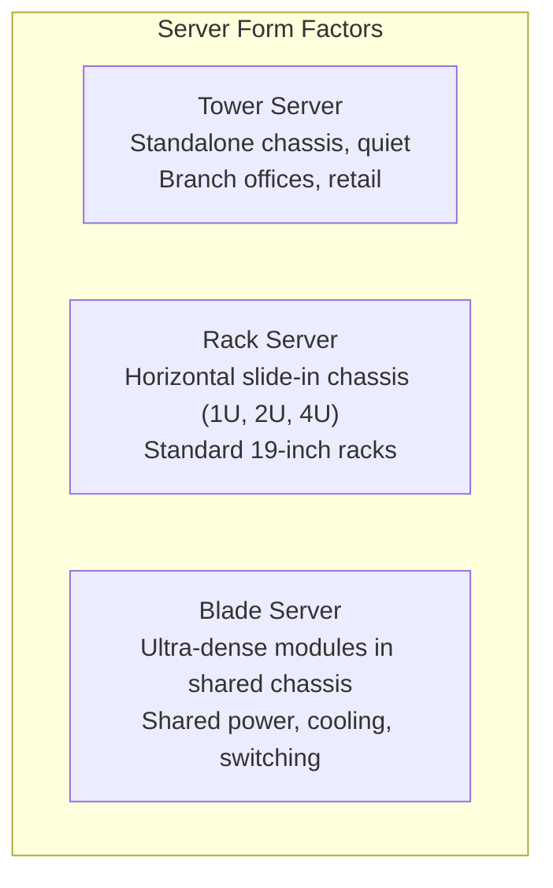
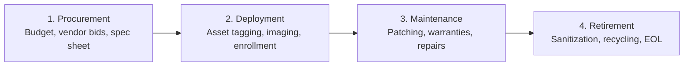
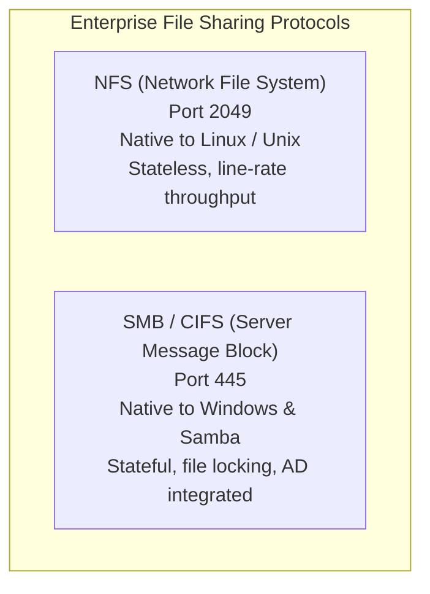
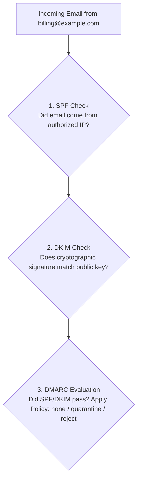
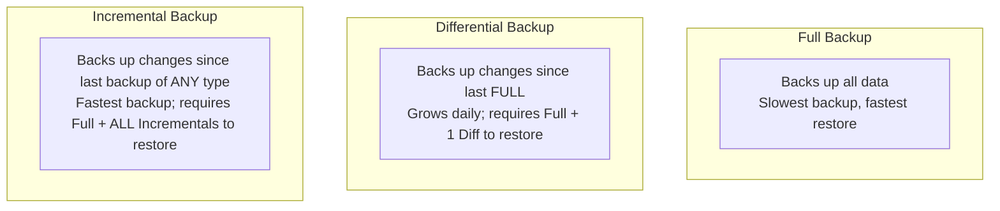

<Concepts
  items={[
    "System Administrator",
    "server form factors",
    "rack units (U)",
    "asset lifecycle management",
    "NIST 800-88 sanitization",
    "Change Advisory Board (CAB)",
    "NFS vs SMB",
    "CUPS",
    "SPF DKIM DMARC",
    "NTP synchronization",
    "3-2-1 backup strategy",
    "RTO vs RPO",
  ]}
/>

<LessonIntro>

While helpdesk specialists focus on client endpoints and individual user support, the **Systems Administrator (SysAdmin)** operates one abstraction layer higher: designing, provisioning, securing, and maintaining the shared infrastructure that powers the enterprise. If the network is the highway system, the infrastructure services are the power plants, water towers, and emergency response services running the entire digital city.

This lesson explores enterprise infrastructure operations: from physical server hardware and data center environmental engineering to IT asset lifecycles, formal change management, shared file storage protocols (NFS and SMB), enterprise email authentication (SPF, DKIM, DMARC), network time synchronization (NTP), and mission-critical backup methodologies.

</LessonIntro>

## Why this matters

- **Uptime and Revenue:** An enterprise outage costs large corporations tens of thousands of dollars per minute. SysAdmins architect redundant systems with failover to guarantee uninterrupted operations.
- **Data Permanence & Ransomware Defense:** Hardware drives fail, employees accidentally delete directories, and ransomware cryptolockers infect shares. Rigorous backup strategies ensure an organization can survive catastrophic events without paying ransoms.
- **Governed Stability (Change Control):** Over 70% of major outages are self-inflicted by uncoordinated software updates or hasty configuration edits. Change management frameworks ensure changes are vetted, scheduled, and reversible.
- **Security at the Perimeter and Core:** Centralizing services like time synchronization, DNS, and file shares reduces the attack surface and guarantees that security policies apply uniformly to thousands of connected clients.

---

## 01 — Server Hardware, Form Factors, and Data Centers

Unlike consumer desktops designed for quiet operation and personal use, enterprise servers are built for continuous 24/7/365 computation, massive I/O throughput, hot-swappable redundancy, and high-density physical packaging.


_Figure 20.1 — Systems administrators conducting acceptance testing and infrastructure commissioning in an enterprise data center environment._

### Server Physical Form Factors



1. **Tower Servers:**
   - Look like standard desktop towers; self-contained cooling and power supplies.
   - Quiet acoustic profile; ideal for small branch offices, retail backrooms, or medical clinics without dedicated server rooms.
2. **Rack Servers:**
   - Horizontal chassis designed to slide into standard **19-inch equipment racks**.
   - Height is measured in standardized **Rack Units (U)**, where **1U = 1.75 inches (44.45 mm)**.
   - Common sizes include 1U (dense compute nodes), 2U (versatile workhorses with multiple PCIe slots and 8–24 drive bays), and 4U (large GPU compute or storage arrays).
3. **Blade Servers:**
   - Strip away individual power supplies, fans, and external cabling. Multiple thin "blades" slide into a shared **blade enclosure (chassis)** that provides centralized power, cooling, management, and high-speed network backplanes.
   - Delivers maximum compute density and reduced cable clutter in large enterprise data centers.

### Server Room & Data Center Environmental Controls

Enterprise servers produce tremendous heat and require strict environmental safeguards:

- **Hot Aisle / Cold Aisle Layout:** Racks are arranged in alternating rows so that server front air intakes face "cold aisles" (flooded with conditioned cool air, typically 18°C–22°C / 64°F–72°F), while server rear exhaust vents blow into "hot aisles" where hot air is captured and returned to cooling units.
- **Raised Flooring:** Perforated floor tiles deliver pressurized cold air from below while providing concealed routing channels for data and power cables.
- **Power Redundancy:** Servers feature dual **hot-swappable Power Supply Units (PSUs)** plugged into independent **Power Distribution Units (PDUs)** fed by separate utility grids, backed by **Uninterruptible Power Supplies (UPS battery banks)** and on-site diesel generators.
- **Clean Agent Fire Suppression:** Traditional water sprinklers destroy electronics. Modern server rooms utilize gaseous clean agents like **FM-200** or **Novec 1230** that chemically suppress fire without water, leaving no residue and allowing equipment to continue running safely.
- **Out-of-Band (OOB) Management:** Dedicated microcontrollers on server motherboards (such as Dell **iDRAC**, HPE **iLO**, or open **IPMI**) have their own independent network ports and IP addresses. Administrators can power-cycle frozen servers, view virtual video consoles, and mount ISO install media remotely even when the host operating system is completely crashed.

---

## 02 — IT Asset & Vendor Lifecycle Management

Enterprise IT departments track and manage physical hardware and software licenses through four distinct lifecycle phases:



### The 4 Phases of Asset Management

1. **Procurement:** Assessing organizational needs, standardizing hardware models (e.g., standardizing on one laptop model to streamline imaging and spare parts), negotiating volume vendor pricing, and tracking purchase orders.
2. **Deployment (Provisioning & Staging):** Applying a physical barcode/RFID asset tag, logging the serial number and MAC address into the **ITAM (IT Asset Management)** database, imaging the OS via PXE/MDM, and assigning the asset to an employee.
3. **Maintenance & Patching:** Enforcing operating system updates, replacing swollen batteries, tracking warranty periods (typically 3 to 5 years), and managing software licensing compliance.
4. **Retirement & Decommissioning:** Securely sanitizing data, removing equipment from inventory registries, and partnering with certified e-waste recyclers.

### Secure Media Sanitization (NIST SP 800-88 Standards)

When decommissioning hard drives or transferring PCs to other departments, standard OS formatting is insufficient because deleted data can be recovered with forensic utilities. The US National Institute of Standards and Technology (**NIST SP 800-88**) defines three sanitization levels:

| Sanitization Level | Method & Mechanism                                                                                                                                                 | Appropriate Use Case                                                                  |
| :----------------- | :----------------------------------------------------------------------------------------------------------------------------------------------------------------- | :------------------------------------------------------------------------------------ |
| **Clear**          | Logical overwriting of all addressable storage locations with fixed patterns (zeros or pseudorandom data) using tools like `shred`, `dd`, or DBAN.                 | Re-issuing a computer to another employee within the same organization.               |
| **Purge**          | Cryptographic Erase (sanitizing self-encrypting SSD keys) or **Degaussing** (exposing magnetic platters to powerful magnetic fields, destroying magnetic domains). | Decommissioning drives containing sensitive company records or intellectual property. |
| **Destroy**        | Physical destruction through industrial shredding (disintegrating platters/chips to particles `< 2mm`), incineration, or hydraulic hole punching.                  | Highest classification data; defective drives that cannot be overwritten or purged.   |

### Vendor Lifecycles: EOL vs. EOSL

- **End of Life (EOL):** The manufacturer ceases production and sales of the hardware model or software version. Bug fixes and security patches may continue for a contracted transition period.
- **End of Service Life (EOSL):** The manufacturer completely terminates all technical support, firmware updates, and critical security vulnerability patches. Running EOSL operating systems (like Windows 7 or Server 2008) in production violates regulatory compliance standards (HIPAA, PCI-DSS) and creates severe security liabilities.

---

## 03 — Change Management & The "Nines" of Availability

<ConceptCard name="Change Management" category="Operational Discipline">

**What it is.** A structured framework to prepare, review, schedule, and approve modifications to IT infrastructure, minimizing unintended service disruption.

**How it works.** Before any major update, network re-routing, or firewall rule change occurs, the engineer submits an **RFC (Request for Change)** detailing the modification, the business justification, the testing completed, the scheduled maintenance window, and a mandatory **rollback/backout plan** if unexpected errors arise.

</ConceptCard>

### The Change Advisory Board (CAB)

The **Change Advisory Board (CAB)** is a cross-functional committee (composed of SysAdmins, network engineers, security leads, and business operations managers) that convenes regularly to evaluate high-risk RFCs. The CAB assesses:

- Does this change conflict with other scheduled maintenance?
- Has the update been validated in an isolated staging environment?
- What is the downtime impact on users and customer transactions?
- If the change fails, can it be rolled back before the business day begins?

### The "Nines" of High Availability (HA)

High availability measures the percentage of time an IT service remains operational and accessible over a full calendar year (8,760 hours):

| Availability Metric | Percentage Uptime | Maximum Allowed Downtime Per Year | Typical Context                                      |
| :------------------ | :---------------- | :-------------------------------- | :--------------------------------------------------- |
| **Two Nines**       | `99.0%`           | **3.65 days** (87.6 hours)        | Non-critical internal lab tools                      |
| **Three Nines**     | `99.9%`           | **8.76 hours**                    | Standard business applications                       |
| **Four Nines**      | `99.99%`          | **52.56 minutes**                 | Enterprise cloud databases, core switches            |
| **Five Nines**      | `99.999%`         | **5.26 minutes**                  | Telecommunications, financial trading, emergency 911 |

---

## 04 — Centralized IT Infrastructure Services

In a corporate environment, workstations do not act as isolated islands; they rely on centralized network services to store files, print documents, deliver emails, and synchronize clocks.

### Centralized File Sharing: NFS vs. SMB



<Tabs items={["SMB / CIFS", "NFS", "NAS vs SAN"]}>
<Tab value="SMB / CIFS">

#### SMB / CIFS (Server Message Block)

- **Default Port:** `TCP 445`.
- **Ecosystem:** Native to Microsoft Windows, supported on macOS and Linux via the **Samba** daemon (`smbd`).
- **Characteristics:** Stateful protocol with robust file-locking mechanisms, integrated with Windows Active Directory permissions (NTFS ACLs), and supports transparent end-to-end encryption (`SMB 3.0+`).
- **Typical Use:** Office user shares, department mapped drives (`Z:\`), and home folders.

</Tab>
<Tab value="NFS">

#### NFS (Network File System)

- **Default Port:** `TCP/UDP 2049`.
- **Ecosystem:** Native to Linux, Unix, and BSD operating systems.
- **Characteristics:** Lightweight, minimal protocol overhead, highly scalable for concurrent multi-client read/write streaming. Authentication historically relies on Unix UID/GID matching (or Kerberos in NFSv4).
- **Typical Use:** Mounting shared code repositories across Kubernetes clusters, database storage, and high-performance scientific computing.

</Tab>
<Tab value="NAS vs SAN">

#### NAS vs. SAN Architecture

- **NAS (Network Attached Storage):** A dedicated storage appliance connected over standard Ethernet providing **file-level access** via SMB or NFS (e.g., Synology, QNAP, NetApp).
- **SAN (Storage Area Network):** A specialized, high-speed storage network (typically using Fibre Channel or **iSCSI**) providing **block-level access**. To the operating system, a SAN volume appears as an unformatted raw physical disk drive.

</Tab>
</Tabs>

### Centralized Print Services: CUPS & Windows Spooling

Allowing hundreds of computers to communicate directly with physical office printers leads to print driver chaos, jammed job queues, and unmonitored printer supplies:

- **The Print Server Solution:** Clients send print jobs to a centralized print server running **CUPS (Common Unix Printing System)** on Linux/macOS or the **Windows Print Management** role.
- **Protocols:** Uses **IPP (Internet Printing Protocol, port 631)** or legacy LPR/LPD (port 515).
- **Benefits:** Single driver distribution point, centralized quota tracking, badge-release "follow-me" secure printing, and unified queue management.

### Enterprise Email Infrastructure & Anti-Spoofing Trilogy

_(For underlying TCP/IP transport foundations, review our [Computer Networking: Layer 4 Transport Protocols](/docs/computer-networking/04-protocols-and-cloud) guide)._

When an email travels from sender to recipient, multiple services interact:

- **Submission & Relay:** The sending email client transmits outgoing mail to a mail server via **SMTP (Simple Mail Transfer Protocol)** on secure port `587` (STARTTLS) or `465` (SMTPS). The mail server resolves the destination domain's **MX (Mail Exchanger)** record via DNS and relays the message across port `25`.
- **Mail Retrieval:** The recipient client fetches messages using **IMAP (Internet Message Access Protocol, port 993)**, which synchronizes email state and folders across all user devices, or legacy **POP3 (Post Office Protocol, port 995)**, which downloads and removes mail from the server.

#### The Anti-Spoofing Trilogy: SPF, DKIM, DMARC

Because the original SMTP protocol had zero built-in sender verification, malicious actors can forge email headers to impersonate corporate executives. Modern infrastructure deploys three defensive DNS records:



1. **SPF (Sender Policy Framework):** A DNS TXT record published by the domain owner listing the authorized IP addresses allowed to send email on behalf of the domain:
   ```text
   v=spf1 ip4:198.51.100.25 include:_spf.google.com ~all
   ```
2. **DKIM (DomainKeys Identified Mail):** The sending mail server attaches a cryptographic digital signature to the email header using its private key. The receiving server looks up the sender's public key in DNS to verify that the email was not altered in transit.
3. **DMARC (Domain-based Message Authentication, Reporting, and Conformance):** Links SPF and DKIM together. Instructs the receiving mail server what action to take if an incoming email fails SPF and DKIM verification:
   - `p=none`: Monitor only (deliver email, send telemetry report to domain admin).
   - `p=quarantine`: Divert failed email to the recipient's spam/junk folder.
   - `p=reject`: Completely drop the forged email at the mail gateway.

### Network Time Protocol (NTP) & Clock Synchronization

<ConceptCard name="Network Time Protocol (NTP)" category="Infrastructure Service">

**What it is.** A networking protocol operating over **UDP port 123** that synchronizes computer clocks across a network to within milliseconds of Coordinated Universal Time (UTC).

**Why it is critical.** Clock synchronization is not merely a matter of convenience:

- **Kerberos Authentication:** The Windows Active Directory Kerberos protocol rejects any authentication ticket if the client and Domain Controller clocks differ by more than **5 minutes** (to prevent replay attacks).
- **TLS Certificate Validation:** If a computer clock is set to 2015 or 2035, web browsers will reject all HTTPS certificates as expired or not yet valid.
- **Forensic Audit Logs:** Correlating events across firewalls, servers, and endpoints during a security investigation is impossible if system log timestamps are out of sync.

**Stratum Levels:** Stratum 0 (high-precision atomic clocks, GPS satellites) feeds Stratum 1 servers (direct link to atomic clocks), which in turn synchronize Stratum 2 enterprise servers, which finally sync client workstations.

</ConceptCard>

---

## 05 — Disaster Recovery, Backups, and Business Continuity

Hardware inevitably fails, floodwaters rise, and human beings click malicious ransomware attachments. SysAdmins ensure that when disaster strikes, company data remains recoverable.

### The 3-2-1 Backup Strategy

The industry gold standard for data resilience dictates:

- **3 Copies of Data:** Maintain three total copies of important business data (1 primary operational copy + 2 backup copies).
- **2 Different Media Types:** Store the copies on at least two distinct storage formats (e.g., fast local NVMe/NAS array + magnetic tape or independent cloud object storage).
- **1 Copy Off-Site:** Keep at least one copy in a geographically separate physical location (or immutable, air-gapped cloud bucket) to survive facility fires, power grid collapse, or ransomware cryptolockers traversing the local network.

### Backup Types Compared



| Backup Type             | What is Backed Up                                                                   | Daily Backup Speed & Size                                             | Restore Complexity                                                                               |
| :---------------------- | :---------------------------------------------------------------------------------- | :-------------------------------------------------------------------- | :----------------------------------------------------------------------------------------------- |
| **Full Backup**         | Every selected file and folder on the volume.                                       | **Slowest** (Requires full storage capacity every cycle).             | **Fastest** (Requires only the single full backup archive).                                      |
| **Differential Backup** | All files modified since the **last Full backup**.                                  | **Moderate** (Backup size grows larger each day following the full).  | **Fast** (Requires the baseline Full backup + the most recent Differential).                     |
| **Incremental Backup**  | Only files modified since the **most recent backup** (whether Full or Incremental). | **Fastest** (Smallest daily storage footprint and fastest execution). | **Slowest** (Requires the Full backup + every sequential Incremental backup up to the disaster). |

### Business Continuity Metrics: RTO vs. RPO

Disaster recovery planning balances financial cost against technical speed using two metrics:

<ConceptCard name="RTO vs. RPO" category="Metric">

- **RTO (Recovery Time Objective):** The maximum acceptable duration of clock time within which a computer system or business process must be restored after an outage. _(Example: "Our billing database has an RTO of 2 hours. If it remains down longer than 2 hours, the business suffers catastrophic financial breach.")_
- **RPO (Recovery Point Objective):** The maximum age of files or database records that an organization can afford to permanently lose when unexpected failure strikes, measured backwards in time. _(Example: "If we execute database backups every 15 minutes, our maximum data loss window in a disaster is 15 minutes, giving us an RPO of 15 minutes.")_

</ConceptCard>

---

## Summary Checklist: System Administration Mental Model

1. **Standardize form factors:** 1U/2U rack servers in 19-inch racks for density; blade enclosures for high-density compute clusters; tower chassis for quiet branch offices.
2. **Maintain environmental rigor:** Hot/cold aisle containment, redundant UPS/generator power, clean agent fire suppression, and out-of-band management (iDRAC/iLO).
3. **Follow NIST 800-88 sanitization:** Clear (overwrite) for internal reuse; Purge (degauss/cryptographic erase) for retired drives; Destroy (shred) for sensitive storage.
4. **Enforce Change Management:** Every major infrastructure adjustment requires an RFC, CAB review, approved maintenance window, and a verified rollback plan.
5. **Differentiate storage protocols:** SMB (port 445) for Windows/Samba users and file shares; NFS (port 2049) for Unix/Linux line-rate throughput and container clusters.
6. **Protect email with the trilogy:** SPF verifies sender IP; DKIM verifies cryptographic payload signature; DMARC enforces reject/quarantine policies.
7. **Keep time synced with NTP:** Prevent Kerberos authentication failures (5-minute drift limit) and SSL/TLS certificate rejections.
8. **Honor the 3-2-1 backup rule:** 3 copies, 2 media types, 1 offsite/immutable copy; test restores regularly to validate RTO and RPO targets.

---

<QuickRecall title="Quick Recall — System Administration & Infrastructure">

Test your understanding of enterprise infrastructure:

1. What standard height measurement corresponds to "1U" in a standard 19-inch server rack?
2. Why is water sprinkler fire suppression avoided in modern mission-critical server rooms, and what is used instead?
3. Which sanitization level under NIST SP 800-88 is required when permanently decommissioning a failed magnetic disk containing confidential corporate intellectual property?
4. Explain why a 6-minute clock drift between a Windows client laptop and an Active Directory Domain Controller causes authentication to fail.
5. In disaster recovery, what is the key difference between RTO and RPO?

<details>
<summary>Reveal answers</summary>

1. **1.75 inches (44.45 mm)** — The standard vertical height of one rack unit (1U).
2. **Water Destroys Electronics and Causes Short Circuits** — Data centers use clean gaseous extinguishing agents (such as FM-200 or Novec 1230) that chemically interrupt combustion without leaving moisture, residue, or damaging operational computing equipment.
3. **Purge (Degaussing / Cryptographic Erase) or Physical Destruction (Shredding)** — Standard logical clearing/overwriting is insufficient for high-risk confidential assets; physical shredding or degaussing is required.
4. **Kerberos Protocol Replay Attack Tolerance** — Kerberos relies on timestamped authentication tickets to prevent eavesdroppers from intercepting and replaying tickets. If client and Domain Controller clocks deviate by more than 5 minutes, tickets are rejected as invalid.
5. **Time to Recover vs. Permissible Data Loss** — RTO (Recovery Time Objective) measures how fast systems must be restored (downtime duration); RPO (Recovery Point Objective) measures how much data loss in time is acceptable (the age of the most recent backup).

</details>

</QuickRecall>
