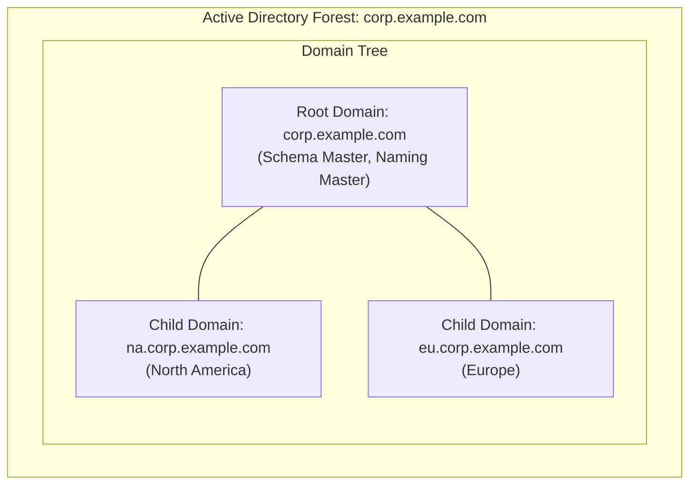
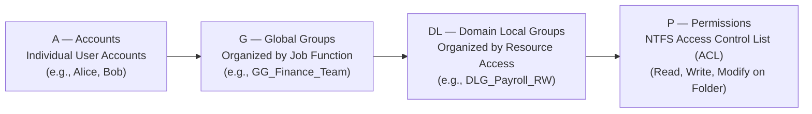
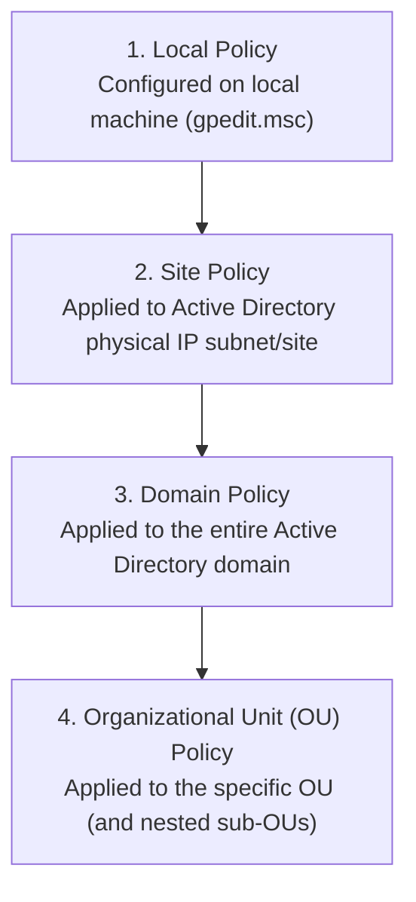
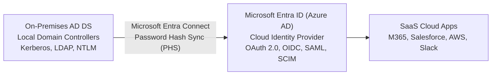

<Concepts items={["Directory Service", "LDAP", "Directory Information Tree (DIT)", "Distinguished Name (DN)", "Active Directory Domain Services (AD DS)", "Domain Controller", "FSMO roles", "Organizational Unit (OU)", "Group Policy Object (GPO)", "SYSVOL", "AGDLP principle", "Microsoft Entra ID"]} />

<LessonIntro>

Imagine an enterprise with 5,000 employees and 6,000 computers. If each workstation relied purely on its local operating system accounts (the Windows SAM database or Linux `/etc/passwd`), onboarding a single new employee would require an IT technician to physically log into hundreds of machines to create a local username and password. Terminating an employee would require manually deleting that account from every device.

A **Directory Service** solves this existential scalability crisis by centralizing user identities, group memberships, computer accounts, and security policies into a single, replicated, network-accessible database. This lesson examines the architecture of modern enterprise identity: the open **LDAP** standard, Microsoft **Active Directory Domain Services (AD DS)**, FSMO master roles, Group Policy enforcement, and modern hybrid cloud federation.

</LessonIntro>

## Why this matters

* **Single Source of Truth:** Centralized identity means an employee logs into workstations, email, VPNs, and file shares with one set of credentials managed in one unified console.
* **Instant Deprovisioning (Zero-Trust):** When an employee departs, disabling their single directory account immediately revokes access across all company endpoints, servers, and cloud applications.
* **Fleet-Wide Configuration Governance:** Through **Group Policy (GPO)**, a systems administrator can enforce BitLocker disk encryption, deploy software updates, or configure firewall rules across 10,000 computers in a single click.
* **Role-Based Access Control (RBAC):** Group hierarchies enable precise, audit-compliant permission delegation without cluttering individual user accounts with hundreds of direct ACL entries.

---

## 01 — What is a Directory Service? Local vs. Centralized Identity

<ConceptCard name="Directory Service" category="Core Infrastructure">

**What it is.** A specialized database optimized for fast read, search, and lookup operations that maps network resources (users, groups, servers, printers) to attributes (email, phone, group memberships, public keys).

**How it works.** Unlike relational databases (such as PostgreSQL or MySQL) tuned for high-volume transactions and frequent writes, a directory service experiences a write ratio of roughly 1% (account creation, password resets) compared to 99% reads (authenticating logons, checking group access tokens). It organizes records in a hierarchical tree structure rather than flat tables.

</ConceptCard>

### Local Security Database vs. Centralized Directory

| Architecture Dimension | Local OS Identity (Workgroup / Standalone) | Centralized Directory Service (Domain) |
| :--- | :--- | :--- |
| **Account Storage** | Stored in local workstation database (`C:\Windows\System32\config\SAM` or `/etc/shadow`). | Stored in centralized, replicated database (`ntds.dit` across all Domain Controllers). |
| **Credential Scope** | Valid *only* on the single physical machine where it was created. | Valid across *all* domain-joined workstations, servers, and network services. |
| **Administrative Overhead** | Exponential: $O(U \times M)$ where $U$ is users and $M$ is machines. | Linear: $O(U)$ — configure user once, accessible everywhere. |
| **Password Policy** | Must be manually configured on each machine via local policy. | Centrally defined once and universally enforced via domain policy. |
| **Device Management** | No centralized remote management or automated software distribution. | Fully governed via Group Policy Objects (GPO) and Mobile Device Management (MDM). |

---

## 02 — LDAP: Lightweight Directory Access Protocol

Before exploring proprietary platforms like Microsoft Active Directory, we must understand the foundational open protocol that powers them: **LDAP (Lightweight Directory Access Protocol)**, standardized under RFC 4511.


*Figure 21.1 — The hierarchical LDAP Directory Information Tree (DIT) mapping root domain components down to organizational units and leaf objects.*

### The Directory Information Tree (DIT)

LDAP organizes information in an inverted tree called the **Directory Information Tree (DIT)**. Every node in the tree is an **Entry**, composed of **Attributes** (key-value pairs) defined by a strict **Schema**:
* **Root Node:** Typically maps to the top-level internet domain name using **Domain Components (`dc`)**.
* **Containers & OUs:** Branches that organize objects, defined as **Organizational Units (`ou`)**.
* **Leaf Objects:** Endpoints that cannot contain child objects, such as individual users, computers, or security groups, defined by **Common Names (`cn`)**.

### Understanding Distinguished Names (DN)

To uniquely locate any specific object in an LDAP directory, you specify its **Distinguished Name (DN)**. A DN reads from the specific leaf object backward up through the container branches to the root of the tree:

```text
dn: CN=Alice Chen, OU=Engineering, DC=corp, DC=example, DC=com
```

Let us dissect the structural components:
* `CN=Alice Chen`: **Common Name** — The specific name of the leaf object (the user).
* `OU=Engineering`: **Organizational Unit** — The departmental container housing the user.
* `DC=corp, DC=example, DC=com`: **Domain Components** — The domain name structure representing `corp.example.com`.

<ConceptCard name="Relative Distinguished Name (RDN)" category="LDAP Syntax">

**What it is.** The leftmost portion of a DN that identifies the object relative to its immediate parent container.

**Example.** In `CN=Alice Chen, OU=Engineering, DC=corp, DC=example, DC=com`, the RDN is simply `CN=Alice Chen`. Two objects can share the same RDN (`CN=Alice Chen`) as long as they reside in different OUs (e.g., `OU=Marketing` vs `OU=Engineering`).

</ConceptCard>

### LDAP Network Ports & Security

* **Unencrypted LDAP:** Operates over **TCP port 389**. Credentials and search queries are sent across the wire in cleartext; strictly deprecated in enterprise production.
* **LDAP over SSL/TLS (LDAPS):** Operates over **TCP port 636**. Tunnels directory traffic through an encrypted TLS session, preventing credential sniffing.
* **Global Catalog (Active Directory):** Operates on port **3268** (unencrypted) and **3269** (LDAPS) for fast cross-domain attribute lookups.

---

## 03 — Microsoft Active Directory Domain Services (AD DS)

Microsoft Active Directory Domain Services (**AD DS**) is the enterprise implementation of LDAP, Kerberos authentication, and DNS integrated into the Windows Server operating system.



### The Logical Hierarchy: Objects, OUs, Domains, Trees, and Forests

1. **Objects:** The basic atomic units of Active Directory (a user account, a security group, a shared network printer, or a domain-joined workstation).
2. **Organizational Units (OUs):** Sub-containers within a domain used to organize objects logically (by department, geographic office, or device type). OUs are the smallest unit to which a Systems Administrator can link **Group Policy Objects (GPOs)** or delegate administrative permissions.
3. **Domains:** The core administrative boundary. All objects inside a domain share a common directory database (`ntds.dit`), common security policies, and identical domain-wide password rules.
4. **Trees:** A collection of one or more domains that share a contiguous DNS namespace (e.g., `na.corp.example.com` and `eu.corp.example.com` form a tree under `corp.example.com`).
5. **Forests:** The top-level container and ultimate security boundary in Active Directory. A forest encompasses all domains, trees, and schema definitions. Domains within the same forest automatically share **two-way transitive Kerberos trust relationships**.

### The Physical Components: Domain Controllers and DNS Integration

* **Domain Controller (DC):** A Windows Server running the AD DS role. DCs store the local copy of the directory database, process logon requests, authenticate users via Kerberos, and replicate changes to peer DCs.
* **DNS Integration:** Active Directory cannot function without DNS. When a client workstation attempts to log in, it queries DNS for specialized **SRV (Service) records** (specifically `_ldap._tcp.dc._msdcs.<domain>`) to locate an active Domain Controller on the local subnet. *(Review [Computer Networking: DNS Architecture](/docs/computer-networking/04-protocols-and-cloud/02-dns) for deep dive into SRV records).*

### FSMO Roles: Flexible Single Master Operations

While most Active Directory modifications are multi-master (any Domain Controller can create a user or change an email address and replicate it to others), five critical operations require single-master consistency to prevent conflicts. These are called the **FSMO Roles**:

| FSMO Role | Scope | Critical Responsibility |
| :--- | :--- | :--- |
| **Schema Master** | **Forest-Wide** (1 per forest) | Controls modifications to the underlying directory database schema (adding new attributes or object classes). |
| **Domain Naming Master** | **Forest-Wide** (1 per forest) | Manages the addition or removal of domains within the forest to prevent duplicate domain names. |
| **RID (Relative ID) Master** | **Domain-Wide** (1 per domain) | Allocates pools of unique relative identifiers (RIDs) to each DC. When a DC creates an object, it combines the domain SID with a RID to form a globally unique Security Identifier. |
| **PDC Emulator** | **Domain-Wide** (1 per domain) | Primary time synchronizer (Stratum-1/2 NTP source), authoritative processor of password changes and account lockouts, and legacy compatibility master. |
| **Infrastructure Master** | **Domain-Wide** (1 per domain) | Translates and synchronizes cross-domain object references (e.g., when a user from Domain A is added to a security group in Domain B). |

---

## 04 — Active Directory Groups & The AGDLP Principle

Active Directory provides two types of groups:
* **Distribution Groups:** Used exclusively for email distribution lists (Exchange / Outlook); cannot be assigned security permissions.
* **Security Groups:** Can be assigned access permissions (ACLs) to file shares, printers, and registries, and can also double as email distribution lists.


*Figure 21.2 — Active Directory group scope nesting hierarchy illustrating how accounts roll into Global Groups, Domain Local Groups, and finally file system permissions.*

### Group Scopes: Domain Local, Global, and Universal

| Group Scope | Can Contain Members From | Can Be Assigned Permissions In | Primary Architectural Purpose |
| :--- | :--- | :--- | :--- |
| **Global Group (GG)** | Only the **same domain** where the group exists. | **Any domain** across the entire forest. | Grouping users with identical business roles (e.g., `GG_Accountants`, `GG_SoftwareEngineers`). |
| **Domain Local Group (DLG)** | **Any domain** across the forest or trusted forests. | Only the **local domain** where the group exists. | Assigning permissions to a specific resource (e.g., `DLG_Finance_Folder_ReadWrite`). |
| **Universal Group (UG)** | **Any domain** across the entire forest. | **Any domain** across the entire forest. | Cross-domain multi-forest collaboration; replicated across the Global Catalog. |

### The AGDLP Role-Based Access Control Principle

To maintain a scalable, clean permissions architecture that never degrades into unmanageable spaghetti permissions, Microsoft mandates the **AGDLP Rule**:



* **Step 1:** Add user **A**ccounts into **G**lobal Groups representing their departmental role (`Alice` -> `GG_Finance_Team`).
* **Step 2:** Place the **G**lobal Group inside a **D**omain **L**ocal Group that represents access to a specific resource (`GG_Finance_Team` -> `DLG_PayrollShare_Modify`).
* **Step 3:** Assign NTFS **P**ermissions on the physical folder *only* to the **D**omain **L**ocal Group.
* **Result:** When an employee joins or leaves accounting, you simply add or remove them from `GG_Finance_Team`. You never touch file share ACLs directly.

---

## 05 — Group Policy Objects (GPO) & Fleet Governance

<ConceptCard name="Group Policy Object (GPO)" category="Fleet Administration">

**What it is.** A collection of administrative settings, security configurations, and software installation scripts stored in Active Directory that automatically enforce compliance across all domain-joined Windows machines.

**How it works.** GPOs apply to two targets: **Computer Configuration** (applied when the physical machine boots up, before user logon) and **User Configuration** (applied when a user signs in).

</ConceptCard>

### GPO Inheritance and Processing Order: LSDOU

When a client computer boots and a user logs on, Windows processes Group Policies in a strict, sequential hierarchical order known as **LSDOU**:



<LessonNote variant="tip" title="The 'Last Applied Wins' Rule">

Policies are processed sequentially from **Local -> Site -> Domain -> OU**. By default, settings applied *later* in the evaluation chain override settings applied earlier. Therefore, an OU policy targeted specifically at the `Engineering` OU overrides a conflicting setting established at the top-level `Domain` level.

* **Block Inheritance:** An OU administrator can toggle "Block Inheritance" to prevent parent Domain policies from trickling down.
* **Enforced (No Override):** A top-level Domain Administrator can mark a critical security GPO as **Enforced**, which forcefully overrides any "Block Inheritance" flags below it.

</LessonNote>

### The SYSVOL Share

GPOs do not store their policy script templates inside the `ntds.dit` database directly. Instead, they reside in a special replicated network share on each Domain Controller located at:
```text
\\<DomainName>\SYSVOL\<DomainName>\Policies\{GUID}
```
SYSVOL replicates across all Domain Controllers using **DFSR (Distributed File System Replication)** so that client machines can fetch policies from whatever DC is physically closest.

### Essential Group Policy CLI Diagnostics

When troubleshooting a machine where policies fail to apply, open PowerShell or Command Prompt as Administrator:

```powershell
# Force an immediate re-evaluation and application of all GPOs without waiting 90 minutes
gpupdate /force

# Display a command-line summary of applied GPOs and security group memberships
gpresult /r

# Generate an exhaustive HTML diagnostic report of applied and denied GPOs
gpresult /h C:\temp\GPOReport.html
```

---

## 06 — Hybrid Identity: Active Directory to Microsoft Entra ID

As organizations migrate corporate infrastructure to the cloud (Microsoft 365, AWS, Salesforce, Google Workspace), traditional on-premises Active Directory connects to cloud identity providers:



### On-Premises AD DS vs. Microsoft Entra ID (Azure AD)

| Feature | On-Premises Active Directory (AD DS) | Microsoft Entra ID (formerly Azure AD) |
| :--- | :--- | :--- |
| **Hosting Model** | On-premises physical or virtual server infrastructure. | Multi-tenant cloud identity-as-a-service (IDaaS). |
| **Protocols** | Kerberos, NTLM, LDAP, DNS, SMB. | Modern web standards: **OAuth 2.0**, **OpenID Connect (OIDC)**, **SAML 2.0**. |
| **Device Join** | Domain Join (requires line-of-sight to DC over LAN/VPN). | Entra ID Join (registers over the public internet via HTTPS). |
| **Policy Engine** | Group Policy Objects (GPO). | Microsoft Intune / Mobile Device Management (MDM) configuration profiles. |
| **Authentication Flow** | Kerberos ticket granting (`TGT` on port 88). | Encrypted JSON Web Tokens (`JWT`) transmitted over HTTPS (port 443). |

---

## Summary Checklist: Directory Services & Active Directory

1. **Centralize identity:** Centralized directories eliminate local SAM account sprawl and enable instant, enterprise-wide deprovisioning.
2. **Master LDAP DN syntax:** Read DNs from leaf to root: `CN=User, OU=Department, DC=domain, DC=com`.
3. **Understand AD DS logical boundaries:** OUs organize resources and hold GPOs; Domains establish security boundaries; Forests encompass the entire schema and transitive trusts.
4. **Identify FSMO roles:** Schema Master and Domain Naming Master (forest-wide); RID Master, PDC Emulator, and Infrastructure Master (domain-wide).
5. **Enforce the AGDLP principle:** Accounts -> Global Groups -> Domain Local Groups -> Permissions. Never assign NTFS ACLs directly to user accounts.
6. **Remember LSDOU processing:** Local -> Site -> Domain -> OU. The last applied policy wins unless a parent policy is Enforced.
7. **Diagnose GPOs with CLI:** Use `gpupdate /force` to refresh policies and `gpresult /r` or `gpresult /h` to audit which GPOs succeeded or failed.
8. **Bridge to the cloud:** Modern hybrid enterprises synchronize on-premises AD to Microsoft Entra ID using Entra Connect, translating Kerberos/LDAP into OAuth/OIDC/SAML tokens for SaaS applications.

---

<QuickRecall title="Quick Recall — Directory Services & Active Directory">

Verify your understanding of directory architecture:

1. In an LDAP directory, what do the abbreviations `CN`, `OU`, and `DC` represent?
2. Which FSMO role is responsible for acting as the authoritative network time source (NTP) and immediately processing account lockouts and password changes?
3. Under the AGDLP access control framework, what type of Active Directory group should be directly assigned NTFS permissions on a shared network folder?
4. In what order does Windows process Group Policy Objects, and which policy wins if a setting at the Domain level conflicts with a setting at the OU level?
5. Why does modern cloud identity (Microsoft Entra ID) utilize protocols like OAuth 2.0 and SAML instead of Kerberos and LDAP?

<details>
<summary>Reveal answers</summary>

1) **Common Name, Organizational Unit, and Domain Component** — `CN` represents the leaf object (user/group/computer), `OU` represents the container folder, and `DC` represents the domain name parts.
2) **PDC Emulator (Primary Domain Controller Emulator)** — Handles time synchronization, urgent password replication, and domain-wide lockout validation.
3) **Domain Local Group (DLG)** — Permissions are assigned strictly to Domain Local Groups; Global Groups (containing user accounts) are nested inside the Domain Local Group.
4) **LSDOU (Local -> Site -> Domain -> OU) / OU Wins** — Policies apply sequentially; because OU is evaluated last, the OU policy setting overrides the Domain setting (unless the Domain policy is marked "Enforced").
5) **Web and Internet Compatibility** — Kerberos and LDAP rely on internal private network ports (88, 389) and direct line-of-sight to Domain Controllers over LAN/VPN; OAuth 2.0, OIDC, and SAML transmit secure JSON/XML tokens over HTTPS (port 443), enabling secure identity across cloud services and mobile devices without private VPN connections.

</details>

</QuickRecall>
