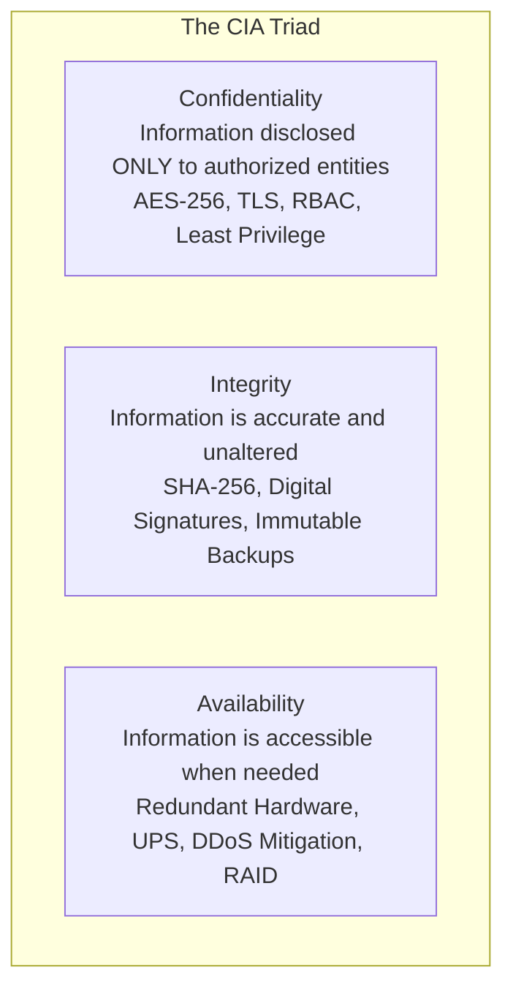
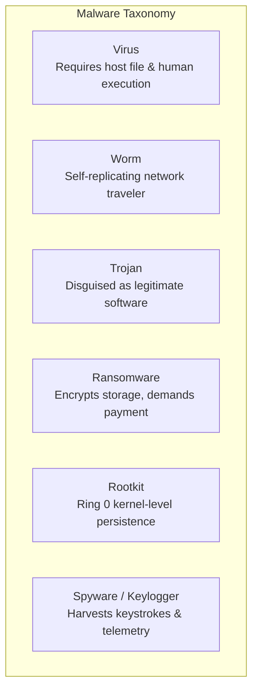
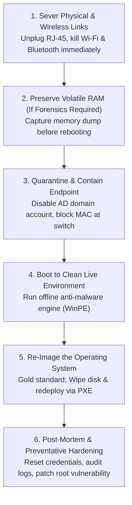
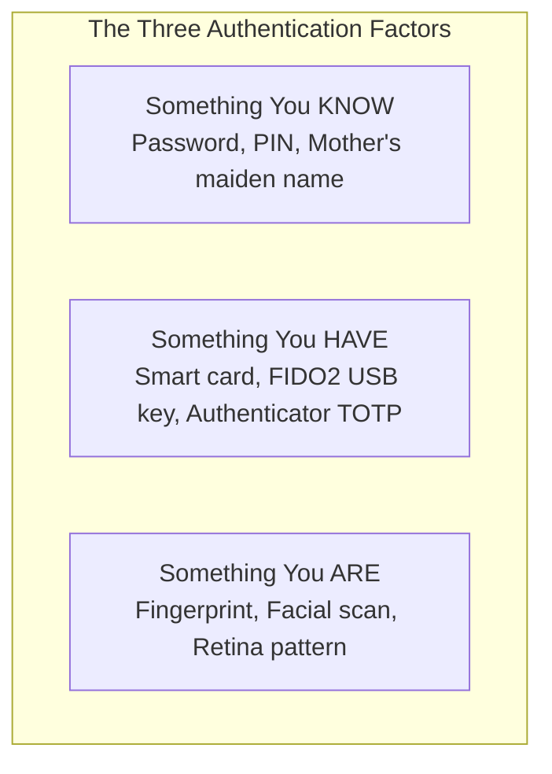

<Concepts
  items={[
    "CIA triad",
    "threat vs vulnerability vs exploit",
    "malware taxonomy",
    "ransomware",
    "botnet architecture",
    "infection quarantine procedure",
    "denial of service (DoS)",
    "DNS poisoning",
    "Man-in-the-Middle (MitM)",
    "brute force vs dictionary",
    "password salting and hashing",
    "social engineering",
    "physical access security",
  ]}
/>

<LessonIntro>

In technical support, making computers work is only half the profession; the other half is preventing adversaries from abusing that computing power. Modern corporate endpoints and servers operate under constant probe from automated botnets, phishing syndicates, and sophisticated ransomware cartels seeking unauthorized access to proprietary data and customer financial records.

This lesson explores defense against digital dark arts: the foundational **CIA Triad**, the mechanics of malware and botnets, the emergency quarantine procedure every technician must execute during an active outbreak, network and authentication attack vectors, social engineering psychological tactics, and physical facility security safeguards.

</LessonIntro>

## Why this matters

- **Ransomware Survival:** A single infected laptop connected to the corporate LAN can encrypt shared network drives across hundreds of servers within minutes. Rapid endpoint quarantine halts the spread before catastrophe strikes.
- **Preserving Digital Integrity:** Breaches compromise more than confidentiality; tampering with medical databases, financial ledgers, or product blueprints can endanger human lives and collapse business operations.
- **The Human Element:** Technology defenses like firewalls and 256-bit AES encryption cannot stop an employee from willingly typing their corporate password into a convincing spoofed login page. Recognizing social engineering tactics is paramount.
- **Regulatory & Legal Liability:** Failure to enforce security safeguards violates legal compliance frameworks (GDPR, HIPAA, PCI-DSS), resulting in millions of dollars in regulatory fines and irreparable brand damage.

---

## 01 — Security Foundations: The CIA Triad & Threat Modeling

Every security policy, firewall rule, and encryption algorithm ever designed exists to protect one or more pillars of the **CIA Triad**:


_Figure 22.1 — The CIA Triad: Confidentiality, Integrity, and Availability form the triangular bedrock of information security._



<ConceptCard name="The CIA Triad" category="Security Model">

1. **Confidentiality:** Preventing unauthorized disclosure of data. Achieved through strong encryption at rest (BitLocker, LUKS) and in transit (HTTPS, TLS, IPsec), strict Role-Based Access Control (RBAC), and the principle of least privilege.
2. **Integrity:** Guaranteeing that data is authentic, accurate, and has not been maliciously modified or accidentally corrupted. Achieved through cryptographic hashing (SHA-256), digital signatures, and database audit logs.
3. **Availability:** Ensuring authorized users have reliable, timely access to systems and information. Achieved through redundant power supplies, multi-zone server failover, RAID disk arrays, offsite backups, and DDoS mitigation services.

</ConceptCard>

### Threat vs. Vulnerability vs. Exploit

To communicate cleanly during a security incident, technicians must distinguish between three commonly conflated terms:

- **Vulnerability:** A flaw, bug, or misconfiguration in software or hardware that weakens security (e.g., an unpatched buffer overflow in a web server). Vulnerabilities are cataloged globally in the **CVE (Common Vulnerabilities and Exposures)** database and scored from `0.0` to `10.0` via the **CVSS (Common Vulnerability Scoring System)**.
- **Threat:** Any external or internal actor, circumstance, or event with the potential to adversely impact operations (e.g., a cybercriminal cartel, a disgruntled ex-employee, or a hurricane).
- **Exploit:** The specific software code, script, or sequence of commands developed by a threat actor that takes advantage of a vulnerability to compromise a system.
- **Risk:** The mathematical probability of a threat exploiting a vulnerability multiplied by the resulting operational impact: $\text{Risk} = \text{Threat} \times \text{Vulnerability} \times \text{Impact}$.

---

## 02 — Malware Taxonomy & Attack Mechanics

**Malware (Malicious Software)** is any code deliberately designed to infiltrate, damage, or compromise computer systems without the owner's informed consent.



| Malware Type            | Infection & Propagation Vector                                                                                            | Primary Malicious Payload                                                                                              | Real-World Example                                   |
| :---------------------- | :------------------------------------------------------------------------------------------------------------------------ | :--------------------------------------------------------------------------------------------------------------------- | :--------------------------------------------------- |
| **Virus**               | Attaches code to legitimate executable files (`.exe`, `.docx` macros); requires human action to run.                      | Corrupts local files, formats partitions, displays unwanted messages.                                                  | CIH / Chernobyl, Melissa                             |
| **Worm**                | Self-propagating; scans local subnets and the internet to exploit network vulnerabilities with **no human intervention**. | Consumes network bandwidth, drops backdoors, deploys ransomware payloads.                                              | WannaCry (exploited MS17-010 EternalBlue), Conficker |
| **Trojan Horse**        | Masquerades as legitimate software (a free game, PDF converter, or cracked software).                                     | Installs a hidden **Remote Access Trojan (RAT)**, opening backdoors for attackers.                                     | Emotet, DarkComet                                    |
| **Ransomware**          | Phishing email attachments, unpatched RDP ports, or software supply-chain compromises.                                    | Encrypts local and network storage volumes with unbreakable AES-256/RSA keys, demanding cryptocurrency payment.        | LockBit, Conti, REvil                                |
| **Rootkit**             | Infiltrates operating system kernel space (Ring 0) or motherboard UEFI firmware.                                          | Intercepts system APIs to hide its files, network connections, and processes from Task Manager and antivirus scanners. | Sony BMG Rootkit, Stuxnet                            |
| **Keylogger / Spyware** | Bundled with freeware, malicious browser extensions, or dropped by Trojans.                                               | Silently records keystrokes, webcam feeds, clipboard data, and credentials, exfiltrating them to an external server.   | Agent Tesla, Pegasus                                 |

---

## 03 — Botnets and Command & Control (C2) Architecture

A **Botnet** is a distributed network of thousands or millions of compromised computing devices (called **zombies** or **bots**) infected with malware and controlled remotely by a central adversary called a **Botmaster**.


_Figure 22.2 — Botnet Command and Control (C2) architecture illustrating how infected zombie endpoints receive coordinated instructions from a central controller._

### The Lifecycle of a Botnet

1. **Infiltration & Recruitment:** The attacker scans the public internet for vulnerable IoT devices (webcams, home routers with default passwords) or distributes malware via phishing campaigns to infect desktop computers.
2. **Beaconing & C2 Connection:** Once executed, the infected bot calls home to a **Command and Control (C2)** server using HTTP, IRC, DNS tunneling, or peer-to-peer (P2P) channels.
3. **Coordinated Exploitation:** The botmaster issues synchronized instructions across the zombie fleet:
   - **Volumetric DDoS Attacks:** Flooding targeted websites with millions of bogus requests per second.
   - **Credential Stuffing:** Attempting billions of stolen username/password combinations across banking sites simultaneously.
   - **Cryptomining:** Hijacking CPU/GPU compute cycles to mine cryptocurrency.

---

## 04 — Step-by-Step Malware Quarantine & Incident Response

When an IT technician encounters an actively infected machine displaying ransomware alerts, suspicious network traffic, or unauthorized administrative actions, they must act decisively.



<LessonNote variant="critical" title="Emergency Step 1: Immediate Network Isolation">

**Do NOT simply power off the machine or wait for a scan to finish!**

1. **Unplug the physical Ethernet cable (RJ-45) immediately.**
2. **Toggle off physical Wi-Fi and Bluetooth switches** or disconnect from wireless networks.
3. **Disconnect any attached USB flash drives or external backup drives** to prevent the malware from leaping onto connected storage media.
4. If the machine is connecting via corporate VPN from home, terminate the active VPN tunnel from the corporate firewall console immediately.

</LessonNote>

### The 6 Stages of Endpoint Incident Response

1. **Network Severance & Isolation:** Cut all network links immediately to prevent ransomware from propagating across shared SMB shares or receiving instructions from C2 servers.
2. **Forensic Memory Capture (Optional / Enterprise):** If criminal investigation or regulatory compliance (e.g., breach notification laws) requires digital forensics, do _not_ power down the machine, as RAM contents will vanish. Use tools like `WinPmem` or FTK Imager to take a volatile memory snapshot.
3. **Account & Access Revocation:** Immediately disable the affected user's Active Directory and Microsoft Entra ID accounts from a separate, clean administrator workstation. Revoke all active SSO session tokens and reset passwords.
4. **Offline Diagnostic Scans:** Boot the quarantined computer using a clean, write-protected USB drive containing a bootable rescue environment (e.g., Windows PE or Linux Live environment with updated antivirus engines). Scanning from an external OS ensures rootkits hiding inside the host kernel cannot suppress scanner alerts.
5. **The Enterprise Gold Standard: Wipe & Re-Image:**
   - In enterprise IT support, **never attempt to simply "clean" an infected production machine and hand it back to an employee**.
   - Sophisticated advanced persistent threats (APTs) leave hidden registry hooks, secondary backdoors, or modified system binaries that standard antivirus scanners miss.
   - **The Standard Operating Procedure:** Back up verified non-executable user documents (plain text, CSVs) from clean backups, perform a full cryptographic wipe/format of the disk, and re-image the machine cleanly via PXE/MDM.
6. **Root-Cause Analysis & Prevention:** Determine how the malware entered (was it an unpatched Adobe Reader bug? An employee opening a fake invoice attachment?). Patch the vulnerability across the entire fleet and conduct targeted security awareness training.

---

## 05 — Network & Infrastructure Attacks

_(For foundational packet headers and subnetting, explore our [Computer Networking: Foundations](/docs/computer-networking/01-foundations) and [Protocols & Cloud](/docs/computer-networking/04-protocols-and-cloud) modules)._

### Denial of Service (DoS) & Distributed DoS (DDoS)

- **SYN Flood:** Exploits the TCP three-way handshake (`SYN` -> `SYN-ACK` -> `ACK`). The attacker transmits millions of `SYN` requests with spoofed source IPs and deliberately ignores the server's `SYN-ACK` replies, exhausting the server's connection memory tables.
- **Amplification Attacks (DNS & NTP Reflection):** The attacker sends small UDP requests to publicly open DNS or NTP servers, spoofing the victim's IP address as the sender. The servers respond to the victim with massive data payloads (up to 50x to 100x magnification), overwhelming the victim's internet pipe.

### Man-in-the-Middle (MitM) & ARP Spoofing

On a local Ethernet network, switches use **ARP (Address Resolution Protocol)** to map IP addresses to physical MAC addresses. Because ARP has no built-in authentication, an attacker can broadcast forged ARP replies asserting: _"I have IP 192.168.1.1 (the default gateway), and my MAC address is AA:BB:CC:DD:EE:FF."_

- Workstations update their local ARP cache and begin sending all outbound internet traffic directly to the attacker's machine, allowing the attacker to intercept, inspect, or modify cleartext packets before forwarding them to the real router.
- **Defenses:** Dynamic ARP Inspection (DAI) on managed enterprise switches, 802.1X port authentication, and universal TLS/HTTPS encryption.

### Wireless Attacks: Rogue APs & Evil Twin

- **Rogue Access Point:** An unauthorized wireless router or Wi-Fi hotspot plugged into an office Ethernet wall jack without IT authorization, bypassing corporate perimeter firewalls.
- **Evil Twin Attack:** An attacker sets up a portable Wi-Fi access point broadcasting the identical SSID (e.g., `"Company_Guest_WiFi"`) as the legitimate office network, but with a stronger radio signal. When employee laptops automatically associate with the stronger signal, the attacker captures login credentials and traffic.

---

## 06 — Authentication Hardening: Passwords, Hashing, and MFA

### Password Attacks

- **Brute-Force Attack:** An automated script systematically attempts every possible combination of letters, numbers, and symbols (`aaaa`, `aaab`, `aaac`...) until the correct password matches.
- **Dictionary Attack:** Uses a wordlist of hundreds of thousands of common passwords, dictionary words, and leaked credentials (`P@ssw0rd123`, `Winter2024!`).
- **Credential Stuffing:** Attackers take massive lists of leaked username/password combinations stolen from one breached website and automatically test them against thousands of other banking and corporate portals, exploiting user password reuse.

### Cryptographic Salting & Slow Hashing

Modern operating systems and web applications never store plain-text passwords. When a user creates a password, the system applies a cryptographic hash function:

```text
Hash("Secret123") -> 5e884898da28047151d0e56f8dc6292773603d0d6aabbdd62a11ef721d1542d8
```

However, if two users choose the same password, their hashes are identical, allowing attackers to crack millions of hashes simultaneously using precomputed **Rainbow Tables**.

<ConceptCard name="Cryptographic Salting" category="Defensive Cryptography">

**What it is.** Appending a unique, random string of characters (the **Salt**) to a user's password _before_ running it through the hash function.

$$\text{Stored Value} = \text{Salt} + \text{Hash}(\text{Password} + \text{Salt})$$

**Why it defeats attacks.** Even if 1,000 users all choose `"P@ssword1"`, each user has a unique random salt, resulting in 1,000 completely distinct hashes. Rainbow tables become completely useless, forcing attackers to crack each individual user account one by one.

**Slow Hashing Algorithms:** Systems use deliberately computationally expensive hashing algorithms like **bcrypt**, **Argon2**, and **PBKDF2** that require significant CPU time and memory, slowing down brute-force cracking tools from billions of guesses per second to a few hundred.

</ConceptCard>

### Multi-Factor Authentication (MFA)

Authentication relies on three fundamental factors:



- **Multi-Factor Authentication (MFA)** requires providing verification from **two or more distinct categories**. Providing a password and a PIN is _not_ MFA; both represent "Something You Know".
- **Authentication Strength Ranking:**
  1. **FIDO2 / WebAuthn Hardware Security Keys (YubiKey):** Cryptographically bound to the specific browser domain; 100% immune to phishing and reverse-proxy credential harvesting.
  2. **Authenticator App TOTP (Time-Based One-Time Password):** Generates 6-digit rolling codes every 30 seconds (Google Authenticator, Microsoft Authenticator).
  3. **SMS / Email OTP (Weakest):** Highly vulnerable to **SIM swapping attacks** (socially engineering telecom carriers into transferring a phone number to an attacker's SIM) and SS7 cellular network interception.

---

## 07 — Social Engineering & Physical Facility Security

The most formidable cryptographic firewalls can be dismantled in seconds by manipulating human psychology:

### Social Engineering Attack Vectors

- **Phishing:** Broad, untargeted emails disguised as legitimate organizations (banks, delivery couriers) prompting users to click malicious links or download infected attachments.
- **Spear Phishing:** Highly customized, researched attacks targeting a specific individual, referencing their actual colleagues, current projects, or recent purchases to appear authentic.
- **Whaling:** Spear phishing targeted specifically at high-profile executives (CEO, CFO) to authorize fraudulent wire transfers or disclose executive compensation records.
- **Vishing (Voice Phishing):** Telephone-based impersonation (e.g., claiming to be the IT Helpdesk asking for remote access or using AI voice cloning to impersonate an executive).
- **Smishing (SMS Phishing):** Text messages urging immediate action ("Your package delivery failed, click here to confirm address").
- **Baiting:** Leaving infected USB flash drives labeled "Executive Payroll 2024" in company parking lots or lobbies, betting that an employee's curiosity will lead them to plug it into an office workstation.
- **Tailgating / Piggybacking:** An unauthorized person closely following an employee through a secure keycard door by pretending to hold heavy boxes or feigning a polite conversation.

### Physical Facility Security Safeguards

Digital security is impossible without physical control of the hardware:

- **Access Control Vestibules (Mantraps):** A physical entryway consisting of two interlocking doors where the second door cannot unlock until the first door has closed and the visitor's authentication (badge/biometrics) has been verified, completely preventing tailgating.
- **Security Bollards:** Heavy concrete or steel posts surrounding the exterior building perimeter to stop vehicle-ramming attacks against data center walls.
- **Cable Locks (Kensington Locks):** Physically tethering laptops and desktop chassis to heavy desks, preventing walk-away physical theft.
- **Clean Desk & Screen Privacy Policies:** Mandating that employees lock their screens whenever leaving desks (`Windows Key + L`), requiring privacy screen filters to prevent "shoulder surfing" in public spaces, and securing physical documents inside locked shredding bins.

---

## Summary Checklist: IT Security Mental Model

1. **Defend the CIA Triad:** Balance Confidentiality (encryption/RBAC), Integrity (hashing/signatures), and Availability (redundancy/backups).
2. **Classify malware accurately:** Viruses require hosts; Worms self-replicate over networks; Trojans disguise their payload; Ransomware encrypts storage; Rootkits hide inside Ring 0 kernels.
3. **Execute emergency quarantine instantly:** Physically unplug Ethernet, disable Wi-Fi/Bluetooth, and disconnect external drives at the first sign of active infection.
4. **Re-image, do not "patch" infected machines:** The enterprise gold standard is a full disk wipe and clean re-imaging via PXE/MDM.
5. **Mitigate network attacks:** Deploy Dynamic ARP Inspection against ARP spoofing, implement DNSSEC against cache poisoning, and monitor for rogue Wi-Fi access points.
6. **Enforce salted hashing & true MFA:** Salting defeats rainbow tables; Argon2/bcrypt slows brute-force cracking; enforce hardware FIDO2 or app-based TOTP over vulnerable SMS codes.
7. **Educate against social engineering:** Train users to identify phishing, spear phishing, vishing, and baiting; never blame users when reporting security incidents.
8. **Enforce physical boundaries:** Implement mantraps, bollards, RFID badge readers, and strict clean-desk policies.

---

<QuickRecall title="Quick Recall — IT Security & Incident Response">

Test your mastery of IT security fundamentals:

1. An employee's workstation suddenly displays a popup demanding \$1,000 in Bitcoin to decrypt their documents, and file extensions are changing across a network share. What is the very first physical action you must take?
2. Why is storing passwords with a simple cryptographic hash like SHA-256 considered insecure, and what technique must be applied to harden it?
3. What is the key difference between a computer virus and a computer worm?
4. In multi-factor authentication, an employee authenticates using their corporate domain password and an alphanumeric security PIN sent to their memory. Does this meet the standard for true MFA?
5. How does an "Access Control Vestibule" (Mantrap) physically prevent tailgating?

<details>
<summary>Reveal answers</summary>

1. **Disconnect the Physical Network Cable (RJ-45) and Kill Wi-Fi** — Immediately isolate the machine from the corporate LAN to stop ransomware from encrypting shared departmental network drives or communicating with its Command & Control server.
2. **Vulnerability to Rainbow Tables and High-Speed Hardware Cracking** — Raw hashes can be reversed instantly using precomputed rainbow tables or cracked at billions of guesses per second on modern GPUs. Passwords must be combined with a unique random **Salt** and processed using a slow hashing algorithm like **bcrypt** or **Argon2**.
3. **Human Interaction & Host File Requirement** — A virus requires a host file (e.g., an executable or macro) and human action to run and propagate; a worm is an autonomous standalone program that replicates and travels across computer networks automatically by exploiting unpatched vulnerabilities without any human intervention.
4. **No, Both Are the Same Factor ("Something You Know")** — True MFA requires factors from at least two distinct categories (Something you know, Something you have, Something you are). A password and a PIN are both "Something You Know".
5. **Interlocking Double Doors with Independent Authentication** — An access control vestibule features two doors; the second door remains securely locked until the first door closes and authentication (keycard/biometrics) is confirmed for a single occupant inside the intermediate chamber.

</details>

</QuickRecall>
