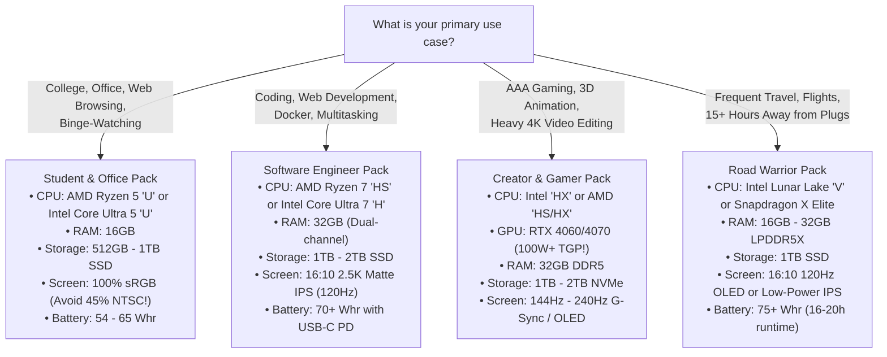
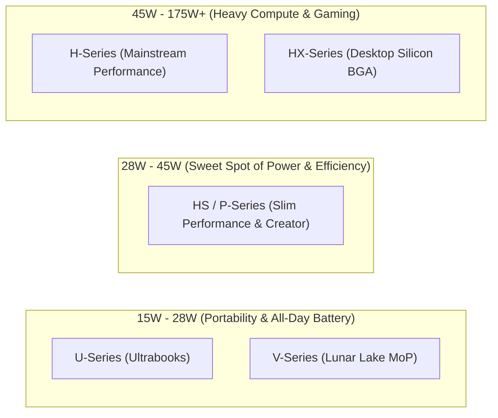
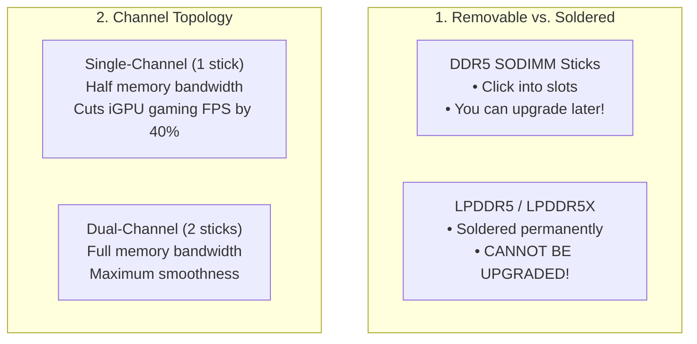
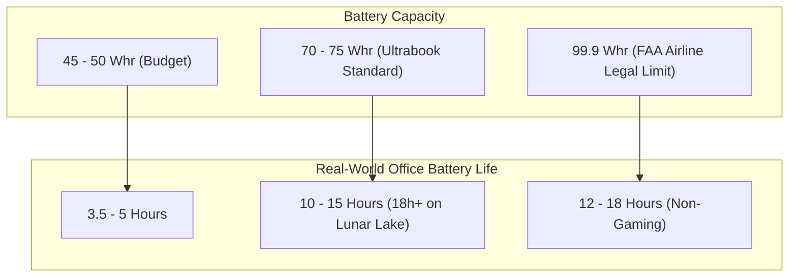
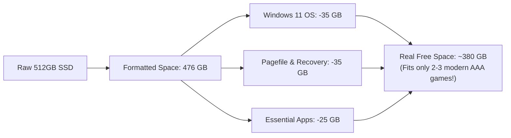

# The Ultimate Laptop Buying Guide: Silicon, Power & Specs

Buying a laptop today can feel overwhelming. Manufacturers fill spec sheets with confusing abbreviations: _TDP, TGP, LPDDR5X, PCIe Gen 4, 100% sRGB, 120Hz VRR, 75 Whr_. Even worse, computer brands frequently use deceptive marketing tricks—such as selling an "RTX 4070" that is crippled to half its power, or giving a budget laptop a screen that looks faded and washed out.

This comprehensive guide breaks down laptop hardware from **first principles into simple, everyday language**. Whether you are a student, programmer, gamer, or business professional, this guide equips you with the exact knowledge needed to get the best performance for your budget without falling into costly marketing traps.

---

## ⚡ 30-Second Quick Purchase Cheat Sheet

If you need a quick answer before diving into the details, match your needs to these golden rules:



---

## 01 — CPU Suffixes: The Real Power Story (U vs. HS vs. H vs. HX vs. V)

<Callout type="info">
  **💡 In Plain English:** Think of CPU wattage like a car engine. * A **"U"**
  chip is a fuel-sipping hybrid engine: runs cool, sips battery, quiet, but not
  meant for hauling heavy trailers. * An **"HS"** chip is a turbocharged V6:
  fast, responsive, and balanced. * An **"HX"** chip is a gas-guzzling
  twin-turbo V8: immense raw power, but empties the gas tank in 90 minutes and
  needs massive cooling fans.
</Callout>

A laptop processor's performance is not determined by its advertised "Boost Clock" (e.g., 5.0 GHz). It is determined by **how many Watts of continuous electricity (TDP) the laptop's cooling fans can sustain without overheating.**



### The CPU Suffix Decoder Table

| Suffix                 | Typical Wattage | Fan Noise & Heat        | Real Battery Life | Best For                                                                         |
| :--------------------- | :-------------- | :---------------------- | :---------------- | :------------------------------------------------------------------------------- |
| **U** (Ultra-Low)      | **15W – 28W**   | Silent or whisper quiet | **8 – 14 Hours**  | General office work, coding, web browsing, students.                             |
| **V** (Lunar Lake)     | **17W – 30W**   | Nearly silent           | **16 – 22 Hours** | Extreme battery endurance on Windows without performance compromises.            |
| **HS / P** (Balanced)  | **28W – 45W**   | Low to moderate         | **7 – 11 Hours**  | **The developer sweet spot.** Fast code compiles, multitasking, and slim gaming. |
| **H** (High Power)     | **45W – 65W**   | Audible fan whir        | **3 – 5 Hours**   | Mainstream gaming laptops and video editing rigs.                                |
| **HX** (Desktop Class) | **55W – 175W+** | Very loud under load    | **1.5 – 3 Hours** | Maximum raw speed. Desktop chip soldered into a thick laptop. Needs a wall plug. |

### How Intel Names Processors: Core vs. Core Ultra

- **Older Style (13th/14th Gen, e.g., Core i7-14700HX):** Powerful, but high idle power consumption. Battery drains quickly even when just reading an article.
- **Core Ultra Series 1 (Meteor Lake, e.g., Ultra 7 155H):** Added an AI engine (NPU) and improved battery efficiency with new low-power efficiency cores.
- **Core Ultra Series 2 (Lunar Lake, e.g., Ultra 7 258V):** Built on TSMC's 3nm process with memory mounted directly on the chip package. Delivers class-leading **16 to 22 hours of real-world battery life** while running all native Windows programs.

### The AMD Ryzen Decoder: Watch the 3rd Digit!

AMD's mobile naming convention can trick buyers who do not look closely. Look specifically at the **3rd digit**:

$$\text{Ryzen } 7 \ [Tier] \quad 8 \ [Performance] \quad \mathbf{4} \ [\mathbf{Architecture!}] \quad 0 \quad \text{HS}$$

- **Digit 2 (Zen 2, e.g., Ryzen 5 7520U):** 2019 architecture rebranded. Very slow graphics. **Avoid.**
- **Digit 3 (Zen 3 / 3+, e.g., Ryzen 7 7730U):** Budget performance; decent for light tasks.
- **Digit 4 (Zen 4, e.g., Ryzen 7 7840HS, 8845HS):** Built on modern 4nm technology. Exceptional battery efficiency and powerful **Radeon 780M** graphics. **The sweet spot.**
- **Ryzen AI 300 Series (Zen 5, e.g., AI 9 HX 370):** AMD's flagship hybrid architecture with the fastest integrated graphics on the market (**Radeon 890M**).

---

## 02 — System Memory (RAM): DDR4 vs. DDR5 & Sizing (16GB vs. 24GB vs. 32GB)

<Callout type="info">
  **💡 In Plain English:** Think of RAM like the surface of your desk, while
  your SSD storage is the filing cabinet across the room. * **8 GB** is a tiny
  school desk. As soon as you open 15 browser tabs and a Word document, papers
  start falling off the edge (your computer freezes and stutters). * **16 GB**
  is a standard office desk. Comfortable for everyday multitasking and games. *
  **32 GB** is a wide workshop bench. You can keep multiple heavy programs (VS
  Code, Docker, Photoshop, 50 tabs) open simultaneously with zero lag.
</Callout>



### Removable vs. Soldered RAM

1. **DDR4 / DDR5 (SODIMM):** Standard memory sticks that plug into physical slots on the motherboard. If you buy a 16GB laptop today, you can open the bottom cover later and upgrade it to 32GB or 64GB for $60.
2. **LPDDR5 / LPDDR5X (Low Power):** Microscopic chips soldered directly to the motherboard to save space and battery in thin ultrabooks. **You can never upgrade it.** If you buy an 8GB soldered laptop, it will remain 8GB forever.
3. **LPCAMM2:** The new 2025+ standard that offers the low power and high speed of LPDDR5X, but in a thin, removable, user-upgradable module.

### Is DDR4 Still Fine?

- **Laptops under $400:** DDR4 is acceptable if money is tight and the laptop has an open slot to add more RAM later.
- **Laptops above $600:** **Insist on DDR5.** DDR5 provides double the data transfer speed (bandwidth), has built-in error protection (On-Die ECC), and delivers smoother performance in heavy applications.

### Capacity Breakdown: 8GB vs. 16GB vs. 24GB vs. 32GB vs. 64GB

```
Real-World RAM Utilization Under Standard Workloads
---------------------------------------------------------------------------------
[Windows 11 + Slack + 25 Browser Tabs]       ██████████ (7 - 9 GB)
[1080p Gaming (Cyberpunk / Modern Warfare)]  ██████████████ (11 - 14 GB)
[Full-Stack Dev: VS Code + Docker + Node]   ████████████████████ (16 - 22 GB)
[4K 60fps Video Editing in Premiere/DaVinci] ██████████████████████████ (24 - 30 GB)
[Local LLM AI Models / 3D Blender Scenes]    ████████████████████████████████ (32 - 48 GB+)
---------------------------------------------------------------------------------
```

- **8 GB — Do Not Buy:** Windows 11 alone uses 4GB. Open Chrome with 10 tabs and Spotify, and you hit 7GB. The laptop is forced to use the hard drive as emergency memory, causing sluggishness.
- **16 GB — Recommended Baseline:** Great for students, writers, office tasks, and casual 1080p gaming.
- **24 GB — The Smart Budget Tier:** A new option introduced with non-binary DDR5 memory dies. Provides a cost-effective sweet spot for light developers and gamers without paying for 32GB.
- **32 GB — The Gold Standard:** Essential for software engineers (Docker, VMs, local databases), 4K video editing, complex Figma designs, and modern AAA games.
- **64 GB+ — Workstations:** Required for running local AI models (Llama 3, DeepSeek), training machine learning algorithms, and heavy 3D rendering.

---

## 03 — GPU (Graphics): The TGP Wattage Trap & VRAM

<Callout type="warn">
  **💡 The Sports Car Analogy:** Imagine buying a Ferrari, but the factory
  restricted its fuel pipe so it can only sip a trickle of gasoline. A normal
  family sedan running at full throttle will beat it on the track! That is
  exactly what happens when a manufacturer puts an **RTX 4070 restricted to
  45W** into a super-thin laptop. An **RTX 4060 running at 140W** will easily
  outperform it!
</Callout>

```
Relative Gaming Performance (1080p/1440p Raster)
---------------------------------------------------------------------------------
[140W RTX 4070]  ████████████████████████████████████████ (100%)
[140W RTX 4060]  ████████████████████████████████ (82%)
[100W RTX 4060]  ███████████████████████████████ (80% - Efficiency Sweet Spot)
[45W RTX 4070]   ██████████████████████ (56% - Severely Power Throttled)
[45W RTX 4060]   ██████████████████ (48%)
---------------------------------------------------------------------------------
```

### Integrated (iGPU) vs. Dedicated (dGPU)

- **Integrated Graphics (iGPU):** Built directly into the CPU chip. Consumes very little power (15W–30W) and produces little heat. Modern integrated chips like the **AMD Radeon 780M / 890M** and **Intel Arc 140V** can smoothly play games like _GTA V_, _Valorant_, _CS:GO_, _Minecraft_, and _Rocket League_ at 1080p.
  - **Rule of Thumb:** If you don't play heavy 3D games or render 3D scenes, **you do not need a dedicated graphics card.** Skipping a dGPU saves money, eliminates fan noise, and doubles battery life.
- **Dedicated Graphics (dGPU):** Separate NVIDIA RTX or AMD Radeon chips with their own dedicated high-speed video memory (VRAM). Necessary for heavy gaming, ray tracing, 4K video editing, and local AI model inference.

### What is TGP (Total Graphics Power)?

NVIDIA allows laptop makers to tune the RTX 4060 and 4070 anywhere from **35W up to 140W**:

- **Under 75W TGP:** Heavily power-limited. Good for thin laptops, but expect lower frame rates.
- **100W – 140W TGP:** The full-power sweet spot where the GPU delivers its true desktop-grade performance.
- **Buyer Checklist:** Before buying a gaming or creator laptop, search online for: `"[Laptop Model Name] RTX 4060 TGP wattage"` to ensure it delivers at least **100W**.

### How Much VRAM Do You Need?

- **6 GB (RTX 4050):** Entry-level 1080p gaming on medium settings.
- **8 GB (RTX 4060 / 4070):** The mainstream standard for 1080p and 1440p gaming. In ray-traced games, you may need to reduce texture quality to stay under 8GB.
- **12 GB – 16 GB (RTX 4080 / 4090):** High-end 4K gaming, running 14B parameter AI models locally, and complex 3D scenes in Blender.

---

## 04 — Battery Capacity (Whr), Real Runtimes & Fast Charging

<Callout type="info">
  **💡 In Plain English:** * **Watt-Hours (Whr)** is the size of your laptop's
  fuel tank. A 50 Whr battery is a compact 10-gallon tank; a 99.9 Whr battery is
  a 20-gallon tank. * **Average Power Draw (Watts)** is how hard you press the
  accelerator pedal. Typing a Word document uses 5 Watts (cruising). Playing an
  intense 3D game uses 120 Watts (pedal to the metal).
</Callout>

$$\text{Battery Life (Hours)} = \frac{\text{Battery Capacity (Whr)}}{\text{Average System Power Draw (Watts)}}$$



### Real-World Battery Hours by Battery Size & Task

| Battery Size (Whr) | Typical Laptop Class                        | Office Work & Browsing                       | Video Streaming (1080p) | Heavy Coding & Compiles | AAA Gaming _(Unplugged)_ |
| :----------------- | :------------------------------------------ | :------------------------------------------- | :---------------------- | :---------------------- | :----------------------- |
| **45 – 50 Whr**    | Budget laptops ($350–$550)                  | **3.5 – 5.0 Hours**                          | **4.5 – 6.0 Hours**     | **1.5 – 2.0 Hours**     | **~45 – 50 Minutes**     |
| **54 – 60 Whr**    | Mid-range laptops                           | **6.0 – 8.0 Hours**                          | **7.0 – 9.0 Hours**     | **2.5 – 3.5 Hours**     | **~1.0 Hour**            |
| **70 – 75 Whr**    | Premium Ultrabooks                          | **10.0 – 15.0 Hours** _(18h+ on Lunar Lake)_ | **12.0 – 16.0 Hours**   | **4.5 – 6.0 Hours**     | **~1.2 – 1.5 Hours**     |
| **85 – 90 Whr**    | Creator / Slim Gaming                       | **8.0 – 11.0 Hours**                         | **9.0 – 12.0 Hours**    | **4.0 – 5.5 Hours**     | **~1.5 Hours**           |
| **99.9 Whr**       | Flagship Gaming / Workstation _(FAA Limit)_ | **6.0 – 9.0 Hours** _(dGPU idle)_            | **7.5 – 10.0 Hours**    | **3.5 – 5.0 Hours**     | **~1.5 – 2.0 Hours**     |

<Callout type="warn">
  **Why You Should Never Game on Battery:** Laptop batteries cannot discharge
  150 Watts of power all at once without dangerously overheating. The moment you
  unplug the charger, the laptop's internal software cuts CPU and GPU
  performance by **60% to 75%**. A game running at a smooth 100 FPS will
  instantly drop to a stuttering 25–30 FPS on battery power.
</Callout>

### Fast Charging: Speeds & How It Works

Modern laptops use **USB-C Power Delivery (USB-PD)**, allowing you to use small, pocket-sized GaN chargers instead of giant power bricks.

```
How Fast Charging Works (75 Whr Battery on 100W USB-C Charger)
---------------------------------------------------------------------------------
0% to 50%  : [██████████████████████████] ~30 Minutes (Rapid Current Phase)
50% to 80% : [██████████████] ~35 Minutes (Stepped Voltage Reduction)
80% to 100%: [██████] ~30 Minutes (Trickle Charge Phase to Protect Battery Life)
Total Time : ~90 - 95 Minutes
---------------------------------------------------------------------------------
```

- **65W USB-C:** Standard for ultrabooks. Charges 0% to 50% in roughly **35 to 45 minutes**.
- **100W USB-C:** Charges 0% to 50% in **~30 minutes** and powers heavy CPU compile tasks simultaneously.
- **140W – 240W EPR:** Next-gen high-wattage Type-C standard capable of charging gaming laptops without proprietary plugs.

#### Two Battery Features That Double Laptop Life

1. **80% Battery Limit Cap:** Lithium-ion batteries wear out fastest when kept at 100% while plugged in on a desk. Free tools like Lenovo Vantage or ASUS MyASUS let you cap charging at 80%, **extending the battery's health from 2 years to 4+ years**.
2. **Bypass Charging:** When plugged into the wall, the laptop powers the CPU and GPU directly from the wall outlet rather than cycling electricity through the battery cells, keeping the battery cool and healthy during gaming sessions.

---

## 05 — Storage Sizing: 512GB vs. 1TB vs. 2TB

<Callout type="info">
  **💡 In Plain English:** The box says "512GB", but you do not get 512GB of
  free space. Windows 11, recovery files, and system caches consume roughly
  **130 GB on day one**. That leaves only **~380 GB** for your own games, apps,
  and documents.
</Callout>



### Storage Sizing Guide

| SSD Size                | Real Usable Space Remaining | What It Can Comfortably Store                                                                 | Recommended For                                                                       |
| :---------------------- | :-------------------------- | :-------------------------------------------------------------------------------------------- | :------------------------------------------------------------------------------------ |
| **512 GB**              | **~380 GB**                 | OS + 10,000 photos + basic school software + **1 or 2 large games**.                          | Students and budget buyers who store most files in the cloud (Google Drive/OneDrive). |
| **1 TB** _(Sweet Spot)_ | **~860 GB**                 | OS + full coding stack (Docker, Python, Node) + **5 to 7 modern AAA games** + 4K video clips. | **The recommended baseline for 90% of buyers.**                                       |
| **2 TB**                | **~1,800 GB**               | Huge local project repositories, 15+ modern games, raw video footage, local AI checkpoints.   | Gamers, video editors, software engineers, and AI researchers.                        |

### PCIe Generations: Gen 3 vs. Gen 4 vs. Gen 5

- **PCIe Gen 4 (Up to ~7,000 MB/s):** The ideal standard. Instant boot times, instant app launches, and moderate temperatures.
- **PCIe Gen 5:** **Avoid in laptops.** They run extremely hot ($80^\circ\text{C}+$) without large desktop heatsinks, causing thermal throttling and draining battery without noticeable real-world benefit.
- **Pro Tip:** Check if the laptop has a **second empty M.2 SSD slot**. A second slot allows you to buy a cheap 1TB or 2TB SSD later and pop it in yourself in five minutes.

---

## 06 — Displays: 60Hz vs. 120Hz, 16:10, and Panel Traps

<Callout type="warn">
  **The 45% NTSC Trap:** Cheap laptops often advertise "Full HD IPS Screen", but
  use a low-grade **45% NTSC** panel (~62% sRGB). Colors look washed-out, red
  looks like dull orange, and text looks grainy. **Always check the spec sheet
  for 100% sRGB or 100% DCI-P3.**
</Callout>

```
Display Refresh Rate & Frame Time Comparison
---------------------------------------------------------------------------------
60 Hz  : [████████████████] 16.66 ms delay (Noticeable mouse jitter, baseline)
90 Hz  : [██████████] 11.11 ms delay (Noticeably smoother scrolling)
120 Hz : [████████] 8.33 ms delay (The smooth cursor & reduced eye fatigue sweet spot)
144 Hz : [██████] 6.94 ms delay (Mainstream gaming standard)
240 Hz : [████] 4.16 ms delay (Competitive esports: Apex, CS2, Valorant)
---------------------------------------------------------------------------------
```

### Refresh Rates: Why 120Hz Matters Even for Non-Gamers

- **60 Hz:** Redraws the screen 60 times per second. Standard for budget screens. Cursor movement and scrolling web pages have noticeable micro-stutter.
- **120 Hz:** Redraws the screen 120 times per second (twice as fast). Windows feel silky smooth when dragged, web pages glide effortlessly, and your eyes experience significantly less strain during long working sessions.
- **144Hz – 240Hz:** Pure high-speed fluidity for competitive multiplayer games (_Valorant_, _CS2_, _Call of Duty_).
- **Look for VRR (Variable Refresh Rate):** A smart display feature that automatically drops down to 60Hz when reading an article to save battery, jumping up to 120Hz the millisecond you touch the trackpad.

### Aspect Ratio: 16:10 vs. 16:9

- **16:9 (Traditional Widescreen, e.g., 1920x1080):** Good for movies, but cramped for work. You waste time constantly scrolling up and down.
- **16:10 (Modern Standard, e.g., 1920x1200 or 2560x1600):** Taller screen with **11% to 18% more vertical space**. You see more lines of code, larger spreadsheets, and full web documents at a glance.

### Panel Types: IPS vs. OLED vs. Mini-LED

| Feature                        | IPS LCD                          | OLED                                 | Mini-LED                    |
| :----------------------------- | :------------------------------- | :----------------------------------- | :-------------------------- |
| **Contrast & Blacks**          | Decent (Dark gray in dark rooms) | **Infinite (True 0-nit black)**      | Exceptional                 |
| **Color Vibrancy**             | Natural and accurate             | Super vibrant, pop-out colors        | Extremely vivid             |
| **Burn-In Risk?**              | **None**                         | Low risk on static taskbars          | **None**                    |
| **Battery on White Documents** | **Low power**                    | Consumes more battery on white pages | Moderate                    |
| **Outdoor Brightness**         | 350 – 500 nits                   | 400 – 600 nits                       | **1,000 – 1,600 nits peak** |
| **Eye Strain (PWM Flicker)**   | None (DC Dimming)                | Common at low brightness (under 50%) | Rare                        |

---

## 07 — Cooling, Build Quality & Ports

- **Heat Pipes vs. Vapor Chambers:** Standard heat pipes are fine for budget laptops. Laptops with **Vapor Chambers** spread heat evenly across a flat surface, allowing slim laptops to deliver 20W–40W more performance without burning your lap.
- **Thunderbolt 4 / USB4:** Look for this port! It lets you plug in a single cable that charges your laptop, connects dual 4K monitors, and transfers files at lightning-fast 40 Gbps speeds.
- **HDMI 2.1 Watchout:** Verify that the HDMI port supports **HDMI 2.1 FRL (48 Gbps)** if you want to output 4K at 120Hz/144Hz to a modern TV or gaming monitor.

---

## 08 — Tailored Buyer Configurations by Workload

Find the exact configuration tailored to your specific use case:

```
+----------------------------------------------------------------------------------------------------------------+
| TAILORED SPECIFICATION RECOMMENDATION MATRIX                                                                   |
+------------------------------------+--------------------------+-----------------------+------------------------+
| User Persona                       | Recommended CPU          | RAM & Storage         | GPU & Display          |
+------------------------------------+--------------------------+-----------------------+------------------------+
| 1. Student / General Everyday      | AMD Ryzen 5 8640U /      | 16GB DDR5 / LPDDR5X   | Integrated (Radeon/Arc)|
|    Budget: $500 – $750             | Intel Core Ultra 5 125U  | 512GB - 1TB Gen 4 SSD | 16:10 FHD+ IPS (400n)  |
|                                    |                          | 54 - 65 Whr Battery   | 60Hz or 120Hz 100% sRGB|
+------------------------------------+--------------------------+-----------------------+------------------------+
| 2. Business Road Warrior           | Intel Core Ultra 7 258V  | 32GB LPDDR5X (MoP)    | Arc 140V or Snapdragon|
|    Need: 15–20+ hrs battery life   | or Snapdragon X Elite    | 1TB Gen 4 NVMe        | 16:10 2.5K IPS / OLED  |
|                                    |                          | 75+ Whr Battery       | 120Hz VRR, 65W GaN PD  |
+------------------------------------+--------------------------+-----------------------+------------------------+
| 3. Software Engineer / Developer   | AMD Ryzen 7 8845HS /     | 32GB DDR5 (Dual Slot) | Fast iGPU or RTX 4050  |
|    Need: Fast compiles & Docker    | Ryzen AI 9 365 /         | 1TB - 2TB (Dual M.2)  | 16:10 2.5K/3K IPS      |
|                                    | Core Ultra 7 155H        | 75+ Whr Battery       | 120Hz Matte, crisp text|
+------------------------------------+--------------------------+-----------------------+------------------------+
| 4. Content Creator / Video Editor  | Intel Core Ultra 9 185H  | 32GB–64GB RAM         | RTX 4070 (100W+ TGP)   |
|    Need: Premiere, DaVinci, 3D     | or AMD Ryzen 9 8945HS    | 2TB Gen 4 SSD         | 100% DCI-P3 OLED or    |
|                                    | Apple M3/M4 Pro          | 85+ Whr Battery       | Mini-LED, SD slot      |
+------------------------------------+--------------------------+-----------------------+------------------------+
| 5. Hardcore Gamer                  | AMD Ryzen 7 7845HX /     | 32GB DDR5 5600MHz     | RTX 4070/4080 (140W+)  |
|    Need: Max FPS, Ray Tracing, VR  | Intel Core i7 14700HX    | 2TB NVMe Gen 4        | 165Hz–240Hz QHD G-Sync |
|                                    |                          | 90+ Whr Battery       | Bypass Charging support|
+------------------------------------+--------------------------+-----------------------+------------------------+
| 6. Local AI / ML Researcher        | Apple M3/M4 Max (Unified)| 64GB–128GB Unified    | Apple 40-core GPU or   |
|    Need: Quantized LLMs, PyTorch   | OR Intel/AMD HX Host     | OR 64GB RAM +         | RTX 4090 16GB VRAM     |
|                                    |                          | 2TB - 4TB NVMe        | High TGP, Vapor Chamber|
+------------------------------------+--------------------------+-----------------------+------------------------+
```

---

## 09 — Final Pre-Purchase Verification Checklist

Before clicking "Buy", run through this 8-point verification:

- [ ] **Check the GPU Wattage (TGP):** If it has an RTX GPU, confirm its exact TGP in watts. Avoid underpowered 45W configurations.
- [ ] **Verify RAM Modularity & Generation:** Ensure DDR5 if spending over $600. If RAM is soldered (LPDDR5X), do not buy 8GB; purchase at least 16GB, or 32GB for long-term safety.
- [ ] **Inspect Storage Sizing & Expansion:** Pick **1TB as your baseline** unless on an extreme budget, and verify if the motherboard includes an unpopulated second M.2 slot for future expansion.
- [ ] **Inspect Color Accuracy:** Verify the spec sheet explicitly lists **100% sRGB or 100% DCI-P3**. Reject any display marked "45% NTSC".
- [ ] **Choose 120Hz with 16:10 Aspect Ratio:** Prioritize $1920 \times 1200$ or $2560 \times 1600$ at 120Hz for dramatically smoother scrolling and more vertical working space.
- [ ] **Match the CPU Suffix to Your Battery Needs:** Buy **U** or **V** for all-day battery life, **HS** for balanced power, and **H / HX** only if you plan to stay plugged into wall power.
- [ ] **Confirm Fast USB-C Power Delivery:** Ensure at least 65W–100W USB-PD charging support to charge conveniently with compact GaN travel chargers.
- [ ] **Verify Battery Threshold & Bypass Charging Support:** Look for OEM software (Lenovo Vantage, ASUS MyASUS, Dell Command) that allows limiting charge to 80% to protect battery health over years of desktop use.

---

## 10 — Real-World Laptop Showcase & Model Examples

To see how these architectural rules translate to physical products, here are five benchmark models representing different tiers:

### 1. The Budget Student King: Acer Swift Go 14 / Lenovo IdeaPad Slim 5 (AMD)

- **Target Audience:** College students, writers, general office productivity (Budget: $550 – $750).
- **Key Specifications:**
  - **Processor:** AMD Ryzen 5 8640U (Zen 4, 6 Cores / 12 Threads, 15W–28W TDP).
  - **RAM:** 16GB LPDDR5X (6400 MT/s, Dual-Channel soldered).
  - **Storage:** 512GB or 1TB PCIe Gen 4 NVMe SSD (with an open secondary M.2 2280 slot).
  - **Display:** 14.0" 16:10 FHD+ ($1920 \times 1200$), IPS, 100% sRGB color gamut, 400 nits brightness.
  - **Battery & Charging:** 57 Whr battery (~8 to 10 hours real runtime), 65W USB-C GaN fast charging.
- **Why It Is a Textbook Example:** It avoids the common sub-$600 pitfalls. Instead of using a washed-out 45% NTSC screen, it delivers 100% sRGB with 400 nits. Instead of rebranded Zen 2 silicon (like the 7520U), it uses genuine 4nm Zen 4 silicon with Radeon 760M graphics that easily handles light gaming and video streaming without fan noise.

### 2. The 18+ Hour Road Warrior: ASUS Zenbook S 14 (UX5406) / Lenovo Yoga Slim 7i Aura

- **Target Audience:** Business travelers, consultants, mobile workers, executives ($1,100 – $1,500).
- **Key Specifications:**
  - **Processor:** Intel Core Ultra 7 258V (Lunar Lake, 8 Cores / 8 Threads, TSMC 3nm).
  - **RAM:** 32GB LPDDR5X-8533 (Memory-on-Package, zero motherboard trace latency).
  - **Storage:** 1TB PCIe Gen 4 NVMe SSD.
  - **Display:** 14.0" 16:10 3K ($2880 \times 1800$), 120Hz VRR OLED, 100% DCI-P3, 500 nits HDR.
  - **Battery & Charging:** 72 – 75 Whr battery (**16 to 20 hours real-world battery life**), 65W USB-C charging.
- **Why It Is a Textbook Example:** Lunar Lake redefines x86 mobile efficiency. Because the 32GB RAM is mounted directly onto the CPU silicon package, idle power draw drops down to 2.0W—matching ARM and Apple Silicon efficiency while maintaining 100% native Windows application compatibility with zero translation lag.

### 3. The Developer & Creator Sweet Spot: ASUS ROG Zephyrus G14 / Lenovo Legion Pro 5 Gen 9

- **Target Audience:** Software engineers, full-stack developers, content creators, hybrid gamers ($1,400 – $1,900).
- **Key Specifications:**
  - **Processor:** AMD Ryzen 9 8945HS or Ryzen AI 9 HX 370 (Zen 5, up to 12 Cores / 24 Threads).
  - **RAM:** 32GB DDR5-5600 (Dual SODIMM modular slots or 7500 MT/s LPDDR5X).
  - **Graphics:** NVIDIA GeForce RTX 4060 or RTX 4070 Laptop (90W – 100W TGP sweet spot with 8GB VRAM).
  - **Display:** 14.0" or 16.0" 16:10 2.5K/3K OLED or IPS, 120Hz/165Hz VRR, 100% DCI-P3, 500 nits.
  - **Battery & Charging:** 73 – 80 Whr battery (~8 to 10 hours light office use with dGPU disabled), 100W USB-C PD on the go + 180W brick for full GPU rendering.
- **Why It Is a Textbook Example:** It strikes the ideal balance between raw horsepower and portability. The "HS" CPU handles heavy Docker containers and fast multi-threaded code compilation, while the 100W GPU gives full CUDA/OptiX acceleration for 4K video editing without the bulk of a heavy desktop-replacement brick.

### 4. The Uncompromised Gaming & Workstation Beast: Lenovo Legion Pro 7i / ASUS ROG Strix SCAR 16

- **Target Audience:** Hardcore AAA gamers, 3D animators, Unreal Engine developers ($2,200 – $3,200).
- **Key Specifications:**
  - **Processor:** Intel Core i9-14900HX (24 Cores: 8P + 16E, burst to 175W) or Core Ultra 9 285HX.
  - **RAM:** 32GB or 64GB DDR5-5600MHz (Dual modular SODIMM slots, user-upgradable to 96GB).
  - **Graphics:** NVIDIA GeForce RTX 4080 (12GB VRAM) or RTX 4090 (16GB VRAM) at **Full 175W TGP**.
  - **Cooling:** Full-surface vapor chamber with liquid metal thermal interface material and quad exhaust vents.
  - **Display:** 16.0" 16:10 WQXGA ($2560 \times 1600$), 240Hz, 3ms GtG, 500 nits, G-Sync, 100% DCI-P3.
  - **Battery & Power:** 99.9 Whr battery (**maximum legal airline limit**), 330W GaN power brick with hardware bypass charging.
- **Why It Is a Textbook Example:** This is the antithesis of the "thin-and-light throttle trap." It feeds the full 175 Watts to the GPU, features massive VRAM headroom for maxed-out ray tracing and local AI checkpoints, and bypasses the battery entirely when plugged in to preserve lithium cell health.

### 5. The Unified Memory AI & Creative Benchmark: Apple MacBook Pro 14 / 16 (M3/M4 Pro & Max)

- **Target Audience:** iOS/macOS developers, film colorists, audio engineers, local LLM researchers ($1,999 – $3,999).
- **Key Specifications:**
  - **Processor:** Apple M3/M4 Pro (12–14 CPU cores) or M3/M4 Max (14–16 CPU cores).
  - **Unified Memory:** 36GB, 48GB, 64GB, or **128GB Unified Memory** (up to 400 GB/s bandwidth).
  - **Display:** 14.2" or 16.2" Liquid Retina XDR (Mini-LED, 120Hz ProMotion, 1,000 nits sustained, 1,600 nits peak HDR).
  - **Battery:** 70 Whr (14") to 100 Whr (16"), delivering **18 to 22 hours of real-world battery life**.
- **Why It Is a Textbook Example:** In Windows laptops, dedicated GPUs are capped at 16GB of VRAM. Because Apple Silicon uses a unified memory architecture shared between CPU and GPU, an M3/M4 Max with 64GB or 128GB of RAM can load and run massive **70B parameter open-source LLMs entirely in memory**—a capability impossible on any standard mobile discrete GPU.

---

## Knowledge Check

<TryIt
  question="Why can an RTX 4070 laptop GPU configured at 45W TGP perform worse in real-world rendering or gaming than an RTX 4060 laptop GPU configured at 100W TGP?"
  options={[
    "The 4060 uses DDR4 VRAM while the 4070 uses DDR3",
    "GPU clock speeds and tensor throughput scale directly with electrical wattage (TGP); starving a higher-tier chip of power forces it into aggressive thermal downclocking below a properly-fed lower-tier chip",
    "RTX 4070 mobile chips are restricted to 32-bit arithmetic",
    "The 45W card is an integrated CPU graphics processor",
  ]}
  answer="B"
  why="TGP (Total Graphics Power) is paramount. A high-tier GPU constrained to 45W cannot sustain its target boost clocks, whereas a 100W mid-tier GPU can sustain peak boost frequencies continuously."
/>

<TryIt
  question="Why is an Apple M3/M4 Max with 128GB Unified Memory able to load and run larger local AI models (e.g. 70B parameter LLMs) than an expensive laptop with an NVIDIA RTX 4090 Mobile?"
  options={[
    "NVIDIA mobile drivers do not support Python or PyTorch",
    "RTX 4090 Mobile is physically limited to 16GB of dedicated VRAM; Apple's Unified Memory Architecture allows the entire 128GB RAM pool to be addressed directly by the GPU cores without PCIe bottleneck transfers",
    "Apple Silicon processors do not require floating-point calculations",
    "Windows disables local AI models for enterprise security",
  ]}
  answer="B"
  why="Consumer mobile GPUs cap out at 16GB of dedicated VRAM, making it impossible to fit 40GB+ model weights directly into VRAM. Unified memory architectures eliminate the CPU-to-GPU memory transfer wall."
/>
