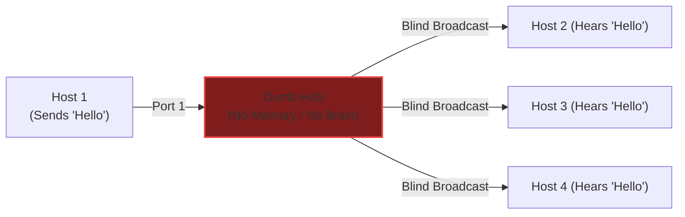

import { Callout } from "fumadocs-ui/components/callout";
import { Tabs, Tab } from "fumadocs-ui/components/tabs";
import { Steps, Step } from "fumadocs-ui/components/steps";
import { Cards, Card } from "fumadocs-ui/components/card";

## The Physical Reality: "There Is No Cloud"

During a TravelBuddy board meeting, an investor asks: _"Where does our application actually live?"_

The marketing answer is _"in the cloud."_

The engineering answer is vastly more fascinating:

> **There is no cloud. There are only millions of computers connected by twisted copper wires, laser pulses traveling through microscopically thin glass tubes on the ocean floor, and silicon switches making billionth-of-a-second routing decisions.**

Every digital experience—a booking confirmation, a credit card swipe, a 4K video stream—is fundamentally an electromagnetic wave or a packet of photons racing through physical matter.

In this chapter, we inspect the physical hardware, transmission media, and mathematical constraints of speed that make the global Internet possible.

---

## Visualizing the Physical Layer

Before examining their internal logic, observe the actual hardware components deployed across enterprise networks, telecommunications infrastructure, and datacenters:

<div className="grid grid-cols-1 md:grid-cols-2 lg:grid-cols-3 gap-4 my-6">
  <div className="rounded-xl border border-fd-border overflow-hidden bg-fd-card">
    
    <div className="p-3 text-xs text-fd-muted-foreground">
      <strong>Network Interface Card (NIC)</strong>: PCI/PCIe hardware
      controller with PHY transceiver, MAC processor chip, and onboard EEPROM
      containing the burned-in MAC address.
    </div>
  </div>
  <div className="rounded-xl border border-fd-border overflow-hidden bg-fd-card">
    
    <div className="p-3 text-xs text-fd-muted-foreground">
      <strong>Category 6 Twisted Copper Pair with RJ-45 Connector</strong>: The
      backbone of horizontal office wiring, delivering 1 to 10 Gbps up to 100
      meters using differential signaling.
    </div>
  </div>
  <div className="rounded-xl border border-fd-border overflow-hidden bg-fd-card">
    
    <div className="p-3 text-xs text-fd-muted-foreground">
      <strong>Duplex LC Optical Fiber Patch Cable</strong>: Silica glass core
      carrying infrared laser pulses at ~204,000 km/s with total internal
      reflection.
    </div>
  </div>
  <div className="rounded-xl border border-fd-border overflow-hidden bg-fd-card">
    
    <div className="p-3 text-xs text-fd-muted-foreground">
      <strong>Multiport Ethernet Hub (Layer 1)</strong>: Legacy physical layer
      splitter that blindly repeats electrical voltages onto every connected
      port (Single shared collision domain).
    </div>
  </div>
  <div className="rounded-xl border border-fd-border overflow-hidden bg-fd-card">
    
    <div className="p-3 text-xs text-fd-muted-foreground">
      <strong>Enterprise Layer 2/3 Switch</strong>: Hardware ASIC switching
      fabric microsegmenting collision domains and forwarding Ethernet frames in
      nanoseconds via CAM tables.
    </div>
  </div>
  <div className="rounded-xl border border-fd-border overflow-hidden bg-fd-card">
    
    <div className="p-3 text-xs text-fd-muted-foreground">
      <strong>Carrier-Grade Edge Router (Layer 3)</strong>: Interconnects
      distinct IP subnets, separates broadcast domains, decrements TTL, and
      executes global dynamic routing (BGP/OSPF).
    </div>
  </div>
  <div className="rounded-xl border border-fd-border overflow-hidden bg-fd-card">
    
    <div className="p-3 text-xs text-fd-muted-foreground">
      <strong>Broadband Modem (Modulator-Demodulator)</strong>: Translates
      high-frequency analog RF or optical carrier signals from the ISP into
      digital binary Ethernet frames.
    </div>
  </div>
  <div className="rounded-xl border border-fd-border overflow-hidden bg-fd-card">
    
    <div className="p-3 text-xs text-fd-muted-foreground">
      <strong>Wireless Access Point (WAP)</strong>: Bridges IEEE 802.11 wireless
      radio frequencies with IEEE 802.3 wired Ethernet backbones, powered by
      Power-over-Ethernet (PoE).
    </div>
  </div>
  <div className="rounded-xl border border-fd-border overflow-hidden bg-fd-card">
    
    <div className="p-3 text-xs text-fd-muted-foreground">
      <strong>Hardware Firewall Appliance</strong>: Dedicated security device
      performing stateful packet inspection, deep packet payload inspection
      (DPI), and perimeter access control.
    </div>
  </div>
  <div className="rounded-xl border border-fd-border overflow-hidden bg-fd-card">
    
    <div className="p-3 text-xs text-fd-muted-foreground">
      <strong>Protocol Gateway (Layers 4–7)</strong>: Translates disparate
      communication protocols (e.g. converting IP SIP/RTP voice packets to
      legacy analog/PSTN telephone signals).
    </div>
  </div>
</div>

---

## Network Hardware Devices & Their Layer Boundaries

Why do we need so many different boxes in a server room? Why can't a single device do everything?

Because each device operates at a **different layer of abstraction** and was engineered to solve a specific physical or logical bottleneck.

<div className="my-6 rounded-xl border border-fd-border overflow-hidden bg-fd-card">
  
  <div className="p-3 text-xs text-fd-muted-foreground bg-fd-muted/30">
    <strong>Network Devices Taxonomy & OSI Hierarchy:</strong> From Layer 1
    physical bit regenerators (Repeaters/Hubs) to Layer 2 switches, Layer 3
    routers, hybrid Brouters, and Layers 4–7 Gateways.

```mermaid
flowchart TD
    subgraph L7["Layers 4–7: Gateways & Proxies"]
        Gateway["Gateway / Reverse Proxy<br/>(Translates Disparate Protocols & Formats)"]
    end

    subgraph L3["Layer 3: Network Layer (IP Packets)"]
        Router["Router / Layer 3 Switch<br/>(Inspects IP, Decides Routes, Blocks Broadcasts)"]
    end

    subgraph Hybrid["Layer 2/3 Hybrid"]
        Brouter["Brouter<br/>(Bridges Non-Routable Protocols, Routes IP)"]
    end

    subgraph L2["Layer 2: Data Link Layer (Ethernet Frames)"]
        Switch["Layer 2 Switch / Bridge<br/>(Inspects MAC, Dedicated Collision Domains)"]
    end

    subgraph L1["Layer 1: Physical Layer (Raw Electrical Bits / Photons)"]
        Hub["Hub / Repeater<br/>(Dumb Electrical Splitter, Shared Collisions)"]
    end

    L7 --> L3
    L3 --> Hybrid
    Hybrid --> L2
    L2 --> L1

    style L7 fill:#312e81,stroke:#818cf8,stroke-width:2px
    style L3 fill:#1e1b4b,stroke:#a855f7,stroke-width:2px
    style Hybrid fill:#0e7490,stroke:#06b6d4,stroke-width:2px
    style L2 fill:#0f172a,stroke:#38bdf8,stroke-width:2px
    style L1 fill:#1c1917,stroke:#78716c,stroke-width:2px
```

  </div>
</div>



Let us examine each device from the physical layer up to the application gateway.

---

### 1. Network Interface Cards (NIC / Network Adapter) (Layers 1 & 2)

Before any host—a server, laptop, smart TV, or industrial robot—can emit a single bit onto a network, it requires a **Network Interface Card (NIC)** (also known as a Network Adapter or LAN Card).

<div className="my-6 rounded-xl border border-fd-border overflow-hidden bg-fd-card">
  
  <div className="p-3 text-xs text-fd-muted-foreground bg-fd-muted/30">
    <strong>Network Interface Card (NIC):</strong> Internal PCIe expansion card
    featuring an onboard MAC controller chip, physical PHY transceiver, pulse
    transformer, and an external RJ-45 8P8C modular port.
  </div>
</div>

#### Architectural Components & Functions of a NIC

1. **The Physical Layer Transceiver (PHY)**:
   - Houses the digital-to-analog and analog-to-digital circuitry.
   - Converts raw binary bits from the computer's internal bus into physical voltage pulses (for copper), light pulses (for fiber optics), or radio waves (for Wi-Fi).
   - Encodes waveforms using standards like Manchester encoding, 4B/5B, or PAM-16 (Pulse Amplitude Modulation).
2. **The MAC Controller & Permanent Burned-in MAC Address**:
   - Every physical NIC contains non-volatile EEPROM or ROM memory containing a factory-assigned **48-bit Media Access Control (MAC) address** (e.g., `00:1A:2B:3C:4D:5E`).
   - The first 24 bits represent the **OUI (Organizationally Unique Identifier)** assigned by IEEE to the manufacturer (e.g., Intel, Realtek, Broadcom), and the remaining 24 bits represent the vendor's unique device sequence number.
3. **Serialization & Deserialization (SerDes)**:
   - Converts 32-bit or 64-bit parallel data from the computer's PCIe motherboard bus into a high-speed serial stream of single bits traveling down the wire, and vice-versa.
4. **Frame Encapsulation & FCS / CRC32 Generation**:
   - The NIC autonomously calculates the 32-bit Cyclic Redundancy Check (**CRC-32**) Frame Check Sequence (FCS) for outgoing frames and verifies it on incoming frames in silicon hardware, immediately discarding corrupted frames before wasting host CPU cycles.
5. **Direct Memory Access (DMA) & Ring Buffers**:
   - High-performance NICs use **DMA (Direct Memory Access)** to write incoming packets directly into the host operating system's RAM without interrupting the CPU for every individual byte.
   - Operating systems allocate **Rx (Receive) and Tx (Transmit) Ring Buffers**. When the buffer fills, the NIC raises a hardware interrupt to the CPU.
6. **Hardware Offloading (Modern NIC Features)**:
   - **TSO (TCP Segmentation Offload)**: The host OS passes a massive 64 KB TCP buffer to the NIC, and the NIC itself carves it into standard 1,500-byte MTU Ethernet frames.
   - **Checksum Offload**: Calculates IP, TCP, and UDP checksums directly on the NIC chip.
   - **LRO (Large Receive Offload)**: Reassembles multiple incoming packets into a single giant buffer before handing it to the OS kernel.
7. **Promiscuous Mode**:
   - Under normal operation, a NIC silently drops any frame whose Destination MAC does not match its own MAC address (or a broadcast/multicast address).
   - When configured in **Promiscuous Mode** (used by packet sniffers like Wireshark and tcpdump), the NIC accepts and forwards every single frame on the wire to the OS kernel regardless of the destination MAC.

---

### 2. Repeaters (Layer 1: Physical Signal Regenerators)

Because electrical voltages and laser light attenuate (decay in amplitude) over distance due to conductor resistance, skin effect, and optical glass absorption, long cable runs eventually degrade below the receiver's detection threshold.

<div className="my-6 rounded-xl border border-fd-border overflow-hidden bg-fd-card">
  
  <div className="p-3 text-xs text-fd-muted-foreground bg-fd-muted/30">
    <strong>Network Repeater (Range Extender):</strong> A 2-port Layer 1 device
    that receives attenuated physical signals, cleans distorted waveforms, and
    retransmits pristine, full-amplitude pulses down the next physical segment.
  </div>
</div>

#### How a Repeater Operates

- A **Repeater** is a 2-port Layer 1 device that receives an attenuated, distorted physical signal, cleans the waveform, amplifies or regenerates it bit-by-bit to full amplitude, and transmits it down the next cable segment.
- **Amplification vs. Regeneration (Critical Technical Distinction)**:
  - **Analog Amplifier**: Blindly multiplies both the incoming signal _and_ accumulated electrical noise. If noise is amplified across multiple hops, the signal becomes an indecipherable roar.
  - **Digital Repeater**: Reads the incoming binary waveform, samples the clock edge, completely eliminates background noise, and synthesizes a brand-new, crisp, pristine reconstructed square wave. It has zero knowledge of MAC addresses, IP addresses, or packet boundaries.
- **The Historical 5-4-3 Rule**: In early 10BASE5 and 10BASE2 coaxial Ethernet, no more than 5 cable segments could be connected via 4 repeaters, with at most 3 segments containing active computers. This physical rule ensured that round-trip propagation delay did not exceed the 51.2-microsecond collision detection slot time of CSMA/CD.
- **Optical Repeaters (EDFA)**: In fiber optics, Erbium-Doped Fiber Amplifiers (EDFAs) optically amplify light signals every 50–80 km along subsea and long-haul telecommunications cables without requiring conversion into electricity.

---

### 3. Hubs (Layer 1: Multiport Broadcast Repeaters)

A **Hub** is simply a **multiport repeater**. When an electrical bit enters Port 1, the hub's internal electrical bus replicates that voltage onto Ports 2, 3, and 4 simultaneously.

<div className="my-6 rounded-xl border border-fd-border overflow-hidden bg-fd-card">
  
  <div className="p-3 text-xs text-fd-muted-foreground bg-fd-muted/30">
    <strong>Multiport Ethernet Hub:</strong> A shared electrical backplane. All
    connected devices share a single collision domain and operate in half-duplex
    mode.
  </div>
</div>



#### Classes of Hubs

1. **Passive Hubs**: Simply wire connections together electrically without amplifying or cleaning signals. Requires no power supply; acts purely as a physical junction box.
2. **Active Hubs**: Contains active electronics that regenerate, clean, and amplify signals on every outgoing port, acting as a true multiport repeater.
3. **Intelligent (Manageable) Hubs**: Includes microprocessors allowing remote administrators to monitor port activity, measure bandwidth utilization, and shut down malfunctioning ports via SNMP.

#### Why Hubs Are Completely Extinct in Modern LANs

1. **Single Shared Collision Domain**: All connected devices share one physical electrical channel. If Host 1 and Host 3 transmit simultaneously, their electrical voltages smash into each other, creating a collision and destroying both transmissions.
2. **Strict Half-Duplex Operation**: Hosts cannot transmit and receive at the same time because the shared wire would collide with its own incoming voltage.
3. **Catastrophic Security Vulnerability**: Anyone running Wireshark on Host 4 can promiscuously capture every single byte transmitted between Host 1 and Host 2 without ARP spoofing or MITM tactics.
4. **Bandwidth Dilution**: A 10 Mbps hub with 10 active devices offers an effective average throughput of only ~1 Mbps per workstation.

---

### 4. Bridges (Layer 2: Software Segmenters)

Historically, when early Ethernet LANs grew too congested with collisions, engineers placed a **Bridge** between two bus segments.

<div className="my-6 rounded-xl border border-fd-border overflow-hidden bg-fd-card">
  
  <div className="p-3 text-xs text-fd-muted-foreground bg-fd-muted/30">
    <strong>Network Bridge Architecture:</strong> Inspects destination MAC
    addresses in software to split a single congested LAN into two isolated
    collision domains while preserving a unified broadcast domain.
  </div>
</div>

#### How a Bridge Operates

- A bridge is typically a 2-port Layer 2 device that inspects incoming Ethernet frames, reads their **Source and Destination MAC addresses**, and maintains an internal **Bridge Forwarding Table**.
- **The Forwarding Logic**:
  1. **Learning**: When a frame arrives on Port 1 from MAC `AA:AA:AA:AA:AA:AA`, the bridge records `AA:AA:AA:AA:AA:AA -> Port 1` in memory with an expiration timestamp.
  2. **Filtering**: If Host A on Segment 1 sends a frame to Host B on Segment 1, the bridge consults its table, notes that Host B is also on Port 1, and **drops the frame from crossing over to Port 2**. Segment 2 remains quiet!
  3. **Forwarding**: If Host A sends to Host C on Segment 2, the bridge retransmits the frame strictly across to Port 2.
  4. **Flooding**: If the destination MAC is not yet in the bridge's table (or is a broadcast frame `FF:FF:FF:FF:FF:FF`), the bridge floods the frame to all other ports except the incoming port.
- **Bridge Types**:
  - **Transparent Bridge**: Operates completely invisibly to connected end stations without requiring any endpoint reconfiguration (standard IEEE 802.1D).
  - **Source-Route Bridge**: The sending host explicitly specifies the hop-by-hop bridge path inside the frame header (historically used in IBM Token Ring networks).
  - **Translational Bridge**: Connects two completely different Data Link protocols (e.g., bridging an Ethernet LAN to a Token Ring or FDDI backbone).
- **Limitation**: Early bridges processed frame headers in **software using general-purpose CPUs**, which limited their throughput to a few megabits per second.

---

### 5. Switches (Layer 2 ASICs & Layer 3 Multilayer Switches)

A **Switch** is a high-speed, multiport hardware evolution of the bridge.

<div className="my-6 rounded-xl border border-fd-border overflow-hidden bg-fd-card">
  
  <div className="p-3 text-xs text-fd-muted-foreground bg-fd-muted/30">
    <strong>Enterprise Layer 2/3 Switch:</strong> Multiport silicon switching
    engine featuring dedicated ASIC hardware per port group, capable of
    switching millions of frames per second at full line rate.
  </div>
</div>

#### Core Architectural Mechanics

- Instead of using a slow software CPU, switches use specialized silicon hardware chips called **ASICs (Application-Specific Integrated Circuits)**.
- **Microsegmentation**: Every single port on a switch is its own private, isolated **Collision Domain**. Combined with full-duplex twisted pair wiring, collisions are completely eliminated from the modern wired LAN.
- **CAM (Content Addressable Memory) Table**: High-speed memory that looks up a 48-bit MAC address in a single clock cycle ($O(1)$ constant time lookup).
- **Full-Duplex Communication**: Workstations can transmit at 1 Gbps and simultaneously receive at 1 Gbps, yielding an aggregate 2 Gbps bidirectional bandwidth per port.

```mermaid
flowchart TD
    Frame["Incoming Frame on Port 1<br/>Src: AA:AA:AA:AA:AA:AA | Dst: CC:CC:CC:CC:CC:CC"] --> Switch

    subgraph Switch["Layer 2 Switch (CAM Table Memory)"]
        direction TB
        CAM["CAM Table:<br/>Port 1: AA:AA:AA:AA:AA:AA<br/>Port 2: BB:BB:BB:BB:BB:BB<br/>Port 3: CC:CC:CC:CC:CC:CC"]
    end

    Switch -->|Transmits ONLY to Port 3| DstHost["Destination Host C<br/>(Port 3)"]
    Switch -.->|SILENCE on Port 2| HostB["Host B (Port 2)"]

    style Switch fill:#064e3b,stroke:#10b981,stroke-width:2px
```



#### Switch Forwarding Techniques

1. **Store-and-Forward**: The switch receives the entire frame into a buffer, validates the 32-bit CRC Frame Check Sequence (FCS) to ensure no bits were corrupted on the wire, and only then forwards it. Corrupted frames are silently dropped.
2. **Cut-Through**: The switch reads only the first 6 bytes of the incoming frame (Destination MAC) and immediately begins transmitting bits out of the target egress port before the remainder of the frame has even finished arriving! Forwarding latency drops to under 1 microsecond.
3. **Fragment-Free**: Reads the first 64 bytes of the frame (the minimum valid Ethernet frame size where 99% of collisions occur) before forwarding, filtering out collision fragments ("runts") while maintaining low latency.

#### Layer 2 Switch vs. Layer 3 Multilayer Switch (MLS)

- **Layer 2 Switch**: Forwards frames strictly within the same VLAN based on MAC addresses. Cannot route traffic between different IP subnets.
- **Layer 3 Switch (Multilayer Switch - MLS)**: Combines standard Layer 2 switching with **hardware-based Layer 3 IP routing**.
  - Uses **TCAM (Ternary Content Addressable Memory)** and **Cisco Express Forwarding (CEF)** to route IP packets between VLANs at full wire speed in hardware ASICs, eliminating the bandwidth bottleneck of sending inter-VLAN traffic through an external router ("Router-on-a-Stick").

---

### 6. Routers (Layer 3: Network Path Decision & Broadcast Isolation)

While switches connect computers within the same local network subnet, **Routers connect disparate, heterogeneous networks across the world**.

<div className="my-6 rounded-xl border border-fd-border overflow-hidden bg-fd-card">
  
  <div className="p-3 text-xs text-fd-muted-foreground bg-fd-muted/30">
    <strong>Carrier-Grade Edge Router:</strong> Interconnects distinct IP
    subnets and autonomous systems, breaks broadcast domains, maintains dynamic
    routing tables (OSPF/BGP), and performs NAT and QoS.

```mermaid
flowchart LR
    subgraph LAN1["Office LAN (Subnet 192.168.1.0/24)"]
        PC1["Host 1"] --> SW1["Switch 1"]
    end

    SW1 <-->|Gateway Interface G0/0| R["Router<br/>(Separates Broadcast Domains)"]

    subgraph LAN2["Cloud Datacenter (Subnet 10.0.0.0/16)"]
        R <-->|WAN Interface G0/1| SW2["Switch 2"]
        SW2 --> Srv1["Database Server"]
    end

    style R fill:#1e1b4b,stroke:#a855f7,stroke-width:2px
```

  </div>
</div>



#### How a Router Operates

1. **Breaks Broadcast Domains**: A router will **never forward a Layer 2 broadcast frame (`FF:FF:FF:FF:FF:FF`) across its interfaces** by default. This permanently bounds broadcast radiation and prevents enterprise broadcast storms.
2. **Connects Disparate Logical Networks**: Each router interface belongs to a distinct IP subnet with its own network address (e.g., interface `Gig0/0` on `192.168.1.1/24`, interface `Gig0/1` on `10.0.0.1/16`).
3. **Decapsulation & Re-encapsulation**:
   - The router strips off the incoming Layer 2 Ethernet frame header.
   - It inspects the destination IP address in the Layer 3 header.
   - It consults its **Routing Table** using **Longest Prefix Match (LPM)** algorithms.
   - It decrements the **TTL (Time-To-Live)** field by 1 and updates the IPv4 header checksum. If TTL reaches 0, it drops the packet and transmits an ICMP Time Exceeded message.
   - It encapsulates the packet inside a _new_ Layer 2 frame targeting the next-hop router's MAC address (discovered via ARP/NDP).
4. **Control Plane vs. Data (Forwarding) Plane**:
   - **Control Plane**: Runs dynamic routing protocols (OSPF, BGP, IS-IS) in CPU software to calculate the best paths and build the **RIB (Routing Information Base)**.
   - **Data (Forwarding) Plane**: High-speed silicon hardware line cards that parse packet headers, match IP prefixes in TCAM tables using the **FIB (Forwarding Information Base)**, and switch packets across the internal crossbar fabric in nanoseconds.

---

### 7. Modems (Modulator-Demodulator: Analog & Digital Translators)

Computer processors and switches speak pure digital binary: square electrical pulses representing discrete ones and zeros. However, long-distance transmission media (such as cable TV coaxial copper, telephone copper pairs, or radio frequencies) were engineered to transmit **continuous analog waveforms**.

A **Modem (Modulator-Demodulator)** is the physical bridge that translates between the digital domain of your home or office network and the analog carrier waves of telecommunication service providers.

<div className="my-6 rounded-xl border border-fd-border overflow-hidden bg-fd-card">
  
  <div className="p-3 text-xs text-fd-muted-foreground bg-fd-muted/30">
    <strong>Broadband Cable Modem (DOCSIS):</strong> Translates high-frequency
    analog RF carrier frequencies received over coaxial F-type connectors into
    digital 802.3 Ethernet frames for your local router.
  </div>
</div>

#### The Physics: Modulation & Demodulation

- **Modulation (Tx)**: Converting digital bits into analog carrier wave variations (manipulating amplitude, frequency, or phase):
  - **ASK (Amplitude Shift Keying)**: Varies the wave amplitude to represent 1 vs 0.
  - **FSK (Frequency Shift Keying)**: Shifts between high and low frequencies.
  - **PSK (Phase Shift Keying)**: Inverts the wave phase ($180^\circ$ shift) at transitions.
  - **QAM (Quadrature Amplitude Modulation)**: Combines amplitude and phase shifts (e.g., 1024-QAM, 4096-QAM in DOCSIS 4.0 and Wi-Fi 7) to transmit up to 12 bits per single analog cycle!
- **Demodulation (Rx)**: The receiver samples the incoming analog carrier wave, filters out noise, detects the phase and amplitude, and reconstructs the original binary ones and zeros.

#### Prominent Modem Classes

1. **Dial-Up Modems (Legacy 56k)**: Modulated binary data into audible sound frequencies ($300\text{ Hz} - 3.4\text{ kHz}$) across the public switched telephone network (PSTN), topping out at $56\text{ kbps}$ (V.90 standard).
2. **DSL Modems (ADSL / VDSL)**: Transmit high-frequency digital data (up to $30\text{ MHz}$) across standard unshielded telephone copper wire pairs while leaving lower voice frequencies ($< 4\text{ kHz}$) undisturbed for simultaneous telephone calls.
3. **Cable Modems (DOCSIS)**: Uses **Data Over Cable Service Interface Specification (DOCSIS 3.0 / 3.1 / 4.0)** over Hybrid Fiber-Coaxial (HFC) networks, bonding multiple 6 MHz TV channels together to deliver 1 to 10 Gbps broadband.
4. **Optical Network Terminals (ONT / ONU)**: In FTTH (Fiber to the Home) Gigabit Passive Optical Networks (GPON / XGS-PON), the ONT acts as an "optical modem"—converting incoming infrared laser wavelengths ($1490\text{ nm} / 1577\text{ nm}$) into electrical Gigabit Ethernet frames.

<Callout
  type="info"
  title="Clearing Up the Common Confusion: Modem vs. Router vs. Gateway"
>
  - **Modem**: Converts ISP analog/optical signals into a single raw digital
  Ethernet feed. Does not issue private LAN IP addresses, does not run Wi-Fi,
  and does not provide NAT firewall protection. - **Router**: Takes that single
  IP address, creates a private local subnet (`192.168.1.0/24`), assigns IP
  addresses via DHCP, and routes traffic between your LAN and the Internet using
  NAT. - **Residential Gateway ("All-in-One Modem/Router")**: The plastic box
  provided by Comcast, Verizon, or AT&T that houses a Modem, Router, 4-port
  Switch, and Wi-Fi Access Point inside a single physical chassis.
</Callout>

---

### 8. Wireless Access Points (WAP / AP: Layer 2 RF-to-Ethernet Bridges)

A **Wireless Access Point (WAP or AP)** is a Layer 2 networking device that connects wireless mobile devices (smartphones, laptops, tablets) to a wired Ethernet backbone network.

<div className="my-6 rounded-xl border border-fd-border overflow-hidden bg-fd-card">
  
  <div className="p-3 text-xs text-fd-muted-foreground bg-fd-muted/30">
    <strong>Enterprise Wireless Access Point (Cisco Aironet):</strong>{" "}
    Ceiling-mounted access point with internal MIMO antenna array, Gigabit
    Ethernet uplink port, and Power-over-Ethernet (802.3at PoE+) support.
  </div>
</div>

#### How an Access Point Operates

1. **Layer 2 Protocol Translation (802.11 $\leftrightarrow$ 802.3)**:
   - Wireless clients communicate using **IEEE 802.11** frame formats with 3 or 4 MAC address fields (Transmitter Address, Receiver Address, Destination Address, Source Address).
   - Wired LAN switches understand only **IEEE 802.3** frames (Source MAC and Destination MAC).
   - The AP converts 802.11 wireless radio frames into standard 802.3 Ethernet frames and injects them onto the wired switch trunk.
2. **Beacon Frames, SSIDs & BSSID**:
   - The AP broadcasts **Beacon Frames** approximately 10 times per second ($100\text{ ms}$ interval), announcing the **SSID (Service Set Identifier)**, supported data rates, and encryption capabilities.
   - The **BSSID (Basic Service Set Identifier)** is the unique 48-bit MAC address of the AP's physical radio interface.
3. **Power over Ethernet (PoE - IEEE 802.3af/at/bt)**:
   - Enterprise APs are mounted on ceilings and walls where AC power outlets are unavailable.
   - Power is delivered across the same twisted-pair Cat6 Ethernet cable from a PoE-enabled switch (delivering from $15.4\text{ W}$ up to $90\text{ W}$ DC power).
4. **Autonomous (Fat) vs. Lightweight (Thin) APs**:
   - **Autonomous APs**: Self-contained units where VLANs, SSIDs, and security policies are configured manually on each individual box (suitable for small retail shops).
   - **Lightweight APs (LWAPP / CAPWAP)**: In enterprise campuses with hundreds of APs, the APs have minimal onboard logic. They build an encrypted **CAPWAP (Control and Provisioning of Wireless Access Points)** tunnel back to a centralized **Wireless LAN Controller (WLC)**, which manages radio frequency channels, dynamic transmit power, load balancing, and client authentication.
5. **Seamless Seamless Roaming (802.11k / 802.11v / 802.11r)**:
   - Enables users to walk across a 10-story office building on a live Zoom call; the client device handoffs between APs in under $50\text{ ms}$ without dropping TCP packets.

---

### 9. Firewalls (Layers 3, 4 & 7: Network Security Appliances)

While routers forward traffic indiscriminately as long as a valid route exists, a **Firewall** inspects, filters, and enforces security policies to block unauthorized access, malicious exploits, and data exfiltration.

<div className="my-6 rounded-xl border border-fd-border overflow-hidden bg-fd-card">
  
  <div className="p-3 text-xs text-fd-muted-foreground bg-fd-muted/30">
    <strong>Hardware Firewall Security Appliance:</strong> Dedicated rackmount
    security device positioned at the network perimeter to inspect connection
    states, enforce ACLs, and execute deep packet inspection.
  </div>
</div>

#### Evolution & Generations of Firewalls

1. **Packet Filtering Firewalls (Stateless - Layer 3 & 4)**:
   - Inspects individual packets in isolation against static **Access Control Lists (ACLs)**.
   - Evaluates: Source IP, Destination IP, Protocol (TCP/UDP/ICMP), and Port number (e.g., Allow Destination Port 443).
   - **Flaw**: Cannot remember prior packets. If an attacker sends a spoofed packet with the TCP `ACK` flag set, a stateless firewall blindly permits it because it cannot verify whether a prior `SYN` handshake occurred.
2. **Stateful Packet Inspection (SPI - Layers 3 & 4)**:
   - Maintains an in-memory **State Table** tracking active bidirectional connections.
   - When an internal host initiates a TCP handshake to an external web server, the firewall records the connection: `192.168.1.50:54321 <-> 93.184.216.34:443 [STATE: ESTABLISHED]`.
   - Incoming return traffic is permitted **only if it matches an existing entry in the state table**. Unsolicited incoming packets from the outside Internet are dropped immediately.
3. **Next-Generation Firewalls (NGFW - Layer 7 Application Layer)**:
   - Modern enterprise appliances (Palo Alto Networks PA-Series, Fortinet FortiGate, Cisco Secure Firewall).
   - **Deep Packet Inspection (DPI)**: Looks past port numbers to inspect the actual application payload. For example, if BitTorrent or malware traffic attempts to sneak past port 80 or 443, the NGFW recognizes the underlying application signature (**App-ID**) and kills the session.
   - **Integrated IPS/IDS**: Detects exploit payloads, SQL injection, and buffer overflow attempts in real time.
   - **SSL/TLS Decryption**: Terminates and decrypts HTTPS sessions, scans the plaintext payload for zero-day malware, and re-encrypts the stream before forwarding to the destination.
4. **Demilitarized Zones (DMZ)**:
   - Firewalls segment the enterprise into security zones: **Inside (Trusted LAN)**, **Outside (Untrusted Internet)**, and **DMZ (Semi-Trusted Perimeter)** where public-facing web servers and mail relays reside. If a public server in the DMZ is compromised, firewall rules prevent the attacker from pivoting into the internal corporate LAN.

---

### 10. Gateways (Layers 4 to 7: Heterogeneous Protocol & Format Translators)

Never confuse a default router gateway with a true **Protocol Gateway**:

- A router forwards packets between different subnets within the _same_ overall protocol family (e.g. IP to IP).
- A **Gateway** is an advanced inter-networking device that performs **full translation between completely incompatible network architectures, data formats, and protocol stacks** across Layers 4 through 7.

<div className="my-6 rounded-xl border border-fd-border overflow-hidden bg-fd-card">
  
  <div className="p-3 text-xs text-fd-muted-foreground bg-fd-muted/30">
    <strong>Hardware Protocol Gateway (Cisco SPA):</strong> Translates between
    disparate communication stacks, converting packet-switched IP SIP/RTP voice
    packets into circuit-switched analog FXS/FXO signals.

```mermaid
flowchart LR
    subgraph NetA["VoIP Enterprise Network (SIP / RTP over IP)"]
        IP_Phone["IP Softphone<br/>VoIP Packet: G.711 Audio in UDP"]
    end

    GW["VoIP Telephony Gateway<br/>(Translates Packets into Analog/TDM Circuits)"]

    subgraph NetB["Telco PSTN Network (TDM Circuit Switched)"]
        Landline["Traditional Landline / Cell Tower<br/>ISDN PRI / SS7 Signaling"]
    end

    IP_Phone <--> GW
    GW <--> Landline

    style GW fill:#431407,stroke:#f97316,stroke-width:2px
```

  </div>
</div>



#### Prominent Gateway Types

1. **VoIP Telephony Gateways**: Translates VoIP SIP signaling and RTP UDP packets into circuit-switched SS7 / ISDN PRI / analog loop-start signaling on legacy telephone company networks.
2. **Payment Gateways**: Converts web application REST/JSON e-commerce requests into legacy ISO 8583 financial interchange message formats required by inter-bank mainframe clearinghouses.
3. **Cloud API Gateways**: Sits at the edge of Kubernetes clusters (e.g. Kong, Envoy, AWS API Gateway), translating external public HTTPS/REST requests into internal high-performance binary gRPC protocols, enforcing OAuth2 authentication, rate limiting, and SSL termination.
4. **IoT / Industrial Gateways**: Translates fieldbus protocols (Modbus RTU, BACnet, Zigbee, CAN bus) into standard TCP/IP MQTT or HTTPS streams consumed by cloud telemetry backends.

---

### 11. Brouters (Bridge + Router Hybrids)

In complex corporate networks, administrators occasionally run into legacy protocols:

- Protocols like **IPv4 and IPv6** are **routable**—they contain logical hierarchical network addressing that routers can parse and forward.
- Protocols like **NetBEUI** (NetBIOS Extended User Interface) and legacy IBM **LAT / SNA** lack logical network layer addresses—they are strictly **non-routable** and only understand Layer 2 MAC addresses.

A **Brouter (Bridge Router)** is a hybrid networking device:

- When a packet arrives, the brouter inspects its protocol header.
- If the packet belongs to a routable protocol (such as IP or IPX), the brouter **acts as a router** and forwards it based on Layer 3 IP tables.
- If the packet belongs to a non-routable protocol (such as NetBEUI), the brouter **falls back to acting as a bridge**, forwarding the raw frame using Layer 2 MAC address tables.
- Modern enterprise routers (like Cisco IOS routers) perform brouter capabilities using **Integrated Routing and Bridging (IRB)**.

---

### Comprehensive Hardware Device Comparison Matrix

| Device                    | Primary OSI Layer   | Data Unit (PDU)    | Addressing Used           | Collision Domains            | Broadcast Domains                    | Forwarding Hardware Engine                       | Primary Real-World Purpose                                        |
| :------------------------ | :------------------ | :----------------- | :------------------------ | :--------------------------- | :----------------------------------- | :----------------------------------------------- | :---------------------------------------------------------------- |
| **NIC**                   | Layer 1 & 2         | Bits / Frames      | 48-bit MAC Address        | 1 (Dedicated full-duplex)    | 1 (Member of LAN)                    | PHY Transceiver + MAC Controller Chip            | Connects host computer bus to transmission media                  |
| **Repeater**              | Layer 1 (Physical)  | Bits               | None (Raw Waveform)       | 1 (Shared)                   | 1 (Shared)                           | Digital Signal Regenerator / Clocking Circuit    | Cleans and regenerates attenuated signals over distance           |
| **Hub**                   | Layer 1 (Physical)  | Bits               | None (Raw Voltage)        | 1 (Shared across all ports)  | 1 (Shared across all ports)          | Multiport Shared Electrical Bus                  | Multiport signal replication (Obsolete, half-duplex)              |
| **Bridge**                | Layer 2 (Data Link) | Frames             | 48-bit MAC Address        | 1 per port (Software)        | 1 (Shared across all ports)          | Microprocessor CPU Software Filtering            | Divides a single congested collision domain into 2                |
| **Layer 2 Switch**        | Layer 2 (Data Link) | Frames             | 48-bit MAC (CAM Table)    | 1 per port (Dedicated ASICs) | 1 per configured VLAN                | High-Speed ASIC Crossbar Fabric                  | Hardware microsegmentation; high-speed LAN frame switching        |
| **Layer 3 Switch (MLS)**  | Layer 2 & 3         | Frames / Packets   | MAC & IP Addresses        | 1 per port (Dedicated)       | 1 per configured VLAN                | ASICs + TCAM + CEF Hardware Engines              | Wire-speed inter-VLAN routing without external router bottleneck  |
| **Router**                | Layer 3 (Network)   | Packets            | 32-bit / 128-bit IP       | 1 per interface              | **1 per interface (Breaks Domains)** | Control Plane CPU + Data Plane FIB TCAMs         | Interconnects subnets globally; breaks broadcast domains          |
| **Modem (ONT/Cable/DSL)** | Layer 1 & 2         | Waveforms / Frames | Carrier Frequencies / MAC | 1 per interface              | 1 (Transparent to LAN)               | Analog Modulation/Demodulation Circuitry         | Converts analog ISP carrier waveforms into digital Ethernet       |
| **Access Point (WAP)**    | Layer 1 & 2         | Frames / Radio     | MAC / 802.11 BSSID        | 1 per RF Channel             | 1 (Bridged to Ethernet)              | RF Transceiver + 802.11/802.3 Framing Bridge     | Bridges 802.11 wireless radio clients to wired Ethernet           |
| **Hardware Firewall**     | Layers 3, 4 & 7     | Packets / Sessions | IP, Port, State Table     | 1 per interface              | 1 per Security Zone                  | Stateful Inspection ASICs + DPI Engine           | Enforces security policies, state tracking, and perimeter defense |
| **Gateway**               | Layers 4–7          | Segments / Data    | Protocol Specific         | Dependent on interfaces      | Dependent on interfaces              | Application Processing CPU / Protocol Converters | Translates between completely incompatible architectures          |
| **Brouter**               | Layer 2 & 3         | Frames / Packets   | MAC & IP Addresses        | 1 per port                   | 1 per bridged segment                | Dual Bridging / Routing Engine                   | Bridges non-routable traffic while routing routable IP            |

---

## Transmission Media: Guided vs. Unguided

Transmission media form the physical pathway over which raw bits travel. They fall into two fundamental classes:

1. **Guided Media (Bounded / Wired)**: Electromagnetic energy is physically constrained within a tangible material conduit (copper wire or silica glass).
2. **Unguided Media (Unbounded / Wireless)**: Electromagnetic waves propagate freely through the atmosphere, vacuum, or water without physical boundaries.

<div className="my-6 rounded-xl border border-fd-border overflow-hidden bg-fd-card">
  
  <div className="p-3 text-xs text-fd-muted-foreground bg-fd-muted/30">
    <strong>Transmission Media Architecture:</strong> Comparing Guided physical
    conduits (Twisted Pair, Coax, Optical Fiber) against Unguided wireless
    propagation (Bluetooth, Wi-Fi, Cellular, Microwave, Satellite).
  </div>
</div>

---

### Part A: Guided Transmission Media (Cables)

Physical data cables fall into three distinct families: **Twisted Pair**, **Coaxial**, and **Optical Fiber**.

---

### 1. Twisted Pair Copper (UTP / STP)

Twisted pair is the most ubiquitous cable on planet Earth. Inside an Ethernet cable, you will find **8 color-coded copper wires arranged into 4 pairs**.

#### Why Are the Wires Twisted? (The Physics of Noise Cancellation)

When an electrical signal travels down a copper wire, it acts as an antenna: it emits electromagnetic radiation and absorbs electromagnetic noise from nearby elevator motors, power lines, and fluorescent lights.

Worse, adjacent wires inside the same cable bleed signals into each other—a phenomenon called **Crosstalk**.

To cancel this out, engineers use **Differential Signaling** combined with **Twisting**:

```mermaid
flowchart LR
    subgraph Transmitter["Transmitter"]
        V_pos["Wire A: +V (Signal)"]
        V_neg["Wire B: -V (Inverted Signal)"]
    end

    subgraph Channel["Physical Twisted Pair (Noise N hits both wires equally)"]
        WireA["Wire A carries: (+V + N)"]
        WireB["Wire B carries: (-V + N)"]
    end

    subgraph Receiver["Receiver (Differential Amplifier)"]
        Sub["Subtracts: (Wire A) - (Wire B)<br/>= (+V + N) - (-V + N)<br/>= 2V (Noise N completely cancelled!)"]
    end

    V_pos --> WireA --> Sub
    V_neg --> WireB --> Sub

    style Transmitter fill:#0f172a,stroke:#38bdf8
    style Receiver fill:#022c22,stroke:#10b981
```



By tightly twisting the two wires around each other (typically 2 to 3 twists per inch), external electromagnetic interference hits both wires equally. The receiver subtracts the negative wire from the positive wire: **the external noise cancels out to absolute zero**, leaving a clean, pristine digital pulse.

#### The Ethernet Categories (Cat5e to Cat8)

| Category   | Max Bandwidth    | Max Frequency | Max Distance              | Shielding              | Primary Real-World Application                     |
| :--------- | :--------------- | :------------ | :------------------------ | :--------------------- | :------------------------------------------------- |
| **Cat 5e** | 1 Gbps           | 100 MHz       | 100 meters                | UTP (Unshielded)       | Legacy residential, basic office workstations      |
| **Cat 6**  | 1 Gbps / 10 Gbps | 250 MHz       | 100m (1G) / 55m (10G)     | UTP or STP             | Modern office desktop horizontal wiring            |
| **Cat 6A** | 10 Gbps          | 500 MHz       | **100 meters (full 10G)** | STP (Shielded)         | Enterprise datacenters, Wi-Fi 6/7 AP uplinks       |
| **Cat 7**  | 10 Gbps          | 600 MHz       | 100 meters                | Individually Shielded  | Industrial plants with heavy electromagnetic noise |
| **Cat 8**  | **25 / 40 Gbps** | **2,000 MHz** | **30 meters**             | Fully Shielded (S/FTP) | Short Top-of-Rack server-to-switch links           |

<Callout type="info" title="The 100-Meter Rule">
  Standard Ethernet over twisted copper pair has an unyielding physical distance
  limit: **100 meters (328 feet)**. This is split into 90 meters of solid-core
  structural cable inside the walls plus two 5-meter flexible patch cords on
  each end. Beyond 100 meters, electrical signal attenuation and timing skew
  prevent the receiver from distinguishing binary ones from zeros.
</Callout>

#### Wiring Standards: T568A vs. T568B

When terminating an RJ-45 plug with a crimper, the 8 color-coded wires must follow a standardized pinout:

```text
Pin 1: White/Orange  (Tx+)
Pin 2: Orange        (Tx-)
Pin 3: White/Green   (Rx+)
Pin 4: Blue          (Unused in 100Base-TX)
Pin 5: White/Blue    (Unused in 100Base-TX)
Pin 6: Green         (Rx-)
Pin 7: White/Brown   (Unused in 100Base-TX)
Pin 8: Brown         (Unused in 100Base-TX)
```

- **Straight-Through Cable**: Both ends wired as T568B. Used to connect different devices (e.g., Computer $\rightarrow$ Switch).
- **Crossover Cable**: One end T568A, the other T568B (swapping Tx and Rx pins). Historically required to connect like-to-like devices (e.g., Switch $\rightarrow$ Switch or PC $\rightarrow$ PC).
- **Auto-MDIX (Automatic Medium-Dependent Interface Crossover)**: Modern network cards automatically detect pin wiring electronically and swap transmit/receive paths in silicon. Today, **crossover cables are obsolete**.

---

### 2. Fiber Optic Cable (Light in Glass)

When data must travel further than 100 meters, or at speeds of 100 Gbps to 800 Gbps, copper cable fails. We turn to **Fiber Optics**.

#### The Physics: Total Internal Reflection

A fiber optic cable consists of three layers:

1. **Core**: An ultra-pure, flexible strand of silica glass through which light pulses travel.
2. **Cladding**: A glass layer with a **lower index of refraction** ($n_2 < n_1$) surrounding the core.
3. **Buffer Jacket**: Protective Kevlar yarn and PVC plastic coating.

Because the cladding has a lower refractive index, light rays entering the core at an angle greater than the **critical angle** reflect completely off the boundary: **Total Internal Reflection**. Not a single photon escapes; the light bounces down the glass tube with virtually zero loss.

```mermaid
flowchart LR
    subgraph FiberCylinder["Total Internal Reflection inside Optical Fiber"]
        Core["Core Glass (Index n1 = 1.48)"]
        Cladding["Cladding Glass (Index n2 = 1.46)"]
        Ray["Light Ray Bouncing Continuously at Critical Angle"]
    end

    style FiberCylinder fill:#0f172a,stroke:#38bdf8,stroke-width:2px
```



#### Single-Mode Fiber (SMF) vs. Multi-Mode Fiber (MMF)

Never mix up Single-Mode and Multi-Mode fiber:

```mermaid
flowchart TD
    subgraph SMF["Single-Mode Fiber (Yellow Jacket)"]
        CoreSMF["Tiny Core: 9 µm"] --> Laser["Single Laser Beam (1310nm / 1550nm)"]
        Laser --> DistSMF["Zero Modal Dispersion · Range: 10 km to 100 km"]
    end

    subgraph MMF["Multi-Mode Fiber (Aqua Jacket)"]
        CoreMMF["Wider Core: 50 µm"] --> LED["Multiple Light Angles (850nm VCSEL)"]
        LED --> DistMMF["Modal Dispersion Spreads Pulses · Range: Max 300–500m"]
    end

    style SMF fill:#451a03,stroke:#f59e0b,stroke-width:2px
    style MMF fill:#083344,stroke:#06b6d4,stroke-width:2px
```



| Feature              | Single-Mode Fiber (SMF)                              | Multi-Mode Fiber (MMF)                                        |
| :------------------- | :--------------------------------------------------- | :------------------------------------------------------------ |
| **Core Diameter**    | **$9\ \mu\text{m}$** (fraction of a human hair)      | **$50\ \mu\text{m}$ or $62.5\ \mu\text{m}$**                  |
| **Light Source**     | Precision Solid-State Infrared Laser                 | Inexpensive VCSEL Laser or LED                                |
| **Wavelength**       | $1310\text{ nm}$ or $1550\text{ nm}$                 | $850\text{ nm}$ or $1300\text{ nm}$                           |
| **Modal Dispersion** | **Zero** (Only 1 straight mode travels)              | **High** (Different modes arrive at different times)          |
| **Max Distance**     | **Up to 80–100 km without repeater**                 | **300 to 500 meters**                                         |
| **Cost**             | Cable is cheap; SFP laser transceivers are expensive | Cable is slightly higher; optical transceivers are very cheap |
| **Color Code**       | **Yellow**                                           | **Aqua (OM3/OM4) or Lime Green (OM5)**                        |
| **Use Case**         | Campus backbones, telecom MAN/WAN, subsea cables     | Inside a single datacenter room, rack-to-rack                 |

---

### Part B: Unguided Transmission Media (Wireless)

Unguided media convey electromagnetic signals through the air, vacuum, or water without using a physical conductor. They are classified by transmission range and frequency spectrum:

#### 1. Bluetooth & BLE (Short-Range PAN)

- **Frequency**: 2.4 GHz unlicensed ISM (Industrial, Scientific, and Medical) radio band.
- **Operating Mechanics**: Utilizes **FHSS (Frequency Hopping Spread Spectrum)**, hopping across 79 distinct 1-MHz channels (or 40 channels in BLE) up to 1,600 times per second to avoid interference from Wi-Fi and microwave ovens.
- **Range & Throughput**: Up to 10 meters (Class 2); throughput ranges from 1 Mbps to 3 Mbps (Bluetooth 5.0 EDR).
- **Bluetooth Low Energy (BLE)**: Designed for coin-cell battery Internet-of-Things (IoT) sensors and smart wearables that sleep 99% of the time, operating for years on a single watch battery.

#### 2. Wi-Fi (Mid-Range WLAN)

- **Standard**: IEEE 802.11 family (802.11b/g/n/ac/ax/be).
- **Frequencies**: Operates across 2.4 GHz (longer range, high wall penetration, crowded), 5 GHz (faster throughput, lower wall penetration), and 6 GHz (Wi-Fi 6E/7, pristine wide channels).
- **Duplex Mode & Contention**: Wi-Fi is inherently **Half-Duplex**. Because radio transceivers cannot transmit and listen on the same frequency without dazzling their own receivers, Wi-Fi uses **CSMA/CA (Carrier Sense Multiple Access with Collision Avoidance)** with Request to Send / Clear to Send (RTS/CTS) frames.
- **Speeds**: From 54 Mbps (802.11g) up to **9.6 Gbps** (Wi-Fi 6) and **46 Gbps** (Wi-Fi 7 with 320 MHz channel widths and 4096-QAM modulation).

#### 3. Cellular Mobile Networks (Long-Range WAN)

- **Spectrum**: Heavily regulated, licensed carrier frequencies ranging from 600 MHz to mmWave (24–39 GHz).
- **Architectural Mechanics**: Geographic areas are divided into hexagonal "cells," each serviced by a base transceiver station (cell tower).
- **Generational Evolution**:
  - **3G (UMTS/HSPA)**: Introduced mobile packet data (up to ~7 Mbps).
  - **4G LTE**: All-IP architecture, Orthogonal Frequency Division Multiple Access (OFDMA), providing 100 Mbps to 1 Gbps.
  - **5G NR (New Radio)**: Sub-6 GHz and Millimeter Wave (mmWave) delivering gigabit mobile data, massive machine-type communications (mMTC), and ultra-reliable low latency communications (URLLC, under 1 ms radio latency).
- **Seamless Handoff**: As a mobile client travels at 100 km/h down a highway, the cellular core network executes seamless hard and soft handoffs from tower to tower without dropping active TCP connections or voice calls.

#### 4. Terrestrial Microwave & Satellite (Long-Distance Line-of-Sight)

- **Terrestrial Microwave**: High-gain parabolic dish antennas mounted on mountain ridges and towers relay data over line-of-sight distances (30 to 50 km), bypassing rivers, ravines, and rugged terrain where laying fiber is cost-prohibitive.
- **Geostationary Satellites (GEO)**: Orbit at 35,786 km above the equator. While providing vast continental footprints, the astronomical distance introduces a crushing latency penalty (**~500 to 600 ms RTT**).
- **Low Earth Orbit (LEO)**: Constellations like Starlink and Kuiper orbit at 500–1,200 km, reducing round-trip latency to 25–40 ms.

---

### WAN Fiber Backbone Transport: SONET/SDH & Frame Relay

How did early enterprise networks link their campus LANs across continental optical backbones before modern IP MPLS networks?

#### 1. SONET / SDH (Synchronous Optical Network)

Developed by ANSI (SONET in North America) and ITU-T (SDH in Europe/Asia), **SONET** is the foundational physical transport standard for high-speed digital transmission over optical fiber:

- **Synchronous Timing**: All devices across the entire telco network synchronize to a master atomic clock. Individual telephone or data channels can be extracted from a multiplexed optical stream using byte pointers without demultiplexing the entire high-speed signal.
- **Self-Healing Dual Rings**: SONET uses dual counter-rotating fiber rings (Working Ring and Protection Ring). If a backhoe severs the fiber cable, the adjacent SONET Add/Drop Multiplexers (ADMs) execute **Automatic Protection Switching (APS)** within **less than 50 milliseconds**, wrapping the ring around the break with zero disruption to active phone calls or data sessions.
- **Speed Hierarchy**: Defined in Optical Carrier (OC) levels based on the base STS-1 rate ($51.84\text{ Mbps}$):
  - **OC-3**: $155.52\text{ Mbps}$
  - **OC-12**: $622.08\text{ Mbps}$
  - **OC-48**: $2.488\text{ Gbps}$
  - **OC-192**: $9.953\text{ Gbps}$ (foundational backbone rate)

#### 2. Frame Relay (The Packet-Switched WAN Revolution)

Before the 1990s, linking branch offices required expensive, dedicated point-to-point leased lines (like T1/E1 lines) paid on a flat monthly rate regardless of whether traffic was flowing.

**Frame Relay** replaced expensive private circuits with a shared, packet-switched WAN service:

- **Virtual Circuits**: Multiple enterprise customers share the same physical telecom fiber infrastructure using **PVCs (Permanent Virtual Circuits)**.
- **DLCI (Data Link Connection Identifier)**: Frame Relay switches identify distinct customer connections using a local 10-bit DLCI number in the frame header.
- **CIR (Committed Information Rate)**: Customers pay for a guaranteed bandwidth baseline (e.g. 2 Mbps) but can burst up to full physical line capacity when the network is uncongested. If the provider's network becomes congested, frames marked with the **Discard Eligibility (DE)** bit are dropped first.
- **Successor**: In modern enterprise networking, Frame Relay has been superseded by **MPLS (Multiprotocol Label Switching)**, **Carrier Ethernet**, and software-defined **SD-WAN**.

---

## Subsea Cables: The Hidden Arteries of Planet Earth

Many people believe satellite constellations (like Starlink or GPS) carry the global Internet.

That is an absolute myth:

<Callout type="warn" title="Planetary Truth">
  **Over 99% of all intercontinental data traffic travels across cables laid on
  the bottom of the ocean floor.** Satellites handle less than 1% of
  international bandwidth.
</Callout>

There are currently over **550 active subsea fiber optic cables** spanning 1.4 million kilometers across the Atlantic, Pacific, and Indian Oceans.

```mermaid
flowchart TD
    subgraph CableAnatomy["Anatomy of a Deep-Sea Submarine Cable (Outside to Inside)"]
        direction TB
        L1["1. Outer Polyethylene Protective Jacket"]
        L2["2. Mylar Barrier Tape"]
        L3["3. Stranded High-Tensile Steel Wires (Resisting Ocean Pressure)"]
        L4["4. Continuous Aluminum Water Barrier"]
        L5["5. Solid Copper Tube (Carrying 10,000 Volts DC to Repeaters)"]
        L6["6. Thixotropic Petroleum Jelly (Water Blocking)"]
        L7["7. Polycarbonate Core Tube"]
        L8["8. 16 to 48 Optical Glass Fibers (The actual data carriers)"]

        L1 --> L2 --> L3 --> L4 --> L5 --> L6 --> L7 --> L8
    end

    style CableAnatomy fill:#020617,stroke:#38bdf8,stroke-width:2px
```



### Optical Repeaters (EDFA) on the Ocean Floor

Even in the purest synthetic silica glass, light attenuates by approximately $0.18\text{ dB}$ per kilometer. Over a 6,000-kilometer transatlantic crossing, the optical signal would decay into imperceptible blackness without amplification.

Every **50 to 80 kilometers**, subsea cables incorporate heavy titanium cylinders called **Optical Repeaters**.

- Inside each repeater is an **EDFA (Erbium-Doped Fiber Amplifier)**.
- A high-power semiconductor pump laser energizes erbium ions doped into the glass.
- When the weakened data photons pass through the energized erbium, they stimulate emission, creating identical clones of themselves.
- **The photons are amplified purely in the optical domain—never converted into electricity!**
- To power these hundreds of amplifiers sitting 15,000 feet under the sea, the cable's inner copper tube carries up to **10,000 Volts of direct current (DC)** from landing stations on the coast.

---

## Internet Speed: Bandwidth, Latency & The Speed of Light

Why does a webpage take 80 milliseconds to load from London to New York, no matter how fast your home internet connection is?

Because of Einstein's Special Theory of Relativity.

### The Speed of Light Constraint

The speed of light in a vacuum ($c$) is:

$$c = 299,792\text{ km/s} \approx 300,000\text{ km/s}$$

However, photons in a fiber optic cable do not travel through a vacuum; they travel through solid silica glass. The **refractive index ($n$)** of silica glass is approximately $1.468$.

The actual speed of light in optical fiber ($v$) is:

$$v = \frac{c}{n} = \frac{299,792\text{ km/s}}{1.468} \approx 204,218\text{ km/s}$$

This translates to a physical constant every network engineer must memorize:

$$\text{Propagation Speed in Glass} \approx 204\text{ meters per microsecond} \approx 4.9\ \mu\text{s per kilometer}$$

#### The Unbreakable Transatlantic Limit

The Great Circle distance between London and New York is approximately $5,585\text{ km}$. Subsea cables zigzag around oceanic trenches, making the physical cable length roughly $6,600\text{ km}$.

The minimum physical round-trip propagation time ($RTT$) is:

$$RTT_{\text{physics}} = \frac{2 \times 6,600\text{ km}}{204,218\text{ km/s}} \approx 64.6\text{ milliseconds}$$

No amount of money, no quantum computing algorithm, and no software optimization can ever reduce a London-to-New York ping below **~65 milliseconds**. It is a fundamental law of physics.

---

### The Bandwidth-Delay Product (BDP)

The most critical mathematical concept connecting speed, latency, and throughput is the **Bandwidth-Delay Product (BDP)**:

$$\text{BDP (bits)} = \text{Bandwidth (bits/sec)} \times \text{Round-Trip Time (sec)}$$

$$\text{BDP (bytes)} = \frac{\text{BDP (bits)}}{8}$$

#### The Pipe Analogy

Think of a network link like a water pipe:

- **Bandwidth** is the diameter of the pipe.
- **Latency (RTT)** is the length of the pipe.
- **BDP** is the **total volume of water currently inside the pipe in transit**.


#### Why High Latency Destroys Throughput

Suppose TravelBuddy purchases a high-speed **10 Gbps** transatlantic connection between New York and London ($RTT = 70\text{ ms} = 0.07\text{ s}$).

Let us calculate the volume of data that must be in-flight across the ocean:

$$\text{BDP} = 10,000,000,000\text{ bps} \times 0.07\text{ s} = 700,000,000\text{ bits} = 87.5\text{ Megabytes}$$

If your operating system's TCP receive buffer window is configured to the legacy default of $64\text{ KB}$ ($0.064\text{ MB}$):

1. The sender transmits 64 KB in $0.05$ milliseconds.
2. The sender's buffer is empty! It must now **freeze and wait 70 milliseconds** for the receiver's acknowledgment (ACK) to cross the ocean and return.
3. Your 10 Gbps fiber line sits 99.9% idle!
4. Real-world throughput collapses from 10,000 Mbps down to **7.3 Mbps**!

<Callout type="tip" title="TCP Window Scaling (RFC 7323)">
  This is why modern operating systems support **TCP Window Scaling**, allowing
  TCP windows to expand up to 1 Gigabyte, ensuring high-bandwidth links remain
  saturated even across transoceanic latencies.
</Callout>

---

## Hands-on Lab: Inspecting Physical Interfaces & Errors

Let us inspect the physical layer on your machine.

<Tabs items={['Linux', 'Windows (PowerShell)']}>
<Tab value="Linux">
```bash
# Check link status, duplex mode, and port speed
ip link show

# Deep inspection of physical transceiver (requires ethtool)

ethtool eth0

````
Look for:
- `Speed: 1000Mb/s` (or `10000Mb/s`)
- `Duplex: Full`
- `Auto-negotiation: on`
- `Link detected: yes`
</Tab>
<Tab value="Windows (PowerShell)">
```powershell
# Inspect physical network adapters, link speeds, and connection status
Get-NetAdapter | Select-Object Name, InterfaceDescription, Status, LinkSpeed
````

</Tab>
</Tabs>

### Interpreting CRC Errors

If you run `netstat -i` or inspect a switch interface and notice **CRC (Cyclic Redundancy Check) Errors** or **FCS Errors** climbing:

- Do not blame the software or the operating system.
- CRC errors mean bits are being corrupted **on the physical wire** due to a damaged pin, a kinked fiber patch cord with high bend radius attenuation, or an unshielded copper cable routed too close to a high-voltage air conditioner compressor.

---

## Chapter Summary & Quick Recall

<Cards>
  <Card
    title="Hub vs. Switch vs. Router"
    href="#network-hardware-devices--their-layer-boundaries"
  >
    Hubs blindly repeat electricity (1 shared collision domain). Switches
    forward frames based on MAC tables (microsegmented collision domains).
    Routers route packets between subnets and break broadcast domains.
  </Card>
  <Card
    title="Copper Cancellation & Fiber Optics"
    href="#guided-transmission-media-cables"
  >
    Twisted pair cancels noise using differential signaling. Single-Mode fiber
    ($9\mu\text{m}$) uses precision lasers for 80km+ spans with zero modal
    dispersion; Multi-Mode ($50\mu\text{m}$) uses VCSELs for cheap 300m
    datacenter runs.
  </Card>
  <Card
    title="Speed of Light & BDP"
    href="#internet-speed-bandwidth-latency--the-speed-of-light"
  >
    Light travels at $\approx 204\text{km / ms}$ in glass ($5\mu\text{s / km}$).
    The Bandwidth-Delay Product ($\text{Bandwidth} \times \text{RTT}$) dictates
    how much data must remain in-flight to prevent TCP starvation.
  </Card>
</Cards>

<Callout type="info" title="Next Up: Lesson 04">
  With physical media, devices, and speed constraints mastered, we ascend into
  the structural architecture of networking: **[The OSI 7-Layer Reference Model
  & The TCP/IP Internet
  Architecture](/docs/computer-networking/02-switching-and-data-link/01-osi-model)**.
</Callout>
