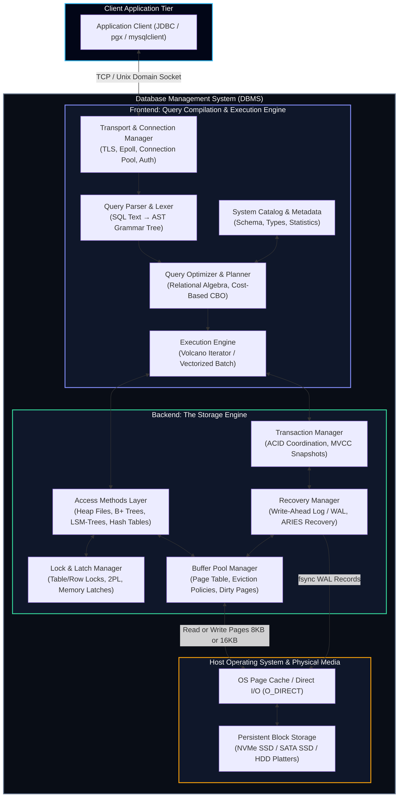
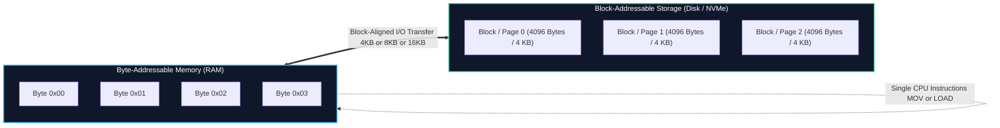
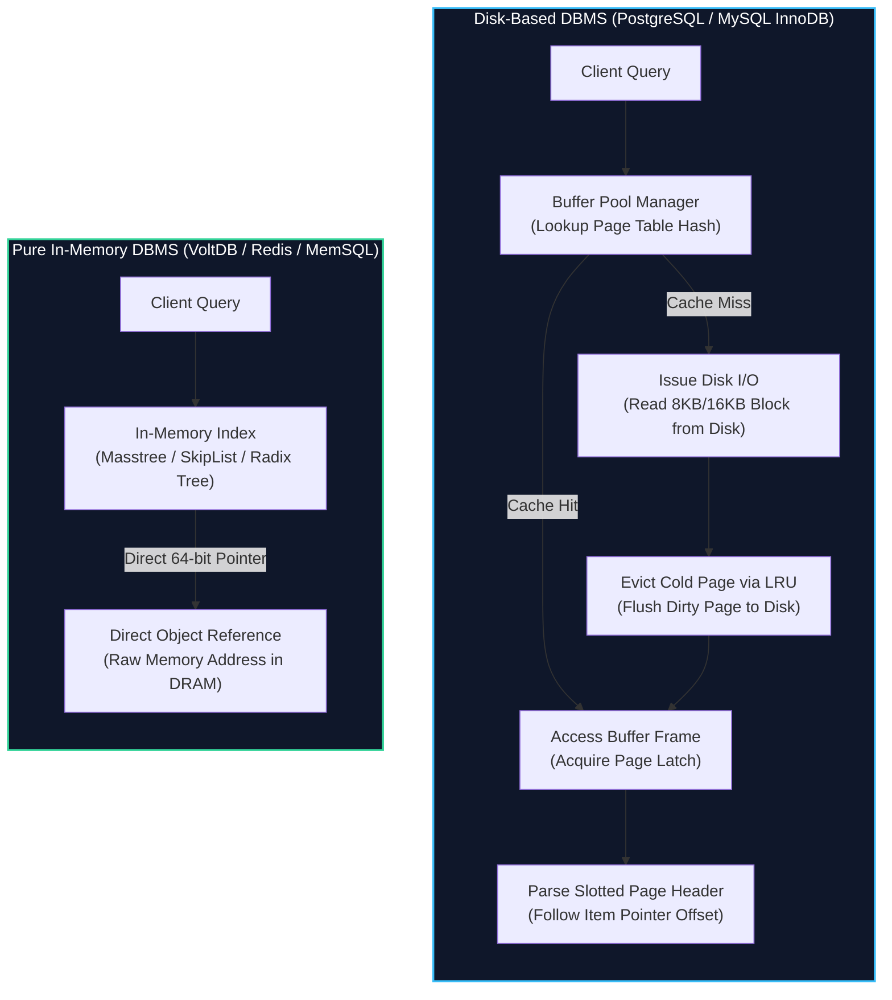
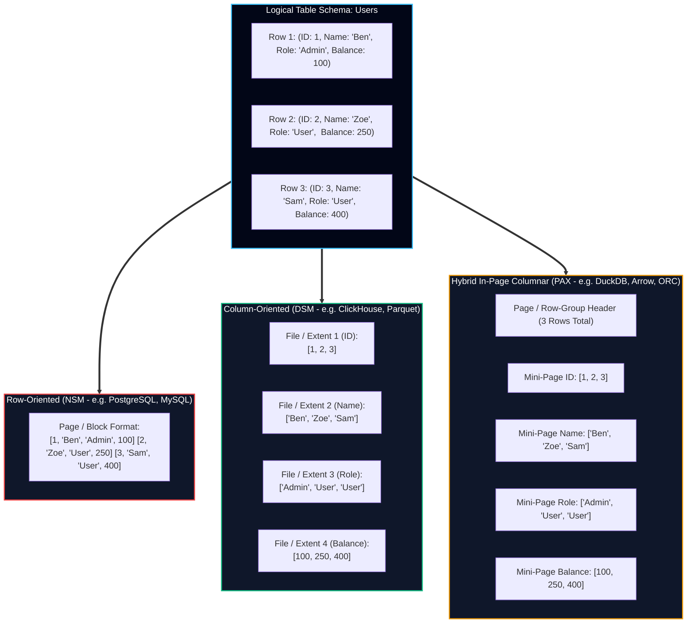
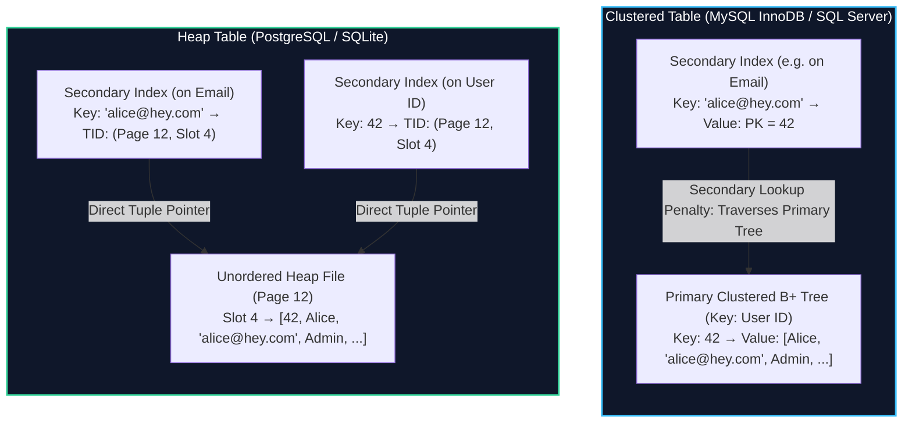

import { Callout } from "fumadocs-ui/components/callout";
import { Tabs, Tab } from "fumadocs-ui/components/tabs";
import { Steps, Step } from "fumadocs-ui/components/steps";

When an application executes a query as simple as `SELECT username, email FROM users WHERE id = 42;`, it sets in motion a sophisticated pipeline of distributed coordination, memory caching, query compilation, transaction scheduling, and physical block device input/output (I/O).

To the software engineer, a database management system (DBMS) presents the illusion of a declarative, instantaneous data repository. Beneath this abstraction, however, lies an intricate machine engineered to reconcile a brutal physical reality: **CPUs operate at nanosecond latencies on byte-addressable volatile registers and caches, while durable state resides on millisecond- or microsecond-latency block-addressable non-volatile media.**

In this chapter, we dissect the anatomy of modern database management systems based on Alex Petrov's _Database Internals_ and the architectural implementations of production engines such as PostgreSQL, MySQL (InnoDB), ClickHouse, and RocksDB.

---

## 1. The Anatomy of a DBMS

A production DBMS is decoupled into two primary hemispheres:

1. **The DBMS Frontend (Compute & Query Engine):** Accepts network client requests, validates credentials, parses SQL text into structured trees, optimizes query plans using statistical heuristics, and coordinates iterative execution.
2. **The DBMS Backend (Storage Engine):** Manages persistent storage, allocates and formats disk blocks, caches hot pages in DRAM, enforces ACID transaction isolation, coordinates concurrent thread access, and guarantees durability across sudden power loss or process crashes.



### 1.1 The Frontend Subsystems

#### Transport & Connection Manager

Every interaction starts at the transport layer. Clients connect over TCP/IP sockets or local Unix Domain Sockets (UDS) protected by TLS encryption.

- **Process/Thread Models:** PostgreSQL employs a process-per-connection architecture where the `postmaster` daemon forks an independent OS process for every connected client, sharing state via POSIX shared memory segments. MySQL and Microsoft SQL Server utilize a thread-per-connection model with an optional thread pool to handle tens of thousands of idle connections without drowning in OS context-switching overhead.
- **Wire Protocols:** The engine speaks a specialized binary wire protocol (e.g., the PostgreSQL Frontend/Backend Protocol v3.0 or the MySQL Client/Server Protocol). The transport manager handles authentication, parses protocol frames, and binds prepared statement handles.

#### Parser & Lexer

The parser ingests raw SQL query strings and performs:

1. **Lexical Analysis (Scanner):** Converts characters into tokens (`SELECT`, `FROM`, identifiers, literals).
2. **Syntactic Analysis (Grammar):** Uses parser generators (Bison/Flex) or hand-rolled recursive descent parsers to produce an **Abstract Syntax Tree (AST)** verifying that the statement adheres to SQL grammar rules.
3. **Semantic Analysis:** Validates table names, column existence, schema permissions, and type coercions against the database **System Catalog** (data dictionary).

#### Query Optimizer & Planner

The optimizer transforms the AST into an optimal, executable physical plan:

- **Logical Query Plan:** The AST is converted into relational algebra expressions containing operators such as Projection ($\pi$), Selection ($\sigma$), Cartesian Product ($\times$), and Join ($\bowtie$). Relational equivalence rules are applied (e.g., predicate pushdown, projection pruning, subquery flattening).
- **Cost-Based Optimization (CBO):** Database engines generate multiple candidate physical execution plans (e.g., evaluating whether an `INNER JOIN` should execute as a Hash Join, a Merge Join, or an Index Nested Loop Join). The optimizer evaluates statistical histograms stored in the catalog—such as column cardinality, null fraction, average width, and Most Common Values (MCV)—to compute an estimated cost in arbitrary I/O and CPU computational units:

$$
\text{Cost} = (N_{\text{pages}} \times \text{page\_cost}) + (N_{\text{tuples}} \times \text{cpu\_tuple\_cost}) + (N_{\text{ops}} \times \text{cpu\_operator\_cost})
$$

#### Execution Engine

The execution engine executes the physical plan produced by the optimizer. Two predominant architectural models dominate database systems:

<Tabs items={["Volcano Iterator Model", "Vectorized Execution Model"]}>
  <Tab value="Volcano Iterator Model">
    Pioneered by Goetz Graefe in 1990, the **Volcano (or Pipeline/Iterator) Model** structures query operators as an iterator tree where every operator implements three fundamental interface methods:

    ```cpp
    class VolcanoIterator {
    public:
        virtual void open() = 0;
        virtual Tuple* next() = 0; // Pulls one tuple at a time
        virtual void close() = 0;
    };
    ```

    The execution engine calls `next()` on the root operator (e.g., a Limit or Projection node), which recursively invokes `next()` on its children (e.g., a Filter or Index Scan node).

    * **Advantage:** Low memory footprint; results can be streamed immediately to the client without buffering entire intermediate relations in memory.
    * **Disadvantage:** Severe CPU instruction cache thrashing. Calling a virtual `next()` function millions of times per second incurs high dynamic dispatch overhead and prevents compiler loop unrolling and CPU SIMD auto-vectorization.

  </Tab>

  <Tab value="Vectorized Execution Model">
    Pioneered by the MonetDB/X100 (Vectorwise) project, **Vectorized Execution** shifts from pulling a single tuple per call to pulling an in-memory batch (vector) of tuples—typically $1024$ or $2048$ rows arranged contiguously:

    ```cpp
    class VectorizedIterator {
    public:
        virtual void open() = 0;
        virtual VectorBatch* next() = 0; // Pulls an array of 1024 columnar values
        virtual void close() = 0;
    };
    ```

    * **Advantage:** Transforms nested execution loops into tight, branch-free iterations over contiguous primitive arrays. The compiler can leverage modern CPU **Single Instruction, Multiple Data (SIMD)** vector registers (AVX2, AVX-512, ARM Neon) to process 8 to 16 values in a single CPU clock cycle.
    * **Primary Use Case:** Analytical processing (OLAP) engines like ClickHouse, DuckDB, Snowflake, and PostgreSQL's JIT/vectorized extensions.

  </Tab>
</Tabs>

---

### 1.2 The Storage Engine Subsystems

The storage engine is the heart of single-node database internals. It abstracts raw blocks into structured records and enforces transactional invariants.

#### Access Methods Layer

The Access Methods layer abstracts the physical layout of tables and indexes from the execution engine. When the executor requests `fetch_record_by_key(table_id, key)`, it does not know whether the physical storage is a heap file indexed by a B+ Tree, an append-only LSM-Tree, or an in-memory skip list. It provides unified primitives:

- Table Scans (heap traversal)
- Index Point Scans (equality matching)
- Index Range Scans (ordered iterator traversals)

#### Buffer Pool Manager

Database systems cannot afford to execute arbitrary operating system `read()` and `write()` syscalls on every record access. The **Buffer Pool Manager** allocates a large dedicated pool of virtual memory (e.g., `shared_buffers` in PostgreSQL, `innodb_buffer_pool_size` in MySQL) divided into fixed-size frames matching on-disk page sizes ($4\text{ KB}, 8\text{ KB}, \text{or } 16\text{ KB}$).

- **Page Table:** An in-memory hash table mapping a logical `PageID` (e.g., `[file_number, page_offset]`) to the physical memory frame address currently holding that page.
- **Pinning / Unpinning:** When a worker thread reads or updates a page, it increments the frame's `pin_count` (or reference count) and acquires a memory latch. As long as `pin_count > 0`, the page cannot be evicted from RAM. Once work completes, the thread unpins the frame.
- **Dirty Page Tracking & Flushing:** If a page is modified in RAM, its dirty flag is set. Background flusher threads periodically write dirty pages back to durable disk storage.
- **Eviction Algorithms:** When the pool is exhausted and an unbuffered page is requested, an existing page with `pin_count == 0` must be evicted. Engines use algorithms such as **LRU-K**, **2Q**, or **CLOCK-Pro** to avoid flushing hot index pages when large sequential scans sweep across the database.

#### Lock & Latch Manager

Engineers often conflate locks and latches. In storage engine architecture, they serve completely different purposes:

| Architectural Dimension | Database Lock (Logical)                                                           | Database Latch (Physical / Memory)                                                               |
| :---------------------- | :-------------------------------------------------------------------------------- | :----------------------------------------------------------------------------------------------- |
| **Protected Entity**    | Logical database entities: User tables, individual rows, transaction scopes.      | In-memory physical data structures: Buffer pool frames, B-Tree nodes, hash table buckets.        |
| **Duration**            | Maintained for the entire duration of a transaction (milliseconds to minutes).    | Maintained strictly for the duration of a memory operation (nanoseconds to microseconds).        |
| **Acquisition Mode**    | Strict Two-Phase Locking (2PL), Shared (S), Exclusive (X), Intent locks (IS, IX). | Atomic CPU primitives: `compare-and-swap` (CAS), read-write spinlocks, pthread mutexes.          |
| **Deadlock Management** | Detected via wait-for graphs, lock timeouts, and transaction rollback.            | Prevented by rigid global acquisition ordering (latch crabbing); deadlocks indicate engine bugs. |
| **Visibility**          | Exposed to SQL clients via system catalogs (`pg_locks`, `sys.innodb_locks`).      | Pure internal engine implementation; invisible to external database clients.                     |

#### Transaction & Recovery Managers (WAL & ARIES)

The transaction manager coordinates ACID semantics using either pessimistic locking or **Multi-Version Concurrency Control (MVCC)**.

- **Write-Ahead Logging (WAL):** To guarantee durability ($D$) and atomicity ($A$) without incurring catastrophic random disk writes on every `COMMIT`, the storage engine enforces the fundamental WAL protocol:

<Callout type="warn" title="The Fundamental WAL Invariant">
  **No dirty data page residing in the volatile Buffer Pool may be written to
  persistent disk storage until the corresponding log records describing the
  update have been serialized and flushed to disk (`fsync`).**
</Callout>

By writing compact, sequential update records to an append-only log file before altering on-disk pages, the database ensures that if power vanishes mid-transaction, the **Recovery Manager** can execute the **ARIES (Algorithms for Recovery and Isolation Exploiting Semantics)** protocol upon reboot:

1. **Analysis Phase:** Scan WAL forward from the latest checkpoint to reconstruct the active transaction table and dirty page table at the time of crash.
2. **Redo Phase:** Replay all logged modifications forward to restore the system state exactly to the microsecond of failure.
3. **Undo Phase:** Scan backward to reverse changes made by active, uncommitted transactions, returning the database to a globally consistent state.

---

## 2. Memory Hierarchy Realities: The Hardware Foundations

A storage engine's design is dictated entirely by the latency, bandwidth, and addressing physics of modern computer hardware.

### 2.1 The Latency Chasm

The performance divergence between CPU caches, volatile system DRAM, and non-volatile block storage spans **seven orders of magnitude**.

To build an intuitive engineering mental model, if we normalize a single CPU clock cycle ($0.3\text{ ns}$ on a modern $3.3\text{ GHz}$ core) to **1 second of human time**, the relative physical latencies scale dramatically:

| Storage Medium                | Typical Physical Latency | Scaled to Human Perspective ($1\text{ cycle} = 1\text{ sec}$) | Bandwidth Throughput    | Addressing Unit         |
| :---------------------------- | :----------------------- | :------------------------------------------------------------ | :---------------------- | :---------------------- |
| **L1 CPU Cache**              | $0.5 - 1.0\text{ ns}$    | **$2 - 3\text{ seconds}$**                                    | $\sim 5\text{ TB/s}$    | 64-byte cache line      |
| **L2 CPU Cache**              | $3.0 - 4.0\text{ ns}$    | **$10 - 14\text{ seconds}$**                                  | $\sim 2\text{ TB/s}$    | 64-byte cache line      |
| **L3 CPU Cache (Shared)**     | $10 - 25\text{ ns}$      | **$30 - 75\text{ seconds}$**                                  | $\sim 1\text{ TB/s}$    | 64-byte cache line      |
| **Main Memory (DRAM)**        | $50 - 100\text{ ns}$     | **$2.5 - 5\text{ minutes}$**                                  | $50 - 100\text{ GB/s}$  | 64-byte cache line      |
| **NVMe PCIe Gen4/5 SSD**      | $10 - 30\ \mu\text{s}$   | **$9 - 28\text{ hours}$ (over a full day!)**                  | $5 - 14\text{ GB/s}$    | 4KB / 8KB flash page    |
| **SATA SSD**                  | $100 - 200\ \mu\text{s}$ | **$3 - 6\text{ days}$**                                       | $\sim 550\text{ MB/s}$  | 4KB / 8KB flash page    |
| **Rotational HDD (7200 RPM)** | $5 - 10\text{ ms}$       | **$6 - 12\text{ months}$ (a full year!)**                     | $150 - 250\text{ MB/s}$ | 512B / 4KB sector       |
| **Tape Archival Storage**     | $10 - 60\text{ seconds}$ | **$1,000 - 6,000\text{ years}$ (Recorded human history!)**    | $300 - 400\text{ MB/s}$ | Large sequential blocks |

```mermaid
flowchart TD
    subgraph MEMORY_HIERARCHY["Hardware Latency Spectrum (Logarithmic Scale)"]
        L1["L1 Cache: ~1 ns<br/>(32-64 KB per core)"]
        L2["L2 Cache: ~4 ns<br/>(512 KB - 1 MB per core)"]
        L3["L3 Cache: ~15 ns<br/>(16 - 64 MB shared)"]
        DRAM["DRAM: ~80 ns<br/>(16 - 512 GB)"]
        NVME["NVMe Flash SSD: ~20 µs<br/>(1 - 30 TB)"]
        SATA["SATA SSD: ~150 µs<br/>(500 GB - 4 TB)"]
        HDD["Mechanical HDD: ~8 ms<br/>(4 - 24 TB)"]
    end

    L1 -->|4x slower| L2
    L2 -->|4x slower| L3
    L3 -->|5x slower| DRAM
    DRAM -->|250x slower| NVME
    NVME -->|7x slower| SATA
    SATA -->|50x slower| HDD

    style L1 fill:#047857,stroke:#10b981,stroke-width:2px,color:#ffffff
    style L2 fill:#047857,stroke:#10b981,stroke-width:2px,color:#ffffff
    style L3 fill:#047857,stroke:#10b981,stroke-width:2px,color:#ffffff
    style DRAM fill:#1d4ed8,stroke:#3b82f6,stroke-width:2px,color:#ffffff
    style NVME fill:#b45309,stroke:#f59e0b,stroke-width:2px,color:#ffffff
    style SATA fill:#b45309,stroke:#f59e0b,stroke-width:2px,color:#ffffff
    style HDD fill:#b91c1c,stroke:#ef4444,stroke-width:2px,color:#ffffff
```



<Callout type="info" title="The Engineering Implication">
Waiting for an HDD rotational seek ($8\text{ ms}$) relative to a CPU instruction cycle is equivalent to a software developer pausing their work not for a second, but for an entire calendar year.

Even on blazing-fast enterprise NVMe flash drives ($20\ \mu\text{s}$), a single page fetch equates to an entire work day of idle CPU cycles. **Therefore, storage engine architecture is the art of minimizing random storage device interactions through intelligent in-memory indexing, sequential batching, and page-level locality.**

</Callout>

---

### 2.2 Why Disk is a Block Device

A central rule of database engineering states: **Operating systems and physical disk controllers cannot address, read, or write a single solitary byte from persistent storage.**

All persistent storage hardware operates fundamentally as a **Block Device**:



1. **Hardware Sector & Page Geometry:**
   - Traditional spinning hard drives read data using physical magnetic sectors (historically $512$ bytes, modernized as Advanced Format `4Kn` using $4096$-byte physical sectors).
   - Solid-State Drives (NAND Flash) store floating-gate or charge-trap electrons organized physically into **Flash Pages** ($4\text{ KB}, 8\text{ KB}, \text{or } 16\text{ KB}$) grouped into massive **Erase Blocks** ($2\text{ MB} - 8\text{ MB}$). While reads and writes occur in page increments, erasing data can _only_ occur at the block level.
2. **The Read-Modify-Write Penalty:**
   - If an application attempts to update a single 4-byte integer on disk, the storage controller cannot simply flip those 4 bytes. It must:
     1. Read the entire $4096$-byte physical page into device memory.
     2. Update the target 4 bytes in the memory buffer.
     3. Write the entire $4096$-byte page back to durable storage.
3. **The Architectural Mandate for Slotted Pages:**
   - Because disks enforce block-granular transfer, database engines format their data files into fixed-size **Pages** matching or multiplying the underlying disk block size:
     - **PostgreSQL:** $8\text{ KB}$ default page size.
     - **MySQL InnoDB:** $16\text{ KB}$ default page size.
     - **SQLite:** $4\text{ KB}$ default page size.
     - **Oracle:** $8\text{ KB}$ default page size.
   - Storing rows inside fixed-size pages ensures that reading a record pulls adjacent records into memory simultaneously, maximizing **spatial locality**.

---

## 3. In-Memory vs. Disk-Based Database Engines

The memory hierarchy creates a fundamental split in database design philosophies. A system designed from scratch assuming data permanently fits in RAM looks radically different from an engine designed for disk persistence.



### 3.1 Architectural Divergences

#### Buffer Pool Overhead vs. Pointer Swizzling

- In a **disk-based database**, every single record access must traverse the Buffer Pool Manager. Even if the entire $500\text{ GB}$ database happens to reside in RAM, every read incurs:
  1. Hashing the `PageID` to find the corresponding buffer pool frame.
  2. Acquiring and releasing memory latches on the frame header.
  3. Validating page header checksums and LSN numbers.
  4. Resolving record offsets via the page's internal slot array.

  Benchmarking studies (such as Harizopoulos et al., _OLTP Through The Looking Glass_) reveal that in disk-based engines operating on fully cached datasets, **less than 10% of total CPU cycles are spent executing actual relational work (filtering, sorting, joining)**. The remaining 90%+ is consumed by buffer pool management, latching, lock acquisition, and logging overhead!

- In an **in-memory database** (e.g., VoltDB, Redis, RAMCloud), the buffer pool is discarded entirely. Pointers in index structures (such as Bw-Trees or SkipLists) point directly to the 64-bit virtual memory address where the tuple struct resides in DRAM. This technique—**pointer swizzling**—eliminates address translation lookups and enables instruction execution at full hardware memory bus speed.

#### Latching and Concurrency Control

- **Disk-Based:** Must use complex multithreading with fine-grained page-level latching protocols (latch crabbing) to allow multiple worker threads to traverse B-Trees while disk reads are pending asynchronously.
- **In-Memory:** Because there is no I/O blocking (a memory read takes $80\text{ ns}$, not $10\text{ ms}$), engines like VoltDB partition memory across CPU cores. Each core runs a single-threaded execution loop that accesses its partition without acquiring any locks or latches whatsoever, achieving tens of millions of transactions per second.

#### Durability and Logging Models

- **Disk-Based:** Durability is primary. Data is continually written to pages on disk; WAL records are appended synchronously before transaction commits return to clients.
- **In-Memory:** Data in RAM is primary. Durability is achieved through asynchronous snapshotting (e.g., Redis RDB background forks), non-volatile memory (NVDIMM/Optane), or command logging (recording transaction stored procedure invocations rather than detailed physical row byte diffs).

---

## 4. Row-Oriented vs. Column-Oriented Data Layouts

Once a database decides how to interface with memory and storage blocks, it must decide how to organize tuples inside those storage blocks.

Two classic paradigms define physical database storage:

1. **Row-Oriented Layout (NSM - N-ary Storage Model)**
2. **Column-Oriented Layout (DSM - Decomposition Storage Model)**
3. **Hybrid In-Page Columnar Layout (PAX - Partition Attributes Across)**



---

### 4.1 Row-Oriented Layout (NSM)

In the N-ary Storage Model, a table's records are packed sequentially inside disk pages, row by row.

#### Physical Anatomy of an NSM Page

Inside an $8\text{ KB}$ PostgreSQL or $16\text{ KB}$ InnoDB page:

- **Page Header:** Holds page metadata, LSN (Log Sequence Number), free space bounds, and transaction transaction slots.
- **Slot Array (Item Pointers):** Grows from the beginning of the page forward. Each slot is a 4-byte pointer containing an offset and a length pointing to an individual record.
- **Tuples:** Stored contiguously starting from the end of the page backward.
- **Free Space:** The contiguous unallocated memory gap between the end of the slot array and the start of the newest tuple.

```
+-----------------------------------------------------------------------+
| Page Header | Slot 1 | Slot 2 | Slot 3 | ...  FREE SPACE  ...         |
|-----------------------------------------------------------------------|
| ... (Free Space) ... | Tuple 3 | Tuple 2       | Tuple 1              |
+-----------------------------------------------------------------------+
```

#### Why NSM Excels in OLTP (Online Transaction Processing)

1. **High-Velocity Point Writes:** Inserting a new user record requires writing to exactly one page block and one WAL location.
2. **Point Lookups:** When executing `SELECT * FROM users WHERE id = 42;`, finding the tuple requires reading one single page into memory. All fields (`id`, `name`, `role`, `balance`, `created_at`) are physically contiguous on that page, loaded into CPU L1/L2 caches with zero reconstruction cost.
3. **Record-Level Locking:** Thread contention is isolated; locking row $42$ does not block access to adjacent rows on other pages.

#### The Pathological Failure of NSM in Analytics (OLAP)

Suppose your application has $100,000,000$ user records, each taking $250$ bytes across $50$ columns. You execute an aggregate query:

```sql
SELECT AVG(balance) FROM users;
```

To compute this single floating-point number, the database must evaluate only the 4-byte `balance` column ($400\text{ MB}$ of useful data).

However, because the data is laid out in NSM rows, the engine has no choice but to scan **every single byte of every single row**:

$$
\text{Data Transferred} = 100,000,000 \times 250\text{ bytes} = 25\text{ GB}
$$

The storage engine must pull $25\text{ GB}$ of data off disk, flood the buffer pool, evict hot pages, and consume memory bus bandwidth just to discard $98.4\%$ of the bytes it retrieved!

---

### 4.2 Column-Oriented Layout (DSM)

In the Decomposition Storage Model, each table column is stored in its own separate file or contiguous set of disk blocks.

For our query `SELECT AVG(balance) FROM users;`:

- The engine reads _only_ the blocks allocated to the `balance` column.
- Instead of scanning $25\text{ GB}$, it reads exactly $400\text{ MB}$ (and with compression, often less than $40\text{ MB}$!).
- Disk I/O drops by **$99\%$**, and memory bandwidth saturation is avoided.

#### The Extreme Compression Advantage

In row-oriented databases, adjacent bytes belong to completely different data types: an integer followed by a UTF-8 string, followed by a timestamp, followed by a boolean. This heterogeneity destroys entropy and makes data compression ineffective.

In a columnar database, every adjacent value in a block is of the **exact same data type** with high semantic repetition, enabling specialized compression algorithms:

<Tabs items={["Run-Length Encoding (RLE)", "Dictionary Encoding", "Bit-Packing & Frame-of-Reference", "Delta Encoding"]}>
  <Tab value="Run-Length Encoding (RLE)">
    When columns contain repeated values (especially when the data is sorted by that column), consecutive identical entries are replaced by a `(value, count)` pair.

    ```
    Raw Column:   ["US", "US", "US", "US", "CA", "CA", "UK", "UK", "UK"]
    RLE Encoded:  [("US", 4), ("CA", 2), ("UK", 3)]
    ```

    * **Compression Ratio:** Can exceed $100:1$ for low-cardinality sorted dimensions (such as status codes, countries, or timestamps truncated to date).
    * **Direct Execution:** Aggregate functions like `COUNT(*)` can sum the run lengths directly without decompressing the underlying strings.

  </Tab>

  <Tab value="Dictionary Encoding">
    High-cardinality strings (e.g., URLs, browser user agents, city names) are mapped to compact integer IDs in a small dictionary table.

    ```
    Dictionary Table:
    0 -> "Chrome/124.0.0.0"
    1 -> "Safari/17.4"
    2 -> "Firefox/125.0"

    Raw Column:  ["Chrome/124.0.0.0", "Safari/17.4", "Chrome/124.0.0.0"]
    Data Array:  [0, 1, 0]  (Stored as 1-byte or 2-byte integers)
    ```

    * Strings of $50+$ bytes are replaced with 1-byte integers, reducing memory footprint by $98\%$ and enabling lightning-fast CPU integer comparisons during `WHERE` clause filtering.

  </Tab>

  <Tab value="Bit-Packing & Frame-of-Reference">
    Standard integers allocate 32 or 64 bits regardless of actual value magnitude. **Frame of Reference (FoR)** finds the minimum value in a block (the reference) and subtracts it from all entries:

    ```
    Raw Values:       [1004, 1002, 1007, 1001, 1005]
    Reference Value:  1001
    Differences:      [3, 1, 6, 0, 4]
    ```

    The maximum difference ($6$) requires only $3$ bits ($2^3 = 8$). Using **Bit-Packing**, the engine packs every number into 3 bits instead of 32 bits, achieving an immediate **$10\times$ storage reduction**.

  </Tab>

  <Tab value="Delta Encoding">
    Ideal for monotonically increasing sequences such as primary keys, auto-increment IDs, and microsecond sensor timestamps.

    ```
    Raw Timestamps:  [1700000000, 1700000002, 1700000005, 1700000006]
    Delta Encoded:   1700000000 (base), [+2, +3, +1]
    ```

    Combined with bit-packing, thousands of timestamps can be compressed into a handful of bytes.

  </Tab>
</Tabs>

#### The Weakness of Pure Column Stores in OLTP

Pure columnar storage collapses when applied to high-concurrency transactional workloads:

1. **Tuple Reconstruction Penalty:** Executing `SELECT * FROM users WHERE id = 42;` requires the storage engine to perform 50 separate read operations across 50 separate files/blocks to stitch the row together.
2. **Write Amplification on Inserts:** Inserting a single user record requires writing to 50 separate column files on disk, turning one sequential write into 50 random I/O operations.

---

### 4.3 Hybrid In-Page Columnar: The PAX Model

To eliminate the tuple reconstruction penalty of DSM while retaining the cache locality and SIMD benefits of columnar storage, Anastassia Ailamaki et al. introduced **PAX (Partition Attributes Across)** in 2001.

PAX is the architectural foundation of modern analytical formats such as **Apache Parquet**, **Apache ORC**, and engines like **DuckDB**:

- The dataset is partitioned horizontally into large **Row Groups** (typically $64\text{ MB} - 512\text{ MB}$ or multi-megabyte pages).
- Inside each page/group, data is laid out **column by column** in dedicated minipages.

```
+-----------------------------------------------------------------------------+
| PAX PAGE / ROW-GROUP HEADER (Contains Minipage Offsets & Row Count)         |
|-----------------------------------------------------------------------------|
| Minipage 1: Column ID       [1, 2, 3, 4, 5, 6, ...]                        |
| Minipage 2: Column Age      [28, 34, 45, 19, 52, 31, ...]                   |
| Minipage 3: Column Balance  [100.50, 400.00, 25.20, 990.00, ...]           |
+-----------------------------------------------------------------------------+
```

**The PAX Breakthrough:**

- **Cache Locality:** When the CPU evaluates a filter on `Age`, it streams contiguous 32-bit integers straight into L1 cache lines with zero wasted bandwidth.
- **Localized Tuple Reconstruction:** If a row matches the filter, its corresponding `ID` and `Balance` fields reside in the _exact same memory buffer / disk block_. No inter-file disk seeks or cross-network fetches are required.

---

## 5. Table Storage vs. Index Storage: Clustered vs. Secondary

How does a database physically link an index entry (such as a B+ Tree key) back to the actual row data on disk?

Engines adopt two distinct architectures: **Clustered Index Tables (Index-Organized Tables)** versus **Heap File Tables with Secondary Indexes**.



### 5.1 Clustered Index Storage (InnoDB Architecture)

In MySQL InnoDB:

- **The Table IS a B+ Tree:** There is no separate heap file. The table data is physically stored in the leaf pages of the primary key's B+ Tree.
- **Secondary Index Trade-off:** A secondary index (e.g., an index on `email`) does not store physical disk addresses. Instead, it stores the **Primary Key value** (`id = 42`).
  - _Lookup Penalty:_ Searching by email requires a **two-phase index traversal**:
    1. Search the `email` B+ Tree to find `id = 42`.
    2. Search the primary key B+ Tree to retrieve the actual row columns.
  - _Maintenance Advantage:_ If an update modifies a row without altering its primary key, the row can move to a completely new physical page during a node split without needing to update any secondary indexes.

### 5.2 Heap File Storage (PostgreSQL Architecture)

In PostgreSQL:

- **Heap File Organization:** Tables are stored in unordered heap files consisting of $8\text{ KB}$ pages. Tuples are inserted wherever free space exists.
- **Direct Tuple Identifier (TID / RID):** Every index (primary or secondary) stores a direct physical pointer called a **Tuple Identifier (TID)** formatted as `(page_number, slot_number)`:
  - _Lookup Advantage:_ Looking up a row by primary key or by email takes the exact same time: one index search directly yields the heap page number and slot.
  - _Write Penalty (The Update Ripple):_ If an update modifies a tuple and causes it to outgrow its slot, PostgreSQL must write the new tuple version to a new page. This changes its physical TID, requiring the engine to **update every single secondary index on that table** to point to the new location.
  - _PostgreSQL's Countermeasure (HOT):_ PostgreSQL implements **Heap-Only Tuples (HOT)**. If an updated tuple fits inside the _exact same heap page_ and no indexed columns were modified, a pointer chain is created inside the page header, completely avoiding secondary index updates.

---

## 6. Architecture Comparison Matrix

To summarize the design choices across modern database systems, evaluate the architectural trade-offs:

| Architectural Dimension     | PostgreSQL                              | MySQL (InnoDB)                                               | ClickHouse                                   | RocksDB                                         | Redis                                     |
| :-------------------------- | :-------------------------------------- | :----------------------------------------------------------- | :------------------------------------------- | :---------------------------------------------- | :---------------------------------------- |
| **Primary Target Workload** | General-purpose OLTP                    | High-concurrency Web OLTP                                    | Real-time Big Data OLAP                      | Write-Heavy Key-Value                           | Low-Latency In-Memory Cache/Store         |
| **Storage Layout**          | Row-Store (NSM Heap)                    | Row-Store (NSM Clustered)                                    | Column-Store (DSM MergeTree)                 | Log-Structured (LSM-Tree)                       | In-Memory Key-Value (RAM Hash / SkipList) |
| **Execution Model**         | Volcano Iterator (Pull)                 | Volcano Iterator (Pull)                                      | Vectorized Batch (Push)                      | Key-Value API / Scan                            | Single-Threaded Event Loop                |
| **Buffer Cache Strategy**   | Dual: `shared_buffers` + OS Page Cache  | Dedicated: `innodb_buffer_pool` (bypasses OS via `O_DIRECT`) | OS Page Cache + Block Cache                  | Block Cache + MemTable                          | None (Data natively resides in DRAM)      |
| **Concurrency Control**     | MVCC (Append-only row versions in heap) | MVCC (In-place update + Undo Log pages)                      | Immutable partitions (No transactional MVCC) | MVCC via Sequence Numbers & Immutable MemTables | Single-threaded serialization per shard   |
| **Crash Recovery**          | ARIES-style WAL (`pg_wal`)              | WAL (Redo Log) + Undo Logs                                   | Append-only part logs + Checkpoints          | WAL (`.log`) + Manifest                         | Append-Only File (AOF) + Snapshot (RDB)   |

---

## 7. Key Takeaways & Architectural Mental Model

1. **The DBMS is a Dual Machine:** Never view a database as a monolith. The **Query Engine** operates on abstract relational math, compiler optimizations, and iterators; the **Storage Engine** operates on physical disk blocks, memory latches, buffer pools, and crash logs.
2. **The Physics of Storage Govern Everything:** Because physical disk controllers operate exclusively in blocks ($4\text{ KB} - 16\text{ KB}$), storage engines organize data into fixed-size pages. Memory latency is measured in nanoseconds; disk latency in microseconds to milliseconds. Database algorithms are designed to minimize random page transfers.
3. **Workload Dictates Physical Layout:**
   - Use **Row-Oriented (NSM)** when your workload reads or updates complete entities by primary key (OLTP).
   - Use **Column-Oriented (DSM/PAX)** when your workload executes wide analytical aggregations across billions of rows (OLAP).
4. **Indirection vs. Direct Pointers:** Clustered index tables (MySQL) use primary keys as logical pointers to decouple secondary indexes from physical block locations; heap tables (PostgreSQL) use direct physical page addresses (TIDs) for faster single-hop lookups at the cost of update amplification.

In the next chapter, we dive deep into the most critical data structure in disk-based storage engines: **The B-Tree**. We will explore why binary search trees fail on persistent hardware, how multiway fanout conquers the memory hierarchy, and how node split and merge algorithms maintain balance under continuous modification.
