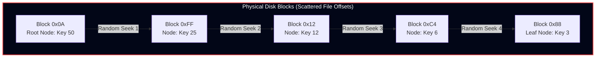
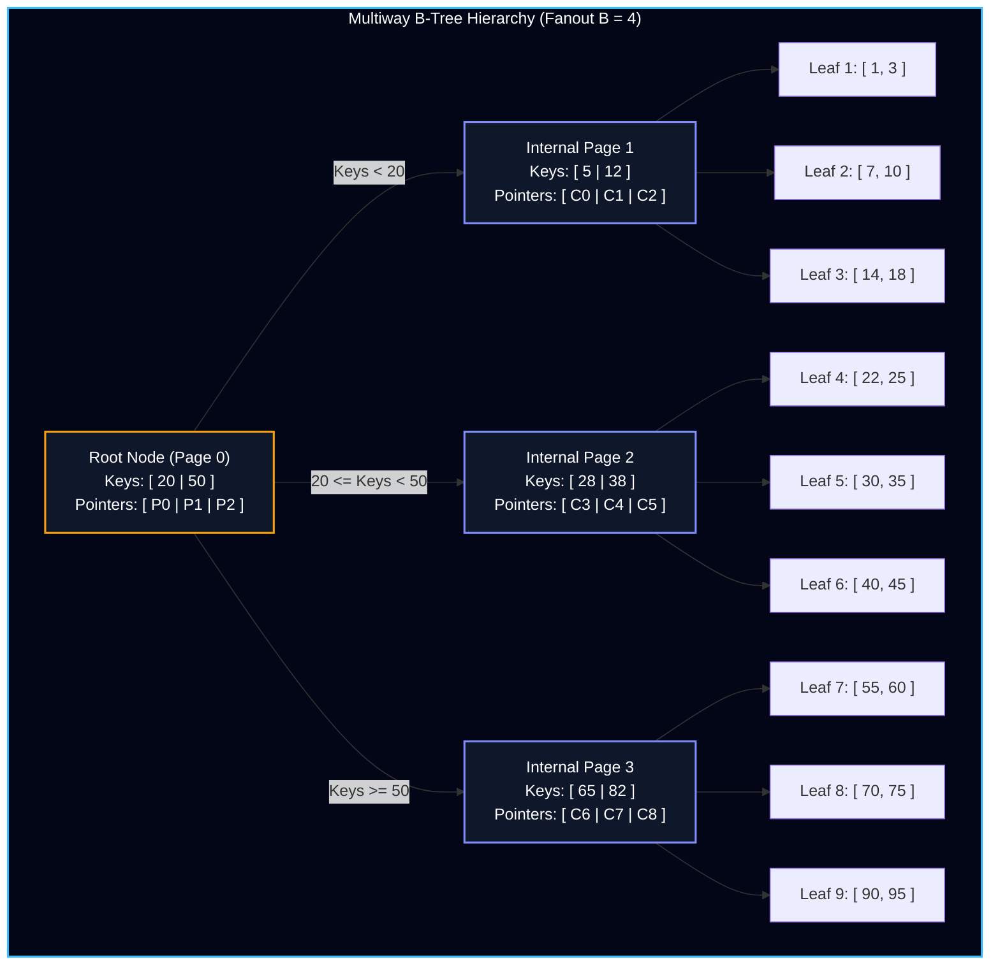
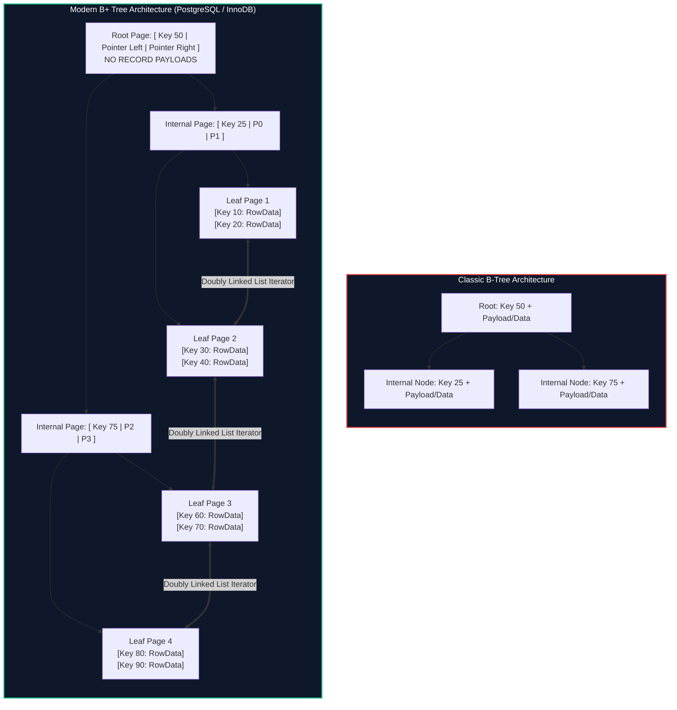
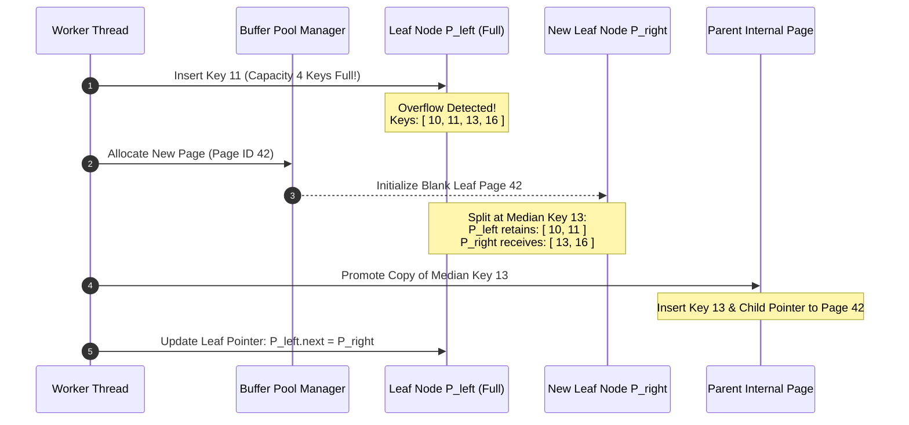
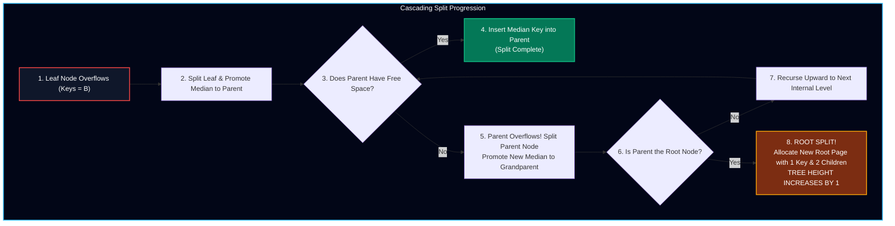
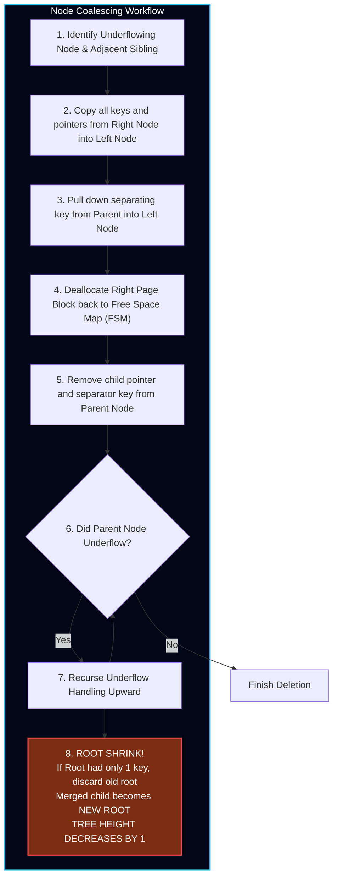

import { Callout } from "fumadocs-ui/components/callout";
import { Tabs, Tab } from "fumadocs-ui/components/tabs";
import { Steps, Step } from "fumadocs-ui/components/steps";

In database engineering, indexing is the art of structuring data so that point lookups, range scans, and ordered iterations execute without scanning every page in a multi-gigabyte or multi-terabyte dataset.

Software engineers are taught in introductory computer science that balanced binary search trees (BSTs), such as **AVL trees** or **Red-Black trees**, are optimal search structures offering $O(\log_2 N)$ lookup, insertion, and deletion complexity. Yet, if you inspect the source code of PostgreSQL, MySQL InnoDB, SQLite, or Oracle, you will find virtually **no binary search trees in the persistent storage engine**.

Instead, the undisputed workhorse of relational databases for over fifty years has been the **B-Tree** (and its ubiquitous modern variant, the **B+ Tree**), invented by Rudolf Bayer and Edward M. McCreight at Boeing Labs in 1970.

In this chapter, we explore why binary search trees fail catastrophically on persistent block storage, how B-Trees leverage high fanout to conquer the memory hierarchy, and how node split and merge algorithms maintain balance under continuous modification.

---

## 1. The Indexing Dilemma: The Storage Medium Gap

To understand why B-Trees exist, consider the fundamental trade-offs among elementary on-disk data structures:

```mermaid
flowchart LR
    subgraph APPEND_LOG["1. Unsorted Append-Only Log (Heap)"]
        A_WRITE["Writes: O(1) Sequential Append<br/>Max hardware bandwidth"]
        A_READ["Reads: O(N) Full Table Scan<br/>Must inspect every single block"]
    end

    subgraph SORTED_ARRAY["2. Contiguous Sorted Array"]
        S_READ["Reads: O(log₂ N) Binary Search<br/>Minimum comparison count"]
        S_WRITE["Writes: O(N) Element Shifts<br/>Inserting in middle shifts half the file"]
    end

    subgraph BTREE_IDEAL["3. Multiway B-Tree Hierarchy"]
        B_READ["Reads: O(log_B N) Disk Page Accesses<br/>3 to 4 I/O reads for billions of rows"]
        B_WRITE["Writes: O(log_B N) Balanced Splitting<br/>Localized page modifications"]
    end

    APPEND_LOG -.->|Need faster reads| SORTED_ARRAY
    SORTED_ARRAY -.->|Need faster writes| BTREE_IDEAL

    style APPEND_LOG fill:#0f172a,stroke:#ef4444,stroke-width:2px,color:#ffffff
    style SORTED_ARRAY fill:#0f172a,stroke:#f59e0b,stroke-width:2px,color:#ffffff
    style BTREE_IDEAL fill:#0f172a,stroke:#10b981,stroke-width:2px,color:#ffffff
```



1. **Unsorted Append-Only Logs (Heap Files):**
   - **Write Throughput:** Flawless. New records are appended sequentially to the end of the file ($O(1)$). Disk heads do not seek, and flash write caches fill sequentially.
   - **Read Throughput:** Pathological ($O(N)$). Finding a user by `id = 42` requires scanning every single disk block from the beginning of the file to the end.
2. **Contiguous Sorted Arrays:**
   - **Read Throughput:** Excellent ($O(\log_2 N)$). We can perform binary search across the file offsets.
   - **Write Throughput:** Catastrophic ($O(N)$). Inserting a new record into the middle of a $100\text{ GB}$ sorted array requires shifting tens of gigabytes of subsequent bytes forward on disk to make room.

We require a data structure that reconciles this dilemma: keeping data dynamically sorted to support $O(\log N)$ search and range scans, while isolating updates so insertions and deletions execute in $O(\log N)$ without shifting arbitrary bytes across the disk.

---

## 2. Why Binary Search Trees (BSTs) Fail on Disk

If a balanced binary search tree (like an AVL or Red-Black tree) solves the dynamic sorted insertion problem in DRAM, why can we not simply serialize its nodes directly to disk?

Four physical hardware barriers prevent binary search trees from operating as persistent on-disk index structures:

### 2.1 Barrier 1: The Fanout Deficit and Astronomical Tree Height

The **fanout** ($B$) of a tree is the number of child pointers originating from each internal node. In any binary tree, the fanout is strictly fixed at:

$$
B = 2
$$

Because each node has at most two children, the height $h$ of a balanced binary search tree containing $N$ elements is:

$$
h_{\text{BST}} \approx \lceil \log_2 N \rceil
$$

Consider a production database table containing **$100,000,000$ (100 Million) records**:

$$
h_{\text{BST}} = \log_2(100,000,000) \approx 27\text{ levels}
$$

A point lookup requires traversing from the root to a leaf node, dereferencing **$27$ sequential pointers**.

---

### 2.2 Barrier 2: Arbitrary Pointer Chasing and Random I/O

In volatile DRAM, dereferencing a 64-bit pointer is an electronic operation taking $50 - 100\text{ ns}$. In persistent storage, however, a pointer is not a memory address; it is a **file offset or block ID on disk**.

Because nodes are allocated dynamically at different points in time as records arrive, adjacent nodes in the tree are scattered across completely arbitrary locations in the database file:



Traversing $27$ levels in a persistent BST requires **$27$ independent, dependent random disk reads**:

<Tabs items={["Mechanical HDD Latency", "Enterprise NVMe SSD Latency"]}>
  <Tab value="Mechanical HDD Latency">
    A standard 7200 RPM enterprise hard disk drive exhibits an average rotational delay and mechanical arm seek time of $\approx 8\text{ ms}$ per random I/O:

    $$
    \text{Latency} = 27\text{ levels} \times 8\text{ ms} = \mathbf{216\text{ milliseconds}}
    $$

    At $216\text{ ms}$ per point lookup, a single server can execute only **$4.6$ queries per second per disk!** A web service handling hundreds of requests per second would grind to a halt.

  </Tab>

  <Tab value="Enterprise NVMe SSD Latency">
    Modern PCIe Gen4 NVMe solid-state drives eliminate mechanical arms, achieving random read latencies of $\approx 20\ \mu\text{s}$:

    $$
    \text{Latency} = 27\text{ levels} \times 20\ \mu\text{s} = \mathbf{540\ \mu\text{s}}
    $$

    While $540\ \mu\text{s}$ is vastly superior to an HDD, it is still **over 5,000 times slower** than DRAM ($0.1\ \mu\text{s}$). Furthermore, it forces $27$ sequential rounds of PCIe bus communication, stalling the CPU worker thread at every level.

  </Tab>
</Tabs>

---

### 2.3 Barrier 3: Cache Line & Page Boundary Misalignment (Wasted Bandwidth)

As established in Chapter 1, physical storage hardware and operating system kernels cannot read isolated bytes; **they transfer data in fixed-size blocks (pages), typically $4096\text{ bytes}$ (4 KB), $8192\text{ bytes}$ (8 KB), or $16384\text{ bytes}$ (16 KB)**.

Consider the memory footprint of a single 64-bit binary search tree node:

```cpp
struct BSTNode {
    int64_t key;          // 8 bytes
    int64_t value_offset; // 8 bytes (pointer to data record)
    BSTNode* left_child;  // 8 bytes (disk block ID)
    BSTNode* right_child; // 8 bytes (disk block ID)
}; // Total: 32 bytes
```

If we store each node in its own disk page:

- The node consumes **$32\text{ bytes}$**.
- The hardware must transfer a minimum **$4096\text{ bytes}$** page from disk to RAM.

$$
\text{Storage Efficiency} = \frac{32\text{ bytes}}{4096\text{ bytes}} \approx \mathbf{0.78\%}
$$

**Over $99.2\%$ of the data transferred across the storage bus into the operating system buffer cache is completely discarded!**

If we attempt to pack multiple small BST nodes onto a single 4 KB page, an insertion that rotates the tree requires modifying multiple scattered pages, destroying page locality and causing severe write amplification.

---

### 2.4 Barrier 4: Structural Instability During Self-Balancing

In self-balancing binary search trees (AVL or Red-Black trees), an insertion or deletion frequently violates invariant balance factors or color rules, triggering tree rotations (Left Rotation, Right Rotation, Left-Right Rotation):

```
       A (Page 1)                     B (Page 2)
        \                            / \
         B (Page 2)    ===>         A   C
          \                     (Page 1)(Page 3)
           C (Page 3)
```

A single rotation modifies parent and child pointers across three distinct nodes. If those three nodes reside on separate disk pages, **one single record insertion can dirty three separate 8 KB disk pages**, forcing the recovery manager to emit three separate WAL records and the buffer pool to flush three entire pages back to storage.

---

## 3. Anatomy of a B-Tree: Multiway Search Trees

The B-Tree was engineered specifically to exploit the physical block geometry of secondary storage devices.

### 3.1 The Architectural Philosophy: Maximize Fanout

Instead of storing a single key and two child pointers per node, the B-Tree widens the node to match the physical page size ($4\text{ KB} - 16\text{ KB}$). A single node stores **hundreds or thousands of keys and child pointers**.

By drastically increasing the fanout ($B$), the tree collapses vertically, becoming **extremely wide and remarkably shallow**.



---

### 3.2 Formal Mathematical Invariants

A B-Tree of order (or maximum fanout) $B$ is a self-balancing search tree governed by five rigid structural invariants:

<Callout type="info" title="The Five Invariants of an Order-B B-Tree">
1. **Node Key and Pointer Invariant:** Every node contains an array of sorted keys $K_1 < K_2 < \dots < K_{k-1}$ and an array of $k$ child pointers $P_0, P_1, \dots, P_{k-1}$. A node with $k$ child pointers always contains exactly $k - 1$ keys.
2. **Internal Node Capacity Invariant:** Every internal node (except the root) has at most $B$ child pointers and at least $\lceil B / 2 \rceil$ child pointers. Consequently, every internal node contains at most $B - 1$ keys and at least $\lceil B / 2 \rceil - 1$ keys.
3. **Root Node Capacity Invariant:** The root node has at least $2$ children if it is not a leaf node (and at least $1$ key if the tree is non-empty).
4. **Leaf Node Capacity Invariant:** All leaf nodes reside at the **exact same depth** from the root, guaranteeing $100\%$ global balance. Leaves contain between $\lceil B / 2 \rceil - 1$ and $B - 1$ keys.
5. **Key Subtree Ordering Invariant:** For any internal node with keys $K_1 < K_2 < \dots < K_{k-1}$ and pointers $P_0, P_1, \dots, P_{k-1}$:
   - Subtree $P_0$ contains only keys where $K < K_1$.
   - Subtree $P_i$ (for $1 \le i \le k-2$) contains only keys where $K_i \le K < K_{i+1}$.
   - Subtree $P_{k-1}$ contains only keys where $K \ge K_{k-1}$.
</Callout>

---

### 3.3 Derivation of B-Tree Height and Logarithmic Bounds

The primary metric of a database index is the maximum number of disk I/O operations required to locate any arbitrary record. This directly corresponds to the **height $h$** of the tree.

Let $N$ be the total number of items stored in the B-Tree. To find the maximum possible height $h_{\max}$ (the worst-case scenario), we assume every node in the tree is populated with the **minimum permissible capacity**:

- The root contains $1$ key and $2$ child pointers.
- Level 1 contains $2$ nodes, each having $\lceil B / 2 \rceil$ children.
- Level 2 contains $2 \times \lceil B / 2 \rceil$ nodes, each having $\lceil B / 2 \rceil$ children.
- In general, level $i$ contains $2 \times \lceil B / 2 \rceil^{i-1}$ nodes.

Summing the minimum keys present at each level down to height $h$:

$$
N \ge 1 + \sum_{i=1}^{h-1} 2 \lceil B / 2 \rceil^{i-1} \left( \lceil B / 2 \rceil - 1 \right)
$$

Using the geometric series summation $\sum_{j=0}^{m} r^j = \frac{r^{m+1} - 1}{r - 1}$, this telescopes to:

$$
N \ge 1 + 2 \left( \lceil B / 2 \rceil - 1 \right) \frac{\lceil B / 2 \rceil^{h-1} - 1}{\lceil B / 2 \rceil - 1} = 2 \lceil B / 2 \rceil^{h-1} - 1
$$

Rearranging for height $h$:

$$
N + 1 \ge 2 \lceil B / 2 \rceil^{h-1} \implies \frac{N + 1}{2} \ge \lceil B / 2 \rceil^{h-1}
$$

Taking the logarithm base $\lceil B / 2 \rceil$ of both sides:

$$
h \le 1 + \log_{\lceil B / 2 \rceil} \left( \frac{N + 1}{2} \right) = \mathbf{O(\log_B N)}
$$

#### Numerical Reality: Real-World Capacity Calculations

Consider a production database page size of $8192\text{ bytes}$ (8 KB) in PostgreSQL:

- Key: 8-byte integer (`BIGINT`).
- Child Pointer / Page ID: 8-byte integer.
- Each key-pointer entry consumes $16\text{ bytes}$.
- Accounting for a 64-byte page header, a single 8 KB page stores:

$$
B = \frac{8192 - 64}{16} \approx \mathbf{508\text{ child pointers}}
$$

With minimum fanout $\lceil B / 2 \rceil = 254$, let us compute the capacity of the tree at increasing heights:

| Tree Height ($h$) | Maximum Random Disk I/Os | Total Key Capacity Calculation | Total Addressable Records                           |
| :---------------: | :----------------------: | :----------------------------- | :-------------------------------------------------- |
|   **Height 1**    |      $1\text{ I/O}$      | $B - 1$                        | **$507\text{ records}$**                            |
|   **Height 2**    |     $2\text{ I/Os}$      | $(B) \times (B - 1)$           | **$257,556\text{ records}$**                        |
|   **Height 3**    |     $3\text{ I/Os}$      | $(B)^2 \times (B - 1)$         | **$130,838,448\text{ records}$ (130 Million!)**     |
|   **Height 4**    |     $4\text{ I/Os}$      | $(B)^3 \times (B - 1)$         | **$66,465,931,584\text{ records}$ (66.4 Billion!)** |

<Callout type="warn" title="The Sub-Millisecond Database Miracle">
In a database storing **66.4 Billion rows**, a point lookup requires traversing at most **4 levels**!

Furthermore, in production systems, the root page and top-level internal pages are constantly accessed and remain **permanently pinned in the Buffer Pool RAM cache**.

Consequently, levels 1 and 2 are resolved in DRAM nanoseconds. A point lookup across billions of records requires **only 1 physical disk read** (to fetch the leaf page), executing in **$< 20\ \mu\text{s}$ on NVMe storage**.

</Callout>

---

### 3.4 B-Tree vs. B+ Tree: The Production Evolution

Although Bayer and McCreight introduced the original B-Tree, almost every modern relational database (PostgreSQL, InnoDB, SQLite) implements the **B+ Tree** variant.



| Architectural Feature      | Classic B-Tree                                                                                                       | Modern B+ Tree                                                                                                                                          |
| :------------------------- | :------------------------------------------------------------------------------------------------------------------- | :------------------------------------------------------------------------------------------------------------------------------------------------------ |
| **Payload Storage**        | Stored in **all nodes** (root, internal, and leaves).                                                                | Stored **strictly in leaf nodes**. Internal nodes store only search keys and child page IDs.                                                            |
| **Internal Node Fanout**   | **Low.** Payloads consume space, reducing the number of keys per page from $\sim 500$ down to $\sim 30$.             | **Maximal ($\sim 500 - 1000$).** Tree remains significantly flatter, reducing height and disk I/Os.                                                     |
| **Leaf Node Chaining**     | Leaves are isolated; no lateral pointers exist between siblings.                                                     | All leaf nodes are linked via a **doubly linked list** (`prev_page` and `next_page` pointers).                                                          |
| **Range Scan Performance** | **Pathological.** Executing `WHERE id BETWEEN 10 AND 1000` requires constantly ascending and descending tree levels. | **Optimal.** Descend to the first leaf node ($O(\log_B N)$), then traverse laterally across the linked leaves in pure sequential memory scans ($O(K)$). |
| **Duplicate Keys**         | Keys appear exactly once in the entire tree.                                                                         | Search keys are duplicated: discriminator keys guide routing in internal nodes, while the actual key resides in the leaf.                               |

---

## 4. The Search Algorithm

Searching for a target key $K_{\text{target}}$ in a B+ Tree is a deterministic descent from the root to the target leaf page.

### 4.1 Step-by-Step Procedure

<Steps>
  <Step>
    #### Step 1: Initialize at the Root Page
    Request the root page from the Buffer Pool Manager. If the root page resides in the buffer pool frame table, access it in RAM; otherwise, issue an asynchronous block read to load it from disk into a buffer frame.
  </Step>

  <Step>
    #### Step 2: Binary Search Within Current Page
    The internal page contains an array of sorted keys $[K_1, K_2, \dots, K_{k-1}]$ and child pointers $[P_0, P_1, \dots, P_{k-1}]$.
    Perform an in-memory binary search to find the index $i$ such that:
    
    $$
    K_i \le K_{\text{target}} < K_{i+1}
    $$

    - If $K_{\text{target}} < K_1$, select child pointer $P_0$.
    - If $K_{\text{target}} \ge K_{k-1}$, select child pointer $P_{k-1}$.
    - Otherwise, select child pointer $P_i$.

  </Step>

  <Step>
    #### Step 3: Descend or Terminate
    - **If the current page is an Internal Page:** Unpin the current page latch, assign the current page to $P_i$, and repeat Step 2.
    - **If the current page is a Leaf Page:** Perform a final binary search across the leaf's key array:
      - If an exact match $K_j == K_{\text{target}}$ is found, return the corresponding data payload (or Tuple ID / RID).
      - If no match exists, return `KEY_NOT_FOUND`.
  </Step>
</Steps>

### 4.2 Algorithmic Complexity

- **Disk I/O Operations:** Exactly equal to the tree height $h$:

$$
\text{Disk Reads} = O(\log_B N)
$$

- **CPU Comparisons:** At each level, binary search evaluates $\log_2 B$ keys. Across all $h$ levels:

$$
\text{CPU Comparisons} = h \times \log_2 B = \log_B N \times \log_2 B = \frac{\log_2 N}{\log_2 B} \times \log_2 B = \mathbf{O(\log_2 N)}
$$

The B-Tree achieves the theoretical minimum CPU comparison bound of a binary search tree while reducing physical disk I/O by orders of magnitude.

---

## 5. The Insertion Algorithm: Node Splits and Tree Growth

Inserting a new key-value pair $(K_{\text{new}}, V_{\text{new}})$ into a B+ Tree always begins at a leaf node. Because internal nodes do not hold payloads, **insertions never occur directly into internal nodes**.

### 5.1 Insertion Workflow

1. **Locate Target Leaf:** Execute the search algorithm to locate the leaf page where $K_{\text{new}}$ belongs.
2. **In-Page Sorted Insertion:** If the leaf page has free capacity ($< B - 1$ keys), insert $(K_{\text{new}}, V_{\text{new}})$ into the page's sorted array, shifting adjacent slot pointers inside the page header. Update page LSN, emit a WAL record, and return success.
3. **Leaf Node Overflow:** If the leaf page is already full ($B - 1$ keys present), inserting the new key causes an **Overflow Condition** ($B$ keys). The page must **Split**.

---

### 5.2 Anatomy of a Node Split

When a leaf node overflows:

1. **Allocate New Sibling Page:** The storage engine's Free Space Map (FSM) or page allocator allocates a new, empty page block $P_{\text{right}}$ on disk.
2. **Partition Keys at Median:**
   - The $B$ keys (the existing $B - 1$ keys plus the newly inserted key) are sorted in a temporary memory buffer.
   - The median index $m = \lfloor B / 2 \rfloor$ is determined.
   - The first $m$ keys remain in the original left leaf $P_{\text{left}}$.
   - The remaining keys (from index $m$ to $B - 1$) are moved into the new right sibling $P_{\text{right}}$.
3. **Promote Discriminator Key to Parent:**
   - In a B+ Tree, the smallest key in $P_{\text{right}}$ (the median key $K_{\text{median}}$) is **promoted (copied)** to the parent internal node.
   - The parent internal node inserts $K_{\text{median}}$ and links the child pointer to $P_{\text{right}}$.
4. **Update Leaf Linked List:**
   - Update lateral leaf pointers to maintain the scan chain:
     ```cpp
     P_right->next = P_left->next;
     P_right->prev = P_left;
     P_left->next = P_right;
     ```



---

### 5.3 Cascading Splits and Root Split (How B-Trees Grow)

What happens if the parent internal node is also full when it receives the promoted median key?



<Callout type="info" title="The Fundamental Law of B-Tree Growth">
Binary search trees grow **downwards** from their leaves, causing unbalanced branch lengths.

**A B-Tree grows exclusively from the bottom up!** The only operation that increases the height of a B-Tree is a **Root Split**. When the root splits, a brand new root node is created containing exactly $1$ key and $2$ child pointers.

Because every leaf in the entire database moves down exactly one level simultaneously, **the B-Tree remains 100% perfectly balanced at all times.**

</Callout>

---

## 6. The Deletion Algorithm: Underflow, Redistribution, and Merging

While insertions cause pages to grow and split, deletions cause pages to shrink. If nodes become nearly empty, storage efficiency plummets and tree height increases unnecessarily. The deletion algorithm enforces minimum capacity invariants.

### 6.1 Deletion Workflow

1. **Locate Target Key:** Descend the tree to locate the leaf page containing the key to delete.
2. **In-Page Removal:** Remove the key-value pair from the leaf page.
3. **Underflow Condition Check:**
   - Every node must hold at least $\lceil B / 2 \rceil - 1$ keys.
   - If the key count drops below this threshold, the node is in **Underflow**.

---

### 6.2 Strategy 1: Key Borrowing (Redistribution / Rotation)

Before executing an expensive page merge, the engine inspects the immediate left and right sibling pages:

- If the sibling page has surplus keys ($> \lceil B / 2 \rceil - 1$), the underflowing node **borrows a key from the sibling**.
- In an internal node redistribution, the key rotates through the parent separator key to maintain strict ordering:
  - The sibling's closest key replaces the parent's separator key.
  - The parent's old separator key rotates down into the underflowing node.
- In a leaf node redistribution (B+ Tree), the sibling's key moves directly into the underflowing leaf, and the parent's discriminator key is updated to match the new lowest key in the right sibling.
- **Tree height remains unchanged.** No pages are deallocated.

```
Initial State (Threshold = 2 keys):
Parent:                 [ 30 ]
                       /      \
Underflowing Left: [ 10 ]     Right Sibling: [ 40, 50, 60 ] (Surplus!)

After Redistribution (Borrowing 40 from Right Sibling):
Parent:                 [ 50 ]
                       /      \
Left Node:        [ 10, 40 ]  Right Node:    [ 60 ]
```

---

### 6.3 Strategy 2: Node Merging (Coalescing)

If neither adjacent sibling has surplus keys (both are at the bare minimum capacity $\lceil B / 2 \rceil - 1$), borrowing is impossible without causing the sibling to underflow.

The engine must **Merge (Coalesce)** the two nodes:



<Callout type="warn" title="How B-Trees Shrink in Height">
Just as a B-Tree grows exclusively via root splits, **a B-Tree decreases in height exclusively when the root node is deleted during a merge**.

When the root node holds only $1$ key and its two children coalesce into a single page, the old root is deallocated. The newly coalesced child page becomes the new root of the tree, reducing global height by $1$.

</Callout>

---

## 7. Real-World Engineering Realities

In textbook computer science, B-Trees are neat mathematical abstractions. In production database engines, physical hardware imposes severe performance constraints.

### 7.1 Write Amplification and Page Fill Factor

When an application inserts a $20\text{-byte}$ row into a database table with four B+ Tree indexes, that small update can trigger:

1. Four separate in-memory page insertions across four index trees.
2. Potential page splits on one or more index leaf pages.
3. Writing multiple $8\text{ KB}$ or $16\text{ KB}$ dirty pages to storage.
4. Serializing hundreds of bytes of WAL records.

This phenomenon—where updating a small number of logical bytes generates orders of magnitude more physical disk writes—is known as **Write Amplification (WA)**:

$$
\text{Write Amplification} = \frac{\text{Bytes Written to Physical Storage}}{\text{Logical Bytes Written by Application}}
$$

To mitigate unnecessary splits, database engines provide a **Fill Factor** configuration (e.g., `FILLFACTOR = 70` in PostgreSQL):

- During bulk loads or `REINDEX` operations, leaf pages are intentionally filled to only $70\%$ capacity.
- The remaining $30\%$ free space absorbs future random updates and inserts, preventing immediate page splits.

---

### 7.2 The Sequential Auto-Increment Problem: Right-Leaning Splits

In relational databases, primary keys are predominantly sequential auto-incrementing integers (`BIGSERIAL`, `AUTO_INCREMENT`) or monotonic timestamps (`UUIDv7`).

When keys arrive in strictly increasing order ($1, 2, 3, 4, \dots$):

- Standard B-Tree splitting splits the page down the middle ($50/50$).
- Because all future inserts have keys strictly greater than the current maximum, **no future key will ever be inserted into the left half of the split page**.
- Every page in the database remains **$50\%$ empty**, permanently wasting half of total disk space!

#### The MySQL InnoDB Split Optimization

To solve this pathology, MySQL InnoDB tracks the insertion pattern of every index page:

- If the last $N$ insertions into a page were strictly sequential, InnoDB alters its split logic.
- Instead of splitting at the $50\%$ median, it splits at **$15/16$ (approx $93\%$) capacity**.
- The existing page retains $93\%$ of the keys, and the new page receives only the latest key. Sequential workloads achieve **$> 95\%$ page density**.

---

### 7.3 B\* Trees: Two-to-Three Redistribution

In 1979, Donald Knuth analyzed that standard B-Tree splits yield an average storage utilization of only $\ln(2) \approx 69\%$.

To increase storage density, the **B\* Tree** variant delays splitting:

- When a node overflows, rather than immediately allocating a new page, it attempts to **redistribute keys across two adjacent sibling nodes**.
- A split is triggered only when **two adjacent siblings are both completely full**.
- The two full pages are split into **three pages**, each $2/3$ full:

$$
\text{B* Tree Minimum Fill Invariant} = \mathbf{\left\lfloor \frac{2B - 1}{3} \right\rfloor \approx 66.7\%}
$$

Engines utilizing B\* Tree variants (such as Apple's HFS+ filesystem) guarantee higher page density, reducing tree height and saving significant storage space.

---

## 8. Summary of B-Tree Mechanics

| Structural Dimension             | Binary Search Tree (BST)                       | Modern B+ Tree                                        |
| :------------------------------- | :--------------------------------------------- | :---------------------------------------------------- |
| **Branching Factor ($B$)**       | Strictly $B = 2$                               | Massive ($B = 500 - 1000$)                            |
| **Typical Height ($10^8$ Keys)** | $\approx 27\text{ levels}$                     | $\approx 3 - 4\text{ levels}$                         |
| **Hardware Alignment**           | Poor (32-byte node misaligned with 4KB pages)  | Perfect (Nodes match 4KB / 8KB / 16KB disk blocks)    |
| **Cache Efficiency**             | Discards $> 99\%$ of transferred bytes         | 100% of read page contains useful keys/payloads       |
| **Range Scan Performance**       | $O(N \log N)$ (Frequent tree ascents/descents) | $O(K)$ (Traverse lateral doubly linked leaf list)     |
| **Growth Mechanism**             | Grows downwards at leaves (prone to skew)      | Grows upwards via root split (100% globally balanced) |
| **Real-World Implementations**   | In-memory BST libraries                        | PostgreSQL (`nbtree`), MySQL InnoDB, SQLite, Oracle   |

In the next chapter, we will examine **File Formats & Record Layouts**: how variable-length strings, null bitmaps, tuple headers, and TOAST (The Oversized-Attribute Storage Technique) are laid out byte-by-byte inside physical slotted pages.
