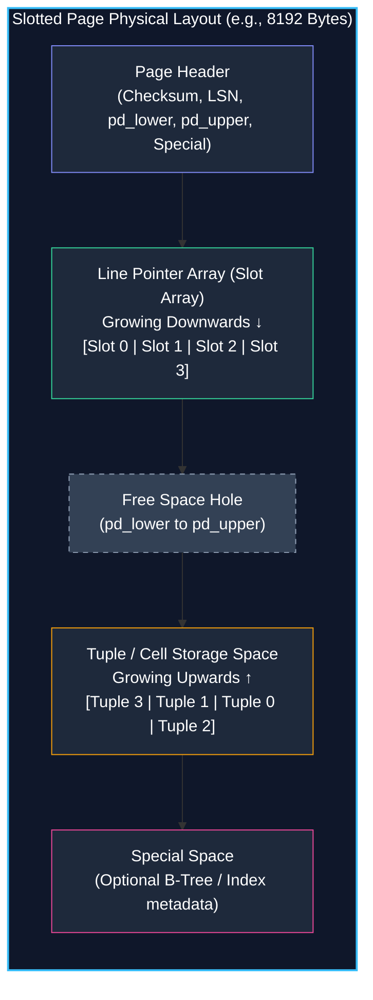
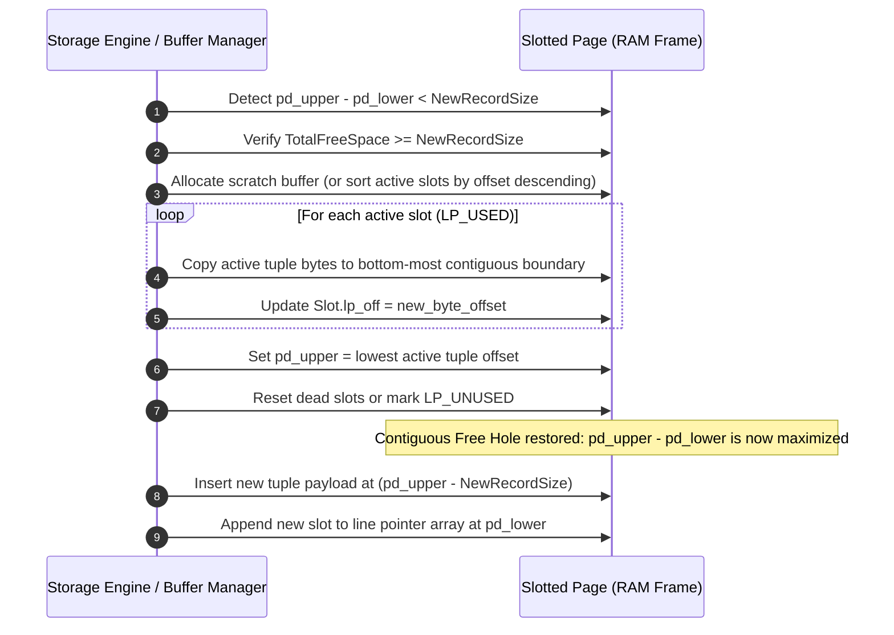
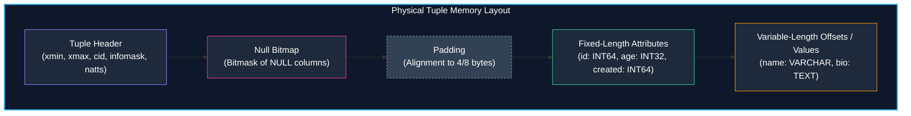
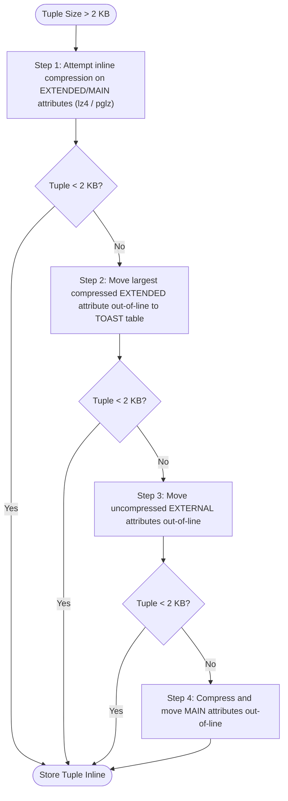

import { Callout } from "fumadocs-ui/components/callout";
import { Tabs, Tab } from "fumadocs-ui/components/tabs";

At the lowest level of an on-disk database engine sits the translation layer between high-level relational concepts (tables, rows, columns, data types) and the raw physical storage medium. To an operating system and hardware controller, a Non-Volatile Memory Express (NVMe) solid-state drive or spinning disk is not a collection of rows or JSON documents; it is an unformatted, linear array of fixed-size hardware blocks.

A database management system (DBMS) cannot simply write records sequentially like an append-only stream. Real-world transactional workloads modify records in place, delete rows, update variable-length strings, and query arbitrary subsets of attributes. If records were laid out consecutively in an unstructured byte stream, updating a string from `"Alice"` to `"Alexander"` would require rewriting every subsequent byte in the file.

To solve this, database storage engines organize disk files into **Pages** (or **Blocks**) and structure the interior of those pages using the **Slotted-Page Architecture**. This chapter explores how DBMS storage layers manage block I/O, pack variable-length records with null bitmaps and CPU alignment, and handle oversize attributes that exceed page boundaries.

---

## The Block Storage Abstraction

All persistent storage media—whether legacy magnetic drives, SATA SSDs, or PCIe 5.0 NVMe drives—are block devices. The operating system kernel and storage controllers do not expose byte-addressable write primitives to user-space applications. Every read or write operation transfers a fixed-size quantum of data.

```
+-------------------------------------------------------------------------+
| Hardware Sector (512 B or 4096 B / 4Kn)                                 |
+-----------------------------------+-------------------------------------+
| OS Virtual Memory Page (4 KB)     | OS Virtual Memory Page (4 KB)       |
+-----------------------------------+-------------------------------------+
| DBMS Page / Block (8 KB in PostgreSQL, 16 KB in MySQL InnoDB)           |
+-------------------------------------------------------------------------+
```

### Hierarchy of Page Granularities

When analyzing database I/O, three distinct "page" concepts must be distinguished:

1. **Hardware Sector (Physical Block):** The physical unit of storage on the disk medium. Older hard drives used 512-byte sectors. Modern Advanced Format drives use 4096-byte (4 KB) physical sectors ($4\text{Kn}$ or $512\text{e}$). Writes smaller than a sector require a read-modify-write cycle inside the drive firmware.
2. **Operating System Page (Virtual Memory Page):** The granularity at which the CPU's Memory Management Unit (MMU) manages virtual address spaces, typically $4\text{ KB}$ on x86-64 hardware ($16\text{ KB}$ or $64\text{ KB}$ on modern Apple Silicon / ARM64).
3. **DBMS Page (Buffer Frame):** The discrete unit of allocation, caching, and I/O managed by the database storage engine. Common default page sizes include:
   - **PostgreSQL:** $8\text{ KB}$ (`BLCKSZ = 8192`)
   - **MySQL InnoDB:** $16\text{ KB}$ (`innodb_page_size = 16384`)
   - **SQLite:** $4\text{ KB}$ (`SQLITE_DEFAULT_PAGE_SIZE = 4096`)
   - **Oracle Database:** $8\text{ KB}$ (configurable from $2\text{ KB}$ to $32\text{ KB}$)

<Callout type="info" title="Why Don't DBMS Engines Just Use 4 KB OS Pages?">
  A larger DBMS page size ($8\text{KB}$ or $16\text{KB}$) amortizes the fixed
  overhead of page headers and slot pointers across more user records, increases
  the fanout of B-Tree index nodes (reducing tree height), and aligns with
  sequential read-ahead behaviors of operating system file systems. However,
  oversized pages increase write amplification when modifying a single row and
  increase latch contention in the buffer pool.
</Callout>

### The Problem of Torn Writes

Because a single $8\text{ KB}$ or $16\text{ KB}$ DBMS page spans multiple $512\text{ B}$ or $4\text{ KB}$ hardware disk sectors, the hardware cannot write an entire database page atomically. If power fails or the kernel panics while the storage controller has written sector 0 and 1 but not sectors 2 and 3 of an $8\text{ KB}$ page, the page becomes **torn**.

A torn page contains an unrecoverable hybrid of old and new data. Because the page is internally corrupted, standard Write-Ahead Log (WAL) undo/redo operations that expect valid pre-existing state may fail. Databases mitigate torn writes using specialized defensive subsystems:

- **MySQL InnoDB Doublewrite Buffer:** Before dirty pages are written to their final table space files, InnoDB writes them contiguously to a sequential disk region known as the doublewrite buffer and issues an `fsync()`. If a crash occurs during the subsequent write to the data file, InnoDB recovers the uncorrupted copy from the doublewrite buffer.
- **PostgreSQL Full-Page Images:** Following every checkpoint, the first time a page is modified by any transaction, a complete copy of that $8\text{ KB}$ page is written into the WAL stream (`wal_log_hints` / full page writes). During recovery, the full-page image replaces whatever corrupted state existed on disk before replaying log records.

---

## The Slotted-Page Architecture

In early flat-file database implementations, developers attempted to store records as contiguous arrays:

```
[ Row 0 (120 B) ][ Row 1 (85 B) ][ Row 2 (210 B) ][ Row 3 (95 B) ]
```

This naive design collapses under production mutation patterns:

1. **Variable-Length Updates:** If Row 1 expands from $85\text{ B}$ to $140\text{ B}$, Row 2 and Row 3 must be shifted to the right, requiring an $O(N)$ memory move and rewriting the page.
2. **Deletions and Fragmentation:** Deleting Row 1 creates an $85\text{ B}$ gap. If the next inserted record is $110\text{ B}$, it cannot fit into the gap, causing external fragmentation within the page.
3. **Index Pointer Invalidation:** If external indexes reference tuples by physical byte offset (e.g., `offset = 120`), moving records during compaction invalidates every index entry pointing to that page.

The universal solution adopted by relational engines is the **Slotted-Page Architecture** (also called the **Slot Array** or **Item Pointer Array**).



### Anatomical Breakdown of a Slotted Page

A slotted page is divided into five distinct regions that manage memory from both edges towards the center:

1. **Page Header:** Fixed-size metadata located at byte offset 0.
2. **Line Pointer Array (Slot Array):** An array of fixed-size slot descriptors that begins immediately after the header and **grows downwards** toward higher byte offsets.
3. **Free Space Hole:** The unallocated byte range between the end of the line pointer array and the start of the newest record.
4. **Tuple Storage Area:** The raw record data payloads, which are allocated from the bottom of the page and **grow upwards** toward lower byte offsets.
5. **Special Space:** An optional, fixed-size region at the very end of the page reserved for access-method-specific metadata (e.g., left/right sibling links in B-Tree index pages).

#### 1. Page Header Fields

In PostgreSQL (`PageHeaderData` in `src/include/storage/bufpage.h`), the header occupies 24 bytes:

```c
typedef struct PageHeaderData {
    /* WAL / Recovery Metadata */
    PageXLogRecPtr pd_lsn;      /* 8 bytes: LSN of last WAL record modifying page */
    uint16          pd_checksum; /* 2 bytes: Page checksum (CRC-32C or Fletcher-16) */
    uint16          pd_flags;    /* 2 bytes: Flag bits (e.g., page full, all visible) */

    /* Free Space Pointers */
    LocationIndex   pd_lower;    /* 2 bytes: Offset to start of free space (end of slot array) */
    LocationIndex   pd_upper;    /* 2 bytes: Offset to end of free space (start of youngest tuple) */
    LocationIndex   pd_special;  /* 2 bytes: Offset to start of special space */

    /* Layout & Version Information */
    uint16          pd_pagesize_version; /* 2 bytes: Page size and layout version number */
    TransactionId   pd_prune_xid;        /* 4 bytes: Oldest unpruned XID on page, or zero */

    /* Followed immediately by itemIdArray[1] line pointers */
} PageHeaderData;
```

- **`pd_lsn` (Log Sequence Number):** The 64-bit monotonically increasing byte offset in the Write-Ahead Log representing the last operation that modified this page. Essential for ARIES recovery to avoid reapplying already-committed log records.
- **`pd_lower`:** A 16-bit unsigned offset pointing to the byte address where the next line pointer will be appended.
- **`pd_upper`:** A 16-bit unsigned offset pointing to the byte address where the most recently inserted tuple began.

The total contiguous free space available for an immediate tuple insert without compaction is:

$$\text{ContiguousFreeSpace} = \text{pd\_upper} - \text{pd\_lower}$$

If an insert requires a new line pointer (4 bytes) and a tuple payload of $L$ bytes, the page can accept the write directly if and only if:

$$\text{pd\_upper} - \text{pd\_lower} \ge L + \text{sizeof}(\text{ItemIdData})$$

#### 2. Line Pointers (`ItemIdData`)

Each entry in the line pointer array is a compact 32-bit (4-byte) bitfield descriptor:

```c
typedef struct ItemIdData {
    unsigned lp_off:15;   /* 15 bits: Byte offset to the tuple within the page (0..8191) */
    unsigned lp_flags:2;  /* 2 bits:  Slot status flags */
    unsigned lp_len:15;   /* 15 bits: Length of the tuple payload in bytes */
} ItemIdData;
```

The 2-bit `lp_flags` define the lifecycle state of the slot:

- `LP_UNUSED (0)`: The slot is unallocated and can be recycled.
- `LP_USED (1)`: The slot points to an active, valid tuple at offset `lp_off` of length `lp_len`.
- `LP_REDIRECT (2)`: Used in PostgreSQL Heap-Only Tuples (HOT). Points to another line pointer on the same page where the updated version of the row resides, avoiding index updates.
- `LP_DEAD (3)`: The tuple has been deleted and cleaned up, but the slot remains reserved until page vacuuming or reindexing.

---

### Stable Physical Addressing (TID / RID)

One of the greatest architectural triumphs of the slotted-page model is **stable physical addressing**.

In relational engines, an index does not store physical disk byte offsets. An index maps a search key (e.g., `user_id = 42`) to a **Tuple Identifier** (TID in PostgreSQL) or **Record Identifier** (RID in SQLite and Oracle):

$$\text{TID} = (\text{PageID}, \text{SlotIndex})$$

For example, a TID of `(402, 3)` means: "Fetch page number 402, inspect the 4th line pointer (`itemIdArray[3]`), and follow its `lp_off` to read the tuple."

```
Index B-Tree Leaf:  Key: "Alice" ---> TID: (Page 14, Slot 2)
                                                |
                                                v
Page 14:  [ Header ] [ Slot 0 ] [ Slot 1 ] [ Slot 2 ] ... [ Tuple 2 ]
                                                |              ^
                                                +--------------+ (lp_off)
```

Because the line pointer index inside the array **never changes**, the database engine can slide tuples around inside the page, defragment holes, or reclaim dead space during a background compaction without updating a single entry in any B-Tree index on that table!

---

## In-Page Defragmentation & Compaction

When records are deleted or updated with smaller values, gaps appear in the tuple storage area. These gaps cause internal fragmentation.

Consider the following scenario on an $8\text{ KB}$ page:

```
[ Header | Slot 0 | Slot 1 | Slot 2 ] ... [ Free Hole ] ... [ T2 (100B) ][ T1 (DEAD, 200B) ][ T0 (150B) ]
                                          ^            ^
                                       pd_lower     pd_upper
```

Here, `T1` was deleted. The $200\text{ B}$ previously occupied by `T1` cannot be merged into the free space hole between `pd_lower` and `pd_upper` because `T2` sits between the free space hole and the deleted space of `T1`.

### The Compaction Algorithm

When a new insert arrives requiring $180\text{ B}$, but `pd_upper - pd_lower` is only $80\text{ B}$, the page manager does not immediately abort or allocate a new page. It calculates the **Total Free Space**:

$$\text{TotalFreeSpace} = (\text{pd\_upper} - \text{pd\_lower}) + \sum_{\text{dead}} \text{lp\_len}$$

If $\text{TotalFreeSpace} \ge 180\text{ B} + 4\text{ B}$, the page undergoes **In-Memory Defragmentation (Compaction)**:



During compaction:

1. Every active tuple (`LP_USED`) is shifted toward the bottom of the page (toward byte 8192).
2. The corresponding `lp_off` in each line pointer is updated to reflect the new byte offset.
3. `pd_upper` is moved downwards to point to the highest byte boundary of the newly consolidated block.
4. Because the _slots_ themselves retained their indices (`Slot 0`, `Slot 2`), all external index TIDs remain $100\%$ valid!

---

## Record Layout & Tuple Anatomy

Once the storage engine follows a line pointer to a tuple offset, it must interpret the raw bytes of the record. A record is not a serialized JSON string; it is a meticulously aligned binary structure.



### The Tuple Header

In Multi-Version Concurrency Control (MVCC) engines like PostgreSQL, each row carries substantial transactional metadata in its header (`HeapTupleHeaderData` in `src/include/access/htup_details.h`):

```c
struct HeapTupleHeaderData {
    union {
        HeapTupleFields  t_heap;
        DatumTupleFields t_datum;
    } t_choice;

    ItemPointerData t_ctid;      /* 6 bytes: Current TID of this tuple or updated version */
    uint16          t_infomask2; /* 2 bytes: Number of attributes + visibility flags */
    uint16          t_infomask;  /* 2 bytes: Various status flags (e.g., has_null, has_varwidth) */
    uint8           t_hoff;      /* 1 byte:  Offset to user data (header size + null bitmap + padding) */

    /* Variable-length section follows: */
    bits8           t_bits[1];   /* Bitmap of NULL attributes (1 bit per column, dynamically sized) */
};
```

Key header responsibilities include:

- **`xmin` / `xmax`:** The 32-bit transaction IDs that created and deleted/updated this row version.
- **`t_ctid`:** If the row was updated, `t_ctid` contains the `(PageID, SlotIndex)` of the new row version. If the row has not been updated, `t_ctid` points back to itself.
- **`t_hoff` (Header Offset):** The byte offset where user data actually begins. Because the null bitmap length depends on the number of columns in the table, `t_hoff` instructs the query execution engine where the raw column data starts.

### The Null Bitmap (Presence Vector)

Storing sentinel values (e.g., `-1` for a null integer or an empty string for a null text) is dangerous and wastes storage. Instead, engines store an explicit bitmask: **The Null Bitmap**.

If a table has $N$ columns, the null bitmap requires:

$$\text{BitmapBytes} = \left\lceil \frac{N}{8} \right\rceil$$

For a table with 12 columns, $\lceil 12 / 8 \rceil = 2\text{ bytes}$ are reserved immediately following the fixed header.

<Tabs items={["Bitmap Bit Semantics", "Column Lookup Logic"]}>
<Tab value="Bitmap Bit Semantics">
In PostgreSQL, a bit set to `1` indicates the value is **NOT NULL**, while a bit set to `0` indicates the column **IS NULL**:

```
Column Index:    11 10  9  8  7  6  5  4  3  2  1  0
Null Status:      0  1  1  1  1  0  1  1  1  1  0  1
Byte 1 (cols 8-11): 0b0111  -> 0x07 (col 11 is NULL)
Byte 0 (cols 0-7):  0b10111101 -> 0xBD (cols 1 and 6 are NULL)
```

If a column's bit is `0` (NULL), **zero bytes are allocated for that column in the payload**. The engine skips parsing bytes for that attribute entirely!

</Tab>
<Tab value="Column Lookup Logic">
To read column $i$:
1. Check bit $i$ in `t_bits`:
   ```c
   bool is_null = !(tuple->t_bits[i / 8] & (1 << (i % 8)));
   if (is_null) return NULL_DATUM;
   ```
2. If column $i$ is not null, calculate its offset based on the schema and preceding non-null columns.
</Tab>
</Tabs>

---

### Data Alignment and CPU Padding Waste

Modern CPU architectures (x86-64, ARM64) transfer data from the L1 cache to CPU registers across 64-bit buses. Accessing a primitive data type at an address that is not a multiple of its size requires the memory controller to perform an unaligned memory access:

- An aligned 8-byte integer (`int64_t`) must start at a byte offset divisible by 8 ($A \pmod 8 = 0$).
- An aligned 4-byte integer (`int32_t`) must start at a byte offset divisible by 4 ($A \pmod 4 = 0$).
- An aligned 2-byte integer (`int16_t`) must start at a byte offset divisible by 2 ($A \pmod 2 = 0$).

If a database engine stored an `int64` at an odd address (e.g., offset 23), the CPU would have to issue two separate memory read cycles, extract the pieces from two cache lines, and execute bit-shift/mask operations to assemble the integer. On some architectures (older SPARC or ARM), unaligned access triggers a hardware fault (`SIGBUS`).

To prevent this, database storage engines enforce **attribute alignment** by inserting padding bytes between columns.

#### The Cost of Naive Column Ordering

Consider a table defined naively by an application developer:

```sql
CREATE TABLE user_account (
    is_active     BOOLEAN,     -- 1 byte (alignment 1)
    account_id    BIGINT,      -- 8 bytes (alignment 8)
    failed_logins SMALLINT,    -- 2 bytes (alignment 2)
    balance       DOUBLE PRECISION, -- 8 bytes (alignment 8)
    role_id       INT          -- 4 bytes (alignment 4)
);
```

Let us trace the physical memory offsets inside each tuple:

```
Offset  0: [ is_active (1 B) ]
Offset  1: [ PADDING (7 Bytes to align to 8) ] <--- WASTED
Offset  8: [ account_id (8 B) ]
Offset 16: [ failed_logins (2 B) ]
Offset 18: [ PADDING (6 Bytes to align to 8) ] <--- WASTED
Offset 24: [ balance (8 B) ]
Offset 32: [ role_id (4 B) ]
Offset 36: [ PADDING (4 Bytes to align tuple boundary to 8) ] <--- WASTED
Total Size: 40 Bytes (19 Bytes of useful data + 21 Bytes of padding!)
```

Over $50\%$ of the storage on disk is completely wasted padding bytes!

#### Column Reordering Optimization

By reordering columns in descending order of alignment requirement (8-byte types first, followed by 4-byte, 2-byte, 1-byte, and finally variable-length strings):

```sql
CREATE TABLE user_account_optimized (
    account_id    BIGINT,           -- 8 bytes (offset 0..7)
    balance       DOUBLE PRECISION, -- 8 bytes (offset 8..15)
    role_id       INT,              -- 4 bytes (offset 16..19)
    failed_logins SMALLINT,         -- 2 bytes (offset 20..21)
    is_active     BOOLEAN           -- 1 byte  (offset 22)
    -- 1 byte padding to align tuple tail to multiple of 8
);
Total Size: 24 Bytes (Saved 16 Bytes per row = 40% reduction!)
```

<Callout type="tip" title="Production Engineering Rule">
  In high-volume tables with hundreds of millions of rows, manually ordering
  table columns by data alignment type (or using tools like PostgreSQL
  `pg_repack` / schema analyzers) can save hundreds of gigabytes of disk space
  and reduce buffer pool memory footprint dramatically.
</Callout>

---

## Variable-Length Attributes & Large Value Handling

Relational databases support variable-length data types such as `VARCHAR`, `TEXT`, `BLOB`, `BYTEA`, and `JSONB`. Because these values have dynamic lengths that vary from row to row, they cannot be addressed by static schema offsets.

### Varlen Header Encoding

Engines typically prefix variable-length fields with a compact length header. In modern PostgreSQL, variable-length headers (`varlena`) utilize an optimized 1-byte or 4-byte descriptor:

- **Short Varlen (1-byte header):** For values $\le 126\text{ bytes}$, the length is packed into 7 bits of the first byte, with the lowest bit set to 1. This saves 3 bytes per short string compared to a 4-byte integer.
- **Long Varlen (4-byte header):** For values $> 126\text{ bytes}$, a full 32-bit integer stores the length and compression/TOAST flags.

```
Short Varlen: [ Length (7 bits) | 1 ] [ ... data up to 126 bytes ... ]
Long Varlen:  [ Length (30 bits) | Flags (2 bits) | 0 ] [ ... data ... ]
```

---

### The Page Size Boundary Problem

What happens when a single record is larger than an entire page?

If a PostgreSQL table has an $8\text{ KB}$ page size, an uncompressed $2\text{ MB}$ PDF or a large JSON document cannot fit inside the page, even if the page contains no other tuples. Even more strictly, if a page holds only one tuple, the tree fanout of B-Tree indexes collapses, ruining search efficiency.

To maintain efficient page utilization, databases define a **Maximum Inline Tuple Threshold**:

- In PostgreSQL, if a tuple exceeds $\frac{1}{4}$ of a page ($\approx 2\text{ KB}$, `TOAST_TUPLE_THRESHOLD`), the engine triggers overflow mechanisms.
- In SQLite, the maximum inline payload fraction is $\approx \frac{U - 35}{255}$ (typically around $1\text{ KB}$ on a $4\text{ KB}$ page).

---

### PostgreSQL TOAST (The Oversized-Attribute Storage Technique)

PostgreSQL handles large attributes via a dedicated background subsystem: **TOAST**.

When an update or insert creates a tuple that exceeds `TOAST_TUPLE_THRESHOLD` ($2\text{ KB}$), the engine initiates a 4-step cascade to shrink the tuple until it falls below `TOAST_TUPLE_TARGET` ($2\text{ KB}$):



#### TOAST Storage Strategies

Every column type in PostgreSQL has a default storage strategy, configurable via `ALTER TABLE ... ALTER COLUMN ... SET STORAGE`:

| Strategy       | Compress Inline? | Move Out-of-Line? | Typical Data Types                                                                                         |
| :------------- | :--------------: | :---------------: | :--------------------------------------------------------------------------------------------------------- |
| **`PLAIN`**    |      ❌ No       |       ❌ No       | Fixed-length types (`INT4`, `BIGINT`, `FLOAT8`, `UUID`). Never TOASTed.                                    |
| **`EXTENDED`** |      ✅ Yes      |      ✅ Yes       | Default for `TEXT`, `VARCHAR`, `JSONB`, `BYTEA`. Compressed first; moved out-of-line if still too large.   |
| **`EXTERNAL`** |      ❌ No       |      ✅ Yes       | Large strings where compression is disabled (e.g., already compressed JPEG/MP4 or fast substring queries). |
| **`MAIN`**     |      ✅ Yes      |  ⚠️ Last Resort   | Compressed inline; only moved out-of-line if no other options bring tuple below threshold.                 |

#### Out-of-Line TOAST Tables

When an attribute is moved out-of-line:

1. The engine strips the large attribute from the original user table (the **heap table**).
2. The payload is sliced into chunks of $\approx 2\text{ KB}$ (`TOAST_MAX_CHUNK_SIZE = 1996\text{ bytes}`).
3. Each chunk is inserted as an individual row into an auxiliary companion table called the **TOAST Table** (named `pg_toast.pg_toast_<table_oid>`).
4. In place of the original attribute in the heap tuple, the engine writes an **18-byte TOAST Pointer**:

```c
struct varatt_external {
    int32   va_rawsize;    /* Original uncompressed data size */
    int32   va_extsize;    /* Compressed size on disk in TOAST table */
    Oid     va_valueid;    /* Unique identifier of the value in the TOAST table */
    Oid     va_toastrelid; /* OID of the TOAST table storing the chunks */
};
```

```
Heap Table Page (8 KB):
[ Row 1: id=101 | name="Alice" | bio=TOAST_POINTER(valueid=98721) ]
                                            |
                                            v
Auxiliary TOAST Table (pg_toast_16402):
+----------+---------------+--------------------------------------+
| chunk_id | chunk_seq (0) | data [ bytes 0..1995 ]              |
+----------+---------------+--------------------------------------+
| chunk_id | chunk_seq (1) | data [ bytes 1996..3991 ]           |
+----------+---------------+--------------------------------------+
| chunk_id | chunk_seq (2) | data [ bytes 3992..4810 ]           |
+----------+---------------+--------------------------------------+
```

<Callout type="info" title="Performance Implication of TOAST">
  When executing `SELECT id, name FROM users;`, the engine reads only the
  primary heap pages. Because large `bio` text fields are stored out-of-line in
  the TOAST table, the heap pages remain dense and compact. Thousands of rows
  fit into a single $8\text{KB}$ heap page, allowing sequential scans to run
  orders of magnitude faster because oversized columns are not loaded into
  memory unless explicitly referenced!
</Callout>

---

### SQLite Overflow Chains

SQLite uses a different, linked-list overflow mechanism.

In SQLite's B-Tree engine (`src/btree.c`), each leaf cell reserves a fixed amount of inline space calculated based on page size. If a record's payload exceeds this threshold:

1. The initial portion of the payload (up to the threshold) is kept inside the primary B-Tree page.
2. The final 4 bytes of the cell store a 32-bit **Overflow Page Number**.
3. That overflow page stores raw unslotted bytes, ending with another 4-byte pointer to the next overflow page, forming a singly linked chain of overflow blocks:

```
B-Tree Leaf Page:
[ Cell Header | Inline Data (First 1020 B) | NextPageID: 45 ]
                                                   |
                                                   v
Overflow Page 45:  [ 4092 Bytes of Data Payload | NextPageID: 46 ]
                                                   |
                                                   v
Overflow Page 46:  [ Remaining 850 Bytes Data   | NextPageID: 0 (NULL) ]
```

While simpler than PostgreSQL's relational TOAST tables, SQLite's linked-list overflow structure does not support random access into arbitrary byte offsets of an overflow payload; reading the end of a large BLOB requires traversing the linked list from the beginning.

---

## Production Reference Implementations

<Tabs items={["PostgreSQL Slotted Page", "Rust Storage Engine Core"]}>
<Tab value="PostgreSQL Slotted Page">
The official C layout used in PostgreSQL's storage engine (`src/include/storage/bufpage.h`):

```c
#define BLCKSZ 8192

/* 24-byte page header */
typedef struct PageHeaderData {
    PageXLogRecPtr pd_lsn;      /* LSN: next byte after last byte of WAL record */
    uint16         pd_checksum; /* Page checksum */
    uint16         pd_flags;    /* Flag bits */
    LocationIndex  pd_lower;    /* Offset to start of free space */
    LocationIndex  pd_upper;    /* Offset to end of free space */
    LocationIndex  pd_special;  /* Offset to start of special space */
    uint16         pd_pagesize_version;
    TransactionId  pd_prune_xid;
    ItemIdData     pd_linp[1];  /* Beginning of line pointer array */
} PageHeaderData;

typedef PageHeaderData *PageHeader;

/* Inline macro to calculate contiguous free space */
#define PageGetFreeSpace(page) \
    ((int) (((PageHeader) (page))->pd_upper - ((PageHeader) (page))->pd_lower))
```

</Tab>
<Tab value="Rust Storage Engine Core">
A modern, memory-safe implementation of a Slotted Page manager in Rust:

```rust
pub const PAGE_SIZE: usize = 8192;
pub const PAGE_HEADER_SIZE: usize = 24;

#[repr(C)]
#[derive(Debug, Clone, Copy)]
pub struct PageHeader {
    pub lsn: u64,
    pub checksum: u16,
    pub flags: u16,
    pub lower: u16,   // Byte offset to end of slot array
    pub upper: u16,   // Byte offset to start of lowest tuple
    pub special: u16, // End of page / index special space
}

#[repr(C)]
#[derive(Debug, Clone, Copy)]
pub struct Slot {
    pub offset: u16, // Offset within page
    pub length: u16, // Length of tuple payload
}

pub struct SlottedPage {
    pub data: [u8; PAGE_SIZE],
}

impl SlottedPage {
    pub fn new() -> Self {
        let mut page = Self { data: [0u8; PAGE_SIZE] };
        let header = PageHeader {
            lsn: 0,
            checksum: 0,
            flags: 0,
            lower: PAGE_HEADER_SIZE as u16,
            upper: PAGE_SIZE as u16,
            special: PAGE_SIZE as u16,
        };
        unsafe {
            std::ptr::copy_nonoverlapping(
                &header as *const _ as *const u8,
                page.data.as_mut_ptr(),
                PAGE_HEADER_SIZE,
            );
        }
        page
    }

    pub fn insert_record(&mut self, record: &[u8]) -> Option<u16> {
        let header = self.header_mut();
        let slot_size = std::mem::size_of::<Slot>() as u16;
        let required_space = slot_size + record.len() as u16;

        if (header.upper - header.lower) < required_space {
            return None; // Page full, requires compaction or new page
        }

        // Allocate tuple growing upwards
        let tuple_offset = header.upper - record.len() as u16;
        header.upper = tuple_offset;

        // Write record payload
        let start = tuple_offset as usize;
        let end = start + record.len();
        self.data[start..end].copy_from_slice(record);

        // Append line pointer growing downwards
        let slot_idx = (header.lower - PAGE_HEADER_SIZE as u16) / slot_size;
        let slot = Slot {
            offset: tuple_offset,
            length: record.len() as u16,
        };

        let slot_start = header.lower as usize;
        let slot_end = slot_start + slot_size as usize;
        unsafe {
            std::ptr::copy_nonoverlapping(
                &slot as *const _ as *const u8,
                self.data[slot_start..slot_end].as_mut_ptr(),
                slot_size as usize,
            );
        }
        header.lower += slot_size;

        Some(slot_idx)
    }

    fn header_mut(&mut self) -> &mut PageHeader {
        unsafe { &mut *(self.data.as_mut_ptr() as *mut PageHeader) }
    }
}
```

</Tab>
</Tabs>

---

## Chapter Summary & Architectural Review

| Feature / Problem            | Naive Array Strategy                                | Slotted-Page Engine (PostgreSQL / SQLite / MySQL)              |
| :--------------------------- | :-------------------------------------------------- | :------------------------------------------------------------- |
| **Addressing Unit**          | Byte offset in file                                 | Fixed-size Pages ($4\text{ KB}, 8\text{ KB}, 16\text{ KB}$)    |
| **Variable-Length Rows**     | Shifting trailing rows ($O(N)$ write amplification) | Line pointer array + tuple storage growing inward ($O(1)$)     |
| **Internal Defragmentation** | Invalidates external index pointers                 | In-page compaction preserves stable `(PageID, SlotIndex)` TIDs |
| **Null Representation**      | Sentinel values or full-width padding               | Null bitmap saves space for every NULL attribute               |
| **Data Alignment**           | Random byte boundaries cause slow CPU cycles        | Pad attributes to natural word boundaries (2, 4, 8 bytes)      |
| **Oversized Records**        | Rejects inserts $> \text{PageSize}$                 | Overflow pages & TOAST tables with out-of-line chunks          |

In the next chapter, we will build upon the slotted-page foundation to implement **Disk-Backed B-Trees**, exploring how page IDs replace RAM pointers, how freelists recycle deleted blocks, and how latch crabbing protocols coordinate concurrent traversals.
