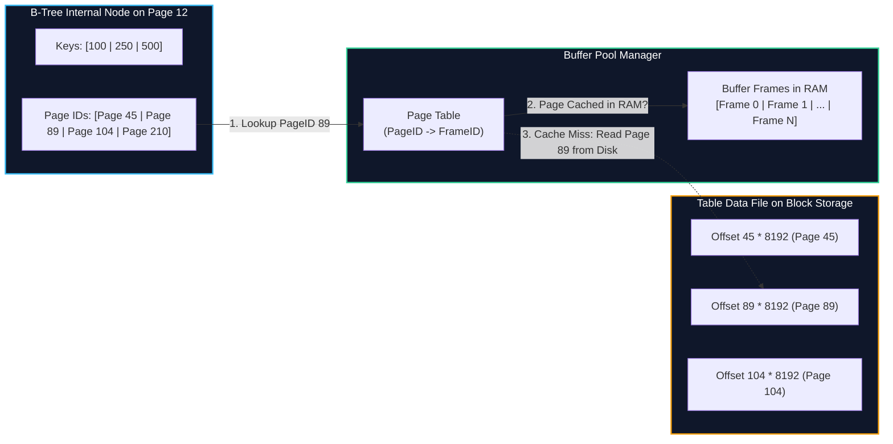
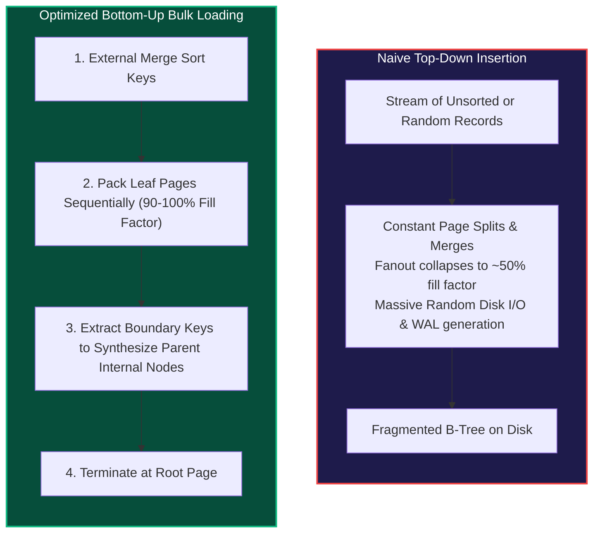
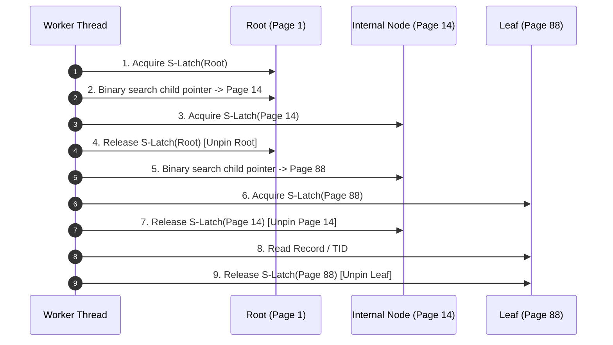
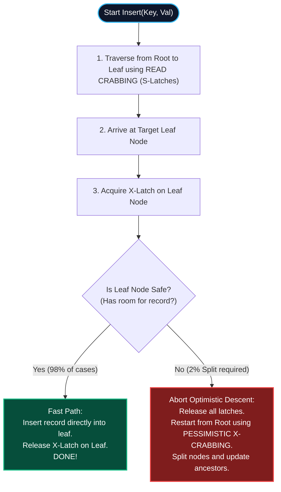
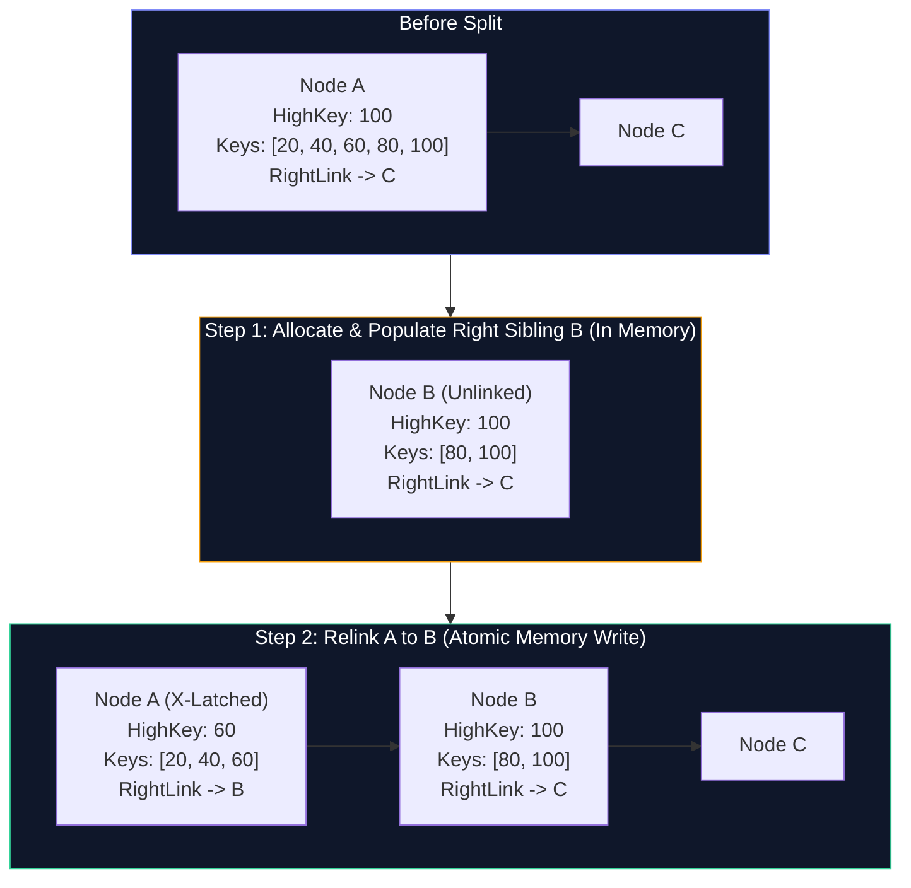
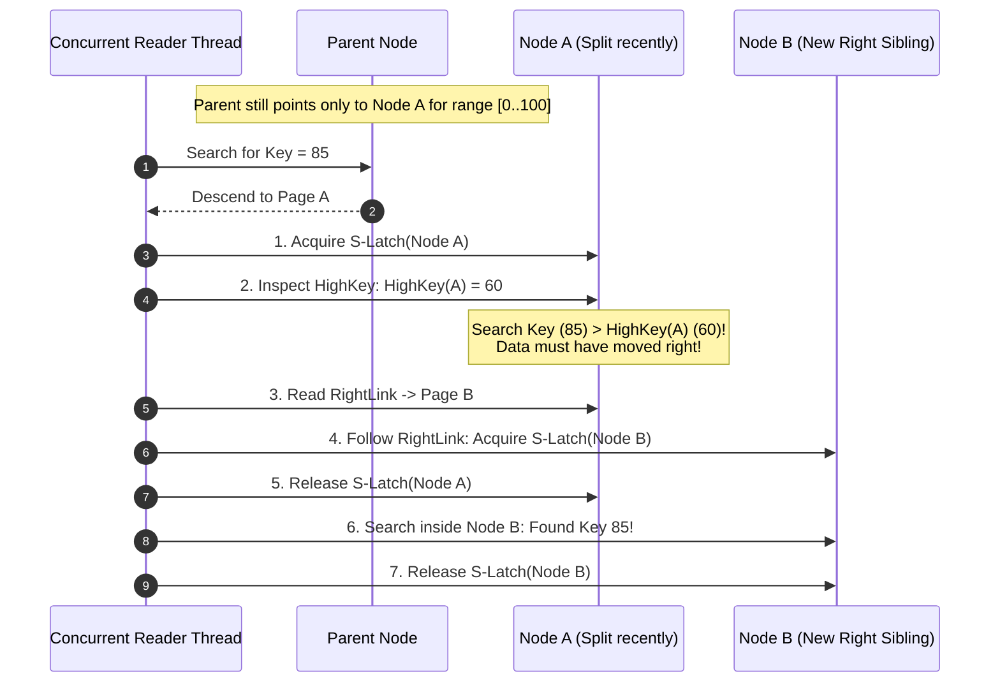

import { Callout } from "fumadocs-ui/components/callout";
import { Tabs, Tab } from "fumadocs-ui/components/tabs";

In academic data structures courses, a B-Tree is typically presented as an in-memory graph: a collection of heap-allocated objects connected by 64-bit pointers (`Node* left, Node* right`). Traversal is a simple pointer-dereference operation, and modifications assume single-threaded exclusive execution.

In a real-world relational storage engine (such as PostgreSQL, MySQL InnoDB, or SQLite), implementing a production-grade B-Tree requires solving two difficult systems engineering problems:

1. **Persistent Serialization & Memory Mapping:** How do we represent dynamic tree nodes inside fixed-size disk pages ($4\text{ KB}$, $8\text{ KB}$, or $16\text{ KB}$), replace RAM memory addresses with disk page identifiers, and recycle deleted pages without leaking disk space?
2. **High-Concurrency Synchronization:** How do multiple worker threads traverse, insert, split, and merge tree nodes concurrently without corrupting memory, deadlocking, or bottlenecking on the tree root?

This chapter bridges the gap between theoretical algorithms and industrial storage engines. We explore disk-resident pointers, buffer pool frame translation, freelists, the fundamental difference between **Locks** and **Latches**, **Latch Crabbing** protocols, and the **Lehman-Yao B-link Tree** architecture.

---

## Disk-Backed B-Trees: The Pointer Abstraction

In virtual memory, a pointer is a 64-bit address representing an offset into the process's virtual address space:

```c
// In-Memory Node (Naive - Impossible on disk)
struct Node {
    Key keys[MAX_KEYS];
    struct Node* children[MAX_KEYS + 1]; // Direct 64-bit virtual memory pointers
};
```

This representation cannot be persisted to block storage for two reasons:

1. **Address Space Randomization & Restarts:** When the database process restarts or crashes, the operating system kernel assigns a completely different virtual address space. Any saved 64-bit virtual memory pointers now point to arbitrary unmapped memory, causing segmentation faults.
2. **Buffer Pool Swapping:** The database dataset may be hundreds of terabytes, while available RAM is only a few gigabytes. At any moment, a child node may not reside in physical memory; it lives on an NVMe drive.



### Page Identifiers (`page_id_t`)

To decouple physical memory locations from persistent storage, database engines replace memory pointers with **Page Identifiers** (`page_id_t`), typically represented as a 32-bit or 64-bit unsigned integer:

```c
typedef uint32_t page_id_t; // Supports up to 2^32 * 8 KB = 32 Terabytes per file
```

The `page_id_t` represents the logical ordinal index of the page within the table's disk file. To locate the physical byte offset of a page on disk:

$$\text{FileOffset} = \text{page\_id} \times \text{PAGE\_SIZE}$$

When a query traverses from an internal node to a child node:

1. The execution thread reads the child's `page_id` from the parent's cell.
2. The thread requests the page from the **Buffer Pool Manager** (`FetchPage(page_id)`).
3. The Buffer Pool checks its in-memory hash table:
   - **Cache Hit:** If the page is already cached in a RAM buffer frame, the manager increments the frame's **Pin Count** and returns a direct pointer to the memory frame.
   - **Cache Miss:** The manager selects an eviction victim (via LRU or 2Q clock sweep), writes the victim page to disk if dirty, reads the requested `page_id` from disk into the vacated frame, pins it, and returns the memory pointer.
4. When finished reading the node, the thread unpins the frame (`UnpinPage(page_id, is_dirty)`).

---

### Pointer Swizzling

While indirection through the Buffer Pool allows datasets larger than RAM, looking up a `page_id` in the buffer pool hash table and incrementing atomic pin counters incurs significant CPU overhead on high-throughput workloads (often 20% to 30% of total query latency).

To eliminate this bottleneck, advanced storage engines (such as WiredTiger, HyPer, and LeanStore) implement **Pointer Swizzling**:

- **Unswizzled Pointer:** Contains a standard persistent `page_id_t` (e.g., `89`). Traversing it requires a buffer pool hash table lookup.
- **Swizzled Pointer:** When a page is resident in memory, the engine dynamically overwrites the 64-bit slot with the direct raw virtual memory address of the buffer pool frame (`0x7fff_94a0_1000`), toggling the highest bit (or a tag bit) to indicate that the pointer is swizzled.
- **Traversal:** Threads dereference swizzled pointers directly with zero hash lookups and zero buffer pool latch overhead.
- **Eviction (Unswizzling):** Before a page is evicted from the buffer pool, the engine unswizzles all pointers referencing that frame, converting them back into persistent `page_id_t` integers before writing dirty pages to disk.

---

## Node Serialization & Page Anatomy

As established in Chapter 3, a B-Tree node is mapped directly into one (or more) slotted pages. In modern engines, B-Trees are almost universally implemented as **B+ Trees**, where internal nodes and leaf nodes have distinct physical layouts.

```
+-------------------------------------------------------------------------------+
|                             B+ Tree Node Page (8 KB)                          |
+-------------------------------------------------------------------------------+
| Page Header: LSN, Checksum, Flags, Node Type (Leaf/Internal), ItemCount       |
+-------------------------------------------------------------------------------+
| Sibling Pointers: PrevPageID (4 B), NextPageID (4 B)                          |
+-------------------------------------------------------------------------------+
| Slot Array (Offsets to Keys / Payloads growing downwards)                     |
| [ Slot 0 | Slot 1 | Slot 2 | Slot 3 | ... ]                                  |
+-------------------------------------------------------------------------------+
|                             Free Space Hole                                   |
+-------------------------------------------------------------------------------+
| Cell / Tuple Storage Area (Growing upwards from page tail)                    |
| [ Cell 3 | Cell 1 | Cell 0 | Cell 2 ]                                         |
+-------------------------------------------------------------------------------+
```

### 1. Internal Nodes (Router Pages)

Internal nodes do not store table records or row data. They act exclusively as routing signposts. An internal node with $M$ keys contains $M + 1$ child page pointers:

$$P_0, K_1, P_1, K_2, P_2, \dots, K_M, P_M$$

Where:

- Child page $P_0$ contains all keys strictly less than $K_1$ ($k < K_1$).
- Child page $P_i$ contains all keys in the half-open range $[K_i, K_{i+1})$.
- Child page $P_M$ contains all keys greater than or equal to $K_M$ ($k \ge K_M$).

Because keys in internal nodes are stripped of user-facing data payloads, the fanout $B$ of an internal node is very high. On an $8\text{ KB}$ page storing 8-byte `BIGINT` keys and 4-byte `page_id` pointers:

$$\text{Capacity} \approx \frac{8192 - \text{HeaderBytes}}{12 + \text{SlotBytes}} \approx \frac{8100}{16} \approx 500 \text{ children per node}$$

A tree with a fanout of 500 can index:

- Level 1 (Root): $500$ leaves
- Level 2: $500^2 = 250,000$ leaves
- Level 3: $500^3 = 125,000,000$ leaves ($125\text{M} \times 8\text{ KB} = 1\text{ Terabyte}$ of data)

At a height of just 3 levels, any key among hundreds of millions of rows can be located with at most **3 page reads**.

### 2. Leaf Nodes (Data Pages)

Leaf nodes store the actual payloads:

- **Clustered Index (e.g., MySQL InnoDB):** The leaf node cells contain the complete row data (all columns).
- **Secondary Index (e.g., PostgreSQL / Oracle):** The leaf node cells contain the indexed search key paired with the tuple's physical TID:

$$\text{LeafCell} = \langle \text{SearchKey}, \text{TID}(\text{PageID}, \text{SlotIndex}) \rangle$$

Leaf nodes also maintain bidirectional sibling pointers:

- **`prev_page_id`:** Page ID of the immediate left sibling.
- **`next_page_id`:** Page ID of the immediate right sibling.

These links allow the query engine to perform sequential scans and range queries (`WHERE age BETWEEN 20 AND 30`) by navigating down to the first qualifying leaf node and following `next_page_id` pointers horizontally without re-traversing parent nodes.

---

## Bulk Loading: Top-Down vs. Bottom-Up Construction

How should a database populate a B-Tree containing 100 million pre-existing rows?



### The Inefficiency of Top-Down Inserts

If records are inserted individually using standard point inserts (`tree.insert(k, v)`):

1. Each insert traverses the tree from the root to a leaf.
2. Nodes split randomly, leaving nodes on average **$50\%$ to $67\%$ full** (Shannon entropy for random B-tree insertions).
3. Memory buffers thrash constantly as random page writes hit the disk controller, causing catastrophic write amplification.

### The Bottom-Up Bulk Loading Algorithm

Industrial databases implement **Bottom-Up Bulk Loading** (e.g., PostgreSQL `CREATE INDEX`):

1. **Sort Phase:** The input records are sorted by the index key using an in-memory sort or external merge sort.
2. **Leaf Allocation Phase:** The engine allocates contiguous leaf pages sequentially. It fills each page to a configurable **Fill Factor** (e.g., $90\%$ to leave headroom for future writes, or $100\%$ for read-only tables).
3. **Internal Node Synthesis:** As each leaf page fills:
   - The engine writes the leaf page to disk.
   - It captures the highest key in that leaf page and its `page_id`.
   - It appends that `(Key, page_id)` entry to an internal node at Level 1.
4. **Recursive Escalation:** When Level 1 internal nodes fill up, they push boundary keys up to Level 2. This repeats until a single root page is produced.

Bottom-up bulk loading achieves:

- **$100\%$ Sequential Disk I/O:** Pages are written strictly in physical file order.
- **Optimal Packing:** Zero wasted fragmentation space.
- **Zero Splits:** No pages are ever split or locked during construction.

---

## Free Space Management & Freelists

When tuples are deleted or index pages merge due to underflow, pages become empty. If the database engine simply abandoned deleted pages and continually appended new pages to the end of the file, table files would grow indefinitely.

Storage engines manage unused blocks through a **Freelist** or **Free Space Map (FSM)**.

```
File Header Page (Page 0):
[ Magic: 0xDB01 | RootPage: 1 | FreelistHead: Page 14 ]
                                                 |
                                                 v
Page 14 (Unused):  [ NextFreePageID: Page 29  | ... unallocated bytes ... ]
                                      |
                                      v
Page 29 (Unused):  [ NextFreePageID: Page 84  | ... unallocated bytes ... ]
                                      |
                                      v
Page 84 (Unused):  [ NextFreePageID: 0 (NULL) | ... unallocated bytes ... ]
```

### Freelist Mechanics

1. **Page Allocation:** When the B-Tree requires a new page (e.g., during a node split):
   - The engine checks `FreelistHead` in the file header.
   - If `FreelistHead != NULL`, it pops the first page off the freelist:
     $$\text{AllocatedPage} = \text{FreelistHead}$$
     $$\text{FreelistHead} = \text{AllocatedPage.NextFreePageID}$$
   - If `FreelistHead == NULL`, the engine extends the physical file by appending a new block at the end (`lseek(fd, 0, SEEK_END)`).
2. **Page Deallocation:** When a node merges and is destroyed:
   - The engine sets the freed page's `NextFreePageID` to the current `FreelistHead`.
   - It updates `FreelistHead` in Page 0 to point to the newly freed page.

<Callout type="warning" title="WAL Logging of Freelist Modifications">
  Modifying freelist pointers is a structural metadata modification. If the
  database crashes immediately after allocating a page from the freelist but
  before the B-Tree split commits, the page must not be permanently lost or
  double-allocated. Freelist operations must be strictly logged in the
  Write-Ahead Log.
</Callout>

---

## Concurrency Control: Locks vs. Latches

In database literature and production engineering discussions, the terms **Lock** and **Latch** refer to completely different synchronization mechanisms. Confusing them is one of the most common mistakes in systems programming.

| Dimension             | Logical Locks (Lock)                                            | Physical Latches (Latch)                                                             |
| :-------------------- | :-------------------------------------------------------------- | :----------------------------------------------------------------------------------- |
| **Protected Entity**  | Logical database contents (Tables, Rows, Keys)                  | In-memory physical data structures (Pages in RAM, B-Tree nodes, Hash tables)         |
| **Duration**          | Entire transaction duration (milliseconds to minutes)           | Immediate memory operation (microseconds)                                            |
| **Ownership**         | Owned by a **Transaction**                                      | Owned by an operating system **Thread**                                              |
| **Primitives Used**   | Lock Manager hash table with transaction wait-queues            | Atomic CPU instructions, Mutexes, Spinlocks, Reader-Writer (`RWLock`)                |
| **Deadlock Handling** | Deadlocks are normal; resolved via Wait-For Graphs or timeouts  | Deadlocks are catastrophic engine bugs; prevented by strict acquisition ordering     |
| **ACID Layer**        | Guarantees **Isolation** (Serializability / Snapshot Isolation) | Guarantees **Physical Consistency** (prevents memory corruption / torn reads in RAM) |

```
Transaction Tx1:
  1. Acquire EXCLUSIVE LOCK on row (user_id = 42) ---- [Held for 500 ms until COMMIT]
  2. Traversal down B-Tree to find row:
       a. Acquire Shared Latch on Root (Page 1)  ---- [Held for 2 microseconds]
       b. Acquire Shared Latch on Child (Page 8) ---- [Held for 2 microseconds]
       c. Release Shared Latch on Root (Page 1)
       d. Read tuple bytes from Page 8
       e. Release Shared Latch on Child (Page 8)
  3. Execute business logic...
  4. COMMIT Tx1 (Release Logical Locks)
```

---

## Latch Crabbing / Coupling Protocols

Consider a multi-threaded database where 64 CPU cores execute queries simultaneously. If every thread acquired an exclusive latch on the B-Tree root page before traversing downwards, the entire database engine would degenerate into single-threaded execution.

To maximize concurrency, engines employ **Latch Crabbing** (also called **Latch Coupling**): a thread crawls down the tree like a crab, holding onto a parent node until it has successfully gripped the child node.

### 1. Read Crabbing (Search Protocol)

Read operations only require **Shared Latches ($S$)**. Because multiple threads can hold $S$-latches concurrently, read traversals never block other readers:



At any point in time, a reader holds at most **two latches** simultaneously. As soon as the child is latched, the parent is immediately released, allowing other threads to access the root.

---

### 2. Pessimistic Write Crabbing (Insert / Delete)

When an insertion or deletion modifies the tree, the thread may trigger a node split or merge that propagates upwards toward the root.

Under the **Pessimistic Protocol**, the thread assumes the worst: every node it touches might split:

1. Acquire an **Exclusive Latch ($X$)** on the root.
2. Descend to the child node and acquire an $X$-latch on the child.
3. Check if the child is **Safe**:
   - **Insert Safe:** The child has at least one free slot (it will not split).
   - **Delete Safe:** The child has more than the minimum allowed keys (it will not merge or underflow).
4. **The Release Rule:**
   - If the child is **Safe**: Any split in this subtree will terminate at this child and _cannot_ affect ancestors. The thread **immediately releases all $X$-latches held on all ancestor nodes**!
   - If the child is **Unsafe**: The thread **maintains all ancestor $X$-latches** because a split might propagate all the way up to the root.

<Callout type="error" title="The Bottleneck of Pessimistic Latching">
  Because the root node is immediately $X$-latched on every write, all other
  readers and writers are blocked from even beginning a traversal until the
  writer verifies that Level 1 is safe. On write-heavy workloads, this creates
  massive latch contention at the root.
</Callout>

---

### 3. Optimistic Write Crabbing

In real-world B-Trees with large fanout ($B \ge 100$), node splits are statistically rare. A node split occurs only once every $\approx \frac{B}{2}$ insertions ($< 2\%$ of operations).

The **Optimistic Latch Protocol** exploits this property:



By assuming the leaf is safe, writers traverse the upper levels of the tree holding only shared $S$-latches. Over $98\%$ of writes complete without ever acquiring an exclusive latch on an internal node or the root!

---

## High Concurrency: The Lehman-Yao B-link Tree

Even with optimistic latching, when a node split _does_ occur, traditional B-Trees require holding exclusive latches across multiple levels (the splitting node, its sibling, and its parent) to insert the new separator key into the parent. Holding latches across multiple levels introduces deadlock risks and stalls concurrent readers.

In 1981, Philip L. Lehman and S. Bing Yao published a revolutionary B-Tree variant: **The B-link Tree** (_Efficient Locking for Concurrent Operations on B-Trees_). It forms the architectural foundation for high-performance B-Tree engines, including PostgreSQL's `nbtree`.

### The Two Core Innovations of B-link Trees

A Lehman-Yao B-link Tree adds two physical fields to **every node** (both leaf nodes and internal nodes):

1. **Right-Sibling Pointer (`right_link`):** Every node contains the `page_id` of its immediate right sibling at the same level.
2. **High Key (`high_key`):** Every node stores an upper bound key $H_N$. All keys in that node's subtree are guaranteed to be **less than or equal to** $H_N$:

$$\forall k \in \text{Subtree}(N), \quad k \le H_N$$

```
Normal B-Tree Split: Requires locking Parent, Left Child, and Right Child simultaneously.
B-link Tree Split:   Locks ONLY the splitting node! Parent is updated asynchronously!
```

---

### The B-link Tree Split Mechanics

Suppose node $A$ is full and must split:



1. **Allocate Sibling:** The engine allocates new page $B$ from the freelist.
2. **Transfer Keys:** It copies the upper half of $A$'s keys (`[80, 100]`) into $B$.
3. **Set $B$'s Links:**
   - $B\text{.high\_key} = A\text{.high\_key}$ ($100$)
   - $B\text{.right\_link} = A\text{.right\_link}$ (points to $C$)
4. **Relink $A$:**
   - $A\text{.high\_key} = 60$ (the split key)
   - $A\text{.right\_link} = \text{page\_id}(B)$
5. **Flush & Release:** Page $B$ is flushed/latched, and **the exclusive latch on $A$ is immediately released!**

Notice the incredible consequence: **The parent node was never locked!** At this moment, the parent node does not even know node $B$ exists.

---

### Concurrent Traversal & Self-Healing During Splits

What happens if a concurrent reader traverses down the tree looking for `Key = 85` before the parent has been updated with the pointer to $B$?



The algorithm is self-healing:

1. The reader arrives at Node $A$ expecting to find keys up to $100$.
2. It checks its search key ($85$) against $A\text{.high\_key}$ ($60$).
3. Because $85 > 60$, the reader knows instantly that **a split occurred and the requested data moved to the right sibling**!
4. The reader navigates across the `right_link` to Node $B$ horizontally.
5. The reader finds the key successfully without aborting, without throwing errors, and without ever acquiring a latch on the parent!

In a B-link tree, **readers never lock out writers, writers never lock out readers, and traversals never deadlock**.

---

## Production Implementation: Lehman-Yao B-link Core in Rust

<Tabs items={["B-link Page Definitions", "Concurrent Search Algorithm"]}>
<Tab value="B-link Page Definitions">
```rust
use std::sync::atomic::{AtomicU32, Ordering};

pub const PAGE_SIZE: usize = 8192;
pub type PageId = u32;
pub const INVALID_PAGE_ID: PageId = 0;

#[repr(C)] #[derive(Debug)]
pub struct BLinkPageHeader {
pub lsn: u64,
pub flags: u16,
pub item_count: u16,
pub lower: u16,
pub upper: u16,

    // Lehman-Yao B-link Tree Invariant Fields
    pub right_link: PageId,  // Right sibling pointer on ALL levels
    pub high_key_len: u16,    // Length of upper bound key
    pub is_leaf: bool,

}

#[repr(C)]
pub struct BLinkNode {
pub header: BLinkPageHeader,
pub data: [u8; PAGE_SIZE - std::mem::size_of::<BLinkPageHeader>()],
}

````
</Tab>
<Tab value="Concurrent Search Algorithm">
```rust
impl BLinkNode {
    /// Traverses rightward across right_link if search key > high_key
    pub fn find_child_or_sibling<K: Ord + AsRef<[u8]>>(
        &self,
        search_key: &K,
        buffer_pool: &BufferPool,
    ) -> (PageId, bool) {
        // Step 1: Check High Key (Self-Healing Step)
        if self.header.right_link != INVALID_PAGE_ID && self.header.high_key_len > 0 {
            let high_key = self.get_high_key();
            if search_key.as_ref() > high_key {
                // Key moved right during an uncompleted split! Follow right_link!
                return (self.header.right_link, true); // true = move sideways
            }
        }

        // Step 2: Key belongs in this subtree, perform standard binary search
        if self.header.is_leaf {
            (self.search_leaf_cell(search_key), false)
        } else {
            (self.search_internal_child(search_key), false)
        }
    }

    fn get_high_key(&self) -> &[u8] {
        let offset = self.header.upper as usize;
        let len = self.header.high_key_len as usize;
        &self.data[offset..offset + len]
    }

    fn search_internal_child<K: Ord + AsRef<[u8]>>(&self, key: &K) -> PageId {
        // Binary search slot array for highest key <= search_key
        // Returns corresponding child PageId
        todo!("Binary search implementation over line pointers")
    }

    fn search_leaf_cell<K: Ord + AsRef<[u8]>>(&self, key: &K) -> PageId {
        todo!("Scan leaf cells for exact match")
    }
}
````

</Tab>
</Tabs>

---

## Chapter Summary & Architectural Review

| Component / Mechanism          | Naive In-Memory Tree                                 | Industrial B-Tree (InnoDB / Postgres nbtree)                              |
| :----------------------------- | :--------------------------------------------------- | :------------------------------------------------------------------------ |
| **Pointers**                   | 64-bit virtual memory addresses (`*Node`)            | Persistent `page_id_t` with Buffer Pool indirection & Swizzling           |
| **Node Layout**                | Dynamic heap objects with pointer arrays             | Slotted pages with line pointers, null bitmaps, and cell offsets          |
| **Page Recycling**             | Language Garbage Collector / `free()`                | In-file Freelist linked list or Free Space Maps (FSM)                     |
| **Bulk Population**            | Repeated single inserts ($O(N \log N)$, $50\%$ fill) | Bottom-Up Bulk Loading (Sort $\to$ Pack Leaves $\to$ Synthesize Parents)  |
| **Logical Protection**         | Mutex on tree root                                   | Two-Phase Locking (**Locks**) managed by Lock Manager                     |
| **Physical Memory Protection** | Unsynchronized or coarse thread lock                 | Short-duration reader/writer **Latches** on buffer frames                 |
| **Traversal Protocol**         | Lock entire tree during updates                      | **Latch Crabbing**: Optimistic S-latches with fallback to X-latches       |
| **Split Concurrency**          | Blocks readers, holds parent locks                   | **Lehman-Yao B-link Tree**: `high_key` + `right_link` sideways navigation |

In the next chapter, we will examine **Transaction Processing & Recovery**, diving into how Write-Ahead Logging (WAL), Steal/No-Force buffer policies, and the ARIES recovery algorithm guarantee durability across sudden system crashes.
