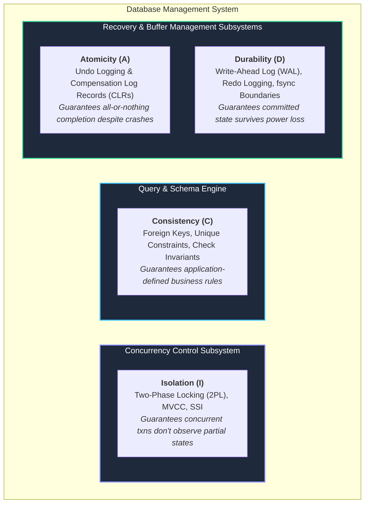
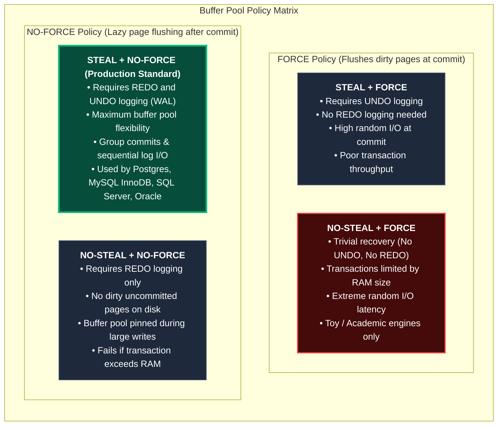
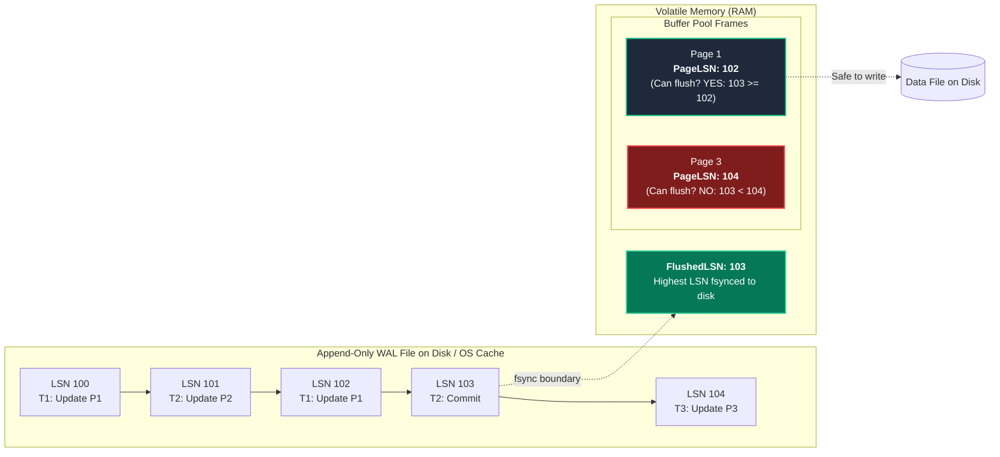
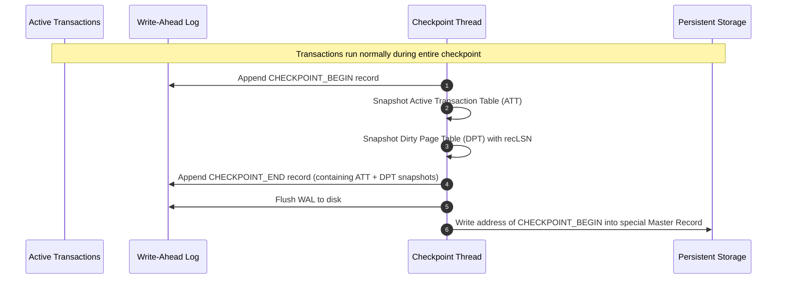
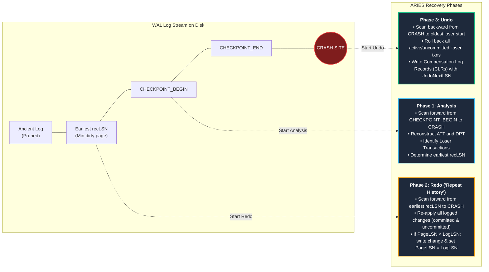
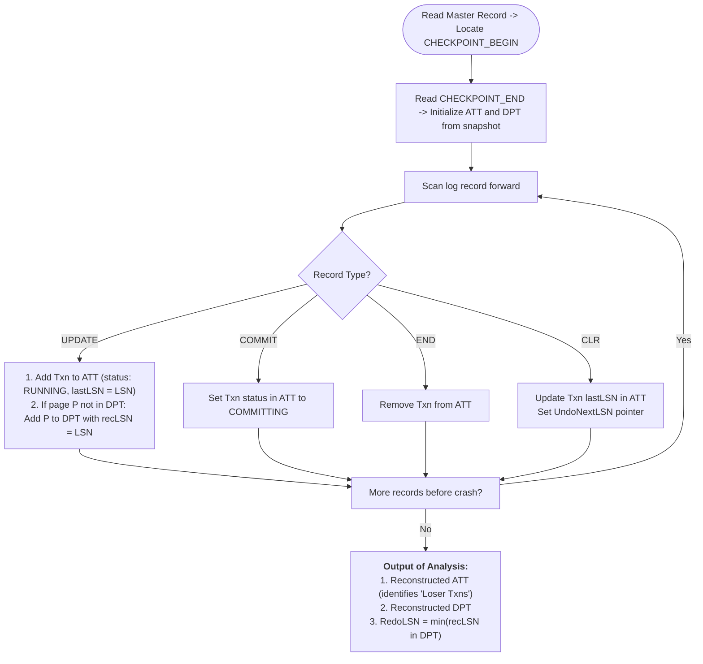
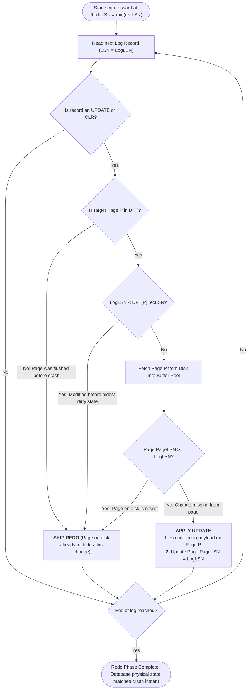
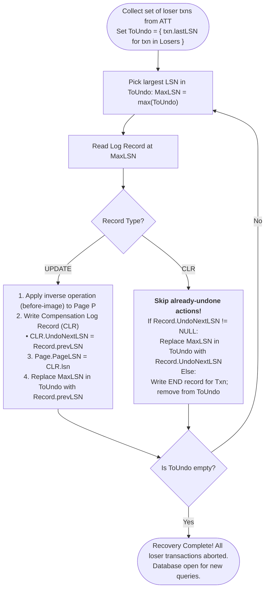

import { Callout } from "fumadocs-ui/components/callout";
import { Tabs, Tab } from "fumadocs-ui/components/tabs";

In transactional database systems, application developers interact with transactions through SQL abstractions: `BEGIN TRANSACTION`, `COMMIT`, and `ROLLBACK`. The database promises that modifications are atomic and durable. However, at the physical storage layer, the database engine does not execute writes directly to disk blocks on every query. Doing so would cripple throughput with millions of random disk I/O operations per second.

Instead, databases buffer read and written pages in volatile random-access memory (the **Buffer Pool**). This architectural necessity introduces the central dilemma of database internals: **How can a database guarantee that committed data is never lost and uncommitted changes never persist when the host machine can experience a catastrophic power failure or kernel panic at any arbitrary microsecond?**

This chapter deconstructs the mechanics of storage-layer ACID, the 2x2 buffer management policy matrix, the Write-Ahead Logging (WAL) protocol, and the industry-standard **ARIES** (Algorithms for Recovery and Isolation Exploiting Semantics) crash recovery algorithm.

---

## ACID Redefined at the Storage Layer

In academic literature, ACID is often presented as a unified set of properties. In a production storage engine, ACID is decoupled across distinct subsystem boundaries:



### The Storage Engine Division of Responsibility

1. **Consistency ($C$) is an Application Illusion:**
   The storage engine has no intrinsic concept of bank accounts, negative balances, or referential integrity. The query layer verifies constraints. The storage engine's sole duty regarding consistency is preserving internal physical structural invariants—for example, ensuring a B-Tree page's prefix keys remain sorted and page header pointers remain uncorrupted.

2. **Isolation ($I$) Belongs to Concurrency Control:**
   Isolation ensures that concurrent transactions do not step on each other's toes or observe uncommitted intermediate states. This is handled by page latches (short-term physical memory locks), table/row locks (long-term logical locks), or Multi-Version Concurrency Control (MVCC) visibility timestamps.

3. **Atomicity ($A$) and Durability ($D$) Belong to Recovery:**
   Atomicity and Durability are two sides of the physical storage coin:
   - **Atomicity** requires that if a transaction updates 10 pages and crashes after modifying 4, those 4 dirty pages must be reverted back to their pristine pre-transaction state (**Undo Logging**).
   - **Durability** requires that once a transaction receives a successful commit acknowledgement, its updates will survive an instantaneous power cut, even if those modified pages were sitting in RAM and had not yet been written to persistent storage (**Redo Logging**).

---

## Buffer Management Policies: STEAL and FORCE

A database storage engine manages an in-memory page cache called the **Buffer Pool**. When a query modifies a tuple on Page $P$, $P$ is loaded into memory, updated in place, and marked as **dirty**.

Eventually, dirty pages must be written back to disk. Two critical architectural decisions dictate how the buffer manager coordinates with the transaction manager:

1. **STEAL vs. NO-STEAL (Eviction Policy):** Can the buffer manager evict a dirty page containing modifications from an _uncommitted_ transaction to make room for another page?
2. **FORCE vs. NO-FORCE (Commit Policy):** Must the buffer manager flush all dirty pages modified by a transaction to disk before the transaction is allowed to _commit_?

### The 2x2 Buffer Management Matrix



### Detailed Breakdown of Combinations

<Tabs items={["STEAL + NO-FORCE", "NO-STEAL + FORCE", "STEAL + FORCE", "NO-STEAL + NO-FORCE"]}>
  <Tab value="STEAL + NO-FORCE">
    #### The Gold Standard for High-Performance Engines
    - **Mechanism:** The buffer pool can evict any unpinned dirty page to disk under memory pressure (**STEAL**). Transactions commit the instant their sequential log entries reach disk, without touching the data files (**NO-FORCE**).
    - **Pros:**
      1. **Minimal Commit Latency:** Commit operations do not perform scattered random writes to table files. They issue a single append-only sequential write to the log.
      2. **Maximum Buffer Frame Utilization:** Long-running analytical or batch transactions modifying millions of rows can proceed without exhausting buffer pool capacity.
      3. **Write Amortization:** A "hot" page modified 10,000 times by distinct transactions can remain dirty in RAM for minutes, absorbing writes before a single consolidated write to disk occurs.
    - **Cons:** Recovery complexity is at its maximum. The engine must support **REDO** (to reapply committed changes absent from disk) and **UNDO** (to erase uncommitted stolen changes present on disk).
  </Tab>

<Tab value="NO-STEAL + FORCE">
  #### The Simplest Architecture (Trivial Recovery) - **Mechanism:** Dirty pages
  can never be written to disk while their transaction is active. When
  committing, every dirty page modified by the transaction must be synchronously
  forced to disk via `fsync()`. - **Recovery Impact:** Recovery requires
  **neither REDO nor UNDO**. If the system crashes: - Any committed transaction
  had all its pages forced to disk before the commit returned (no REDO needed).
  - No uncommitted transaction ever had its dirty pages written to disk (no UNDO
  needed). - **Why Production Engines Reject It:** - A transaction cannot modify
  more pages than fit in available physical RAM. - Commits incur catastrophic
  random I/O delays, stalling client threads while the disk heads seek across
  disparate sectors.
</Tab>

<Tab value="STEAL + FORCE">
  #### Requires UNDO Only - **Mechanism:** Dirty uncommitted pages may be
  evicted to disk when memory is tight. But at commit time, all remaining dirty
  pages modified by the transaction are forced to disk. - **Recovery Impact:**
  Requires **UNDO logging** (because uncommitted pages might have been stolen to
  disk before a crash), but **no REDO logging** (because all committed changes
  are guaranteed to reside on disk). - **Why Production Engines Reject It:**
  Retains the fatal throughput penalty of FORCE: every transaction commit stalls
  on synchronous, random multi-page disk writes.
</Tab>

  <Tab value="NO-STEAL + NO-FORCE">
    #### Requires REDO Only
    - **Mechanism:** Dirty pages remain pinned in RAM until commit. At commit time, changes are not forced to table files; only log records are flushed. Pages are written to disk lazily in the background.
    - **Recovery Impact:** Requires **REDO logging** (to restore committed updates lost from volatile memory), but **no UNDO logging** (since dirty uncommitted pages never touched disk).
    - **Why Production Engines Reject It:** Pinning pages in RAM until commit causes catastrophic buffer pool starvation when processing large batch updates, bulk inserts, or index builds that exceed RAM capacity.
  </Tab>
</Tabs>

---

## Write-Ahead Logging (WAL) Protocol

To safely run a **STEAL + NO-FORCE** engine, the database relies on the **Write-Ahead Log (WAL)**—an append-only, sequential log stored on non-volatile media.

### The Golden Rule of WAL

The WAL protocol enforces one inviolable mathematical invariant between the in-memory page cache and the on-disk log:

<Callout type="error" title="The Fundamental Invariant of Write-Ahead Logging">
Before any dirty page $P$ is flushed from the volatile buffer pool to persistent disk storage, all log records describing modifications applied to $P$ must already be safely serialized and flushed to persistent storage:

$$\text{FlushedLSN} \ge \text{PageLSN}(P)$$

If this rule were ever violated, and the host crashed immediately after $P$ reached disk, the disk would contain dirty, uncommitted changes with **no corresponding log records** to undo them, corrupting the database permanently.

</Callout>

### Core LSN Identifiers

Every operation in a WAL-driven database revolves around monotonically increasing **Log Sequence Numbers (LSNs)**, typically implemented as 64-bit integer byte offsets into the log stream:



- **$\text{LogLSN}$ (or $\text{LSN}$):** The unique, monotonically increasing address assigned to a newly appended log record.
- **$\text{PageLSN}$:** A 64-bit integer embedded directly in the binary header of every disk/memory page. It records the $\text{LogLSN}$ of the most recent log record whose modification was applied to that page.
- **$\text{FlushedLSN}$:** A global, in-memory atomic variable maintained by the log manager. It tracks the highest LSN that has been flushed and acknowledged by the disk subsystem (`fsync`).
- **$\text{prevLSN}$:** A field inside every log record pointing to the preceding log record emitted by the _same transaction_. This constructs a backward-linked singly linked list inside the log, allowing the engine to traverse a specific transaction's operations in reverse during an abort or rollback.

### Log Record Physical Structure

In production engines, log records are written in a packed binary format. Below is an architectural representation of a standard physiological log record:

```c
struct LogRecordHeader {
    uint64_t lsn;             // Unique Log Sequence Number for this record
    uint64_t prev_lsn;        // Previous LSN written by this transaction
    uint32_t txn_id;          // Transaction Identifier
    uint16_t type;            // UPDATE, COMPENSATION (CLR), COMMIT, ABORT, CHECKPOINT
    uint32_t page_id;         // Targeted Page ID (for physiological records)
    uint16_t offset;          // Slot or byte offset within targeted page
    uint64_t undo_next_lsn;   // ONLY for CLRs: points to next LSN to undo
    uint16_t before_image_len;// Length of UNDO payload
    uint16_t after_image_len; // Length of REDO payload
    // Followed by byte arrays: [before_image_bytes] [after_image_bytes]
};
```

### Logging Granularities: Physical vs. Logical vs. Physiological

<Tabs items={["Physiological Logging", "Physical Logging", "Logical Logging"]}>
  <Tab value="Physiological Logging">
    #### The Industry Standard (Used by ARIES, InnoDB, Postgres)
    - **Philosophy:** *"Physical-to-a-page, logical-within-a-page."*
    - **Mechanism:** The log record identifies the exact physical page address (`page_id`) and slot offset, but records the operation as a logical action (e.g., *"Insert key 42 into slot 3 of Page 919"* or *"Subtract 50 from column balance"*).
    - **Why it wins:**
      - **Compactness:** Far smaller than logging full 8KB or 16KB physical disk pages.
      - **Concurrent Structure Modifications:** Different transactions can modify different slots on the same page concurrently without race conditions during recovery.
      - **Idempotence:** With $\text{PageLSN}$, physiological operations can be safely applied multiple times without duplicating effects.
  </Tab>

<Tab value="Physical Logging">
  #### Byte-Level Exact Diffs (State Logging) - **Mechanism:** Records exact
  before-images (pre-images) and after-images (post-images) of the raw bytes
  modified on disk. - **Pros:** Completely independent of storage layout logic;
  strictly idempotent. - **Cons:** Generates massive log volume. If a B-Tree
  page split shifts 50 tuples across an 8KB page, physical logging records the
  entire 8KB page image, causing severe write amplification and I/O bottlenecks.
</Tab>

  <Tab value="Logical Logging">
    #### High-Level Command Logging
    - **Mechanism:** Records the high-level SQL command or relational algebra operation (e.g., `UPDATE accounts SET balance = balance - 100 WHERE id = 7`).
    - **Pros:** Minimal log footprint.
    - **Cons:** Disastrous for concurrent crash recovery. Logical operations are non-deterministic (e.g., `NOW()`, `RAND()`, or rows updated in indeterminate order). Undoing a logical query in the presence of concurrent interleaved transactions can lead to unrecoverable logical corruption.
  </Tab>
</Tabs>

---

## Checkpointing Mechanics

If a database ran continuously for months, appending millions of log records, crash recovery would require scanning and replaying gigabytes of historical log records—a process that could take hours.

**Checkpointing** bounds recovery time by flushing dirty pages and safely truncating obsolete log segments.

### Naive Quiescent Checkpoint (Stop-the-World)

In early database architectures, checkpointing was synchronous and blocking:

1. Halt the acceptance of all new incoming transactions.
2. Wait for all currently executing transactions to commit or abort.
3. Flush every single dirty page in the buffer pool to persistent disk storage (`fsync`).
4. Write a `CHECKPOINT` record to the WAL and flush it.
5. Resume transaction processing.

```
[System Normal] ---> [PAUSE / QUIESCE] ---> [FLUSH ALL PAGES] ---> [RESUME]
                           ▲
                           └───── Latency spike: All queries stall!
```

This approach is intolerable in modern high-availability environments. Flushing gigabytes of dirty pages causes massive I/O stalls, violating Service Level Objectives (SLOs).

### Non-Blocking Fuzzy Checkpointing

Modern engines use **fuzzy checkpointing**, which executes asynchronously in the background without freezing client transactions or forcing immediate buffer flushes.

Instead of writing data pages to disk, a fuzzy checkpoint takes a **snapshot of in-memory control structures**:



The fuzzy checkpoint records two critical in-memory tables:

1. **Active Transaction Table (ATT):**
   A map of all active transactions running at the checkpoint instant, their state (`RUNNING`, `COMMITTING`, `ABORTING`), and their `lastLSN`.
2. **Dirty Page Table (DPT):**
   A map of all dirty pages currently residing in the buffer pool. Crucially, for each page, it records the **$\text{recLSN}$** (**Recovery LSN**)—the LSN of the log record that _first_ dirtied the page since it was last fetched from disk.

<Callout type="info" title="Why recLSN is the Master Anchor of Recovery">
  The smallest $\text{recLSN}$ across all entries in the Dirty Page Table
  ($\min(\text{recLSN})$) identifies the **oldest unwritten modification** in
  the entire database. No log record prior to $\min(\text{recLSN})$ can possibly
  have unwritten changes on disk. Therefore, the Redo phase of crash recovery
  never needs to read a single byte of log before $\min(\text{recLSN})$.
</Callout>

---

## The ARIES Recovery Algorithm

Published in 1992 by C. Mohan, Don Haderle, Bruce Lindsay, Hamid Pirahesh, and Peter Schwarz at IBM Research, **ARIES** (_Algorithms for Recovery and Isolation Exploiting Semantics_) is the foundational recovery paradigm implemented in nearly every enterprise relational database.

ARIES operates under three core principles:

1. **Physiological Logging:** Allows fine-grained concurrency and structured record modifications.
2. **Repeating History during Redo:** Redoes all logged operations (including those of aborted or active transactions) up to the crash point to reconstruct the exact physical state before failure.
3. **Logging Changes during Undo:** Appends **Compensation Log Records (CLRs)** during rollbacks so that undo operations are never repeated if another crash occurs during recovery.

### The ARIES 3-Phase Execution Timeline



---

### Phase 1: The Analysis Phase

The Analysis Phase scans the log **forward**, beginning at the `CHECKPOINT_BEGIN` record pointed to by the Master Record, and proceeds to the very end of the log (the crash site).



#### Detailed Tasks of Analysis:

1. **Initialize State:** Read the `CHECKPOINT_END` record and populate the in-memory ATT and DPT with the serialized snapshots saved during the checkpoint.
2. **Scan Forward:** Process every log record between `CHECKPOINT_BEGIN` and the end of the log:
   - If an `UPDATE` record is encountered for transaction $T_i$:
     - Add $T_i$ to the ATT if absent; set its state to `RUNNING` and update its `lastLSN = record.lsn`.
     - If the modified page $P$ is not in the DPT, add $P$ to the DPT with $\text{recLSN} = \text{record.lsn}$. (This marks the first unwritten modification to $P$).
   - If a `COMMIT` record is found for $T_i$: Set $T_i$'s state in the ATT to `COMMITTING`.
   - If an `END` record is found for $T_i$: Remove $T_i$ from the ATT entirely (it has finished committing or aborting).
   - If a `CLR` (Compensation Log Record) is found: Update $T_i$'s `lastLSN = record.lsn`.
3. **Determine Losers and Redo Start:**
   - Any transaction remaining in the ATT at the end of the Analysis scan without an `END` record is classified as a **Loser Transaction** (it was in-flight when the crash occurred and must be rolled back).
   - The starting point for the Redo phase ($\text{RedoLSN}$) is computed as:
     $$\text{RedoLSN} = \min_{P \in \text{DPT}} (\text{DPT}[P].\text{recLSN})$$
     If the DPT is empty, $\text{RedoLSN} = \text{CHECKPOINT\_BEGIN}$.

---

### Phase 2: The Redo Phase ("Repeating History")

The Redo Phase scans **forward** starting from $\text{RedoLSN}$ up to the end of the log.

ARIES enforces a strict **"Repeat History"** paradigm: **it re-executes all logged operations, including those belonging to active or aborted loser transactions, and re-applies all CLRs.**



#### The Three Optimization Checks (Avoiding Disk I/O)

To minimize expensive disk reads during Redo, ARIES performs three cascading tests before reading a page from disk:

1. **Test 1 (DPT Membership):** If page $P$ modified by the log record is **not** present in the Dirty Page Table, the page was clean when the checkpoint occurred and was never dirtied, or was already flushed to disk before the crash. **Skip without disk I/O.**
2. **Test 2 ($\text{recLSN}$ Comparison):** If $P \in \text{DPT}$, but $\text{LogLSN} < \text{DPT}[P].\text{recLSN}$, this modification was already persisted to disk prior to the dirty state tracked by $\text{recLSN}$. **Skip without disk I/O.**
3. **Test 3 ($\text{PageLSN}$ Comparison):** Only if Tests 1 and 2 fail must the engine read Page $P$ from disk into the buffer pool. It checks the header:
   - If $P.\text{PageLSN} \ge \text{LogLSN}$, the page on disk already reflects this log record's changes (e.g., evicted via STEAL just before the crash). **Skip without modifying.**
   - If $P.\text{PageLSN} < \text{LogLSN}$, apply the update, and immediately set:
     $$P.\text{PageLSN} = \text{LogLSN}$$

<Callout type="warn" title="Why Redo Loser Transactions?">
Engineers often ask: *"Why waste CPU cycles redoing changes for transactions we know we are about to roll back in the Undo phase?"*

The answer is **concurrency and physical page invariants**. Multiple transactions interleave modifications on the same page. If Transaction $T_{\text{loser}}$ inserted a row, followed by Transaction $T_{\text{winner}}$ inserting another row on the same page, undoing $T_{\text{loser}}$ without first restoring the page's exact physical geometry would cause slot corruption. By repeating history, ARIES restores the database to the exact state it was in at the instant of failure, ensuring that undo logic operates on completely valid page layouts.

</Callout>

---

### Phase 3: The Undo Phase & Compensation Log Records (CLRs)

The Undo Phase scans **backward** from the crash point, reversing the actions of all **loser transactions** identified in the ATT during Phase 1.



#### The Danger of Crash During Recovery (Undo Loops)

Consider what happens if a database crashes _while executing the Undo phase_. Without special protection:

1. Transaction $T_1$ modified Pages $A$, $B$, and $C$.
2. The database crashes. Recovery starts.
3. Undo reverses $C$, then crashes before reversing $B$.
4. Recovery starts again from scratch. It attempts to undo $C$ a second time.
5. If the undo operation is not strictly idempotent, double-undo causes catastrophic data corruption or enters an infinite crash-recovery loop!

#### The Genius of Compensation Log Records (CLRs)

To prevent undo loops, ARIES mandates that whenever an update is rolled back, the engine appends a **Compensation Log Record (CLR)** to the log.

A CLR contains a critical field: **`UndoNextLSN`**.

- When rolling back an update record at $\text{LSN}_{100}$, whose `prevLSN` is $\text{LSN}_{50}$, the engine writes:
  $$\text{CLR}(\text{LSN}_{105}, \text{undone\_lsn} = 100, \text{UndoNextLSN} = 50)$$
- If the system crashes at $\text{LSN}_{106}$, the next recovery pass's Undo phase reads the CLR at $\text{LSN}_{105}$ and **immediately jumps directly to $\text{LSN}_{50}$**, skipping $\text{LSN}_{100}$ entirely!

```
[LSN 50: T1 Update] <----+
                         |  prevLSN
[LSN 75: T2 Update]      |
                         |
[LSN 100: T1 Update] ----+  <-- Rolled back by Undo Phase
       ▲
       |  Undone
       |
[LSN 105: CLR for 100] ----> UndoNextLSN points directly to LSN 50!
```

**Key properties of CLRs:**

1. CLRs are **never undone**. The Undo phase skips CLRs and follows their `UndoNextLSN` pointers.
2. Recovery progress is strictly monotonic. Even if a server crashes 100 times in succession during recovery, it will never repeat previously completed undo work.

---

## State Walkthrough: A Concrete Recovery Trace

To observe ARIES in action, let us trace a concrete execution history through a sudden crash and recovery.

### Execution History Leading to Crash

|  LSN   |  Txn  |    Record Type     | Target Page | Page $\text{prevLSN}$ | Details                                                                  |
| :----: | :---: | :----------------: | :---------: | :-------------------: | :----------------------------------------------------------------------- |
| **10** | $T_1$ |      `UPDATE`      |    $P_1$    |        `NULL`         | $T_1$ sets $X = 100$                                                     |
| **20** | $T_2$ |      `UPDATE`      |    $P_2$    |        `NULL`         | $T_2$ sets $Y = 200$                                                     |
| **30** |   —   | `CHECKPOINT_BEGIN` |      —      |           —           | Fuzzy checkpoint initiated                                               |
|   —    |   —   |  _Snapshot State_  |      —      |           —           | $\text{ATT} = \{T_1: 10, T_2: 20\}$, $\text{DPT} = \{P_1: 10, P_2: 20\}$ |
| **40** | $T_1$ |      `UPDATE`      |    $P_3$    |         `10`          | $T_1$ sets $Z = 300$                                                     |
| **50** |   —   |  `CHECKPOINT_END`  |      —      |           —           | Checkpoint finishes; flushed to disk                                     |
| **60** | $T_2$ |      `COMMIT`      |      —      |         `20`          | $T_2$ commits; WAL flushed                                               |
| **70** | $T_3$ |      `UPDATE`      |    $P_2$    |        `NULL`         | $T_3$ sets $Y = 250$                                                     |
| **80** | $T_1$ |      `UPDATE`      |    $P_1$    |         `40`          | $T_1$ sets $X = 150$                                                     |
|   —    |   —   |    **💥 CRASH**    |      —      |           —           | Power failure! Memory lost.                                              |

_Disk State at Crash:_ Assume Page $P_1$ was evicted to disk (STEAL) at LSN 80 ($P_1.\text{PageLSN} = 80$). Pages $P_2$ and $P_3$ were never flushed to disk ($P_2.\text{PageLSN} = 20$, $P_3.\text{PageLSN} = 0$).

---

### Step-by-Step Recovery Execution

#### Step 1: Analysis Phase

1. Locate `CHECKPOINT_BEGIN` at LSN 30. Read snapshot from `CHECKPOINT_END` at LSN 50.
2. Initialize:
   - $\text{ATT} = \{ T_1: (\text{RUNNING}, \text{lastLSN}=10), T_2: (\text{RUNNING}, \text{lastLSN}=20) \}$
   - $\text{DPT} = \{ P_1: \text{recLSN}=10, P_2: \text{recLSN}=20 \}$
3. Scan forward from LSN 50:
   - **LSN 60 (`COMMIT` $T_2$):** Change $T_2$ status in ATT to `COMMITTING`.
   - **LSN 70 (`UPDATE` $T_3$ on $P_2$):** Add $T_3$ to ATT ($\text{RUNNING}, \text{lastLSN}=70$). $P_2$ already in DPT ($\text{recLSN}=20$).
   - **LSN 80 (`UPDATE` $T_1$ on $P_1$):** Update $T_1$ in ATT ($\text{lastLSN}=80$). $P_1$ already in DPT ($\text{recLSN}=10$).
4. Analysis Result:
   - **Loser Transactions:** $T_1$ ($\text{lastLSN}=80$), $T_3$ ($\text{lastLSN}=70$). (Note: $T_2$ committed; write its `END` record).
   - $\text{RedoLSN} = \min(\text{DPT}.\text{recLSN}) = \min(10, 20) = \mathbf{10}$.

#### Step 2: Redo Phase

Scan forward from $\text{RedoLSN} = 10$ to crash (LSN 80):

- **LSN 10 ($T_1 \to P_1$):** $P_1 \in \text{DPT}$ ($10 \ge 10$). Read $P_1$ from disk. $P_1.\text{PageLSN} = 80 \ge 10 \implies$ **SKIP REDO**.
- **LSN 20 ($T_2 \to P_2$):** $P_2 \in \text{DPT}$ ($20 \ge 20$). Read $P_2$ from disk. $P_2.\text{PageLSN} = 20 \ge 20 \implies$ **SKIP REDO**.
- **LSN 40 ($T_1 \to P_3$):** $P_3 \notin \text{DPT}$ in snapshot, but dirtied at 40! Add $P_3$ ($\text{recLSN}=40$). Read $P_3$. $P_3.\text{PageLSN} = 0 < 40 \implies$ **APPLY REDO**. Set $P_3.\text{PageLSN} = 40$.
- **LSN 60:** Non-redoable (Commit).
- **LSN 70 ($T_3 \to P_2$):** Read $P_2$. $P_2.\text{PageLSN} = 20 < 70 \implies$ **APPLY REDO**. Set $P_2.\text{PageLSN} = 70$.
- **LSN 80 ($T_1 \to P_1$):** Read $P_1$. $P_1.\text{PageLSN} = 80 \ge 80 \implies$ **SKIP REDO**.

#### Step 3: Undo Phase

Loser transactions to undo: $T_1$ ($\text{lastLSN}=80$) and $T_3$ ($\text{lastLSN}=70$).
$\text{ToUndo} = \{ 80, 70 \}$.

1. Select maximum LSN: $\mathbf{80}$ ($T_1 \to P_1$):
   - Undo $X = 150 \to$ restore previous value $X = 100$.
   - Write $\text{CLR}_{90}$ for $T_1$: $\text{UndoNextLSN} = \text{LSN 80.prevLSN} = 40$.
   - Set $P_1.\text{PageLSN} = 90$.
   - Replace 80 with 40 in $\text{ToUndo}$: $\text{ToUndo} = \{ 70, 40 \}$.
2. Select maximum LSN: $\mathbf{70}$ ($T_3 \to P_2$):
   - Undo $Y = 250 \to$ restore previous value $Y = 200$.
   - Write $\text{CLR}_{100}$ for $T_3$: $\text{UndoNextLSN} = \text{NULL}$ (first record of $T_3$).
   - Set $P_2.\text{PageLSN} = 100$.
   - Remove 70 from $\text{ToUndo}$; write `END` record for $T_3$. $\text{ToUndo} = \{ 40 \}$.
3. Select maximum LSN: $\mathbf{40}$ ($T_1 \to P_3$):
   - Undo $Z = 300 \to$ restore $Z = \text{NULL}$.
   - Write $\text{CLR}_{110}$ for $T_1$: $\text{UndoNextLSN} = \text{LSN 40.prevLSN} = 10$.
   - Set $P_3.\text{PageLSN} = 110$.
   - Replace 40 with 10 in $\text{ToUndo}$: $\text{ToUndo} = \{ 10 \}$.
4. Select maximum LSN: $\mathbf{10}$ ($T_1 \to P_1$):
   - Undo $X = 100 \to$ restore $X = \text{NULL}$.
   - Write $\text{CLR}_{120}$ for $T_1$: $\text{UndoNextLSN} = \text{NULL}$.
   - Set $P_1.\text{PageLSN} = 120$.
   - Write `END` record for $T_1$. $\text{ToUndo} = \emptyset$.

**Recovery complete.** Every loser transaction is rolled back, all committed changes are physically present, and no torn or inconsistent states exist.

---

## Real-World Engine Implementations

<Tabs items={["PostgreSQL (XLOG)", "MySQL (InnoDB)", "SQLite (WAL Mode)"]}>
  <Tab value="PostgreSQL (XLOG)">
    #### PostgreSQL Write-Ahead Log
    - **Architecture:** Postgres uses a monolithic, segment-based WAL directory (`pg_wal/`, historically `pg_xlog/`) split into 16MB files.
    - **Full Page Writes (`full_page_writes = on`):** To protect against **torn pages** (where the OS writes an 8KB page in 4KB filesystem blocks and crashes halfway through, leaving a corrupt page), Postgres writes a complete 8KB binary copy of every dirty page to the WAL on its *first modification* following a checkpoint.
    - **Background Processes:**
      - `checkpointer`: Periodically writes checkpoints based on `checkpoint_timeout` (default 5 min) and `max_wal_size`.
      - `walwriter`: Flushes WAL buffers asynchronously to meet commit durability requirements.
  </Tab>

<Tab value="MySQL (InnoDB)">
  #### InnoDB Redo & Undo Subsystems - **Redo Log (`ib_logfile0`,
  `ib_logfile1`):** A fixed-size circular ring buffer. Once the log wraps around
  to the oldest unwritten page checkpoint, writes freeze until dirty pages are
  flushed. - **Doublewrite Buffer (`ibdata`):** Instead of logging full pages
  like Postgres, InnoDB writes dirty pages to a contiguous 2MB sequential area
  on disk (the Doublewrite Buffer) before writing them to their actual
  tablespace locations. If a crash occurs during tablespace write, InnoDB
  restores the page from the doublewrite buffer. - **Undo Tablespaces:**
  Separate rollback segments storing multi-version undo logs, used both for
  transaction rollback and MVCC non-locking read views.
</Tab>

  <Tab value="SQLite (WAL Mode)">
    #### Embedded SQLite WAL
    - **Mechanism:** In WAL mode, SQLite appends modified pages directly to a separate `database.db-wal` file.
    - **Index (`wal-index`):** A memory-mapped file (`database.db-shm`) maps page numbers to offsets within the WAL file so readers can find the latest version without scanning.
    - **Checkpointing:** A periodic `PRAGMA wal_checkpoint` copies dirty pages sequentially from the WAL back into the main database file.
  </Tab>
</Tabs>

---

## Architecture Summary Checklist

When evaluating or implementing a transactional storage engine's recovery subsystem:

| Architecture Metric     | High-Performance Standard                                                   | Naive / Flawed Approach                                   |
| :---------------------- | :-------------------------------------------------------------------------- | :-------------------------------------------------------- |
| **Buffer Steal Policy** | **STEAL** (evict uncommitted pages under memory pressure)                   | **NO-STEAL** (pins dirty pages, failing on large writes)  |
| **Buffer Force Policy** | **NO-FORCE** (lazy asynchronous writes to data files)                       | **FORCE** (synchronous random I/O at every commit)        |
| **WAL Invariant**       | Strict $\text{FlushedLSN} \ge \text{PageLSN}$ check before every page write | Asynchronous, uncoordinated page flushes                  |
| **Logging Format**      | **Physiological** (page physical address + logical operation)               | Full physical byte diffs (extreme I/O amplification)      |
| **Checkpoint Strategy** | **Fuzzy Checkpointing** with DPT and $\min(\text{recLSN})$                  | Quiescent stop-the-world database lock                    |
| **Rollback Safety**     | **Compensation Log Records (CLRs)** with `UndoNextLSN`                      | Naive undo without log records (vulnerable to undo loops) |
