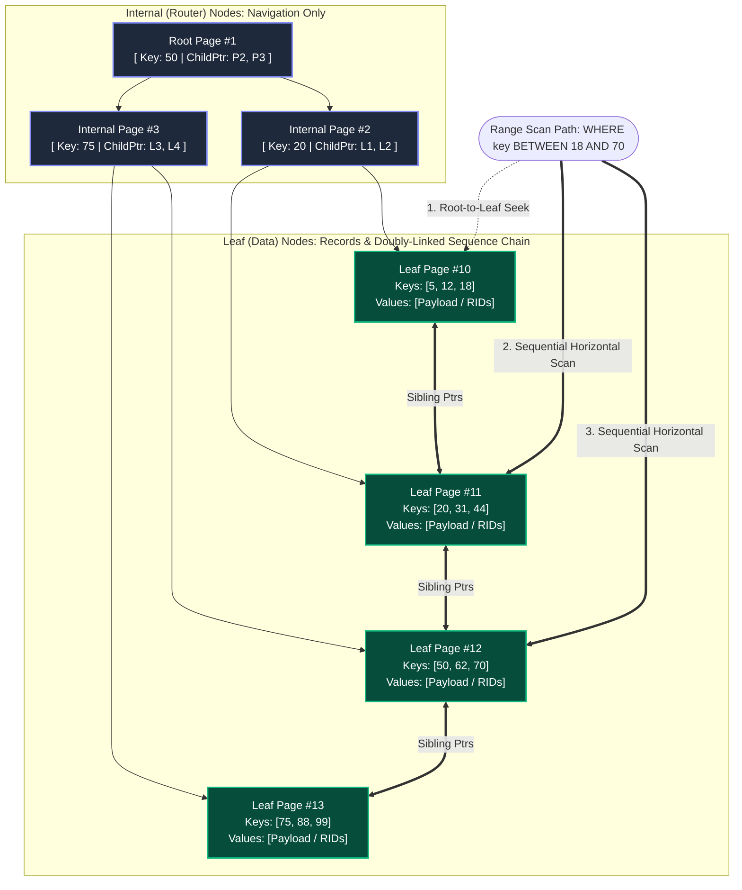
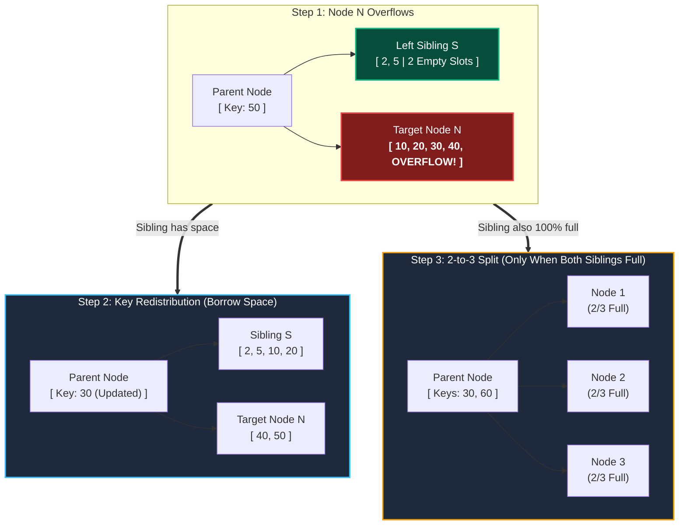
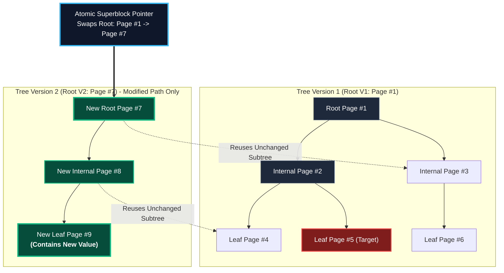
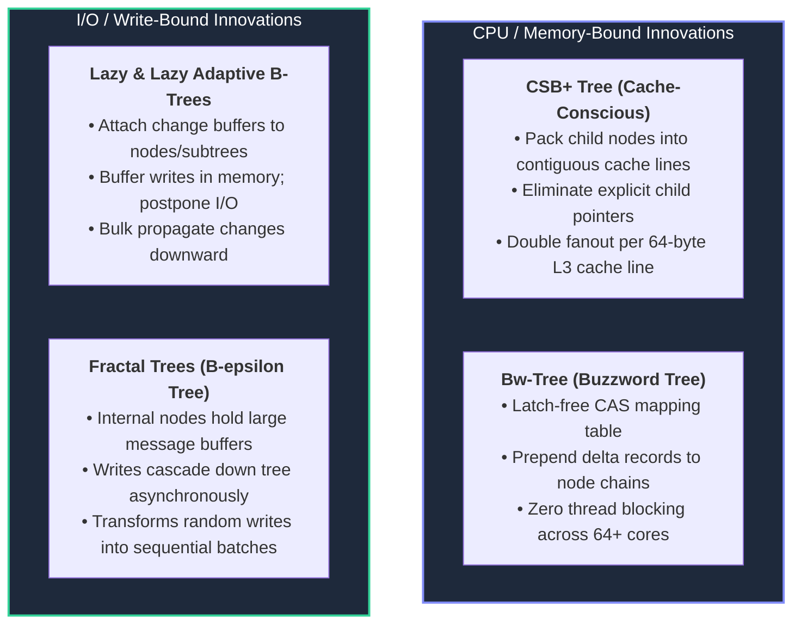
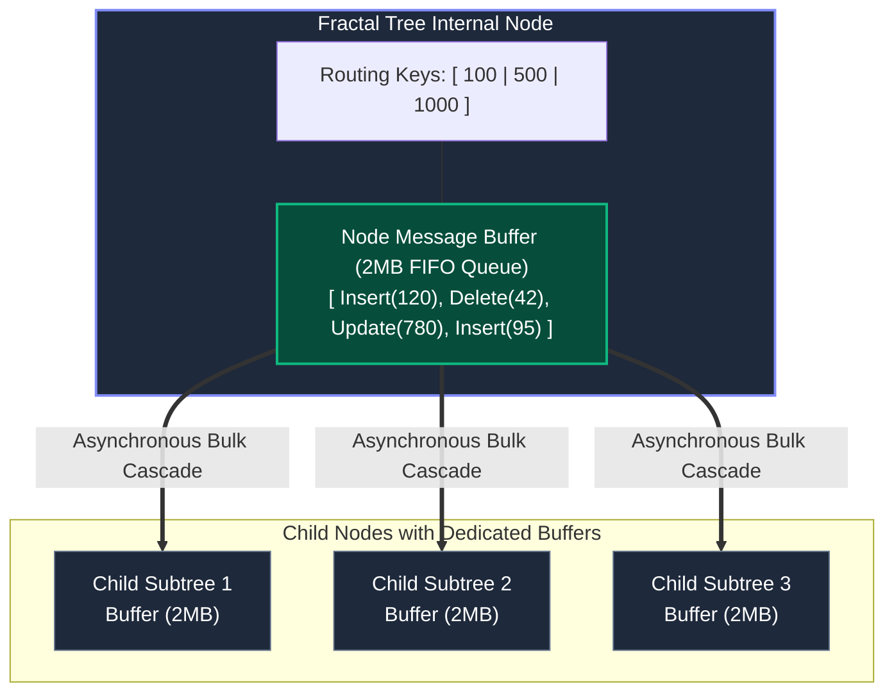
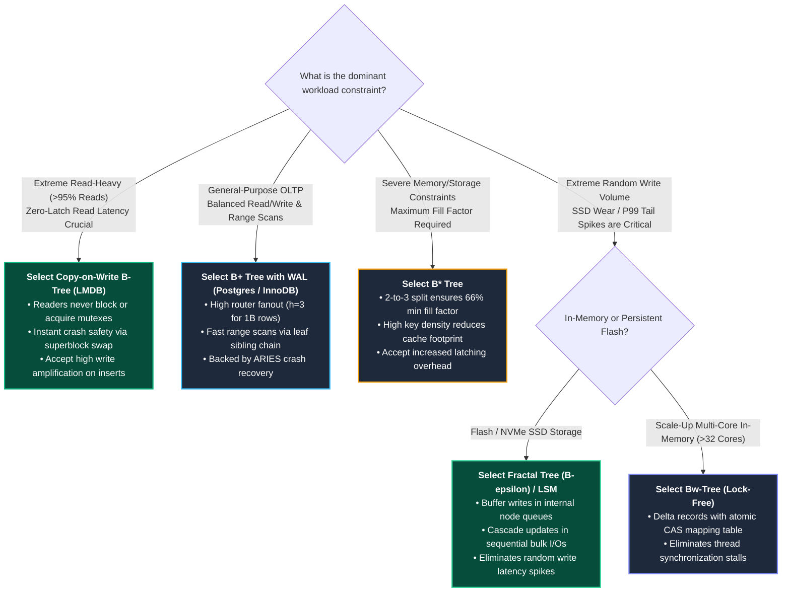

import { Callout } from "fumadocs-ui/components/callout";
import { Tabs, Tab } from "fumadocs-ui/components/tabs";
import { Steps, Step } from "fumadocs-ui/components/steps";

When Rudolf Bayer and Edward M. McCreight introduced the B-Tree in 1970, they solved the fundamental problem of organizing indexed data on block storage devices. However, the original B-Tree design embodied a specific set of engineering trade-offs suited to the hardware of the era: in-place page updates, uniform node splitting, and payload records stored directly inside internal routing nodes.

As database engines scaled to handle millions of queries per second across modern hardware—multi-core CPUs, NVMe SSDs, and memory-mapped architectures—the original B-Tree revealed distinct performance bottlenecks:

1. **Low Fanout in Internal Nodes:** Storing full payload records inside routing nodes inflated page sizes, shrank node fanout ($B$), increased tree height, and multiplied disk seeks.
2. **Poor Range Scan Performance:** Traversing a range of keys required zigzagging up and down the tree hierarchy in an in-order depth-first search, producing pathological random disk I/O.
3. **Low Storage Utilization:** Standard page splits divide overflowing nodes into two halves, yielding a worst-case storage utilization of only $50\%$.
4. **Latch Contention & Write Amplification:** In-place page updates required exclusive page latches that blocked concurrent readers and triggered catastrophic random write latency spikes.

To resolve these bottlenecks, database researchers and storage architects developed a rich taxonomy of **B-Tree variants**. This chapter breaks down four major architectural evolutionary branches: **B+ Trees**, **B\* Trees**, **Copy-on-Write (CoW) B-Trees**, and **Write-Optimized / Cache-Conscious Trees**.

---

## B+ Trees: The Universal Standard for Disk Engines

The **B+ Tree** (formalized by Douglas Comer in 1979) is the uncontested standard indexing structure in modern relational database management systems, powering PostgreSQL, MySQL (InnoDB), SQLite, and Oracle.

The defining insight of the B+ Tree is the strict **separation of concerns** between internal nodes and leaf nodes:



### 1. Internal Nodes (Routers) vs. Leaf Nodes (Storage)

| Attribute                 | Classic B-Tree                                            | B+ Tree                                                 |
| :------------------------ | :-------------------------------------------------------- | :------------------------------------------------------ |
| **Payload Storage**       | Stored in **both** internal and leaf nodes                | Stored **strictly in leaf nodes**                       |
| **Internal Node Content** | Keys, Child Pointers, and Data Records                    | Keys and Child Pointers only                            |
| **Leaf Node Content**     | Keys and Data Records                                     | Keys, Data Records, and Sibling Pointers                |
| **Node Fanout ($B$)**     | Low ($B \approx 10 \text{ to } 50$) due to bulky payloads | Massive ($B \approx 500 \text{ to } 1500$)              |
| **Tree Height ($h$)**     | Taller ($h = 4 \text{ to } 7$)                            | Extremely shallow ($h = 3 \text{ to } 4$)               |
| **Key Duplication**       | Keys appear exactly once in the tree                      | Separator keys in router nodes are duplicated in leaves |

#### Why High Fanout Protects Disk Latency

The height $h$ of a balanced tree determines the number of disk pages that must be retrieved from storage during a point lookup. For a database storing $N$ records with page size $P_{\text{size}}$, key size $K$, pointer size $C$, and record payload size $V$:

In a classic B-Tree, each internal node entry takes $K + C + V$ bytes. If $V = 256$ bytes, $K = 8$ bytes, and $C = 8$ bytes:
$$B_{\text{classic}} \approx \frac{4096}{272} \approx 15$$

In a B+ Tree, internal routing entries contain only $K + C = 16$ bytes:
$$B_{\text{B+}} \approx \frac{4096}{16} \approx 256$$

For a table containing 100,000,000 records:

- **Classic B-Tree Height:** $h \approx \log_{15}(10^8) \approx \mathbf{6.8} \implies 7 \text{ random disk I/Os}$
- **B+ Tree Height:** $h \approx \log_{256}(10^8) \approx \mathbf{3.3} \implies 3 \text{ to } 4 \text{ random disk I/Os}$

Because the top 2 levels of a B+ Tree easily fit into the database buffer pool cache (requiring only a few megabytes of RAM), almost every point lookup in a billion-row table requires only **one single physical disk I/O** (to fetch the target leaf page).

### 2. The Doubly-Linked Leaf Chain

Every leaf node in a B+ Tree embeds pointers to its immediate left and right siblings (`prev_page_id`, `next_page_id`). This creates a continuous, sorted doubly-linked list spanning all data records across the entire table.

#### Mechanics of a Range Scan (`WHERE id BETWEEN 20 AND 75`):

1. **Phase 1 (Binary Search Down to Leaf):** The engine navigates from the root down to the leaf node containing the lower bound key (`20`). This takes $O(\log_B N)$ steps.
2. **Phase 2 (Horizontal Scan):** Once the lower bound leaf is reached, the engine ceases all tree traversal. It follows the horizontal `next_page_id` sibling pointers directly from leaf to leaf, reading contiguous sorted records until encountering a key $> 75$.

This transforms range scans from chaotic, high-overhead tree traversals into **near-sequential linear disk reads**, enabling modern disk controllers to leverage hardware prefetching and read-ahead buffers.

---

## B\* Trees: Balancing Before Splitting

While the B+ Tree optimizes search fanout and range scanning, it retains a persistent storage inefficiency: **low node fill factor under random inserts**.

When an insert targets a full leaf or internal node of size $M$, a standard B-Tree splits the node into two nodes, each containing approximately $M/2$ keys. Consequently, under random insert workloads, average storage utilization hovers around $\ln(2) \approx 69\%$, with worst-case utilization plummeting to **50%**.

In large datasets, running at 67% fill factor means that **one-third of all allocated disk storage and buffer pool memory is empty padding**.

### Knuth's B\* Tree Algorithm (2-to-3 Redistribution)

Invented by Donald Knuth in 1973, the **B\* Tree** enforces a strict structural invariant: **every node must remain at least two-thirds ($\frac{2}{3}$) full**, achieving a minimum storage utilization of **66.7%** and typical utilization above **85%**.



### The Two-Phase Overflow Protocol

<Steps>
  <Step>
    #### Phase 1: Local Sibling Redistribution
    When an insert causes node $N$ to exceed its capacity $M$, the engine **does not immediately allocate a new page**. Instead, it inspects its immediate sibling $S$ (left or right).
    - If $S$ has available space, the engine performs **redistribution**:
      1. Keys from $N$ and $S$ are pooled together along with the dividing separator key in their parent.
      2. Keys are evenly distributed between $N$ and $S$.
      3. The parent's separator key is updated to reflect the new boundary.
    - Result: Space is reclaimed without allocating new disk blocks or altering tree height.
  </Step>

  <Step>
    #### Phase 2: The 2-to-3 Page Split
    If and only if node $N$ is full **and** its adjacent sibling $S$ is also completely full, a split must occur. 
    - Instead of splitting 1 node into 2, the B* Tree splits **2 full nodes into 3 nodes**:
      1. Allocate exactly **one** new page $N_{\text{new}}$.
      2. Pool all keys from node $N$, sibling $S$, the new key, and the parent router key (totaling $2M + 1$ keys).
      3. Divide the pooled keys evenly across the three nodes: $N$, $S$, and $N_{\text{new}}$.
      4. Each of the three resulting nodes contains approximately $\lfloor \frac{2M}{3} \rfloor$ keys.
      5. Insert two new separator keys into the parent routing node.
  </Step>
</Steps>

### Mathematical Proof of Fill Factor & Height

Let $M$ be the maximum key capacity of a node.

- **B-Tree Minimum Keys:** $\lceil M/2 \rceil \implies \mathbf{50\%}$ fill factor.
- **B\* Tree Minimum Keys:** $\lceil \frac{2M - 1}{3} \rceil \implies \mathbf{66.7\%}$ fill factor.

The height bound of a B* Tree indexing $N$ keys is strictly tighter than a standard B+ Tree:
$$h\_{B^*} \le 1 + \left\lfloor \log\_{\lceil 2M/3 \rceil} \left( \frac{N + 1}{2} \right) \right\rfloor$$

#### Engineering Trade-offs of B\* Trees

- **Advantages:** Drastically reduced storage footprint (15-20% less disk space consumed), higher cache residency, and shallower tree height.
- **Disadvantages:** Complex concurrency control. A 2-to-3 split requires holding exclusive latches on **four pages simultaneously** (the target node, its sibling, the newly allocated page, and the parent). This increases latch contention under write-heavy workloads and requires strict lock-ordering protocols to prevent deadlocks.
- **Real-World Use Cases:** Apple's **HFS+** filesystem historically used B\* Trees for its Catalog and Extents Overflow files to maximize metadata density on magnetic hard drives.

---

## Copy-on-Write (CoW) B-Trees

Traditional B-Trees modify pages **in place**. To write key 42 to Leaf Page #99, the engine modifies the bytes in memory, writes a WAL entry, and eventually overwrites Page #99 on disk. This requires write-ahead logs, dirty page tables, torn page protection (e.g., Postgres full-page writes or MySQL doublewrite buffers), and shared/exclusive latches.

**Copy-on-Write (CoW) B-Trees** (also known as _Shadow Paging B-Trees_ or _Append-Only B-Trees_) eliminate in-place page overwrites entirely.

### The Path-Copying Protocol

In a CoW B-Tree, every single modification leaves existing disk pages completely immutable. Updating a single leaf record generates an entirely new copy of the leaf, which in turn forces new copies of every ancestor node up to the root:



### Step-by-Step Path Copying Mechanics

<Steps>
  <Step>
    #### 1. Allocate New Leaf Page
    To insert or update a record in Leaf Page #5, allocate an unused block on disk (Page #9). Copy all records from Page #5 into Page #9 and apply the modification. Page #5 remains completely unmodified on disk.
  </Step>

<Step>
  #### 2. Propagate Upward to Ancestor Routers Parent Page #2 cannot point to
  the new Page #9 without being modified. Therefore, Page #2 cannot be updated
  in place. - Allocate a new internal page (Page #8). - Copy Page #2's routing
  keys into Page #8. - Update the child pointer for the modified branch to point
  to Page #9. - For all unmodified branches, Page #8 **reuses the existing child
  pointers directly** (e.g., pointing to unchanged Leaf Page #4).
</Step>

  <Step>
    #### 3. Allocate New Root & Atomic Swap
    This path copying cascades up to the root. Allocate a new Root Page (Page #7) pointing to Page #8 and the existing unchanged Page #3.
    - Up to this microsecond, readers querying the database continue traversing Root Page #1.
    - The transaction commits by issuing an **atomic 64-bit pointer write** in the database superblock (e.g., pointing `root_ptr = 7`) followed by an `fsync()`.
    - Instantaneously, all new queries observe Version 2.
  </Step>
</Steps>

### Architectural Benefits of CoW B-Trees

<Tabs items={["Zero-Latch Readers", "Trivial Crash Durability", "Instant Snapshots"]}>
  <Tab value="Zero-Latch Readers">
    #### Complete Elimination of Reader/Writer Locks
    - **Mechanism:** Because published pages are completely immutable, readers never compete with writers for memory latches.
    - **Performance:** Readers execute at raw memory-mapped speeds without atomic bus operations, lock tables, or reader-writer lock acquisition overhead.
    - A writer can allocate new pages and assemble a new tree version concurrently while 10,000 read threads traverse the immutable old tree.
  </Tab>

<Tab value="Trivial Crash Durability">
  #### Crash Recovery Without WAL or ARIES - **Mechanism:** At any given moment,
  the database superblock points to a completely valid, internally consistent
  root node ($V_1$). - If the server experiences a sudden power loss while the
  writer is allocating and flushing pages for $V_2$, the atomic superblock swap
  never occurs. - Upon reboot, the engine simply reads the superblock pointer
  ($V_1$). The partial writes for $V_2$ are treated as unallocated space. -
  **Result:** Zero recovery time. No log scanning, no Redo phase, no Undo phase.
</Tab>

  <Tab value="Instant Snapshots">
    #### Free MVCC & Point-in-Time History
    - **Mechanism:** Creating an isolated transaction snapshot or backup requires nothing more than retaining a memory pointer to an older root node.
    - As long as an active read transaction holds a reference to Root $V_1$, the pages referenced by $V_1$ are pinned and prevented from being recycled into the freelist.
  </Tab>
</Tabs>

### The Hidden Costs of Copy-on-Write

Despite its conceptual elegance, CoW introduces substantial engineering penalties:

1. **Write Amplification ($O(h)$ per update):**
   Modifying a single 32-byte tuple in a 4-level B-Tree with 4KB pages requires allocating and writing $4 \times 4096 = 16,384$ bytes to disk. For random write workloads, write amplification is severe.
2. **The Wandering Trees Problem:**
   Because leaf page modifications force parent page relocations, contiguous physical page layouts are continuously destroyed. Sibling leaves that were once contiguous on disk become fragmented across disparate physical offsets, degrading sequential range scan performance.
3. **Complex Garbage Collection (Freelist Management):**
   Old versions of modified pages cannot be reclaimed immediately because concurrent long-running read transactions may still be traversing them. The engine must maintain transactional freelists and epochs to track when all readers referencing an old root have terminated before recycling blocks.

<Callout type="warn" title="The Wandering Trees Dilemma">
  In filesystems like ZFS and Btrfs, the combination of Copy-on-Write and
  hierarchical block pointers means that every block modification re-allocates
  its parent, grandparent, and root metadata. Without sophisticated
  defragmentation, background allocation groups, and transaction group flushing
  (TXGs), long-lived CoW trees inevitably suffer from physical fragmentation on
  persistent media.
</Callout>

#### Real-World Implementations:

- **LMDB (Symas Lightning Memory-Mapped Database):** Implements a pure CoW B-Tree over memory-mapped files (`mmap`). Supports single-writer, concurrent zero-latch readers, delivering tens of millions of reads per second.
- **ZFS & Btrfs:** Advanced enterprise filesystems that utilize CoW B-Trees to provide atomic directory updates, instant volume snapshots, and end-to-end data checksumming.

---

## Write-Optimized & Cache-Conscious Trees

As solid-state storage (NVMe SSDs) and multi-core CPU architectures replaced mechanical disks, the primary performance bottlenecks shifted:

- **At the CPU level:** Memory bus bandwidth and L1/L2/L3 cache misses became major search bottlenecks.
- **At the I/O level:** Random write latency and SSD write endurance limits forced engines to mitigate **write amplification** and high P99 tail latency.



---

### 1. Cache-Conscious B+ Trees (CSB+ Trees)

Modern CPUs do not fetch individual 8-byte pointers from RAM; they fetch data in **64-byte Cache Lines**.

In a standard B+ Tree internal node, every key is paired with an 8-byte pointer ($K_1, P_1, K_2, P_2, \dots$). In a 64-byte cache line storing 8-byte keys and 8-byte pointers, you can fit at most **3 keys and 4 pointers** (48 bytes + padding). The child pointers consume $50\%$ of precious L1/L2/L3 cache space!

#### The CSB+ Tree Innovation (Rao & Ross, 2000):

**Cache-Sensitive B+ Trees (CSB+)** store all child nodes of a given parent node **contiguously in a single memory block**.

Because child pages $C_0, C_1, C_2, \dots, C_k$ are placed sequentially in memory, the parent node does not need to store $k$ distinct child pointers. It stores **one single base pointer** to child $C_0$!

$$\text{Address}(C_i) = \text{BasePointer} + (i \times \text{NodeSize})$$

```
Standard B+ Tree Node (Cache Line Waste):
[ Key 1 | Ptr 1 | Key 2 | Ptr 2 | Key 3 | Ptr 3 ]  --> 50% pointers!

CSB+ Tree Node (Implicit Indexing):
[ BaseChildPtr ] [ Key 1 | Key 2 | Key 3 | Key 4 | Key 5 | Key 6 | Key 7 ]
        │
        └───> Points to contiguous child block: [ Child 0 ][ Child 1 ][ Child 2 ]...
```

- **Impact:** By eliminating explicit child pointers, the number of routing keys stored in a single 64-byte cache line **doubles**.
- **Result:** Internal node fanout doubles, cutting CPU cache misses by up to **$50\%$** during binary search traversals.

---

### 2. Lazy B-Trees & Lazy Adaptive B-Trees

As explored in database literature and Alex Petrov's analysis, standard B-Trees suffer from extreme tail latency (P99/P99.9 spikes) under heavy random write traffic. Every random insert immediately traverses down to a leaf, dirties a page in the buffer cache, and eventually triggers an expensive random disk write.

#### Lazy B-Trees

A **Lazy B-Tree** pairs each node in the tree with a small in-memory **Change Buffer** (a mini append-only log):

1. When an insert, update, or delete arrives for a leaf node, the operation is **not immediately applied** to the page's sorted array.
2. Instead, the mutation is appended to the leaf's change buffer.
3. Only when the change buffer reaches capacity are the pending modifications sorted and merged into the page in a single batch operation.

#### Lazy Adaptive B-Trees

**Lazy Adaptive Trees** optimize this buffering mechanism across hierarchical subtrees:

- Instead of allocating a dedicated buffer for every single node, buffers are allocated at **subtree boundaries** (e.g., at the root and intermediate routing levels).
- A write entering the tree is placed directly into the **root buffer**. The traversal stops immediately!
- When the root buffer fills, all buffered modifications are partitioned by key range and **pushed down in bulk** to the corresponding lower-level subtree buffers.
- When a leaf-level buffer overflows, the batched writes are applied to disk pages simultaneously.

```
Write Op ---> [ Root Node Buffer ]  (Returns immediately! No disk I/O)
                     │
                     ▼ (When root buffer fills, flush bulk batch)
              [ Subtree Buffer A ]       [ Subtree Buffer B ]
                     │
                     ▼ (When subtree buffer fills, flush to disk)
              [ Leaf Page 1 ] [ Leaf Page 2 ]
```

- **Key Advantage:** Drastically reduces write amplification by amortizing I/O costs. Instead of executing 100 separate random writes to a page, 100 updates are collected in memory and written in a single consolidated block operation.

---

### 3. Fractal Trees & $B^\epsilon$-Trees

Formalized by Michael Bender et al., the **$B^\epsilon$-Tree** (commercialized as the **Fractal Tree** in TokuDB / Percona) is a mathematically optimal indexing structure that bridges the gap between B-Trees and Log-Structured Merge (LSM) Trees.

In a Fractal Tree, **every internal node contains both routing keys and a large message buffer** (typically 1MB to 4MB):



#### How Operations Work in a Fractal Tree:

- **Write Path (Blazing Fast):** When an `INSERT`, `UPDATE`, or `DELETE` arrives, the engine appends a "message" describing the operation into the **root node's buffer** and immediately returns success to the client. The write never traverses down to the leaf at query time!
- **Asynchronous Cascading:** When a node's message buffer fills up, a background thread flushes a batch of messages down to the appropriate child node's buffer. Messages trickle down the tree lazily until reaching the leaves.
- **Read Path:** A point lookup navigates from root to leaf, applying any pending messages found in internal node buffers along its path to construct the latest state of the tuple.

#### The Epsilon ($\epsilon$) Tuning Parameter

The $B^\epsilon$-Tree is governed by a tuning parameter $\epsilon \in [0, 1]$:

- When $\epsilon = 1$: Message buffers are size zero; the structure degenerates into a standard **B+ Tree** (optimal read performance: $O(\log_B N)$, poor write performance: $O(1)$ random I/O per write).
- When $\epsilon = 0$: Node fanout is 1; the structure becomes an append-only log or **LSM-Tree** (optimal write performance: $O(\frac{1}{B})$, higher read overhead).
- When $\epsilon = 0.5$: A **Fractal Tree** achieves write performance orders of magnitude faster than a B-Tree while preserving fast $O(\log N)$ point lookups.

---

### 4. The Bw-Tree ("Buzzword Tree")

Developed by Microsoft Research for the Hekaton in-memory engine in SQL Server, the **Bw-Tree** is a high-performance, latch-free B-Tree designed for modern multi-socket, multi-core hardware.

#### The Core Innovations:

1. **The Mapping Table (Logical Indirection):**
   In a Bw-Tree, nodes do not reference child pages by physical 64-bit virtual memory addresses. Instead, they reference **Logical Page IDs (LPIDs)**. A central in-memory array called the **Mapping Table** translates each LPID to its physical memory address.
2. **Delta Update Chains (No In-Place Modification):**
   When a record is inserted or updated on Page $P$, the engine does not modify the page bytes in place (which would require acquiring an exclusive write latch). Instead, it allocates a small **Delta Record** describing the update.
3. **Atomic Compare-And-Swap (CAS):**
   The delta record is linked to the existing page using a single hardware atomic CPU instruction: `atomic_compare_and_swap`. The Mapping Table entry for Page $P$ is updated to point to the new Delta Record, which points back to the base page.

```
Mapping Table:
[ LPID 42 ] ──> Points to Head of Delta Chain

Delta Chain in Memory:
[ Delta Record: Insert(55) ] ──> [ Delta Record: Delete(12) ] ──> [ Base Page #42 ]
              ▲
              └──── Appended via atomic CAS! Zero locks, zero latches!
```

- When the delta chain grows excessively long (e.g., $> 8$ deltas), a worker thread performs **consolidation**: it creates a clean, merged base page and atomically updates the Mapping Table pointer.
- **Impact:** Eliminates all thread blocking, cache line invalidation, and latch contention. Threads never sleep waiting on mutexes, enabling linear scaling across 64+ CPU cores.

---

## Comprehensive Architecture Comparison Matrix

The following matrix compares all major B-Tree architectural variants across critical storage and hardware metrics:

| Architectural Variant                | Primary Innovation                                       | Point Read Complexity                   | Write Cost / Amplification                                  | Concurrency & Latching Model                                 | Crash Recovery Mechanism                            | Best Workload Profile                                  |
| :----------------------------------- | :------------------------------------------------------- | :-------------------------------------- | :---------------------------------------------------------- | :----------------------------------------------------------- | :-------------------------------------------------- | :----------------------------------------------------- |
| **Classic B-Tree** (1970)            | Balanced $M$-way search tree on disk blocks              | $O(\log_B N)$                           | High (in-place page overwrite)                              | Latch Crabbing / Coupling (Coupled shared/exclusive latches) | WAL + Checkpoints (Requires REDO & UNDO)            | Historical / Reference only                            |
| **B+ Tree** (1979)                   | Router/Leaf separation + Doubly-linked leaf chain        | $O(\log_B N)$ (Shallow tree, $h \le 4$) | High (in-place page overwrite)                              | Latch Crabbing / Latch Freezing                              | WAL + ARIES (Physiological logs, STEAL/NO-FORCE)    | General-purpose OLTP (Postgres, InnoDB, SQLite)        |
| **B\* Tree** (1973)                  | Sibling redistribution + 2-to-3 page splits              | $O(\log_{2B/3} N)$ (Dense packing)      | Moderate-High (Complex multi-page splits)                   | Multi-node latching (Deadlock-prone without strict ordering) | WAL + Checkpoints                                   | Read-heavy workloads on capacity-constrained media     |
| **Copy-on-Write B-Tree** (LMDB, ZFS) | Path copying from modified leaf to root; immutable pages | $O(\log_B N)$                           | Extreme ($O(h)$ pages copied per write)                     | **Zero-latch readers**; Single serialized writer             | Atomic Superblock pointer swap (Zero recovery time) | Read-dominant OLTP ($> 95\%$ reads), embedded engines  |
| **CSB+ Tree** (2000)                 | Contiguous child allocation with single base pointer     | $O(\log_{2B} N)$ (Cache-optimized)      | High (Child block reallocation during splits)               | Standard Latch Crabbing                                      | Memory-mapped / WAL                                 | In-memory indexing, CPU cache-bound analytics          |
| **Lazy Adaptive Tree**               | Hierarchical change buffering at node/subtree level      | $O(\log_B N)$                           | Low (Amortized bulk page flushes)                           | Buffer-level locking                                         | Buffer WAL / Checkpoints                            | Mixed read/write OLTP with high random insert volume   |
| **Fractal Tree ($B^\epsilon$)**      | Multi-megabyte message buffers inside internal nodes     | $O(\log_B N)$                           | **Very Low** ($O(\frac{1}{B^\epsilon})$ sequential flushes) | Top-down buffer latches                                      | WAL + Asynchronous buffer flushes                   | High-throughput write-heavy OLTP, time-series indexing |
| **Bw-Tree** (Microsoft)              | Mapping Table indirection + Latch-free CAS delta chains  | $O(\log_B N) + O(\text{chain})$         | Low-Moderate (Append-only deltas in RAM)                    | **Latch-free** (Hardware atomic CAS instructions)            | Checkpointed base pages + Delta WAL                 | Extreme multi-core in-memory OLTP (Hekaton)            |

---

## Engineering Decision Guide: Choosing the Right Tree

When designing or selecting an embedded storage engine or indexing subsystem, use this architectural decision hierarchy:


