import { Callout } from "fumadocs-ui/components/callout";
import { Tabs, Tab } from "fumadocs-ui/components/tabs";
import { Cards, Card } from "fumadocs-ui/components/card";

Traditional relational databases (PostgreSQL, MySQL InnoDB, Oracle) were architected around the **B-Tree** and its variant, the B+ Tree. For decades, the B-Tree reigned supreme: it offers deterministic $O(\log_B N)$ point lookups, efficient sequential range scans, and direct in-place page updates.

However, the explosion of write-intensive distributed workloads—time-series metrics, financial transaction ledgers, distributed messaging queues, social network activity feeds, and multi-terabyte analytical ingestion—revealed a fundamental hardware bottleneck: **in-place updates on persistent block storage incur devastating write amplification and random I/O penalties.**

To solve this, modern storage engines such as **RocksDB** (Meta), **LevelDB** (Google), **Apache Cassandra**, **ScyllaDB**, **CockroachDB** (via Pebble), and **ClickHouse** turned to the **Log-Structured Merge-Tree (LSM-Tree)**, originally introduced by Patrick O'Neil, Edward O'Neil, and Gerhard Weikum in 1996.

This lesson explores the single-node mechanics of LSM-trees: how they convert random writes into sequential disk streams, how data transitions from volatile RAM to multi-layered disk structures, how multi-component reads work with Bloom filters, how tombstones prevent resurrection hazards, and how compaction strategies balance the fundamental **RUM trilemma**.

---

## 1. The Physics of Storage: Why In-Place Updates Fail

To understand why LSM-trees exist, we must analyze the physical characteristics of storage media (Mechanical Hard Disk Drives and Solid-State Drives) and how B-Trees interact with them.

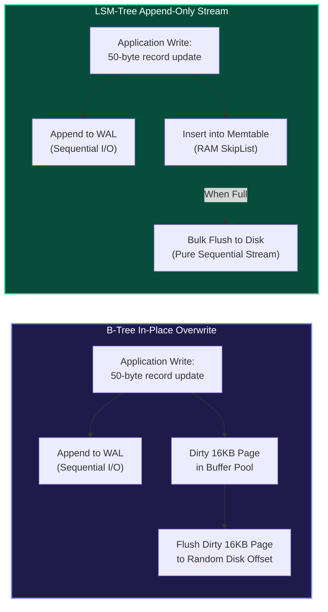

### The Random Write Penalty

Persistent storage devices possess an inherent asymmetry between sequential throughput and random I/O:

1. **Mechanical Hard Disk Drives (HDDs):**
   - A random write requires moving a physical mechanical actuator arm across spinning magnetic platters (seek latency: $3\text{--}10\text{ ms}$) and waiting for the target sector to rotate underneath the head (rotational delay: $4.17\text{ ms}$ at 7,200 RPM).
   - A standard HDD achieves only **$100\text{--}200\text{ IOPS}$** for random writes (amounting to $\approx 1\text{--}2\text{ MB/s}$ of useful payload).
   - In contrast, pure sequential transfers allow the disk head to stay on a single track, streaming data at **$150\text{--}250\text{ MB/s}$**—over **100x faster**.

2. **Solid-State Drives (NAND Flash & NVMe SSDs):**
   - SSDs eliminate mechanical heads, but they introduce a severe solid-state physics limitation: **NAND flash cells cannot be overwritten in-place**.
   - **Page vs. Block Asymmetry:** Flash memory is read and written (programmed) in units of **Pages** (typically $4\text{ KB}\text{--}16\text{ KB}$), but erase operations can only be performed across an entire **Erase Block** (typically $2\text{ MB}\text{--}8\text{ MB}$, consisting of 128 to 512 pages).
   - To update an existing page on flash, the drive's internal **Flash Translation Layer (FTL)** writes the new data to a fresh, previously erased page and marks the old page as stale/invalid.
   - Over time, invalid pages accumulate. The FTL must trigger internal **Garbage Collection (GC)**: reading an entire erase block into internal controller RAM, copying valid pages to a clean block, and erasing the original block.

<Callout type="warn" title="Hardware Write Amplification & Flash Wear">
Because of internal SSD Garbage Collection, writing a small random payload to flash causes the SSD controller to internally rewrite many surrounding pages. The **Device Write Amplification Factor ($WAF_{\text{device}}$)** is defined as:

$$WAF_{\text{device}} = \frac{\text{Bytes Written to NAND Flash}}{\text{Bytes Written by Host OS}}$$

High random write workloads can drive $WAF_{\text{device}}$ to $5\text{--}15\times$, rapidly burning through the drive's limited Program/Erase (P/E) cycles (e.g., $1{,}000\text{--}3{,}000$ cycles for TLC, $500\text{--}1{,}000$ for QLC) and killing the hardware. Sequential appends, by contrast, keep $WAF_{\text{device}} \approx 1.0$.

</Callout>

### The B-Tree Write Amplification Pathology

A standard B+ Tree engine (such as MySQL InnoDB) persists data in fixed-size disk pages (e.g., $16\text{ KB}$). Consider an application updating a single 32-byte integer counter:

1. The transaction appends an entry to the Write-Ahead Log (WAL) for durability ($\approx 50\text{ bytes}$).
2. The engine locates the page in the Buffer Pool and mutates the 32 bytes in RAM, marking the page as **dirty**.
3. When the Buffer Pool flush thread checkpoints or evicts that page, the **entire $16\text{ KB}$ page is written to disk**, even though only 32 bytes changed.

The software write amplification for that single page update is:

$$W_A = \frac{16{,}384\text{ bytes written}}{32\text{ bytes payload}} = 512\times$$

Furthermore, as the tree grows far larger than the RAM buffer pool, pages being updated are scattered randomly across the physical storage address space. Every random page flush triggers expensive FTL remappings or HDD head seeks.

### The LSM Alternative: Sequential Append-Only I/O

The core thesis of an LSM-Tree is simple:

> **Never update data in-place on persistent storage. Buffer incoming mutations in fast RAM, sort them in memory, and flush them to disk in large, continuous, immutable sequential streams.**

By converting arbitrary random updates and inserts into pure sequential I/O, LSM-trees maximize disk write bandwidth (saturating up to $7\text{ GB/s}$ on modern PCIe 4.0/5.0 NVMe drives) while minimizing physical flash wear.

---

## 2. Core Anatomy of an LSM-Tree

An LSM-tree splits the storage engine into two distinct tiers: **volatile in-memory components** for absorbing fast writes and **persistent on-disk components** for durable, immutable storage.

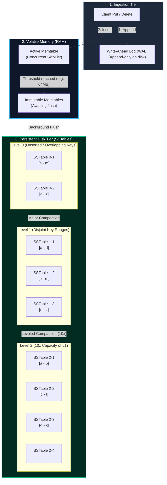

### The In-Memory Memtable

All incoming write operations (`Put`, `Delete`) write first to an active in-memory buffer called the **Memtable**.

#### Why Not a Red-Black Tree?

Traditional self-balancing binary search trees (Red-Black, AVL) maintain sorted order in $O(\log N)$ time. However, in high-throughput database systems where dozens of worker threads execute concurrent writes, BSTs suffer from severe synchronization bottlenecks:

- Insertions require tree rotations and pointer rebalancing that span multiple tree levels.
- Rebalancing forces coarse-grained locking or complex lock coupling across parent, sibling, and child nodes, crippling multi-core scalability.

#### The Dominance of the Concurrent SkipList

Modern storage engines (RocksDB, LevelDB, Cassandra, Pebble) utilize a **Concurrent SkipList** for their default Memtable implementation.

A SkipList is a probabilistic multi-level linked list. Every node contains a key, a value, and an array of forward pointers corresponding to its randomized height.

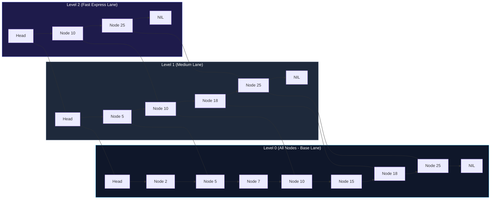

**Why SkipLists Excel in Memtables:**

1. **Lock-Free Concurrency:** Insertion only mutates pointers at the target position without global restructuring or rotations. RocksDB uses an `InlineSkipList` that allows lock-free readers and lock-free concurrent writers via atomic Compare-And-Swap (`CAS`) operations.
2. **Predictable Performance:** Search, insert, and delete execute in $O(\log N)$ expected time, matching balanced trees.
3. **Sequential Traversal:** Finding a starting key and scanning forward is a simple linked list traversal at Level 0, providing fast iterator performance for ranges and flushes.
4. **Arena Allocation:** Rather than calling `malloc()` for every key-value node (which fragments memory), nodes are appended to a contiguous contiguous memory pool (an **Arena**). When the memtable is flushed, the entire Arena is reclaimed in a single free operation.

### The Write-Ahead Log (WAL)

Because the Memtable lives in volatile RAM, an unexpected server power loss or kernel panic would destroy uncommitted writes.

To guarantee ACID **Durability**, every write must be appended to an on-disk **Write-Ahead Log (WAL)** before being inserted into the Memtable:

- The WAL is an append-only sequential file on disk.
- Each record contains a CRC32 checksum, timestamp/sequence number, record type (Put/Delete), key size, key bytes, value size, and value bytes.
- When an active Memtable reaches its memory threshold and is successfully flushed to disk as an SSTable, its corresponding WAL file is safely unlinked.

<Tabs items={["Synchronous (Sync)", "Group Commit", "Asynchronous"]}>
  <Tab value="Synchronous (Sync)">
    Every client write invokes `fdatasync()` on the WAL file descriptor before returning success to the client.
    - **Durability:** Zero data loss upon power failure.
    - **Throughput:** Constrained by storage IOPS ($100\text{--}1{,}000\text{ writes/sec}$ on standard drives).
  </Tab>
  <Tab value="Group Commit">
    Concurrent client threads queue their writes into a mutex-protected batch. A single leader thread issues a single combined `write()` and `fdatasync()` for the entire batch, waking up waiting threads.
    - **Durability:** Zero data loss upon power failure.
    - **Throughput:** Amortizes disk synchronization overhead across hundreds of concurrent requests.
  </Tab>
  <Tab value="Asynchronous">
    Writes are written to the OS page cache without calling `fsync()` immediately. The OS flushes dirty pages periodically (e.g., every 1-5 seconds).
    - **Durability:** Vulnerable to losing the last few seconds of writes upon power failure (though immune to application-level process crashes).
    - **Throughput:** Maximum possible performance (hundreds of thousands of writes/sec).
  </Tab>
</Tabs>

### The Flush Boundary: Active to Immutable

A Memtable has a configured size limit (e.g., `write_buffer_size = 64MB` in RocksDB).

Once the active memtable exceeds this threshold:

1. The engine atomically freezes the active Memtable and transitions it to an **Immutable Memtable (`imm`)**.
2. A new, empty active Memtable and fresh WAL file are allocated immediately, allowing client writes to proceed without blocking.
3. A background **Flush Thread** iterates through the immutable memtable in ascending key order and writes it out as a brand-new, sequentially structured **SSTable** file on disk (placed into Level 0).
4. Once the SSTable is fsynced to disk, the old WAL is deleted, and the immutable memtable is purged from RAM.

---

## 3. Immutable SSTables (Sorted String Tables) on Disk

An **SSTable (Sorted String Table)** is the fundamental on-disk building block of an LSM-tree.

Once an SSTable is written to disk, it is **strictly immutable**. It is never updated, appended to, or modified in-place. If keys within that SSTable are modified or deleted by the application, new records are written to new SSTables; the old records are only reclaimed during background **Compaction**.

### Binary Layout of a Production SSTable

Below is the binary architecture of a modern Block-Based SSTable (standardized by Google LevelDB and Meta RocksDB):

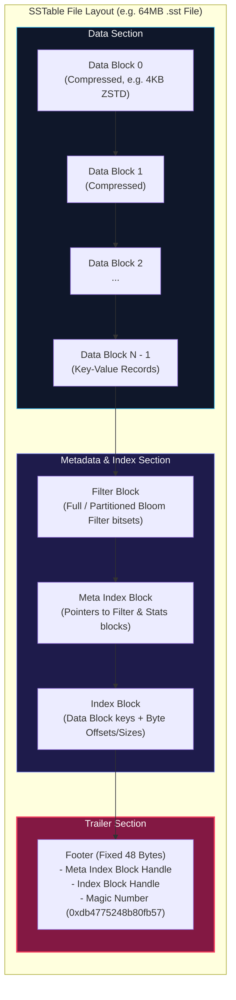

### Detailed Component Breakdown

#### 1. Data Blocks

Data blocks hold sorted key-value pairs, typically grouped into $4\text{ KB}\text{--}64\text{ KB}$ uncompressed units (often compressed using LZ4, ZSTD, or Snappy).

To maximize storage density, keys within a data block utilize **Prefix Delta Encoding**:
Since keys are sorted, adjacent keys share long prefixes (e.g., `user:1001:email` and `user:1001:profile`). Instead of repeating the prefix, the engine encodes:

- Shared key length
- Unshared key length
- Value length
- Unshared key bytes followed by value bytes.

To avoid decompressing and scanning an entire block from byte 0 just to find a single key, the engine inserts **Restart Points** every $K$ keys (typically $K=16$). At each restart point, prefix compression is reset, and the full key is stored. A small integer array of restart point offsets at the tail of each block allows binary search inside the block.

#### 2. Index Block

The Index Block acts as the router for data blocks. For every data block in the SSTable, the index block stores one entry:

- **Key:** A string $\ge$ the last key of that data block and $<$ the first key of the subsequent data block (the shortest separator key).
- **Value (Block Handle):** An offset and size tuple indicating exactly where that data block begins on disk and how many bytes it occupies.

When searching for key $K$, the engine binary-searches the Index Block to find the candidate data block, loads only that $4\text{ KB}$ chunk into RAM, and binary-searches its restart points.

#### 3. Filter Block (Bloom Filter)

Contains serialized Bloom filter bit arrays that allow the engine to determine whether a given search key could possibly exist in this SSTable without reading any data blocks.

#### 4. Meta Index Block

Maps metadata block names (e.g., `"filter.rocksdb.builtin_bloom_filter"`, `"rocksdb.properties"`) to their physical block handles within the file.

#### 5. Footer (File Trailer)

The Footer is located at the very end of the file at a fixed size (typically 48 bytes). It contains:

- `BlockHandle` pointing to the Meta Index Block
- `BlockHandle` pointing to the Index Block
- Padding bytes to align the structure
- **Magic Number:** An 8-byte constant (e.g., `0xdb4775248b80fb57ull` in RocksDB) used to verify that the file is not corrupted and represents a valid SSTable.

<Callout type="info" title="Reading an SSTable Begins at the End">
  When a database engine opens an SSTable from disk, it does **not** read from
  byte 0. It reads the final 48 bytes (the Footer), validates the magic number,
  extracts the offsets of the Index and Meta Index blocks, loads them into
  memory, and caches them. The raw data blocks are only read on demand.
</Callout>

---

## 4. The Read Path & Multi-Component Search

Because an LSM-tree does not update records in-place, the latest version of a key may reside in the in-memory Memtable, in an immutable Memtable pending flush, or across any of dozens of SSTable files across multiple disk levels.

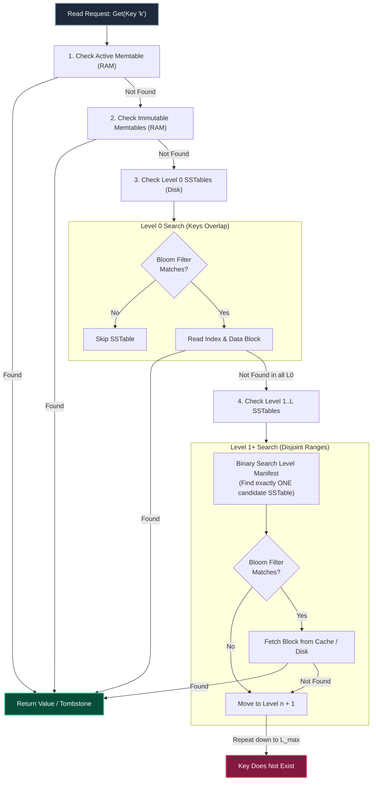

### The Read Search Order

A point lookup `Get(k)` executes in strict chronological order from newest to oldest data:

1. **Active Memtable (RAM):** The most recent mutations live here. If found, return immediately.
2. **Immutable Memtables (RAM):** Data that has been frozen but not yet flushed to disk.
3. **Level 0 SSTables (Disk):**
   - _Crucial difference:_ Because Level 0 files are direct flushes of memtables, their key ranges **overlap** arbitrarily. A key might be in SSTable 0-1 `[a - m]` or SSTable 0-2 `[c - z]`.
   - The engine must search **every Level 0 SSTable** (from newest to oldest), unless eliminated by Bloom filters.
4. **Level 1 through Level $L_{\max}$ (Disk):**
   - At Level 1 and beyond, files have strictly **disjoint, non-overlapping key ranges**.
   - The engine performs a binary search over the level's file boundary metadata in RAM to find the single SSTable that encompasses the target key range.
   - At most **one SSTable per level** needs to be searched.

### The Range Scan Challenge: Multi-Way Min-Heap Merge

While point lookups stop as soon as the newest version of a key is encountered, a **Range Scan** (`Scan(start_key, end_key)`) must observe all valid keys in sorted order.

To execute a range scan across overlapping components, the engine uses a **K-way Merge Iterator** powered by a **Priority Queue (Min-Heap)**:

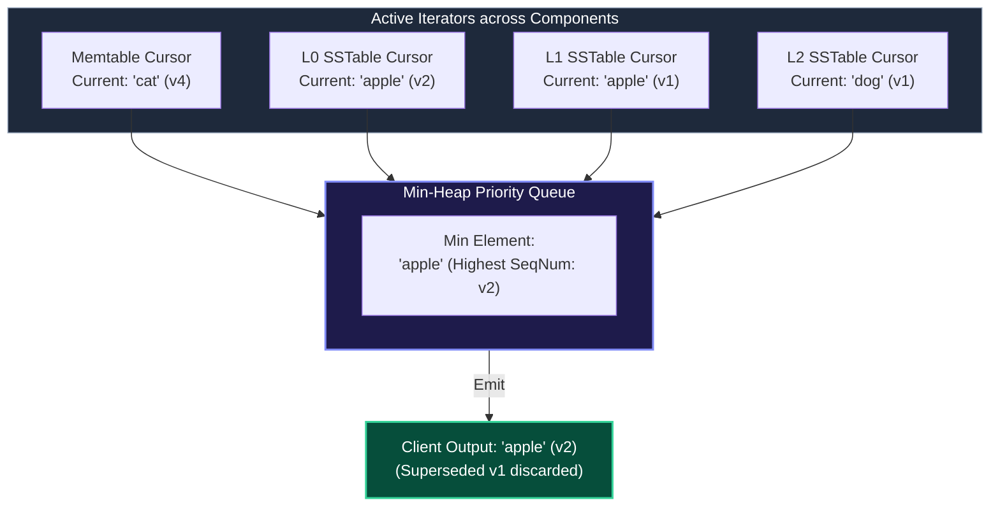

- Each candidate component (Memtables, candidate SSTables) initializes an independent iterator positioned at `start_key`.
- The current elements of all $K$ iterators are pushed into a Min-Heap sorted by `(key ASC, sequence_number DESC)`.
- The engine pops the root:
  - If identical keys appear from multiple iterators, the one with the highest sequence number is emitted; older duplicates are advanced and discarded.
  - If a **Tombstone** record is popped, the key is suppressed and not returned to the user.
- The advancing iterator pushes its next element into the heap, maintaining $O(\log K)$ step time.

---

## 5. Bloom Filters in Depth

If every point lookup had to read indexes and data blocks from dozens of SSTables just to discover that a key does not exist, LSM read latency would be catastrophically high.

The primary defense against read amplification is the **Bloom Filter**—a space-efficient probabilistic data structure that tests set membership with **zero false negatives**:

- If the filter returns **False**, the key is **definitely not in the SSTable**. The engine bypasses the file completely, saving disk I/O.
- If the filter returns **True**, the key **might be in the SSTable** (or it may be a false positive). The engine proceeds to read the file.

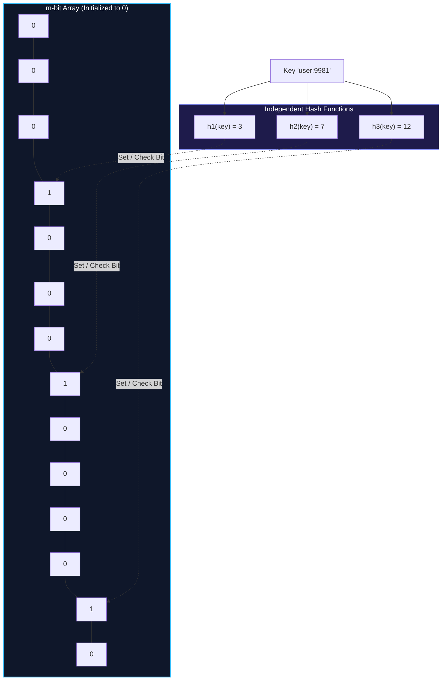

### Mathematical Formulation & Derivation

A Bloom filter consists of a bit array of size $m$ and $k$ independent, uniformly distributed cryptographic or non-cryptographic hash functions (such as MurmurHash3 or xxHash), mapping keys to the range $[0, m-1]$.

#### 1. Probability of False Positives

Assume $n$ unique keys have been inserted into an $m$-bit array using $k$ hash functions.

The probability that a specific bit is **not** set to 1 by a specific hash function during a single insertion is:

$$1 - \frac{1}{m}$$

After inserting $n$ keys, each evaluated by $k$ hash functions (total of $kn$ hash events), the probability that a specific bit remains 0 is:

$$P(\text{bit} = 0) = \left(1 - \frac{1}{m}\right)^{kn} \approx e^{-\frac{kn}{m}}$$

Consequently, the probability that a bit has been set to 1 is:

$$P(\text{bit} = 1) = 1 - e^{-\frac{kn}{m}}$$

When querying a non-existent key, a false positive occurs if all $k$ hashed bit positions happen to be set to 1:

$$p = \left(1 - e^{-\frac{kn}{m}}\right)^k$$

#### 2. Optimal Number of Hash Functions

To minimize the false positive rate $p$ for a fixed bit budget $m$ and item count $n$, we take the derivative with respect to $k$ and set it to zero:

$$k_{\text{optimal}} = \frac{m}{n} \ln 2 \approx 0.693 \cdot \frac{m}{n}$$

#### 3. Tuning Bits-Per-Key in Production

Substituting $k_{\text{optimal}}$ back into the probability equation yields the direct relationship between bits-per-key ($\frac{m}{n}$) and the false positive probability $p$:

$$\frac{m}{n} = -\frac{\ln p}{(\ln 2)^2} \approx -2.08 \ln p$$

| Bits per Key ($m/n$) | Optimal Hashes ($k$) | False Positive Rate ($p$) | Use Case in Databases                     |
| :------------------: | :------------------: | :-----------------------: | :---------------------------------------- |
|        **6**         |          4           |      $\approx 5.6\%$      | Memory-constrained systems                |
|        **8**         |          6           |      $\approx 2.1\%$      | General balance                           |
|        **10**        |        **7**         | $\approx \mathbf{0.82\%}$ | **Production Standard (RocksDB default)** |
|        **12**        |          8           |     $\approx 0.31\%$      | High read-throughput requirements         |
|        **14**        |          10          |     $\approx 0.11\%$      | Extreme latency-sensitive point lookups   |

<Callout
  type="tip"
  title="RocksDB Optimization: Block-Based vs. Full vs. Ribbon Filters"
>
  Older engines placed a separate small Bloom filter inside each $4\text{KB}$
  data block. This caused CPU cache misses and CPU overhead. Modern RocksDB
  defaults to **Full Filters** (one contiguous filter for the entire SSTable) or
  **Ribbon Filters** (a linear-solver-based filter that saves $30\%$ memory
  compared to classical Bloom filters while achieving identical false positive
  rates).
</Callout>

### Block Cache vs. Table Cache

To avoid reading files and indexes from persistent storage on every query, LSM engines employ two levels of in-memory caching:

1. **Table Cache (File Descriptor Cache):**
   - Keeps open OS file descriptors (`fd`) for SSTables to bypass expensive `open()` and `close()` kernel system calls.
   - Caches parsed Footer and Index Blocks in RAM.
2. **Block Cache:**
   - Caches uncompressed Data Blocks in memory.
   - When a query requests key `k`, the engine checks the Block Cache. If hit, the binary search runs entirely in RAM without crossing the filesystem or VFS boundary.
   - Typically managed via advanced eviction algorithms: **LRU**, **Clock-Pro**, or **2Q** to prevent full-table range scans from polluting point-lookup caches.

---

## 6. Deletions in LSM: Tombstones & Resurrection Hazards

Because SSTables are immutable, an application issuing a `DELETE` cannot search on-disk files and erase the record in-place. Doing so would turn sequential I/O into random I/O and break file immutability.

### The Mechanism of Tombstones

Instead of physically removing data, an LSM engine executes a deletion by appending a special marker record called a **Tombstone** (or delete marker):

```
Write Path: Delete("user:1001")
--> Appends ("user:1001", TYPE_DELETION, SeqNum: 4096) to Active Memtable and WAL.
```

When reading, if the query encounters a tombstone with a higher sequence number than older `PUT` records, the engine interprets the key as deleted and returns `NotFound`.

### The Resurrection Hazard

A critical architectural pitfall in LSM engines is the **Resurrection Hazard**:

```mermaid
sequenceDiagram
    autonumber
    participant App as Application / Query
    participant L1 as Level 1 SSTable
    participant L3 as Level 3 SSTable
    participant Comp as Compaction Thread

    Note over L1: Contains Tombstone: Delete("user:42") [Seq 200]
    Note over L3: Contains Ancient Record: Put("user:42", "active") [Seq 50]

    rect rgb(30, 27, 75)
    Note over Comp: FLAWED COMPACTION:<br/>Purges Tombstone during L1 Compaction<br/>because L1 has no other "user:42" keys!
    Comp->>L1: Compaction drops Tombstone
    end

    App->>L1: Get("user:42") -> Not in L1
    App->>L3: Get("user:42") -> Finds Seq 50!
    App-->>App: DATA RESURRECTED!<br/>User sees deleted record "active"
```

If a compaction thread processes Level 1 and sees a tombstone for key `k`, **it cannot simply discard the tombstone** just because `k` has no duplicate in Level 1.

If an older version of key `k` still exists in Level 2, Level 3, or Level 4, dropping the tombstone in Level 1 exposes the older record. The deleted record **resurrects**, causing silent, catastrophic data corruption!

<Callout type="error" title="The Invariant of Safe Tombstone Purging">
A Tombstone for key $k$ can **only** be permanently dropped if and only if:
1. It reaches the **deepest level of the LSM-tree** ($L_{\max}$), OR
2. The engine's compaction tracker proves that **no level deeper than the current compaction level contains key $k$** (verified via SSTable key range boundaries and metadata).
</Callout>

### Range Deletions (`DeleteRange`)

Deleting millions of consecutive keys (e.g., dropping a time partition `DeleteRange("metrics:2026-01-01", "metrics:2026-01-02")`) by inserting individual point tombstones would flood the memtable and consume gigabytes of storage.

Modern engines store a specialized **Range Tombstone Block** in each SSTable. Iterators check whether a key falls within any active range deletion interval, avoiding individual point tombstone overhead.

---

## 7. Compaction Strategies & Trade-offs

Over time, continuous flushes of immutable memtables generate dozens or hundreds of SSTables on disk. Without maintenance:

- Read performance degrades because point lookups must check more files ($R_A \uparrow$).
- Deleted and overwritten records accumulate, wasting vast amounts of disk capacity ($S_A \uparrow$).

**Compaction** is the background reconciliation process that reads multiple existing SSTables, executes a multi-way merge sort, eliminates obsolete versions and tombstones, and emits new, consolidated, sorted SSTables.

There are two primary compaction strategies in industry:

---

### Strategy A: Size-Tiered Compaction Strategy (STCS)

Popularized by Google Bigtable and default in **Apache Cassandra** for write-heavy workloads.

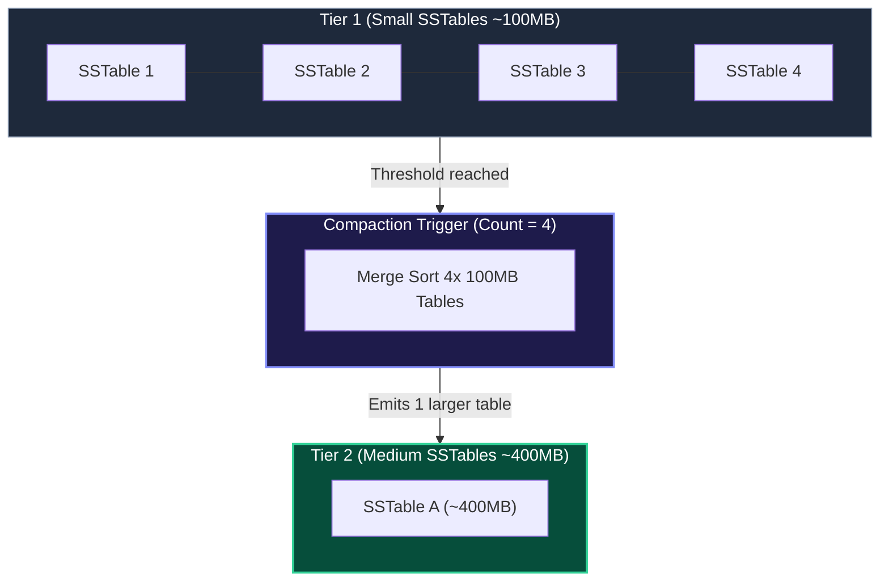

#### How STCS Works

1. SSTables are grouped into "tiers" based on file size.
2. When a tier accumulates a threshold number of files of roughly similar size (typically 4 files), those files are merged together into a single larger SSTable belonging to the next tier up.
3. Over time, tables grow exponentially: $100\text{ MB} \to 400\text{ MB} \to 1.6\text{ GB} \to 6.4\text{ GB}$.

#### Advantages

- **Low Write Amplification:** Files are written and merged in bulk; fewer write passes occur during initial ingestion. Ideal for pure append-only logging.

#### The Fatal Flaw: 100% Space Amplification Overhead

Because an entire tier must be merged into a new file before the old files can be safely deleted, merging the largest tier requires **equal free disk capacity to the data being compacted**. If your largest tier holds 1 TB of data, you must maintain **1 TB of unallocated headroom (50% free disk capacity)** just to execute compaction. If disk usage crosses 51%, the database can run out of disk space and crash.

---

### Strategy B: Leveled Compaction Strategy (LCS)

Introduced by Google **LevelDB** and refined by Meta **RocksDB**. It is the standard strategy for systems demanding fast point lookups and bounded disk space.

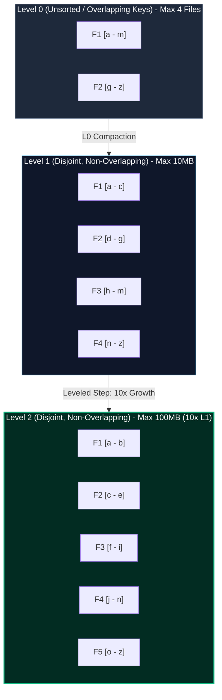

#### How LCS Works

1. Data is organized into numbered levels ($L_0, L_1, L_2, \dots, L_{\max}$).
2. Each level has a fixed total byte budget that grows by an amplification factor $T$ (typically $T = 10$):
   - Level 1: $10\text{ MB}$
   - Level 2: $100\text{ MB}$
   - Level 3: $1\text{ GB}$
   - Level 4: $10\text{ GB}$
   - Level 5: $100\text{ GB}$
3. **Strict Disjointness:** At $L_1$ and above, the key ranges across all SSTables in that level are **strictly mutually exclusive (non-overlapping)**.
4. **The Compaction Step:**
   - When Level $L_i$ exceeds its byte quota, the engine picks one SSTable from $L_i$.
   - It determines the key range $[K_{\min}, K_{\max}]$ of that table.
   - It finds all overlapping SSTables in Level $L_{i+1}$.
   - It streams both inputs through a multi-way merge, writing out new $L_{i+1}$ SSTables (splitting them at file size boundaries, e.g., $64\text{ MB}$).
   - The old input files from $L_i$ and $L_{i+1}$ are atomically unlinked.

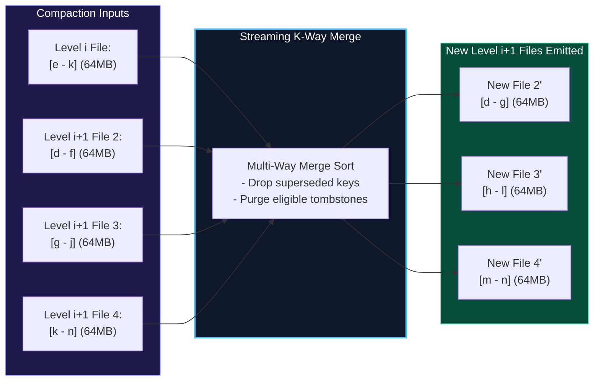

#### Why Leveled Compaction Wins on Space

In Leveled Compaction with a 10x multiplier ($T=10$), the deepest level ($L_{\max}$) contains $\approx 90\%$ of all data in the database. Level $L_{\max - 1}$ contains $\approx 9\%$, and all preceding levels hold $< 1\%$.

Because compaction is performed one small file at a time (e.g., merging one $64\text{ MB}$ file from $L_i$ into overlapping files in $L_{i+1}$), the temporary disk space headroom required is **bounded to a small fraction of the total database size ($\approx 10\text{--}15\%$)**, completely eliminating the 100% space risk of Size-Tiered compaction.

---

## 8. The RUM Conjecture & Fundamental Trade-off Trilemma

Every database storage engine operates within the fundamental constraints of information theory and physical hardware.

In 2016, researchers Manos Athanassoulis, Stratos Idreos, and colleagues at Harvard DASlab formalized these constraints as the **RUM Conjecture**:

> **The RUM Conjecture states that when designing access methods, optimizing for any two of Read Amplification ($R$), Update/Write Amplification ($U$), and Memory/Space Overhead ($M$) forces a compromise on the third.**

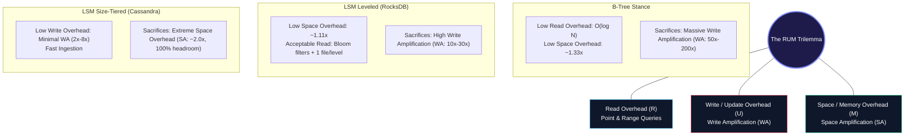

### Mathematical Definitions of the RUM Metrics

1. **Write Amplification ($W_A$):**
   $$W_A = \frac{\text{Total Bytes Written to Storage Media}}{\text{Total Uncompressed Bytes Ingested by Application}}$$
   In an ideal system, $W_A = 1.0$. In B-Trees, $W_A$ often reaches $50\text{--}100$. In Leveled LSMs, $W_A$ is typically $10\text{--}30$.

2. **Read Amplification ($R_A$):**
   $$R_A = \frac{\text{Total Bytes Read from Storage Media}}{\text{Total Logical Bytes Requested by Application}}$$
   Or alternatively, the number of physical disk I/O operations required to satisfy a single point lookup query. In B-Trees, $R_A = 1\text{--}3$ page reads. In naive LSMs, $R_A$ can be $30\text{--}100$ (reduced to $\approx 1$ with tuned Bloom filters).

3. **Space Amplification ($S_A$):**
   $$S_A = \frac{\text{Total Physical Disk Space Consumed by Engine}}{\text{Size of Raw, Active, Uncompressed Data}}$$
   Space amplification is driven by three factors: fragmentation (partially filled pages), compression ratio, and garbage accumulation (superseded row versions and dead tombstones waiting for compaction).

### Comprehensive Architectural Comparison Matrix

| Property                        | B+ Tree (Postgres, InnoDB)                  | LSM Leveled (RocksDB, LevelDB)                 | LSM Size-Tiered (Cassandra)                                | Append-Only Log (Bitcask)                         |
| :------------------------------ | :------------------------------------------ | :--------------------------------------------- | :--------------------------------------------------------- | :------------------------------------------------ |
| **Primary Architecture**        | Fixed-size slotted pages                    | Multi-level disjoint SSTables                  | Size-based tiered SSTables                                 | In-memory hash index + log                        |
| **Point Read ($R_A$)**          | **Best** (1-3 I/Os)                         | Good (Bloom filters $\to \approx 1\text{--}2$) | Moderate to Poor (must probe all tables/tier)              | **Best** (Exactly 1 I/O)                          |
| **Range Scan Speed**            | **Fast** (leaf page chains)                 | Moderate (K-way merge heap)                    | Slow (merges across many tiers)                            | Inefficient (requires in-memory sort)             |
| **Write Amplification ($W_A$)** | **Terrible** ($30\times\text{--}200\times$) | Moderate ($10\times\text{--}30\times$)         | **Low** ($2\times\text{--}8\times$)                        | **Lowest** ($W_A \approx 1.0$)                    |
| **Space Amplification ($S_A$)** | Moderate ($1.3\times\text{--}1.6\times$)    | **Low** ($1.1\times\text{--}1.2\times$)        | **Terrible** ($2.0\times\text{--}2.5\times$, 100% reserve) | Moderate ($1.5\times\text{--}2.0\times$ until GC) |
| **RAM Footprint**               | Buffer Pool (Page Cache)                    | Memtables + Block Cache + Bloom                | Memtables + Bloom + Key Caches                             | Entire key directory in RAM                       |
| **Storage Suitability**         | Read-heavy, OLTP transactions               | High write throughput, NVMe SSDs               | High-ingestion distributed clusters                        | Data fits in RAM, values on disk                  |

---

## 9. Production Engineering: Real-World RocksDB Tuning

To see these mathematical principles in action, examine a production-grade RocksDB tuning profile designed for high-write NVMe SSD workloads:

```cpp
#include <rocksdb/db.h>
#include <rocksdb/table.h>
#include <rocksdb/filter_policy.h>

rocksdb::Options ConfigureProductionLSM() {
    rocksdb::Options options;

    // 1. Durability & Concurrency
    options.create_if_missing = true;
    options.max_background_jobs = 8; // Dedicated threads for flushes and compactions

    // 2. Memtable Configuration (64MB buffer, 4 buffers max)
    options.write_buffer_size = 64 * 1024 * 1024; // 64 MB per memtable
    options.max_write_buffer_number = 4;          // 256 MB max RAM for ingestion
    options.min_write_buffer_number_to_merge = 1;

    // 3. Level 0 & Compaction Triggers
    options.level0_file_num_compaction_trigger = 4; // Flush L0 -> L1 when 4 files exist
    options.level0_slowdown_writes_trigger = 20;     // Backpressure write stalls
    options.level0_stop_writes_trigger = 36;

    // 4. Leveled Architecture Sizing (T = 10)
    options.target_file_size_base = 64 * 1024 * 1024;     // 64 MB per SSTable
    options.max_bytes_for_level_base = 256 * 1024 * 1024; // L1 size = 256 MB
    options.max_bytes_for_level_multiplier = 10.0;        // L2 = 2.5GB, L3 = 25GB...

    // 5. Dynamic Base Level Sizing (Optimizes Space & Write Amplification)
    options.level_compaction_dynamic_level_bytes = true;

    // 6. Block-Based SSTable & Bloom Filter Configuration
    rocksdb::BlockBasedTableOptions table_options;
    table_options.block_size = 4 * 1024; // 4 KB data blocks
    table_options.cache_index_and_filter_blocks = true;
    table_options.pin_l0_filter_and_index_blocks_in_cache = true;

    // 10 bits per key Bloom Filter yields ~0.82% False Positive Rate
    table_options.filter_policy.reset(rocksdb::NewBloomFilterPolicy(10, false));

    // LRU Block Cache for uncompressed data
    table_options.block_cache = rocksdb::NewLRUCache(4ULL * 1024 * 1024 * 1024); // 4 GB RAM

    options.table_factory.reset(rocksdb::NewBlockBasedTableFactory(table_options));

    return options;
}
```

<Callout type="info" title="What is Dynamic Level Base Sizing?">
In traditional Leveled Compaction, if $L_1$ target is $256\text{ MB}$ and $L_{\max}$ is $256\text{ GB}$, but your dataset is currently only $2\text{ GB}$, data accumulates in $L_1$ and $L_2$ with empty deeper levels. This leads to artificial write amplification.

Setting `level_compaction_dynamic_level_bytes = true` reverses level base sizing: RocksDB automatically sizes $L_{\max}$ to match the actual data volume, dynamically calculating base levels upward. This eliminates up to **$50\%$ of write amplification** during early database growth.

</Callout>

---

## 10. Summary & Key Takeaways

<Cards>
  <Card title="Sequential Append-Only Writes" icon="Zap">
    LSM-trees avoid in-place page overwrites. By buffering writes in a concurrent SkipList Memtable and committing to an append-only WAL, random write workloads are transformed into pure sequential flash streams.
  </Card>
  <Card title="SSTable Immutability" icon="FileText">
    Once flushed to disk, an SSTable is never modified. It consists of prefix-compressed Data Blocks, Index Blocks for binary search, Bloom Filter bitsets, and a 48-byte trailer Footer with magic verification.
  </Card>
  <Card title="Bloom Filter Defense" icon="Search">
    Point read amplification is mitigated by probabilistic Bloom filters. Tuning $10\text{ bits per key}$ achieves an optimal $k=7$ hash count and suppresses $99.2\%$ of unnecessary disk probes.
  </Card>
  <Card title="The RUM Trilemma" icon="Layers">
    You cannot optimize Read, Write, and Space amplification simultaneously. Leveled Compaction minimizes space overhead ($\approx 1.11\times$) at the expense of write amplification ($10\text{--}30\times$), whereas Size-Tiered minimizes write amplification at the cost of 100% temporary space headroom.
  </Card>
</Cards>
