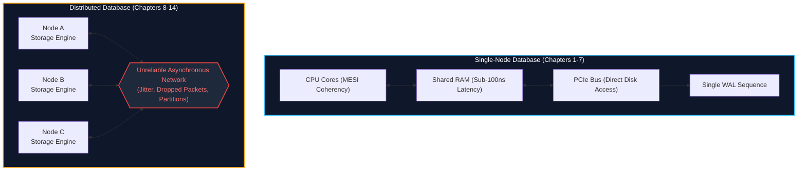
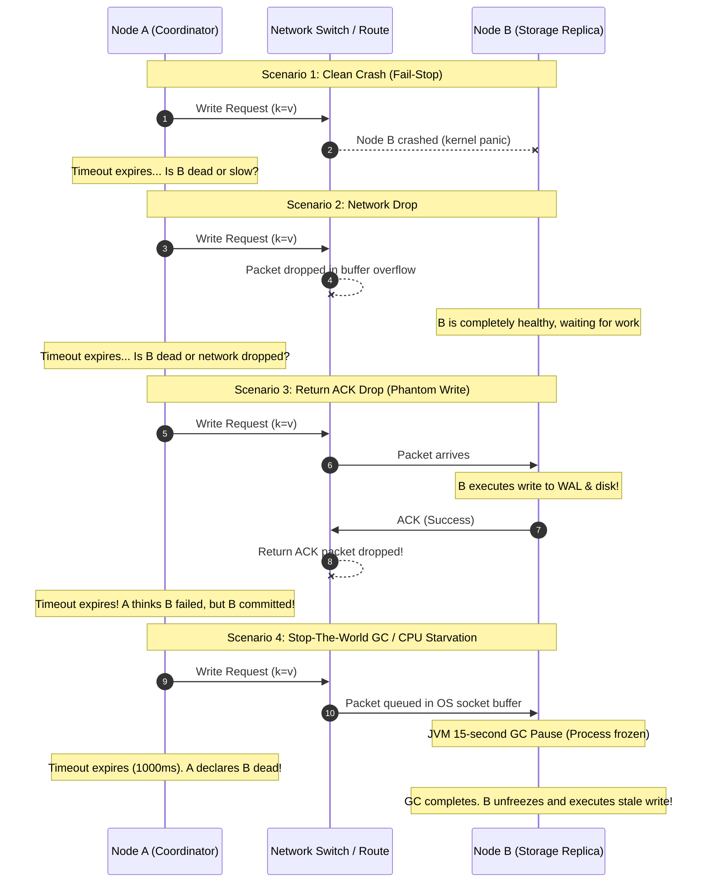
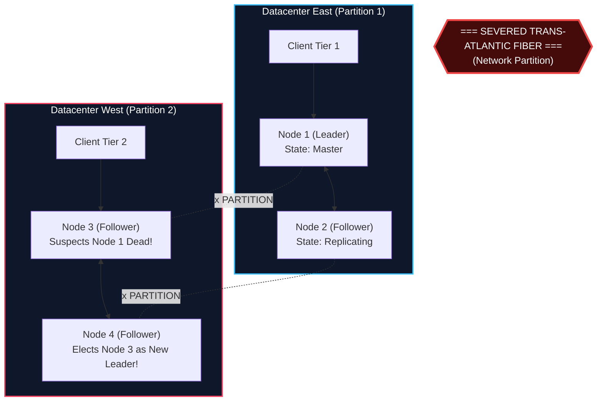
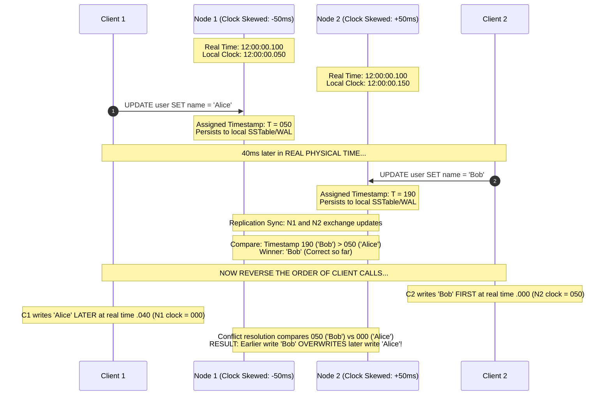
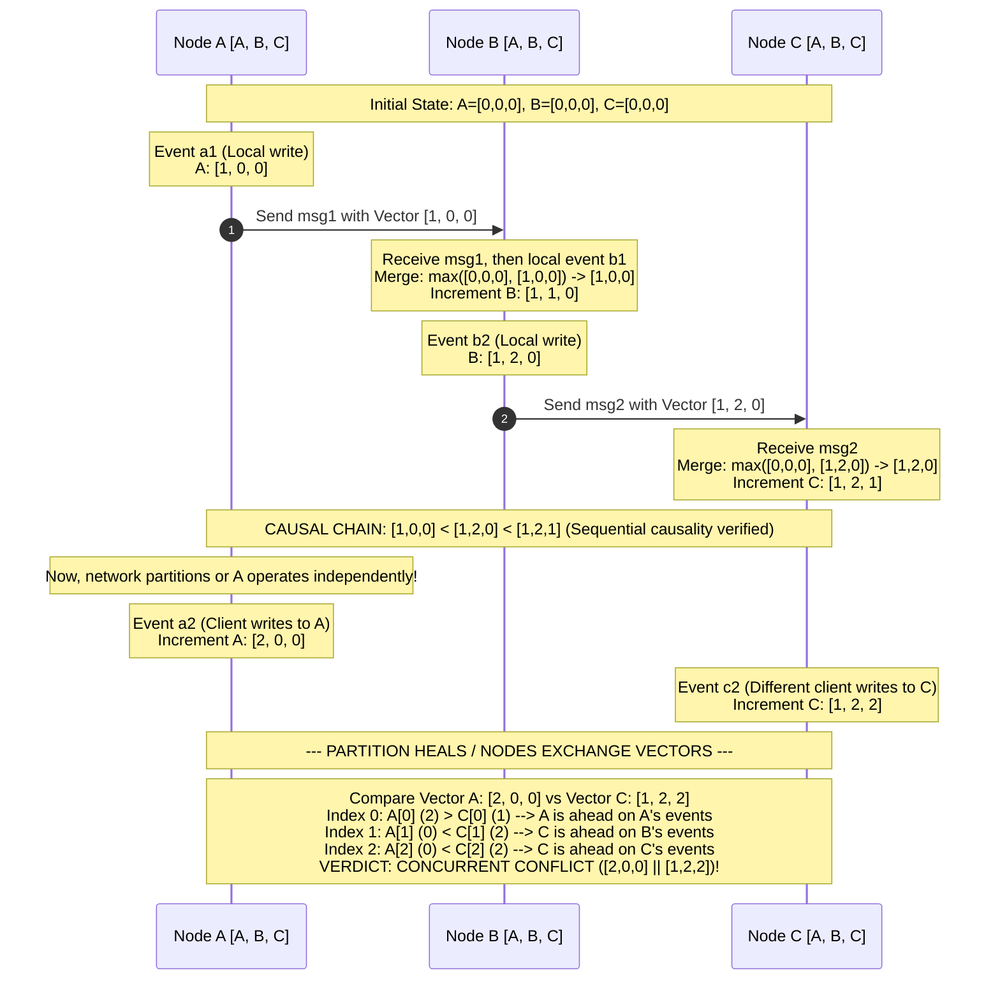

import { Callout } from "fumadocs-ui/components/callout";
import { Tabs, Tab } from "fumadocs-ui/components/tabs";

In the first seven chapters of this series, storage engine architecture was examined strictly through the lens of a **single operating system instance**. On a single node, hardware guarantees deterministic invariants:

- The CPU coordinates access to RAM through cache coherency protocols (such as MESI/MOESI) and memory bus locks.
- Disk controllers write blocks either atomically or fail with identifiable I/O errors.
- The operating system kernel enforces thread scheduling and process isolation.
- A single monotonic system clock dictates the sequence of Write-Ahead Log (WAL) records.

The moment a database expands to two or more nodes across a network, every single hardware-level guarantee collapses. A distributed database is not merely a collection of single-node storage engines running next to each other; it is a radically different class of software. In this chapter, we explore why distributing state across nodes introduces profound complexity, dissect the fallacies that trap system architects, formalize distributed failure models, and solve the foundational problem of time and causal ordering.

---

## 1. The Single-Node Illusion Shatters

Single-node databases scale vertically by adding faster NVMe SSDs, more RAM, and higher core-count CPUs. However, vertical scaling faces hard physical and economic boundaries: NUMA interconnect saturation, bus contention, and catastrophic blast radiuses—if the motherboard burns or the datacenter loses power, the database is dead.

Distributed databases overcome these limits by partitioning (sharding) and replicating state across independent machines. But this architectural shift fundamentally changes how data operations behave.



### Shared-Memory vs. Shared-Disk vs. Shared-Nothing

When designing a multi-node database architecture, storage architects classify systems into three primary memory/storage topologies:

```
+-----------------------------------------------------------------------------------+
| Architecture   | Compute Nodes | Storage Layer | Bottleneck       | Examples      |
+-----------------------------------------------------------------------------------+
| Shared-Memory  | Unified SMP   | Unified RAM   | Memory bus locks | Large NUMA    |
| Shared-Disk    | Decoupled     | Network SAN   | SAN interconnect | Oracle RAC,   |
|                | Stateless     | (EBS / Ceph)  | & Distributed DLM| AWS Aurora    |
| Shared-Nothing | Independent   | Local Storage | Network RPCs &   | Cassandra,    |
|                | CPU + RAM     | per Node      | Consensus Logs   | CockroachDB,  |
|                |               |               |                  | Vitess, Spanner|
+-----------------------------------------------------------------------------------+
```

1. **Shared-Memory (SMP/NUMA):** All processors share global RAM and disk. Concurrency is governed by OS latches and atomic CPU instructions. While performance is fast (sub-microsecond synchronization), scalability is physically capped by the motherboard and interconnect bandwidth.
2. **Shared-Disk:** Compute nodes are stateless and run independent query engines, but share a common storage layer via a Storage Area Network (SAN), Network Attached Storage (NAS), or cloud block store (such as AWS Aurora utilizing an optimized multi-tenant storage fleet). While compute can scale dynamically, the storage layer becomes the single point of coordination, requiring complex distributed lock managers (DLMs) to prevent concurrent cache corruption.
3. **Shared-Nothing:** Each node possesses its own independent CPU, RAM, and non-volatile storage. Nodes communicate solely by exchanging messages across an arbitrary network topology. There is no single point of hardware failure, and clusters can scale to thousands of nodes. However, **all coordination—consensus, transactions, replication, and schema management—must be resolved in software over an asynchronous network.**

Nearly all hyperscale modern distributed databases (Google Spanner, CockroachDB, Apache Cassandra, ScyllaDB, TiDB, Vitess) are built on the **Shared-Nothing** model.

---

## 2. The Eight Fallacies of Distributed Computing

In the 1990s, Peter Deutsch, James Gosling, and other Sun Microsystems architects articulated the "Fallacies of Distributed Computing"—false assumptions that developers intuitively make when moving from single-machine code to distributed networks. When viewed through the lens of database internals, each fallacy represents a specific failure mode that can cause data corruption, silent data loss, or system deadlock.

<Tabs items={["Fallacies 1-4 (Transport & Network)", "Fallacies 5-8 (Topology & Environment)"]}>
  <Tab value="Fallacies 1-4 (Transport & Network)">
    ### 1. The Network is Reliable
    * **The Fallacy:** Assuming that a TCP packet sent to a replica will arrive intact.
    * **The Database Reality:** Switches fail, optical transceivers degrade, cross-rack cables are severed, and TCP RST packets are dropped. A node cannot assume that silence indicates lack of activity.
    * **The Consequence:** The **Two Generals Problem**. In an asynchronous network, two nodes can never reach guaranteed mutual certainty over an unreliable link. If Node A sends an `INSERT` command to Replica B, and receives no acknowledgement, Node A cannot determine whether Replica B crashed before execution, executed the write and crashed before responding, or whether the ACK packet was simply dropped by an intermediary router.

    ### 2. Latency is Zero
    * **The Fallacy:** Treating remote Procedure Calls (RPCs) like local function calls.
    * **The Database Reality:** A local L1/L2 cache reference requires $0.5 - 5 \text{ ns}$; a main memory read requires $50 - 100 \text{ ns}$; a local PCIe Gen4 NVMe read requires $10 - 50 \ \mu\text{s}$. A cross-datacenter round-trip (e.g., US-East to US-West) requires $70 \text{ ms}$ ($70,000,000 \text{ ns}$)—a factor of **one million times slower**.
    * **The Consequence:** High tail-latency amplification. If a distributed query coordinator fans out a scatter-gather query to 100 partition shards, the overall query latency is bound to the $p99.9$ percentile of the slowest shard. Synchronous replication protocols (such as Two-Phase Commit) lock resources across round trips, reducing cluster throughput to a crawl.

    ### 3. Bandwidth is Infinite
    * **The Fallacy:** Assuming the network pipe can carry arbitrary data volumes without degradation.
    * **The Database Reality:** Top-of-Rack (ToR) switches possess finite uplink capacity (oversubscription ratios often reach 3:1 or 4:1). When nodes execute bulk background operations—such as LSM-Tree cross-node sstable streaming during rebalancing, full database backups, or distributed hash joins—inter-node bandwidth saturates.
    * **The Consequence:** Buffer starvation and heartbeat timeout collapse. High bandwidth consumption queues heartbeat packets behind multi-megabyte data streams, triggering false node failure detections and unnecessary cascading rebalances.

    ### 4. The Network is Secure
    * **The Fallacy:** Assuming internal cluster communication within a private VPC is implicitly trusted.
    * **The Database Reality:** Cloud environments are multi-tenant; virtual network interfaces share underlying physical hypervisors. Malicious actors or compromised microservices can spoof cluster traffic, intercept cleartext replication streams, or replay leader election ballots.
    * **The Consequence:** Modern distributed engines must enforce mutual TLS (mTLS) with cryptographically verified identity tokens (e.g., SPIFFE/SPIRE) on every internal RPC channel, adding non-trivial encryption, decryption, and handshake CPU overhead.

  </Tab>

  <Tab value="Fallacies 5-8 (Topology & Environment)">
    ### 5. Topology Doesn't Change
    * **The Fallacy:** Assuming the IP addresses, rack locations, and node identities remain static.
    * **The Database Reality:** Cloud instances are ephemeral. Kubernetes pods reschedule, Spot instances terminate with a 30-second warning, AWS auto-scaling groups cycle VMs, and failed network interfaces receive newly assigned DHCP addresses.
    * **The Consequence:** Hardcoded routing tables fail immediately. Storage engines require dynamic discovery mechanisms (such as Gossip protocols or centralized consensus configuration registries like etcd/ZooKeeper) and epoch/generation numbering to reject obsolete messages from dead topologies.

    ### 6. There is One Administrator
    * **The Fallacy:** Assuming consistent system configuration, operating system versions, and maintenance policies.
    * **The Database Reality:** In large enterprise fleets, different teams manage network switches, Kubernetes platforms, kernel updates, and storage volumes. One team might configure aggressive TCP keepalive timeouts on rack switches while another updates the Linux kernel TCP stack buffers on compute nodes.
    * **The Consequence:** Configuration drift leads to asymmetric network timeouts, unexplained packet truncation, and intermittent replication drops that evade local testing.

    ### 7. Transport Cost is Zero
    * **The Fallacy:** Assuming serializing, deserializing, and passing data to the network interface card is negligible compared to query execution.
    * **The Database Reality:** Passing structured memory tuples from a database engine into an RPC buffer requires marshaling (e.g., Protobuf, FlatBuffers, or custom binary codecs), memory copies (`memcpy`), kernel context switching, and socket buffer allocation.
    * **The Consequence:** In high-throughput transactional engines, serialization/deserialization CPU cycles often consume $30\% - 50\%$ of the total CPU budget. Modern engines increasingly rely on zero-copy RPC frameworks, kernel-bypass mechanisms (DPDK), or shared-memory rings for local IPC.

    ### 8. The Network is Homogeneous
    * **The Fallacy:** Assuming all nodes, network interfaces, and inter-node paths share identical performance characteristics.
    * **The Database Reality:** Real-world networks mix 10 GbE and 100 GbE NICs, variable switch buffer depths, cross-availability-zone fiber links, and heterogeneous CPU generations with varying memory bus speeds.
    * **The Consequence:** "Straggler nodes". A single degraded switch port or throttling CPU core on one node slows down distributed quorums ($R+W > N$), dragging down the throughput of the entire cluster.

  </Tab>
</Tabs>

---

## 3. Distributed Failure Models

To design algorithms that operate correctly across untrusted networks, computer scientists define formal **failure models**. A failure model establishes what types of faults an algorithm can tolerate, and under what conditions.

```
+-----------------------------------------------------------------------------------------+
| Failure Model        | Node Behavior                        | Byzantine? | Complexity  |
+-----------------------------------------------------------------------------------------+
| Fail-Stop            | Halts cleanly; state freezes;        | No         | Lowest      |
| (Crash-Stop)         | failure is observable by all         |            |             |
+-----------------------------------------------------------------------------------------+
| Fail-Recovery        | Crashes; loses volatile memory;      | No         | Moderate    |
| (Crash-Recovery)     | restarts later with persistent disk  |            |             |
+-----------------------------------------------------------------------------------------+
| Omission Failures    | Fails to send or receive messages;   | No         | High        |
|                      | packets dropped intermittently       |            |             |
+-----------------------------------------------------------------------------------------+
| Byzantine            | Arbitrary behavior; lies, forges     | Yes        | Extreme     |
| (Arbitrary)          | messages, sends conflicting ballots  |            |             |
+-----------------------------------------------------------------------------------------+
```

### 1. Fail-Stop (Crash-Stop)

In this idealized model, a node operates correctly until it experiences a fatal fault, at which point it halts execution forever. Other nodes can reliably detect that the node has failed (provided the network is synchronous). While simple to reason about mathematically, pure Fail-Stop is unrealistic in production because physical machines reboot, services are restarted by orchestrators, and network paths recover.

### 2. Fail-Recovery (Crash-Recovery)

This is the standard operational model for enterprise distributed databases (PostgreSQL streaming replication, MySQL Group Replication, CockroachDB, Raft, Paxos).

- A node may halt execution unexpectedly at any moment (kernel panic, power loss, OOM killer).
- Volatile state (RAM, cache lines, in-flight CPU registers) is lost permanently.
- Non-volatile state persisted to disk (WAL, SSTables, configuration files) survives the crash.
- The node may recover after an arbitrary amount of time, replay its on-disk recovery logs (using ARIES or LSM recovery), and attempt to rejoin the active cluster.
- **The Core Challenge:** The recovering node may have missed thousands of committed transactions while offline, or worse, may hold uncommitted, stale data that contradicts the cluster's current state.

### 3. Arbitrary / Byzantine Failures

A node under the Byzantine failure model may behave arbitrarily: it can forge message payloads, deliberately lie about its committed state, send contradictory messages to different peers (telling Node B it voted "Yes" while telling Node C it voted "No"), or suffer silent hardware memory corruption (bit flips).

- Tolerating Byzantine faults requires **Byzantine Fault Tolerant (BFT)** consensus (such as PBFT, Tendermint, or HotStuff), requiring at least $3f + 1$ nodes to tolerate $f$ Byzantine failures, along with extensive cryptographic signatures.
- **Database Reality:** Standard distributed databases (Spanner, Cassandra, CockroachDB) do **not** use Byzantine consensus. They operate under the **Crash-Fault Tolerant (CFT)** model, requiring $2f + 1$ nodes to tolerate $f$ crash failures, assuming nodes are non-malicious and run authenticated internal protocols. Silent data corruption on disk is addressed via end-to-end CRC32 checksums on data blocks rather than expensive BFT protocols.

### The Indistinguishability Problem

The fundamental obstacle in distributed systems engineering is that over an asynchronous network, **a node cannot distinguish between a slow peer, a dead peer, and a broken network.**

Suppose Node A issues an RPC request to Node B and waits for an acknowledgement:



Because scenarios 1, 2, 3, and 4 produce the exact same observable symptom at Node A (silence until the timeout expires), Node A must make an assumption under uncertainty. If it assumes B is dead and elects a replacement, but B is merely paused (Scenario 4), the cluster risks a **split-brain catastrophe**.

---

## 4. Network Partitions and Split-Brain Hazards

A network partition occurs when communication between nodes fails or degrades such that the cluster is cleaved into disconnected components, even though nodes on both sides of the partition remain fully operational.



### The Split-Brain Catastrophe

Consider a four-node database spanning two regions, split into two equal partitions as illustrated above:

1. **Initial State:** Node 1 in `DC_EAST` is the designated primary leader, accepting all read and write transactions. Replicas 2, 3, and 4 stream WAL logs from Node 1.
2. **The Partition:** An underwater fiber line cuts between `DC_EAST` and `DC_WEST`. Nodes 1 and 2 can communicate with each other; Nodes 3 and 4 can communicate with each other; but cross-datacenter packets are dropped.
3. **The False Suspicion:** Nodes 3 and 4 stop receiving heartbeats from Node 1. They conclude that `DC_EAST` suffered a total power failure.
4. **Illegal Promotion:** Nodes 3 and 4 hold an election. Node 3 is promoted to primary leader in `DC_WEST`.
5. **Dual Writes:** Client Tier 1 connects to Node 1 in `DC_EAST` and issues:
   ```sql
   UPDATE accounts SET balance = balance - 100 WHERE id = 42;
   ```
   Simultaneously, Client Tier 2 connects to Node 3 in `DC_WEST` and issues:
   ```sql
   UPDATE accounts SET balance = balance + 500 WHERE id = 42;
   ```
6. **State Divergence:** Both nodes independently commit contradictory transactions to their local storage engines. When the network link recovers, the database state cannot be cleanly merged—the logs have irreversibly diverged, breaking ACID guarantees.

<Callout type="error" title="The Law of Majority Quorums">
  To mathematically eliminate split-brain disasters, distributed databases
  enforce **majority quorums**. A cluster of $N$ nodes requires a strict
  majority of: $$\text{Quorum} = \left\lfloor \frac{N}
  {2} \right\rfloor + 1$$ In a 4-node cluster, a quorum requires $\lfloor 4/2
  \rfloor + 1 = 3$ nodes. During a 2-2 network split, neither side can assemble
  3 votes. Therefore, neither side can elect a leader or commit writes,
  sacrificing availability to protect consistency (as dictated by the CAP
  theorem).
</Callout>

---

## 5. Clocks and Time: The Physical Illusion

In a single-machine database, ordering operations is straightforward: read the system timer, or increment a monotonic integer counter in kernel memory. But in a distributed database, operations originate on different nodes across the planet. Why can't we simply synchronize physical hardware clocks on all servers and order database transactions by their wall-clock timestamp ($T_{\text{wall}}$)?

### 1. Quartz Oscillator Physics and Clock Drift

Every computer motherboard contains a physical quartz crystal oscillator. When an electrical voltage is applied, the crystal vibrates at a specific frequency (e.g., 32,768 Hz), generating clock interrupts that increment the operating system's time counter.

However, quartz oscillators are mechanical devices subject to thermal fluctuations, component aging, and voltage jitter:

- Standard server oscillators have a drift rate of approximately $\pm 10^{-5}$ to $10^{-6}$ seconds per second.
- A drift of $10^{-5}$ means a clock drifts by **1 second every 100,000 seconds (approximately 27.7 hours, or ~1 millisecond every 1.6 minutes)**.
- Even servers sitting in adjacent racks within the same datacenter will drift apart rapidly without constant external synchronization.

### 2. Network Time Protocol (NTP) Synchronization Limits

Datacenters run the Network Time Protocol (NTP) to periodically synchronize local clocks against authoritative Stratum 1 reference servers (atomic clocks or GPS receivers). NTP uses round-trip packet timing:

```
T1 (Client sends request) ----------> T2 (Server receives request)
T4 (Client receives response) <------ T3 (Server sends response)
```

NTP calculates the round-trip network delay $\delta$ and clock offset $\theta$:
$$\delta = (T_4 - T_1) - (T_3 - T_2)$$
$$\theta = \frac{(T_2 - T_1) + (T_3 - T_4)}{2}$$

<Callout type="warning" title="The Fatal Flaw of NTP: Asymmetric Routing">
The calculation of offset $\theta$ fundamentally assumes that **the outbound network latency ($T_1 \to T_2$) is mathematically identical to the inbound latency ($T_3 \to T_4$).**

In modern IP networks, packet routing is asymmetric—inbound packets frequently traverse different switches, optical paths, and congestion queues than outbound packets. In a congested datacenter, NTP uncertainty typically ranges from **$5 \text{ ms}$ to $50 \text{ ms}$**, and can spike to **hundreds of milliseconds** under transient network degradation.

</Callout>

### 3. Step Adjustments and Leap Seconds

When a local clock drifts too far from the reference server:

- If the NTP daemon is configured to "slew" the clock, it gradually accelerates or decelerates the clock tick rate by up to $0.05\%$ until synchronized.
- If the drift exceeds a configured threshold (often 128 ms), NTP may perform a **step adjustment**—instantly snapping the clock backward or forward.
- **The Catastrophe:** If the clock snaps backward by $50 \text{ ms}$, the operating system generates timestamps that have _already been issued to previous database transactions_. Transactions written later in real time receive earlier timestamps!
- Furthermore, astronomical **leap seconds** have historically crashed production database clusters (such as the 2012 Linux kernel leap second bug that locked CPUs in futex loops).

### How Clock Skew Breaks Serializability: The Last-Write-Wins Bug

Many NoSQL databases (such as Apache Cassandra or Apache HBase) historically used physical wall-clock timestamps to resolve concurrent conflicts using **Last-Write-Wins (LWW)**: when two updates conflict, the one with the higher physical timestamp overwrites the other.

Consider the following scenario:



Because Node 1's physical clock lagged behind Node 2's physical clock, an update that happened _earlier in physical reality_ was assigned a higher timestamp than an update that happened _later_. The later update was silently discarded!

**Conclusion:** Physical wall-clock time cannot be trusted to establish a total order of transactions across a distributed database.

---

## 6. Logical Time: Lamport Timestamps

In 1978, Leslie Lamport published the landmark paper _"Time, Clocks, and the Ordering of Events in a Distributed System"_. Lamport recognized that distributed systems do not actually need to know the physical wall-clock time (e.g., whether it is 2:15 PM UTC). What they need is **causality**—a way to determine whether Event A could have influenced or caused Event B.

### The "Happens-Before" Relation ($\to$)

Lamport defined the causal ordering relation, denoted as $\to$ ("happens-before"), across three rules:

1. **Local Process Ordering:** If events $a$ and $b$ occur within the same process (or node), and $a$ occurs before $b$, then $a \to b$.
2. **Message Passing:** If event $a$ is the sending of a message by one node, and event $b$ is the receipt of that same message by another node, then $a \to b$.
3. **Transitivity:** If $a \to b$ and $b \to c$, then $a \to c$.

If neither $a \to b$ nor $b \to a$ holds, then events $a$ and $b$ are said to be **concurrent**, denoted as:
$$a \parallel b$$
Concurrent events have no causal relationship; neither event could have known about or influenced the other.

### The Lamport Clock Algorithm

A Lamport Clock is a simple integer counter maintained independently on every node:

```
+-----------------------------------------------------------------------------------+
| Lamport Clock Rules                                                               |
+-----------------------------------------------------------------------------------+
| 1. Initialization:                                                                |
|    Each node i maintains an integer counter L_i, initialized to 0.                |
|                                                                                   |
| 2. Local Event Execution:                                                         |
|    Before executing any internal event, node i increments:                        |
|        L_i <- L_i + 1                                                             |
|                                                                                   |
| 3. Message Transmission:                                                          |
|    When node i sends a message m, it attaches its current counter:                |
|        send(m, L_i)                                                               |
|                                                                                   |
| 4. Message Receipt:                                                               |
|    When node j receives (m, L_msg), it updates its local counter:                 |
|        L_j <- max(L_j, L_msg) + 1                                                 |
+-----------------------------------------------------------------------------------+
```

By enforcing that $L_j \leftarrow \max(L_j, L_{\text{msg}}) + 1$, the clock on the receiving node is guaranteed to jump ahead of the sender's clock, ensuring that the receipt event always has a strictly higher logical timestamp than the send event.

### Creating a Total Order (Tie-Breaking)

Lamport timestamps define a **partial order** because two independent nodes can generate the exact same integer timestamp for concurrent events ($L(a) = L(b)$).

To create a **strict total order**, Lamport introduced a deterministic tie-breaker using arbitrary, unique node identifiers (e.g., node IP or node index):
$$(L(a), \text{node}_a) < (L(b), \text{node}_b) \iff (L(a) < L(b)) \lor (L(a) = L(b) \land \text{node}_a < \text{node}_b)$$

This total ordering is widely used in distributed mutual exclusion algorithms and distributed lock acquisition.

### The Fundamental Limitation of Lamport Clocks

While Lamport Clocks satisfy the forward causal implication:
$$a \to b \implies L(a) < L(b)$$

**The reverse implication is NOT true:**
$$L(a) < L(b) \not\implies a \to b$$

If you are given two arbitrary events from different nodes with $L(a) = 4$ and $L(b) = 7$, **you cannot tell whether $a$ caused $b$, or whether $a$ and $b$ were completely concurrent and unrelated.**

Because a single scalar integer compresses all cluster history into one number, it loses the distinction between causal dependency and concurrent independence. To track true concurrent conflicts, databases need **Vector Clocks**.

---

## 7. Vector Clocks: Tracking True Causality

To detect concurrent updates and preserve causal history, Colin Fidge and Friedemann Mattern independently developed **Vector Clocks** in 1988.

### Mathematical Formulation

In a cluster of $N$ known nodes, every node $i$ maintains a vector $V_i$ of $N$ non-negative integers:
$$V_i = [v_1, v_2, \dots, v_N]$$
where $V_i[k]$ represents node $i$'s knowledge of the logical events that have transpired on node $k$.

```
+-----------------------------------------------------------------------------------+
| Vector Clock Execution Rules                                                      |
+-----------------------------------------------------------------------------------+
| 1. Initialization:                                                                |
|    For each node i: V_i = [0, 0, ..., 0]                                          |
|                                                                                   |
| 2. Local Event:                                                                   |
|    Before executing an event, node i increments its OWN entry:                    |
|        V_i[i] <- V_i[i] + 1                                                       |
|                                                                                   |
| 3. Message Send:                                                                  |
|    Node i attaches its entire current vector V_i to the outbound message:         |
|        send(m, V_i)                                                               |
|                                                                                   |
| 4. Message Receive:                                                               |
|    When node i receives (m, V_msg), it merges every element by taking the max,   |
|    and then increments its own entry:                                             |
|        For all k != i: V_i[k] <- max(V_i[k], V_msg[k])                            |
|        V_i[i] <- V_i[i] + 1                                                       |
+-----------------------------------------------------------------------------------+
```

### Vector Comparison Math

Two vector clocks $V_A$ and $V_B$ are compared element-wise across all dimensions $k \in \{1, \dots, N\}$:

- **Equality:** $V_A = V_B \iff \forall k, V_A[k] = V_B[k]$.
- **Less Than or Equal:** $V_A \le V_B \iff \forall k, V_A[k] \le V_B[k]$.
- **Strict Causal Precedence ($V_A$ caused $V_B$):**
  $$V_A < V_B \iff (V_A \le V_B) \land (V_A \neq V_B)$$
  _Every_ coordinate in $V_A$ is less than or equal to the corresponding coordinate in $V_B$, and at least one coordinate is strictly smaller.
- **Concurrent / Conflicting ($V_A \parallel V_B$):**
  $$V_A \parallel V_B \iff \neg(V_A \le V_B) \land \neg(V_B \le V_A)$$
  This condition occurs if and only if:
  $$\exists j, k \quad \text{such that} \quad V_A[j] > V_B[j] \quad \text{and} \quad V_A[k] < V_B[k]$$
  Node A has seen an event from Node $j$ that Node B has not seen, while Node B has seen an event from Node $k$ that Node A has not seen. **Neither update causally precedes the other; they are concurrent.**

### Vector Clock Causality DAG

The following sequence trace visualizes how vector clocks propagate across three nodes, and how a concurrent conflict is formally generated:



### Resolving Concurrent Conflicts in Production

When a distributed storage engine (such as Apache Cassandra, Amazon Dynamo, or Riak KV) detects a concurrent vector conflict ($V_A \parallel V_B$), the storage engine cannot automatically choose one value without risking data loss. It handles the conflict in one of three ways:

1. **Siblings Creation (Multi-Value Registers):** The database stores _both_ conflicting values under the key as "siblings". On the next `GET` query, both versions are returned to the client application along with the conflicting vector clocks. The client application reconciles the conflict (e.g., merging two shopping carts by taking the union of items) and writes back a single merged value with the unified vector clock.
2. **Conflict-Free Replicated Data Types (CRDTs):** The data structure is restricted to mathematically commutative, associative, and idempotent operations (e.g., PN-Counters, Observed-Removed Sets, or Last-Write-Wins Maps). Concurrent vectors are merged automatically by algebraic rules without requiring application logic.
3. **Arbitrary Timestamp Tie-Breaking:** Some systems degrade vector clocks back to Last-Write-Wins by choosing the sibling with the highest physical wall-clock timestamp as a tie-breaker, accepting the risk of silent update clobbering to avoid application complexity.

### Production Reality: Vector Clocks vs. Version Vectors

In production literature, the terms "Vector Clock" and "Version Vector" are often used interchangeably, but distributed systems architects maintain a strict technical distinction:

- **Vector Clocks:** Track causality between _internal processing events and message passing steps_ within the system.
- **Version Vectors:** Track causality between _stored replica versions of data objects_. A version vector increments only when an explicit write or update operation modifies a specific object key.

#### The Problem of Vector Explosion

In large systems with hundreds of storage nodes, thousands of partition replicas, or millions of client writers, maintaining a vector with an entry for every entity becomes computationally prohibitive ($O(N)$ space overhead per row).

Systems like Riak address this using **vector clock pruning**: tracking timestamps for each vector entry and truncating the oldest entries when the vector length exceeds a threshold (e.g., 10 entries). However, truncating vector clocks turns a known causal history into an approximation, which can occasionally re-introduce false concurrent conflicts.

---

## 8. Summary: Single-Node vs. Distributed Storage

The transition from single-node storage to distributed systems requires trading simple hardware invariants for complex, probabilistic software coordination.

```
+-----------------------------------------------------------------------------------------+
| Architecture Feature | Single-Node Engine (Ch. 1-7)      | Distributed Engine (Ch. 8-14)|
+-----------------------------------------------------------------------------------------+
| Concurrency Control  | In-memory mutexes, latches, rwlocks| 2PC, Distributed Locks, Raft|
| Failure Detection    | Deterministic OS process signals   | Heartbeats, Phi Accrual     |
| Time & Ordering      | Monotonic hardware CPU timers      | Lamport/Vector Clocks, TrueTime|
| Crash Recovery       | Local WAL + ARIES replay           | Quorum reconciliation, SMR  |
| Primary Bottleneck   | Disk I/O & Memory bus bandwidth   | Network RTT & Tail Latency  |
| Split-Brain Hazard   | Impossible (single kernel)         | Critical risk; quorum needed|
+-----------------------------------------------------------------------------------------+
```

### Looking Ahead

Understanding the fallacies of the network, partial failures, and causal time provides the foundation for distributed systems. However, before a distributed database can elect a leader, replicate WAL logs, or commit distributed transactions, it must solve an urgent operational question: **How does a node know whether its peer is actually dead, or just temporarily slow?**

In [Chapter 09: Failure Detection](/docs/database-internals/09-failure-detection), we examine heartbeat protocols, the failure detection spectrum (Completeness vs. Accuracy), the mathematical mechanics of the **$\Phi$ (Phi) Accrual Failure Detector**, and scalable **SWIM gossip protocols**.
