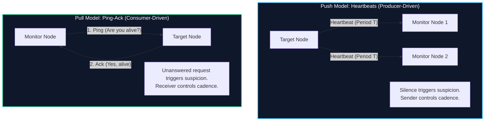
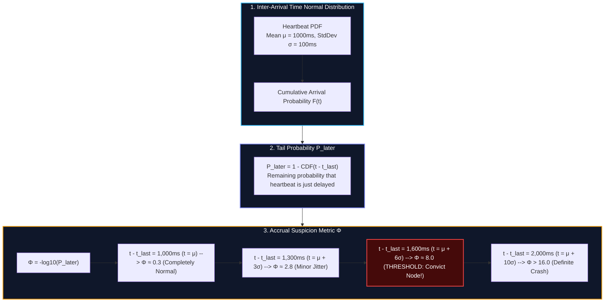
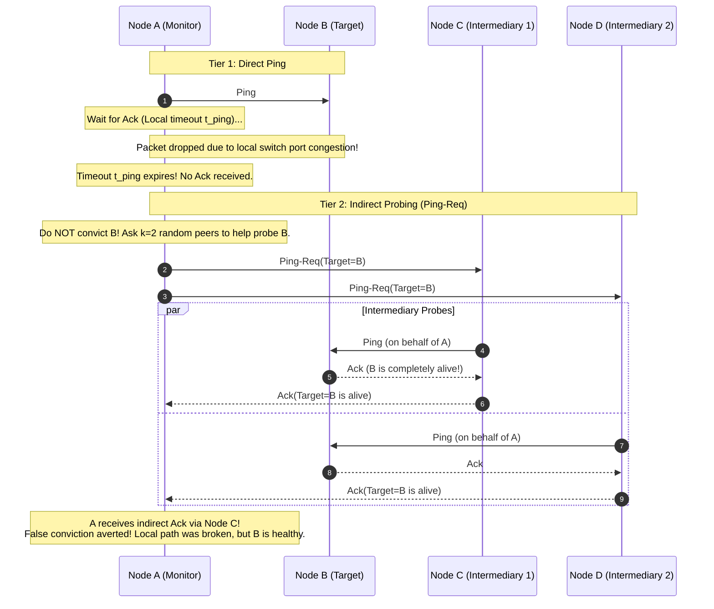

import { Callout } from "fumadocs-ui/components/callout";
import { Tabs, Tab } from "fumadocs-ui/components/tabs";

In a distributed database, high availability is predicated on a single fundamental capability: **detecting when a node has crashed.**

Whether executing a failover in a primary-backup cluster, triggering a leader election in Raft, excluding a dead replica from a quorum write, or initiating hinted handoffs in a dynamo-style storage engine, the system must first identify that a participating node is no longer capable of fulfilling its duties.

However, as established in [Chapter 08: Distributed Systems Overview](/docs/database-internals/08-distributed-systems-overview), asynchronous networks do not provide clean failure notifications. A crashed node, a frozen JVM undergoing a 15-second garbage collection pause, a saturated top-of-rack switch dropping packets, and an asymmetric fiber cut look **completely identical** from the outside.

If a database misjudges a healthy node as dead, it triggers unnecessary failovers, cascades replication rebalances, and risks split-brain disasters. Conversely, if it waits too long to declare a node dead, client queries stall in black-hole timeouts.

This chapter examines the theory, mathematics, and production implementations of distributed failure detectors.

---

## 1. The Failure Detection Problem: Completeness vs. Accuracy

In their seminal 1996 paper _"Unreliable Failure Detectors for Reliable Distributed Systems"_, Tushar Chandra and Sam Toueg formalized failure detection as an independent distributed service that provides nodes with suspicion lists of failed peers.

Chandra and Toueg proved that a failure detector's operational characteristics are defined by two orthogonal metrics: **Completeness** and **Accuracy**.

```
+-----------------------------------------------------------------------------------------+
| Metric        | Definition                                                              |
+-----------------------------------------------------------------------------------------+
| Completeness  | The ability of the detector to detect actual node crashes.              |
|               | (Does every dead node get suspected?)                                   |
+-----------------------------------------------------------------------------------------+
| Accuracy      | The ability of the detector to avoid false accusations.                 |
|               | (Do healthy nodes avoid being suspected?)                               |
+-----------------------------------------------------------------------------------------+
```

### The Spectrum of Completeness

Completeness guarantees that crashed processes do not remain undetected indefinitely:

- **Strong Completeness:** Eventually, every process that crashes is permanently suspected by **every** healthy process in the cluster.
- **Weak Completeness:** Eventually, every process that crashes is permanently suspected by **at least one** healthy process.

<Callout type="info" title="The Reducibility of Weak Completeness">
  Weak Completeness can be trivially transformed into Strong Completeness:
  whenever any healthy node suspects a dead peer, it simply broadcasts a gossip
  message to all other nodes. Therefore, distributed systems focus primarily on
  the harder problem: **Accuracy**.
</Callout>

### The Spectrum of Accuracy

Accuracy guarantees that healthy processes are not falsely suspected:

- **Strong Accuracy:** No healthy process is ever suspected before it crashes.
- **Weak Accuracy:** At least one healthy process is never suspected by any node.
- **Eventual Strong Accuracy ($\diamond\mathcal{P}$):** Eventually, there is a time after which no healthy process is ever suspected.
- **Eventual Weak Accuracy ($\diamond\mathcal{S}$):** Eventually, there is a time after which at least one healthy process is never suspected.

### The Chandra-Toueg Hierarchy of Failure Detectors

Combining these properties yields the classical taxonomy of failure detector classes:

```
+-----------------------------------------------------------------------------------+
| Completeness \ Accuracy | Strong Accuracy (P) | Weak (S) | Eventual Strong (◊P) | Eventual Weak (◊S)|
+-----------------------------------------------------------------------------------+
| Strong Completeness     | Perfect (P)         | Strong(S)| Eventually Perfect(◊P)| Eventually Strong(◊S)|
| Weak Completeness       | Q                   | Pseudo(W)| ◊Q                   | ◊W                |
+-----------------------------------------------------------------------------------+
```

### The Impossibility Result and the FLP Theorem

In an asynchronous distributed system—where message delays and process execution speeds are unbounded—**it is mathematically impossible to implement a Perfect Failure Detector ($\mathcal{P}$).**

Because network delay has no upper bound, an algorithm cannot choose a static timeout $\Delta$ that guarantees a delayed message is not merely slow rather than lost.

This directly connects to the famous **FLP Impossibility Theorem** (Fischer, Lynch, Paterson, 1985), which proved that deterministic distributed consensus is impossible in an asynchronous system if even a single process can experience an unannounced crash.

Chandra and Toueg showed that distributed consensus _does become solvable_ if the system is augmented with an **Eventually Strong Failure Detector ($\diamond\mathcal{S}$)** or **Eventually Perfect Failure Detector ($\diamond\mathcal{P}$)**. Practical database consensus protocols (such as Raft, Multi-Paxos, and Viewstamped Replication) operate under the assumption of partial synchrony, relying on failure detectors that achieve eventual accuracy once network conditions stabilize.

---

## 2. Heartbeating vs. Ping-Ack Protocols

Every failure detector implementation relies on exchanging probe messages across the network. These protocols fall into two structural paradigms: **Push (Heartbeating)** and **Pull (Ping-Ack)**.



### 1. The Heartbeat Protocol (Push Model)

- **Mechanics:** The monitored node periodically broadcasts an unsolicited message (`"I am alive"`, sequence number $S$) to all registered observers at a fixed interval $T_{\text{heartbeat}}$.
- **Observer Logic:** Each observer starts a countdown timer of duration $\Delta$. If a heartbeat arrives, the timer resets. If the timer expires before a heartbeat arrives, the observer suspects the sender is dead.
- **Topology & Scaling:**
  - **Leader-to-Followers:** In Raft or primary-backup replication, only the leader emits heartbeats. Network cost is $O(N)$ messages per period.
  - **All-to-All Mesh:** In peer-to-peer databases without a central coordinator, every node heartbeats to every other node. In a cluster of $N$ nodes, message volume scales as:
    $$\text{Traffic} = N(N - 1) \in O(N^2)$$
    In a 100-node cluster with $T = 1 \text{ s}$, the network must handle **9,900 messages per second** purely for failure detection. At 1,000 nodes, traffic surges to nearly **1,000,000 messages per second**, saturating network buffers and triggering self-inflicted failures.

### 2. The Ping-Ack Protocol (Pull Model)

- **Mechanics:** An observer proactively sends an interrogation request (`Ping`) to the target node. The target node must immediately respond with an acknowledgement (`Ack`).
- **Observer Logic:** The observer measures the round-trip time (RTT). If no `Ack` arrives within a timeout window $\Delta_{\text{timeout}}$, the target is marked as suspected.
- **Advantages:** Pings can be issued on-demand. For example, a query coordinator only pings a replica when it needs to route an active client query, eliminating background overhead for idle shards.
- **Disadvantages:** Doubles network message count per check (1 Ping + 1 Ack = 2 packets per observation). Furthermore, the target node must burn CPU context switches actively processing and answering incoming pings.

### The Timeout Calibration Dilemma

In traditional binary failure detectors, the system designer must configure a static timeout threshold $\Delta$. This configuration forces an unavoidable operational trade-off:

```
+-----------------------------------------------------------------------------------+
| Timeout Calibration | Detection Speed | False Positive Rate | Blast Radius        |
+-----------------------------------------------------------------------------------+
| Aggressive (Small Δ)| Fast (<100ms)   | High                | Election storms,    |
|                     |                 |                     | false failovers     |
+-----------------------------------------------------------------------------------+
| Conservative(Large Δ| Slow (>30s)     | Very Low            | Blocked queries,    |
|                     |                 |                     | client timeouts     |
+-----------------------------------------------------------------------------------+
```

#### Why Static Timeouts Fail in Cloud Networks

In AWS, GCP, or multi-tenant enterprise datacenters, network latency is non-deterministic:

1. **JVM Garbage Collection:** A database written in Java (such as Apache Cassandra, Apache Kafka, or Elasticsearch) may experience Stop-The-World (STW) GC pauses lasting from 500 ms to several seconds. During a pause, the JVM cannot emit heartbeats or respond to pings, even though the OS kernel is healthy and the disk state is intact.
2. **Virtualization Stolen CPU:** In virtualized environments, a hypervisor may de-schedule a VM's virtual CPU (vCPU steal time) to service another tenant, pausing thread execution for hundreds of milliseconds.
3. **TCP Retransmission Backoff:** Transient packet drops on top-of-rack switches trigger TCP exponentially increasing retransmission timers ($200\text{ ms} \to 400\text{ ms} \to 800\text{ ms}$).

Under these dynamic conditions, a static timeout either generates frequent false convictions during minor load spikes or takes minutes to recognize a fatal hardware crash.

---

## 3. The $\Phi$ (Phi) Accrual Failure Detector

To eliminate the fragility of binary static timeouts, Naohiro Hayashibara, Xavier Défago, Rami Yared, and Takuya Katayama introduced the **$\Phi$ (Phi) Accrual Failure Detector** in 2004.

The core breakthrough of an accrual failure detector is **decoupling suspicion accumulation from action execution.**

```
Traditional Detector:   Heartbeat Missing? ---> [ Binary Output: ALIVE or DEAD ]
                                                         |
                                                (Immediate Failover)

Accrual Detector:       Heartbeat Interval ---> [ Continuous Suspicion Metric Φ ]
                                                         |
                           +-----------------------------+-----------------------------+
                           |                             |                             |
                       Φ = 3 (Low)                  Φ = 8 (Moderate)             Φ = 12 (High)
                 (Deprioritize in Read Path)     (Trigger Leader Election)    (Evict & Re-replicate)
```

Instead of outputting a boolean `true`/`false`, the $\Phi$ Accrual Failure Detector outputs a continuous real-valued metric:
$$\Phi \in [0, \infty)$$
$\Phi$ represents the **current degree of suspicion** that a target node has failed. As time elapses without receiving a heartbeat, $\Phi$ smoothly increases according to a rigorous probabilistic model.

### Mathematical Formulation

The suspicion metric $\Phi$ is defined as the negative base-10 logarithm of the probability that a heartbeat will arrive more than $t - t_{\text{last}}$ units after the previous heartbeat:

$$\Phi = -\log_{10}\left( P_{\text{later}}(t - t_{\text{last}}) \right)$$

Where:

- $t$: Current physical timestamp.
- $t_{\text{last}}$: Timestamp when the most recent heartbeat from the monitored node was received.
- $t - t_{\text{last}}$: Elapsed time since the last heartbeat.
- $P_{\text{later}}(\Delta t)$: The probability that a heartbeat will be delayed by more than $\Delta t$, based on the **historical distribution of heartbeat inter-arrival intervals**.

### Translating $\Phi$ to False Positive Probability

The logarithmic definition gives $\Phi$ an intuitive, scale-invariant interpretation: **$\Phi$ directly corresponds to the orders of magnitude of probability that an accusation is a false positive.**

$$\Phi = -\log_{10}(P) \iff P = 10^{-\Phi}$$

```
+-----------------------------------------------------------------------------------+
| Φ Value | False Positive Probability (P_later) | Expected Frequency of False Alarm|
+-----------------------------------------------------------------------------------+
| Φ = 1   | 10^-1 = 0.1                          | 1 false alarm per 10 heartbeats  |
| Φ = 2   | 10^-2 = 0.01                         | 1 false alarm per 100 heartbeats |
| Φ = 3   | 10^-3 = 0.001                        | 1 false alarm per 1,000 heartbeats|
| Φ = 4   | 10^-4 = 0.0001                       | 1 false alarm per 10,000 heartbeats|
| Φ = 8   | 10^-8 = 0.00000001                   | 1 false alarm per 100,000,000 hbs|
| Φ = 12  | 10^-12                               | 1 false alarm per 1 trillion hbs |
+-----------------------------------------------------------------------------------+
```

If a node emits heartbeats every 1 second ($T = 1\text{ s}$), setting a conviction threshold of:

- $\Phi = 8$ guarantees that under stable network distributions, a false conviction occurs roughly **once every 3.17 years**.
- $\Phi = 12$ guarantees a false conviction roughly **once every 31,700 years**.

### Historical Sampling and Distribution Modeling

To compute $P_{\text{later}}(\Delta t)$, the failure detector maintains a **sliding window of the most recent $K$ heartbeat inter-arrival intervals** (typically $K = 1,000$ samples):

$$\Delta_i = T_i - T_{i-1} \quad \text{for } i \in \{1, 2, \dots, K\}$$

From this sliding history, the detector computes the sample mean $\mu$ and sample variance $\sigma^2$:

$$\mu = \frac{1}{K} \sum_{i=1}^K \Delta_i$$

$$\sigma^2 = \frac{1}{K} \sum_{i=1}^K (\Delta_i - \mu)^2$$

Assuming that network delays follow a Gaussian (Normal) distribution, the probability that a heartbeat interval exceeds the current elapsed time $t - t_{\text{last}}$ is calculated using the complementary cumulative distribution function:

$$P_{\text{later}}(t - t_{\text{last}}) = \frac{1}{\sigma \sqrt{2\pi}} \int_{t - t_{\text{last}}}^{\infty} e^{-\frac{(x - \mu)^2}{2\sigma^2}} \, dx$$

Using the Gauss Error Function ($\text{erf}$), this integral is expressed in closed form:

$$P_{\text{later}}(t - t_{\text{last}}) = \frac{1}{2} \left[ 1 - \text{erf}\left( \frac{(t - t_{\text{last}}) - \mu}{\sigma \sqrt{2}} \right) \right]$$

### The Suspicion Growth Curve

The following diagram illustrates how the probability of heartbeat arrival shrinks, causing $\Phi$ to scale exponentially over elapsed time:



### Production Implementation: Apache Cassandra

Apache Cassandra and Akka Cluster use the $\Phi$ Accrual Failure Detector as their primary membership health engine.

In Cassandra's codebase (`org.apache.cassandra.gms.FailureDetector`):

- Heartbeats are exchanged via Cassandra's background Gossip protocol.
- Each node maintains an `ArrayBackedBoundedStats` ring buffer storing the last 1,000 heartbeat intervals received from every peer.
- The configuration parameter `phi_convict_threshold` in `cassandra.yaml` dictates when a node is marked down:
  - **Default:** `phi_convict_threshold: 8` (suitable for typical bare-metal and private cloud setups).
  - **Cloud / Cross-Region Recommendation:** On AWS EC2 or cross-datacenter WAN links, operators increase this to `10` or `12` to prevent transient virtualization spikes from triggering false node evacuations.

---

## 4. Gossip-Based Failure Detection & The SWIM Protocol

While $\Phi$-Accrual solves the timeout calibration problem, it does not solve the **network scaling problem**. If every node must monitor every other node using all-to-all heartbeating, message overhead remains $O(N^2)$. In large clusters (100 to 10,000+ nodes), full-mesh probing collapses the network.

To scale failure detection to large clusters, distributed databases turn to **epidemic gossip protocols**, most notably the **SWIM Protocol** (Structured Weakly-Consistent Infection-Style Process Group Membership Protocol), designed by Abhinandan Das, Indranil Gupta, and Ashish Motivala in 2002.

### SWIM Core Architecture

SWIM splits membership into two decoupled mechanisms:

1. **A randomized failure detection component** that bounds network overhead to $O(1)$ per node per period.
2. **A dissemination component** that broadcasts membership updates using infection-style piggybacked gossip.

```
+-----------------------------------------------------------------------------------+
| Metric                        | All-to-All Heartbeating | SWIM Protocol           |
+-----------------------------------------------------------------------------------+
| Network Message Overhead      | O(N^2) total            | O(N) total (O(1)/node)  |
| CPU / Socket Bound per Node   | O(N)                    | O(1)                    |
| Expected Detection Time       | O(1) (Fixed timeout)    | O(1) expected           |
| Dissemination Latency         | O(1) (Direct broadcast) | O(log N) epidemic rounds|
| Resilience to Message Loss    | Poor (Static threshold) | High (Indirect probes)  |
+-----------------------------------------------------------------------------------+
```

### The Two-Tier Probing Mechanism

Instead of pinging all $N-1$ peers simultaneously, each node selects a single target peer at random to probe during each protocol period $T$.



#### Step 1: Direct Probing

1. At the start of protocol period $T$, Node A selects a peer (Node B) at random from its internal membership list.
2. Node A sends a `Ping` to Node B and waits for an `Ack` within a short timeout $t_{\text{ping}}$.
3. If Node B responds with `Ack` within $t_{\text{ping}}$, the period completes successfully. Node A picks a new random target in the next period.

#### Step 2: Indirect Probing (`Ping-Req`)

If Node A does not receive an `Ack` within $t_{\text{ping}}$, **it does not declare Node B dead.** The failure to receive an ACK could be caused by an asymmetric network drop on the direct link between A and B, while Node B remains fully operational and accessible to the rest of the cluster.

1. Node A selects $k$ members at random ($C_1, C_2, \dots, C_k$, typically $k = 3$).
2. Node A transmits a `Ping-Req(B)` to each of the $k$ intermediary peers.
3. Upon receiving `Ping-Req(B)`, each intermediary immediately sends its own direct `Ping` to Node B.
4. If Node B responds to _any_ intermediary, that intermediary immediately forwards an `Ack(B)` back to Node A.
5. If Node A receives at least one indirect `Ack` before the protocol period $T$ ends, Node B is preserved as healthy.

<Callout type="tip" title="Why Indirect Probing Eliminates Flapping">
  Direct links in virtualized cloud environments frequently experience brief
  packet loss bursts (e.g., microsecond microbursts overflowing Top-of-Rack
  buffer queues). By routing probes across $k$ physically independent network
  paths, the probability of a false conviction drops from $p$ to $p^{k + 1}$,
  virtually eliminating false-positive node convictions.
</Callout>

### The SWIM Suspicion Mechanism

In the basic SWIM protocol, if neither the direct ping nor any of the $k$ indirect pings return an `Ack`, Node B is declared `DEAD`. However, under severe network congestion, all indirect probes might be delayed, causing a healthy node to be convicted.

To harden the protocol, modern implementations (such as HashiCorp Serf and Consul) use the **SWIM Suspicion Mechanism** (introduced by Gupta et al.):

```
                 +-------------------+
                 |       ALIVE       | <---------------+
                 +-------------------+                 |
                           |                           |
                 Direct & Indirect                     |
                 Probes Fail                           |
                           |                     Node B Refutes
                           v                     Suspicion via
                 +-------------------+           ALIVE(Incarnation + 1)
                 |      SUSPECT      |                 |
                 +-------------------+ ----------------+
                           |
                 Suspicion Timer
                 Expires (No Refutation)
                           |
                           v
                 +-------------------+
                 |       DEAD        |
                 +-------------------+
```

#### 1. Incarnation Numbers and State Transitions

Every node in the cluster maintains a monotonic integer **Incarnation Number** (starting at 0).

- When indirect probes fail, Node A does not broadcast `DEAD(B)`. Instead, it broadcasts a `SUSPECT(B, Incarnation_i)` message.
- While in the `SUSPECT` state, Node B is treated as provisionally dead for read routing, but the cluster grants an incubation period ($T_{\text{suspect}}$) before permanent eviction.

#### 2. Self-Refutation

The `SUSPECT(B, Incarnation_i)` status disseminates across the cluster via gossip and eventually reaches Node B itself:

- If Node B is actually alive, it discovers that it is being falsely suspected!
- Node B immediately increments its own incarnation number:
  $$\text{Incarnation}_B \leftarrow \text{Incarnation}_B + 1$$
- Node B broadcasts an `ALIVE(B, \text{Incarnation}_B)` message across the cluster.
- Because an `ALIVE` message with incarnation $i+1$ strictly overrides a `SUSPECT` message with incarnation $i$, all nodes update their tables and restore Node B to `ALIVE`.

#### 3. Conviction

If Node B has genuinely crashed or lost power, it cannot increment its incarnation number or emit a refutation. The suspicion timer $T_{\text{suspect}}$ expires on observers, and the node's state transitions permanently from `SUSPECT` to `DEAD`.

### Piggybacked Epidemic Dissemination

A naive gossip protocol broadcasts dedicated membership change packets whenever a state changes, re-introducing traffic spikes.

SWIM achieves zero additional message overhead by **piggybacking membership updates onto the existing `Ping`, `Ping-Req`, and `Ack` packets**:

- Every node maintains a bounded FIFO buffer of recent membership events (`ALIVE`, `SUSPECT`, `DEAD`).
- Whenever a node sends a `Ping` or an `Ack`, it packs as many membership events into the payload bytes as MTU limits permit.
- Mathematically, epidemic gossip guarantees that an update reaches all $N$ nodes in the cluster within:
  $$\text{Time} \in O(\log N) \text{ protocol periods}$$
- The network overhead per node per period remains strictly **$O(1)$**, independent of total cluster size.

---

## 5. Architectural Comparison Matrix

Distributed databases select failure detection protocols based on their consistency models, cluster sizes, and network topologies:

```
+------------------------------------------------------------------------------------------------------+
| Feature               | Heartbeat (Push)      | Ping-Ack (Pull)     | Φ-Accrual (Cassandra)| SWIM Protocol (Consul)|
+------------------------------------------------------------------------------------------------------+
| Detection Accuracy    | Binary (Static)       | Binary (Static)     | Probabilistic (Accrual)| Multi-tiered Suspicion|
| Network Message Bound | O(N) or O(N^2)        | O(1) per check      | O(N^2) or Gossip     | O(1) per node/period  |
| Scalability Limit     | ~100 nodes            | Sharded only        | ~1,000 nodes         | 10,000+ nodes         |
| Handling of Asymmetry | Poor                  | Poor                | Moderate             | Immune (Indirect Ping)|
| Handling of GC Pauses | False positives       | False positives     | Adapts dynamically   | Refutation mechanism  |
| Primary Implementations| Raft, Multi-Paxos    | Distributed Schedulers| Apache Cassandra,  | HashiCorp Consul/Serf,|
|                       | (etcd, ZooKeeper)     | (Nomad, Kubernetes) | Akka Cluster         | Riak KV, DynamoDB     |
+------------------------------------------------------------------------------------------------------+
```

<Tabs items={["Leader-Based Consensus (Raft/Paxos)", "Decentralized Peer-to-Peer (Cassandra/Dynamo)"]}>
  <Tab value="Leader-Based Consensus (Raft/Paxos)">
    In strongly consistent, consensus-driven systems (such as etcd, CockroachDB, or ZooKeeper):
    * **Topology:** Strict single-leader hierarchy.
    * **Failure Detector Model:** Unidirectional Leader Heartbeats.
    * **Mechanics:** The leader continuously broadcasts heartbeat RPCs (`AppendEntries` in Raft) to all followers at fixed intervals ($T \approx 50 - 100 \text{ ms}$).
    * **Follower Rule:** Followers do not need to know the health of other followers; they only monitor the leader. If a follower's election timer (typically randomized between $150 - 300 \text{ ms}$) expires without a leader heartbeat, the follower transitions to candidate state and starts an election.
    * **Trade-off:** Minimal network traffic ($O(N)$), but highly sensitive to leader hiccups.
  </Tab>

  <Tab value="Decentralized Peer-to-Peer (Cassandra/Dynamo)">
    In leaderless, highly available NoSQL systems (such as Apache Cassandra, Amazon Dynamo, or Riak):
    * **Topology:** Symmetric rings of hundreds or thousands of equal storage nodes.
    * **Failure Detector Model:** $\Phi$-Accrual coupled with Gossip or SWIM.
    * **Mechanics:** Nodes exchange state over continuous epidemic gossip rounds. Each node independently builds a statistical arrival model for every other node in the ring.
    * **Decoupled Actions:** A node with a moderately high suspicion score ($\Phi = 4$) is skipped during read-repair routing, but is not convicted until $\Phi \ge 8$. During write operations, if a replica has $\Phi \ge 8$, the coordinator writes a local **Hinted Handoff** mutation instead of failing the write, delivering the data once the replica's suspicion score normalizes.
    * **Trade-off:** Higher algorithmic complexity, but near-zero operational downtime during transient network degradation.
  </Tab>
</Tabs>

---

## 6. Production Tuning and Failure Modes

Configuring failure detectors in real-world infrastructure requires balancing physical limits against application SLA requirements.

### 1. The JVM Stop-the-World GC Hazard

If your database engine runs on a managed runtime (Java, Go, .NET), runtime pauses will artificially inflate heartbeat intervals:

- **The Symptom:** Every few hours, a Cassandra or Kafka node is convicted by its peers, evicted from the cluster, and re-added 10 seconds later, causing massive cache invalidation and thread pool saturation.
- **The Root Cause:** Young-generation or full Garbage Collection pauses freeze all user threads, stopping heartbeat emitters.
- **The Remediation:**
  - Enable pause-less GC algorithms (e.g., ZGC or Shenandoah in modern JDKs) to keep pauses below 10 ms.
  - Run failure detector threads on dedicated, isolated OS native threads outside the managed runtime where possible.
  - In Cassandra, set `phi_convict_threshold` to `10` or `12` if running on JVMs with large heap allocations ($>32 \text{ GB}$).

### 2. Cascading Failure Storms

The most catastrophic failure mode occurs when **failure detection itself triggers cluster collapse**:

1. Node 1 experiences high client query load, causing CPU utilization to reach 100%.
2. Node 1's heartbeat processing thread is starved of CPU slices, delaying outbound heartbeats.
3. Node 2 and Node 3 suspect Node 1 and convict it.
4. Node 2 and Node 3 initiate partition re-balancing, streaming gigabytes of replacement data across the network to take over Node 1's shards.
5. The incoming replication data saturates the network cards and CPUs of Node 2 and Node 3.
6. Now Node 2 and Node 3 fail to send their heartbeats.
7. Node 4 convicts Node 2 and Node 3!
8. Within minutes, the entire cluster cascades into total operational collapse.

<Callout
  type="error"
  title="Architectural Defense: Circuit Breakers and Eviction Rate Limits"
>
  Never allow a failure detector to trigger unlimited automatic cluster
  mutations. Robust production databases enforce: 1. **Eviction Quotas:** Limit
  the maximum percentage of nodes that can be convicted concurrently (e.g., no
  more than $10\%$ of cluster capacity per hour). 2. **Resource Isolation:**
  Heartbeat and health-probe traffic must run on a dedicated network interface,
  port, or highest-priority OS thread pool (`SCHED_FIFO`), completely isolated
  from client read/write query processing.
</Callout>

---

## 7. Summary

Detecting failures across asynchronous networks requires trading the illusion of certainty for statistical probability and cooperative verification.

- **Binary Static Timeouts** fail in cloud networks because they cannot differentiate between dead nodes, slow links, and JVM GC pauses.
- **Completeness vs. Accuracy:** Completeness ensures dead nodes are convicted; Accuracy prevents healthy nodes from being wrongly evicted. Perfect accuracy is impossible in asynchronous networks.
- **The $\Phi$ Accrual Failure Detector** models heartbeat inter-arrival history as a continuous probability distribution, outputting a suspicion score $\Phi = -\log_{10}(P_{\text{later}})$ that allows applications to execute progressive, multi-tiered responses.
- **The SWIM Protocol** scales failure detection to thousands of nodes by combining $O(1)$ randomized probing, indirect `Ping-Req` routing across helper peers, an incubation suspicion state with self-refutation, and zero-overhead piggybacked gossip.

### Looking Ahead

Once a failure detector has definitively established that a primary node or coordinator has crashed, the distributed system faces its next urgent operational crisis: **Who takes over?**

In [Chapter 10: Leader Election](/docs/database-internals/10-leader-election), we examine the algorithms that allow clusters to safely select a new coordinator without split-brain: the Bully algorithm, Ring elections, epoch generation numbers, fencing tokens, and modern consensus-driven leader appointments.
