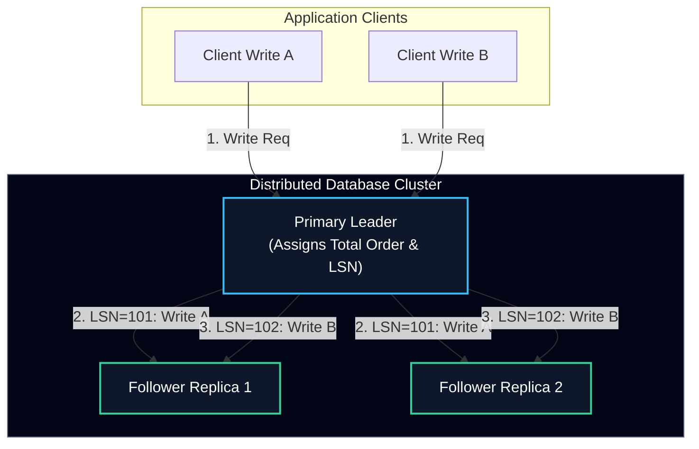
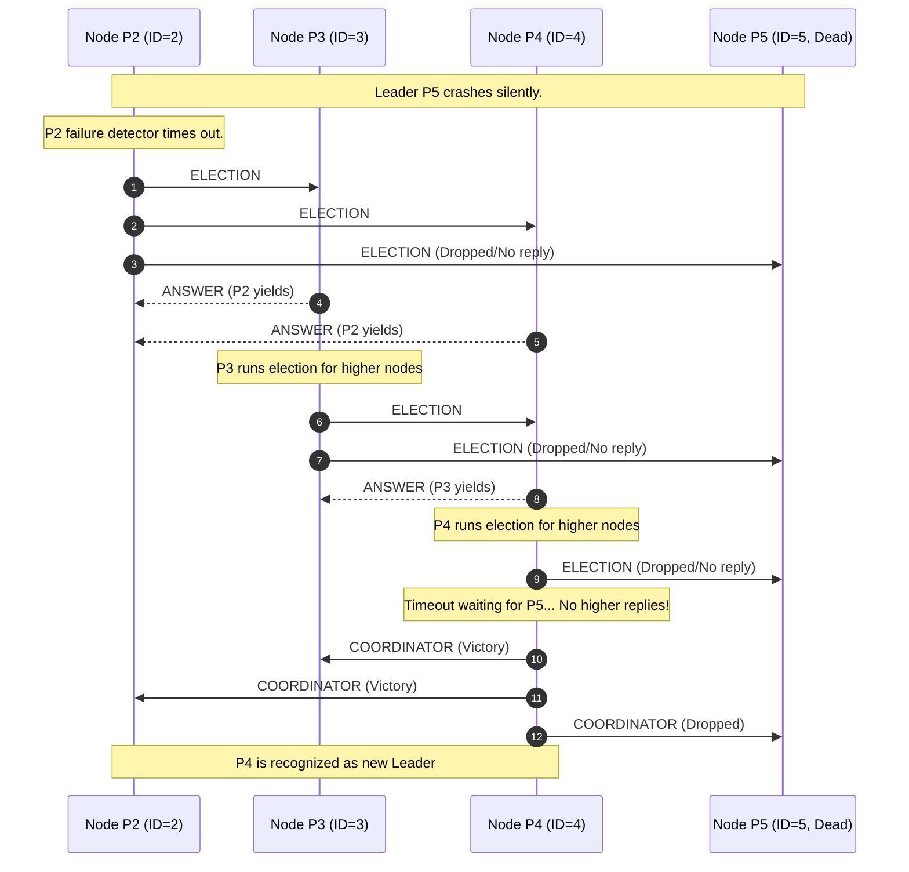
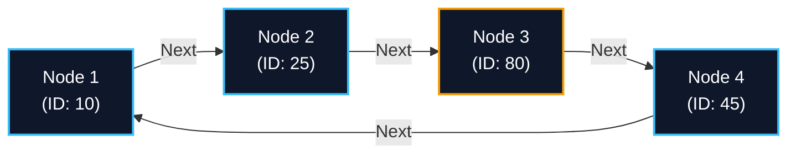
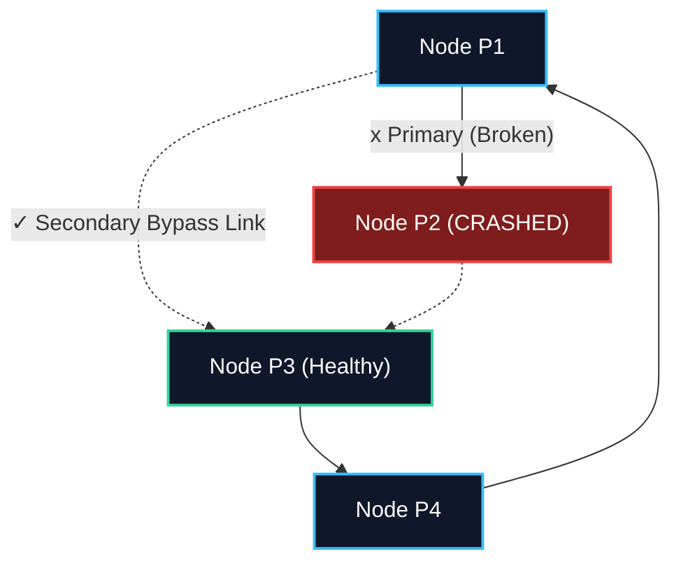
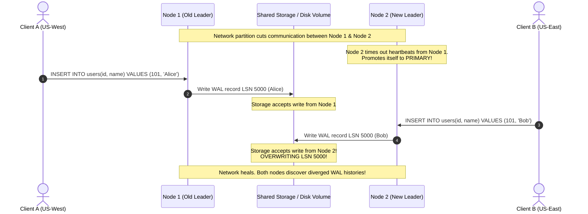
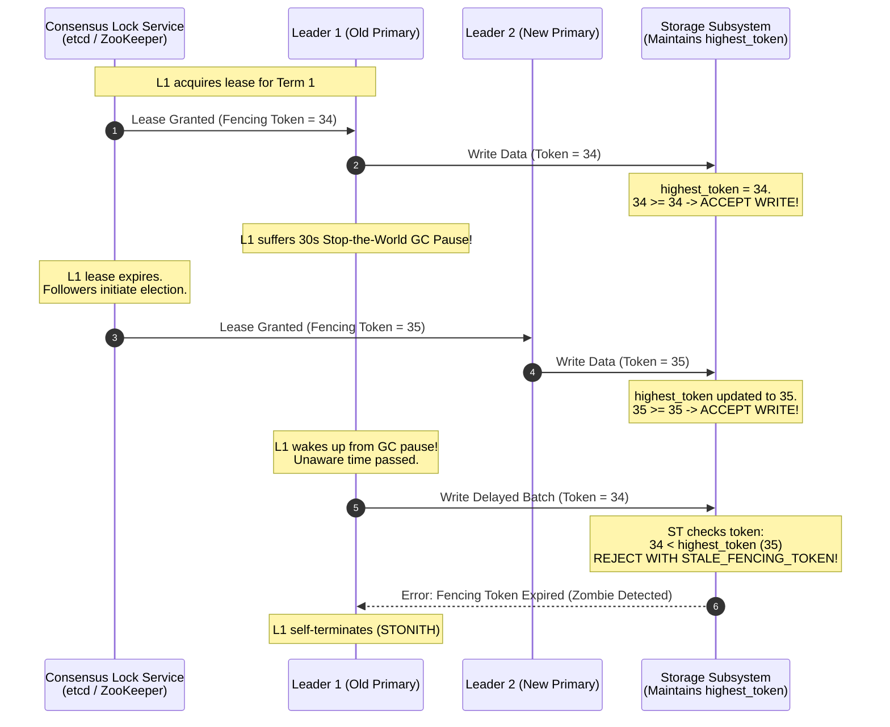

import { Callout } from "fumadocs-ui/components/callout";
import { Tabs, Tab } from "fumadocs-ui/components/tabs";
import { Cards, Card } from "fumadocs-ui/components/card";

In a distributed database, having multiple nodes execute reads and writes across an untrusted, asynchronous network introduces a central coordination dilemma: **who is in charge?**

When every node operates autonomously without an authoritative coordinator, simple database operations like generating unique auto-incrementing primary keys, serializing writes to a Write-Ahead Log (WAL), or acquiring distributed locks collapse into race conditions and data corruption. To establish determinism, distributed architectures rely on **Leader Election**—a consensus-backed protocol that designates a single node as the authoritative primary while followers replicate its state.

Yet, electing a leader in a distributed environment where physical network links fail, CPU threads experience garbage collection pauses, and nodes crash unpredictably is one of the most notoriously deceptive problems in computer science.

---

## The Leader Election Problem

### Why Databases Need a Leader

Most relational and strongly consistent distributed databases (such as PostgreSQL with streaming replication, MySQL InnoDB Cluster, etcd, Apache Kafka, and CockroachDB) rely on a **Single-Leader (Primary-Backup)** model for partition coordination:

1. **State Machine Replication (SMR):** Replicas execute identical state transitions from an initial state $S_0$ if and only if they process the exact same sequence of operations in the exact same deterministic order:
   $$\{op_1, op_2, op_3, \dots, op_k\}$$
   A designated leader linearizes client writes, assigns monotonically increasing log sequence numbers (LSNs), and streams the ordered log to replicas.
2. **Elimination of Multi-Writer Conflicts:** If two clients simultaneously execute `UPDATE accounts SET balance = balance - 100 WHERE id = 42` on two different nodes without coordination, both transactions could pass local balance checks and commit concurrently, violating business invariants. A single leader serializes all mutations to row `id = 42` through row latches and transaction locks.
3. **Coordination Overhead Reduction:** Without a leader, every mutating transaction requires executing a distributed atomic agreement (such as multi-round Byzantine or Classic Paxos) across all nodes for every single row mutation. A stable leader amortizes election costs, allowing normal write paths to proceed in a single round-trip.

### The FLP Impossibility Barrier

Why is leader election difficult? In 1985, researchers Fischer, Lynch, and Paterson published the landmark **FLP Impossibility Theorem**:

<Callout
  type="error"
  title="The FLP Impossibility Theorem (Fischer, Lynch, Paterson, 1985)"
>
  In a purely asynchronous distributed system, **no deterministic consensus
  protocol can guarantee both safety and liveness in the presence of even a
  single unannounced crash failure.**
</Callout>

In an asynchronous network:

- Message transmission delay is **unbounded** (a message can take 10 milliseconds or 10 hours).
- Process execution speed is **unbounded** (a thread can be frozen by an OS context switch or a long JVM garbage collection stop-the-world pause).
- A recipient cannot mathematically distinguish between a node that has **crashed** and a node that is merely **running slowly or experiencing network latency**.

To escape FLP in production engines, real-world databases weaken the pure asynchronous model to **Partial Synchrony** (Dwork, Lynch, Stockmeyer, 1988): systems assume that after an unknown Global Stabilization Time ($GST$), message delays and processing times are bounded by known constants $\Delta$, allowing timeout-driven failure detectors to trigger deterministic elections.

---

## The Classic Bully Algorithm

Invented by Hector Garcia-Molina in 1982, the **Bully Algorithm** is one of the foundational leader election protocols in distributed systems. It derives its name from its operating principle: **the highest-ranked available node bullies all lower-ranked nodes into submission and declares itself coordinator.**

### Protocol Mechanics

Consider a static cluster of $N$ nodes, where each node possesses a unique, globally known integer identifier:
$$\mathcal{P} = \{p_1, p_2, \dots, p_N\} \quad \text{where } id(p_1) < id(p_2) < \dots < id(p_N)$$

The node with the largest identifier ($p_N$) is the default coordinator. The algorithm defines three distinct message types:

1. `ELECTION`: Initiated by a node suspecting the leader; sent only to nodes with higher IDs.
2. `ANSWER` (or `OK`): Sent by a higher-ranked node to abort the election bid of a lower-ranked node.
3. `COORDINATOR`: Broadcast by the victorious candidate to announce its new leadership to all active nodes.

### Step-by-Step Execution

1. **Failure Suspicion:** When any active node $p_i$ detects a heartbeat timeout from coordinator $p_N$, it initiates an election.
2. **Higher-Rank Challenge:** $p_i$ transmits an `ELECTION` message to every node $p_j$ where $id(p_j) > id(p_i)$.
3. **Response Handling:**
   - If **no higher node replies** within timeout interval $T_{reply}$, $p_i$ assumes all higher nodes are dead. $p_i$ broadcasts a `COORDINATOR` message to all nodes $p_k$ ($k < i$), establishing itself as the new leader.
   - If **one or more higher nodes reply** with `ANSWER`, $p_i$'s candidacy terminates immediately. The responding higher nodes independently initiate their own election rounds.
4. **Cascading Resolution:** The highest active node receives no answers to its `ELECTION` messages, declares victory, and sends `COORDINATOR` broadcasts to all surviving cluster members.

### Complexity & Production Flaws

<Tabs items={["Message Complexity", "Flapping & Instability", "Partition Vulnerability"]}>
  <Tab value="Message Complexity">
    - **Best-Case ($O(N)$):** If the second-highest node $p_{N-1}$ detects $p_N$'s crash first, it immediately sends an `ELECTION` to $p_N$, receives no answer, and broadcasts $N-2$ `COORDINATOR` messages. Total message cost is linear:
      $$\mathcal{M}_{best} = (N - 1) = O(N)$$
    - **Worst-Case ($O(N^2)$):** If the lowest node $p_1$ detects failure first, it transmits $N-1$ messages. Every higher node $p_2, p_3, \dots, p_{N-1}$ responds and spawns its own nested election:
      $$\mathcal{M}_{worst} = \sum_{k=1}^{N-1} (N - k) + \sum_{k=1}^{N-1} (k - 1) = O(N^2)$$
      In a 100-node cluster, a single failure detection by $p_1$ triggers approximately $10{,}000$ RPCs across the cluster backbone.
  </Tab>
  <Tab value="Flapping & Instability">
    The Bully algorithm assumes that a node's operational state is binary (healthy or dead). In production, nodes fail non-binary via **flapping**:
    
    1. Node $p_5$ suffers hardware overheating or out-of-memory kernel panics, causing it to reboot every 30 seconds.
    2. While $p_5$ is dead, $p_4$ is elected leader and stabilizes replica streams.
    3. $p_5$ reboots, comes online, immediately sends `ELECTION` messages, bullies $p_4$ into stepping down, and claims leadership.
    4. 10 seconds later, $p_5$ crashes again.
    
    This results in **continuous election storms**, invalidating client sessions and preventing the database cluster from ever serving sustained transactional write traffic.
  </Tab>
  <Tab value="Partition Vulnerability">
    The Bully algorithm possesses **zero partition tolerance**. 
    
    If a network switch splits a 5-node cluster into two isolated subnets $\mathcal{G}_1 = \{p_1, p_2\}$ and $\mathcal{G}_2 = \{p_3, p_4, p_5\}$:
    - In $\mathcal{G}_1$, $p_2$ sends `ELECTION` to $p_3, p_4, p_5$. Because cross-rack links are severed, it receives no answers. $p_2$ concludes $p_3, p_4, p_5$ are dead and declares itself Leader of $\mathcal{G}_1$.
    - In $\mathcal{G}_2$, $p_5$ bullies $p_3$ and $p_4$, declaring itself Leader of $\mathcal{G}_2$.
    
    The cluster now has **two simultaneous leaders** accepting writes—a catastrophe known as **Split-Brain**.
  </Tab>
</Tabs>

---

## Ring-Based Election Algorithm

To mitigate the uncontrolled message floods of the Bully protocol, the **Ring-Based Election Algorithm** (Chang and Roberts, 1979) organizes cluster nodes into a logical unidirectional ring.

### Logical Topology & Token Propagation

Every node $p_i$ maintains an outbound communication channel to exactly one logical successor:
$$p_i \longrightarrow p_{(i+1) \bmod N}$$

Nodes do not broadcast to all peers; messages traverse sequentially around the perimeter of the ring.

### The Candidate Extraction Protocol

1. **Election Initiation:** When node $p_i$ discovers its leader is unreachable, it generates an `ELECTION` message initialized with a candidate set containing its own identifier:
   $$M_{elec} = \text{ELECTION}(\mathcal{C} = \{ id(p_i) \})$$
   It forwards $M_{elec}$ to its immediate downstream neighbor in the ring.
2. **Candidate Accumulation:** Upon receiving an $\text{ELECTION}(\mathcal{C})$ message:
   - If a node $p_k$ observes that its own identifier $id(p_k) \notin \mathcal{C}$, it appends its identifier to the payload:
     $$\mathcal{C}' \leftarrow \mathcal{C} \cup \{ id(p_k) \}$$
     and forwards $\text{ELECTION}(\mathcal{C}')$ to its downstream neighbor.
   - If node $p_k$ receives an `ELECTION` message that **already contains** $id(p_k)$, the message has completed a full $360^\circ$ traversal around the logical ring.
3. **Winner Extraction & Announcement:**
   The initiating node inspects candidate set $\mathcal{C}$ and extracts the maximum value:
   $$Leader = \max(\mathcal{C})$$
   It transforms the message into a `COORDINATOR` announcement containing the winner's ID and transmits it around the ring:
   $$M_{coord} = \text{COORDINATOR}(Leader)$$
   Each node updates its internal pointer to the new leader and forwards the announcement until it traverses the entire ring once and terminates.

### Handling Broken Rings & Link Failures

In a production network, a physical node crash simultaneously breaks the logical ring. If node $p_2$ crashes, node $p_1$'s outbound channel to $p_2$ drops packets.

To survive link and intermediate node crashes:

- **Skip-Ahead Pointers (Multi-Ring Topology):** Each node maintains an ordered fallback list of successors: primary successor $p_{(i+1)}$, secondary backup $p_{(i+2)}$, and tertiary backup $p_{(i+3)}$.
- **Connection Probing:** When forwarding `ELECTION`, if the primary socket connection times out after threshold $T_{socket}$, the node closes the socket, flags $p_{(i+1)}$ as dead, and establishes a bypass link directly to $p_{(i+2)}$.
- **Complexity:** The Chang-Roberts ring election consumes $O(N)$ messages in the best case and $O(N^2)$ in the worst case (if all nodes initiate simultaneous elections). The Hirschberg-Sinclair bidirectional refinement reduces worst-case message complexity to:
  $$\mathcal{M}_{HS} = O(N \log N)$$

---

## Split-Brain Hazards & Partition Disasters

The most catastrophic failure mode in distributed data management is **Split-Brain**. Split-brain occurs when an unhandled network partition or communication blackout divides a cluster into isolated subsets, each of which independently elects a leader.

### Anatomy of a Data Corruption Event

Consider a 3-node primary-backup PostgreSQL cluster using automated failover without quorum verification:

1. **Partition Inception:** A fiber cut severs communication between Node 1 and Node 2.
2. **Dual Leadership:**
   - Node 1 has no visibility into Node 2, but client traffic from its local datacenter continues arriving. Node 1 processes `INSERT INTO users (id, name) VALUES (101, 'Alice')`.
   - Node 2 suspects Node 1 is dead. It promotes itself to Primary and accepts traffic from another region: `INSERT INTO users (id, name) VALUES (101, 'Bob')`.
3. **Write-Ahead Log Divergence:** Both nodes allocate primary key `id = 101`, write contradictory rows to their respective local write-ahead logs, and commit transactions to clients.
4. **The Impossible Reconciliation:** When the network heals, the replication stream cannot merge. The WAL branches have forked at identical LSN offsets with conflicting data. Resolving this requires either dropping one client's committed transactions (data loss) or manual database surgery by an SRE team.

---

## The Production Solution: Quorums, Epochs, and Fencing Tokens

Industrial distributed engines (such as Google Spanner, Apache Kafka KRaft, etcd, Apache Cassandra, and ZooKeeper) eliminate split-brain through three interlocking mechanisms:

1. **Majority Quorums** ($\lfloor N/2 \rfloor + 1$)
2. **Epoch / Term Generation Numbers**
3. **Fencing Tokens at the Storage Subsystem**

### 1. Majority Quorum Mathematics

To ensure that two conflicting leaders can never be simultaneously elected, the system enforces a strict **Majority Voting Invariant**:

<Callout type="info" title="The Quorum Intersection Rule">
  An election is valid if and only if the candidate collects affirmative votes
  from a strict majority $Q$ of all configured cluster nodes: $$Q = \left\lfloor
  \frac{N}
  {2} \right\rfloor + 1$$
</Callout>

**Mathematical Proof of Non-Overlapping Majorities:**  
Let the cluster consist of $N$ nodes. Suppose two disjoint partitions $\mathcal{P}_1$ and $\mathcal{P}_2$ both attempt to elect a leader. For both to succeed, their voter sets must each satisfy the majority condition:
$$|\mathcal{P}_1| \ge \left\lfloor \frac{N}{2} \right\rfloor + 1 \quad \text{and} \quad |\mathcal{P}_2| \ge \left\lfloor \frac{N}{2} \right\rfloor + 1$$

Summing the sizes of both voter pools:
$$|\mathcal{P}_1| + |\mathcal{P}_2| \ge 2 \cdot \left( \left\lfloor \frac{N}{2} \right\rfloor + 1 \right) > N$$

By the **Pigeonhole Principle**, the sum exceeds total cluster membership $N$. Therefore:
$$\mathcal{P}_1 \cap \mathcal{P}_2 \neq \emptyset$$

There must exist at least one node $p_v \in (\mathcal{P}_1 \cap \mathcal{P}_2)$. Since each node is strictly constrained to cast at most **one vote per election cycle**, it cannot vote for both candidates. Consequently, **it is mathematically impossible for two majorities to form simultaneously.** The minority partition simply fails to reach quorum and enters a read-only or waiting state.

| Cluster Size ($N$) | Majority Quorum ($Q$) | Maximum Tolerated Node Failures ($F = \lfloor (N-1)/2 \rfloor$) |
| :----------------: | :-------------------: | :-------------------------------------------------------------: |
|         1          |           1           |                                0                                |
|         3          |           2           |                                1                                |
|         5          |           3           |                                2                                |
|         7          |           4           |                                3                                |

<Callout type="warning" title="Even vs. Odd Cluster Node Counts">
Notice that a 4-node cluster requires $Q = \lfloor 4/2 \rfloor + 1 = 3$ nodes for a quorum. If a 4-node cluster loses 2 nodes, it cannot form a quorum ($2 < 3$). Thus, a 4-node cluster tolerates only 1 failure—the **exact same fault tolerance as a 3-node cluster**, but with higher network overhead. Always configure odd numbers of consensus participants (3, 5, or 7).
</Callout>

### 2. Epochs, Terms, and Generation Counters

A leader elected in a majority partition cannot rule indefinitely. Nodes can get separated from their peers after election due to transient network blips. To bound authority, consensus engines employ **Epoch Numbers** (termed _Epoch_ in ZooKeeper, _Term_ in Raft, and _Ballot_ in Paxos):

- Every time an election is triggered, the cluster increments a monotonic 64-bit counter:
  $$e_{new} = e_{current} + 1$$
- Every RPC message (`AppendEntries`, `Commit`, `Heartbeat`) carries the current epoch $e$.
- If any node receives a message bearing an epoch $e_{msg} < e_{local}$, it rejects the message outright.
- If a leader receives an RPC with $e_{msg} > e_{local}$, it realizes a newer leader has been elected in a subsequent generation, immediately abdicates its throne, and reverts to a follower.

### 3. The Zombie Leader Problem & Storage Fencing Tokens

Even with quorum elections and epochs, a subtle hardware/runtime anomaly can still destroy data integrity: the **Zombie Leader** (or phantom primary).

Consider the following real-world sequence:

1. Leader 1 holds an active lease for Term 1.
2. Leader 1 encounters a major **Java Stop-The-World (STW) Garbage Collection pause** lasting 45 seconds, or hypervisor CPU starvation.
3. The cluster followers stop receiving heartbeats. After 5 seconds, they time out, increment the epoch to Term 2, and elect Leader 2.
4. Leader 2 begins accepting writes and persists them to the shared network storage or SAN.
5. Leader 1's GC pause completes. Leader 1's local OS thread resumes execution. In its local memory, Leader 1 still believes it is the legitimate leader because it has not yet processed incoming network packets!
6. Leader 1 flushes a queued batch of stale writes directly to the storage layer, corrupting the records just committed by Leader 2!

To eliminate zombie leader write corruption, modern systems implement **Fencing Tokens** (Martin Kleppmann, _Designing Data-Intensive Applications_):

<Callout type="info" title="The Fencing Token Guarantee">
Every time a leader acquires an election lease or lock from the consensus coordination service (e.g., ZooKeeper or etcd), it receives an **incrementing numerical token** ($token = 34, 35, 36, \dots$). When sending writes to the shared storage layer or downstream replicas, the leader must attach its fencing token. The storage layer checks the token against the highest token it has ever observed: if $token < token_{highest}$, the write is permanently rejected.
</Callout>

---

## Real-World Implementations

Modern distributed databases translate these theoretical models into production architectures:

<Tabs items={["Apache Kafka (KRaft)", "etcd & Raft", "PostgreSQL (Patroni)"]}>
  <Tab value="Apache Kafka (KRaft)">
    In early versions, Apache Kafka relied on ZooKeeper to elect an external
    Controller node. If the Controller died, ZooKeeper elected a new Controller
    using ephemeral znode locks. However, metadata synchronization between
    ZooKeeper and broker partitions was slow ($O(P)$ metadata updates). With
    **KIP-500 (Kafka Raft Metadata mode - KRaft)**, Kafka replaced ZooKeeper
    with an integrated Raft quorum: - Dedicated Controller nodes maintain an
    event-driven metadata log. - Raft-based term elections elect a single Active
    Metadata Controller. - Partition reassignments carry **Controller Epochs**.
    Any broker receiving a replication command from a Controller with an expired
    epoch rejects the command, preventing phantom controllers from issuing stale
    replica rebalances.
  </Tab>
  <Tab value="etcd & Raft">
    **etcd** (the distributed key-value store powering Kubernetes) implements
    the classic Raft consensus algorithm: - State machine transitions between
    three states: `Follower`, `Candidate`, and `Leader`. - Nodes monitor
    heartbeat intervals using randomized election timeouts ($150\text{ms} -
    300\text{ms}$) to prevent split-vote scenarios where multiple candidates
    split the vote equally. - A candidate only votes for another candidate if
    the applicant's log is at least as up-to-date as its own local log
    (comparing `lastLogTerm` and `lastLogIndex`), ensuring that an elected
    leader is guaranteed to contain all previously committed entries.
  </Tab>
  <Tab value="PostgreSQL (Patroni)">
    PostgreSQL does not natively implement distributed consensus for leader
    election. Production high-availability architectures deploy **Patroni**, an
    orchestration template wrapping Postgres: - Patroni instances connect to a
    Distributed Consensus Store (DCS) such as etcd or Consul. - A leader lock
    with a Time-To-Live (TTL) of 10 seconds is maintained in etcd by the primary
    Patroni daemon via continuous heartbeats. - If the primary fails to refresh
    its DCS lease, standby Patroni daemons compete to acquire the key. - The
    standby with the lowest replication lag (highest WAL position / LSN) is
    promoted to Primary. - Patroni enforces **Watchdog fencing (software
    STONITH)**: if a primary node loses contact with the DCS for more than the
    lease duration, its local hardware watchdog immediately resets the machine,
    preventing zombie dual-primary execution.
  </Tab>
</Tabs>

---

## Architectural Decision Checklist

When designing or evaluating a distributed database's leader election subsystem, review this engineering checklist:

<Cards>
  <Card title="Quorum Configuration" icon="ShieldCheck">
    Always deploy an odd number of voting nodes ($2F + 1$). Never run
    even-numbered consensus voter rings without dedicated tie-breaker arbiters.
  </Card>
  <Card title="Storage Fencing" icon="Lock">
    Never rely solely on heartbeat timeouts to revoke leadership. Always pass
    monotonically increasing fencing tokens to downline storage endpoints.
  </Card>
  <Card title="Clock Independence" icon="Clock">
    Ensure safety invariants do not depend on physical wall-clock
    synchronization. Rely exclusively on logical epochs or consensus-backed
    leases.
  </Card>
  <Card title="Flapping Suppression" icon="Activity">
    Implement exponential backoff on candidate election retries and failure
    detector penalties to prevent flapping nodes from destabilizing the cluster.
  </Card>
</Cards>
