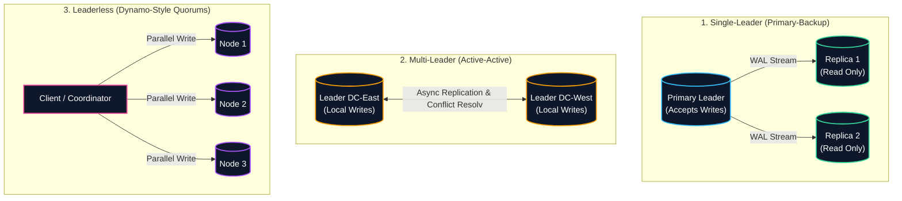
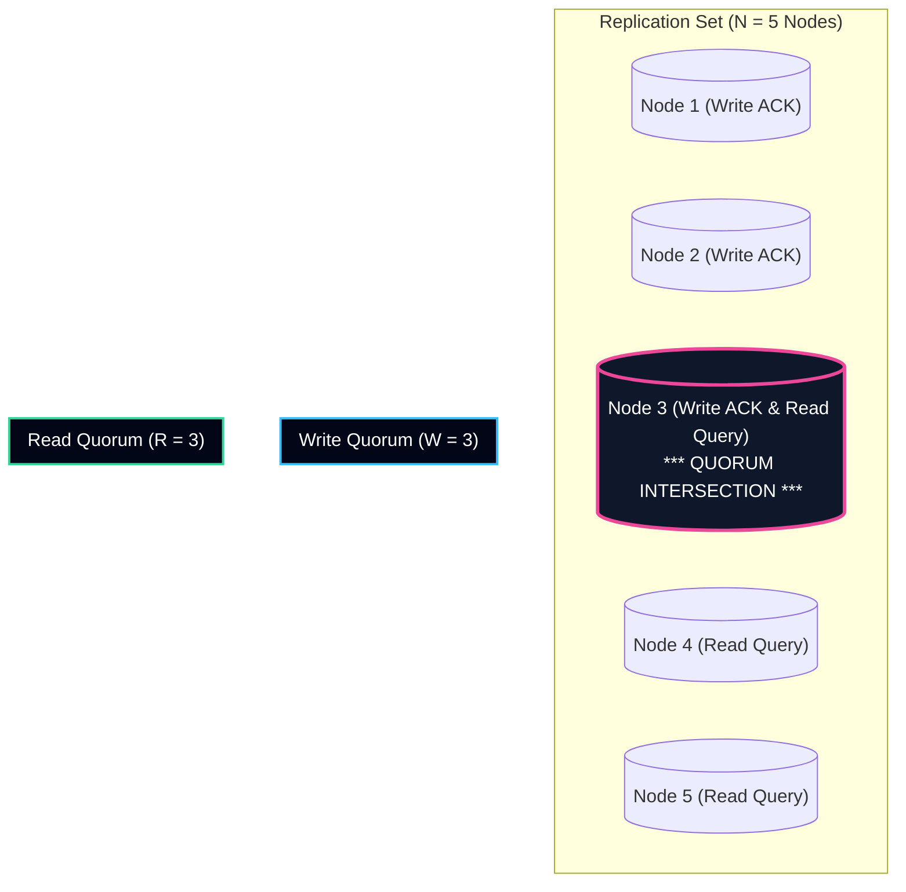
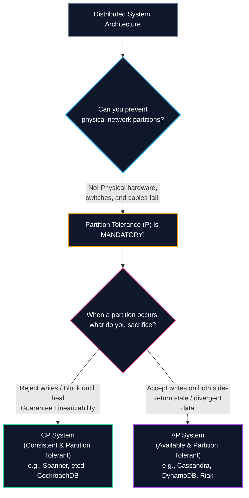
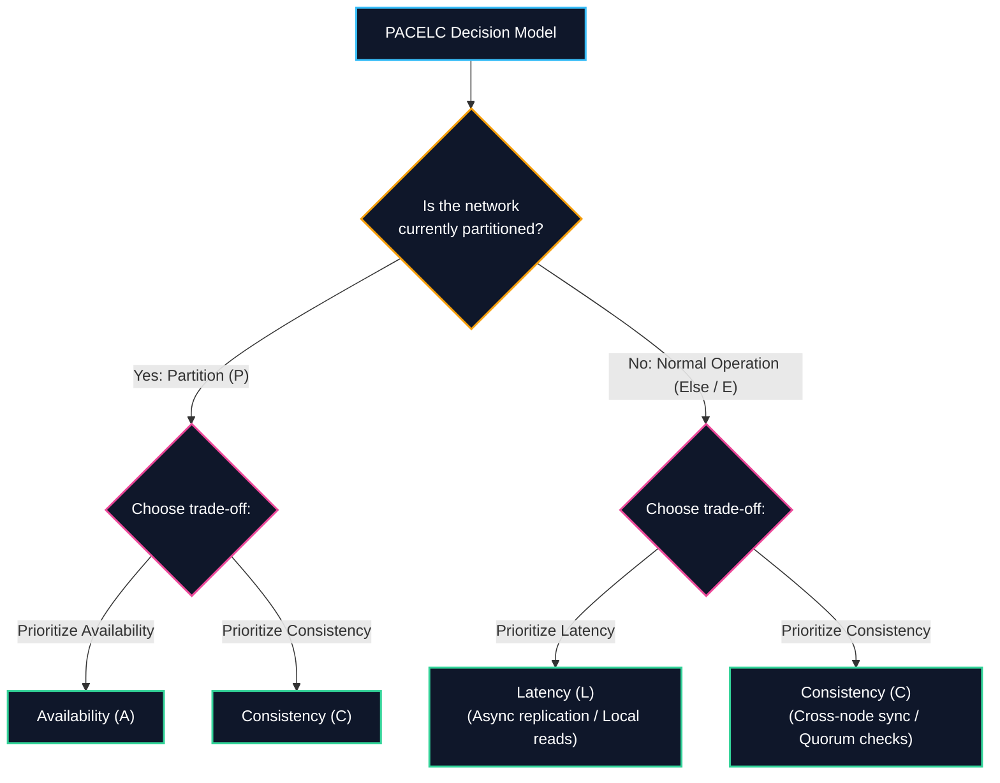
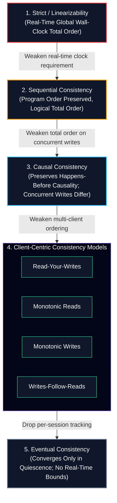
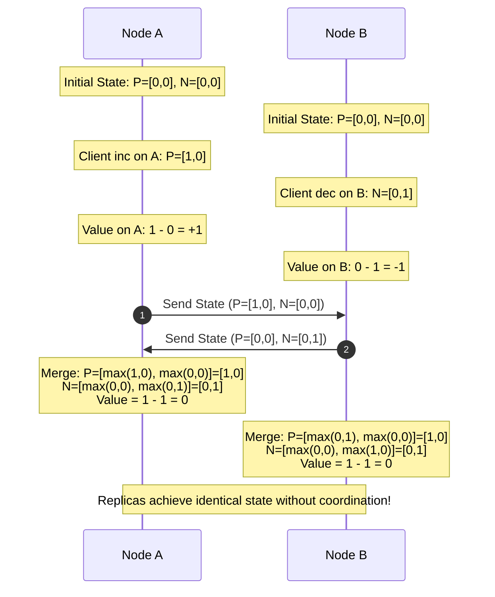

import { Callout } from "fumadocs-ui/components/callout";
import { Tabs, Tab } from "fumadocs-ui/components/tabs";
import { Cards, Card } from "fumadocs-ui/components/card";

In single-node database engines, data durability is governed by local hardware primitives: Write-Ahead Log (WAL) flushes, atomic disk sector writes, and buffer pool eviction policies. But as soon as data must scale beyond a single physical server—to survive hardware catastrophes, serve worldwide users with low latency, and scale read/write throughput—the system enters the domain of **Replication**.

Replicating data across multiple independent physical machines introduces fundamental physical constraints. Network packets experience variable latency, physical links experience fiber cuts and packet loss, and physical clocks drift asynchronously.

This chapter explores how distributed databases structure replica communication, the mathematical foundation of read/write quorums, the theoretical boundaries established by the **CAP** and **PACELC** theorems, the complete spectrum of distributed consistency models, and how conflict-free data structures reconcile concurrent mutations without coordination.

---

## Replication Topologies

Every distributed database must choose how it distributes authority to mutate state. There are three primary replication architectures:

### 1. Single-Leader (Primary-Backup / Active-Passive)

The single-leader topology (employed by PostgreSQL streaming replication, MySQL InnoDB replica sets, Redis Sentinel, and MongoDB replica sets) designates exactly one node as the **Primary (Leader)**:

- **Write Path:** All mutating queries (`INSERT`, `UPDATE`, `DELETE`) must be routed exclusively to the primary. The primary evaluates constraints, serializes transactions, appends mutations to its local Write-Ahead Log (WAL), and transmits the replication stream to standbys.
- **Read Path:** Read queries can execute against the primary or be offloaded to read replicas to scale query throughput.
- **Replication Modes:**
  - **Synchronous ($W = N$):** The primary delays client acknowledgment until every configured standby has acknowledged persisting the log entry to disk. Guarantees zero data loss ($RPO = 0$), but a single slow or unresponsive replica blocks all cluster write transactions.
  - **Asynchronous ($W = 1$):** The primary commits immediately after writing to its local WAL and transmits updates to standbys in the background. Provides ultra-low write latency, but unpropagated writes will be permanently lost if the primary crashes before replicas catch up.
  - **Semi-Synchronous ($1 < W < N$):** Used in production engines (e.g., MySQL `rpl_semi_sync` or PostgreSQL `synchronous_commit = remote_write`). The primary waits for acknowledgment from at least one standby before returning success to the client, surviving single-node failovers without incurring the tail latency of all replicas.

### 2. Multi-Leader (Active-Active / Multi-Master)

In multi-leader setups, multiple database nodes act as primaries simultaneously, typically placed in distinct geographic datacenters (e.g., US-East, EU-Central, APAC-South):

- **Benefits:** Clients execute writes against their nearest geographic datacenter with sub-10 millisecond latency. If an entire regional datacenter loses power or internet connectivity, surviving regions continue processing writes unimpeded.
- **The Fatal Challenge:** **Concurrent Write Conflicts.** If User 42 changes their email to `alice@work.com` in London while simultaneously updating it to `alice@home.org` in New York, both datacenters commit their local transactions successfully. When the replication streams cross the Atlantic, the database discovers conflicting values for the same record.
- **Topologies:** Replicas connect via circular ring ($A \to B \to C \to A$), star/tree topologies, or all-to-all broadcast networks.

### 3. Leaderless Replication (Dynamo-Style)

Pioneered by Werner Vogels et al. in the landmark Amazon Dynamo paper (2007) and implemented in Apache Cassandra, ScyllaDB, and Riak, leaderless architectures abandon the concept of a primary entirely:

- **Symmetric Architecture:** Every node in the cluster is functionally identical. No node holds unique coordination privilege.
- **Client/Coordinator Routing:** A client transmits a write directly to all $N$ replica nodes responsible for that key, or contacts an arbitrary node which acts as a lightweight stateless **Coordinator** for that specific request.
- **Fault Resilience:** If one or two nodes are down or partitioned, the write can still succeed as long as a sufficient subset of nodes acknowledges the request.

---

## Quorum Mathematics

In leaderless and distributed quorum-based systems, read and write operations do not need to contact every replica in the cluster. Instead, strong consistency is guaranteed mathematically through **Quorum Intersections**.

### Formal Parameters

A quorum-based partition is parameterized by three fundamental variables:

1. **Replication Factor ($N$):** The total number of distinct physical nodes designated to store a copy of a given partition or key.
2. **Write Quorum ($W$):** The minimum number of replica nodes that must successfully process and acknowledge a write operation before the database reports success to the client.
3. **Read Quorum ($R$):** The minimum number of replica nodes that a client or coordinator must query in parallel to read a value.

### The Strict Quorum Condition

<Callout type="info" title="The Quorum Intersection Rule">
A distributed database guarantees strong consistency (preventing stale reads) if and only if the read quorum and write quorum satisfy:
$$R + W > N$$
</Callout>

#### Mathematical Proof via the Pigeonhole Principle

Let $\mathcal{U}$ be the set of all $N$ replicas responsible for a given key:
$$|\mathcal{U}| = N$$

When a client performs a write, it receives acknowledgments from an arbitrary subset of replicas $\mathcal{S}_W \subseteq \mathcal{U}$, where:
$$|\mathcal{S}_W| \ge W$$

When another client performs a subsequent read, it collects values from an arbitrary subset of replicas $\mathcal{S}_R \subseteq \mathcal{U}$, where:
$$|\mathcal{S}_R| \ge R$$

From basic set theory, the size of the union of these two sets cannot exceed the total universe size $N$:
$$|\mathcal{S}_W \cup \mathcal{S}_R| \le |\mathcal{U}| = N$$

Now, consider the cardinality of the intersection $\mathcal{S}_W \cap \mathcal{S}_R$:
$$|\mathcal{S}_W \cap \mathcal{S}_R| = |\mathcal{S}_W| + |\mathcal{S}_R| - |\mathcal{S}_W \cup \mathcal{S}_R|$$

Substituting the lower bounds:
$$|\mathcal{S}_W \cap \mathcal{S}_R| \ge W + R - N$$

If we enforce the strict quorum condition $R + W > N$, it follows directly that:
$$R + W - N \ge 1 \implies |\mathcal{S}_W \cap \mathcal{S}_R| \ge 1$$

$$\therefore \quad \mathcal{S}_W \cap \mathcal{S}_R \neq \emptyset$$

Because the intersection set $\mathcal{S}_W \cap \mathcal{S}_R$ contains at least one common replica, **any read quorum is mathematically guaranteed to query at least one node that participated in the most recent successful write.** By comparing version numbers or timestamps across the $R$ responses, the coordinator selects the value with the highest version and returns it to the client.

### Configurable Quorum Trade-Offs

Distributed databases allow administrators to tune $W$ and $R$ on a per-query or per-table basis:

|    Configuration ($N=5$)     | Write Quorum ($W$) | Read Quorum ($R$) |      Consistency       | Latency Profile & Fault Tolerance                                                                              |
| :--------------------------: | :----------------: | :---------------: | :--------------------: | :------------------------------------------------------------------------------------------------------------- |
| **Fast Writes / Slow Reads** |      $W = 1$       |      $R = 5$      |  Strong ($1 + 5 > 5$)  | Ultra-fast writes, but read queries must query all nodes. If a single node is down, reads fail.                |
| **Fast Reads / Slow Writes** |      $W = 5$       |      $R = 1$      |  Strong ($5 + 1 > 5$)  | Instant reads from any single node, but writes require all 5 nodes to be healthy. Zero write fault tolerance.  |
|   **Balanced (Majority)**    |      $W = 3$       |      $R = 3$      |  Strong ($3 + 3 > 5$)  | Standard production setup. Tolerates up to $\lfloor (N-1)/2 \rfloor = 2$ dead nodes for both reads and writes. |
|    **Weak / Stale Reads**    |      $W = 2$       |      $R = 2$      | Eventual ($2 + 2 < 5$) | High performance and availability, but reads can completely miss recent writes. Stale data risk.               |

### Sloppy Quorums and Hinted Handoff

What happens in a leaderless system when a network partition cuts off access to some of the $N$ designated replicas, making it impossible to assemble a strict quorum of $W$ nodes?

In a Dynamo-style database configured for high availability:

1. **The Preference List:** A key hashes to an ordered list of $N$ nodes on the consistent hashing ring.
2. **Sloppy Quorum:** If the coordinator cannot reach $W$ designated nodes from the preference list, it routes writes to healthy **fallback nodes** outside the preference list on the cluster ring.
3. **Hinted Handoff:** The fallback node accepts the write, persists it locally in a temporary spool, and attaches a **hint** (the identity of the original intended recipient). The fallback continuously probes the intended recipient; as soon as the network heals, it replays the hinted writes and purges its temporary spool.

<Callout type="warning" title="Sloppy Quorums Break Consistency">
A sloppy quorum is not a true quorum. Even if $R + W > N$, writes stored on fallback nodes are invisible to regular read operations querying the designated preference list. Sloppy quorums prioritize write availability at the cost of transiently violating linearizability.
</Callout>

---

## Theoretical Guarantees: CAP & PACELC

### The CAP Theorem

Formulated by Eric Brewer at PODC 2000 and formally proven by Seth Gilbert and Nancy Lynch in 2002, the **CAP Theorem** dictates the fundamental trade-offs of distributed data systems:

- **Consistency ($C$):** Formally defined as **Linearizability** (atomic consistency). Every read operation must return the value of the most recent write or throw an error; the system behaves as if there is only a single copy of the data.
- **Availability ($A$):** Every non-failing node must return a non-error response for every received request (though with no guarantee that it contains the most recent write).
- **Partition Tolerance ($P$):** The system continues to operate despite an arbitrary number of messages being dropped or delayed by the underlying network.

<Callout type="error" title="The 'Pick 2 of 3' Fallacy">
Many introductory texts state: *"You can pick any two: Consistency, Availability, or Partition Tolerance."* **This is mathematically false.** You cannot "choose CA". A network partition ($P$) is not a configuration setting; it is an inevitable physical reality caused by hardware faults, switch crashes, and transient routing blips.

The true formulation of CAP is:  
**In the presence of a network partition ($P$), a distributed system must choose between Consistency ($CP$) or Availability ($AP$).**

</Callout>

#### Harvest vs. Yield

In real-world operations, availability is rarely binary. Eric Brewer introduced **Harvest and Yield** as quantitative degradation metrics:

$$\text{Yield} = \frac{\text{Queries completed successfully}}{\text{Total queries issued}}$$

$$\text{Harvest} = \frac{\text{Fraction of data searched / returned}}{\text{Total complete dataset}}$$

Under degraded network conditions, a search index or analytics engine might maintain $100\%$ Yield (answering every query) while degrading Harvest to $85\%$ (omitting partitioned shards from results), rather than hard-failing requests.

### The PACELC Theorem

In 2012, Yale computer scientist Daniel Abadi identified a major limitation of CAP: **CAP only describes distributed system behavior during a network partition.** Real-world datacenters operate without network partitions $99.99\%$ of the time. What trade-offs govern the system during normal operation?

Abadi proposed the **PACELC Theorem**:

$$\text{If } \mathbf{P} \text{ (Partition)} \implies \text{Choose } \mathbf{A} \lor \mathbf{C}; \quad \text{Else } \mathbf{E} \implies \text{Choose } \mathbf{L} \lor \mathbf{C}$$

When there is a **Partition ($P$)**, how does the system choose between **Availability ($A$)** and **Consistency ($C$)**?  
**Else ($E$)**, when the network is behaving normally, how does the system choose between **Latency ($L$)** and **Consistency ($C$)**?

#### Classification of Production Engines under PACELC

<Tabs
  items={["PC/EC Systems", "PA/EL Systems", "PC/EL Systems", "PA/EC Systems"]}
>
  <Tab value="PC/EC Systems">
    **Prioritize Consistency everywhere:** - Under partitions, they reject
    writes to prevent split-brain ($PC$). - During normal operation, they incur
    the latency of cross-node synchronous coordination or Raft/Paxos round-trips
    to prevent stale reads ($EC$). - **Examples:** Google Spanner, CockroachDB,
    etcd, HBase, TiDB.
  </Tab>
  <Tab value="PA/EL Systems">
    **Prioritize Availability and Speed:** - Under partitions, partitioned
    replicas accept writes locally ($PA$). - During normal operation, they
    return reads from local memory/disk asynchronously without querying other
    nodes, optimizing for ultra-low latency ($EL$). - **Examples:** Amazon
    DynamoDB, Apache Cassandra, Couchbase, Riak.
  </Tab>
  <Tab value="PC/EL Systems">
    **Consistent in partitions, fast in normal operation:** - Under partitions,
    they reject writes in the minority partition ($PC$). - In normal operation,
    they serve reads from local asynchronous secondaries, prioritizing low
    latency over strong consistency ($EL$). - **Examples:** MongoDB (when
    configured with default read concern `local` and write concern `majority`).
  </Tab>
  <Tab value="PA/EC Systems">
    **Available in partitions, consistent in normal operation:** - Highly
    theoretical; under normal conditions, the database executes expensive
    distributed consistency protocols, but when a partition occurs, it falls
    back to an available, divergent state ($PA$). - **Examples:** VoltDB /
    H-Store (in specific multi-master modes).
  </Tab>
</Tabs>

---

## The Consistency Spectrum in Depth

Consistency in distributed systems is not a binary choice between "strong" and "eventual". It is a continuous mathematical hierarchy of formal guarantees.

### 1. Linearizability (Atomic Consistency)

Formally defined by Maurice Herlihy and Jeannette Wing in 1990:

- **Definition:** Every read operation must return the value of the most recently completed write operation in **real physical time** (as observed by a fictitious global external observer).
- **Invariants:** Operations take effect instantaneously at a linearization point between their invocation and response. If operation $op_2$ is invoked after operation $op_1$ completes in real time, $op_2$ must observe $op_1$ or a newer state:
  $$res(op_1) <_{real} inv(op_2) \implies op_1 \prec op_2$$
- **Cost:** Extreme latency penalty. To enforce linearizability across datacenters, every read must either execute a round of consensus (Raft/Paxos read-index or lease verification) or wait out the physical clock uncertainty interval (Google Spanner TrueTime $\epsilon \approx 7\text{ms}$).

### 2. Sequential Consistency

Defined by Leslie Lamport in 1979:

- **Definition:** The result of any execution is the same as if the operations of all processors were executed in some **single sequential order**, and the operations of each individual processor appear in this sequence in the order specified by its program.
- **Comparison with Linearizability:** Sequential consistency does **not** bind execution order to physical real-time clocks. If Node B updates a record at 12:00:00 UTC and Node A reads from a replica at 12:00:05 UTC, sequential consistency permits the replica to return the older value—_provided all nodes in the cluster agree on the exact same global total sequence of operations._

### 3. Causal Consistency

Causal consistency captures dependencies between events using Leslie Lamport’s **Happens-Before Relation ($\to$)**:

- If event $A$ caused event $B$ ($A \to B$), every node in the cluster must observe event $A$ before event $B$.
- **Concurrent Operations ($A \parallel B$):** If two events occurred independently without causal linkage, replicas are permitted to process and display them in different orders.
- **Significance:** Causal consistency is the **mathematically strongest consistency model achievable in an entirely available system during network partitions ($AP$)** (Mahajan et al., 2011).

### 4. Client-Centric Consistency Models

When global total order is too expensive, systems preserve consistency guarantees scoped to an individual client session (Terry et al., 1994, _Bayou Architecture_):

<Tabs items={["Read-Your-Writes", "Monotonic Reads", "Monotonic Writes", "Writes-Follow-Reads"]}>
  <Tab value="Read-Your-Writes">
    **Guarantee:** A client that updates a record will always observe its own update on subsequent reads.
    
    **Failure Anomaly:** Alice updates her profile picture on an asynchronous database. The primary commits the write. She immediately refreshes her profile. The web app routes her read to Replica 3, which is 500ms behind in replication. Alice sees her old profile picture!
    
    **Production Fix:** Route a client's reads to the primary for 5 seconds following any write, or attach the write's LSN/transaction ID to the client cookie and route reads only to replicas whose local LSN exceeds that threshold.
  </Tab>
  <Tab value="Monotonic Reads">
    **Guarantee:** If a client observes version $v_1$ of a record at time $t_1$, the client will never subsequently observe an older version $v_0$ at time $t_2 > t_1$ (time does not move backward).
    
    **Failure Anomaly:** Bob checks a sports score. Query 1 hits Replica 1 (up to date): score is 2-1. Bob refreshes 2 seconds later. Query 2 hits Replica 2 (lagging): score is 1-1! To Bob, a goal vanished into thin air.
    
    **Production Fix:** Pin a user session to a specific replica node via consistent hashing on user ID (sticky routing).
  </Tab>
  <Tab value="Monotonic Writes">
    **Guarantee:** A client's writes are serialized and applied in the exact order they were submitted by that client across all cluster replicas.
    
    **Failure Anomaly:** A user submits an `INSERT` creating a database record, followed immediately by an `UPDATE` modifying that record. If the update travels through a faster network route and reaches a replica before the insert, the update fails on a non-existent row, or the insert subsequently overwrites the updated state.
  </Tab>
  <Tab value="Writes-Follow-Reads">
    **Guarantee:** If a client reads version $v_1$ and subsequently executes write $w_2$, then $w_2$ is causally ordered after $v_1$ across all replicas.
    
    **Failure Anomaly:** In a discussion forum, User A reads Post 101 and publishes Reply 102 ("I agree with your answer"). On a lagging replica, Reply 102 appears before Post 101, confusing viewers who see the response before the question.
  </Tab>
</Tabs>

### 5. Eventual Consistency

Coined by Werner Vogels (2008):

- **Definition:** In the absence of new updates, all replicas will eventually converge and return identical values.
- **Trade-off:** Provides the highest theoretical throughput and write availability, but provides zero bounds on replication lag ($\Delta t$ can be milliseconds, minutes, or days during network outages). Reads frequently return arbitrary stale data.

---

## Conflict Resolution in Leaderless Systems

When a multi-leader or leaderless database permits concurrent writes to the same key during a partition, conflicting mutations land on different replicas. How does the database resolve these collisions?

### The Perils of Last-Write-Wins (LWW)

The simplest conflict resolution strategy is **Last-Write-Wins (LWW)** (used by default in Apache Cassandra and Apache Spark):

- Each write is stamped with a wall-clock timestamp $t$ generated by the client or coordinator node using physical system time (NTP).
- When a conflict is detected during read repair or anti-entropy, the database compares timestamps and retains the mutation with the highest timestamp, silently dropping the older write.

<Callout type="error" title="Why LWW Silently Destroys Production Data">
LWW relies on **physical wall clocks**, but physical clocks in computer systems are physically incapable of perfect synchronization:
- **NTP Clock Skew:** Normal NTP synchronization drifts by 5 to 50 milliseconds across server racks.
- **NTP Stepping / Leap Seconds:** If a server's clock drifts backward, a subsequent write can receive a timestamp *smaller* than an earlier write.
- **Virtualization Pauses:** A VM suspended for 200 milliseconds by a hypervisor generates timestamps in the past.

**Consequence:** A write that occurred at 12:00:05 UTC with a skewed clock showing 12:00:04 UTC will be **permanently and silently overwritten** by an older write made at 12:00:02 UTC whose clock was running fast at 12:00:06 UTC. LWW violates true causality!

</Callout>

### Conflict-Free Replicated Data Types (CRDTs)

Invented by Marc Shapiro, Nuno Preguiça, Carlos Baquero, and Marek Zawirski in 2011, **CRDTs** eliminate conflict resolution heuristics through abstract algebra:

<Callout type="info" title="The CRDT Mathematical Guarantee">
  A CRDT guarantees **Strong Eventual Consistency (SEC)**: Replicas that have
  received the same set of updates are mathematically guaranteed to reach the
  exact same state, without requiring any distributed locking, consensus, or
  coordinator intervention.
</Callout>

CRDTs are categorized into two mathematical flavors:

1. **State-Based CRDTs (CvRDT):** Replicas transmit their entire local state to peers. States form a **Bounded Join-Semilattice** $(S, \sqcup)$ where the merge operator $\sqcup$ is:
   - **Associative:** $(a \sqcup b) \sqcup c = a \sqcup (b \sqcup c)$ (message batching order does not matter)
   - **Commutative:** $a \sqcup b = b \sqcup a$ (message arrival order does not matter)
   - **Idempotent:** $a \sqcup a = a$ (duplicate message delivery does not matter)
2. **Operation-Based CRDTs (CmRDT):** Replicas transmit individual mutating operations over a causally ordered, at-least-once broadcast channel where operations are strictly commutative.

### Concrete CRDT Implementations

#### 1. The Positive-Negative Counter (PN-Counter)

A standard integer counter cannot be naively incremented and decremented across concurrent replicas because decrements are non-idempotent. A PN-Counter decomposes the counter into two state vectors:

$$\mathcal{C} = \langle P, N \rangle$$

where $P \in \mathbb{N}^k$ tracks positive increments and $N \in \mathbb{N}^k$ tracks negative decrements for each node $i \in \{1, \dots, k\}$.

- **Increment at Node $i$:** $P[i] \leftarrow P[i] + 1$
- **Decrement at Node $i$:** $N[i] \leftarrow N[i] + 1$
- **State Merge ($\sqcup$):** Replicas merge states by computing the component-wise maximum across both vectors:
  $$P_{merged}[i] = \max(P_A[i], P_B[i]) \quad \forall i$$
  $$N_{merged}[i] = \max(N_A[i], N_B[i]) \quad \forall i$$
- **Counter Value:**
  $$\text{Value}(\mathcal{C}) = \sum_{i=1}^k P[i] - \sum_{i=1}^k N[i]$$

Because $\max(x, y)$ is associative, commutative, and idempotent, any two replicas that exchange vectors immediately compute the identical total counter value regardless of packet reordering or network delays.

#### 2. The Observed-Remove Set (OR-Set)

In distributed sets, concurrent `add(x)` and `remove(x)` operations create ambiguities: if Node A adds item $x$ while Node B concurrently removes item $x$, should $x$ be present?

The **Observed-Remove Set (OR-Set)** resolves this by attaching a globally unique tag (UUID or Lamport timestamp) to every `add` invocation:

- **State:** $\mathcal{S} = \langle \mathcal{A}, \mathcal{R} \rangle$, where $\mathcal{A}$ is the set of added element-tag pairs $(e, tag)$, and $\mathcal{R}$ is the tombstone set of removed tags.
- **Add Operation:** To add element $e$, generate a fresh unique tag $t = \text{UUID}()$ and insert $(e, t)$ into $\mathcal{A}$.
- **Remove Operation:** To remove element $e$, observe all tags currently associated with $e$ in $\mathcal{A}$:
  $$\mathcal{T}_e = \{ t \mid (e, t) \in \mathcal{A} \}$$
  Insert all observed tags into $\mathcal{R}$.
- **Membership Test:**
  $$e \in \text{Set} \iff \exists t \text{ such that } (e, t) \in \mathcal{A} \land t \notin \mathcal{R}$$
- **Merge Operator ($\sqcup$):** Simple set union across both sets:
  $$\mathcal{A}_{merged} = \mathcal{A}_1 \cup \mathcal{A}_2, \quad \mathcal{R}_{merged} = \mathcal{R}_1 \cup \mathcal{R}_2$$

If an `add` and `remove` occur concurrently, the `add` creates a brand new tag $t_{new}$ that the concurrent `remove` could not have observed. Consequently, $t_{new} \notin \mathcal{R}$, and the addition wins deterministically (_Add-Wins Semantics_).

---

## Production Architecture Comparison

| Dimension                 | PostgreSQL / MySQL                      | Cassandra / ScyllaDB        | Google Cloud Spanner                  | CockroachDB                          |
| :------------------------ | :-------------------------------------- | :-------------------------- | :------------------------------------ | :----------------------------------- |
| **Topology**              | Single-Leader (Primary-Backup)          | Leaderless (Symmetric Ring) | Multi-Paxos Leader per Split          | Multi-Raft Consensus per Range       |
| **CAP Classification**    | CP (Synchronous) / AP (Async)           | AP (Configurable)           | CP                                    | CP                                   |
| **PACELC Classification** | PC/EC (Sync) / PC/EL (Async)            | PA/EL                       | PC/EC                                 | PC/EC                                |
| **Default Consistency**   | Read-Committed (Linearizable on Leader) | Eventual / Tunable Quorum   | External Consistency (Linearizable)   | Serializable Linearizable            |
| **Conflict Resolution**   | Single Leader Serializes                | Last-Write-Wins (Timestamp) | Multi-Paxos Lock Ordering             | Multi-Raft Log Ordering              |
| **Clock Dependency**      | Low (Logical WAL LSNs)                  | High (NTP Skew Impacts LWW) | Critical (TrueTime GPS/Atomic Clocks) | Medium (Hybrid Logical Clocks - HLC) |

---

## Architectural Decision Checklist

When architecting replication and consistency layers for production data systems, apply these guiding principles:

<Cards>
  <Card title="Quorum Overlap Verification" icon="ShieldCheck">
    Enforce $R + W > N$ on critical transactional paths. Never configure $W=1$ on financial or inventory records without idempotent compensations.
  </Card>
  <Card title="PACELC Assessment" icon="GitPullRequest">
    Profile normal-state latency expectations ($E \implies L \lor C$). If cross-datacenter round-trips (>100ms) violate SLA limits, select causal or client-centric consistency.
  </Card>
  <Card title="Clock Skew Immunity" icon="Clock">
    Never use raw physical system timestamps (NTP) for leaderless conflict resolution. Deploy CRDTs, Vector Clocks, or Hybrid Logical Clocks (HLC).
  </Card>
  <Card title="Client Session Pinning" icon="UserCheck">
    When offloading reads to asynchronous standbys, enforce Read-Your-Writes and Monotonic Reads using session tokens or LSN-aware replica routing.
  </Card>
</Cards>
