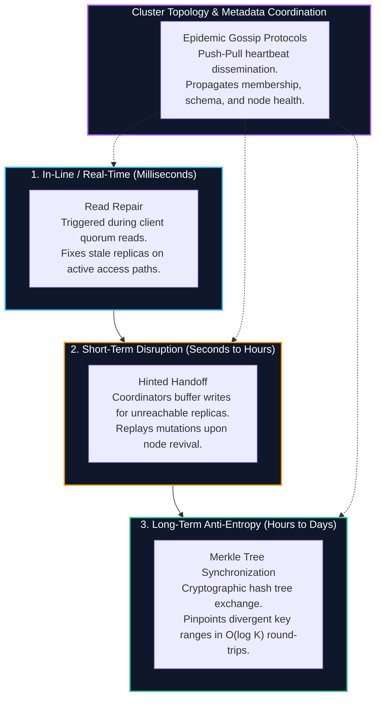
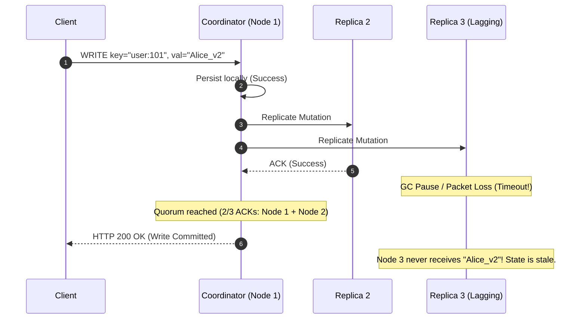
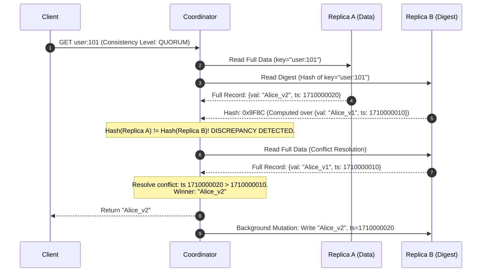
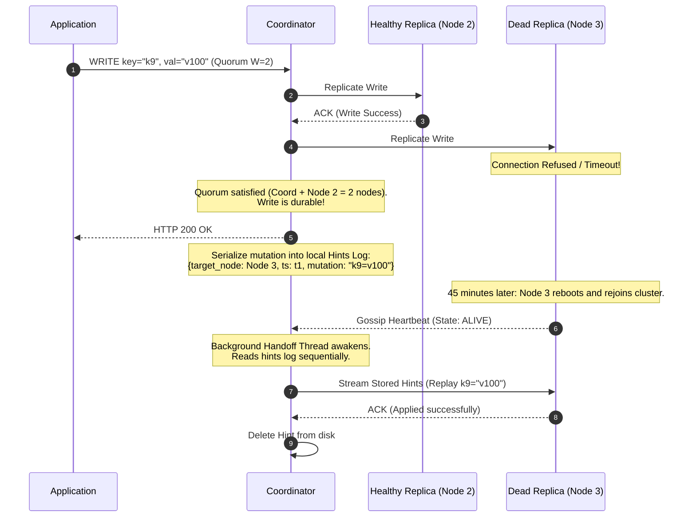
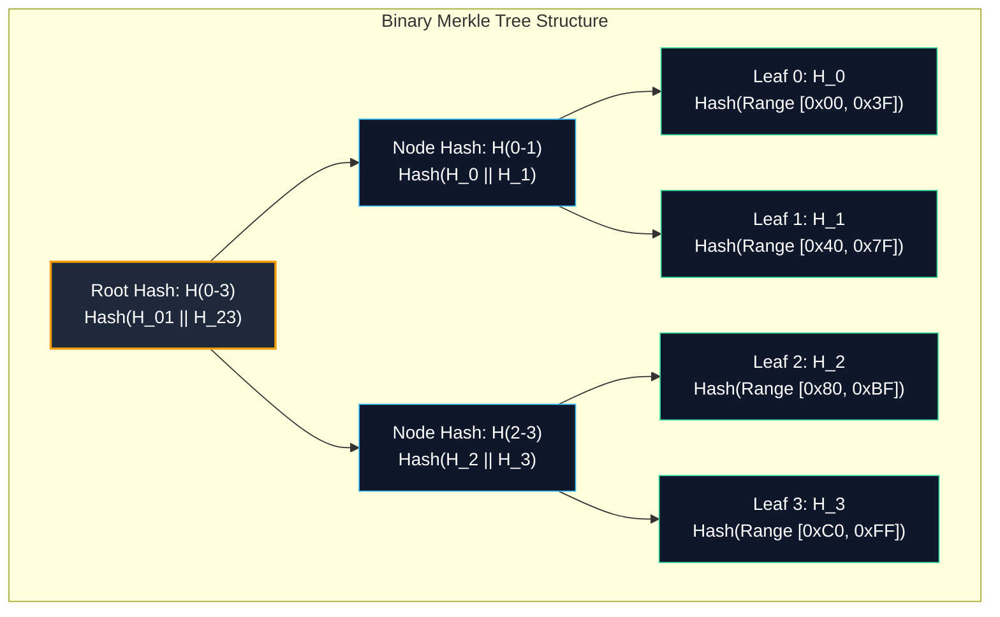
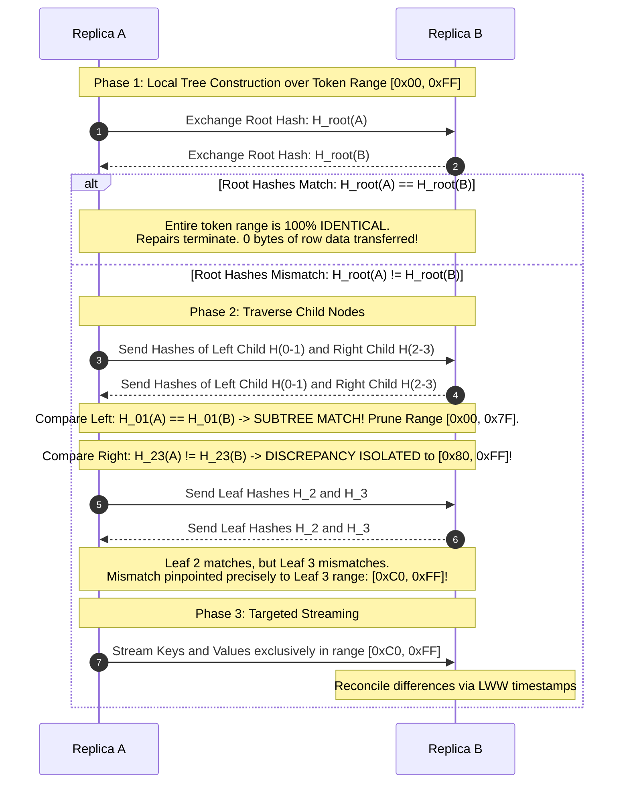
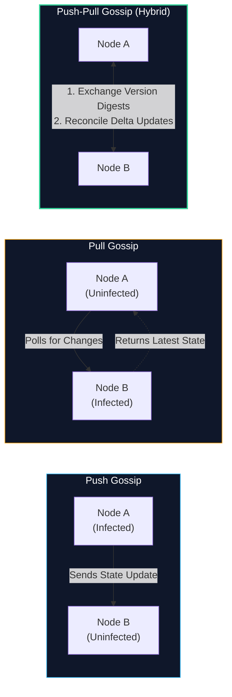
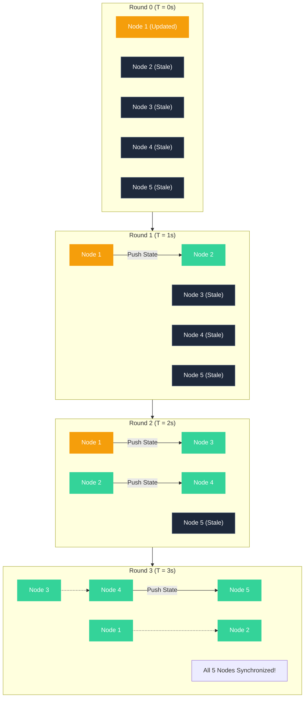

import { Callout } from "fumadocs-ui/components/callout";
import { Tabs, Tab } from "fumadocs-ui/components/tabs";
import { Steps, Step } from "fumadocs-ui/components/steps";
import { Cards, Card } from "fumadocs-ui/components/card";

In a distributed database, divergence is not an exception—it is the default physical state. Even when client writes successfully meet strict quorum thresholds ($W + R > N$), network latency spikes, packet drops, garbage collection pauses, transient disk stalls, and hardware reboots guarantee that individual node replicas will silently drift out of synchronization.

If a database relied solely on write-time replication, this entropy would accumulate monotonically over time until replicas held irreconcilably fractured states.

To maintain consistency and durability over months and years of continuous operation, distributed storage engines implement **Anti-Entropy Protocols**: automated, background, and in-line mechanisms designed to detect divergence, reconcile conflicting record versions, and disseminate state updates across every node in the cluster.

---

## The Spectrum of Convergence Mechanisms

Distributed databases (such as Apache Cassandra, Amazon Dynamo, Riak, and ScyllaDB) employ three complementary repair mechanisms spanning distinct operational time scales, backed by epidemic gossip dissemination for metadata coordination:



---

## 1. The Anti-Entropy Problem

In thermodynamics, entropy measures the degree of disorder or randomness in a closed system. In distributed systems, **data entropy** describes the unavoidable drift in replica state caused by asynchronous execution, transient network partitions, and independent node lifecycles.

### Why Replicas Diverge

Consider a cluster configured with replication factor $N = 3$, write quorum $W = 2$, and read quorum $R = 2$. By the pigeonhole principle:

$$(W + R) = 2 + 2 = 4 > N (3)$$

At least one replica in any read quorum is guaranteed to overlap with the write quorum, ensuring that the client observes the latest committed write. However, consider the sequence of events shown below:



1. The client receives a successful acknowledgment because $W = 2$ was satisfied by Node 1 and Node 2.
2. Node 3 dropped the packet or suffered a 500 ms JVM stop-the-world garbage collection pause.
3. Node 3's local on-disk storage (SSTables or B-Tree pages) still holds `val="Alice_v1"`.
4. If the key `user:101` is never read again, Node 3 will **never** receive the update through normal query paths.

Over time, cold data keys accumulate divergence across disks. If Node 1 and Node 2 later suffer hardware failure, Node 3 remains the sole surviving replica—permanently resurrecting or exposing stale data. Anti-entropy guarantees that cold, inactive keys are systematically repaired in the background.

---

## 2. Read Repair

**Read Repair** is an opportunistic, demand-driven synchronization mechanism. Rather than running a continuous background scanner across petabytes of disk storage, the database repairs stale replicas at the exact moment a client reads divergent data.

### Quorum Read Mechanics: Data vs. Digest Requests

To minimize cross-rack and cross-datacenter network bandwidth, a coordinator node executing a quorum read ($R > 1$) does **not** fetch the full row payload from all $R$ replicas. Instead, it optimizes the network round-trip using **Digest Reads**:



1. **Initial Dispatch:** The coordinator selects the replica with the lowest historical latency (determined by dynamic snitch metrics) and transmits a **Full Data Command**. To the remaining $R - 1$ replicas, it transmits a lightweight **Digest Command** (e.g., an MD5, SHA-1, or MurmurHash3 checksum of the row data and cell timestamps).
2. **Hash Comparison:** If `Hash(FullData) == Digest`, all replicas agree. The coordinator immediately returns the row to the client.
3. **Digest Mismatch:** If the digests disagree, the coordinator issues full data read commands to the remaining replicas to fetch their full rows and associated cell timestamps or version vectors.
4. **Reconciliation:** The coordinator applies conflict resolution:
   - In **Last-Write-Wins (LWW)** systems, the cell with the highest physical timestamp $\max(t_{\text{cell}})$ is declared the authoritative truth.
   - In systems using **Vector Clocks / Version Vectors**, causally concurrent versions are combined into a sibling list or resolved via a registered Conflict-Free Replicated Data Type (CRDT) merge function.
5. **Write-Back Repair:** The coordinator transmits an asynchronous or synchronous write-back mutation containing the latest state exclusively to the stale replica(s).

### Synchronous vs. Asynchronous Read Repair

<Tabs items={["Synchronous Read Repair", "Asynchronous Read Repair"]}>
<Tab value="Synchronous Read Repair">

In **Synchronous Read Repair**, the coordinator blocks the client response until the write-back mutation has been sent to, and acknowledged by, the stale replica.

```
Client Read Request ──> [Coordinator] ──> Fetch Data + Digest
                             │
                      Discrepancy Found!
                             │
                      [Resolve Winner]
                             │
                      Dispatch Write-Back Repair to Stale Node
                             │
                      Wait for Stale Node ACK ◄── (Blocks Client!)
                             │
                      Return Winner to Client
```

- **Advantage:** **Monotonic Read Consistency**. Eliminates the possibility of "time travel" anomalies. A subsequent read by any client immediately after this request will never observe the stale state, even if querying with consistency level $R = 1$.
- **Disadvantage:** **P99 Latency Degradation**. The client's read latency is bound to the slowest lagging replica in the cluster ($T_{\text{read}} = T_{\text{read\_slow}} + T_{\text{write\_slow}}$). A single struggling or GC-paused node inflates client-facing read tail latency.

</Tab>
<Tab value="Asynchronous Read Repair">

In **Asynchronous Read Repair**, the coordinator returns the resolved winning value to the client immediately upon completing local conflict resolution, firing the repair write-back mutation to stale replicas as a decoupled background task.

```
Client Read Request ──> [Coordinator] ──> Fetch Data + Digest
                             │
                      Discrepancy Found!
                             │
                      [Resolve Winner]
                             │
               ┌─────────────┴─────────────┐
               ▼                           ▼
    Return Winner to Client       Dispatch Background Repair
    (Immediate Response!)         (Non-blocking Task Queue)
```

- **Advantage:** **Predictable Low Latency**. The client's read response time is governed solely by the fastest $R$ nodes responding to the initial read and digest queries.
- **Disadvantage:** **Transient Inconsistency Window**. There exists a brief race condition window: if a different client issues a read with $R = 1$ to the lagging node before the background repair packet arrives over the wire, it will observe the superseded stale state.

</Tab>
</Tabs>

<Callout type="warn" title="Production Evolution in Apache Cassandra">
Historically, Apache Cassandra exposed two tunable parameters on every table schema: `read_repair_chance` (probability of triggering background read repair on $N - R$ non-quorum replicas) and `dclocal_read_repair_chance`.

In production, probabilistic asynchronous read repair introduced severe unpredictable background write storms and latency spikes. Starting with **Apache Cassandra 4.0**, probabilistic read repair was completely deprecated and removed in favor of deterministic **Blocking (Synchronous) Read Repair** for quorum discrepancies, while background repairs are strictly delegated to scheduled **Full Merkle Tree Repairs**.

</Callout>

---

## 3. Hinted Handoff

When a replica node becomes completely unreachable—due to network isolation, hardware reboot, kernel panics, or rolling software upgrades—read repair cannot help because the node is offline and cannot accept write-back packets.

If writes to this node simply failed, read availability and data durability would degrade immediately. To mitigate transient failures, distributed systems use **Hinted Handoff**.

### Operational Lifecycle of a Hint



### Anatomy of a Persistent Hint Record

A hint must be durable; if the coordinator crashes while holding hints for another node, those hints must survive the crash. Hints are persisted to disk in an append-only log format:

| Field                | Type       | Description                                                                                   |
| :------------------- | :--------- | :-------------------------------------------------------------------------------------------- |
| `target_replica_id`  | `UUID`     | The unique cluster node identifier of the unreachable destination host.                       |
| `hint_id`            | `TimeUUID` | Monotonically increasing identifier encoding physical creation time.                          |
| `mutation_payload`   | `Blob`     | The raw serialized mutation bytes (keyspace, table, partition key, column cells, TTLs).       |
| `original_timestamp` | `int64`    | The original write timestamp assigned by the client or coordinator (preserves LWW semantics). |
| `hint_ttl`           | `int32`    | Remaining time-to-live before the hint must be purged to avoid resurrecting deleted data.     |

### Failure Modes and Edge Cases

While conceptually elegant, hinted handoff introduces critical systemic vulnerabilities under sustained failure scenarios:

#### 1. Cascading Coordinator Resource Exhaustion

If Node 3 remains dead for hours during peak traffic hours, every coordinator in the cluster continuously writes hints for Node 3 to local disk.

- **Symptom:** Coordinators exhaust local disk space or overwhelm page caches with disk I/O from hint writes.
- **Remedy (`max_hint_window_in_ms`):** Coordinators enforce a hard operational cutoff (default: **3 hours** in Cassandra). If a node has been dead for longer than this threshold, coordinators cease generating hints for it. The dead node must undergo a full Merkle tree anti-entropy repair once revived.

#### 2. Revival Write Storms

When a node that has been offline for 2.5 hours finally boots up, all peer coordinators detect its return simultaneously via gossip. Every coordinator immediately spawns worker threads to dump gigabytes of accumulated hints across the network to the reviving node.

- **Symptom:** The reviving node is instantly crushed by inbound mutation traffic, causing its CPU to spike to 100%, triggering massive garbage collection pauses, which causes the gossip failure detector to mark it dead again.
- **Remedy:** Coordinators implement **hint streaming throttling** (`hinted_handoff_throttle_in_kb`), strictly capping transfer bandwidth per peer.

#### 3. The Tombstone Resurrection Hazard

In distributed stores, a `DELETE` operation does not immediately erase bytes on disk; it writes a marker called a **Tombstone** carrying a deletion timestamp $t_{\text{del}}$:

$$t_{\text{delete}} + \text{gc\_grace\_seconds} < t_{\text{hint\_replay}}$$

If a node goes down, an item is deleted on healthy nodes, and `gc_grace_seconds` (e.g., 10 days) passes, the compaction process permanently erases the tombstone. If an ancient hint written _before_ the deletion is replayed after the tombstone has been purged, the deleted record **resurrects as live data**. Hints must strictly expire before $\text{gc\_grace\_seconds}$ elapses.

---

## 4. Merkle Trees (Hash Trees)

Read repair only fixes data that is actively queried. Hinted handoff only protects against short outages within `max_hint_window_in_ms`.

To synchronize petabytes of cold data across nodes without transmitting the entire dataset across the network, distributed databases rely on **Merkle Trees** (first patented by Ralph Merkle in 1979).

### Mathematical Definition & Construction

A Merkle Tree is a cryptographic binary tree where:

1. Every **leaf node** represents a cryptographic hash of a discrete subset or range of data keys:
   $$H_{\text{leaf}} = \text{Hash}(k_1 \parallel v_1 \parallel k_2 \parallel v_2 \parallel \dots)$$
2. Every **internal node** represents a cryptographic hash of the concatenation of its child hashes:
   $$H_{\text{parent}} = \text{Hash}(H_{\text{left}} \parallel H_{\text{right}})$$



### The $O(\log K)$ Range Synchronization Protocol

When two replicas (Node A and Node B) initiate an anti-entropy repair session over an assigned token range, they execute a recursive top-down tree comparison:



### Complexity Analysis

Let $K$ be the number of discrete leaf ranges partitioned across a token boundary (typically $2^{15} = 32{,}768$ leaves per tree in Cassandra).

- **Network Round Trips:** To locate a diverging bucket, nodes traverse down the tree of depth $D = \log_2(K)$. This requires at most $\mathcal{O}(\log K)$ network round-trips.
- **Bandwidth Reduction:** Rather than streaming an entire 500 GB SSTable across datacenters, the nodes transmit only a few kilobytes of cryptographic hashes. Once the precise mismatching subrange is identified, only the divergent rows (often just a few megabytes) are streamed over the wire.

<Callout type="info" title="Computational Cost of Tree Generation">
Building a Merkle tree requires scanning every key and value in the token range from disk and passing their bytes through cryptographic hash functions. Historically, this generated severe disk I/O saturation.

Modern storage engines use **Incremental Repair**: during background table compaction, the storage engine computes hashes of persisted SSTables once and caches them. Replicas only compute trees over uncompacted, recently modified SSTable partitions, cutting repair CPU and disk load by up to **90%**.

</Callout>

---

## 5. Gossip Protocols & Epidemic Dissemination

In a decentralized, leaderless architecture, there is no centralized cluster coordinator or Apache ZooKeeper / etcd ensemble maintaining node state.

How do hundreds of independent servers agree on:

1. Which nodes are currently part of the cluster (**Membership**)?
2. Which nodes are alive, slow, or dead (**Failure Detection**)?
3. What token ranges are assigned to each node (**Ring Topology**)?
4. What database tables and column definitions exist (**Schema Metadata**)?

They use **Epidemic Gossip Protocols**.

### Rumor-Mongering vs. Anti-Entropy Gossip

Gossip protocols are categorized into two fundamental models:

| Dimension            | Rumor-Mongering (Dissemination)                                                                                      | Anti-Entropy Gossip                                                                |
| :------------------- | :------------------------------------------------------------------------------------------------------------------- | :--------------------------------------------------------------------------------- |
| **Primary Goal**     | Rapidly broadcast a newly arrived, discrete event to all nodes.                                                      | Continuously reconcile full cluster state to eliminate long-term drift.            |
| **Mechanics**        | An "infected" node chooses $k$ random peers to tell a piece of news. After $m$ rounds, it stops gossiping the rumor. | Nodes periodically exchange digests of their entire state table with random peers. |
| **Traffic Overhead** | Temporary burst of traffic that dies down once the rumor goes "cold".                                                | Constant, low-bandwidth periodic background heartbeat traffic.                     |
| **Reliability**      | Probabilistic: there is a small chance a node never hears a rumor.                                                   | Deterministic: 100% convergence across all connected partitions over time.         |

### Push vs. Pull Convergence Dynamics

In each gossip round (typically occurring once every **1,000 ms**), node $A$ selects a random peer node $B$ from its peer sampling table. The exchange proceeds via one of three communication patterns:



Mathematically, the convergence speeds of these patterns differ significantly:

1. **Pure Push Gossip:** Highly efficient when an infection begins (spreading exponentially like a biological epidemic). However, during the final stages when $95\%$ of nodes are already infected, random peer selections wastefully hit already-infected nodes. Convergence time scales as:
   $$\mathcal{O}(\log N)$$
2. **Pure Pull Gossip:** Inefficient at the start because uninfected nodes repeatedly poll other uninfected nodes. However, in the late stages, the remaining uninfected nodes rapidly pull data from the infected majority. Convergence time scales as:
   $$\mathcal{O}(\log \log N)$$
3. **Push-Pull (Scuttlebutt Reconciliation):** The industry standard. Combines rapid early push dissemination with aggressive late pull convergence. A newly added node or schema change converges across a 1,000-node cluster in approximately $\mathcal{O}(\log N)$ rounds with minimal redundant network traffic.

### Epidemic Dissemination Mesh

The following diagram illustrates how state updates propagate across a distributed cluster through successive gossip rounds:



### Cluster Membership State Management

In Apache Cassandra, gossip state for every node in the cluster is maintained inside an `EndpointState` map consisting of `HeartBeatState` and `ApplicationState`:

```
EndpointState for Node 192.168.1.15:
├── HeartBeatState:
│     ├── Generation: 1710002140   <-- Epoch timestamp when node daemon booted
│     └── Version:    8421         <-- Monotonically increasing heartbeat counter
└── ApplicationState:
      ├── STATUS:     "NORMAL,-4611686018427387904" (Token ownership)
      ├── SCHEMA:     "5a8d9f12-2144-4b5c-a281-b51829e0b04a"
      ├── DC:         "us-east-1"
      ├── RACK:       "rack-2a"
      ├── LOAD:       "142.8 GB"
      └── SEVERITY:   "0.12" (Background I/O latency score)
```

#### The Generation Number: Defeating Zombie Restarts

What happens if a node crashes, has its hard drives replaced or wiped, and boots up with version counters reset to `0`?
Peer nodes would assume its incoming heartbeat counter ($0$) is an ancient, outdated state and permanently ignore it.

To solve this, nodes write a persistent **Generation Number** (an epoch timestamp generated upon process startup) to block storage.

- When evaluating a peer's state:
  1. If `Generation(Incoming) > Generation(Local)`: The peer has rebooted. **Immediately wipe local cached state** for that node and accept the new state.
  2. If `Generation(Incoming) == Generation(Local)`: Compare `Version(Incoming) > Version(Local)`. Only apply fields with strictly higher version numbers.
  3. If `Generation(Incoming) < Generation(Local)`: Drop packet as a delayed, obsolete network packet.

---

## 6. Architecture Comparison Matrix

Each synchronization protocol addresses a distinct temporal horizon, failure mode, and performance trade-off:

| Dimension             | Read Repair                       | Hinted Handoff                      | Merkle Tree Repair                            | Gossip Protocol                    |
| :-------------------- | :-------------------------------- | :---------------------------------- | :-------------------------------------------- | :--------------------------------- |
| **Primary Scope**     | Hot row data                      | In-flight mutations                 | Cold & all on-disk data                       | Cluster metadata & health          |
| **Trigger Event**     | Client read quorum mismatch       | Target replica timeout during write | Scheduled background cron (`nodetool repair`) | Periodic timer (e.g., 1000 ms)     |
| **Execution Path**    | In-line query path                | Coordinator background spool        | Independent offline process                   | Independent daemon thread          |
| **Latency Impact**    | Adds P99 read latency (sync mode) | Zero read/write latency impact      | Heavy background disk/CPU I/O                 | Negligible network overhead        |
| **Data Repaired**     | Single requested row              | Writes missed during short outage   | Entire token range / SSTables                 | Node status, schema, heartbeats    |
| **Failure Tolerance** | Ineffective if node is dead       | Drops hints after `max_hint_window` | Handles arbitrarily long downtimes            | Tolerates high packet loss & churn |

---

## Summary & Key Takeaways

1. **Divergence is Inevitable:** Under asynchronous replication and partial network failures, distributed replicas silently drift. Anti-entropy protocols are required to restore convergence.
2. **Read Repair Fixes the Hot Path:** By comparing checksum digests during quorum reads, coordinators detect stale replicas on the fly and dispatch write-back repairs synchronously (monotonic consistency, higher tail latency) or asynchronously (lower latency, transient read race).
3. **Hinted Handoff Absorbs Transient Spikes:** Coordinators write mutation hints to disk when target replicas suffer brief outages, replaying them when the target node revives. Hints must strictly expire before `gc_grace_seconds` to prevent resurrected tombstones.
4. **Merkle Trees Minimize Sync Bandwidth:** Cryptographic hash trees recursively partition the token space, allowing nodes to isolate divergent key ranges in $\mathcal{O}(\log K)$ round-trips without transferring billions of unchanged records.
5. **Gossip Disseminates Cluster Truth:** Epidemic push-pull gossip protocols converge cluster membership, failure detection, and schema definitions across hundreds of nodes without requiring centralized coordination servers.
