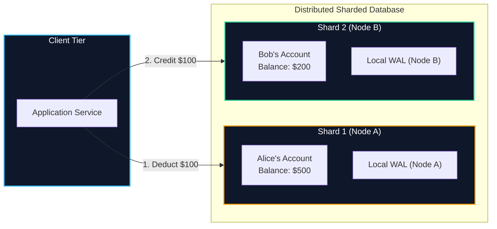
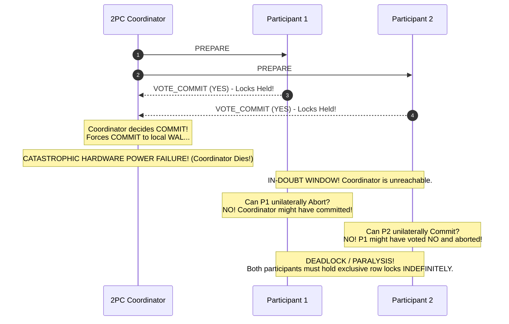
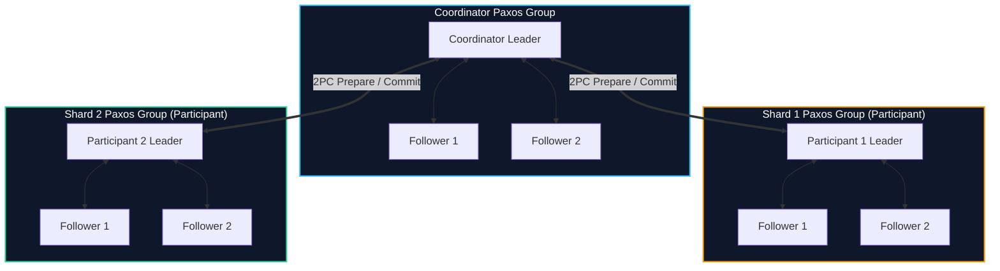
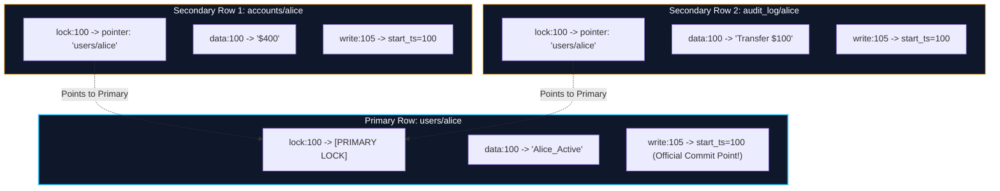
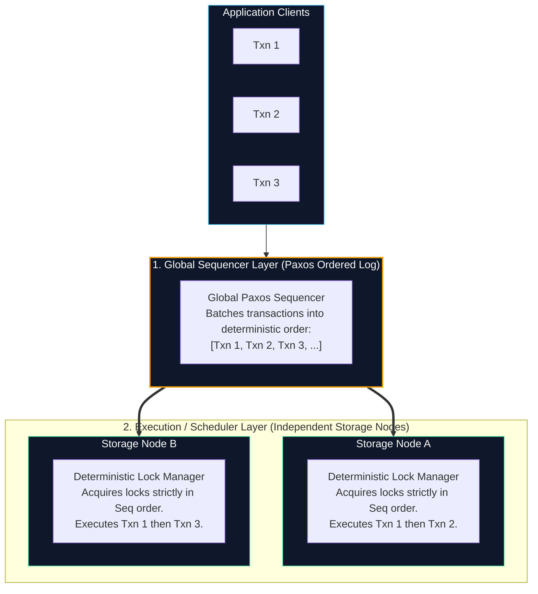

import { Callout } from "fumadocs-ui/components/callout";
import { Tabs, Tab } from "fumadocs-ui/components/tabs";
import { Steps, Step } from "fumadocs-ui/components/steps";
import { Cards, Card } from "fumadocs-ui/components/card";

On a single physical machine, guaranteeing the **ACID** properties (Atomicity, Consistency, Isolation, Durability) is an established engineering discipline. The database engine relies on local page latches, centralized in-memory lock managers (Two-Phase Locking), shared buffer pool caches, and a single monotonic Write-Ahead Log (WAL) governed by algorithms like ARIES (Algorithms for Recovery and Isolation Exploiting Semantics).

However, modern cloud workloads routinely outgrow single-server compute and storage capacities. When a database partitions its tables across dozens or hundreds of independent shards, a single user transaction often needs to mutate records stored on physically separated nodes.

Guaranteeing ACID across multiple network-separated nodes is one of the most difficult challenges in computer science. This chapter explores how distributed transaction protocols work, why classic algorithms block under failure, and how modern systems like **Google Spanner**, **CockroachDB**, **Google Percolator**, and **Calvin** solve distributed transactions at global scale.

---

## 1. Cross-Shard & Cross-Partition Transactions

### The Breakdown of Single-Node ACID

To understand why distributed transactions are difficult, consider the classic bank transfer: transferring $\$100$ from Alice's account to Bob's account.

$$\text{Txn}: \quad \text{UPDATE accounts SET balance = balance - 100 WHERE id = 'Alice'};$$
$$\quad \quad \quad \text{UPDATE accounts SET balance = balance + 100 WHERE id = 'Bob'};$$

On a single node, the database transaction manager executes both updates in memory, writes undo and redo log records to a single local WAL, flushes the log to disk (`fsync`), and commits. If power fails mid-flight, the single WAL provides the definitive truth upon reboot.

Now consider the same transaction in a sharded database where data is partitioned by hash ranges of `account_id`:



In this architecture, single-node ACID guarantees completely break down:

1. **No Shared Memory or Lock Table:** Node A cannot inspect Node B's lock table. While Node A locks Alice's row, a concurrent transaction querying Bob's account on Node B could observe the intermediate state where $\$100$ has vanished into thin air (violating **Isolation**).
2. **Independent Failure Domains:** Node A might successfully write its deduction to disk and commit, but just as Node B attempts to credit Bob's account, Node B suffers a kernel panic or out-of-disk error. Alice's money is permanently gone (violating **Atomicity**).
3. **Independent Clocks:** Physical oscillator clocks on Node A and Node B drift independently. There is no unified physical timestamp to order which operation happened first (violating **Serializability**).

To preserve global atomicity, the database must execute an **Atomic Commit Protocol** ensuring that either all participating shards commit their local updates, or all participating shards abort and roll back.

---

## 2. Two-Phase Commit (2PC)

The foundation of distributed atomic commitment is the **Two-Phase Commit (2PC)** protocol, formalized by Jim Gray in 1978.

### Roles and Architectural Components

A 2PC transaction coordinates two distinct entity types:

- **Coordinator (Transaction Manager):** The node orchestrating the transaction life cycle. It can be a dedicated stateless coordinator, an API proxy, or the shard that received the initial client query.
- **Participants / Cohorts (Resource Managers):** The independent database nodes hosting the actual data partitions being read or mutated.

### Protocol Flow: Phase 1 (Prepare) and Phase 2 (Commit)

```mermaid
sequenceDiagram
    autonumber
    participant Coord as 2PC Coordinator
    participant P1 as Participant 1 (Shard A)
    participant P2 as Participant 2 (Shard B)

    Note over Coord: Client issues COMMIT.<br/>Coordinator initiates 2PC.

    rect rgb(15, 23, 42)
        Note over Coord,P2: PHASE 1: PREPARE (VOTING PHASE)
        Coord->>P1: PREPARE (TxID: 901)
        Coord->>P2: PREPARE (TxID: 901)

        Note over P1: Acquire Exclusive Lock (Alice)<br/>Write Redo/Undo logs to WAL<br/>Force flush disk (fsync)
        P1-->>Coord: VOTE_COMMIT (YES)

        Note over P2: Acquire Exclusive Lock (Bob)<br/>Write Redo/Undo logs to WAL<br/>Force flush disk (fsync)
        P2-->>Coord: VOTE_COMMIT (YES)
    end

    rect rgb(15, 23, 42)
        Note over Coord,P2: PHASE 2: COMMIT (DECISION PHASE)
        Note over Coord: All cohorts voted YES!<br/>Force write "COMMIT TxID:901" to Coordinator WAL.

        Coord->>P1: GLOBAL_COMMIT (TxID: 901)
        Coord->>P2: GLOBAL_COMMIT (TxID: 901)

        Note over P1: Apply mutation permanently<br/>Write "COMMITTED" to local WAL<br/>Release Locks on Alice
        P1-->>Coord: ACK

        Note over P2: Apply mutation permanently<br/>Write "COMMITTED" to local WAL<br/>Release Locks on Bob
        P2-->>Coord: ACK

        Note over Coord: All ACKs received.<br/>Write "END" to Coordinator WAL.
    end
```



<Steps>
### Step 1: The Prepare Phase (Voting)
The coordinator sends a `PREPARE` message to every participant holding data modified by the transaction.
Each participant executes the transaction operations locally up to the commit point:
1. It acquires exclusive row-level write locks (preventing other transactions from modifying the affected data).
2. It writes both **undo log** (to revert changes if aborted) and **redo log** (to apply changes if committed) records to its local WAL.
3. It forces the WAL to physical disk via an `fsync`.
4. If all pre-commit checks succeed, the participant returns `VOTE_COMMIT` (`YES`).

<Callout type="warn" title="The Irrevocable Promise of Voting YES">
  A vote of `YES` is an **irrevocable legal contract**. By voting `YES`, a
  participant guarantees to the coordinator that it can and will commit the
  transaction under all circumstances—even if the participant suddenly crashes,
  reboots, runs out of memory, or loses power for three days. Once a participant
  votes `YES`, it can never unilaterally decide to abort.
</Callout>

### Step 2: The Commit Phase (Decision)

The coordinator evaluates the incoming votes:

- **Case A: All Participants Voted YES:**
  1. The coordinator forces a `COMMIT` record to its own local WAL. **This is the official commit point.** Once written to disk, the transaction is irrevocably committed.
  2. The coordinator broadcasts a `GLOBAL_COMMIT` message to all cohorts.
  3. Each cohort applies the updates permanently, writes a `COMMITTED` record to its local WAL, releases all locks, and replies with an `ACK`.
  4. Once all ACKs are received, the coordinator writes an `END` record to its WAL, closing the transaction.
- **Case B: Any Participant Voted NO or Timed Out:**
  1. If even a single participant votes `VOTE_ABORT` (due to a deadlock, constraint violation, or out-of-disk condition) or fails to respond within a timeout window:
  2. The coordinator forces an `ABORT` record to its local WAL.
  3. The coordinator broadcasts `GLOBAL_ABORT` to all cohorts.
  4. Every cohort uses its undo log to roll back intermediate changes, releases its locks, and sends an `ACK`.
     </Steps>

---

### The Fatal Flaw: The 2PC Blocking Problem

While 2PC guarantees safety (it will never cause an inconsistent state where one node commits and another aborts), it completely sacrifices **liveness** during coordinator failures.

**Two-Phase Commit is a strictly BLOCKING protocol.**

Consider what happens if the coordinator crashes at the critical moment between receiving votes and broadcasting the commit decision:



When participants have voted `YES` and are waiting for the coordinator's Phase 2 decision, they enter the **In-Doubt State**:

- **Why can't Participant 1 unilaterally abort?** Because the coordinator might have written `COMMIT` to its disk and transmitted `GLOBAL_COMMIT` to Participant 2 before its network card died. If Participant 1 aborts, data becomes corrupted.
- **Why can't Participant 1 unilaterally commit?** Because Participant 2 might have voted `NO`, or the coordinator might have chosen to abort.
- **The Result:** The participants have no choice but to **block indefinitely**. They must continue holding exclusive row-level locks on the affected records.

In high-throughput databases, holding exclusive row locks indefinitely triggers a catastrophic cascade. Other transactions attempting to access those locked records queue up, exhausting database connection pools and worker threads until the entire database cluster freezes.

---

## 3. Three-Phase Commit (3PC)

To eliminate the blocking vulnerability of 2PC, Dale Skeen developed the **Three-Phase Commit (3PC)** protocol in 1981.

### Architectural Principle: Eliminating Indecision

The root cause of blocking in 2PC is that a participant in the `Prepared` state has no idea whether other participants voted `YES` or `NO`.

3PC splits Phase 2 into two distinct steps, introducing an intermediate state called **PreCommit**:

1. **Phase 1: CanCommit? (Agreement Phase):** The coordinator asks participants if they can commit. Participants vote `YES` or `NO`.
2. **Phase 2: PreCommit (Consensus Verification):** If all participants voted `YES`, the coordinator sends `PRE_COMMIT`. When a participant receives `PRE_COMMIT`, it gains a crucial piece of global knowledge: **it now knows that every other participant in the cluster voted YES.** Therefore, an abort is no longer possible!
3. **Phase 3: DoCommit (Execution Phase):** Once all participants acknowledge the `PRE_COMMIT`, the coordinator broadcasts `DO_COMMIT`, and the nodes finalize changes and release locks.

```mermaid
sequenceDiagram
    autonumber
    participant Coord as 3PC Coordinator
    participant P1 as Participant 1
    participant P2 as Participant 2

    rect rgb(15, 23, 42)
        Note over Coord,P2: PHASE 1: CAN-COMMIT?
        Coord->>P1: CanCommit?
        Coord->>P2: CanCommit?
        P1-->>Coord: VOTE YES
        P2-->>Coord: VOTE YES
    end

    rect rgb(15, 23, 42)
        Note over Coord,P2: PHASE 2: PRE-COMMIT
        Note over Coord: Everyone voted YES.<br/>Broadcast PreCommit.
        Coord->>P1: PRE_COMMIT
        Coord->>P2: PRE_COMMIT
        Note over P1: Enter PreCommit state.<br/>(Knows everyone voted YES!)
        P1-->>Coord: ACK
        Note over P2: Enter PreCommit state.<br/>(Knows everyone voted YES!)
        P2-->>Coord: ACK
    end

    rect rgb(15, 23, 42)
        Note over Coord,P2: PHASE 3: DO-COMMIT
        Coord->>P1: DO_COMMIT
        Coord->>P2: DO_COMMIT
        Note over P1: Apply changes, release locks
        P1-->>Coord: ACK
        Note over P2: Apply changes, release locks
        P2-->>Coord: ACK
    end
```



### Why 3PC is Non-Blocking Under Fail-Stop Assumptions

If the coordinator crashes during 3PC, the participants can run a cooperative election protocol to elect a replacement coordinator:

- The new coordinator polls all surviving participants for their current state:
  - If **at least one** participant has reached the `PreCommit` state, it proves that every participant in the cluster voted `YES` in Phase 1. The new coordinator can safely advance the entire cluster to `DoCommit`.
  - If **no** participant has reached `PreCommit` (all are in `Init` or `CanCommit`), no node has committed, so the new coordinator can safely broadcast an `ABORT`.

### Why 3PC Fails in the Real World: Network Partitions

3PC is theoretically non-blocking, but **only under the Fail-Stop model with synchronous, bounded network latency**.

In real-world networks (asynchronous networks with arbitrary packet delays and network partitions), **3PC fails catastrophically**:

```
        Network Partition Boundary
                 [ X X X ]

   Partition 1               Partition 2
┌────────────────┐        ┌────────────────┐
│  Coordinator   │        │ Participant 2  │
│  Participant 1 │        │                │
└────────────────┘        └────────────────┘
```

1. Suppose the coordinator and Participant 1 enter `PreCommit`.
2. A network partition isolates Participant 2 from the coordinator.
3. In Partition 1, the coordinator and Participant 1 successfully complete `DoCommit`.
4. In Partition 2, Participant 2 times out waiting for the coordinator. Because it never received `PRE_COMMIT`, its local recovery logic assumes the transaction failed and **unilaterally aborts**.
5. **Outcome:** Participant 1 has committed; Participant 2 has aborted. **Silent data corruption and split-brain.**

Because modern datacenters and internet backbones inevitably experience network partitions, **3PC is virtually never used in production distributed databases**.

---

## 4. Modern Distributed Transaction Architectures

Modern production databases do not rely on fragile standalone 2PC or 3PC coordinators. Instead, they combine consensus protocols (Paxos, Raft), advanced physical clock synchronization, or deterministic execution models.

### Architecture A: Google Spanner & TrueTime

Google Spanner (introduced in 2012) was the first globally distributed database to deliver **External Consistency (Strict Serializability / Linearizability)** across worldwide datacenters while supporting distributed multi-shard ACID transactions.

#### Fixing 2PC with Replicated Paxos Groups

Spanner solves the 2PC coordinator failure problem by making the coordinator and participants **replicated Paxos groups** rather than single servers:



If the physical server running the Coordinator Leader catches fire, the remaining Paxos followers instantly elect a new leader. The new leader reads the replicated Paxos state machine log, determines whether the transaction prepared or committed, and seamlessly resumes 2PC. **The protocol never blocks.**

#### The TrueTime API: Bounding Clock Uncertainty

To allow read-only transactions to execute without acquiring read locks anywhere in the world, Spanner needs to assign every transaction a monotonically increasing commit timestamp $s$ that reflects true physical real-world time.

Standard NTP (Network Time Protocol) synchronization can drift by hundreds of milliseconds. Google engineered **TrueTime**: a hardware architecture combining GPS receivers and redundant atomic clocks (rubidium oscillators) in every datacenter.

Instead of returning a discrete time $t$, the TrueTime API explicitly returns a time window with bounded uncertainty $\epsilon$:

$$\text{TT.now}() = [t_{\text{earliest}}, \, t_{\text{latest}}] \quad \text{where} \quad \epsilon = \frac{t_{\text{latest}} - t_{\text{earliest}}}{2}$$

In Google datacenters, $\epsilon$ is typically less than **7 milliseconds** (and often sub-millisecond).

#### The Commit Wait Rule

Spanner guarantees that if transaction $T_2$ begins after transaction $T_1$ commits in real world time, $T_2$'s timestamp must be strictly greater than $T_1$'s timestamp ($s_2 > s_1$).

To achieve this without inter-datacenter communication during reads, Spanner enforces the **Commit Wait Rule**:

```mermaid
sequenceDiagram
    autonumber
    participant T1 as Transaction T1
    participant TT as TrueTime Engine
    participant Client

    Note over T1: T1 acquires locks, executes updates.
    T1->>TT: TT.now()
    TT-->>T1: Returns [t_earliest, t_latest]
    Note over T1: Pick commit timestamp s >= t_latest

    rect rgb(30, 41, 59)
        Note over T1: COMMIT WAIT DELAY (Duration: 2 * epsilon)<br/>Transaction holds all locks and WAITS...
        Note over T1: Wait until TT.now().earliest > s
    end

    Note over T1: Real-world time is guaranteed to have passed 's'!
    T1->>T1: Release Locks & Commit
    T1-->>Client: Transaction Committed!

    Note over Client: Client immediately starts Transaction T2.<br/>T2 pick timestamp s2 >= TT.now().latest.<br/>Mathematically guaranteed: s2 > s1!
```



$$\text{Commit Wait Delay} \ge 2\epsilon$$

By waiting out the clock uncertainty period ($2\epsilon$) before releasing locks and acknowledging to the client, Spanner guarantees that no future transaction anywhere on the planet can ever receive a timestamp $\le s_1$. This enables lock-free snapshot reads at any timestamp in the past.

---

### Architecture B: Google Percolator (Decentralized Snapshot Isolation)

Built on top of Google Bigtable (a distributed sparse key-value store without multi-row transactions), **Google Percolator** powers Google's web-indexing search pipeline. It achieves distributed Snapshot Isolation without a centralized lock manager.

#### The Column Schema

For each user cell, Percolator stores three separate internal Bigtable columns at discrete timestamps:

| Internal Column | Description                                                                                         | Example Content                                    |
| :-------------- | :-------------------------------------------------------------------------------------------------- | :------------------------------------------------- |
| `data:ts`       | Raw user value written at transaction start timestamp ($T_{\text{start}}$).                         | `data:100 -> "Alice_v2"`                           |
| `lock:ts`       | Indicates an active, uncommitted lock. Points to the **Primary Lock**.                              | `lock:100 -> {primary: "users/alice", client: c1}` |
| `write:ts`      | Commit record written at commit timestamp ($T_{\text{commit}}$). Points back to $T_{\text{start}}$. | `write:105 -> {start_ts: 100}`                     |

#### Primary and Secondary Locks

Percolator designates one row in the transaction as the **Primary Lock**, while all other rows are **Secondary Locks** that hold pointers to the primary row:



#### Execution Lifecycle: Prewrite and Commit

<Tabs items={["Phase 1: Prewrite", "Phase 2: Commit", "Conflict & Recovery"]}>
<Tab value="Phase 1: Prewrite">

1. The client requests a start timestamp from the centralized Timestamp Oracle ($T_{\text{start}} = 100$).
2. The client checks for write conflicts: if any cell has a `write:ts` where $t \ge T_{\text{start}}$, or has an active `lock:ts` at any timestamp, the transaction aborts.
3. The client writes data to `data:100`.
4. The client locks the **Primary Row** by atomically writing `lock:100` via Bigtable's `CheckAndMutate`.
5. The client writes data and secondary locks to all remaining rows, pointing their `lock:100` to the primary row.

</Tab>
<Tab value="Phase 2: Commit">

1. The client requests a commit timestamp from the Timestamp Oracle ($T_{\text{commit}} = 105$).
2. The client commits the **Primary Row first**:
   - In a single atomic `CheckAndMutate`, it removes `lock:100` and writes `write:105 -> start_ts: 100`.
   - **This single atomic operation is the commit point of the entire distributed transaction.**
3. Once the primary row is committed, the client updates the secondary rows asynchronously, deleting their locks and adding `write:105`.

</Tab>
<Tab value="Conflict & Recovery">

What happens if the client crashes mid-commit? Secondary rows are left holding orphan locks pointing to the primary.

When another reader or writer encounters a secondary lock:

- It navigates to the primary row referenced in the lock pointer.
- If the primary row has a `write:ts` record, the primary committed! The reader **rolls forward** the secondary lock (deleting the lock and writing `write:105`).
- If the primary row still has `lock:ts` and its client lease expired, the reader **rolls back** the primary and cleans up all secondary locks.

**The state of the primary lock is the single source of truth for the entire transaction.**

</Tab>
</Tabs>

---

### Architecture C: Calvin & Deterministic Databases

All traditional commit protocols (2PC, 3PC, Percolator) suffer from a fundamental throughput limitation: **locks are held across network round-trips**. While nodes wait for prepare votes and commit confirmations, locks remain locked, throttling concurrency.

**Calvin** (designed by Daniel Abadi, Alexander Thomson, et al. in 2012, and commercialized in FaunaDB) takes a revolutionary approach: **Eliminate distributed commit protocols entirely by ordering transactions BEFORE execution.**



#### How Calvin Eliminates 2PC

1. **Deterministic Sequencing:** Transactions are submitted to a global **Sequencer Layer**. The sequencer batches transactions and uses Paxos to replicate and establish a strict, immutable global execution sequence.
2. **Pre-Parsed Read/Write Sets:** Transactions must declare their read sets and write sets upfront (or use an optimistic pre-execution phase to discover them).
3. **Deterministic Lock Acquisition:** Every storage shard inspects the agreed-upon Paxos log. Each shard acquires locks strictly in the transaction sequence order:
   - Because all nodes acquire locks in identical global order, **deadlocks are mathematically impossible**. No deadlock detection algorithm or lock aborts are required!
4. **Zero Distributed Commit Rounds:** When a node finishes executing its partition of transaction $T_k$, it applies changes immediately. Because the transaction logic is completely deterministic, **every node is guaranteed to produce identical results**. A node never needs to ask its peers if they can commit. **2PC is completely eliminated!**

---

## 5. Architectural Comparison Matrix

| Protocol / Architecture              | Core Mechanism                                                               | Blocking Under Failure?                                          | Network Round-Trips to Commit             | Scalability & Bottlenecks                                      | Real-World Adopters                                 |
| :----------------------------------- | :--------------------------------------------------------------------------- | :--------------------------------------------------------------- | :---------------------------------------- | :------------------------------------------------------------- | :-------------------------------------------------- |
| **Classic 2PC**                      | Coordinator WAL + Cohort Voting                                              | **Yes** (Coordinator crash freezes locks)                        | 2 RTTs                                    | Severe latency amplification; lock contention                  | Traditional RDBMS (Postgres XA, Oracle)             |
| **3PC (Skeen)**                      | CanCommit $\rightarrow$ PreCommit $\rightarrow$ DoCommit                     | Non-blocking under Fail-Stop; **Blocks/Splits under Partitions** | 3 RTTs                                    | Broken by network partitions; high message cost                | Academic prototypes (rarely production)             |
| **Spanner (2PC + Paxos + TrueTime)** | Replicated Paxos groups for coordinator + TrueTime commit wait ($2\epsilon$) | **No** (Paxos electively replaces dead coordinator)              | 2 RTTs + Commit Wait delay                | Requires atomic clocks/GPS; tail latency bound by $\epsilon$   | Google Spanner, CockroachDB (Hybrid Logical Clocks) |
| **Google Percolator**                | Primary Lock + Decentralized Bigtable `CheckAndMutate`                       | **No** (Orphan locks resolved via primary state)                 | 2 RTTs per partition                      | Contention on centralized Timestamp Oracle (TSO)               | Google Indexing, TiDB / TiKV                        |
| **Calvin**                           | Paxos Sequencer ordering prior to deterministic execution                    | **No** (Zero 2PC commit protocol needed)                         | 1 Paxos sequence RTT (prior to execution) | Read/write sets must be known upfront; cross-partition latency | FaunaDB                                             |

---

## Summary & Key Takeaways

1. **Partitioning Destroys Single-Node ACID:** When transactions cross shard boundaries, local page latches and WALs cannot guarantee global atomicity or isolation. Atomic commit protocols are required.
2. **2PC Guarantees Safety, Sacrifices Liveness:** Two-Phase Commit ensures all shards commit or abort, but if the coordinator fails while participants are in the `Prepared` state, nodes block indefinitely holding exclusive row locks.
3. **3PC Fails Under Network Partitions:** Although Three-Phase Commit eliminates blocking under fail-stop assumptions by introducing the `PreCommit` phase, it produces catastrophic split-brain state under network partitions.
4. **Paxos Solves the 2PC Coordinator Problem:** Modern engines (Spanner, CockroachDB) replicate both the coordinator and participants using Paxos/Raft consensus groups, guaranteeing that a crashed coordinator is immediately replaced without blocking transactions.
5. **TrueTime Enables Lock-Free Global Reads:** By bounding physical clock uncertainty to $\epsilon$ via GPS and atomic clocks, Google Spanner uses the Commit Wait rule ($2\epsilon$) to enforce external consistency globally without read locking.
6. **Calvin Redefines Commit by Deterministic Ordering:** By sequencing transactions via Paxos _before_ execution and enforcing deterministic lock acquisition, Calvin eliminates 2PC and distributed locks during transaction execution.
