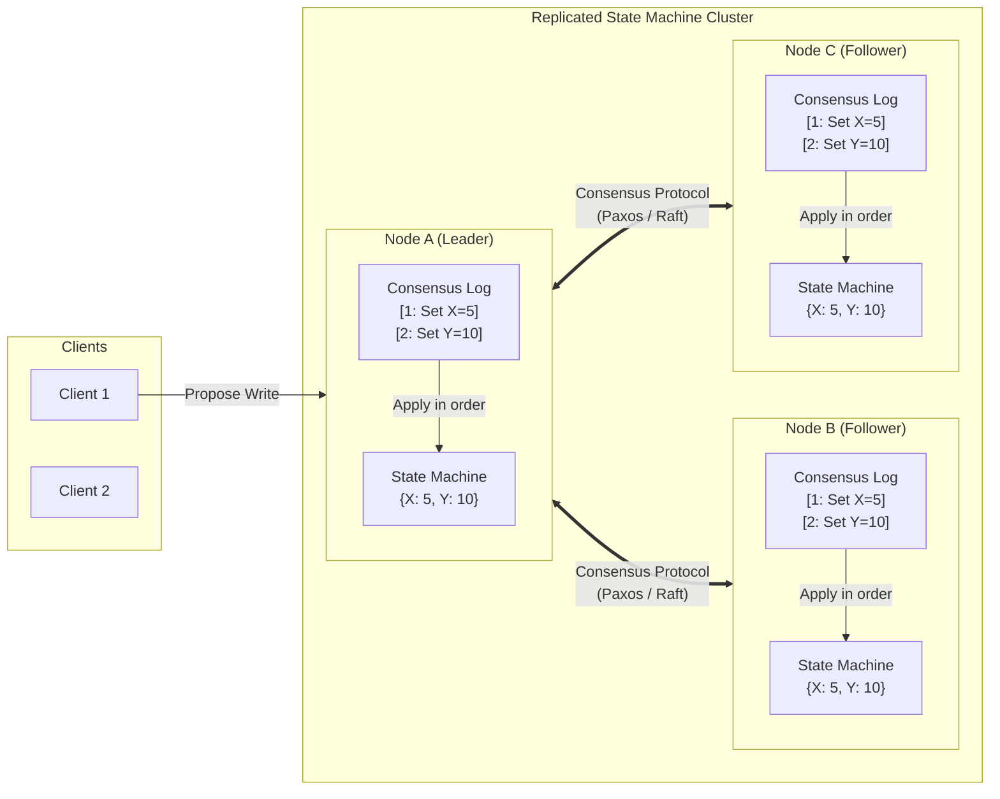
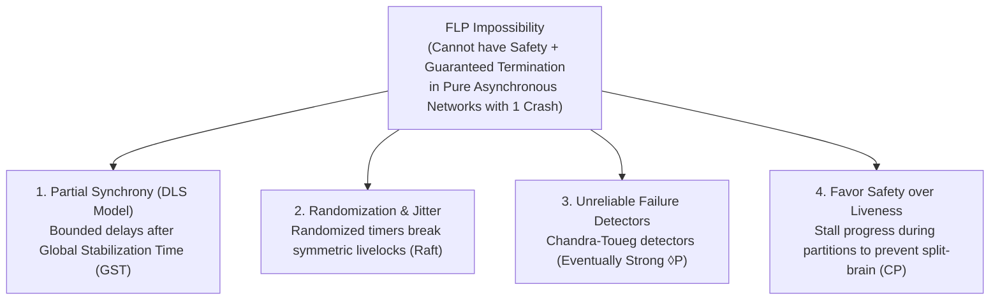
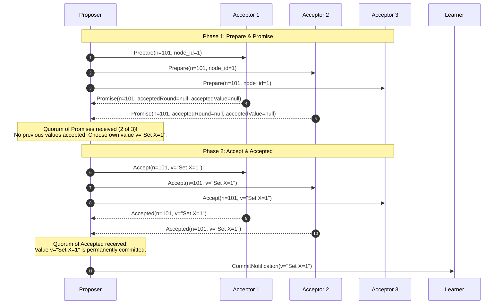
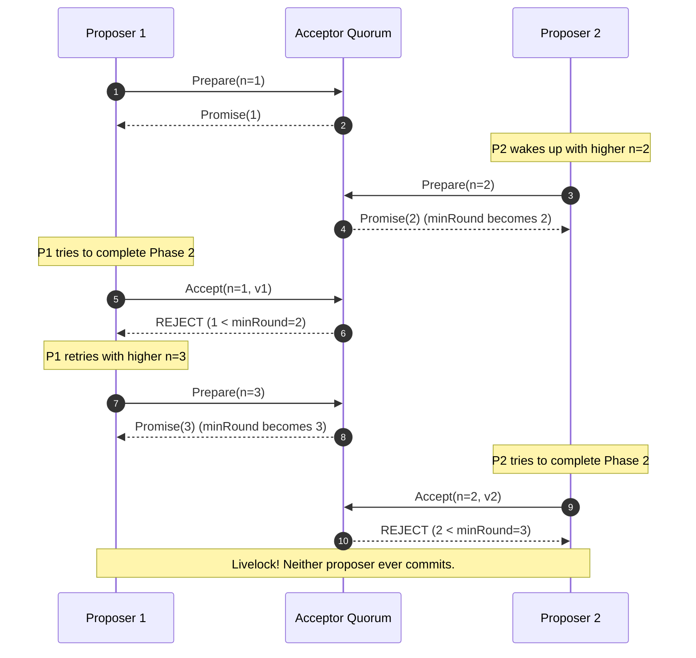
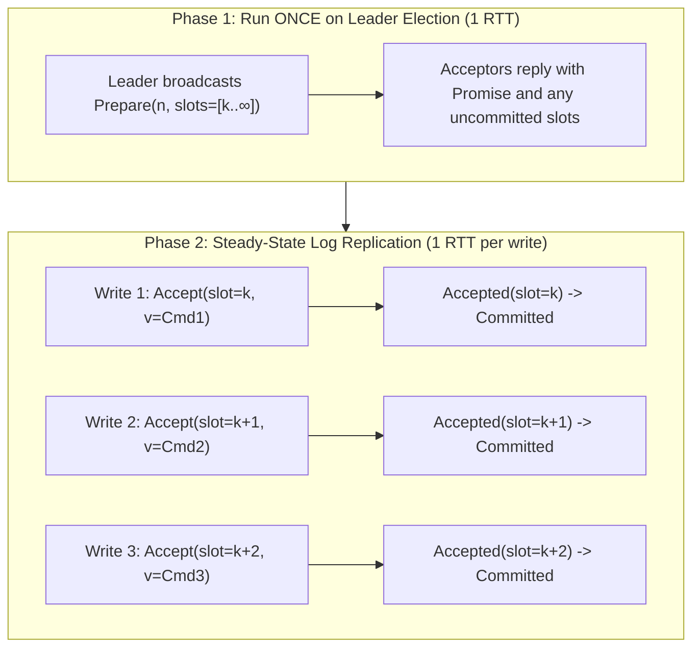
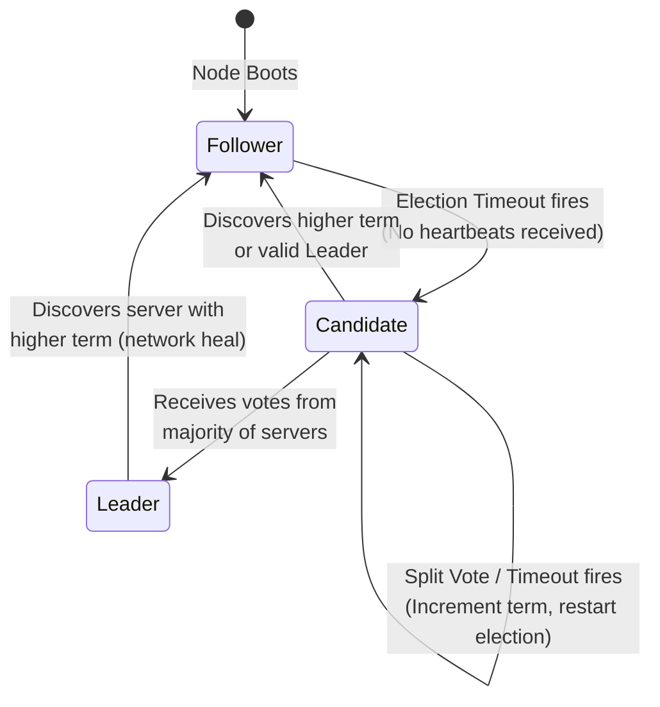
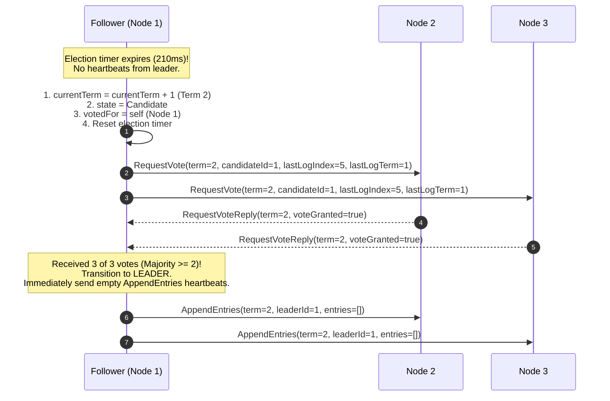
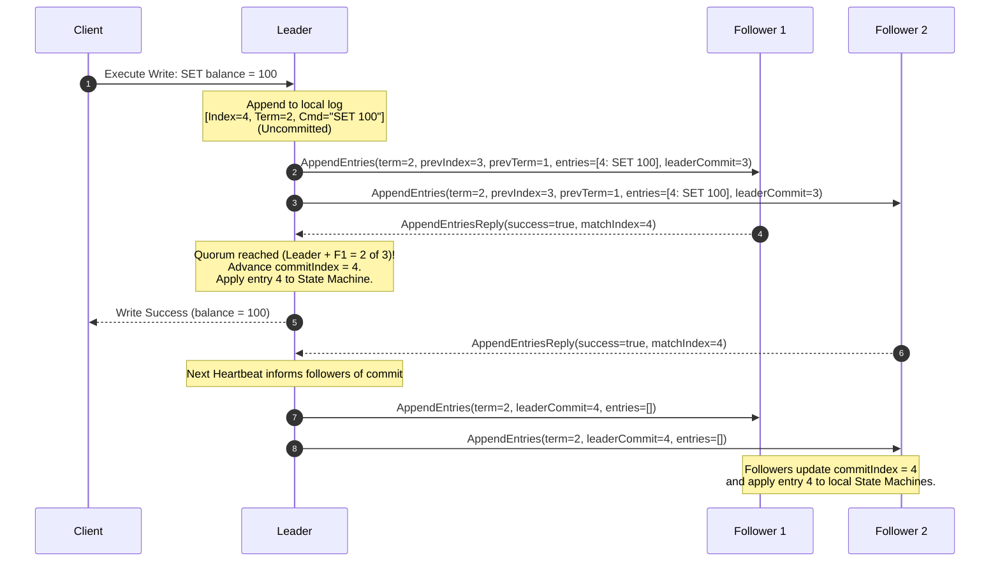
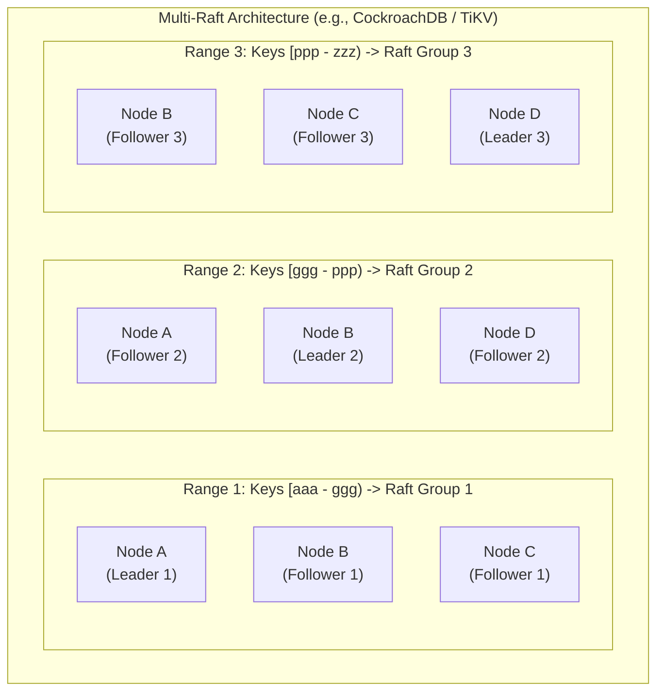

import { Callout } from "fumadocs-ui/components/callout";
import { Tabs, Tab } from "fumadocs-ui/components/tabs";
import { Cards, Card } from "fumadocs-ui/components/card";

In Part I of Database Internals, we explored how a single storage engine durably persists pages, structures indexes (B-Trees and LSM-Trees), and recovers from power loss via Write-Ahead Logging (WAL) and ARIES. In Part II, we scaled out to multi-node topologies: gossip dissemination, failure detectors, and two-phase commit (2PC).

However, traditional primary-replica topologies and distributed transactions hit a catastrophic barrier when nodes crash or the network partitions: **who decides the true state of the database when peers disagree?**

If a primary fails, an automated failover system must promote a replica. If two nodes simultaneously claim to be the primary, a **split-brain** disaster occurs: both accept conflicting writes, permanently corrupting the keyspace. If a 2PC coordinator crashes while participants are in the `PREPARED` state, the entire transaction engine blocks indefinitely.

**Consensus protocols** are the mathematical foundation that solves this problem. They allow a cluster of unreliable, asynchronous machines to reach strict, linearizable agreement on a sequence of state transitions—guaranteeing that surviving nodes remain operational, consistent, and coherent without human intervention.

This chapter explores distributed consensus in exhaustive depth: the theoretical limits under FLP, the classical machinery of Single-Decree and Multi-Paxos, the complete mechanics and safety proofs of Raft, and how modern distributed databases (CockroachDB, TiKV, Spanner, etcd) implement Multi-Raft and Multi-Paxos at petabyte scale.

---

## 1. The Consensus Problem & State Machine Replication (SMR)

### The Core Problem

At its simplest, **consensus** is the process of getting a collection of independent nodes to agree on a single value or decision. In a distributed database, this decision is rarely a one-off value; rather, it is an append-only, ordered log of deterministic commands.

Formal consensus requires four foundational properties:

1. **Agreement (Safety):** No two non-faulty nodes ever decide on different values.
2. **Validity / Non-triviality (Safety):** If a node decides value $v$, then $v$ must have been proposed by some node in the system (nodes cannot invent arbitrary state).
3. **Integrity (Safety):** A node decides at most once.
4. **Termination (Liveness):** Every non-faulty node eventually reaches a decision.

<Callout type="info" title="Safety vs. Liveness in Distributed Systems">
  - **Safety ("Nothing bad happens"):** The system never produces an incorrect
  result, corrupts data, or diverges into split-brain states. Safety can never
  be violated, even under arbitrary network delays, packet duplication, or
  reordering. - **Liveness ("Something good eventually happens"):** The system
  makes forward progress and responds to client requests in bounded time. Under
  extreme network partitions, liveness may temporarily stall, but safety must
  never be compromised.
</Callout>

### State Machine Replication (SMR)

Formulated by Leslie Lamport (1978) and generalized by Fred Schneider (1990), **State Machine Replication (SMR)** is the architectural paradigm that converts a single-node deterministic program into a fault-tolerant distributed system.



A deterministic state machine consists of:

- A set of states $S$.
- An initial state $S_0$.
- A set of input commands $C$.
- A deterministic transition function $f: S \times C \to S'$.

$$\forall i \ge 1, \quad S_i = f(S_{i-1}, C_i)$$

If every replica starts with the identical initial state $S_0$ and applies an identical sequence of deterministic commands $C_1, C_2, \dots, C_k$ in the exact same order, **every surviving replica will arrive at the exact same state $S_k$**.

The job of a consensus protocol in a distributed database is not to execute business logic; its sole purpose is to **replicate and order the log of commands** ($C_1, C_2, \dots$) identically across all nodes despite crashes and packet loss.

---

## 2. The FLP Impossibility Result

In 1985, researchers Fischer, Lynch, and Paterson published one of the most celebrated theorems in computer science: _"Impossibility of Distributed Consensus with One Faulty Process"_ (commonly referred to as **FLP Impossibility**).

### The FLP Theorem

> In a purely **asynchronous distributed system**, no deterministic consensus protocol can guarantee both **safety** and **liveness** in the presence of even a **single unannounced crash failure**.

Why does this hold?

1. **Asynchronous Network Assumption:** Message transmission delays are unbounded. A packet may take 2 milliseconds or 2 days to arrive.
2. **Crash-Stop Failures:** A process can stop executing instructions silently without warning.
3. **Indistinguishability:** If Node $A$ sends a message to Node $B$ and receives no response, Node $A$ cannot determine whether:
   - Node $B$ has crashed permanently, OR
   - Node $B$ is running slowly, OR
   - The network connection to Node $B$ is experiencing transient latency.

Fischer, Lynch, and Paterson proved that in any consensus algorithm, there exist **bivalent configurations** (states from which both a decision of `0` or `1` are still possible). An adversarial network scheduler can delay messages such that the system transitions from one bivalent state to another bivalent state forever, preventing termination without violating safety.

### How Real Systems Circumvent FLP

Because real distributed databases must operate and terminate, systems bypass FLP by relaxing the pure asynchronous model:



1. **Partial Synchrony (Dwork, Lynch, Stockmeyer 1988):** Systems assume the network is asynchronous for periods, but eventually reaches a **Global Stabilization Time (GST)**, after which message propagation delays are bounded by an upper bound $\Delta$. Consensus protocols maintain safety during asynchronous periods and achieve liveness during synchronous periods.
2. **Randomization:** Breaking deterministic symmetry using randomized election timeouts (used universally by Raft) prevents perpetual dueling proposers and split-vote cycles.
3. **Sacrificing Liveness for Safety:** Under network partitions (the CAP theorem's $P$), CP databases (etcd, CockroachDB, Spanner) prefer to reject writes on the minority partition (stalling liveness) to ensure zero split-brain data corruption (preserving absolute safety).

---

## 3. Classic Paxos (Single-Decree)

Invented by Leslie Lamport in his 1998 paper _"The Part-Time Parliament"_ and simplified in 2001's _"Paxos Made Simple"_, **Classic Paxos** (or Single-Decree Paxos) reaches agreement on a single immutable decision among a set of nodes.

### Roles in Paxos

In theoretical Paxos, nodes play three distinct roles:

- **Proposers:** Active agents that advocate for client values by initiating consensus rounds.
- **Acceptors:** Stateful memory of the cluster. They form quorums, store proposals, and vote to accept or reject them.
- **Learners:** Passive nodes that observe the agreed-upon outcome and apply it to their local state machine.

In production databases, every physical node runs all three roles simultaneously.

### Quorums and Proposal Numbers

Paxos guarantees safety by requiring operations to be acknowledged by a **majority quorum** $Q$:

$$|Q| \ge \left\lfloor \frac{N}{2} \right\rfloor + 1 \quad \text{where } N \text{ is total nodes}$$

Because any two majorities of size $\lfloor N/2 \rfloor + 1$ out of $N$ nodes must overlap by at least one node:

$$Q_1 \cap Q_2 \neq \emptyset$$

By the **Pigeonhole Principle**, any subsequent quorum is guaranteed to observe the vote of at least one node that participated in any previous quorum.

Proposers generate **globally unique, monotonically increasing proposal numbers** $n$. A proposal number is represented as a tuple:

$$n = (\text{round\_number}, \text{node\_id})$$

Ordered lexicographically:

$$(r_1, id_1) > (r_2, id_2) \iff (r_1 > r_2) \lor (r_1 = r_2 \land id_1 > id_2)$$

### Acceptor State

Each Acceptor must durably persist three variables to disk (surviving restarts):

- $\text{minRound}$: The highest proposal number $n$ the acceptor has ever promised to consider.
- $\text{acceptedRound}$: The proposal number of the highest proposal the acceptor has accepted (or $\bot$ if none).
- $\text{acceptedValue}$: The value of the highest proposal the acceptor has accepted (or $\bot$ if none).

### The Two-Phase Dance

Paxos operates in two distinct phases: Phase 1 (Prepare/Promise) and Phase 2 (Accept/Accepted).



#### Phase 1a: Prepare

A Proposer chooses a proposal number $n$ and broadcasts a message to a majority of Acceptors:

$$\text{Prepare}(n)$$

#### Phase 1b: Promise

When an Acceptor receives $\text{Prepare}(n)$:

- If $n > \text{minRound}$:
  - It sets $\text{minRound} = n$.
  - It responds with a promise not to accept any proposals numbered less than $n$ in the future:
    $$\text{Promise}(n, \text{acceptedRound}, \text{acceptedValue})$$
- If $n \le \text{minRound}$:
  - The request is rejected or ignored ($\text{NACK}$).

#### Phase 2a: Accept

Once the Proposer receives promises from a majority quorum of Acceptors:

- It selects a value $v$:
  - If any Acceptor returned an already accepted value in its promise, the Proposer **MUST** choose the value $v$ associated with the **highest** $\text{acceptedRound}$ among all received promises.
  - If no Acceptor had previously accepted a value (all returned $\bot$), the Proposer is free to propose its own client-requested value $v$.
- The Proposer broadcasts to a majority of Acceptors:
  $$\text{Accept}(n, v)$$

#### Phase 2b: Accepted

When an Acceptor receives $\text{Accept}(n, v)$:

- If $n \ge \text{minRound}$:
  - It accepts the proposal.
  - It updates $\text{acceptedRound} = n$ and $\text{acceptedValue} = v$.
  - It broadcasts an $\text{Accepted}(n, v)$ message to the Proposer and all Learners.
- If $n < \text{minRound}$:
  - The Acceptor rejects the message (because it already promised a higher proposal number $n' > n$ to another proposer).

A value is **chosen** (committed) the instant it is accepted by a majority of Acceptors.

<Callout type="warn" title="Why Must a Proposer Adopt the Highest-Numbered Accepted Value?">
Suppose Proposer 1 succeeds in getting value $A$ accepted by Acceptors 1 and 2 (a majority). Before Proposer 1 can notify learners, Proposer 2 starts with proposal number $n_2 > n_1$.

When Proposer 2 queries Acceptors 2 and 3 in Phase 1, Acceptor 2 replies: _"I already accepted value $A$ at round $n_1$."_

Because of quorum intersection, **at least one node in Proposer 2's quorum witnessed the previous commit**. If Proposer 2 could propose its own value $B$, it would overwrite value $A$, violating Safety! By forcing Proposer 2 to adopt value $A$, Paxos guarantees that once a value is committed, all future proposers with higher proposal numbers will re-propose and re-affirm that identical value.

</Callout>

### Paxos Pathologies: Dueling Proposers and Livelock

Classic Paxos guarantees safety under all conditions, but it does **not** guarantee liveness when multiple proposers compete concurrently.

Consider two proposers, $P_1$ and $P_2$:



In this scenario, $P_1$ and $P_2$ continuously leapfrog each other's proposal numbers in Phase 1 before either can complete Phase 2. The cluster burns CPU and network bandwidth without ever deciding a value.

**Remedies:**

1. **Randomized Exponential Backoff:** Proposers wait for a randomized interval before retrying a rejected proposal.
2. **Multi-Paxos (Leader Election):** Appoint a single distinguished Proposer (Leader).

---

## 4. Multi-Paxos: Collapsing Round-Trips

Classic Paxos reaches consensus on exactly **one** value (a single log slot) and requires **two round-trips (2 RTTs)** for every decision:

1. RTT 1: Phase 1a ($\text{Prepare}$) $\to$ Phase 1b ($\text{Promise}$)
2. RTT 2: Phase 2a ($\text{Accept}$) $\to$ Phase 2b ($\text{Accepted}$)

In a high-throughput database, burning 2 RTTs per transaction is unacceptable.

### The Multi-Paxos Optimization

**Multi-Paxos** amortizes the cost of Phase 1 across an infinite sequence of log slots:

1. A single stable leader is elected by running Phase 1 once for **all log instances** from current index $i$ to $\infty$:
   $$\text{Prepare}(n, \text{slot}=\text{all})$$
2. Acceptors promise that for all future log slots, they will reject any proposals numbered less than $n$.
3. As long as this leader remains alive, it **skips Phase 1 entirely** for subsequent client writes.
4. Client writes require only **Phase 2 (1 RTT)**:
   $$\text{Accept}(n, \text{slot}=i, v) \longrightarrow \text{Accepted}(n, \text{slot}=i, v)$$



### The Complexity of Multi-Paxos

While mathematically elegant, Lamport's original description of Multi-Paxos omitted vital implementation details:

- How are log holes (uncommitted slots) reconciled during leader failover?
- How is cluster membership reconfigured dynamically?
- How are snapshots taken without stalling concurrent writers?

As the authors of Google Chubby famously noted in their paper _"Paxos Made Live — An Engineering Perspective"_ (Chandra et al., 2007):

> _"There are significant gaps between the description of the Paxos algorithm and the needs of a real-world system... The final system will be based on an unproven protocol."_

This complexity inspired Stanford researchers in 2014 to develop **Raft**.

---

## 5. The Raft Consensus Protocol

Designed by Diego Ongaro and John Ousterhout, **Raft** was constructed specifically to replace Paxos with an algorithm that is formally equivalent in safety and fault tolerance, but fundamentally decomposed for **understandability and straightforward implementation**.

Raft decomposes the consensus problem into three independent sub-problems:

1. **Leader Election:** Electing a single coordinator when an existing leader fails.
2. **Log Replication:** The leader accepts log entries from clients, forces followers to mirror its log, and decides when entries are safe to apply.
3. **Safety Invariants:** Ensuring that if any server applies a log entry to its state machine, no other server will ever apply a different log entry for that same index.

### Server States and Roles

At any given instant, every node in a Raft cluster exists in exactly one of three states:



- **Follower:** Completely passive. Responds to incoming RPCs from leaders and candidates. Never issues requests on its own.
- **Candidate:** Active state during an election. Transitions from Follower, increments term, and requests votes from peers.
- **Leader:** The sole coordinator for the cluster. Handles all client reads and writes, drives log replication, and dispatches periodic heartbeats to prevent follower elections.

### Terms: Raft's Logical Epochs

Time in Raft is divided into arbitrary-length **Terms**, numbered with monotonically increasing integers ($1, 2, 3, \dots$). Terms act as logical clocks:

```
Term 1 (Leader A) | Term 2 (Split Vote) | Term 3 (Leader B) ...
[================]| [====== Election ==]| [====================]
```

- Every RPC exchange begins with an exchange of `term`.
- If a server receives a message with a term $T > \text{currentTerm}$, it immediately updates its $\text{currentTerm} = T$ and converts to a **Follower**.
- If a candidate or leader receives a message with a term $T < \text{currentTerm}$, it rejects the request as stale.

---

### Step 1: Leader Election

Raft clusters use a **heartbeat mechanism** to detect leader failure:

1. The Leader sends periodic empty `AppendEntries` RPCs (heartbeats) to all followers every $T_{\text{heartbeat}}$ (typically 20ms to 50ms).
2. Each Follower maintains an **Election Timer** (randomized between 150ms and 300ms).
3. Every time a Follower receives a valid heartbeat or `AppendEntries` RPC, it resets its election timer.
4. If a follower's election timer expires without receiving a heartbeat, it assumes the leader is dead and begins an election.



#### Why Randomized Election Timeouts?

If all nodes used a static timeout (e.g., 200ms), then when a leader dies, all followers would timeout at the exact same millisecond, vote for themselves, split the votes evenly, and trigger a split-vote deadlock.

By picking the timeout randomly from a uniform distribution (e.g., $[150\text{ms}, 300\text{ms}]$):

- One follower will almost always time out slightly earlier than its peers (e.g., at 162ms vs 245ms).
- It transitions to Candidate and broadcasts `RequestVote` RPCs before other nodes timeout.
- The other nodes receive the vote request, grant their vote, reset their timers, and prevent split votes.

#### The `RequestVote` RPC

**Arguments:**

- `term`: Candidate's current term.
- `candidateId`: Candidate identifier requesting the vote.
- `lastLogIndex`: Index of candidate's last log entry.
- `lastLogTerm`: Term of candidate's last log entry.

**Results:**

- `term`: Current term of the voter (allowing candidate to update itself if it is behind).
- `voteGranted`: Boolean indicating whether the vote was granted.

---

### Step 2: Log Replication

Once elected, the Leader becomes the sole authority for cluster writes.

```
Log Index:      1     2     3     4     5     6
Leader Log:  [1: X] [1: Y] [1: Z] [2: A] [2: B] [3: C] (Uncommitted)
             ^--------------------------------^
                      Committed Entries (Majority)
```

Each log entry contains three fields:

1. **Index:** Integer position in the log ($1, 2, 3, \dots$).
2. **Term:** The term in which the entry was received by the leader.
3. **Command:** The state machine mutation (e.g., `SET user:10 = "Alice"`).

#### The Log Replication Workflow

1. A client submits a command to the Leader.
2. The Leader appends the command to its local log as an **uncommitted** entry.
3. The Leader issues an `AppendEntries` RPC in parallel to all Followers.
4. When a majority ($\lfloor N/2 \rfloor + 1$) of nodes have acknowledged persisting the entry to disk:
   - The Leader marks the entry as **committed** (advances its `commitIndex`).
   - The Leader executes the command against its local state machine.
   - The Leader returns the execution result to the client.
5. In subsequent `AppendEntries` RPCs (or heartbeats), the Leader includes its updated `commitIndex`. Followers observe this and apply the newly committed entries to their local state machines.



---

### Step 3: Raft Safety Invariants

Raft guarantees correctness through five inviolable safety properties:

| Property                 | Description                                                                                                                                          |
| :----------------------- | :--------------------------------------------------------------------------------------------------------------------------------------------------- |
| **Election Safety**      | At most one leader can be elected in a given term.                                                                                                   |
| **Leader Append-Only**   | A leader never overwrites or truncates its own log entries; it only appends new entries.                                                             |
| **Log Matching**         | If two logs contain an entry with the same index and term, they are identical in all entries through the given index.                                |
| **Leader Completeness**  | If a log entry is committed in a given term, that entry will be present in the logs of the leaders for all higher-numbered terms.                    |
| **State Machine Safety** | If a server has applied a log entry at a given index to its state machine, no other server will ever apply a different log entry for the same index. |

Let us inspect the two most critical mechanics that enforce these properties:

#### 1. The Log Matching Property & Consistency Check

Raft guarantees that if two servers agree on an entry at index $i$ with term $t$:

1. They store identical commands at index $i$.
2. Their logs are **completely identical across all preceding entries $1 \dots i-1$**.

This is enforced by an inductive check in the `AppendEntries` RPC:

- When a leader sends `AppendEntries`, it includes `prevLogIndex` and `prevLogTerm` (the index and term of the entry immediately preceding the new entries).
- When a follower receives `AppendEntries`, it verifies whether its own log contains an entry at `prevLogIndex` with term `prevLogTerm`.
- If the follower's entry does **not** match, it **rejects the RPC**.

If a follower rejects `AppendEntries`, the leader decrements `nextIndex[peer]` for that follower and retries. The leader walks backward until it finds the point where the follower's log matches the leader's log, deletes any conflicting follower entries beyond that point, and appends the leader's entries.

```
Leader:    [1:A] [1:B] [2:C] [2:D] [3:E] [3:F]
Follower:  [1:A] [1:B] [1:X] [1:Y] (Diverged at index 3)

Leader decrements nextIndex until prevLogIndex=2, prevLogTerm=1 matches!
Follower truncates [1:X], [1:Y] and overwrites with [2:C], [2:D], [3:E], [3:F].
```

#### 2. The Election Restriction (Leader Completeness Safety)

How does Raft guarantee that a newly elected leader already possesses every committed log entry without having to copy entries from followers?

Raft prevents an out-of-date candidate from winning an election via the **Election Restriction**:

- A follower will deny its vote if the candidate's log is **less up-to-date** than the follower's own log.

The `RequestVote` rule specifies:

1. If the candidate and voter have different `lastLogTerm`, the log with the **higher term is more up-to-date**.
2. If both logs end with the same term, whichever log is **longer (higher `lastLogIndex`) is more up-to-date**.

$$\text{Candidate More Up-to-Date} \iff (t_{\text{cand}} > t_{\text{voter}}) \lor (t_{\text{cand}} = t_{\text{voter}} \land i_{\text{cand}} \ge i_{\text{voter}})$$

Because a committed entry must be present on a majority of nodes, and winning an election requires votes from a majority of nodes, **at least one voter in the candidate's voting quorum must contain the committed entry**. Since that voter has the committed entry, its log is at least as up-to-date as the candidate's, so it will deny its vote to any candidate lacking that entry!

<Callout type="error" title="The Subtle Bug: Committing Entries from Prior Terms (Figure 8 in Raft Paper)">
Can a leader commit an uncommitted entry from a *previous* term as soon as it has replicated that entry to a majority of servers?

**NO!** Diego Ongaro and John Ousterhout discovered a catastrophic edge case:
If a leader tries to commit an entry from an older term by directly counting replicas, an untimely leader crash can allow a resurrected candidate with an older log to overwrite that committed entry.

**The Raft Invariant:** A leader **never commits an entry from an older term directly by counting replicas**. A leader only commits entries from its **current term** by counting replicas to a majority. Once an entry from the current term is committed, all preceding log entries are committed indirectly by the Log Matching Property.

</Callout>

---

### Step 4: Cluster Membership Changes

In a production database, machines must be added or removed dynamically (scaling up, replacing failed hardware).

A naive direct configuration change (switching cluster membership from $\{A, B, C\}$ to $\{A, B, C, D, E\}$ instantly) causes a split-brain disaster: because nodes switch configurations at different times, two disjoint majorities can form simultaneously!

```
Old Config: {A, B, C}       -> Majority = 2 (e.g., A + B)
New Config: {A, B, C, D, E} -> Majority = 3 (e.g., C + D + E)
Simultaneous leaders elected! Split-brain.
```

Raft provides two rigorous mechanisms to handle membership changes safely:

#### Approach 1: Joint Consensus ($C_{\text{old}, \text{new}}$)

The leader writes a transitional configuration entry $C_{\text{old}, \text{new}}$ to its log and replicates it. Under Joint Consensus:

- Any decision (elections, commits) requires **two independent majorities**: a majority of $C_{\text{old}}$ AND a majority of $C_{\text{new}}$.
- Once $C_{\text{old}, \text{new}}$ is committed, the leader replicates a final $C_{\text{new}}$ entry. Once $C_{\text{new}}$ commits, the old nodes are safely decommissioned.

#### Approach 2: Single-Server Changes

If the cluster membership is modified by **adding or removing only one server at a time**, the old configuration and new configuration are mathematically guaranteed to overlap ($Q_{\text{old}} \cap Q_{\text{new}} \neq \emptyset$). Disjoint quorums are impossible, allowing membership changes without full joint consensus.

---

### Step 5: Log Compaction and Snapshotting

An append-only log that grows indefinitely will eventually exhaust disk space and cause recovering nodes to spend hours replaying commands.

Raft uses **Snapshotting** to bound the log size:

1. The state machine periodically writes its current state to a persistent snapshot file on disk up to a given index $K$.
2. The snapshot stores the state data, the `lastIncludedIndex` ($K$), and `lastIncludedTerm`.
3. Log entries from index $1 \dots K$ are discarded from the log.

```
Before Snapshot: [1:Set X=1] [1:Set Y=2] [2:Set X=5] [2:Set Z=9] [3:Del Y]
After Snapshot:  Snapshot up to Index 5: {X: 5, Z: 9} | Remaining Log: [Index 6...]
```

If a follower crashes and falls so far behind that the leader has already truncated the entries the follower needs, the leader cannot send them via `AppendEntries`. Instead, the leader invokes the **`InstallSnapshot` RPC**, streaming the raw snapshot file in chunks to bring the follower instantly up to date.

---

## 6. Multi-Raft: Scaling Beyond a Single Consensus Group

A single Raft consensus group works exceptionally well for metadata services (like etcd coordinating Kubernetes or Consul managing service registrations).

However, a single Raft group **cannot scale a multi-terabyte or petabyte distributed SQL database** (such as CockroachDB or TiKV):

- Every write must pass through a single leader CPU.
- Every node must store 100% of the entire database.
- Consensus traffic saturates the network interfaces.

Modern distributed databases solve this using **Multi-Raft**.



### The Multi-Raft Architecture

1. **Range Partitioning:** The database keyspace is split into small, contiguous chunks called **Ranges** (e.g., 64MB in CockroachDB, 96MB in TiKV).
2. **Independent Consensus Groups:** Each Range is an independent Raft consensus group with 3 or 5 replicas distributed across different physical racks or availability zones.
3. **Colocated Replicas:** A single physical storage node participates in thousands of co-located Raft groups, acting as Leader for some ranges and Follower for others.
4. **Range Splits:** When a Range grows beyond its threshold (e.g., > 64MB), the leader executes a Raft-coordinated **Range Split**, creating two new child Raft groups without blocking the rest of the database.

---

## 7. Consensus Protocol Taxonomy & Comparison Matrix

Distributed databases select different consensus engines based on operational complexity, throughput targets, and threat models:

| Dimension             | Classic Paxos                 | Multi-Paxos            | Raft                       | ZAB (ZooKeeper)        | PBFT (Byzantine)             |
| :-------------------- | :---------------------------- | :--------------------- | :------------------------- | :--------------------- | :--------------------------- |
| **Normal Write RTT**  | 2 RTT                         | **1 RTT** (via Leader) | **1 RTT** (via Leader)     | **1 RTT** (via Leader) | 2 to 3 RTT                   |
| **Failure Recovery**  | No fixed leader               | Re-run Phase 1         | Randomized Election        | Recovery Phase         | Multi-round View Change      |
| **Fault Tolerance**   | Crash Fault ($2f+1$)          | Crash Fault ($2f+1$)   | Crash Fault ($2f+1$)       | Crash Fault ($2f+1$)   | **Byzantine Fault ($3f+1$)** |
| **Leader Structure**  | Leaderless                    | Weak/Stable Leader     | **Strong Leader**          | Primary-Backup Atomic  | Primary with View Change     |
| **Log Gaps**          | Permits out-of-order          | Permits log holes      | **Strictly Sequential**    | Strictly Sequential    | Sequence numbers             |
| **Understandability** | High mathematical abstraction | Notoriously difficult  | **Engineered for clarity** | Moderate               | High complexity              |
| **Production Use**    | Cassandra LWT                 | Google Spanner, Chubby | etcd, CockroachDB, TiKV    | Apache ZooKeeper       | Tendermint, Hyperledger      |

<Tabs items={['etcd / Kubernetes', 'CockroachDB', 'Google Spanner', 'Apache Cassandra']}>
  <Tab value="etcd / Kubernetes">
    **etcd** is the distributed key-value store that acts as the single source of truth for all Kubernetes cluster state. 
    - Written in Go, it uses a battle-tested, standalone Raft implementation (`go.etcd.io/raft`).
    - Every pod deployment, secret, service endpoint, and config map mutation is a committed Raft log entry.
    - Uses strict linearizable reads via Raft `ReadIndex` (querying the leader, which confirms leadership with a heartbeat quorum before serving the read from local memory).
  </Tab>
  <Tab value="CockroachDB">
    **CockroachDB** combines a distributed SQL execution layer with a transactional Multi-Raft storage engine.
    - Keyspace is partitioned into 64MB ranges; each range runs its own Raft consensus group.
    - Implements **Leader Leases**: leaders acquire a time-based lease to serve linearizable read requests locally with 0 RTT consensus overhead.
    - Inter-range multi-key ACID transactions use a hybrid of Multi-Raft and non-blocking Two-Phase Commit (2PC).
  </Tab>
  <Tab value="Google Spanner">
    **Google Spanner** is Google's globally distributed NewSQL database providing external consistency across continents.
    - Each split directory is managed by a **Multi-Paxos** group with Paxos leaders elected via long-lived leases.
    - Combines Multi-Paxos logging with **TrueTime** (synchronized atomic clocks and GPS receivers) to execute distributed read-only transactions across the globe without acquiring locks.
  </Tab>
  <Tab value="Apache Cassandra">
    **Apache Cassandra** is primarily a Dynamo-style, peer-to-peer eventual consistency store with tuneable quorums ($R + W > N$).
    - However, for operations requiring linearizability (e.g., `INSERT ... IF NOT EXISTS`), Cassandra provides **Lightweight Transactions (LWT)**.
    - Cassandra implements **Classic (Single-Decree) Paxos** scoped to individual partition keys, running Phase 1 and Phase 2 on the fly without electing a persistent cluster leader.
  </Tab>
</Tabs>

---

## 8. Read Performance: ReadIndex and Leader Leases

In pure Raft or Multi-Paxos, read requests must be linearizable: a read must never return stale data (reading from a deposed leader that was partitioned away).

If every read had to pass through the consensus log as an `AppendEntries` command, read throughput would plummet. Production consensus engines avoid this using two optimizations:

### 1. ReadIndex (0 Log Writes, 1 Heartbeat RTT)

When the leader receives a read request:

1. It records its current `commitIndex` as `readIndex`.
2. It sends an empty heartbeat round to a majority of followers to confirm it is still the legitimate leader (has not been superseded by a higher term).
3. Once the quorum confirms leadership, the leader waits until its state machine has applied all entries up to `readIndex`.
4. It reads the value directly from memory and returns it to the client with **zero log disk I/O**.

### 2. Leader Leases (0 Log Writes, 0 RTT Consensus Overhead)

The leader acquires a time-bounded lease from followers (e.g., for 5 seconds):

- Followers guarantee they will not start an election or grant votes to any candidate until the lease expires.
- As long as the leader's local clock does not exceed the lease duration, it is mathematically impossible for any other leader to exist.
- The leader serves reads **directly from local memory in sub-millisecond time with 0 network round-trips**.

---

## 9. Summary & Architectural Lessons

Reaching agreement in an untrusted, partitioned network is the hardest problem in distributed systems engineering. As we conclude our study of Database Internals, keep these fundamental principles in mind:

1. **State Machine Replication is the True Primitive:** Databases do not replicate raw memory or disk blocks; they replicate an immutable, ordered stream of deterministic operations.
2. **FLP Defines the Rules of the Game:** You cannot have safety, guaranteed termination, and crash fault tolerance in an asynchronous network. Production databases choose absolute safety and use randomized timeouts and partial synchrony to achieve practical termination.
3. **Quorums Overlap by Design:** The Pigeonhole Principle ($Q_1 \cap Q_2 \neq \emptyset$) guarantees that surviving majorities will always inherit the latest committed state.
4. **Multi-Paxos vs. Raft is an Ergonomics Decision:** Multi-Paxos optimizes theoretical minimalism; Raft optimizes understandability and formal modularity. Both deliver identical steady-state throughput (1 RTT per write).
5. **Scale Requires Multi-Raft:** Real-world distributed storage engines partition data into small ranges and orchestrate thousands of independent consensus groups over shared physical hardware.

---

## Practice Exercises & Deep Questions

<Cards>
  <Card title="Exercise 1: The Partitioned Leader" icon="HelpCircle">
    In a 5-node Raft cluster $\{A, B, C, D, E\}$, Node $A$ is Leader in Term 1. A network partition isolates $\{A, B\}$ from $\{C, D, E\}$. 
    1. What happens when a client sends a write to Node $A$?
    2. What happens in the $\{C, D, E\}$ partition?
    3. When the partition heals, how is Node $A$'s log reconciled?
  </Card>
  <Card title="Exercise 2: Classic Paxos Intersection" icon="HelpCircle">
    Suppose Acceptor 1 accepts $(n=10, v="Apple")$ and Acceptor 2 accepts $(n=10, v="Apple")$. Proposer 2 starts with $n=20$ and queries Acceptors 2 and 3 in Phase 1. 
    Trace the exact values returned in Phase 1b and explain why Proposer 2 is forbidden from proposing $v="Banana"$.
  </Card>
</Cards>
