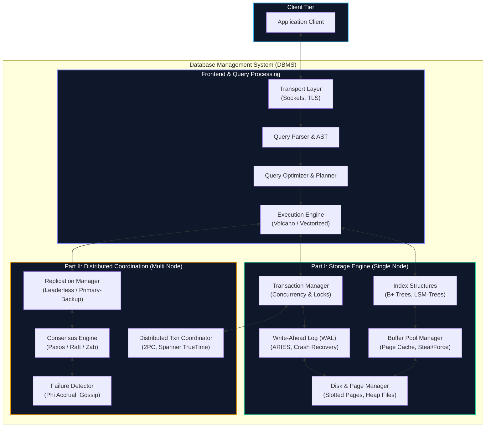

import { Callout } from "fumadocs-ui/components/callout";
import { Tabs, Tab } from "fumadocs-ui/components/tabs";
import { Cards, Card } from "fumadocs-ui/components/card";

<ModuleOverview slug="database-internals" />

Most software engineers treat databases as black boxes: you issue a SQL query or send an HTTP write, and data magically appears, persists across restarts, and replicates across the globe.

**Database Internals** peels back the abstraction layer. Based on Alex Petrov's seminal work and real-world engine architectures (PostgreSQL, MySQL InnoDB, RocksDB, Apache Cassandra, Google Spanner, CockroachDB), this module explores how databases actually organize bytes on block storage, coordinate concurrent access without corrupting state, survive sudden power failure, and reach consensus across untrusted, partitioned networks.

<Callout type="info" title="The Two Halves of Every Distributed Database">
  Modern data-intensive systems are divided into two fundamental layers: 1.
  **The Storage Engine (Single-Node Internals):** How a single machine lays out
  bytes on disk, builds indexing structures (B-Trees vs. LSM-Trees), coordinates
  threads, and guarantees ACID durability through Write-Ahead Logging (WAL) and
  recovery algorithms (ARIES). 2. **The Distributed System (Multi-Node
  Coordination):** How clusters of independent machines replicate data, detect
  dead peers, elect leaders, execute distributed multi-partition transactions
  (2PC), and achieve consensus despite network splits and clock drift (Paxos,
  Raft).
</Callout>

---

## Architectural Map

---

## Curriculum Tracks

### Part I: Storage Engines (Single-Node Foundations)

How data lives on persistent block storage, how indexes accelerate searches, and how single machines guarantee crash durability.

| Chapter | Title & Link                                                                                         | Key Concepts Explored                                                                                     | Real-World Systems               |
| :-----: | :--------------------------------------------------------------------------------------------------- | :-------------------------------------------------------------------------------------------------------- | :------------------------------- |
| **01**  | [Introduction & DBMS Architecture](/docs/database-internals/01-introduction-and-dbms-architecture)   | DBMS component breakdown, memory hierarchy, random vs sequential I/O, column vs row stores.               | SQLite, PostgreSQL, ClickHouse   |
| **02**  | [B-Tree Basics](/docs/database-internals/02-btree-basics)                                            | Why BSTs fail on disk, node capacity, fanout, search algorithm, page splits, and node merges.             | PostgreSQL, InnoDB, LMDB         |
| **03**  | [File Formats & Record Layouts](/docs/database-internals/03-file-formats-and-record-layouts)         | Slotted-page architecture, item pointers, variable-length tuples, null bitmaps, alignment, and TOAST.     | Postgres Heap, SQLite Pages      |
| **04**  | [Implementing B-Trees](/docs/database-internals/04-implementing-btrees)                              | Disk serialization, page allocation tables, lock vs latch distinction, latch crabbing/coupling protocols. | InnoDB Index Manager             |
| **05**  | [Transaction Processing & Recovery](/docs/database-internals/05-transaction-processing-and-recovery) | Storage-layer ACID, Steal/Force buffer policies, Write-Ahead Logging (WAL), ARIES recovery, checkpoints.  | ARIES, Postgres XLOG, SQLite WAL |
| **06**  | [B-Tree Variants](/docs/database-internals/06-btree-variants)                                        | B+ Trees, B\* Trees (2-3 redistribution), Copy-on-Write (CoW) B-Trees, Cache-conscious B-Trees.           | LMDB, Btrfs, ZFS, WiredTiger     |
| **07**  | [Log-Structured Storage (LSM-Trees)](/docs/database-internals/07-log-structured-storage)             | Memtables, SSTables, Bloom filters, block indexes, Size-Tiered vs Leveled compaction trade-offs.          | RocksDB, LevelDB, Cassandra      |

---

### Part II: Distributed Systems (Multi-Node Consistency & Consensus)

When databases scale beyond one machine: surviving node failures, eliminating split-brain, maintaining replicas, and achieving consensus.

| Chapter | Title & Link                                                                               | Key Concepts Explored                                                                                                          | Real-World Systems                   |
| :-----: | :----------------------------------------------------------------------------------------- | :----------------------------------------------------------------------------------------------------------------------------- | :----------------------------------- |
| **08**  | [Distributed Systems Overview](/docs/database-internals/08-distributed-systems-overview)   | Fallacies of distributed computing, failure models (crash-stop vs crash-recovery), physical clock skew, logical time.          | NTP, Lamport Clocks, Vector Clocks   |
| **09**  | [Failure Detection](/docs/database-internals/09-failure-detection)                         | Why network delays mimic crashes, heartbeating, $\Phi$ (Phi) Accrual Failure Detector, gossip protocols.                       | Cassandra, Akka Cluster, SWIM        |
| **10**  | [Leader Election](/docs/database-internals/10-leader-election)                             | Split-brain hazard, Bully algorithm, Ring elections, candidate roles, fencing tokens, and epoch generation numbers.            | ZooKeeper, etcd, Kafka Kraft         |
| **11**  | [Replication & Consistency](/docs/database-internals/11-replication-and-consistency)       | Primary-backup, multi-leader, leaderless quorums ($R+W > N$), CAP & PACELC theorems, consistency spectrum, CRDTs.              | Amazon Dynamo, Cassandra, Riak       |
| **12**  | [Anti-Entropy & Dissemination](/docs/database-internals/12-anti-entropy-and-dissemination) | Background repair, Read Repair, Hinted Handoff, Merkle Trees for minimal wire hash comparison, epidemic gossip.                | Apache Cassandra, DynamoDB           |
| **13**  | [Distributed Transactions](/docs/database-internals/13-distributed-transactions)           | Two-Phase Commit (2PC) mechanics and blocking hazards, 3PC, Google Spanner TrueTime API, Percolator snapshot isolation.        | Google Spanner, CockroachDB, TiDB    |
| **14**  | [Consensus: Paxos vs. Raft](/docs/database-internals/14-consensus-paxos-and-raft)          | State Machine Replication (SMR), Classic Paxos (Prepare/Accept), Multi-Paxos, Raft (Leader election, Log replication, Safety). | etcd, Consul, CockroachDB, ZooKeeper |

---

## Suggested Learning Path

<Tabs
  items={[
    "Storage Engine Track",
    "Distributed Systems Track",
    "System Designer Track",
  ]}
>
  <Tab value="Storage Engine Track">
    If your focus is understanding how databases interact with hardware, disks,
    and operating system caches: 1. Read **Chapters 1, 2, 3, and 4** to master
    page layouts and B-Trees. 2. Study **Chapter 5** to master Write-Ahead
    Logging (WAL) and crash recovery algorithms (ARIES). 3. Compare mutable
    in-place B-Trees with append-only write-optimized storage in **Chapters 6
    and 7 (LSM-Trees)**.
  </Tab>
  <Tab value="Distributed Systems Track">
    If your focus is site reliability, consensus algorithms, and distributed
    systems engineering: 1. Begin with **Chapters 8, 9, and 10** to understand
    partial failure, failure suspicion, and leader election. 2. Deep dive into
    **Chapter 11 and 12** to master replication models, quorum math, and
    anti-entropy Merkle trees. 3. Study **Chapters 13 and 14** to master
    cross-node atomic commits (2PC) and distributed consensus (Paxos & Raft).
  </Tab>
  <Tab value="System Designer Track">
    If you are preparing for high-scale architectural design: * Focus on the
    trade-offs between **B-Trees vs. LSM-Trees** (Chapters 2 vs 7),
    **Consistency models** (Chapter 11), and **Consensus protocols** (Chapter
    14).
  </Tab>
</Tabs>
