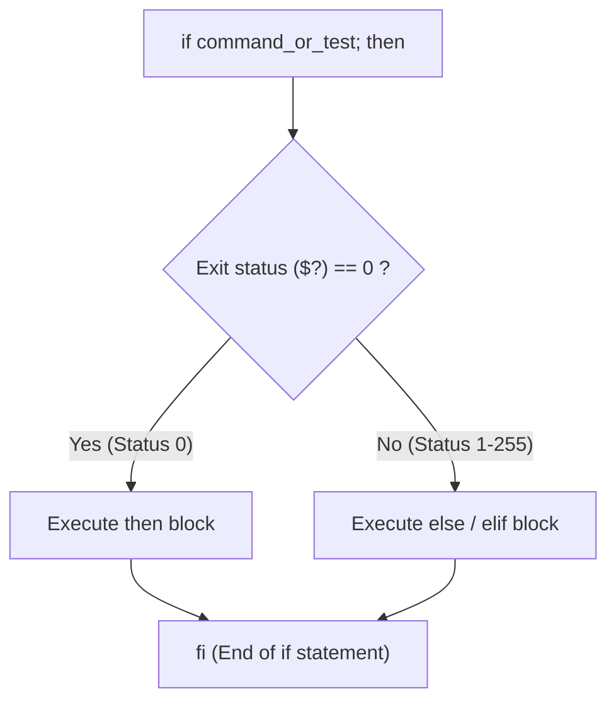

import { Callout } from "fumadocs-ui/components/callout";

## How Conditionals Work in Bash

In languages like JavaScript or Python, an `if` statement evaluates a boolean expression (`true` or `false`).

In Bash, **an `if` statement tests the EXIT CODE of a command**:

- If the command returns **exit status `0`**, Bash considers it **TRUE** and executes the `then` block.
- If the command returns **any non-zero exit status (1–255)**, Bash considers it **FALSE** and skips to `elif` or `else`.



---

## The `if ... then ... elif ... else ... fi` Syntax

In Bash, conditional blocks follow a strict opening and closing structure:

```bash
#!/bin/bash

read -p "Enter your score (0-100): " score

if [ "$score" -ge 90 ]; then
  echo "Grade: A (Outstanding!)"
elif [ "$score" -ge 80 ]; then
  echo "Grade: B (Great job!)"
elif [ "$score" -ge 70 ]; then
  echo "Grade: C (Passed)"
else
  echo "Grade: Needs improvement. YOU DIED."
fi
```

### Anatomy of the Conditional Block

Every conditional statement in Bash consists of four key components:

1. **`if <condition>`**: Begins the conditional evaluation. It runs the test expression (or any Linux command) and inspects its exit status code (`$?`).
2. **`then`**: Marks the start of the commands to execute if the exit status was `0` (truthy).
   - **Why `; then`?** In Bash, `then` is a separate reserved keyword. If placed on the same line as the test, it **must be separated by a semicolon (`;`)**, which serves as a statement separator.
   - Alternatively, you can place `then` on its own line without a semicolon:

     ```bash
     # Style A: Single-line condition (most common in modern scripts)
     if [ "$score" -ge 90 ]; then
       echo "Grade: A"
     fi

     # Style B: Multi-line condition (semicolon omitted)
     if [ "$score" -ge 90 ]
     then
       echo "Grade: A"
     fi
     ```

3. **`elif <condition>; then`**: Short for _"else if"_. Allows checking secondary conditions sequentially if previous tests evaluated to non-zero.
4. **`else`**: The default fallback executed when every preceding `if` and `elif` test has failed.
5. **`fi` — The Block Terminator**:
   - **What does `fi` mean?** `fi` is literally **`if` spelled backward**!
   - It marks the absolute end of the conditional construct.

---

### Deep Dive: Why Does Bash Use `fi`?

In languages like C, JavaScript, or Java, code blocks are opened and closed with curly braces `{ ... }`. In Python, code blocks are governed by indentation levels. In Ruby or Lua, blocks terminate with `end`.

In Bash (and the historic Bourne shell `sh` created by Stephen Bourne in 1977), block terminators adopted a design convention inspired by **ALGOL 68**: **opening keywords are closed by their exact mirror image spelled backward**:

- **`if`** is closed by **`fi`**
- **`case`** is closed by **`esac`**

| Language                | Block Opening        | Block Body                 | Block Closing         |
| :---------------------- | :------------------- | :------------------------- | :-------------------- |
| **Bash / Shell**        | `if condition; then` | Lines (indented for style) | **`fi`**              |
| **C / C++ / Java / JS** | `if (condition) {`   | Lines inside braces        | `}`                   |
| **Python**              | `if condition:`      | Indentation level          | _Dedent (no keyword)_ |
| **Ruby / Lua**          | `if condition`       | Lines                      | `end`                 |
| **SQL (PL/pgSQL)**      | `IF condition THEN`  | Statements                 | `END IF;`             |

#### What Happens If You Forget `fi`?

Because Bash does not use curly braces or indentation to know when a condition stops, **`fi` is strictly mandatory**.

If you forget `fi`, Bash will continue reading the entire rest of your script thinking it is still inside the `if` body, eventually crashing at the end of the file:

```text
bash: ./test_grade.sh: line 42: syntax error: unexpected end of file
```

<Callout type="warn" title="Debugging Tip: 'unexpected end of file'">
  When Bash reports `syntax error: unexpected end of file` at the **very last
  line** of your script, 99% of the time you forgot a closing keyword earlier in
  the file: - A missing **`fi`** for an `if` block. - A missing **`done`** for a
  loop (`for` / `while`). - A missing **`esac`** for a `case` statement. - An
  unclosed quotation mark (`"` or `'`).
</Callout>

<Callout type="warn" title="Spaces around brackets are strictly mandatory!">
  The bracket `[` is actually a command (the `test` program in Unix)! Therefore,
  you **must put spaces** after `[` and before `]`: - `if [ "$a" == "$b" ];
  then` — **CORRECT** - `if ["$a"=="$b"]; then` — **SYNTAX ERROR!**
</Callout>

---

## Single Brackets `[ ]` vs. Double Brackets `[[ ]]`

In modern Bash scripting, always prefer double brackets `[[ ]]` over single brackets `[ ]`:

| Feature                | Single Brackets `[ ]`                          | Double Brackets `[[ ]]`                 |
| :--------------------- | :--------------------------------------------- | :-------------------------------------- | --- | --- |
| **Origin**             | POSIX `test` program (1979)                    | Bash extended keyword (Modern)          |
| **Word Splitting**     | Yes (fails if variable is empty or has spaces) | **No** (safe with unquoted variables)   |
| **Pathname Expansion** | Expands wildcards like `*.txt` dangerously     | Disables unintended globbing            |
| **Operators**          | Uses `-a` (AND) and `-o` (OR)                  | Uses modern `&&` and `                  |     | `   |
| **Regex Matching**     | Not supported                                  | Supported via `=~` operator             |
| **Recommendation**     | Only use if strict POSIX `/bin/sh` required    | **Default choice for all Bash scripts** |

```bash
# In single brackets, an unquoted empty variable crashes:
name=""
[ $name == "Chuck" ]
# bash: [: ==: unary operator expected

# In double brackets, it handles empty strings safely:
[[ $name == "Chuck" ]]
# Evaluates safely to false!
```

---

## Test Operators Cheat Sheet

### 1. Integer Comparisons

Remember that `<` and `>` are used for string comparisons or redirection. For numbers, use letter flags:

| Operator  | Meaning                  | Example               |
| :-------- | :----------------------- | :-------------------- |
| **`-eq`** | Equal to                 | `[[ $age -eq 21 ]]`   |
| **`-ne`** | Not equal to             | `[[ $port -ne 80 ]]`  |
| **`-lt`** | Less than                | `[[ $count -lt 10 ]]` |
| **`-le`** | Less than or equal to    | `[[ $reps -le 50 ]]`  |
| **`-gt`** | Greater than             | `[[ $cpu -gt 85 ]]`   |
| **`-ge`** | Greater than or equal to | `[[ $ram -ge 90 ]]`   |

### 2. String Comparisons

| Operator          | Meaning                           | Example                                                              |
| :---------------- | :-------------------------------- | :------------------------------------------------------------------- |
| **`==`** (or `=`) | Strings are identical             | `[[ "$role" == "admin" ]]`                                           |
| **`!=`**          | Strings are not identical         | `[[ "$env" != "prod" ]]`                                             |
| **`-z`**          | String is **Zero length (Empty)** | `[[ -z "$api_key" ]]`                                                |
| **`-n`**          | String is **Non-empty**           | `[[ -n "$user_input" ]]`                                             |
| **`=~`**          | Matches Regular Expression        | `[[ "$email" =~ ^[A-Za-z0-9._%+-]+@[A-Za-z0-9.-]+\.[A-Za-z]{2,}$ ]]` |

### 3. File & Filesystem Tests

These operators are the backbone of DevOps automation scripts:

| Operator | Meaning                                     | Example                  |
| :------- | :------------------------------------------ | :----------------------- |
| **`-e`** | File or directory exists                    | `[[ -e "/etc/hosts" ]]`  |
| **`-f`** | Exists and is a **regular file**            | `[[ -f "config.json" ]]` |
| **`-d`** | Exists and is a **directory**               | `[[ -d "/var/log" ]]`    |
| **`-s`** | File exists and has size **greater than 0** | `[[ -s "output.log" ]]`  |
| **`-r`** | File is **readable** by current user        | `[[ -r "secret.pem" ]]`  |
| **`-w`** | File is **writable** by current user        | `[[ -w "/var/run" ]]`    |
| **`-x`** | File is **executable**                      | `[[ -x "deploy.sh" ]]`   |

---

## Compound Boolean Logic: `&&`, `||`, and `!`

Combine multiple conditions:

```bash
# Logical AND (Both must be true):
if [[ $age -ge 18 && $has_license == "yes" ]]; then
  echo "Approved to drive."
fi

# Logical OR (Either can be true):
if [[ $user == "root" || $role == "admin" ]]; then
  echo "Granting administrative access."
fi

# Logical NOT (Inversion):
if [[ ! -f "/etc/nginx/nginx.conf" ]]; then
  echo "Nginx configuration file missing!"
fi
```

---

## The `case ... in ... esac` Statement

When comparing a single variable against many possible options (such as menu choices, CLI subcommands, or file extensions), an `if/elif/elif/else` chain becomes messy.

The `case` statement provides clean pattern matching:

```bash title="menu.sh"
#!/bin/bash

echo "=== System Administration Console ==="
echo "1) Check Disk Usage"
echo "2) Check Memory Usage"
echo "3) Check Active Ports"
echo "4) Exit"
read -p "Select option [1-4]: " choice

case $choice in
  1)
    df -h
    ;;
  2)
    free -m
    ;;
  3)
    ss -tuln
    ;;
  4|q|Q)
    echo "Exiting console. Goodbye!"
    exit 0
    ;;
  *)
    echo "Invalid option: '$choice'. Please select between 1 and 4."
    exit 1
    ;;
esac
```

### Anatomy of the `case` Statement

Notice how Bash structures multi-way pattern matching:

- **Pattern Matching (`pattern)`)**: The pattern or value to compare against, followed by a closing parenthesis `)`.
- **The Double Semicolon Terminator (`;;`)**:
  - Each pattern branch **must terminate with two semicolons `;;`**.
  - In languages like C, Java, or JavaScript, `switch` statements require a `break;` keyword to prevent execution from falling through into subsequent cases. In Bash, `;;` acts as that exact `break;` statement.
  - If you forget `;;`, Bash doesn't know where the branch commands end and throws a syntax error when it encounters the next pattern: `syntax error near unexpected token '2)'`.
- **Multiple Choices (`|`)**: Separate alternative matching values with a pipe symbol (e.g. `4|q|Q` matches `4`, lowercase `q`, or uppercase `Q`).
- **Default Fallback (`*)`)**: An asterisk `*` matches anything, serving as the wildcard catch-all (equivalent to `default:` in switch statements).
- **The Block Terminator: `esac`**:
  - Just like `if` is closed by its reverse `fi`, **`case` is closed by its mirror reverse `esac`**!
  - This completes the Bourne shell pattern of using reverse-spelled keywords for block boundaries.
  - Forgetting `esac` leaves the block unclosed, resulting in `syntax error: unexpected end of file`.

---

## Featured Project: Elden Ring in Bash (`eldenring.sh`)

In Episode 4 of NetworkChuck's series, we build a full text adventure RPG battle game based on _Elden Ring_, featuring class selection, boss battles, random combat dice rolls, and secret coffee cheat codes!

```bash title="eldenring.sh"
#!/bin/bash
# ==============================================================================
# Elden Ring (Bash Edition)
# Episode 4: Conditionals, Test Operators & Combat Game
# ==============================================================================

echo "=========================================================="
echo "          WELCOME TO ELDEN RING: BASH EDITION             "
echo "=========================================================="
echo "You awake as a Tarnished in the Lands Between..."
echo "Choose your starting class:"
echo "1) Tarnished (Balanced Warrior)"
echo "2) Astrologer (Mage)"
echo "3) Coffee Bandit (Stealth Caffeine Fiend)"
echo "=========================================================="

read -p "Choose your class [1-3]: " hero_class

case $hero_class in
  1)
    hero="Tarnished"
    hp=20
    attack=10
    ;;
  2)
    hero="Astrologer"
    hp=12
    attack=18
    ;;
  3)
    hero="Coffee Bandit"
    hp=16
    attack=14
    ;;
  *)
    echo "Unrecognized traveler! Defaulting to Wretch."
    hero="Wretch"
    hp=10
    attack=8
    ;;
esac

echo ""
echo "You have chosen: $hero (HP: $hp, ATK: $attack)"
echo "You journey forward toward Stormveil Castle..."
sleep 2

# ------------------------------------------------------------------------------
# BOSS BATTLE 1: Margit the Fell Omen
# ------------------------------------------------------------------------------
echo ""
echo "⚔️ WARNING: A menacing fog descends upon the bridge..."
echo "Boss Appears: MARGIT, THE FELL OMEN!"
echo "'Foul Tarnished, in search of the Elden Ring...'"
sleep 2

# Boss generates a hidden roll: 0 or 1
beast_roll=$(( RANDOM % 2 ))

echo ""
echo "Margit swings his golden cane! Choose your combat action (0 or 1):"
read -p "Your roll / secret spell: " player_move

# Check conditions
if [ "$player_move" == "coffee" ]; then
  echo ""
  echo "☕ COFFEE CHEAT ACTIVATED!"
  echo "You summon a scalding espresso storm directly into Margit's face!"
  echo "Margit is stunned and defeated instantly!"
  echo "🏆 VICTORY ACHIEVED! You earned 12,000 Runes!"
  exit 0
elif [ "$player_move" == "$beast_roll" ]; then
  echo ""
  echo "⚔️ DIRECT HIT! Margit rolled $beast_roll and your roll matched!"
  echo "You parry his strike and pierce him through the heart!"
  echo "🏆 VICTORY ACHIEVED! Margit falls to his knees!"
  exit 0
else
  echo ""
  echo "💀 Margit rolled $beast_roll. Your dodge timed out!"
  echo "Margit hammers you into the stone bridge!"
  echo "=========================================================="
  echo "                      YOU DIED.                           "
  echo "=========================================================="
  exit 1
fi
```

### Playing the Game

1. Grant execute permission:
   ```bash
   chmod +x eldenring.sh
   ```
2. Test normal combat:
   ```bash
   ./eldenring.sh
   # Try rolling 0 or 1!
   ```
3. Test the secret cheat code:
   ```bash
   ./eldenring.sh
   # Enter 'coffee' at the combat prompt!
   ```

---

## Hands-On Exercise & Challenge

<Callout type="info" title="Challenge 4.1: The File Sentinel">
  Write a script called `sentinel.sh` that: 1. Accepts a target filepath as
  `$1`. 2. Checks if `$1` was provided; if not, exit with code 1 and print
  usage. 3. Checks if the path exists: - If it's a directory (`-d`), print its
  contents using `ls -l`. - If it's a file (`-f`), check if it's readable (`-r`)
  and print its line count using `wc -l`. - If it does not exist, ask the user:
  *"Would you like to create it? [y/n]"*. 4. Return exit code `0` on success.
</Callout>

In the next lesson, we will master **loops: repeating tasks, automating ping sweeps, and counting push-ups**.

👉 Proceed to [**Lesson 5: Loops & Iteration**](/docs/developer-tools/bash-scripting/05-loops-and-iteration).
