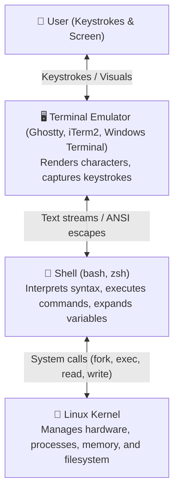
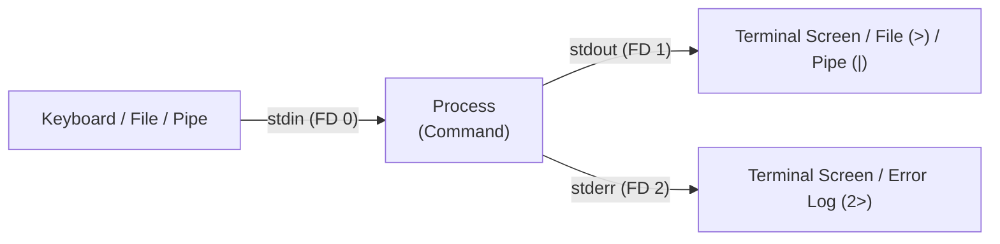

import { Callout } from "fumadocs-ui/components/callout";
import { ShellPermissionsCalculator } from "@/components/developer-tools/shell-simulators";

## Overview & scope

Command-line fluency is not a niche skill. It is the substrate that everything else sits on. If you work anywhere near a server, a build pipeline, a container, or a cloud provider, the shell is the interface you will return to again and again — long after the GUI you learned this year has been replaced.

If you work anywhere close to the internet, understanding the Unix command line is not optional. It is part of your toolset.

"Learn Linux" is a slight misnomer. The real subject is how to use shells and terminals in a Unix-like environment — and that skill transfers between macOS, Linux, and every remote server you will ever SSH into.

### What is covered

1. **Terminals and shells** — what each layer actually is, and the REPL cycle that drives them
2. **File systems & hierarchy** — navigation, paths, Unix directory layout (`/etc`, `/var`, `/proc`), and core file commands
3. **Permissions** — users, modes, numeric octal representation, ownership, and the root account
4. **Programs** — compiled vs interpreted, shells, config files, environment variables, and `PATH`
5. **Input / output** — streams, redirection (`>`, `>>`, `2>&1`), pipes, exit codes, signals, and process control
6. **Package managers** — installing and managing software cleanly

### What is out of scope

The focus here is on _using_ a Unix-like system from the command line, not how that system is built internally. That distinction matters, because it determines what you should expect to walk away knowing.

**Explicitly out of scope**

#### The Linux kernel

The core layer that talks to hardware, schedules processes, manages memory, and exposes system calls.

`syscalls` · `process scheduling` · `device drivers` · `memory management`

You will use the kernel's results every day without ever looking inside.

#### Operating system internals

How an OS is actually assembled — the boot process, init systems, virtual memory, filesystem implementations, and the boundary between user space and kernel space.

`boot process` · `init systems` · `virtual memory` · `filesystem internals` · `user space vs kernel space`

Everything here works the same regardless of how the internals are implemented — which is exactly why it is worth learning first.

#### Server administration

Provisioning, configuring, securing, and maintaining servers in production.

`systemd` · `firewalls` · `TLS certificates` · `backups` · `monitoring` · `deployment` · `incident response`

A local Mac and a production Linux server are not the same environment, even though the shell commands overlap.

<Callout type="info">
**How to use this guide**

Read a section, then open a terminal and type the commands yourself. Do not skim the code blocks. The entire value of this material is in muscle memory — and muscle memory does not come from passive reading.

</Callout>

### Platform notes

| Operating system | What to use                                 | Default shell       |
| ---------------- | ------------------------------------------- | ------------------- |
| macOS            | Terminal.app, Ghostty, iTerm2, or Alacritty | `zsh`               |
| Linux            | Your distribution's terminal emulator       | usually `bash`      |
| Windows          | **WSL** running Ubuntu                      | `bash` (inside WSL) |

macOS and Linux are both **Unix-like**, so the core commands and workflows work across both. Windows is different — that is why WSL exists. It is a real Linux environment running as a lightweight virtual machine, not a compatibility layer, and it will not damage your Windows installation or require disk partitioning.

### Hands-on scenario

Throughout this guide, examples feature a realistic forensic troubleshooting scenario: investigating an incident on an enterprise server. You will navigate directories, search through logs, inspect environment variables, redirect diagnostics, and manage processes.

## Terminals & shells

Programmers use the words _terminal_, _shell_, _command line_, and _CLI_ almost interchangeably. In practice they refer to different layers of the same stack. Knowing which is which will save you real confusion later — especially when something breaks and you need to know which layer is failing.

### The three layers

| Layer                 | What it is                                                                                                                                 | Examples                                     |
| --------------------- | ------------------------------------------------------------------------------------------------------------------------------------------ | -------------------------------------------- |
| **Terminal**          | A physical device. Historically a monitor-keyboard combo wired to a mainframe. You almost certainly do not have one.                       | VT100, DEC VT220                             |
| **Terminal emulator** | A program that emulates a terminal. Accepts text input and renders text output. It does not interpret commands — it just moves characters. | Ghostty, iTerm2, Alacritty, Windows Terminal |
| **Shell**             | A program that reads, evaluates, and executes commands. It is the thing that actually understands what you typed.                          | `bash`, `zsh`, `sh`, `fish`                  |

The terminal emulator is comparatively dumb. It does not know what `ls` means. Its only job is to display characters and forward your keystrokes to the shell — then render whatever the shell sends back.



### The REPL cycle

The shell operates on a loop called a **REPL**: _Read, Evaluate, Print, Loop_.

**Read**:
The shell reads the line you typed

**Evaluate**:
It parses the line and decides what to execute

**Print**:
It writes the result to standard output

**Loop**:
It prints a fresh prompt and waits again

```bash
$ echo hello world        # Read → Evaluate → Print
hello world
$                          # → Loop: new prompt, ready again
```

This is the same concept as Python's interactive interpreter or a Node REPL. The shell is a read-eval-print loop specialized for operating-system tasks.

### Shells are programming languages

Do not think of bash or zsh as "just a command prompt." They are full scripting languages with variables, conditionals, loops, functions, and arithmetic.

```bash
$ expr 123456 + 7890
131346
```

#### Variables

Setting a variable does not use a `$`. Using one does.

```bash
$ name=Lane          # assignment — no $
$ echo $name         # expansion — $ required
Lane
```

<Callout type="warn">
Gotcha

No spaces around `=` in an assignment. `name = Lane` will be parsed as a command called `name` with arguments `=` and `Lane`, and it will fail.

</Callout>

#### Example: shell variables in action

```bash
$ bank_name="World Bank"
$ founded=1969
$ ceo="Jeff Gates"
$ echo "$bank_name was founded in $founded by $ceo"
World Bank was founded in 1969 by Jeff Gates
```

### Command history

The shell keeps a log of everything you have run in the current session (and, with configuration, across sessions).

```bash
$ history
  1  echo hello world
  2  whoami
  3  name=Lane
  ...
```

#### Navigating history

**↑ Up arrow**:
Step backwards through previous commands

**↓ Down arrow**:
Step forwards, back toward an empty prompt

**Ctrl + R**:
Reverse-search through history interactively

```bash
$ echo 1
$ echo 2
$ echo 3
# ↑ → echo 3, ↑ → echo 2, ↑ → echo 1
# ↓ → echo 2, ↓ → echo 3, ↓ → empty
```

#### Clearing the screen

```bash
$ clear
```

`clear` scrolls the visible screen out of view. It does **not** erase your history — everything is still there in the scrollback buffer and in `history`.

### Terminal emulators worth knowing

- **Ghostty** — new, fast, GPU-accelerated. Created by Mitchell Hashimoto (founder of HashiCorp).
- **Alacritty** — the most widely used GPU-accelerated emulator; often embedded inside other tools.
- **iTerm2** — the long-standing macOS power-user choice.
- **Integrated terminals** — built into VS Code, Cursor, and Zed. Convenient if you already live in an editor.
- **Default terminals** — macOS Terminal, GNOME Terminal, Windows Terminal. Perfectly fine.

Pick one and stop thinking about it. The terminal emulator does not change what you can do — the shell does.

### Checkpoint: terminals & shells

<details>
<summary>Which of these is not a terminal emulator: Windows Terminal, Ubuntu, Ghostty, Alacritty?</summary>

Ubuntu. Ubuntu is an operating system (a Linux distribution). The other three are terminal emulator programs.

</details>

<details>
<summary>What is a terminal or terminal emulator, precisely?</summary>

A program that accepts text-based input and renders text to the screen. It does not interpret commands — that is the shell's job.

</details>

<details>
<summary>What does `clear` actually do?</summary>

It clears the visible terminal screen. It does not delete your shell history from memory or from disk.

</details>

<details>
<summary>What does the shell's REPL cycle stand for?</summary>

Read, Evaluate, Print, Loop — read the input, evaluate what it means, print the result, and return a new prompt.

</details>

## The file system

A file system is a tree of directories, starting from a single root directory written as `/`. Directories contain other directories and files. Files are, at bottom, blobs of bytes with metadata attached — the operating system does not inherently know that one blob is a photo and another is a spreadsheet. It is up to the program that reads the file to interpret the bytes.

### The Unix directory hierarchy (FHS)

Unlike Windows, which assigns separate drive letters like `C:\` and `D:\`, Linux and macOS organize every disk, partition, and connected device into a **single unified tree** starting from the root directory `/`.

```mermaid
flowchart TD
  Root["/ (Root Directory)"]
  Root --> Bin["/bin & /usr/bin<br/>Standard user command binaries (ls, cat, bash)"]
  Root --> Sbin["/sbin & /usr/sbin<br/>System binaries for administration (reboot, ip)"]
  Root --> Etc["/etc<br/>System-wide configuration files (hosts, nginx.conf)"]
  Root --> Home["/home<br/>User workspaces (/home/username)"]
  Root --> RootUser["/root<br/>Dedicated home for superuser root"]
  Root --> Var["/var<br/>Variable data: server logs (/var/log), databases"]
  Root --> Tmp["/tmp<br/>Temporary scratch files (cleared on reboot)"]
  Root --> Dev["/dev<br/>Device nodes (disks, null, tty)"]
  Root --> Proc["/proc & /sys<br/>Virtual RAM files exposing kernel & CPU state"]
  Root --> Opt["/opt<br/>Optional self-contained third-party software"]
```



| Directory             | Name / Purpose                                             | Real-world example                                                          |
| --------------------- | ---------------------------------------------------------- | --------------------------------------------------------------------------- |
| `/`                   | **Root** — the top-most ancestor of every file and folder  | Every absolute path begins here                                             |
| `/bin` → `/usr/bin`   | **Binaries** — essential executable programs for all users | `ls`, `grep`, `cat`, `curl`, `node`, `python3`                              |
| `/sbin` → `/usr/sbin` | **System Binaries** — administrative & repair tools        | `iptables`, `fdisk`, `reboot`, `shutdown`                                   |
| `/etc`                | **System Configurations** — editable host & daemon configs | `/etc/hosts`, `/etc/passwd`, `/etc/nginx/`                                  |
| `/var`                | **Variable Data** — dynamic files that grow continuously   | Server logs in `/var/log/syslog`, database storage, spool                   |
| `/tmp`                | **Temporary Files** — volatile scratch space               | Wiped on reboot; readable/writable by any user                              |
| `/home`               | **User Workspaces** — personal data for regular accounts   | `/home/lane/projects`, desktop files, dotfiles (`~`)                        |
| `/root`               | **Root Home** — personal workspace of superuser `root`     | Kept separate from `/home` in case `/home` fails to mount                   |
| `/dev`                | **Devices** — hardware represented as files                | `/dev/sda` (hard drive), `/dev/null` (data black hole)                      |
| `/proc` & `/sys`      | **Kernel Virtual Files** — dynamic kernel state in RAM     | Virtual files exposing real-time metrics (`/proc/cpuinfo`, `/proc/meminfo`) |
| `/opt`                | **Optional Software** — self-contained third-party apps    | Google Chrome, custom enterprise software packages                          |

<Callout type="info">
**Everything is a file in Unix**

In Linux, hardware devices (`/dev/sda`), process telemetry (`/proc`), network sockets, and input/output streams are all exposed through the filesystem interface. If a program can read or write bytes to a file, it can interact with hardware, pipes, and kernel metrics using the exact same standard commands (`cat`, `echo`, `grep`).

</Callout>

### Paths

A **path** is a text representation of a location in that tree. Each step down the tree is separated by a slash.

```bash
/documents/school/homework.txt    # a file
/documents/school                  # a directory
```

#### Absolute vs relative

| -                             | Absolute                             | Relative                                       |
| ----------------------------- | ------------------------------------ | ---------------------------------------------- |
| Starts with                   | `/` (the root)                       | Anything else                                  |
| Depends on current directory? | No — resolves the same from anywhere | Yes — resolved against where you currently are |
| Example                       | `/Users/lane/projects`               | `projects`, `../public`, `./script.sh`         |
| Typical use                   | System paths, installs, scripts      | Everyday navigation                            |

<Callout type="info">
**The address analogy**

An absolute path is your mailing address: postal mail can deliver there no matter where you are standing. A relative path is "go two streets up and around the corner": excellent directions, but only meaningful if the listener knows where you are right now.

</Callout>

#### Special path aliases

**/**:
The root of the entire file system

**~**:
Your home directory. _Not_ the root — this trips people up constantly.

**.**:
The current working directory

**..**:
The parent directory (one level up)

### Where am I?

```bash
$ pwd
/Users/lane
```

`pwd` prints the **working directory** — your current position in the tree. When you open a fresh terminal, you almost always start in your home directory.

### Listing and navigating

```bash
$ ls                     # contents of the current directory
$ ls world_bank          # contents of a specific directory
$ cd world_bank          # move in (relative)
$ cd /Users/lane/world_bank   # move in (absolute)
$ cd ..                  # up one level
$ cd ~                   # home
$ cd                     # also home
```

<Callout type="info">
Tab completion

Start typing a directory or file name and press **Tab**. The shell autocompletes it, or shows you the options if it is ambiguous. Use this constantly — it is faster than typing and eliminates a whole class of typos.

</Callout>

### Reading files

Different tools for different sizes of job.

| Command           | Use it when                                                        |
| ----------------- | ------------------------------------------------------------------ |
| `cat file`        | The file is short and you want all of it at once                   |
| `head -n 20 file` | You want the beginning — usually a header row or startup log lines |
| `tail -n 20 file` | You want the end — usually the most recent log entries             |
| `less file`       | The file is large and you want to page through it                  |

#### cat

```bash
$ cat pr_ideas.txt
```

`cat` is short for **concatenate** — it can join multiple files end to end and print the result. Most of the time you are just printing one file, which makes the name a mild misnomer.

#### head and tail

```bash
$ head -n 6 2023.csv     # first 6 lines
$ tail -n 5 2023.csv     # last 5 lines
$ head 2023.csv          # defaults to 10 lines
```

On large log files, `cat` can flood your terminal and take seconds to render. `head` and `tail` exist to avoid that.

#### less

```bash
$ less 2023.csv
$ less -N 2023.csv       # with line numbers
```

| Key        | Action               |
| ---------- | -------------------- |
| `Enter`    | Scroll down one line |
| `Space`    | Scroll down one page |
| `b`        | Scroll back one page |
| `/pattern` | Search forward       |
| `n`        | Next search match    |
| `q`        | Quit                 |

While inside `less`, your shell prompt is gone — the program has taken over the terminal. This is exactly how terminal editors like Vim and Neovim behave. Remember that `q` exits `less`; it does not exit Vim, which is why leaving Vim has its own folklore.

`more` also exists. It is an older, less capable version of `less`. There is essentially no reason to use it if `less` is available, which it almost always is.

### Creating, moving, copying, deleting

#### touch — create an empty file

```bash
$ touch credit_history.txt
```

`touch` technically updates a file's access and modification timestamps. If the file does not exist, it creates an empty one. In practice, creating empty files is what you will use it for most.

#### mkdir — create a directory

```bash
$ mkdir Investments
```

"Folder" is Windows terminology. "Directory" is the Unix term. They mean the same thing.

#### mv — move or rename

```bash
$ mv credit_cards/t_bills.txt Investments/t_bills.txt
$ mv old_name.txt new_name.txt
```

Moving and renaming are the **same operation**. In a GUI they feel different — you drag a file to move it, and type a new name to rename it. On the command line, both are just changing the file's path. Absolute and relative paths both work.

#### cp — copy

```bash
$ cp 2022.csv backups/2022.csv
$ cp -R directory/ backup_dir/       # copy a directory
```

Unlike `mv`, this leaves the original in place.

#### rm — remove

```bash
$ rm file.txt              # delete a file
$ rm -R directory/          # delete a directory and everything in it
```

<Callout type="warn">
Flag inconsistency

`rm` uses lowercase `-r` for recursive. `cp` uses uppercase `-R`. This is not a typo — the tools were written by different people at different times. Check `man` when in doubt.

</Callout>

<Callout type="info">
Why `rm -R` is required

GUIs delete directories recursively by default. The command line refuses to, unless you say so explicitly. This is a safety feature: a directory might contain hundreds of files, and the shell wants you to confirm that you really mean all of them.

</Callout>

### The home directory

Every user has a home directory. It is where your personal files live and where the shell starts you when you log in.

- `/Users/` on macOS
- `/home/` on Linux
- Always reachable as `~`

Do your development work here. It is a bad idea to work inside system directories like `/bin`, `/etc`, or `/usr` — the operating system relies on those being exactly as they are.

### Finding things

#### grep — search inside files

```bash
$ grep "CRITICAL" private/logs/2024-01-10.log
$ grep hello words.txt
```

Prints every line that contains the given string. It is the command-line equivalent of <kbd>Ctrl</kbd>+<kbd>F</kbd>, but it works across directories and composes with other tools.

```bash
$ grep hello hello.txt hello2.txt       # multiple files
$ grep -r "CRITICAL" private/logs/       # recurse into a directory
$ grep -r "CRITICAL" .                   # search the current directory
```

#### find — search for files

```bash
$ find products -name "joint*"
$ find . -name "*.txt"
```

<Callout type="info">
grep vs find

`grep` finds _text inside_ files. `find` finds _the files themselves_ by name. Mixing them up is one of the most common early mistakes.

</Callout>

`*` is a wildcard that matches any sequence of characters. So `"*joint*"` matches any filename containing "joint" anywhere.

### Checkpoint: the file system

<details>
<summary>How do you tell an absolute path from a relative one?</summary>

An absolute path always begins with `/`, because it starts from the root. A relative path does not.

</details>

<details>
<summary>Which path refers to the same file regardless of your current directory?</summary>

An absolute path. Relative paths are resolved against wherever you happen to be.

</details>

<details>
<summary>What does `~/workspace/names.csv` refer to?</summary>

A file called `names.csv`, inside a directory called `workspace`, inside your home directory.

</details>

<details>
<summary>What is the difference between `mv` and `cp`?</summary>

`mv` changes a file's path (moving or renaming it). `cp` creates a duplicate and leaves the original where it was.

</details>

## Users & permissions

Unix-like systems are multi-user by design. Even if you are the only person on your laptop, the operating system still models every file as belonging to a user and a group, with a specific set of permissions attached. Understanding that model is what lets you debug the single most common error a new developer will hit: `Permission denied`.

### Who am I?

```bash
$ whoami
lane
```

Prints the name of the user account you are currently running as.

### sudo — super user do

`sudo` runs a single command as the **root** user, giving it elevated permissions it would not otherwise have.

```bash
$ whoami
lane
$ sudo whoami
Password:
root
```

You are prompted for your password because acting as root is a privileged operation. The system needs to verify it is really you.

<Callout type="warn">
Do not prefix everything with sudo

The naive fix for permission problems is to run everything as root. This is a bad habit. Running commands as root means any mistake you make has system-wide consequences, and any file you create will be owned by root rather than by you — which causes its own permission problems later.

</Callout>

### The permission string

Run `ls -l` and the first column shows a ten-character string describing the file's permissions.

```bash
$ ls -l
drwxr-xr--  4  lane  staff  128  contacts
-rw-r--r--  1  lane  staff  512  notes.txt
```

Break the string down character by character:

| Position | Meaning                                                      |
| -------- | ------------------------------------------------------------ |
| 1        | `d` if the entry is a directory, `-` if it is a regular file |
| 2 – 4    | Permissions for the **owner** of the file                    |
| 5 – 7    | Permissions for the **group** the file belongs to            |
| 8 – 10   | Permissions for **everyone else** on the system              |

#### The three permissions

**r — read**:
Can read the file's contents

**w — write**:
Can modify the file

**x — execute**:
Can run the file as a program

A dash in place of a letter means that permission is _not_ granted.

#### Worked example

```bash
drwxr-xr--
```

- `d` — this is a directory
- `rwx` — the owner can read, write, and execute
- `r-x` — the group can read and execute, but not write
- `r--` — everyone else can only read

#### Why owner, group, and others matter

For most personal work, **owner** and **others** are the two you actually care about. Group permissions exist for machines with multiple user accounts that share files — common on servers, less common on your laptop. But "others" is the one to watch carefully: setting `rwx` for others means literally anyone who can reach the machine can read, modify, and execute that file.

### chmod — change mode

`chmod` (change mode) modifies the read, write, and execute permissions of a file or directory. You can specify permissions using either **symbolic mode** or **numeric (octal) mode**.

#### 1. Symbolic syntax

The symbolic syntax uses letters to represent who gets what permission:

- **Target (`who`)**: `u` (user/owner), `g` (group), `o` (others), `a` (all)
- **Operator**: `+` (add), `-` (remove), `=` (set exact)
- **Permission**: `r` (read), `w` (write), `x` (execute)

```bash
$ chmod +x script.sh              # add execute for the current user
$ chmod -x script.sh              # remove execute permission
$ chmod u=rwx,g=rx,o=r report.txt # set exact permissions
$ chmod -R u=rwx,g=,o= private/   # recursively restrict directory to owner only
```

<Callout type="info">
**The single most useful chmod**

When you get `Permission denied` trying to run a script you just downloaded or wrote, the fix is almost always:

```bash
chmod +x script_name
```

</Callout>

#### 2. Numeric (octal) syntax

In production scripts, Dockerfiles, and server configuration, permissions are almost always written as three-digit **octal numbers**. Each digit is the mathematical sum of the enabled permissions:

| Permission        | Symbol | Value |
| ----------------- | ------ | ----- |
| **Read**          | `r`    | **4** |
| **Write**         | `w`    | **2** |
| **Execute**       | `x`    | **1** |
| **No permission** | `-`    | **0** |

To set a mode, add up the numbers for each role:

- **Digit 1 (Owner)**: `r (4) + w (2) + x (1) = 7`
- **Digit 2 (Group)**: `r (4) + - (0) + x (1) = 5`
- **Digit 3 (Others)**: `r (4) + - (0) + x (1) = 5`
- **Result:** `chmod 755 script.sh`

#### Common permission modes in industry

| Octal | Symbolic    | Common use case                                                                    |
| ----- | ----------- | ---------------------------------------------------------------------------------- |
| `755` | `rwxr-xr-x` | Executable scripts and public directories (owner can edit; all can read and enter) |
| `644` | `rw-r--r--` | Standard text files, web assets, and documentation (owner edits; all can read)     |
| `600` | `rw-------` | Sensitive credentials and SSH private keys (`id_rsa` / `id_ed25519`)               |
| `700` | `rwx------` | Private directories (like `~/.ssh`) — only owner can enter and list                |
| `777` | `rwxrwxrwx` | **Dangerous:** Any user can modify or execute. Never use in production             |

#### Interactive permission & octal calculator

<ShellPermissionsCalculator />

### chown — change owner

      `chmod` changes permissions. `chown` changes *who owns the file*. Because you cannot reassign ownership of files unless you are root, `chown` almost always needs `sudo`.

```bash
$ sudo chown -R root contacts/
```

#### What this actually changes

After running that, your regular user no longer owns the `contacts` directory. That means the owner permissions no longer apply to you — you now fall under "group" or "others." If those have no write permission, you cannot delete the directory:

```bash
$ rm -R contacts
rm: contacts: Permission denied

$ sudo rm -R contacts
# succeeds — because root owns it and you are acting as root
```

This is the mechanism behind a huge amount of real-world confusion. Files you created can become inaccessible to you the moment ownership changes.

### The root user

Root is the super user. It has unrestricted access to everything on the system. When you run `sudo`, you are running as root for the duration of that one command.

<Callout type="info">
The dangerous command

`sudo rm -rf /` recursively and forcefully deletes every file on the machine, including the ones the operating system needs to boot.

Modern systems have safeguards — most require an additional `--no-preserve-root` flag before this will actually execute. Do not test it.

</Callout>

### Checkpoint: users & permissions

<details>
<summary>Which user is the super user?</summary>

`root`. "Super user" describes the category; root is the actual account.

</details>

<details>
<summary>What happens if you run `sudo rm -rf /`?</summary>

It deletes all files on the machine, including system files required for the computer to function.

</details>

<details>
<summary>In `drwxr-xr--`, who can write to the directory?</summary>

Only the owner. The group has `r-x` (no write) and others have `r--` (no write).

</details>

<details>
<summary>What does `chmod 755 script.sh` give the owner, group, and others?</summary>

Owner gets `7` (`rwx` = 4+2+1, full read/write/execute). Group gets `5` (`r-x` = 4+0+1, read and execute). Others get `5` (`r-x` = 4+0+1, read and execute).

</details>

<details>
<summary>What is the difference between `chmod` and `chown`?</summary>

`chmod` changes what permissions a file has. `chown` changes who owns the file. `chown` requires `sudo`; `chmod` does not, as long as you own the file.

</details>

## Programs & shells

Not all programs are the same kind of thing. Some are compiled into machine code that runs directly on your hardware. Others are text files that require a separate interpreter to read and execute them. Knowing which is which explains a lot of otherwise confusing behavior — including why some files run with `./script` and others need `python script.py`.

### Compiled vs interpreted

| -                             | Compiled                                           | Interpreted                       |
| ----------------------------- | -------------------------------------------------- | --------------------------------- |
| Written in                    | C, Rust, Go                                        | Python, Ruby, JavaScript, shell   |
| What the file contains        | Machine code — the raw instruction set of your CPU | Source text — human-readable code |
| Needs another program to run? | No                                                 | Yes — an interpreter              |
| How you run it                | `./text_editor`                                    | `python text_editor.py`           |
| Examples                      | `.exe` files, video games, `/bin/sh`               | `.sh` scripts, `.py` files        |

You can see the difference directly. Catting a compiled binary produces garbage, because the bytes were never meant to be read as text:

```bash
$ which sh
/bin/sh

$ cat /bin/sh
ELF...binary gibberish...   # not human-readable
```

### The shebang

Normally, an interpreted program needs its interpreter named on the command line. A **shebang** lets you embed that information in the file itself, so you can run the script directly.

```bash
#!/usr/bin/env python3
print("hello")
```

The first line — starting with `#!` — tells the operating system which interpreter to use.

```bash
$ ./main.py      # works, because of the shebang
```

Shell scripts use `#!/bin/sh` or `#!/bin/bash`. The `/usr/bin/env` form is preferred for portability, because it locates the interpreter wherever it happens to be installed rather than hardcoding a path.

### The shell family

| Shell  | Full name          | Where you'll find it                                                                                               |
| ------ | ------------------ | ------------------------------------------------------------------------------------------------------------------ |
| `sh`   | Bourne shell       | The original Unix shell. POSIX-compliant. Minimal features, verbose for complex scripts, but available everywhere. |
| `bash` | Bourne Again shell | The most popular shell on Linux. Builds on `sh` with a large set of quality-of-life additions.                     |
| `zsh`  | Z shell            | The default on modern macOS. Also builds on `sh`, but differs from `bash` in its extensions.                       |

**bash and zsh are supersets of sh.** They can run anything `sh` can run, plus more. For everyday work the differences between bash and zsh will not matter to you. They become visible when writing heavy scripts, because they are genuinely different languages on top of the same base.

### Shell configuration files

Both bash and zsh read a configuration file every time you start a new shell session. These files live in your home directory and are hidden — their names begin with a dot.

```bash
$ ls -a ~
.zshrc  .bashrc  .bash_profile  ...
```

| Shell | Config file                        |
| ----- | ---------------------------------- |
| zsh   | `~/.zshrc`                         |
| bash  | `~/.bashrc` (or `~/.bash_profile`) |

These files run automatically on startup. They are where you set aliases, define functions, export environment variables, and extend `PATH`. If you have ever configured a program to launch automatically when you start your computer, this is the shell-level equivalent.

#### Editing with nano

```bash
$ nano ~/.zshrc
# add a line at the bottom:
echo "hello from the shell"
# Ctrl+O, Enter to save; Ctrl+X to exit
```

Open a new terminal tab and the message appears. Remove the line, save, and it stops appearing.

#### Reloading without restarting

```bash
$ source ~/.zshrc
```

`source` re-runs the file in the current session, so you do not have to open a new terminal every time you change your config.

### Environment variables

Regular shell variables are local to your shell. **Environment variables** are inherited by every program that runs from your shell — which makes them the standard way to configure software, especially on servers.

```bash
$ export NAME=Lane       # by convention: UPPER_SNAKE_CASE
$ echo $NAME
Lane
```

To see everything currently exported:

```bash
$ env
```

<Callout type="warn">
Spaces will break it

`export FOO = bar` fails with `bad assignment`. The shell parses `FOO`, `=`, and `bar` as three separate tokens. Write `export FOO=bar`.

</Callout>

#### Why this matters: configuring a script

```bash
#!/bin/sh
echo "$WARN_MESSAGE from $WARN_FROM_NAME"
```

```bash
$ ./warn.sh
# prints a blank line — the variables are unset

$ export WARN_MESSAGE="the auditor is here"
$ export WARN_FROM_NAME="your worst nightmare"
$ ./warn.sh
the auditor is here from your worst nightmare
```

This pattern is everywhere. A program reads its configuration from environment variables, and the shell is how you set them.

### PATH

`PATH` is the single most important environment variable for day-to-day work. It contains a colon-separated list of directories. Any executable inside any of those directories can be run by typing its name alone — no path required.

```bash
$ which cat
/bin/cat        # /bin is in PATH, so "cat" just works

$ echo $PATH
/usr/local/bin:/usr/bin:/bin:/Users/lane/.local/bin
```

<Callout type="info">
Why "command not found" happens

You install a tool. The installer places it in some directory. That directory is not in your `PATH`. The shell has no idea the program exists.

Nine times out of ten, this is the entire explanation for `command not found`. Read the installer output — it almost always tells you where the program went.

</Callout>

#### Adding a directory to PATH

For the current session only:

```bash
$ export PATH="$PATH:/Users/lane/world_bank/private/bin"
```

Note that `$PATH` comes first. If you wrote `export PATH="/new/dir"` you would overwrite the entire list and break every command on your system.

#### Making it permanent

```bash
$ nano ~/.zshrc
# add at the end:
export PATH="$PATH:/Users/lane/world_bank/private/bin"
# Ctrl+O, Enter, Ctrl+X
$ source ~/.zshrc
```

Now the command works from any directory, in every new shell session.

### Checkpoint: programs & shells

<details>
<summary>What do you see when you `cat` a compiled binary?</summary>

A bunch of gibberish — raw binary bytes being interpreted as text. The file was never meant to be read that way.

</details>

<details>
<summary>Which kind of program can run without an interpreter?</summary>

A compiled executable. Interpreted programs like Python scripts and shell scripts always need an interpreter.

</details>

<details>
<summary>Complete the sentence: `____` and `____` are a superset of `____`.</summary>

bash and zsh are a superset of sh.

</details>

<details>
<summary>Why do you need to restart (or `source`) your shell after editing a config file?</summary>

Because the config file only runs when a new shell session starts. Editing the file does not affect the session that is already running.

</details>

<details>
<summary>After clearing `PATH` to an empty string, what happens when you run `ls`?</summary>

The shell cannot find it, because `/bin` is no longer in `PATH`. You get "command not found."

</details>

## Streams & processes

This is the chapter where the Unix philosophy becomes concrete. Programs are small, they communicate through text, and they compose. Once you understand the three standard streams and how to redirect them, you can build surprisingly powerful workflows out of tools that each do one simple thing.

### The manual

```bash
$ man grep
$ man man        # yes, the manual has a manual
```

| Key        | Action                   |
| ---------- | ------------------------ |
| `/pattern` | Search within the manual |
| `n`        | Jump to the next match   |
| `Enter`    | Scroll down one line     |
| `Space`    | Scroll down one page     |
| `q`        | Quit                     |

Reading documentation is the difference between a developer who needs tutorials forever and one who does not. The man pages are dense, but they are authoritative and always available. Use them to look up flags rather than guessing.

### Flags

Flags modify a command's behavior. They can appear in any order.

```bash
$ ls -l              # long format
$ ls -a              # show hidden files
$ ls -la             # combined short flags
$ ls -l -a           # identical
```

Many flags have two forms — a short form with one dash and a verbose form with two:

```bash
-a        --text
-b        --byte-offset
-r        --recursive
```

Use the short form when typing interactively. Use the long form in scripts, where clarity matters more than keystrokes.

### Positional arguments

Flags are order-independent. **Positional arguments are not.**

```bash
$ mv source.txt destination.txt
#     ^first arg    ^second arg — order is meaningful
```

If you know Python, the analogy is close: flags are like keyword arguments, positional arguments are like regular arguments.

### --help

```bash
$ curl --help
$ tool -h
```

Almost every well-built CLI tool supports `--help`, `-h`, or a `help` subcommand. The output is usually shorter and easier to scan than a full man page, and it is more likely to exist for third-party tools.

### Exit codes

Every process returns a number when it finishes. Zero means success. Anything else means failure.

```bash
$ ls ~
$ echo $?
0

$ ls /does/not/exist
ls: /does/not/exist: No such file or directory
$ echo $?
1
```

`$?` holds the exit code of the most recent command. This matters enormously in automation: a CI pipeline, a deploy script, or a process supervisor decides what to do next based on whether the previous step returned zero.

Codes are not restricted to 0 and 1. A script can exit with any number — 69, for example, if its author decided that was meaningful.

### The three standard streams

Every program launched by the shell automatically opens with three input/output channels called **standard streams**, identified by numerical file descriptors (FD):



| Stream       | File Descriptor | Default source / destination | Description                               |
| ------------ | --------------- | ---------------------------- | ----------------------------------------- |
| **`stdin`**  | `0`             | Keyboard                     | Standard input stream read by the program |
| **`stdout`** | `1`             | Terminal screen              | Normal output results                     |
| **`stderr`** | `2`             | Terminal screen              | Error messages and diagnostic logs        |

#### Redirection operators

Redirection operators let you send stream output to files or feed files into commands instead of using the terminal display.

| Operator | Syntax               | Purpose                                      | Example                         |
| -------- | -------------------- | -------------------------------------------- | ------------------------------- |
| `>`      | `cmd > file`         | Overwrite file with `stdout`                 | `echo "first line" > log.txt`   |
| `>>`     | `cmd >> file`        | **Append** `stdout` to end of file           | `echo "second line" >> log.txt` |
| `<`      | `cmd < file`         | Feed file content into `stdin`               | `mysql -u root < schema.sql`    |
| `2>`     | `cmd 2> file`        | Redirect only `stderr` to file               | `npm run build 2> errors.log`   |
| `2>&1`   | `cmd > out.log 2>&1` | Merge `stderr` into `stdout`                 | `python app.py > app.log 2>&1`  |
| `&>`     | `cmd &> file`        | Shorthand: redirect both `stdout` & `stderr` | `make all &> build.log`         |

```bash
# 1. Overwrite vs append
$ echo "Status: starting" > server.log
$ echo "Status: healthy" >> server.log
$ cat server.log
Status: starting
Status: healthy

# 2. Silencing unwanted output (the Unix black hole)
$ find / -name "*.conf" 2> /dev/null
# All "Permission denied" errors are thrown away into /dev/null
```

#### Reading from stdin

In a shell script, the `read` command pulls a line from stdin and stores it in a variable:

```bash
#!/bin/sh
echo "Please enter your name"
read name
echo "Please enter your email"
read email
echo "Your name is $name, your email is $email"
```

When the script runs, it pauses at each `read` and waits for you to type something and press Enter. The newline from the Enter key is what tells `read` the input is complete.

### Pipes

The pipe operator `|` connects the `stdout` of the left program to the `stdin` of the right program. This is the single most important composition mechanism in the Unix toolkit.

```bash
$ echo "my name is Lane" | wc
      1       4      17
#  lines   words  bytes

$ grep -r "CRITICAL" /var/log/ | wc -l
142
```

Without the pipe, you would need to write output to a temporary file on disk, then read that file with another command. The pipe eliminates the disk step entirely by passing data in memory.

### Interrupting a running program

<kbd>Ctrl</kbd>+<kbd>C</kbd> sends a `SIGINT` (Signal 2) signal to the
foreground process. Well-behaved programs listen for it and exit cleanly.

```bash
$ ./diagnostic.sh
...running scans...
^C
Scan interrupted by user.
```

### Background jobs and job control

Long-running commands do not have to tie up your terminal:

- **Run in background (`&`)**: Append `&` to run a program in the background immediately:
  ```bash
  $ python -m http.server 8080 &
  [1] 4821
  ```
  The shell prints `[JobNumber] PID` and returns your prompt right away.
- **Suspend with <kbd>Ctrl</kbd>+<kbd>Z</kbd>**: Sends `SIGTSTP` to pause the active foreground process.
- **`jobs`**: Lists all active background and stopped tasks in the current shell.
- **`bg`**: Resumes a suspended job running in the background.
- **`fg`**: Brings a background job back into the foreground.

### kill — process signals

When a program ignores <kbd>Ctrl</kbd>+<kbd>C</kbd> or runs headless, locate its PID and send a signal with `kill`:

```bash
$ ps aux | grep "python"
lane   4821  0.5  1.2  python -m http.server 8080
lane   4899  0.0  0.0  grep python

# 1. Graceful shutdown (SIGTERM - default)
$ kill 4821

# 2. Forceful kill if process is hung (SIGKILL)
$ kill -9 4821
```

| Signal    | Name      | Number | Behavior                                                                        |
| --------- | --------- | ------ | ------------------------------------------------------------------------------- |
| `SIGINT`  | Interrupt | `2`    | Sent by <kbd>Ctrl</kbd>+<kbd>C</kbd>; caught and handled by clean exit routines |
| `SIGTERM` | Terminate | `15`   | Default of `kill <PID>`; requests graceful cleanup and exit                     |
| `SIGKILL` | Kill      | `9`    | Sent via `kill -9 <PID>`; kernel drops process instantly; cannot be caught      |

<Callout type="info">
**Two results, one process**

`ps aux | grep foo` always returns at least two lines: the process you are looking for, and the `grep` command itself (because it also matches "foo"). Ignore the grep line.

</Callout>

### top — resource monitoring

```bash
$ top
# press q to quit
```

An interactive, self-updating view of every process, sorted by resource consumption. It shows CPU and memory usage alongside PIDs, so you can also kill from there. It is the command-line equivalent of Task Manager on Windows or Activity Monitor on macOS.

Note the tradeoff: `top` sorts by resource usage, which makes it excellent for finding a runaway process but useless for finding a script that is quietly printing text in a loop. For that, `ps aux | grep` is the right tool.

### The Unix philosophy

      Write programs that do one thing and do it well. Write programs to work together. Write programs to handle text streams, because that is a universal interface.

This is why tools like `grep`, `wc`, `head`, and `cat` are so small. Each does one job. None of them knows about the others. But because they all speak the same language — text on stdin and stdout — they compose into arbitrarily complex workflows.

This is also why infrastructure engineers get so much done from a shell. They do not write a custom program for every task. They chain existing ones together.

### Checkpoint: streams & processes

<details>
<summary>What does the `-v` flag do in `grep`?</summary>

Invert match — it selects lines that do _not_ match the pattern.

</details>

<details>
<summary>Which of these is not a real grep option: `-t`, `-r`, `-i`, `-c`?</summary>

`-t`. The others are recursive (`-r`), ignore case (`-i`), and count (`-c`).

</details>

<details>
<summary>Which of these does *not* follow the Unix philosophy: `cat`, `grep`, `ls`, `WorldOfWarcraft.exe`?</summary>

`WorldOfWarcraft.exe`. It is a large, monolithic application rather than a small composable tool.

</details>

<details>
<summary>From an extensibility standpoint, which interface is more powerful — text or graphical?</summary>

Text. Graphical interfaces are limited to what the developer exposed. Text streams can be composed, redirected, piped, and scripted.

</details>

<details>
<summary>Which shell command reads a line from stdin?</summary>

`read`.

</details>

<details>
<summary>What does `echo $?` print after a successful command?</summary>

`0`. Any non-zero value would indicate an error.

</details>

## Package managers

A package manager is software that installs, updates, and removes other software. It is the standard way to get tools onto a Unix-like system — and understanding what it does under the hood explains a whole category of problems.

| Platform              | Package manager                   | Install command                         |
| --------------------- | --------------------------------- | --------------------------------------- |
| Ubuntu / Debian / WSL | `apt`                             | `sudo apt install neovim`               |
| macOS                 | `brew` (unofficial but universal) | `brew install neovim`                   |
| Arch                  | `pacman`                          | `sudo pacman -S neovim`                 |
| Any                   | `webi`                            | `curl -sS https://webi.sh/<tool> \| sh` |

### What a package manager actually does

1. Checks whether the package is already installed
2. Downloads it from a repository if not
3. Installs the files onto your file system
4. **Resolves and installs all dependencies** — this is the genuinely hard part
5. Usually adds the binary to your `PATH` so it can be run by name

Step four is why package managers exist. Dependency resolution is a graph problem, and doing it by hand across dozens of packages is not practical.

### Installing something

```bash
$ brew install neovim        # macOS
$ sudo apt install neovim    # Ubuntu / WSL

$ nvim --version
NVIM v0.10.3

$ which nvim
/opt/homebrew/bin/nvim
```

Note that you can run `nvim` from anywhere without typing the full path. The package manager added its install directory to `PATH` for you. If it had not, `which nvim` would tell you where the binary lives and you would add that directory to `PATH` yourself.

### Neovim: the survival guide

You will eventually end up inside Vim or Neovim, possibly without meaning to, and you will need to know how to save and exit.

| Key             | Effect                                   |
| --------------- | ---------------------------------------- |
| `i`             | Enter **insert mode** — now you can type |
| `Esc`           | Return to **normal mode**                |
| `h` `j` `k` `l` | Move left, down, up, right               |
| `:w`            | Save                                     |
| `:q`            | Quit                                     |
| `:wq`           | Save and quit                            |
| `:q!`           | Quit without saving                      |

When Neovim opens, you are in **normal mode**. Letters do not insert text — they are commands. That is why new users think their keyboard is broken. Press `i` first.

### webi — installation without a package manager

[webinstall.dev](https://webinstall.dev) is a different approach. Instead of requiring `apt` or `brew` to be installed first, it serves up the _official installation scripts_ for popular tools through a single interface.

```bash
$ curl -sS https://webi.sh/lsd | sh
```

This installs `lsd` (LSDeluxe, a modern `ls` replacement written in Rust) into `~/.local/bin` and adds it to your `PATH`.

```bash
$ lsd --tree
$ lsd --tree --classic private/transactions/
```

<Callout type="warn">
Security: `curl … | sh`

This pattern downloads a script from a remote server and pipes it directly into your shell — meaning it executes immediately, before you have any chance to read it. The reasonable objections:

- The server could serve a malicious script
- You are placing full trust in whoever controls the domain

**The mitigations:**

- **HTTPS** guarantees the script came from that domain, was cryptographically signed, and was not altered in transit. Man-in-the-middle attacks are not a concern.
- You can always `curl` the script to a file first, read it, then run it. Nothing stops you.
- For real applications, prefer signed releases from the publisher over piping to a shell.

The risk is real but bounded. The important thing is understanding what you are trusting, not pretending there is no tradeoff.

</Callout>

### Choosing an editor

| Editor           | Notes                                                                                                                   |
| ---------------- | ----------------------------------------------------------------------------------------------------------------------- |
| **Nano**         | Always available, tiny, easy to learn, not powerful. Worth knowing because it exists on every system you will SSH into. |
| **Neovim / Vim** | Terminal-native and extremely powerful. A skill set in itself — rewarding but a real investment.                        |
| **VS Code**      | GUI with an integrated terminal. The best choice on Windows/WSL, where it has first-class support.                      |
| **Zed**          | Fast and modern. macOS and Linux only; no Windows support.                                                              |
| **Emacs**        | It exists. People who use it love it.                                                                                   |

### Checkpoint: package managers

<details>
<summary>What do package managers *not* do?</summary>

Debug code and fix bugs in the software. They install, update, remove, and resolve dependencies — they do not maintain the software's source.

</details>

<Callout type="info" title="Need syntax for all 50 commands?">
  This page teaches concepts. For flags, examples, and gotchas see the companion
  [50 Most Popular Linux Commands](/docs/developer-tools/linux/commands-50)
  reference.
</Callout>

## Cheat sheet

### Navigation & files

| Command                   | What it does                                    |
| ------------------------- | ----------------------------------------------- |
| `pwd`                     | Print the working directory                     |
| `ls`                      | List directory contents                         |
| `ls -l`                   | Long format — includes permissions, owner, size |
| `ls -a`                   | Include hidden files (names beginning with `.`) |
| `ls -la`                  | Combined short flags                            |
| `cd <dir>`                | Change directory                                |
| `cd ..`                   | Go up one level                                 |
| `cd ~`                    | Go home                                         |
| `touch <file>`            | Create an empty file                            |
| `mkdir <dir>`             | Create a directory                              |
| `mv <src> <dest>`         | Move or rename                                  |
| `cp <src> <dest>`         | Copy a file                                     |
| `cp -R <src> <dest>`      | Copy a directory recursively                    |
| `rm <file>`               | Delete a file                                   |
| `rm -r <dir>`             | Delete a directory and its contents             |
| `cat <file>`              | Print a file's contents                         |
| `head -n N <file>`        | Print the first N lines                         |
| `tail -n N <file>`        | Print the last N lines                          |
| `less <file>`             | Page through a file                             |
| `less -N <file>`          | Page through with line numbers                  |
| `grep "str" <file>`       | Search for text in a file                       |
| `grep -r "str" <dir>`     | Recursive text search                           |
| `find <dir> -name "pat*"` | Find files by name pattern                      |
| `wc -c <file>`            | Count bytes                                     |
| `wc -l <file>`            | Count lines                                     |

### Users & permissions

| Command                      | What it does                                                   |
| ---------------------------- | -------------------------------------------------------------- |
| `whoami`                     | Print the current user account                                 |
| `sudo <cmd>`                 | Run a command with elevated root privileges                    |
| `chmod +x <file>`            | Make a script or binary executable                             |
| `chmod 755 <file>`           | Set `rwxr-xr-x` (executable by all, writable only by owner)    |
| `chmod 644 <file>`           | Set `rw-r--r--` (readable by all, writable only by owner)      |
| `chmod 600 <key>`            | Restrict file to owner read/write only (e.g. SSH private keys) |
| `chmod -R u=rwx,g=,o= <dir>` | Set exact symbolic modes recursively                           |
| `chown -R <user> <dir>`      | Change ownership recursively (requires `sudo`)                 |

### Shell environment

| Command                        | What it does                                       |
| ------------------------------ | -------------------------------------------------- |
| `var=value`                    | Set a local shell variable (no spaces around `=`)  |
| `echo $var`                    | Expand and print a variable value                  |
| `export VAR=value`             | Export an environment variable to child processes  |
| `env`                          | List all exported environment variables            |
| `echo $PATH`                   | Show current executable search directories         |
| `export PATH="$PATH:/new/dir"` | Safely append a directory to `PATH`                |
| `which <cmd>`                  | Locate the filesystem path of an executable binary |
| `history`                      | Show command history list                          |
| `clear`                        | Clear the visible terminal window                  |
| `source ~/.zshrc`              | Reload shell configuration without restarting      |
| `man <cmd>`                    | Open the reference manual for a command            |
| `<cmd> --help`                 | Print a quick command usage summary                |

### Streams & processes

| Syntax                       | What it does                                      |
| ---------------------------- | ------------------------------------------------- |
| `cmd > file`                 | Redirect and overwrite `stdout` to a file         |
| `cmd >> file`                | Redirect and **append** `stdout` to end of file   |
| `cmd 2> file`                | Redirect `stderr` error messages to a file        |
| `cmd > out.log 2>&1`         | Merge both `stdout` and `stderr` into a file      |
| `cmd1 \| cmd2`               | Pipe `stdout` of `cmd1` into `stdin` of `cmd2`    |
| `cmd &`                      | Run program in the background asynchronously      |
| `jobs`                       | List active background and suspended tasks        |
| `fg [%id]`                   | Bring a background job to the foreground          |
| `bg [%id]`                   | Resume a suspended job in the background          |
| `echo $?`                    | Print exit code of last command (`0` = success)   |
| <kbd>Ctrl</kbd>+<kbd>C</kbd> | Send `SIGINT` (2) to interrupt foreground process |
| <kbd>Ctrl</kbd>+<kbd>Z</kbd> | Suspend active foreground process                 |
| `ps aux \| grep <name>`      | Find running processes and their PID              |
| `kill <PID>`                 | Send graceful `SIGTERM` (15) to process           |
| `kill -9 <PID>`              | Forcefully terminate process with `SIGKILL` (9)   |
| `top`                        | Interactive resource monitor (`q` to quit)        |
| `read var`                   | Read a line of input from `stdin`                 |

### Key takeaways

- The shell is a REPL — read, evaluate, print, loop. When stuck, `man <cmd>` or `<cmd> --help` beats guessing.
- Everything lives in one tree from `/`: `pwd` shows where you are, `~` is home, `..` is up one level.
- `Permission denied` is a mode or ownership problem: read `ls -l`, fix scripts with `chmod +x`, reach for `sudo` only for system-wide changes.
- `PATH` decides which programs run by bare name — `command not found` usually means the directory is not on it.
- Compose small tools instead of writing new ones: `>` overwrites, `>>` appends, `|` pipes stdout into the next command.
- Install software with a package manager (`apt`, `brew`), and configure your shell via `~/.bashrc` or `~/.zshrc`.
