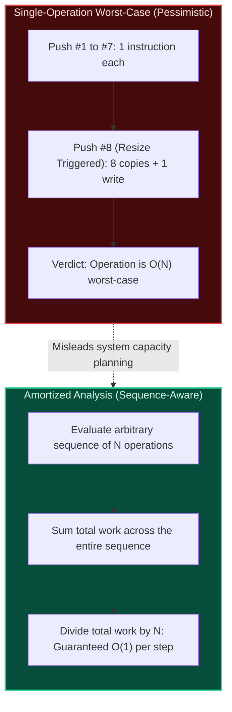
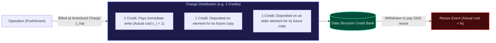
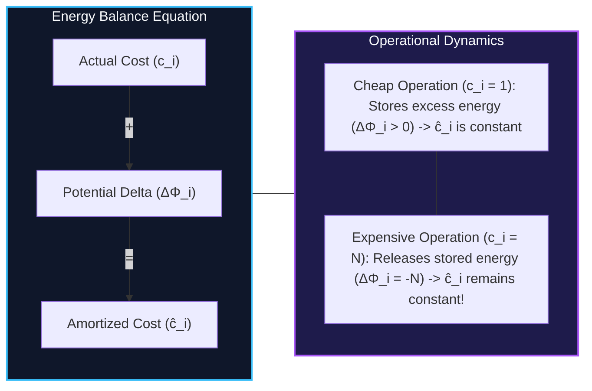
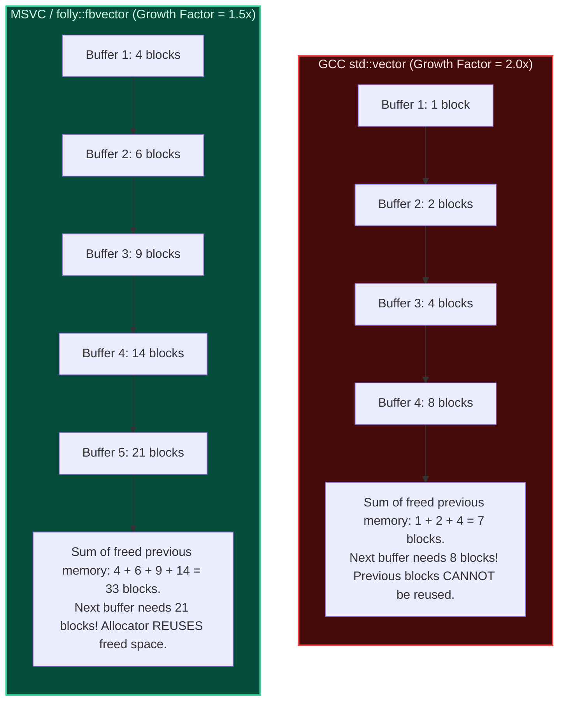

import { Callout } from "fumadocs-ui/components/callout";
import { Tabs, Tab } from "fumadocs-ui/components/tabs";
import { Steps, Step } from "fumadocs-ui/components/steps";
import { Cards, Card } from "fumadocs-ui/components/card";

## The Fundamental Concept of Amortized Cost

When evaluating the performance of an algorithm or data structure, standard worst-case analysis often paints an excessively pessimistic picture. If an operation occasionally performs a heavy administrative cleanup—such as doubling the underlying buffer of a dynamic array or rehashing a hash table—a traditional single-operation worst-case bound will classify the entire operation as $\mathcal{O}(N)$.

However, in real-world systems, that expensive administrative operation **cannot happen on every step**. It requires a long sequence of cheap, preparatory operations before it can trigger again.



### Formal Definition

**Amortized analysis** computes the average cost of an operation over a **worst-case sequence** of operations.

If any sequence of $n$ operations from a known initial state takes a total time upper-bounded by $T(n)$, then the amortized cost per operation is:

$$T_{\text{amortized}} = \frac{T(n)}{n}$$

If $T(n) \le c \cdot n$, where $c$ is a constant independent of $n$, then the amortized cost per operation is $\mathcal{O}(1)$, even if individual operations within that sequence take $\Theta(n)$ time.

<Callout type="error" title="Crucial Distinction: Amortized vs. Average-Case Analysis">
**Amortized analysis is NOT average-case analysis.**

- **Average-Case Analysis** assumes a **probability distribution** over the inputs (e.g., assuming inputs arrive uniformly at random). If the distribution changes or an adversary supplies hostile inputs, average-case guarantees collapse.
- **Amortized Analysis** involves **NO probabilities, NO random variables, and NO input distribution assumptions**. The bound is deterministic. It guarantees that for **ANY valid sequence of operations**, even one orchestrated by a malicious adversary trying to trigger as many worst-case events as possible, the total time divided by $n$ will never exceed the amortized upper bound.

</Callout>

### Analytical Frameworks Comparison

| Dimension             | Worst-Case Analysis           | Average-Case Analysis                                | Amortized Analysis                          |
| :-------------------- | :---------------------------- | :--------------------------------------------------- | :------------------------------------------ |
| **Scope**             | Single isolated operation     | Single operation or sequence                         | Sequence of operations                      |
| **Input Assumptions** | Absolute worst possible input | Random inputs under a known probability distribution | Any valid sequence (adversarial worst-case) |
| **Probability Used?** | No                            | Yes (Expectation $\mathbb{E}[X]$)                    | **No (Deterministic)**                      |
| **Guarantee Level**   | Rigid per-call bound          | Expected value (can be violated on bad runs)         | **Rigid aggregate bound** over $n$ calls    |
| **Typical Target**    | Search algorithms, sorting    | Quicksort partitioning, Hash table collisions        | Dynamic arrays, Splay trees, Union-Find     |

---

## Method 1: Aggregate Analysis

The **Aggregate Method** is the most direct approach to amortized analysis. It proceeds in two steps:

1. Prove an upper bound on the total cost $T(n)$ for an arbitrary sequence of $n$ operations.
2. Divide that total bound by $n$ to assign the exact same amortized cost $T(n) / n$ to every operation in the sequence.

### Classic Problem 1: Dynamic Array Resizing

Consider a dynamic array (like C++ `std::vector`, Python `list`, or Java `ArrayList`) that starts with capacity 1 and doubles its capacity whenever an element is inserted into an already full buffer.

Let $c_i$ be the actual cost of the $i$-th insertion (`push_back`), defined by the number of elementary memory assignments performed:

- If the array is not full: $c_i = 1$ (writing the element into the free slot).
- If the array is full ($i - 1 = 2^k$ for some integer $k \ge 0$): the array allocates a new buffer of size $2^{k+1}$, copies the existing $2^k$ elements into the new buffer, and inserts the new element. Thus, $c_i = 2^k + 1$.

```
Push  1: [X]                       (cost: 1 write)                   Capacity: 1
Push  2: [X][X]                    (cost: 1 copy + 1 write = 2)      Capacity: 2
Push  3: [X][X][X][ ]              (cost: 2 copies + 1 write = 3)    Capacity: 4
Push  4: [X][X][X][X]              (cost: 1 write)                   Capacity: 4
Push  5: [X][X][X][X][X][ ][ ][ ]  (cost: 4 copies + 1 write = 5)    Capacity: 8
Push  6: [X][X][X][X][X][X][ ][ ]  (cost: 1 write)                   Capacity: 8
Push  7: [X][X][X][X][X][X][X][ ]  (cost: 1 write)                   Capacity: 8
Push  8: [X][X][X][X][X][X][X][X]  (cost: 1 write)                   Capacity: 8
Push  9: [X]...[X][ ][ ][ ][ ][ ][ ] (cost: 8 copies + 1 write = 9)  Capacity: 16
```

#### Total Work Summation

For a sequence of $N$ insertions, every insertion performs at least 1 write for the new element, contributing $N$ total writes. Additional copy costs occur only when $i - 1$ is a power of 2 ($1, 2, 4, 8, \dots, 2^{\lfloor \log_2(N-1) \rfloor}$).

The total work $T(N)$ across all $N$ operations is:

$$T(N) = N + \sum_{j=0}^{\lfloor \log_2 N \rfloor} 2^j$$

Using the geometric series formula $\sum_{j=0}^k 2^j = 2^{k+1} - 1$:

$$T(N) = N + \left(2^{\lfloor \log_2 N \rfloor + 1} - 1\right) < N + 2^{\log_2 N + 1} = N + 2N = 3N$$

#### Amortized Cost Calculation

$$\hat{c} = \frac{T(N)}{N} < \frac{3N}{N} = 3 = \mathcal{O}(1)$$

Even though the worst-case cost of a single push is $\Theta(N)$ (when resizing from $N/2$ to $N$), the amortized cost per push over any sequence of $N$ operations is bounded by a constant ($< 3$ operations).

---

### Classic Problem 2: The Multipop Stack

A standard LIFO stack supports two primary operations:

- `Push(S, x)`: Pushes element $x$ onto stack $S$. Cost = $1$.
- `Pop(S)`: Pops the top element from stack $S$. Cost = $1$.

Suppose we add an administrative operation:

- `Multipop(S, k)`: Removes the top $\min(k, |S|)$ elements from the stack.

```
MULTIPOP(S, k):
    while not S.empty() and k > 0:
        S.pop()
        k = k - 1
```

#### The Naive Fallacy

What is the worst-case cost of a single `Multipop` call? If the stack contains $s$ elements and $k \ge s$, `Multipop` executes in $\Theta(s)$ time. In a sequence of $n$ operations, the stack could contain up to $n$ elements, giving a worst-case per-operation bound of $\mathcal{O}(n)$.

A naive upper bound for a sequence of $n$ mixed operations would therefore be:

$$n \times \mathcal{O}(n) = \mathcal{O}(n^2)$$

This bound is dramatically over-pessimistic.

#### The Aggregate Proof

To find the true upper bound, track elements rather than operations:

1. Each element can only be popped **after** it has been pushed onto the stack.
2. In any valid sequence of $n$ operations starting from an empty stack, the maximum number of `Push` operations is at most $n$.
3. Therefore, at most $n$ distinct elements are ever pushed onto the stack.
4. Because each pushed element can be popped **at most once**, the total number of element pops performed by all `Pop` and `Multipop` operations combined across the entire sequence cannot exceed $n$.

$$\text{Total Cost } T(n) = \text{Cost}(\text{Pushes}) + \text{Cost}(\text{Pops}) \le n + n = 2n$$

Dividing by the total number of operations $n$:

$$T_{\text{amortized}} = \frac{T(n)}{n} \le \frac{2n}{n} = 2 = \mathcal{O}(1)$$

Each operation—including `Multipop`—has an amortized cost of $\mathcal{O}(1)$.

---

### Classic Problem 3: $k$-bit Binary Counter Increment

Consider a $k$-bit binary counter stored as an array of bits $A[0 \dots k-1]$, where $A[0]$ is the lowest-order bit (least significant bit) and $A[k-1]$ is the highest-order bit. The counter starts at 0 and supports an `Increment` operation.

```
INCREMENT(A):
    i = 0
    while i < k and A[i] == 1:
        A[i] = 0
        i = i + 1
    if i < k:
        A[i] = 1
```

```
Counter Value    Bit Pattern [A3 A2 A1 A0]    Bit Flips (Cost)
0                0  0  0  0                   -
1                0  0  0  1                   1 (A0: 0->1)
2                0  0  1  0                   2 (A0: 1->0, A1: 0->1)
3                0  0  1  1                   1 (A0: 0->1)
4                0  1  0  0                   3 (A0: 1->0, A1: 1->0, A2: 0->1)
5                0  1  0  1                   1 (A0: 0->1)
6                0  1  1  0                   2 (A0: 1->0, A1: 0->1)
7                0  1  1  1                   1 (A0: 0->1)
8                1  0  0  0                   4 (A0: 1->0, A1: 1->0, A2: 1->0, A3: 0->1)
```

A single call to `Increment` on a counter containing all 1s must flip all $k$ bits, taking $\Theta(k)$ time. For $n$ increments, naive multiplication yields $\mathcal{O}(n \cdot k)$.

#### The Aggregate Proof

Observe how frequently each specific bit position flips during a sequence of $n$ successive increments starting from zero:

- $A[0]$ flips on **every** increment: $\lfloor n / 1 \rfloor = n$ times.
- $A[1]$ flips on every **second** increment: $\lfloor n / 2 \rfloor$ times.
- $A[2]$ flips on every **fourth** increment: $\lfloor n / 4 \rfloor$ times.
- In general, bit $A[j]$ flips $\lfloor n / 2^j \rfloor$ times.

Summing all bit flips across the entire sequence of $n$ operations:

$$T(n) = \sum_{j=0}^{\lfloor \log_2 n \rfloor} \left\lfloor \frac{n}{2^j} \right\rfloor < n \sum_{j=0}^{\infty} \frac{1}{2^j} = n \left( \frac{1}{1 - 1/2} \right) = 2n$$

The amortized cost per increment is:

$$T_{\text{amortized}} = \frac{T(n)}{n} < \frac{2n}{n} = 2 = \mathcal{O}(1)$$

---

## Method 2: The Accounting Method (The Banker's Method)

In the **Accounting Method**, we view computational operations through the lens of a bank account. Different operations are assigned artificial, prepaid fees called **amortized charges** ($\hat{c}_i$).

- If an operation's amortized charge $\hat{c}_i$ exceeds its actual cost $c_i$, the surplus $(\hat{c}_i - c_i)$ is deposited as **credit** into specific elements or compartments within the data structure.
- If an operation's actual cost $c_i$ exceeds its amortized charge $\hat{c}_i$, the deficit $(c_i - \hat{c}_i)$ must be paid by withdrawing previously accumulated credit.



### The Invariant Condition

For the accounting method to prove a valid asymptotic upper bound, the total amortized cost must upper-bound the total actual cost at **every point in time**. The bank account cannot run a debt:

$$\sum_{i=1}^n \hat{c}_i \ge \sum_{i=1}^n c_i \quad \iff \quad \text{Credit}(n) = \sum_{i=1}^n (\hat{c}_i - c_i) \ge 0 \quad \forall n \ge 1$$

If this non-negative invariant holds for all $n$, then the total credit never drops below zero, and $\sum_{i=1}^n \hat{c}_i$ is guaranteed to be an upper bound on the actual total work.

### Dynamic Array Analysis via Accounting

Let 1 credit represent the work required to write or copy a single element in memory. We define the amortized charge for `push_back` as:

$$\hat{c}_{\text{push}} = 3\text{ credits}$$

When a new element arrives, we distribute the 3 credits as follows:

1. **Credit 1**: Pays for the immediate actual cost ($c_i = 1$) of writing the new element into the current slot.
2. **Credit 2**: Deposited directly onto the newly inserted element. When the array eventually doubles, this credit pays to copy this element into the new buffer.
3. **Credit 3**: Deposited onto one of the older elements in the lower half of the array that has already spent its credit during the previous resize.

```
Array just after doubling to capacity 8 (currently has 4 elements, 0 credits):
Index:     [0]   [1]   [2]   [3]   [4]   [5]   [6]   [7]
Element:    A     B     C     D     _     _     _     _
Credits:    $0    $0    $0    $0

Push E (Item 5): Pays $1 to write E. Leaves $1 on E, gives $1 to A:
Index:     [0]   [1]   [2]   [3]   [4]   [5]   [6]   [7]
Element:    A     B     C     D     E     _     _     _
Credits:    $1    $0    $0    $0    $1

Push F (Item 6): Pays $1 to write F. Leaves $1 on F, gives $1 to B:
Credits:    $1    $1    $0    $0    $1    $1

Push G (Item 7): Pays $1 to write G. Leaves $1 on G, gives $1 to C:
Credits:    $1    $1    $1    $0    $1    $1    $1

Push H (Item 8): Pays $1 to write H. Leaves $1 on H, gives $1 to D:
Credits:    $1    $1    $1    $1    $1    $1    $1    $1
```

By the time the array becomes completely full with $N = 8$ elements, **every single element stores exactly \$1 of credit**.

When the 9th push triggers a resize to capacity 16, copying all 8 existing elements costs exactly 8 units of work. The data structure pays for all 8 copies entirely out of the accumulated credits! The bank balance drops to zero, and the cycle repeats.

Because the credit balance never drops below zero:

$$\sum_{i=1}^N c_i \le \sum_{i=1}^N \hat{c}_i = 3N = \mathcal{O}(N) \implies \hat{c}_{\text{push}} = \mathcal{O}(1)$$

### Accounting on Multipop Stack and Binary Counter

<Tabs items={["Multipop Stack", "Binary Counter"]}>
  <Tab value="Multipop Stack">
    Assign the following amortized costs:
    - `Push`: $\hat{c} = 2$ credits.
      - 1 credit pays for the actual insertion into the stack.
      - 1 credit is stored on the pushed element as prepayment for its eventual removal.
    - `Pop`: $\hat{c} = 0$ credits. The actual cost of 1 is paid by withdrawing the 1 credit stored on the element being popped.
    - `Multipop(k)`: $\hat{c} = 0$ credits. Each of the $\min(k, s)$ elements popped pays for its own removal using its pre-deposited credit.

    Since every popped element was previously pushed, the credit on the stack can never drop below zero:
    $$\text{Credit} = \text{number of elements currently on stack} \ge 0$$
    Every operation has an amortized cost of $\mathcal{O}(1)$.

  </Tab>

  <Tab value="Binary Counter">
    Assign the following amortized costs:
    - Setting a bit from $0 \to 1$: $\hat{c} = 2$ credits.
      - 1 credit pays for flipping the bit from 0 to 1.
      - 1 credit is stored on the bit to pay for flipping it back from 1 to 0 in the future.
    - Resetting a bit from $1 \to 0$: $\hat{c} = 0$ credits. Paid by the credit stored on that bit.

    In `Increment(A)`, the algorithm flips $t$ bits from $1 \to 0$ and at most 1 bit from $0 \to 1$:
    - The $t$ flips from $1 \to 0$ cost $t$ in actual work, but cost $0$ in amortized charge (paid by accumulated credits on those bits).
    - The single flip from $0 \to 1$ costs 1 in actual work and is charged 2 credits.

    Therefore, the amortized cost of `Increment` is at most $\hat{c} = 2 = \mathcal{O}(1)$. The total credit stored in the counter equals the number of 1-bits currently set, which is always $\ge 0$.

  </Tab>
</Tabs>

---

## Method 3: The Potential Method (The Physicist's Method)

Rather than attaching discrete credit tokens to individual elements, the **Potential Method** computes a single scalar value representing the overall "stored energy" of the data structure.

We define a **potential function** $\Phi$ that maps the state of data structure $D$ to a real number:

$$\Phi: D \to \mathbb{R}$$

### The Potential Formula

Let $D_0$ be the initial state of the data structure, and let $D_i$ be its state after the $i$-th operation.

The amortized cost $\hat{c}_i$ of the $i$-th operation is defined as:

$$\hat{c}_i = c_i + \Phi(D_i) - \Phi(D_{i-1}) = c_i + \Delta \Phi_i$$

Where:

- $c_i$ is the **actual cost** of the $i$-th operation.
- $\Delta \Phi_i = \Phi(D_i) - \Phi(D_{i-1})$ is the **change in potential**.



### The Telescoping Sum Proof

Summing the amortized costs across a sequence of $n$ operations:

$$\sum_{i=1}^n \hat{c}_i = \sum_{i=1}^n \left( c_i + \Phi(D_i) - \Phi(D_{i-1}) \right)$$

Expanding the summation reveals a **telescoping series**:

$$\sum_{i=1}^n \hat{c}_i = \sum_{i=1}^n c_i + \left( \Phi(D_1) - \Phi(D_0) \right) + \left( \Phi(D_2) - \Phi(D_1) \right) + \dots + \left( \Phi(D_n) - \Phi(D_{n-1}) \right)$$

Every intermediate term cancels:

$$\sum_{i=1}^n \hat{c}_i = \sum_{i=1}^n c_i + \Phi(D_n) - \Phi(D_0)$$

Rearranging for the total actual cost:

$$\sum_{i=1}^n c_i = \sum_{i=1}^n \hat{c}_i - \Phi(D_n) + \Phi(D_0)$$

<Callout type="info" title="The Non-Negative Potential Condition">
If we ensure that:
1. $\Phi(D_0) = 0$ (the initial empty data structure has zero potential).
2. $\Phi(D_i) \ge 0$ for all states $D_i$ throughout the sequence.

Then $-\Phi(D_n) + \Phi(D_0) \le 0$, which guarantees:
$$\sum_{i=1}^n c_i \le \sum_{i=1}^n \hat{c}_i$$
The sum of amortized costs is guaranteed to be a valid mathematical upper bound on the actual execution cost.

</Callout>

### Dynamic Array Analysis via the Potential Method

Let:

- $s_i$ be the number of elements in the array after the $i$-th push.
- $c_i$ be the current allocated capacity of the array after the $i$-th push.

Define the potential function $\Phi(D_i)$ as:

$$\Phi(D_i) = 2 \cdot s_i - c_i$$

#### Invariant Verification

Let us check the boundary conditions:

- **Initially**: $s_0 = 0$, $c_0 = 0 \implies \Phi(D_0) = 0$.
- **Right after doubling** from capacity $s$ to $2s$ when adding the $(s+1)$-th element:
  $$\Phi = 2(s + 1) - 2s = 2 \ge 0$$
- **When completely full** ($s_i = c_i = s$):
  $$\Phi = 2s - s = s \ge 0$$
- Since an array always operates with $\frac{1}{2} c_i \le s_i \le c_i$ (after the first insertion), $\Phi(D_i) = 2s_i - c_i \ge 2\left(\frac{1}{2}c_i\right) - c_i = 0$. Thus, $\Phi(D_i) \ge 0$ holds at all times!

#### Mathematical Derivation of Amortized Cost

Let us analyze the two possible cases for the $i$-th `push_back`:

<Steps>
  <Step>
    #### Case A: No Resize Occurs ($s_{i-1} < c_{i-1}$)
    - Actual cost: $c_i = 1$
    - Size increases: $s_i = s_{i-1} + 1$
    - Capacity remains identical: $c_i = c_{i-1}$
    
    Calculate the potential change $\Delta \Phi_i$:
    $$\Delta \Phi_i = \Phi(D_i) - \Phi(D_{i-1}) = (2 s_i - c_i) - (2 s_{i-1} - c_{i-1}) = 2(s_{i-1} + 1) - 2s_{i-1} = 2$$

    Calculate the amortized cost:
    $$\hat{c}_i = c_i + \Delta \Phi_i = 1 + 2 = 3 = \mathcal{O}(1)$$

  </Step>

  <Step>
    #### Case B: Resize Occurs ($s_{i-1} = c_{i-1} = s$)
    - The array allocates a new buffer of capacity $2s$.
    - Actual cost: Copies $s$ items and writes the new element: $c_i = s + 1$.
    - New size: $s_i = s + 1$.
    - New capacity: $c_i = 2s$.

    Calculate the previous potential:
    $$\Phi(D_{i-1}) = 2 s_{i-1} - c_{i-1} = 2s - s = s$$

    Calculate the new potential:
    $$\Phi(D_i) = 2 s_i - c_i = 2(s + 1) - 2s = 2$$

    Calculate the change in potential:
    $$\Delta \Phi_i = \Phi(D_i) - \Phi(D_{i-1}) = 2 - s$$

    Calculate the amortized cost:
    $$\hat{c}_i = c_i + \Delta \Phi_i = (s + 1) + (2 - s) = 3 = \mathcal{O}(1)$$

  </Step>
</Steps>

In both cases, the amortized cost is identically **3**.

When a resize triggers, the actual cost spikes to $s + 1$, but the potential drops by $s - 2$. The stored potential energy is converted into work, absorbing the shock of the resize and leaving the amortized cost flat at 3.

```mermaid
flowchart TD
    subgraph Wave["Potential Function Φ(D) Sawtooth Oscillation"]
        direction LR
        P1["Φ=0 (Start)"] -->|Push 1| P2["Φ=1"]
        P2 -->|"Push 2 (Double)"| P3["Φ=2"]
        P3 -->|"Push 3 (Double)"| P4["Φ=2"]
        P4 -->|Push 4| P5["Φ=4 (Full)"]
        P5 -->|"Push 5 (Double to 8)"| P6["Φ=2 (Reset)"]
        P6 -->|Push 6| P7["Φ=4"]
        P7 -->|Push 7| P8["Φ=6"]
        P8 -->|Push 8| P9["Φ=8 (Full)"]
        P9 -->|"Push 9 (Double to 16)"| P10["Φ=2 (Reset)"]
    end

    style P1 fill:#0f172a,stroke:#64748b,color:#f8fafc
    style P5 fill:#831843,stroke:#f43f5e,color:#ffe4e6
    style P6 fill:#064e3b,stroke:#34d399,color:#d1fae5
    style P9 fill:#831843,stroke:#f43f5e,color:#ffe4e6
    style P10 fill:#064e3b,stroke:#34d399,color:#d1fae5
```



---

## Comparison Matrix: The 3 Amortized Methods

| Dimension              | 1. Aggregate Analysis                  | 2. Accounting (Banker's) Method                                | 3. Potential (Physicist's) Method                                             |
| :--------------------- | :------------------------------------- | :------------------------------------------------------------- | :---------------------------------------------------------------------------- |
| **Mental Model**       | Average total work over $N$ operations | Monetary savings account with credits/debits                   | Physical system storing and releasing potential energy                        |
| **Amortized Charge**   | Uniform: Every operation gets $T(n)/n$ | Granular: Different operations have custom charges $\hat{c}_i$ | Continuous: $\hat{c}_i = c_i + \Delta \Phi_i$ determined by state function    |
| **Where Credit Lives** | Implicit in the total summation        | Explicitly deposited on specific data elements                 | Represented globally in the scalar function $\Phi(D)$                         |
| **Required Proof**     | Upper bound on $\sum c_i$ directly     | $\sum \hat{c}_i \ge \sum c_i$ (Credit never drops below 0)     | $\Phi(D_0) = 0$ and $\Phi(D_i) \ge 0$ for all $i$                             |
| **Best Used For**      | Straightforward series expansions      | Intuitive proofs where tokens can be attached to objects       | Complex structures with non-local updates (e.g. Splay Trees, Fibonacci Heaps) |

---

## Dynamic Array Growth Factor Comparison & Systems Engineering Reality

Why do programming language runtimes choose geometric expansion factors like $2\times$ or $1.5\times$ rather than simple arithmetic expansion like adding 1,000 slots whenever the array fills up?

### Arithmetic Growth ($+K$) Leads to Quadratic Catastrophe

Suppose an array expands by a fixed constant $K$ elements whenever full. To insert $N$ items into an initially empty array:

- Resizes occur after every $K$ insertions: at sizes $K, 2K, 3K, \dots, \frac{N}{K} \cdot K$.
- The $m$-th resize copies $m \cdot K$ elements.

The total copy work across $N$ insertions is:

$$T_{\text{copy}}(N) = \sum_{m=1}^{N/K} m \cdot K = K \sum_{m=1}^{N/K} m = K \frac{\frac{N}{K} \left(\frac{N}{K} + 1\right)}{2} \approx \frac{N^2}{2K} = \Theta(N^2)$$

The amortized cost per single push is:

$$\frac{T(N)}{N} = \frac{\Theta(N^2)}{N} = \Theta(N)$$

<Callout type="error" title="Production Hazard: Arithmetic Expansion">
  Expanding an array by a fixed increment $+K$ converts an $\mathcal{O}(1)$
  amortized data structure into a quadratic $\mathcal{O}(N^2)$ bottleneck. When
  building production streaming collectors, never resize buffers by fixed
  increments.
</Callout>

### Allocator Memory Reuse: The $2.0\times$ vs. $1.5\times$ Debate

Geometric expansion by _any_ factor $\alpha > 1$ guarantees $\mathcal{O}(1)$ amortized insertion. However, modern memory allocators (`ptmalloc`, `jemalloc`, `tcmalloc`) reveal a critical flaw in the naive doubling strategy ($\alpha = 2.0$).

When an array of capacity $C$ doubles to $2C$:

1. The memory manager attempts to expand the buffer contiguous to its current address.
2. If the adjacent virtual address space is occupied, it allocates a new buffer of size $2C$ elsewhere on the heap, copies the data, and deallocates the old buffer of size $C$.



#### The Mathematical Memory Invariant

To enable an allocator to reuse the contiguous address space of previously freed buffers, the next requested size $C_{k+1}$ must be strictly less than or equal to the sum of all previously deallocated buffers:

$$C_{k+1} \le \sum_{j=1}^k C_j$$

For a geometric sequence $C_j = \alpha^j$:

$$\alpha^{k+1} \le \sum_{j=1}^k \alpha^j = \frac{\alpha^{k+1} - \alpha}{\alpha - 1}$$

Dividing both sides by $\alpha^{k+1}$ and evaluating in the limit $k \to \infty$:

$$1 \le \frac{1}{\alpha - 1} \implies \alpha - 1 \le 1 \implies \alpha \le 2$$

For strictly smaller than the sum (allowing reuse after a finite number of steps):

$$\alpha^2 - \alpha - 1 \le 0 \implies \alpha \le \frac{1 + \sqrt{5}}{2} \approx 1.618 \quad (\text{The Golden Ratio } \phi)$$

- **GCC `libstdc++`** uses $\alpha = 2.0$: It can **never** reuse its own previously deallocated memory. Every reallocation moves to higher virtual addresses, driving memory fragmentation.
- **MSVC STL** uses $\alpha = 1.5$: Once the array reaches its 4th reallocation, the sum of all prior blocks exceeds the next requested block size, allowing `VirtualAlloc` and heap managers to recycle memory in place.
- **Meta's `folly::fbvector`** uses $\alpha = 1.5$: Facebook's high-performance C++ vector replaces standard doubling with $1.5\times$ growth specifically to cooperate with `jemalloc` binning pools.

---

### The SLA and Low-Latency Trap

In high-throughput, low-latency domains—such as High-Frequency Trading (HFT) order gateways, audio Digital Signal Processing (DSP), and autonomous vehicle sensor ingestion—**an amortized $\mathcal{O}(1)$ guarantee is unacceptable**.

If an array holding 10,000,000 64-bit market ticks triggers a doubling, it must allocate 160 MB of RAM, copy 80 MB of contiguous bytes across the memory bus, and flush CPU caches. Even with memory bandwidth at 50 GB/s, this stall takes several milliseconds. In an HFT pipeline where SLAs dictate p99.99 response times under 5 microseconds, that single resize causes dropped packets, SLA penalties, and financial loss.

```
Individual Operation Latency (Microseconds):
Op 1..999,999:  [ 0.02 μs ] |
Op 1,000,000:   [ 14,200 μs ] ========================================> SLA VIOLATION!
Op 1,000,001:   [ 0.02 μs ] |
```

#### Low-Latency Engineering Solutions

1. **Pre-Allocation via `.reserve()`**:
   If the maximum load is known ahead of time, invoke `vector.reserve(MAX_CAPACITY)` during startup initialization to allocate all required heap memory before serving live traffic.
2. **Circular Ring Buffers (`boost::circular_buffer`)**:
   Fixed-capacity memory buffers that overwrite the oldest item when full, guaranteeing deterministic $\mathcal{O}(1)$ worst-case execution on every cycle without allocating heap memory.
3. **Progressive / Incremental Rehashing (Redis `dict.c`)**:
   When a hash table must expand, it does not rehash all keys in one blocking pass. It allocates table 2, and on every subsequent `get`/`set` call, it migrates **1 bucket** from table 1 to table 2. The $\mathcal{O}(N)$ rehash cost is physically distributed across subsequent requests, smoothing the latency profile.

---

## Polyglot Implementations with Telemetry

The following implementations create an instrumented dynamic array that tracks actual cost $c_i$, cumulative cost, amortized cost, and the potential function $\Phi(D) = 2 \cdot \text{size} - \text{capacity}$.

<Tabs items={["Python", "TypeScript", "C++"]}>
  <Tab value="Python">
```python
import math
from typing import Any, List, Optional

class TelemetryDynamicArray:
"""
Dynamic Array instrumented with Potential Function and Amortized Cost tracking.
Demonstrates: - Actual cost (memory copies + element write) - Cumulative cost vs. Amortized upper bound - Potential function: Phi = 2 _ size - capacity
"""
def **init**(self, initial_capacity: int = 1):
self.capacity: int = initial_capacity
self.size: int = 0
self.buffer: List[Optional[Any]] = [None] _ self.capacity
self.total_actual_cost: int = 0

    def potential(self) -> int:
        """Computes the potential energy of the data structure."""
        return 2 * self.size - self.capacity

    def push_back(self, val: Any) -> dict:
        prev_potential = self.potential()
        actual_cost = 0
        resized = False

        if self.size == self.capacity:
            # Buffer full: double the capacity
            old_capacity = self.capacity
            new_capacity = old_capacity * 2
            new_buffer = [None] * new_capacity

            # Copy all existing elements (cost = size)
            for j in range(self.size):
                new_buffer[j] = self.buffer[j]
                actual_cost += 1

            self.buffer = new_buffer
            self.capacity = new_capacity
            resized = True

        # Write the new element (cost = 1)
        self.buffer[self.size] = val
        self.size += 1
        actual_cost += 1
        self.total_actual_cost += actual_cost

        curr_potential = self.potential()
        delta_phi = curr_potential - prev_potential
        amortized_cost = actual_cost + delta_phi

        return {
            "op": self.size,
            "val": val,
            "actual_cost": actual_cost,
            "resized": resized,
            "new_size": self.size,
            "capacity": self.capacity,
            "phi": curr_potential,
            "delta_phi": delta_phi,
            "amortized_cost": amortized_cost,
            "cum_avg_cost": round(self.total_actual_cost / self.size, 2)
        }

if **name** == "**main**":
arr = TelemetryDynamicArray(initial_capacity=1)
print(f"{'Op':<4} | {'ActCost':<7} | {'Cap':<5} | {'Phi':<5} | {'dPhi':<5} | {'AmortCost':<9} | {'CumAvg':<6} | {'Resize?'}")
print("-" \* 65)

    for i in range(1, 17):
        metrics = arr.push_back(i * 10)
        print(f"{metrics['op']:<4} | "
              f"{metrics['actual_cost']:<7} | "
              f"{metrics['capacity']:<5} | "
              f"{metrics['phi']:<5} | "
              f"{metrics['delta_phi']:<5} | "
              f"{metrics['amortized_cost']:<9} | "
              f"{metrics['cum_avg_cost']:<6} | "
              f"{'RESIZED' if metrics['resized'] else ''}")

````
  </Tab>

  <Tab value="TypeScript">
```typescript
interface TelemetryRecord {
  op: number;
  actualCost: number;
  resized: boolean;
  size: number;
  capacity: number;
  phi: number;
  deltaPhi: number;
  amortizedCost: number;
  cumulativeAverage: number;
}

export class InstrumentedVector<T> {
  private buffer: (T | undefined)[];
  private currentSize: number = 0;
  private currentCapacity: number;
  private totalActualCost: number = 0;

  constructor(initialCapacity: number = 1) {
    this.currentCapacity = Math.max(1, initialCapacity);
    this.buffer = new Array(this.currentCapacity);
  }

  public getPotential(): number {
    // Potential Function: Phi(D) = 2 * size - capacity
    return 2 * this.currentSize - this.currentCapacity;
  }

  public pushBack(value: T): TelemetryRecord {
    const prevPotential = this.getPotential();
    let actualCost = 0;
    let resized = false;

    if (this.currentSize === this.currentCapacity) {
      const nextCapacity = this.currentCapacity * 2;
      const nextBuffer = new Array<T | undefined>(nextCapacity);

      // Copy elements over (cost = currentSize)
      for (let i = 0; i < this.currentSize; i++) {
        nextBuffer[i] = this.buffer[i];
        actualCost++;
      }

      this.buffer = nextBuffer;
      this.currentCapacity = nextCapacity;
      resized = true;
    }

    // Insert new element (cost = 1)
    this.buffer[this.currentSize] = value;
    this.currentSize++;
    actualCost++;
    this.totalActualCost += actualCost;

    const currPotential = this.getPotential();
    const deltaPhi = currPotential - prevPotential;
    const amortizedCost = actualCost + deltaPhi;

    return {
      op: this.currentSize,
      actualCost,
      resized,
      size: this.currentSize,
      capacity: this.currentCapacity,
      phi: currPotential,
      deltaPhi,
      amortizedCost,
      cumulativeAverage: Number((this.totalActualCost / this.currentSize).toFixed(2)),
    };
  }
}

// Verification Harness
const vec = new InstrumentedVector<number>(1);
console.log("Op  | ActCost | Cap   | Phi   | dPhi  | Amort | CumAvg | Event");
console.log("---------------------------------------------------------------");
for (let i = 1; i <= 16; i++) {
  const m = vec.pushBack(i);
  console.log(
    `${m.op.toString().padEnd(3)} | ` +
    `${m.actualCost.toString().padEnd(7)} | ` +
    `${m.capacity.toString().padEnd(5)} | ` +
    `${m.phi.toString().padEnd(5)} | ` +
    `${m.deltaPhi.toString().padEnd(5)} | ` +
    `${m.amortizedCost.toString().padEnd(5)} | ` +
    `${m.cumulativeAverage.toString().padEnd(6)} | ` +
    `${m.resized ? "DOUBLE BUFFER" : ""}`
  );
}
````

  </Tab>

  <Tab value="C++">
```cpp
#include <iostream>
#include <iomanip>
#include <memory>
#include <stdexcept>

template <typename T>
class TelemetryVector {
private:
size_t m_size{0};
size_t m_capacity{1};
std::unique_ptr<T[]> m_data;
size_t m_total_work{0};

public:
struct Telemetry {
size_t op;
size_t actual_cost;
bool resized;
size_t size;
size_t capacity;
long long phi;
long long delta_phi;
long long amortized_cost;
double cumulative_avg;
};

    explicit TelemetryVector(size_t initial_cap = 1)
        : m_capacity(initial_cap > 0 ? initial_cap : 1),
          m_data(std::make_unique<T[]>(m_capacity)) {}

    long long potential() const {
        // Potential function: Phi = 2 * size - capacity
        return 2 * static_cast<long long>(m_size) - static_cast<long long>(m_capacity);
    }

    Telemetry push_back(const T& value) {
        long long prev_phi = potential();
        size_t actual_cost = 0;
        bool resized = false;

        if (m_size == m_capacity) {
            size_t next_capacity = m_capacity * 2;
            auto next_data = std::make_unique<T[]>(next_capacity);

            // Copy elements (cost = m_size)
            for (size_t i = 0; i < m_size; ++i) {
                next_data[i] = std::move(m_data[i]);
                actual_cost++;
            }

            m_data = std::move(next_data);
            m_capacity = next_capacity;
            resized = true;
        }

        // Store new value (cost = 1)
        m_data[m_size++] = value;
        actual_cost++;
        m_total_work += actual_cost;

        long long curr_phi = potential();
        long long delta_phi = curr_phi - prev_phi;
        long long amortized_cost = actual_cost + delta_phi;

        return Telemetry{
            m_size,
            actual_cost,
            resized,
            m_size,
            m_capacity,
            curr_phi,
            delta_phi,
            amortized_cost,
            static_cast<double>(m_total_work) / m_size
        };
    }

};

int main() {
TelemetryVector<int> vec(1);
std::cout << std::left
<< std::setw(4) << "Op" << " | "
<< std::setw(7) << "ActCost" << " | "
<< std::setw(5) << "Cap" << " | "
<< std::setw(5) << "Phi" << " | "
<< std::setw(5) << "dPhi" << " | "
<< std::setw(9) << "AmortCost" << " | "
<< std::setw(6) << "CumAvg" << " | Event\n";
std::cout << std::string(62, '-') << "\n";

    for (int i = 1; i <= 16; ++i) {
        auto t = vec.push_back(i * 100);
        std::cout << std::left
                  << std::setw(4) << t.op << " | "
                  << std::setw(7) << t.actual_cost << " | "
                  << std::setw(5) << t.capacity << " | "
                  << std::setw(5) << t.phi << " | "
                  << std::setw(5) << t.delta_phi << " | "
                  << std::setw(9) << t.amortized_cost << " | "
                  << std::fixed << std::setprecision(2) << std::setw(6) << t.cumulative_avg << " | "
                  << (t.resized ? "RESIZED" : "") << "\n";
    }
    return 0;

}

```
  </Tab>
</Tabs>

---

## Diagnostic Scenarios & Edge Cases

<Cards>
  <Card title="Scenario 1: Array Shrinking & The Thrashing Hazard">
    Suppose an array doubles capacity when full, and halves capacity when size drops below 50%. What happens if an adversary pushes an element (causing doubling), pops it (causing halving), pushes again, and repeats $k$ times?
    <br/>
    **Result**: Every single operation triggers a full reallocation and copy of $N$ items, degrading amortized throughput to $\Theta(N)$!
    <br/>
    **Solution**: The **Quarter-Capacity Rule**. Only halve capacity when size drops to **25%** ($N/4$). This guarantees at least $N/4$ cheap operations before another resize, preserving $\mathcal{O}(1)$ amortized time.
  </Card>

  <Card title="Scenario 2: Queue Implemented via Two Stacks">
    Can we implement a First-In-First-Out (FIFO) Queue using two LIFO Stacks (`in_stack` and `out_stack`) with $\mathcal{O}(1)$ amortized time per operation?
    <br/>
    **Enqueue**: Push to `in_stack` (cost 1).
    <br/>
    **Dequeue**: If `out_stack` is empty, pop all elements from `in_stack` and push to `out_stack` (cost $2k$). Then pop top of `out_stack`.
    <br/>
    **Amortized Bound**: Charge \$3 on Enqueue (\$1 for initial push, \$1 for move to `out_stack`, \$1 for final pop). Dequeue charge is \$0. Amortized cost is $\mathcal{O}(1)$.
  </Card>

  <Card title="Scenario 3: Binary Counter with Reset">
    Suppose we add a `Reset` operation that zeroes out all bits in a $k$-bit counter in $\mathcal{O}(k)$ time. Is a sequence of $n$ mixed operations (`Increment` and `Reset`) still $\mathcal{O}(1)$ amortized?
    <br/>
    **Trap**: An adversary increments $k$ times ($0 \to 1 \to \dots \to 2^k-1$) and calls `Reset`, repeating $n/k$ times.
    <br/>
    **Proof**: By the accounting method, charge `Increment` \$2. Every 1-bit holds \$1 credit. `Reset` visits only the 1-bits and clears them using their stored credit, taking $\mathcal{O}(1)$ amortized!
  </Card>
</Cards>
```
