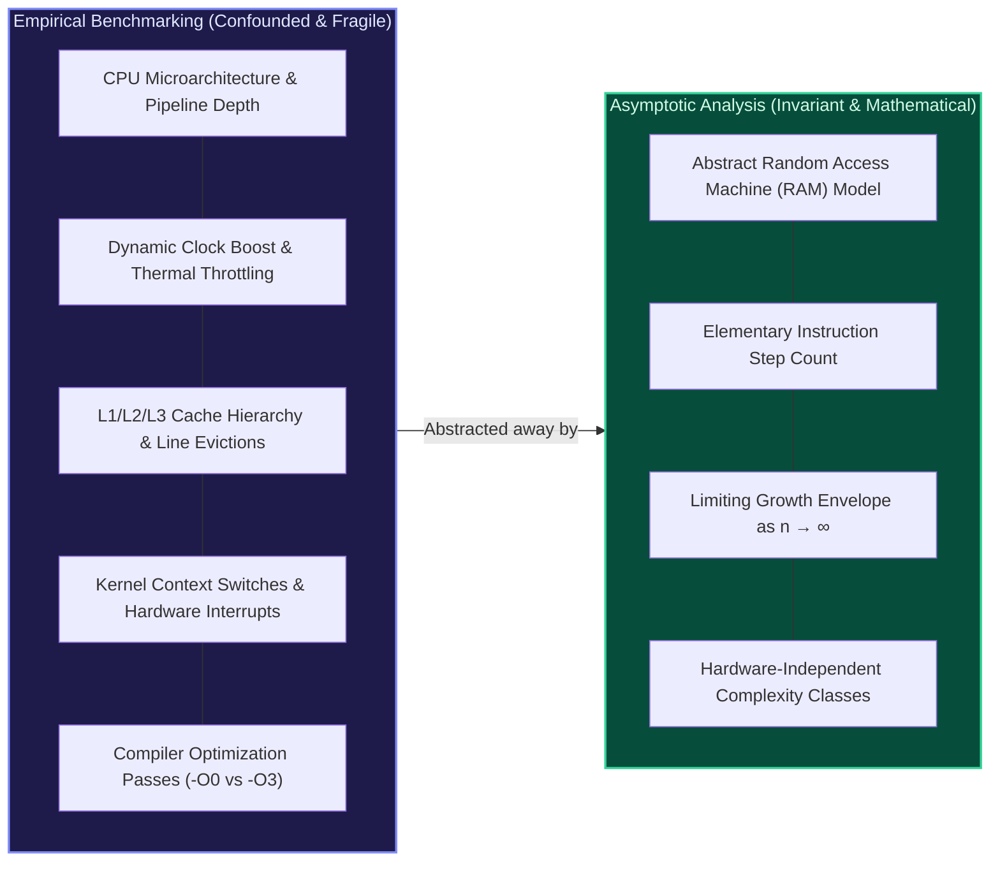
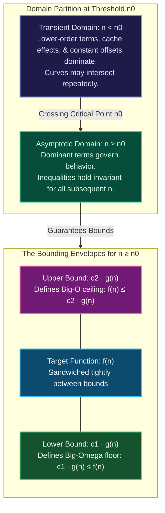
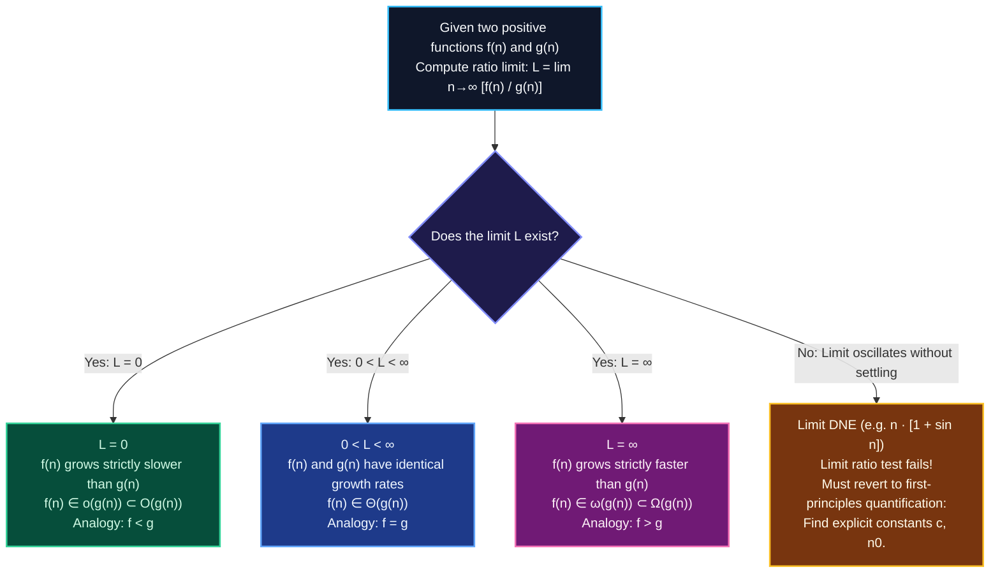

import { Callout } from "fumadocs-ui/components/callout";
import { Tabs, Tab } from "fumadocs-ui/components/tabs";
import { Steps, Step } from "fumadocs-ui/components/steps";
import { Cards, Card } from "fumadocs-ui/components/card";

## The Fallacy of Physical Benchmarks

Why do computer scientists and software engineers rely on asymptotic complexity rather than measuring execution time with a stopwatch or microsecond hardware timer?

Consider benchmarking two different search algorithms on two distinct computing systems:

1. **Algorithm A** (Quadratic, $\mathcal{O}(n^2)$) executed on an Intel Xeon Platinum workstation with 64 cores running at $4.0\text{ GHz}$, utilizing optimized AVX-512 vector pipelines and dual-channel DDR5 RAM.
2. **Algorithm B** (Linearithmic, $\mathcal{O}(n \log n)$) executed on an energy-constrained ARM Cortex-M0 microcontroller running at $48\text{ MHz}$ with $16\text{ KB}$ of SRAM.

If we run both algorithms with an input array of $n = 1{,}000$ elements:

- **Algorithm A** on Xeon finishes in **$0.12\text{ milliseconds}$**.
- **Algorithm B** on Cortex-M0 finishes in **$1.85\text{ milliseconds}$**.

A naive empirical benchmark would conclude that Algorithm A is roughly **15 times faster** than Algorithm B. However, this conclusion is an artifact of transient hardware disparity.

When the dataset scales to $n = 1{,}000{,}000$ elements:

- **Algorithm B** on the low-power Cortex-M0 completes in approximately **$2.4\text{ seconds}$**.
- **Algorithm A** on the Xeon supercomputer requires approximately **$120{,}000\text{ seconds}$ ($33.3\text{ hours}$)**.



### The Invariant Principle of Rate of Growth

Asymptotic analysis abstracts away physical execution constants (clock frequency, transistor architecture, bus latency, compiler optimizations) by analyzing the **limiting behavior of execution steps as the input size $n$ approaches infinity ($n \to \infty$)**.

In this mathematical realm:

- We evaluate the **Random Access Machine (RAM) model**, where standard arithmetic, memory read/write, branching, and comparison operations execute in $\mathcal{O}(1)$ idealized time.
- Multiplicative constants (such as whether a loop body takes 2 instructions or 20 instructions) are suppressed because, for sufficiently large inputs, the order of magnitude of the growth curve completely dwarfs constant multipliers.
- Lower-order polynomial terms (e.g., $7n + 12$ in $3n^2 + 7n + 12$) become mathematically insignificant relative to the highest-degree term $3n^2$ as $n \to \infty$.

---

## Formal Mathematical Definitions (CLRS Rigor)

In formal discrete mathematics and algorithmic theory (as standardized by Cormen, Leiserson, Rivest, and Stein in _Introduction to Algorithms_), asymptotic notations do not describe single numbers; **they describe sets of functions**.

<Callout type="warn" title="The Set-Theoretic Reality of Asymptotic Notation">
  When software engineers write: $$f(n) = \mathcal{O}(g(n))$$ This equality is a
  universally accepted **one-way abuse of mathematical notation**. Formally,
  $\mathcal{O}(g(n))$ is an **infinite set of functions**, and the relationship
  is set membership: $$f(n) \in \mathcal{O}(g(n))$$ Writing $\mathcal{O}(g(n)) =
  f(n)$ is strictly invalid because set membership is not symmetric.
</Callout>

### 1. Big-O ($\mathcal{O}$): Asymptotic Upper Bound

Big-O notation establishes an **asymptotic upper bound**. It guarantees that a function $f(n)$ grows _no faster_ than $g(n)$ to within a constant factor, once $n$ surpasses a critical threshold.

```math
\mathcal{O}(g(n)) = \left\{ f(n) : \exists \, c > 0, n_0 > 0 \text{ such that } 0 \le f(n) \le c \cdot g(n) \text{ for all } n \ge n_0 \right\}
```

- **Existential Quantifiers ($\exists c > 0, n_0 > 0$)**: There must exist at least one positive scaling constant $c$ and one non-negative integer threshold $n_0$ such that the inequality holds everywhere to the right of $n_0$.
- **Geometric Intuition**: The curve $c \cdot g(n)$ forms an impenetrable **ceiling** above $f(n)$ for all values of $n$ beyond the crossover point $n_0$. What happens for small inputs ($n < n_0$) is irrelevant to asymptotic classification.

---

### 2. Big-Omega ($\Omega$): Asymptotic Lower Bound

Big-Omega notation establishes an **asymptotic lower bound**. It guarantees that an algorithm requires _at least_ a certain order of operations to within a constant factor for sufficiently large inputs.

```math
\Omega(g(n)) = \left\{ f(n) : \exists \, c > 0, n_0 > 0 \text{ such that } 0 \le c \cdot g(n) \le f(n) \text{ for all } n \ge n_0 \right\}
```

- **Existential Quantifiers ($\exists c > 0, n_0 > 0$)**: We only need to find a single strictly positive multiplier $c$ such that $c \cdot g(n)$ stays below or equal to $f(n)$ for all $n \ge n_0$.
- **Geometric Intuition**: The scaled function $c \cdot g(n)$ acts as an unyielding **floor** beneath $f(n)$ for all $n \ge n_0$.

---

### 3. Big-Theta ($\Theta$): Asymptotic Tight Bound

Big-Theta notation establishes an **asymptotically tight bound**. It sandwiches $f(n)$ between an upper bound and a lower bound of the exact same growth order.

```math
\Theta(g(n)) = \left\{ f(n) : \exists \, c_1 > 0, c_2 > 0, n_0 > 0 \text{ such that } 0 \le c_1 \cdot g(n) \le f(n) \le c_2 \cdot g(n) \text{ for all } n \ge n_0 \right\}
```

<Callout type="info" title="The Fundamental Sandwich Theorem">
  A function $f(n)$ is bounded tightly by $g(n)$ if and only if it is
  simultaneously bounded from above and below by $g(n)$: $$f(n) \in \Theta(g(n))
  \iff f(n) \in \mathcal{O}(g(n)) \quad \text{and} \quad f(n) \in \Omega(g(n))$$
</Callout>

---

### 4. Little-o ($o$): Strict Asymptotic Upper Bound

While Big-O allows the upper bound to be tight (e.g., $2n^2 \in \mathcal{O}(n^2)$), **Little-o** denotes an upper bound that is **strictly loose**. Function $f(n)$ becomes completely insignificant compared to $g(n)$ as $n$ grows without bound.

```math
o(g(n)) = \left\{ f(n) : \forall \, c > 0, \exists \, n_0 > 0 \text{ such that } 0 \le f(n) < c \cdot g(n) \text{ for all } n \ge n_0 \right\}
```

- **Universal Quantifier ($\forall c > 0$)**: Unlike Big-O, which requires the inequality to hold for _some_ constant $c$, Little-o requires the inequality to hold for _every_ positive constant $c$, no matter how tiny ($c = 10^{-6}, 10^{-100}$).
- **Calculus Limit Definition**:
  $$\lim_{n \to \infty} \frac{f(n)}{g(n)} = 0$$
- **Example**: $n \in o(n^2)$, but $3n^2 \notin o(n^2)$.

---

### 5. Little-omega ($\omega$): Strict Asymptotic Lower Bound

Analogously, **Little-omega** denotes a lower bound that is **strictly loose**. Function $f(n)$ grows strictly faster than $g(n)$.

```math
\omega(g(n)) = \left\{ f(n) : \forall \, c > 0, \exists \, n_0 > 0 \text{ such that } 0 \le c \cdot g(n) < f(n) \text{ for all } n \ge n_0 \right\}
```

- **Universal Quantifier ($\forall c > 0$)**: The curve $f(n)$ eventually overtakes $c \cdot g(n)$ for _any_ constant multiplier $c$, no matter how massive ($c = 10^6, 10^{100}$).
- **Calculus Limit Definition**:
  $$\lim_{n \to \infty} \frac{f(n)}{g(n)} = \infty$$
- **Example**: $n^3 \in \omega(n^2)$, but $5n^2 \notin \omega(n^2)$.

---

### Summary Comparison Matrix

The five asymptotic notations mirror the relational orderings of real numbers:

| Notation                         | Bound Type                     | Formal Condition ($n \ge n_0$)                          | Limit Ratio $L = \lim_{n \to \infty} \frac{f(n)}{g(n)}$ | Real Number Analogue |
| :------------------------------- | :----------------------------- | :------------------------------------------------------ | :------------------------------------------------------ | :------------------- |
| **$f(n) \in \mathcal{O}(g(n))$** | Upper bound (loose or tight)   | $\exists c > 0 : f(n) \le c \cdot g(n)$                 | $L < \infty$ ($L = 0$ or $0 < L < \infty$)              | $a \le b$            |
| **$f(n) \in \Omega(g(n))$**      | Lower bound (loose or tight)   | $\exists c > 0 : c \cdot g(n) \le f(n)$                 | $L > 0$ ($0 < L < \infty$ or $L = \infty$)              | $a \ge b$            |
| **$f(n) \in \Theta(g(n))$**      | Tight sandwich bound           | $\exists c_1, c_2 > 0 : c_1 g(n) \le f(n) \le c_2 g(n)$ | $0 < L < \infty$                                        | $a = b$              |
| **$f(n) \in o(g(n))$**           | Strict upper bound (non-tight) | $\forall c > 0 : f(n) < c \cdot g(n)$                   | $L = 0$                                                 | $a < b$              |
| **$f(n) \in \omega(g(n))$**      | Strict lower bound (non-tight) | $\forall c > 0 : c \cdot g(n) < f(n)$                   | $L = \infty$                                            | $a > b$              |

---

## Geometric Visualization of Bounding Envelopes

The following diagram illustrates how the crossover threshold $n_0$ divides the problem domain into a transient phase and an invariant asymptotic regime:



---

## The Calculus of Growth: Limit Ratio Formulation

When functions $f(n)$ and $g(n)$ are differentiable and continuous for large $n$, we can bypass first-principles quantifier proofs by computing the ratio limit:

$$L = \lim_{n \to \infty} \frac{f(n)}{g(n)}$$

The value of $L$ categorizes the asymptotic relationship instantly:



### Applying L'Hôpital's Rule

If both $f(n) \to \infty$ and $g(n) \to \infty$ as $n \to \infty$ (the indeterminate form $\frac{\infty}{\infty}$), L'Hôpital's Rule allows differentiation of the continuous extensions $f(x)$ and $g(x)$:

$$\lim_{n \to \infty} \frac{f(n)}{g(n)} = \lim_{x \to \infty} \frac{f'(x)}{g'(x)}$$

#### Example 1: Logarithm vs. Square Root

Compare $f(n) = \ln n$ against $g(n) = \sqrt{n}$:

$$L = \lim_{n \to \infty} \frac{\ln n}{\sqrt{n}} \quad \left[\frac{\infty}{\infty}\right]$$

Applying L'Hôpital's Rule:
$$L = \lim_{x \to \infty} \frac{\frac{d}{dx}[\ln x]}{\frac{d}{dx}[x^{1/2}]} = \lim_{x \to \infty} \frac{\frac{1}{x}}{\frac{1}{2\sqrt{x}}} = \lim_{x \to \infty} \frac{2\sqrt{x}}{x} = \lim_{x \to \infty} \frac{2}{\sqrt{x}} = 0$$

Because $L = 0$, we conclude that:
$$\ln n \in o(\sqrt{n}) \subset \mathcal{O}(\sqrt{n})$$

Any fractional polynomial power ($n^{0.001}$) strictly dominates any polylogarithmic factor ($(\log n)^{100}$) as $n \to \infty$.

#### Example 2: Polynomial vs. Exponential

Compare $f(n) = n^k$ (for any fixed $k \ge 1$) against $g(n) = a^n$ (for $a > 1$):
Differentiating $k$ times successively via L'Hôpital's Rule:

$$\lim_{x \to \infty} \frac{x^k}{a^x} = \lim_{x \to \infty} \frac{k!}{(\ln a)^k \cdot a^x} = 0$$

Therefore:
$$n^k \in o(a^n)$$
Exponentials strictly overpower all polynomial degrees.

### When the Limit Test Fails: Oscillatory Functions

<Callout type="error" title="Critical Edge Case: Non-Existent Limits">
The limit ratio test is sufficient, but **not necessary**. If the limit $\lim_{n \to \infty} \frac{f(n)}{g(n)}$ does not exist due to oscillation, the functions may still possess a valid Big-O or Big-Theta relationship.

Consider:
$$f(n) = n(1 + \sin^2 n), \quad g(n) = n$$
The ratio $\frac{f(n)}{g(n)} = 1 + \sin^2 n$ oscillates perpetually in the closed interval $[1, 2]$ as $n \to \infty$. The limit $\lim_{n \to \infty} (1 + \sin^2 n)$ does not exist.

However, using the formal quantifier definition:
$$1 \cdot n \le n(1 + \sin^2 n) \le 2 \cdot n \quad \text{for all } n \ge 1$$
Setting $c_1 = 1$, $c_2 = 2$, and $n_0 = 1$ proves that $f(n) \in \Theta(n)$ rigorously.

</Callout>

---

## Step-by-Step Formal Mathematical Proofs

Let us work through three foundational proofs that form the bedrock of algorithmic theory and academic examinations.

### Proof 1: First-Principles Polynomial Tight Bound

**Proposition**: Prove from first principles that $f(n) = 3n^2 + 7n + 12 \in \Theta(n^2)$.

<Steps>
<Step>
#### State the Exact Proof Obligation
According to the definition of $\Theta(n^2)$, we must find three positive constants $c_1 > 0$, $c_2 > 0$, and $n_0 > 0$ such that:
$$0 \le c_1 \cdot n^2 \le 3n^2 + 7n + 12 \le c_2 \cdot n^2 \quad \text{for all } n \ge n_0$$
</Step>

<Step>
#### Derive the Upper Bound Witness ($c_2, n_0$)
Observe that for all integers $n \ge 1$:
$$n \le n^2 \implies 7n \le 7n^2$$
$$1 \le n^2 \implies 12 \le 12n^2$$

Substituting these upper bounds into $f(n)$:
$$3n^2 + 7n + 12 \le 3n^2 + 7n^2 + 12n^2 = (3 + 7 + 12)n^2 = 22n^2 \quad \text{for all } n \ge 1$$

Thus, setting $c_2 = 22$ and $n_0 = 1$ satisfies the upper bound.

</Step>

<Step>
#### Derive the Lower Bound Witness ($c_1, n_0$)
For all $n \ge 1$, the terms $7n$ and $12$ are strictly positive:
$$7n > 0 \quad \text{and} \quad 12 > 0$$

Dropping these non-negative terms yields:
$$3n^2 + 7n + 12 \ge 3n^2 \quad \text{for all } n \ge 1$$

Thus, setting $c_1 = 3$ and $n_0 = 1$ satisfies the lower bound.

</Step>

<Step>
#### Synthesize and Conclude
We have established:
$$0 \le 3n^2 \le 3n^2 + 7n + 12 \le 22n^2 \quad \text{for all } n \ge 1$$

Choosing constants:
$$c_1 = 3, \quad c_2 = 22, \quad n_0 = 1$$
We satisfy the definition of $\Theta(n^2)$. Therefore, $3n^2 + 7n + 12 \in \Theta(n^2)$. $\blacksquare$

</Step>
</Steps>

---

### Proof 2: Proof by Contradiction

**Proposition**: Prove that $n^2 \notin \mathcal{O}(n)$.

<Steps>
<Step>
#### Formulate the Contradiction Hypothesis
Assume, for the sake of contradiction, that $n^2 \in \mathcal{O}(n)$.
By the formal definition of Big-O, there must exist constants $c > 0$ and $n_0 > 0$ such that:
$$n^2 \le c \cdot n \quad \text{for all } n \ge n_0$$
</Step>

<Step>
#### Algebraic Simplification
Since $n \ge n_0 > 0$, we divide both sides of the inequality by $n$ without changing the inequality sign:
$$n \le c \quad \text{for all } n \ge n_0$$

This inequality states that every integer $n$ beyond $n_0$ is upper-bounded by the fixed finite number $c$.

</Step>

<Step>
#### Construct the Counter-Witness
Choose an integer $n^*$ defined as:
$$n^* = \max(n_0, \lfloor c \rfloor + 1)$$

Since $n^* \ge n_0$, our initial assumption requires:
$$n^* \le c$$

However, by the definition of the ceiling/floor function:
$$n^* \ge \lfloor c \rfloor + 1 > c$$

This leads directly to:
$$c < n^* \le c \implies c < c$$

</Step>

<Step>
#### Establish Contradiction
The statement $c < c$ is impossible for any real number $c$. Hence, our initial hypothesis must be false.
We conclude that $n^2 \notin \mathcal{O}(n)$. $\blacksquare$
</Step>
</Steps>

---

### Proof 3: Bounding Factorials and $\log(n!)$

**Proposition**: Prove that $\log(n!) = \Theta(n \log n)$.

<Steps>
<Step>
#### Part A: Establish the Asymptotic Upper Bound ($\mathcal{O}$)
Recall the definition of factorial: $n! = 1 \times 2 \times 3 \times \dots \times n$.
Each of the $n$ factors in the product is less than or equal to $n$:
$$n! = \prod_{i=1}^n i \le \prod_{i=1}^n n = n^n$$

Taking the logarithm (base 2) of both sides:
$$\log(n!) \le \log(n^n) = n \log n \quad \text{for all } n \ge 1$$

With $c_2 = 1$ and $n_0 = 1$, we have:
$$\log(n!) \in \mathcal{O}(n \log n)$$

</Step>

<Step>
#### Part B: Establish the Asymptotic Lower Bound ($\Omega$)
Split the product $n!$ at its midpoint $\lceil n/2 \rceil$:
$$n! = 1 \times 2 \times \dots \times \left(\left\lceil \frac{n}{2} \right\rceil - 1\right) \times \left\lceil \frac{n}{2} \right\rceil \times \dots \times n$$

Discarding the first $\lceil n/2 \rceil - 1$ terms (all of which are $\ge 1$):
$$n! \ge \prod_{i=\lceil n/2 \rceil}^n i$$

Each factor in this remaining product is $\ge \frac{n}{2}$. The number of terms in this sub-product is $n - \lceil n/2 \rceil + 1 \ge \frac{n}{2}$. Therefore:
$$n! \ge \left(\frac{n}{2}\right)^{n/2}$$

Taking the logarithm:
$$\log(n!) \ge \log\left(\left(\frac{n}{2}\right)^{n/2}\right) = \frac{n}{2} \log\left(\frac{n}{2}\right) = \frac{n}{2}(\log n - \log 2) = \frac{1}{2}n \log n - \frac{\log 2}{2}n$$

For $n \ge 4$, $\log n \ge 2 = 2 \log 2 \implies \frac{\log 2}{2}n \le \frac{1}{4}n \log n$.
Substituting this bound:
$$\log(n!) \ge \frac{1}{2}n \log n - \frac{1}{4}n \log n = \frac{1}{4}n \log n \quad \text{for all } n \ge 4$$

Setting $c_1 = \frac{1}{4}$ and $n_0 = 4$, we have:
$$\log(n!) \in \Omega(n \log n)$$

</Step>

<Step>
#### Corroboration via Stirling's Approximation
Stirling's asymptotic expansion states:
$$n! = \sqrt{2\pi n} \left(\frac{n}{e}\right)^n \left(1 + \mathcal{O}\left(\frac{1}{n}\right)\right)$$

Taking the natural logarithm:
$$\ln(n!) = n \ln n - n + \frac{1}{2}\ln(2\pi n) + \mathcal{O}(1)$$

Computing the ratio limit as $n \to \infty$:
$$\lim_{n \to \infty} \frac{\ln(n!)}{n \ln n} = \lim_{n \to \infty} \left(1 - \frac{1}{\ln n} + \frac{\ln(2\pi n)}{2n \ln n}\right) = 1$$

Since $0 < 1 < \infty$, the Limit Ratio Test independently verifies:
$$\log(n!) \in \Theta(n \log n) \quad \blacksquare$$

</Step>
</Steps>

---

## Relational & Algebraic Properties of Asymptotic Sets

Asymptotic notations obey algebraic rules that simplify the analysis of compound algorithms:

### 1. Relational Properties

- **Transitivity**:
  $$f(n) \in \Theta(g(n)) \land g(n) \in \Theta(h(n)) \implies f(n) \in \Theta(h(n))$$
  _(Also holds identically for $\mathcal{O}, \Omega, o, \omega$)_.
- **Reflexivity**:
  $$f(n) \in \Theta(f(n)), \quad f(n) \in \mathcal{O}(f(n)), \quad f(n) \in \Omega(f(n))$$
  _(Does NOT hold for $o$ and $\omega$, because $f(n) \notin o(f(n))$)_.
- **Symmetry**:
  $$f(n) \in \Theta(g(n)) \iff g(n) \in \Theta(f(n))$$
- **Transpose Symmetry**:
  $$f(n) \in \mathcal{O}(g(n)) \iff g(n) \in \Omega(f(n))$$
  $$f(n) \in o(g(n)) \iff g(n) \in \omega(f(n))$$

### 2. Operational Rules

- **Sum / Maximum Rule**:
  $$\mathcal{O}(f(n) + g(n)) = \mathcal{O}(\max(f(n), g(n)))$$
  When an algorithm executes two sequential steps with complexities $f(n)$ and $g(n)$, the slower step completely dominates the overall asymptotic bound.
- **Product Rule**:
  $$\mathcal{O}(f_1(n)) \cdot \mathcal{O}(f_2(n)) = \mathcal{O}(f_1(n) \cdot f_2(n))$$
  When a loop running in $f_1(n)$ embeds an inner loop running in $f_2(n)$, the complexities multiply.

<Callout type="warn" title="Dangerous Pitfall: Exponentiation Hazards">
While $2n \in \mathcal{O}(n)$, it is strictly **false** that $2^{2n} \in \mathcal{O}(2^n)$.
$$2^{2n} = (2^2)^n = 4^n$$
Testing the ratio:
$$\lim_{n \to \infty} \frac{4^n}{2^n} = \lim_{n \to \infty} 2^n = \infty$$
Therefore, $2^{2n} \in \omega(2^n)$—an exponential squared is an entirely different complexity class!
</Callout>

---

## The Master Growth Rate Hierarchy

Every computer scientist must internalize the global hierarchy of computational complexity classes:

```math
\mathcal{O}(1) < \mathcal{O}(\alpha(n)) < \mathcal{O}(\log \log n) < \mathcal{O}(\log n) < \mathcal{O}(\sqrt{n}) < \mathcal{O}(n) < \mathcal{O}(n \log n) < \mathcal{O}(n^2) < \mathcal{O}(n^3) < \mathcal{O}(2^n) < \mathcal{O}(n!) < \mathcal{O}(n^n)
```

<Callout type="info" title="The Inverse Ackermann Function α(n)">
  The Inverse Ackermann function $\alpha(n)$ grows so slowly that for any
  conceivable input size in the physical universe ($n = 10^{80}$, the estimated
  number of atoms in the observable universe): $$\alpha(n) \le 4$$ It appears in
  the optimal runtime of the Disjoint Set Union (DSU / Union-Find) data
  structure with path compression and union by rank. For all practical
  engineering purposes, $\mathcal{O}(\alpha(n))$ is indistinguishable from
  $\mathcal{O}(1)$.
</Callout>

### Concrete Growth Explosion Across Scales

Assuming an optimized processor executing **$10^9$ operations per second ($1\text{ GHz}$ single-thread capacity)**:

| Complexity Class              | $n = 10$            | $n = 100$                              | $n = 10{,}000$        | $n = 1{,}000{,}000$     | $n = 10^9$                      |
| :---------------------------- | :------------------ | :------------------------------------- | :-------------------- | :---------------------- | :------------------------------ |
| **$\mathcal{O}(1)$**          | $1\text{ ns}$       | $1\text{ ns}$                          | $1\text{ ns}$         | $1\text{ ns}$           | $1\text{ ns}$                   |
| **$\mathcal{O}(\log_2 n)$**   | $3.3\text{ ns}$     | $6.6\text{ ns}$                        | $13.3\text{ ns}$      | $19.9\text{ ns}$        | $29.9\text{ ns}$                |
| **$\mathcal{O}(\sqrt{n})$**   | $3.16\text{ ns}$    | $10\text{ ns}$                         | $100\text{ ns}$       | $1\ \mu\text{s}$        | $31.6\ \mu\text{s}$             |
| **$\mathcal{O}(n)$**          | $10\text{ ns}$      | $100\text{ ns}$                        | $10\ \mu\text{s}$     | $1\text{ ms}$           | $1.0\text{ sec}$                |
| **$\mathcal{O}(n \log_2 n)$** | $33\text{ ns}$      | $664\text{ ns}$                        | $133\ \mu\text{s}$    | $20\text{ ms}$          | $29.9\text{ sec}$               |
| **$\mathcal{O}(n^2)$**        | $100\text{ ns}$     | $10\ \mu\text{s}$                      | $100\text{ ms}$       | $16.7\text{ minutes}$   | **$31.7\text{ years}$**         |
| **$\mathcal{O}(n^3)$**        | $1\ \mu\text{s}$    | $1\text{ ms}$                          | $16.7\text{ minutes}$ | **$31.7\text{ years}$** | **$31.7\text{ billion years}$** |
| **$\mathcal{O}(2^n)$**        | $1.02\ \mu\text{s}$ | **$4.0 \times 10^{13}\text{ years}$**  | Universe Heat Death   | Immeasurable            | Immeasurable                    |
| **$\mathcal{O}(n!)$**         | $3.63\text{ ms}$    | **$2.9 \times 10^{143}\text{ years}$** | Immeasurable          | Immeasurable            | Immeasurable                    |

---

## Critical Distinctions and Common Industry Pitfalls

### Trap 1: Conflating Asymptotic Bounds with Operational Cases

This is the most widespread mistake in technical interviews and system design:

<Callout type="error" title="Big-O is NOT Equivalent to 'Worst Case'!">
- **Worst, Average, and Best Cases** refer to the **input configuration** (e.g., already sorted array vs reverse-sorted array vs random distribution).
- **Big-O, Big-$\Omega$, and Big-$\Theta$** are **mathematical envelope operators** that can bound ANY function.

Every operational case possesses its own independent Big-O, Big-$\Omega$, and Big-$\Theta$ bounds:

</Callout>

Take **Quicksort (Hoare's partitioning)** as the quintessential example:

- **Best-Case Input Configuration** (Pivot always splits array in equal halves):
  $$\text{Execution time } T_{\text{best}}(n) \in \Theta(n \log n)$$
- **Average-Case Input Configuration** (Random uniform permutation of keys):
  $$\text{Execution time } T_{\text{avg}}(n) \in \Theta(n \log n)$$
- **Worst-Case Input Configuration** (Array sorted, naive pivot chooses first element):
  $$\text{Execution time } T_{\text{worst}}(n) \in \Theta(n^2)$$

Notice:

1. It is mathematically correct to state: _"Quicksort's worst-case time is $\mathcal{O}(n^2)$ and $\Omega(n^2)$, hence $\Theta(n^2)$."_
2. It is also mathematically correct to state: _"Quicksort's best-case time is $\mathcal{O}(n \log n)$."_
3. It is mathematically correct to state: _"Quicksort's overall execution time is $\mathcal{O}(n^2)$ across all possible inputs."_
4. It is **completely false** to say: _"Big-O means worst case and Big-Omega means best case."_

### Trap 2: Abuse of Equality

Engineers routinely write:
$$f(n) = \mathcal{O}(g(n))$$
Because equality is symmetric in standard arithmetic ($a = b \implies b = a$), junior engineers incorrectly deduce:
$$\mathcal{O}(g(n)) = f(n)$$
This is nonsensical. As established earlier, $\mathcal{O}(g(n))$ is an infinite equivalence class of functions. When reading equations like:
$$T(n) = 2T(n/2) + \mathcal{O}(n)$$
The term $\mathcal{O}(n)$ represents an **anonymous, unspecified function** $h(n) \in \mathcal{O}(n)$ that absorbs linear overhead.

### Trap 3: Loose vs. Tight Upper Bounds

Technically, because Big-O is an upper bound:
$$n \in \mathcal{O}(n^{100})$$
$$n \in \mathcal{O}(2^n)$$
$$n \in \mathcal{O}(n!)$$

All three statements above are mathematically true, yet practically useless for software design. In technical communication, always strive to supply the **tight bound ($\Theta$)** when both upper and lower bounds coincide. When industry developers say "The Big-O of MergeSort is $n \log n$", they almost always mean $\Theta(n \log n)$.

---

## Multi-Language Empirical Verification Harness

How can we programmatically verify that an implementation matches its theoretical asymptotic complexity?

We employ the **Doubling Ratio Test**:
As input size $n$ doubles to $2n$:
$$\text{Ratio } R = \frac{T(2n)}{T(n)}$$

- If $T(n) \in \Theta(n)$, then $R \approx \frac{2n}{n} = \mathbf{2.0}$.
- If $T(n) \in \Theta(n \log n)$, then $R \approx \frac{2n \log(2n)}{n \log n} = 2\left(1 + \frac{1}{\log_2 n}\right) \to \mathbf{2.0}$.
- If $T(n) \in \Theta(n^2)$, then $R \approx \frac{(2n)^2}{n^2} = \mathbf{4.0}$.
- If $T(n) \in \Theta(n^3)$, then $R \approx \frac{(2n)^3}{n^3} = \mathbf{8.0}$.

<Tabs items={["Python", "TypeScript", "C++"]}>
<Tab value="Python">
```python
"""
Asymptotic Verification Harness (Python)
Measures empirical operation counts across doubling input sizes n
and verifies convergence toward theoretical asymptotic constants.
"""

import time
import math
from typing import Callable, List, Tuple

def benchmark_algorithm(
fn: Callable[[List[int]], int],
generator: Callable[[int], List[int]],
sizes: List[int]
) -> List[Tuple[int, float, float]]:
"""
Runs fn across increasing input sizes, recording wall-clock time
and computing empirical growth ratios: T(n) / T(n / 2).
"""
results = []
prev_time = None

    for n in sizes:
        data = generator(n)

        # Warmup and timed execution
        start_time = time.perf_counter()
        _ = fn(data)
        elapsed = time.perf_counter() - start_time

        ratio = (elapsed / prev_time) if prev_time and prev_time > 0 else 0.0
        results.append((n, elapsed, ratio))
        prev_time = elapsed

    return results

def quadratic_selection_sort(arr: List[int]) -> int:
"""O(n^2) Selection Sort counting comparisons."""
comparisons = 0
a = list(arr)
n = len(a)
for i in range(n):
min_idx = i
for j in range(i + 1, n):
comparisons += 1
if a[j] < a[min_idx]:
min_idx = j
a[i], a[min_idx] = a[min_idx], a[i]
return comparisons

def linearithmic_merge_sort(arr: List[int]) -> int:
"""O(n log n) Merge Sort counting comparisons."""
comparisons = 0

    def sort(a: List[int]) -> List[int]:
        nonlocal comparisons
        if len(a) <= 1:
            return a
        mid = len(a) // 2
        left = sort(a[:mid])
        right = sort(a[mid:])

        merged = []
        i = j = 0
        while i < len(left) and j < len(right):
            comparisons += 1
            if left[i] <= right[j]:
                merged.append(left[i])
                i += 1
            else:
                merged.append(right[j])
                j += 1
        merged.extend(left[i:])
        merged.extend(right[j:])
        return merged

    _ = sort(arr)
    return comparisons

if **name** == "**main**":
test_sizes = [500, 1000, 2000, 4000, 8000]
gen = lambda n: list(range(n, 0, -1)) # Reverse sorted worst-case

    print("=== Selection Sort: Predicted Ratio -> 4.00 (Theta(n^2)) ===")
    q_res = benchmark_algorithm(quadratic_selection_sort, gen, test_sizes)
    for n, dur, ratio in q_res:
        print(f"n = {n:5d} | Time: {dur:.6f}s | Doubling Ratio: {ratio:.2f}")

    print("\n=== Merge Sort: Predicted Ratio -> 2.00 (Theta(n log n)) ===")
    m_res = benchmark_algorithm(linearithmic_merge_sort, gen, test_sizes)
    for n, dur, ratio in m_res:
        print(f"n = {n:5d} | Time: {dur:.6f}s | Doubling Ratio: {ratio:.2f}")

````
</Tab>

<Tab value="TypeScript">
```typescript
/**
 * Asymptotic Verification Harness (TypeScript / Node.js)
 * Tests empirical doubling ratios to confirm computational complexity class.
 */

type BenchmarkResult = {
  n: number;
  timeMs: number;
  ratio: number;
};

function runBenchmark(
  fn: (arr: number[]) => number,
  sizes: number[]
): BenchmarkResult[] {
  const results: BenchmarkResult[] = [];
  let prevTime = 0;

  for (const n of sizes) {
    // Generate reverse-ordered array
    const data = Array.from({ length: n }, (_, i) => n - i);

    const start = performance.now();
    fn(data);
    const timeMs = performance.now() - start;

    const ratio = prevTime > 0 ? timeMs / prevTime : 1.0;
    results.push({ n, timeMs, ratio });
    prevTime = timeMs;
  }

  return results;
}

// O(n^2) Quadratic Bubble Sort
function bubbleSort(arr: number[]): number {
  let ops = 0;
  const a = [...arr];
  const n = a.length;
  for (let i = 0; i < n; i++) {
    for (let j = 0; j < n - i - 1; j++) {
      ops++;
      if (a[j] > a[j + 1]) {
        const tmp = a[j];
        a[j] = a[j + 1];
        a[j + 1] = tmp;
      }
    }
  }
  return ops;
}

// O(n log n) Native TimSort/QuickSort comparison
function builtInSort(arr: number[]): number {
  const a = [...arr];
  a.sort((x, y) => x - y);
  return a.length;
}

const sizes = [1000, 2000, 4000, 8000, 16000];

console.log("=== Quadratic Bubble Sort (Expect Doubling Ratio ~ 4.0) ===");
const quadResults = runBenchmark(bubbleSort, sizes.slice(0, 4));
for (const r of quadResults) {
  console.log(`n: ${r.n.toString().padStart(5)} | Time: ${r.timeMs.toFixed(2)}ms | Ratio: ${r.ratio.toFixed(2)}`);
}

console.log("\n=== Log-Linear Sort (Expect Doubling Ratio ~ 2.0 - 2.2) ===");
const logResults = runBenchmark(builtInSort, sizes);
for (const r of logResults) {
  console.log(`n: ${r.n.toString().padStart(5)} | Time: ${r.timeMs.toFixed(2)}ms | Ratio: ${r.ratio.toFixed(2)}`);
}
````

</Tab>

<Tab value="C++">
```cpp
/**
 * Asymptotic Verification Harness (C++20)
 * Demonstrates clock precision, cycle-invariance, and empirical bounding ratios.
 */

#include <iostream>
#include <vector>
#include <chrono>
#include <numeric>
#include <iomanip>
#include <algorithm>

uint64_t count_quadratic_triplets(const std::vector<int>& arr) {
uint64_t sum = 0;
const size_t n = arr.size();
for (size_t i = 0; i < n; ++i) {
for (size_t j = i + 1; j < n; ++j) {
sum += (arr[i] ^ arr[j]);
}
}
return sum;
}

uint64_t count_linear_pass(const std::vector<int>& arr) {
uint64_t sum = 0;
for (int val : arr) {
sum += (val \* 31);
}
return sum;
}

int main() {
std::vector<size_t> sizes = {2000, 4000, 8000, 16000, 32000};

    std::cout << std::fixed << std::setprecision(4);
    std::cout << "=== Quadratic Loop: Θ(n^2) (Expected Ratio: 4.00) ===\n";

    double prev_time = 0.0;
    for (size_t n : sizes) {
        std::vector<int> data(n);
        std::iota(data.begin(), data.end(), 1);

        auto start = std::chrono::high_resolution_clock::now();
        volatile uint64_t res = count_quadratic_triplets(data);
        auto end = std::chrono::high_resolution_clock::now();

        std::chrono::duration<double, std::milli> elapsed = end - start;
        double current_time = elapsed.count();
        double ratio = (prev_time > 0.0) ? (current_time / prev_time) : 1.0;

        std::cout << "n = " << std::setw(5) << n
                  << " | Elapsed: " << std::setw(9) << current_time << " ms"
                  << " | Ratio: " << std::setw(5) << ratio << "\n";
        prev_time = current_time;
    }

    return 0;

}

```
</Tab>
</Tabs>

---

## Curriculum Navigation & Next Steps

Now that you have mastered the formal set-theoretic definitions, calculus limits, and proof techniques of asymptotic notation, proceed to deeper computational models:

<Cards>
  <Card
    title="1.1.4 Amortized Analysis"
    href="/docs/dsa/01-beginner/algorithmic-complexity-and-asymptotic-analysis/amortized-analysis"
    description="Analyze algorithms where rare expensive operations are guaranteed to be counterbalanced by frequent cheap operations using the Aggregate, Accounting, and Potential methods."
  />
  <Card
    title="1.1.5 Recurrence Relations"
    href="/docs/dsa/01-beginner/algorithmic-complexity-and-asymptotic-analysis/recurrence-relations"
    description="Solve divide-and-conquer recurrences using the Master Theorem, Recursion Tree expansions, and the generalized Akra-Bazzi method."
  />
</Cards>
```
