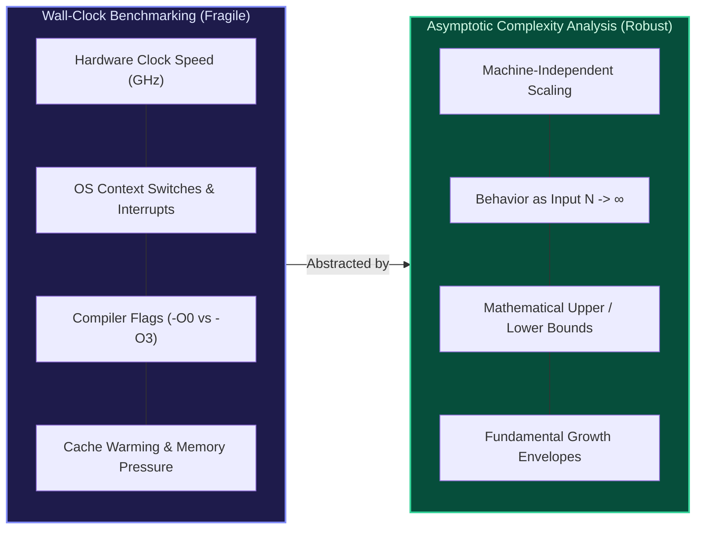
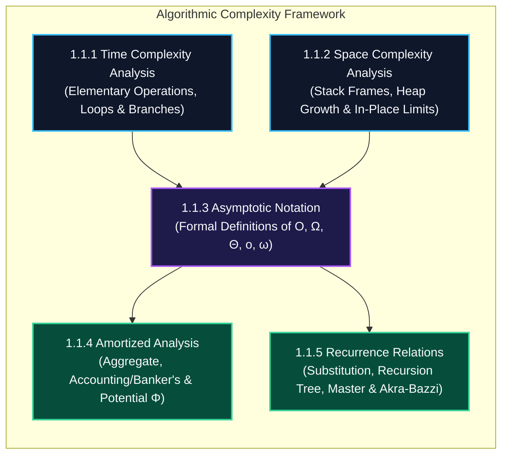

import { Callout } from "fumadocs-ui/components/callout";
import { Tabs, Tab } from "fumadocs-ui/components/tabs";
import { Steps, Step } from "fumadocs-ui/components/steps";
import { Cards, Card } from "fumadocs-ui/components/card";

## The Bedrock of Computer Systems

Why do software engineers and computer scientists analyze algorithms using formal asymptotic complexity rather than simply benchmarking execution times on a physical server?

If you benchmark a search algorithm on an Intel Core i9 processor running at 5.0 GHz with warm L1 caches, an unoptimized $O(N^2)$ algorithm with $N = 10{,}000$ items might execute in **15 milliseconds**. If you run an optimal $O(N \log N)$ algorithm on an under-volted ARM Cortex-M0 microcontroller running at 48 MHz, it might take **45 milliseconds**. A naive wall-clock benchmark would falsely declare the quadratic algorithm 3x superior.

Yet when input scale expands to $N = 1{,}000{,}000$:

- The $O(N \log N)$ algorithm completes in roughly **0.6 seconds** on the micro-controller.
- The $O(N^2)$ algorithm requires **over 4 hours** on the Core i9 supercomputer.

**Asymptotic complexity analysis abstracts away hardware discrepancies, compiler optimizations, and environmental noise.** It provides an invariant mathematical language to classify the intrinsic rate at which resource consumption (execution steps, memory bytes) scales as input size $N$ tends toward infinity ($N \to \infty$).

---

## Conceptual Architecture Roadmap

Algorithmic complexity is not a single formula—it is a coherent analytical framework spanning five foundational pillars:

Every software system from the Linux kernel scheduler to distributed database query planners relies on these analytical disciplines:

1. **Time Complexity**: Determining the growth rate of elementary instruction cycles as a function of input size.
2. **Space Complexity**: Differentiating between transient call stack overhead, auxiliary workspace allocations, and primary input-retaining memory.
3. **Asymptotic Notation**: Grounding Big-O, Big-$\Omega$, and Big-$\Theta$ in rigorous limit definitions ($\lim_{n \to \infty} \frac{f(n)}{g(n)}$) and set-theoretic bounding envelopes.
4. **Amortized Analysis**: Providing ironclad statistical and operational guarantees for data structures (like dynamic arrays and hash tables) where rare high-cost operations are paid for by abundant cheap operations.
5. **Recurrence Relations**: Solving divide-and-conquer recurrence equations governing merge sort, quicksort, fast Fourier transforms, and binary search trees.

---

## Stage 1.1 Curriculum Modules

Explore the dedicated modules in this section:

<Cards>
  <Card
    title="1.1.1 Time Complexity Analysis"
    href="/docs/dsa/01-beginner/algorithmic-complexity-and-asymptotic-analysis/time-complexity-analysis"
    description="Deconstruct code into elementary operations, classify loop hierarchies, and master worst-case, best-case, and average-case analysis."
  />
  <Card
    title="1.1.2 Space Complexity Analysis"
    href="/docs/dsa/01-beginner/algorithmic-complexity-and-asymptotic-analysis/space-complexity-analysis"
    description="Analyze stack frame lifecycles, quantify auxiliary memory versus input space, and master in-place algorithm constraints."
  />
  <Card
    title="1.1.3 Asymptotic Notation"
    href="/docs/dsa/01-beginner/algorithmic-complexity-and-asymptotic-analysis/asymptotic-notation"
    description="Establish rigorous mathematical foundations for Big-O, Big-Omega, Big-Theta, Little-o, and Little-omega with limit proofs."
  />
  <Card
    title="1.1.4 Amortized Analysis"
    href="/docs/dsa/01-beginner/algorithmic-complexity-and-asymptotic-analysis/amortized-analysis"
    description="Master the Aggregate Method, Banker's Accounting Method, and Physicist's Potential Method (Φ) on dynamic structures."
  />
  <Card
    title="1.1.5 Recurrence Relations"
    href="/docs/dsa/01-beginner/algorithmic-complexity-and-asymptotic-analysis/recurrence-relations"
    description="Solve divide-and-conquer runtimes via the Master Theorem, Recursion Tree expansions, Mathematical Induction, and Akra-Bazzi."
  />
</Cards>

---

## Comparative Matrix: Methods & Analytical Tools

| Dimension / Tool         | Primary Question Answered                                           | Mathematical Formulation                                                | Typical Target Structures                                  | Common Trap / Pitfall                                                                                   |
| :----------------------- | :------------------------------------------------------------------ | :---------------------------------------------------------------------- | :--------------------------------------------------------- | :------------------------------------------------------------------------------------------------------ |
| **Time Complexity**      | How do CPU cycles scale as input grows?                             | $T(n) = \sum_{i} \text{cost}_i \times \text{count}_i$                   | Loops, search routines, graph traversals                   | Conflating worst-case $\mathcal{O}$ with average-case runtime.                                          |
| **Space Complexity**     | What peak memory overhead does execution demand?                    | $S(n) = S_{\text{stack}}(n) + S_{\text{auxiliary}}(n)$                  | Recursion stacks, memoization tables, buffers              | Counting output storage or input memory as auxiliary space.                                             |
| **Asymptotic Bounds**    | What are the formal bounding envelopes of growth?                   | $f(n) \in \mathcal{O}(g(n)) \iff \exists c, n_0: f(n) \le c \cdot g(n)$ | Algorithm classification, performance SLAs                 | Writing $\mathcal{O}(N)$ when only a loose upper bound is proven instead of $\Theta(N)$.                |
| **Amortized Analysis**   | What is the guaranteed average cost per operation across $k$ steps? | $\hat{c}_i = c_i + \Phi(D_i) - \Phi(D_{i-1})$                           | Dynamic arrays (`std::vector`), Disjoint Sets (Union-Find) | Applying amortized bounds to single-shot critical real-time operations.                                 |
| **Recurrence Relations** | What is the closed-form runtime of recursive subproblems?           | $T(n) = aT(n/b) + f(n)$                                                 | MergeSort, QuickSort, Divide-and-Conquer                   | Applying standard Master Theorem when subproblem sizes are non-uniform ($T(n) = T(n/3) + T(2n/3) + n$). |

---

## Recommended Learning Flow

<Steps>
  <Step>
    #### 1. Formulate Fundamental Growth Intuition Begin with **Time Complexity
    Analysis** to develop an operational model for loop nesting, conditional
    branch branching, and early-exit termination conditions.
  </Step>
  <Step>
    #### 2. Differentiate Memory Allocations Proceed to **Space Complexity
    Analysis** to separate execution stack frame footprints from persistent heap
    allocations and distinguish $O(1)$ auxiliary in-place algorithms from
    out-of-place copying.
  </Step>
  <Step>
    #### 3. Solidify Mathematical Rigor Ground your intuition in **Asymptotic
    Notation**, learning how to construct formal epsilon-delta style proofs,
    verify limit ratios, and understand why $\mathcal{O}$ describes an upper
    bound while $\Theta$ describes an exact asymptotic fit.
  </Step>
  <Step>
    #### 4. Account for Multi-Operation Sequences Tackle **Amortized Analysis**
    to evaluate sequence operations, proving why vector doubling yields $O(1)$
    amortized append times using credit-based accounting and potential functions
    ($\Phi$).
  </Step>
  <Step>
    #### 5. Solve Recursive Algorithms Complete the track with **Recurrence
    Relations**, mastering Master Theorem case analysis, recursion tree
    geometric series summations, and Akra-Bazzi integrals for uneven partitions.
  </Step>
</Steps>

<Callout type="info" title="Engineering Reality Check">
  While theoretical Big-O treats all constant factors as equivalent ($100N \in
  \mathcal{O}(N)$ and $1N \in \mathcal{O}(N)$), modern hardware caches mean an
  $O(N)$ contiguous array scan will vastly outperform an $O(N)$ linked list
  traversal. As you progress through this section, internalize both the
  asymptotic equations and their interaction with CPU instruction pipelines.
</Callout>
