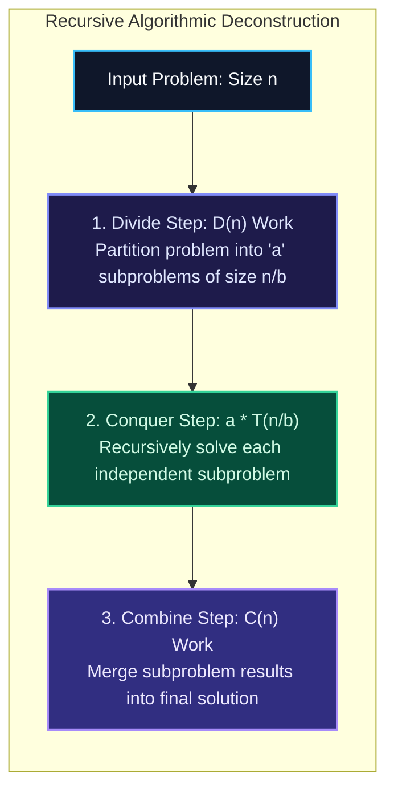
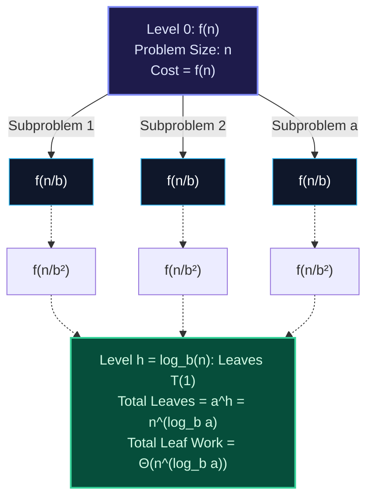
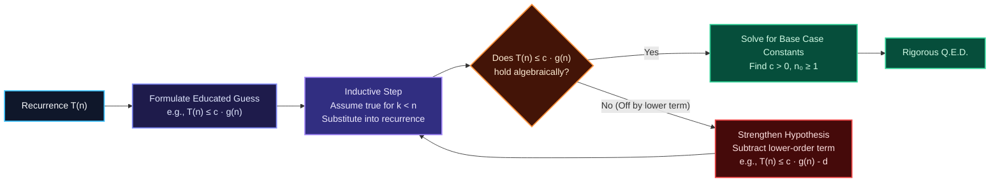
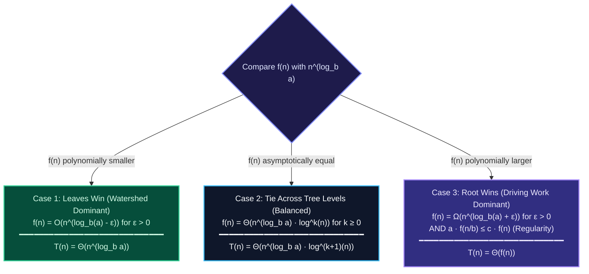
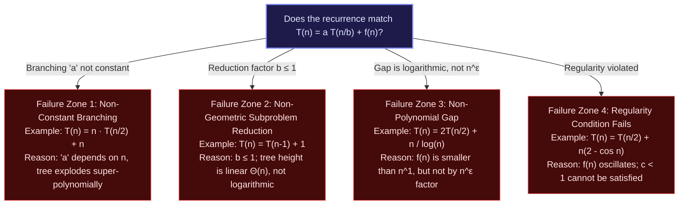
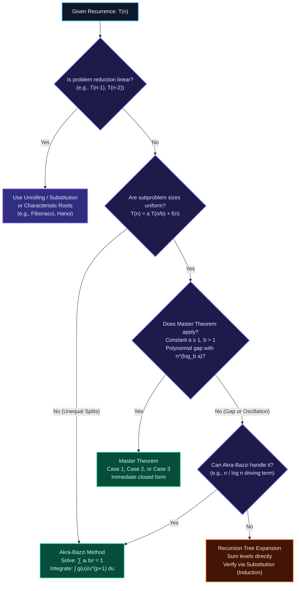

import { Callout } from "fumadocs-ui/components/callout";
import { Tabs, Tab } from "fumadocs-ui/components/tabs";
import { Steps, Step } from "fumadocs-ui/components/steps";
import { Cards, Card } from "fumadocs-ui/components/card";

When analyzing iterative algorithms, we calculate asymptotic complexity by summing the iterations of nested loops. However, when an algorithm invokes itself recursively on smaller subproblems—such as Merge Sort dividing an array into halves or Binary Search discarding half of a search space—its execution time cannot be expressed as a simple closed-form loop sum.

Instead, the running time is modeled mathematically as a **recurrence relation**: an equation or inequality that defines a function $T(n)$ in terms of its values on strictly smaller inputs.

Solving a recurrence means transforming this inductive description into a closed-form asymptotic envelope ($\Theta$, $\mathcal{O}$, or $\Omega$) that can be evaluated directly without simulation. In this guide, we explore the four foundational techniques of recursive complexity analysis: the intuitive **Recursion Tree Method**, the mathematically rigorous **Substitution Method**, the widely applied **Master Theorem**, and the generalized **Akra-Bazzi Method**.

---

## 1. Modeling Recursive Running Times

Every recursive algorithm breaks a problem into base cases and recursive cases. To formulate an accurate recurrence relation $T(n)$, we deconstruct the algorithm into three canonical phases: **Divide**, **Conquer**, and **Combine**.



### The Divide-Conquer-Combine Anatomy

Formally, consider an algorithm that operates on an input of size $n$:

1. **Base Case**: For small inputs below a threshold $n_0$ (frequently $n = 1$ or $n \le c$), the algorithm solves the problem directly using constant or elementary operations:
   $$T(n) = \Theta(1) \quad \text{for } n \le n_0$$
2. **Divide Step**: The algorithm divides the problem of size $n$ into $a$ distinct subproblems, each of size $n/b$ (where $b > 1$). Let $D(n)$ denote the time required to perform this partition.
3. **Conquer Step**: The algorithm solves the $a$ subproblems recursively. This contributes $a \cdot T(n/b)$ to the running time.
4. **Combine Step**: The algorithm synthesizes the $a$ subproblem solutions into the solution for the original problem of size $n$. Let $C(n)$ denote the time required to merge these results.

Grouping the non-recursive overhead $f(n) = D(n) + C(n)$, the recurrence becomes:

$$T(n) = \begin{cases} \Theta(1) & \text{if } n \le n_0 \\ a T(n/b) + f(n) & \text{if } n > n_0 \end{cases}$$

### Linear Recurrences vs. Divide-and-Conquer Recurrences

Not all recursive algorithms divide their input by a constant factor $b > 1$. Recurrences fundamentally fall into two structural paradigms:

| Recurrence Family              | Canonical Form                    | Subproblem Reduction                      | Prototypical Examples                    | Typical Complexity Range                                    |
| :----------------------------- | :-------------------------------- | :---------------------------------------- | :--------------------------------------- | :---------------------------------------------------------- |
| **Linear (Decrementing)**      | $T(n) = T(n-1) + f(n)$            | Decrement by constant $c$ (e.g., $n - 1$) | Linear Search, Factorial, Insertion Sort | $\Theta(n)$ to $\Theta(n^2)$                                |
| **Multiple Branching Linear**  | $T(n) = \sum T(n - c_i) + f(n)$   | Decrement with branching ($a \ge 2$)      | Naive Fibonacci, Towers of Hanoi         | $\Theta(2^n)$ to $\Theta(\phi^n)$ (Exponential)             |
| **Divide-and-Conquer**         | $T(n) = a T(n/b) + f(n)$          | Geometric shrinkage ($n / b$)             | Binary Search, Merge Sort, Karatsuba     | $\Theta(\log n)$ to $\Theta(n^k)$ (Polynomial / Log-linear) |
| **Unequal Divide-and-Conquer** | $T(n) = \sum a_i T(b_i n) + f(n)$ | Asymmetric geometric shrinking            | Median-of-Medians, Unequal Quicksort     | $\Theta(n)$ to $\Theta(n \log n)$                           |

<Callout type="info" title="Why Linear Reductions Lead to Explosive Runtimes">
  When an algorithm reduces problem size by subtraction ($n - 1$) while
  generating $a \ge 2$ subproblems (such as naive Fibonacci $T(n) = T(n-1) +
  T(n-2) + \Theta(1)$), tree height is $\Theta(n)$, producing $2^n$ leaves. In
  contrast, dividing the input by $b \ge 2$ compresses the tree height to
  $\Theta(\log_b n)$, keeping the total work bounded within polynomial or
  log-linear limits.
</Callout>

---

## 2. Technique 1: The Recursion Tree Method

The **Recursion Tree Method** converts a recursive algebraic recurrence into an explicit geometric tree. Each node represents the non-recursive work $f(m)$ performed at that subproblem, while edges represent recursive invocations.

Summing the costs across all nodes level-by-level exposes the dominating layer: the root, the leaves, or an even distribution across all levels.



### The 8-Step Mathematical Protocol

To rigorously solve any divide-and-conquer recurrence $T(n) = a T(n/b) + f(n)$ via recursion trees, execute this eight-step derivation:

<Steps>
### 1. Identify Branching and Reduction Parameters
Extract the branching factor $a$ (number of recursive calls) and the input reduction factor $b$ (divisor of subproblem size).

### 2. Formulate Problem Size at Depth $i$

At depth $i = 0$ (the root), size is $n$. At depth $i = 1$, size is $n/b$. By mathematical induction, the problem size at depth $i$ is:
$$\text{Size}(i) = \frac{n}{b^i}$$

### 3. Determine Node Count at Depth $i$

Since each node produces $a$ children, the number of active subproblems at depth $i$ is:
$$\text{Nodes}(i) = a^i$$

### 4. Evaluate Work Per Node at Depth $i$

Each individual subproblem node at depth $i$ performs non-recursive work proportional to its local input size:
$$\text{Cost per node} = f\left(\frac{n}{b^i}\right)$$

### 5. Compute Aggregate Work at Level $i$

Multiply the number of subproblems by the cost per subproblem:
$$W(i) = \text{Nodes}(i) \times f\left(\frac{n}{b^i}\right) = a^i \cdot f\left(\frac{n}{b^i}\right)$$

### 6. Calculate Tree Height $h$

The tree terminates when the subproblem size reduces to the base case threshold, typically $n / b^h = 1$:
$$b^h = n \implies h = \log_b n$$

### 7. Calculate Aggregate Leaf Work

The leaves reside at level $h = \log_b n$. The total number of leaves is:
$$\text{Leaf Count} = a^h = a^{\log_b n} = n^{\log_b a}$$
_(Using the logarithmic identity $x^{\log_b y} = y^{\log_b x}$)_. Because each leaf performs base-case work $T(1) = \Theta(1)$, total leaf cost is:
$$W_{\text{leaves}} = \Theta(n^{\log_b a})$$

### 8. Sum Across All Levels

Aggregate internal levels from $i = 0$ to $h - 1$, then add the leaf cost:
$$T(n) = \sum_{i=0}^{h-1} W(i) + W_{\text{leaves}} = \sum_{i=0}^{\log_b n - 1} a^i f\left(\frac{n}{b^i}\right) + \Theta(n^{\log_b a})$$

</Steps>

---

### Worked Example 1: Equal-Cost Levels (Merge Sort)

Consider the recurrence modeling Merge Sort:
$$T(n) = 2T\left(\frac{n}{2}\right) + cn$$

1. **Parameters**: $a = 2$, $b = 2$, $f(n) = cn$.
2. **Height**: $h = \log_2 n$.
3. **Level Work**: At depth $i$, there are $2^i$ nodes, each operating on an array of size $n / 2^i$:
   $$W(i) = 2^i \cdot c\left(\frac{n}{2^i}\right) = 2^i \cdot \frac{cn}{2^i} = cn$$
4. **Leaf Work**: At depth $h = \log_2 n$, the number of leaves is $2^{\log_2 n} = n$. Leaf work is $n \cdot T(1) = \Theta(n)$.
5. **Total Sum**:
   $$T(n) = \sum_{i=0}^{\log_2 n - 1} cn + \Theta(n) = cn \cdot \log_2 n + \Theta(n) = \Theta(n \log n)$$

Every single level does exactly $cn$ work. The cost is uniform throughout the depth of the tree.

---

### Worked Example 2: Root-Dominated Tree (Decaying Geometric Series)

Consider the recurrence:
$$T(n) = 3T\left(\frac{n}{4}\right) + cn^2$$

1. **Parameters**: $a = 3$, $b = 4$, $f(n) = cn^2$.
2. **Height**: $h = \log_4 n$.
3. **Level Work**: At depth $i$, there are $3^i$ nodes, each doing $c(n / 4^i)^2$ work:
   $$W(i) = 3^i \cdot c \left(\frac{n}{4^i}\right)^2 = cn^2 \cdot \frac{3^i}{16^i} = cn^2 \left(\frac{3}{16}\right)^i$$
4. **Sum of Internal Nodes**:
   $$\sum_{i=0}^{\log_4 n - 1} cn^2 \left(\frac{3}{16}\right)^i = cn^2 \sum_{i=0}^{\log_4 n - 1} \left(\frac{3}{16}\right)^i$$
   This is a decreasing geometric series with common ratio $r = 3/16 < 1$. Using the infinite geometric series upper bound $\sum_{i=0}^{\infty} r^i = \frac{1}{1 - r}$:
   $$\sum_{i=0}^{\log_4 n - 1} \left(\frac{3}{16}\right)^i < \frac{1}{1 - 3/16} = \frac{16}{13}$$
   Therefore, the internal work is bounded by:
   $$\frac{16}{13} cn^2 = \mathcal{O}(n^2)$$
5. **Leaf Work**:
   $$W_{\text{leaves}} = \Theta(n^{\log_4 3}) \approx \Theta(n^{0.792})$$
6. **Total Asymptotic Bound**:
   Because $n^2$ strictly dominates $n^{0.792}$:
   $$T(n) = \Theta(n^2)$$

The work decreases by a factor of $16/3 \approx 5.33$ at each successive depth. The root node alone performs the overwhelming majority of the total computation.

---

### Worked Example 3: Leaf-Dominated Tree (Growing Geometric Series)

Consider the recurrence:
$$T(n) = 4T\left(\frac{n}{2}\right) + cn$$

1. **Parameters**: $a = 4$, $b = 2$, $f(n) = cn$.
2. **Height**: $h = \log_2 n$.
3. **Level Work**: At depth $i$, there are $4^i$ nodes, each doing $c(n / 2^i)$ work:
   $$W(i) = 4^i \cdot c \left(\frac{n}{2^i}\right) = cn \cdot \frac{4^i}{2^i} = cn \cdot 2^i$$
4. **Sum of Internal Nodes**:
   $$\sum_{i=0}^{\log_2 n - 1} cn \cdot 2^i = cn \sum_{i=0}^{\log_2 n - 1} 2^i = cn \left( \frac{2^{\log_2 n} - 1}{2 - 1} \right) = cn(n - 1) = cn^2 - cn$$
5. **Leaf Work**:
   $$W_{\text{leaves}} = 4^{\log_2 n} \cdot T(1) = n^{\log_2 4} \cdot \Theta(1) = \Theta(n^2)$$
6. **Total Asymptotic Bound**:
   $$T(n) = (cn^2 - cn) + \Theta(n^2) = \Theta(n^2)$$

Here, the work doubles at every successive depth ($r = 2 > 1$). The leaves at the bottom perform $\Theta(n^2)$ work, completely dominating the $cn$ cost at the root.

---

## 3. Technique 2: The Substitution Method (Mathematical Induction)

While recursion trees provide geometric insight, they can involve subtle algebraic approximations around floor and ceiling boundaries. The **Substitution Method** is the mathematical gold standard for formal proof.

The method consists of two stages:

1. **Guess** the form of the mathematical solution (using recursion trees or inductive intuition).
2. **Prove** the bound holds for all $n \ge n_0$ using mathematical induction, explicitly solving for the constants $c > 0$ and $n_0 \ge 1$.



### Proving an Upper Bound: $T(n) = 2T(\lfloor n/2 \rfloor) + n$

Let us prove that $T(n) = \mathcal{O}(n \log_2 n)$.

**1. Inductive Hypothesis**:
Assume that for all positive integers $k < n$, there exists a constant $c > 0$ such that:
$$T(k) \le c k \log_2 k$$

**2. Inductive Step**:
We must prove that $T(n) \le c n \log_2 n$. Substituting the hypothesis into the recurrence for $k = \lfloor n/2 \rfloor$:

$$T(n) = 2T(\lfloor n/2 \rfloor) + n \le 2 \left( c \lfloor n/2 \rfloor \log_2 \lfloor n/2 \rfloor \right) + n$$

Using the inequality $\lfloor n/2 \rfloor \le n/2$:

$$T(n) \le 2 \left( c \frac{n}{2} \log_2 \left(\frac{n}{2}\right) \right) + n = cn \log_2\left(\frac{n}{2}\right) + n$$

Applying the logarithmic quotient rule $\log_2(n/2) = \log_2 n - \log_2 2 = \log_2 n - 1$:

$$T(n) \le cn(\log_2 n - 1) + n = cn \log_2 n - cn + n = cn \log_2 n - (c - 1)n$$

We require this expression to be $\le cn \log_2 n$. This holds if and only if:
$$-(c - 1)n \le 0 \implies c - 1 \ge 0 \implies c \ge 1$$

Thus, the inductive step holds for any $c \ge 1$.

**3. Establishing the Base Cases**:
A common mistake in induction is verifying only $n = 1$. Notice that:
$$c(1)\log_2(1) = c \cdot 1 \cdot 0 = 0$$
Since $T(1) = 1$, $T(1) \le 0$ is impossible for any finite $c$.

However, asymptotic notation only requires the property to hold for $n \ge n_0$. In divide-and-conquer recurrences with subproblem size $\lfloor n/2 \rfloor$, the base cases must cover the values of $n$ that do not reduce to smaller instances already governed by the inductive step—here, $n = 2$ and $n = 3$:

- For $n = 2$: $T(2) = 2T(1) + 2 = 2(1) + 2 = 4$. We require $T(2) \le c(2)\log_2(2) = 2c \implies 4 \le 2c \implies c \ge 2$.
- For $n = 3$: $T(3) = 2T(1) + 3 = 2(1) + 3 = 5$. We require $T(3) \le c(3)\log_2(3) \approx 4.755c \implies c \ge 5 / 4.755 \approx 1.05$.

Choosing $c = 2$ and $n_0 = 2$ completes the proof. $\blacksquare$

---

### The Subtle Lower-Order Terms Trap

A frequent stumbling block in mathematical induction occurs when an inductive guess is asymptotically correct, but the algebra fails because the induction hypothesis is not strong enough to absorb lower-order terms.

#### The Failure Case

Consider the recurrence:
$$T(n) = 2T(\lfloor n/2 \rfloor) + 1 \quad \text{with } T(1) = 1$$

We suspect the solution is linear: $T(n) = \mathcal{O}(n)$. We attempt an inductive hypothesis:
$$\text{Guess: } T(k) \le ck$$

Substitute into the recurrence:
$$T(n) = 2T(\lfloor n/2 \rfloor) + 1 \le 2\left(c \frac{n}{2}\right) + 1 = cn + 1$$

To complete the induction, we must show that $cn + 1 \le cn$. But $cn + 1 \le cn \iff 1 \le 0$, which is **mathematically impossible**.

The guess $T(n) = \mathcal{O}(n)$ is completely correct, yet the proof collapsed. Novices often abandon the linear hypothesis and incorrectly guess a weaker bound like $\mathcal{O}(n^2)$.

#### The Mathematical Remedy: Strengthening the Hypothesis

The failure occurred because the recurrence contains a positive additive constant ($+1$) that was not accounted for by the linear term $cn$.

To fix this, we **strengthen the induction hypothesis by subtracting a lower-order term**:

$$\text{Revised Guess: } T(k) \le ck - d \quad \text{for constants } c > 0, d > 0$$

Substitute the revised hypothesis into the recurrence:

$$T(n) = 2T(\lfloor n/2 \rfloor) + 1 \le 2\left( c \lfloor n/2 \rfloor - d \right) + 1 \le 2\left(c \frac{n}{2} - d\right) + 1$$

$$T(n) \le cn - 2d + 1$$

We require $T(n) \le cn - d$. Setting up the inequality:
$$cn - 2d + 1 \le cn - d \iff -2d + 1 \le -d \iff d \ge 1$$

By fixing $d = 1$, the inequality holds for **any** value of $c$!

Now, satisfy the base case at $n = 1$:
$$T(1) = 1 \le c(1) - d = c - 1 \implies c \ge 2$$

Choosing $c = 2$ and $d = 1$ yields:
$$T(n) \le 2n - 1 = \mathcal{O}(n)$$

The proof succeeds. Subtracting the lower-order term $d$ provided the slack needed to cancel the additive $+1$.

---

## 4. Technique 3: The Master Theorem (Divide-and-Conquer)

The **Master Theorem** provides a cookbook recipe for solving standard divide-and-conquer recurrences without expanding trees or constructing induction proofs manually.

### Theorem Formulation

Let $a \ge 1$ and $b > 1$ be constants, let $f(n)$ be a driving function, and let $T(n)$ be defined on the non-negative integers by:

$$T(n) = a T\left(\frac{n}{b}\right) + f(n)$$

where $n/b$ can mean either $\lfloor n/b \rfloor$ or $\lceil n/b \rceil$.

### The Watershed (Critical Exponent)

The asymptotic behavior of $T(n)$ is determined entirely by comparing the non-recursive driving work $f(n)$ with the **watershed function**:

$$\mathbf{\text{Watershed Function: } n^{c_{\text{crit}}} = n^{\log_b a}}$$

The quantity $c_{\text{crit}} = \log_b a$ is the **critical exponent**. Recall from our recursion tree analysis that $n^{\log_b a}$ represents the exact number of leaves in the tree.

The Master Theorem simply classifies which component dominates the computation:



### The Three Master Cases

#### Case 1: Leaf / Watershed Dominant

If $f(n) = \mathcal{O}(n^{\log_b a - \epsilon})$ for some constant $\epsilon > 0$:
$$T(n) = \Theta(n^{\log_b a})$$
_Intuition_: The driving work $f(n)$ grows **polynomially slower** than the leaf count. The leaves dominate the total cost.

_Example_: $T(n) = 8T(n/2) + 1000n^2$

- $a = 8, b = 2 \implies n^{\log_b a} = n^{\log_2 8} = n^3$.
- Compare $f(n) = 1000n^2$ with $n^3$: choosing $\epsilon = 1$, $f(n) = \mathcal{O}(n^{3 - 1}) = \mathcal{O}(n^2)$.
- Since Case 1 applies: $T(n) = \Theta(n^3)$.

#### Case 2: Balanced Across Levels

If $f(n) = \Theta(n^{\log_b a} \log^k n)$ for some real $k \ge 0$:
$$T(n) = \Theta(n^{\log_b a} \log^{k+1} n)$$
_Intuition_: The driving work is asymptotically equal to the leaf count (up to logarithmic factors). Each of the $\Theta(\log n)$ levels performs equal work.

_Example_: $T(n) = 2T(n/2) + 5n$

- $a = 2, b = 2 \implies n^{\log_2 2} = n^1$.
- $f(n) = 5n = \Theta(n^1 \log^0 n) \implies k = 0$.
- Case 2 applies: $T(n) = \Theta(n^1 \log^{0+1} n) = \Theta(n \log n)$.

#### Case 3: Root / Driving Work Dominant

If $f(n) = \Omega(n^{\log_b a + \epsilon})$ for some constant $\epsilon > 0$, **AND** $f(n)$ satisfies the **regularity condition**:
$$a \cdot f\left(\frac{n}{b}\right) \le c \cdot f(n) \quad \text{for some constant } c < 1 \text{ and all sufficiently large } n$$
then:
$$T(n) = \Theta(f(n))$$
_Intuition_: The non-recursive work at the root grows **polynomially faster** than the leaf count. The root dominates the entire tree.

_Example_: $T(n) = 2T(n/2) + n^2$

- $a = 2, b = 2 \implies n^{\log_2 2} = n^1$.
- Compare $f(n) = n^2$ with $n^1$: with $\epsilon = 1$, $f(n) = \Omega(n^{1 + 1}) = \Omega(n^2)$.
- Check Regularity: $a f(n/b) = 2(n/2)^2 = 2(n^2 / 4) = \frac{1}{2}n^2 \le c n^2$. For $c = 1/2 < 1$, regularity holds.
- Case 3 applies: $T(n) = \Theta(n^2)$.

---

### Master Theorem Failure Zones

The Master Theorem is not universally applicable. It fails whenever a recurrence violates its algebraic preconditions.



#### The Non-Polynomial Gap Trap

The most subtle failure occurs when $f(n)$ is asymptotically smaller (or larger) than $n^{\log_b a}$, but **not by a polynomial factor $n^\epsilon$**.

Consider the recurrence:
$$T(n) = 2T\left(\frac{n}{2}\right) + \frac{n}{\log_2 n}$$

1. $a = 2, b = 2 \implies n^{\log_b a} = n^{\log_2 2} = n^1$.
2. Compare $f(n) = \frac{n}{\log_2 n}$ with $n^1$:
   $$\lim_{n \to \infty} \frac{n / \log_2 n}{n} = \lim_{n \to \infty} \frac{1}{\log_2 n} = 0$$
   Thus, $f(n)$ is strictly asymptotically smaller than $n^1$.
3. However, does Case 1 apply? We must test if $f(n) = \mathcal{O}(n^{1 - \epsilon})$ for some constant $\epsilon > 0$:
   $$\frac{n / \log_2 n}{n^{1 - \epsilon}} = \frac{n^\epsilon}{\log_2 n}$$
   Because any polynomial power $n^\epsilon$ grows strictly faster than a logarithm:
   $$\lim_{n \to \infty} \frac{n^\epsilon}{\log_2 n} = \infty \quad \text{for any } \epsilon > 0$$
   Therefore, $f(n)$ is **never** $\mathcal{O}(n^{1 - \epsilon})$. The gap between $n / \log_2 n$ and $n$ is logarithmic ($1 / \log n$), not polynomial ($n^{-\epsilon}$).
4. Case 2 does not apply because $k = -1$, which violates $k \ge 0$ for the standard Master Theorem.

**Conclusion**: The Master Theorem cannot solve this recurrence. We must use the Akra-Bazzi method or direct summation.

---

## 5. Technique 4: The Akra-Bazzi Method (Generalized Master Theorem)

Published in 1998 by Mohamad Akra and Louay Bazzi, the **Akra-Bazzi Method** is a powerful generalization that overcomes the structural limitations of the Master Theorem. It effortlessly handles:

- **Unequal subproblem partition sizes** (e.g., $T(n) = T(n/3) + T(2n/3) + cn$).
- **Multiple distinct subproblems**.
- **Small perturbation functions** representing floors and ceilings ($h_i(n) = \lfloor n/b \rfloor - n/b$).
- **Non-polynomial gaps** where the Master Theorem fails.

### General Formulation

Consider recurrences of the form:

$$T(n) = \sum_{i=1}^k a_i T(b_i n + h_i(n)) + g(n)$$

subject to:

1. $a_i > 0$ are real constants.
2. $0 < b_i < 1$ are real constants.
3. The perturbation functions satisfy $|h_i(n)| = \mathcal{O}\left(\frac{n}{\log^2 n}\right)$ (floors and ceilings satisfy this because $|h_i(n)| \le 1$).
4. The driving function $g(n)$ satisfies polynomial growth bounds ($g'(n)$ is well-behaved).

### The Two-Step Solution Protocol

<Steps>
### 1. Solve the Characteristic Equation for $p$
Find the unique real value $p$ that satisfies:
$$\sum_{i=1}^k a_i b_i^p = 1$$
Because the function $\phi(p) = \sum a_i b_i^p$ is continuous and strictly monotonically decreasing from $\infty$ to $0$ as $p$ ranges from $-\infty$ to $\infty$, there is guaranteed to be **exactly one real solution** for $p$.

### 2. Evaluate the Universal Asymptotic Integral

Once $p$ is determined, evaluate the closed-form integral:
$$\mathbf{T(n) = \Theta\left( n^p \left( 1 + \int_1^n \frac{g(u)}{u^{p+1}} \, du \right) \right)}$$

</Steps>

---

### Worked Example 1: The Unequal Divide Recurrence

Solve the classic divide-and-conquer recurrence with asymmetric splits:
$$T(n) = T\left(\frac{n}{3}\right) + T\left(\frac{2n}{3}\right) + cn$$

This recurrence models the expected running time of Quickselect or unbalanced Quicksort partition branches. The Master Theorem cannot touch this recurrence because the subproblem sizes ($n/3$ and $2n/3$) are unequal.

#### Step 1: Formulate and Solve the Characteristic Equation

Here, $k = 2$, $a_1 = 1$, $b_1 = 1/3$, $a_2 = 1$, $b_2 = 2/3$, and $g(n) = cn$.

$$\sum_{i=1}^2 a_i b_i^p = 1 \implies \left(\frac{1}{3}\right)^p + \left(\frac{2}{3}\right)^p = 1$$

Test $p = 1$:
$$\left(\frac{1}{3}\right)^1 + \left(\frac{2}{3}\right)^1 = \frac{1 + 2}{3} = 1$$
The unique real solution is **$p = 1$**.

#### Step 2: Compute the Universal Integral

Substitute $p = 1$ and $g(u) = cu$ into the Akra-Bazzi formula:

$$T(n) = \Theta\left( n^1 \left( 1 + \int_1^n \frac{cu}{u^{1+1}} \, du \right) \right) = \Theta\left( n \left( 1 + c \int_1^n \frac{1}{u} \, du \right) \right)$$

Evaluating the integral:
$$\int_1^n \frac{1}{u} \, du = \left[ \ln u \right]_1^n = \ln n - \ln 1 = \ln n$$

Substituting back:
$$T(n) = \Theta(n(1 + c \ln n)) = \Theta(n \ln n) = \mathbf{\Theta(n \log n)}$$

Akra-Bazzi resolves in four lines what would otherwise require a messy non-uniform recursion tree proof.

---

### Worked Example 2: Solving the Master Theorem Non-Polynomial Failure

Recall the failure case from Section 4:
$$T(n) = 2T\left(\frac{n}{2}\right) + \frac{n}{\log_2 n}$$

Let us apply Akra-Bazzi:

1. $a_1 = 2$, $b_1 = 1/2$, and $g(n) = \frac{n}{\ln n}$.
2. Solve the characteristic equation:
   $$2\left(\frac{1}{2}\right)^p = 1 \implies \left(\frac{1}{2}\right)^{p-1} = 1 \implies p = 1$$
3. Evaluate the integral:
   $$T(n) = \Theta\left( n^1 \left( 1 + \int_2^n \frac{u / \ln u}{u^{1+1}} \, du \right) \right) = \Theta\left( n \left( 1 + \int_2^n \frac{1}{u \ln u} \, du \right) \right)$$
4. Substitute $v = \ln u \implies dv = \frac{1}{u} du$:
   $$\int \frac{1}{u \ln u} \, du = \int \frac{1}{v} \, dv = \ln v = \ln(\ln u)$$
5. Evaluating from $2$ to $n$:
   $$\int_2^n \frac{1}{u \ln u} \, du = \ln(\ln n) - \ln(\ln 2)$$
6. Asymptotic Result:
   $$T(n) = \Theta\left( n \left( 1 + \ln(\ln n) \right) \right) = \mathbf{\Theta(n \log \log n)}$$

The Akra-Bazzi method delivers the exact asymptotic bound $\Theta(n \log \log n)$ without requiring complex induction bounds.

---

## 6. The Algorithmic Recurrence Decision Framework

When confronted with an arbitrary recurrence in an interview, research paper, or codebase audit, follow this decision matrix to select the most efficient resolution method:



### Method Comparison Summary

| Method             | Applicable Scope                                           | Core Mechanism                                    | Primary Advantages                                                  | Primary Limitations                                                     |
| :----------------- | :--------------------------------------------------------- | :------------------------------------------------ | :------------------------------------------------------------------ | :---------------------------------------------------------------------- |
| **Recursion Tree** | Any divide-and-conquer recurrence                          | Geometric level-by-level summation                | Provides visual intuition for which tree level dominates            | Summing irregular series can be mathematically cumbersome               |
| **Substitution**   | Any recurrence (linear or divide-and-conquer)              | Mathematical induction ($k < n$)                  | Formally proves exact constants $c, n_0$; handles floors/ceilings   | Requires an initial guess; lower-order terms can trap induction         |
| **Master Theorem** | Uniform divide-and-conquer: $a T(n/b) + f(n)$              | Compares $f(n)$ to leaf watershed $n^{\log_b a}$  | Instant 10-second solution for textbook algorithms                  | Fails on unequal splits, non-polynomial gaps, and oscillating functions |
| **Akra-Bazzi**     | Generalized divide-and-conquer: $\sum a_i T(b_i n) + g(n)$ | Solves $\sum a_i b_i^p = 1$ and computes integral | Handles asymmetric splits, floors/ceilings, and sub-polynomial gaps | Requires finding real root $p$ and evaluating an integral               |

---

## 7. Classic Algorithmic Recurrence Catalog

The table below catalogs the quintessential recurrences from computer science literature, their algorithmic origin, resolution method, and exact asymptotic complexity:

| Algorithm                     | Recurrence Formulation                   | Watershed $n^{\log_b a}$                 | Winning Component             | Resolution Method                           | Asymptotic Bound                                          |
| :---------------------------- | :--------------------------------------- | :--------------------------------------- | :---------------------------- | :------------------------------------------ | :-------------------------------------------------------- |
| **Binary Search**             | $T(n) = T(n/2) + \Theta(1)$              | $n^{\log_2 1} = n^0 = 1$                 | Balanced ($f(n) = \Theta(1)$) | Master Theorem Case 2 ($k=0$)               | $\mathbf{\Theta(\log n)}$                                 |
| **Merge Sort**                | $T(n) = 2T(n/2) + \Theta(n)$             | $n^{\log_2 2} = n^1 = n$                 | Balanced ($f(n) = \Theta(n)$) | Master Theorem Case 2 ($k=0$)               | $\mathbf{\Theta(n \log n)}$                               |
| **Karatsuba Multiplication**  | $T(n) = 3T(n/2) + \Theta(n)$             | $n^{\log_2 3} \approx n^{1.585}$         | Leaves ($n^{1.585} \gg n$)    | Master Theorem Case 1                       | $\mathbf{\Theta(n^{\log_2 3})} \approx \Theta(n^{1.585})$ |
| **Strassen Matrix Mult.**     | $T(n) = 7T(n/2) + \Theta(n^2)$           | $n^{\log_2 7} \approx n^{2.807}$         | Leaves ($n^{2.807} \gg n^2$)  | Master Theorem Case 1                       | $\mathbf{\Theta(n^{\log_2 7})} \approx \Theta(n^{2.807})$ |
| **Median of Medians**         | $T(n) \le T(n/5) + T(7n/10) + \Theta(n)$ | $\sum b_i = 1/5 + 7/10 = 0.9$            | Driving ($p < 1$)             | Akra-Bazzi / Substitution                   | $\mathbf{\Theta(n)}$                                      |
| **Unequal Quicksort Split**   | $T(n) = T(n/10) + T(9n/10) + \Theta(n)$  | $(1/10)^p + (9/10)^p = 1 \implies p = 1$ | Balanced                      | Akra-Bazzi ($p = 1$)                        | $\mathbf{\Theta(n \log n)}$                               |
| **Naive Recursive Fibonacci** | $T(n) = T(n-1) + T(n-2) + \Theta(1)$     | N/A (Linear recurrence)                  | Leaves ($2^n$ tree)           | Characteristic Equation ($r^2 - r - 1 = 0$) | $\mathbf{\Theta(\phi^n)} \approx \Theta(1.618^n)$         |
| **Towers of Hanoi**           | $T(n) = 2T(n-1) + \Theta(1)$             | N/A (Linear recurrence)                  | Branching ($2^n$)             | Telescoping / Induction                     | $\mathbf{\Theta(2^n)}$                                    |

<Callout type="warn" title="Why Karatsuba and Strassen Beat Classical Algorithms">
Standard integer multiplication splits two $n$-digit numbers into four sub-multiplications of size $n/2$:
$$T(n) = 4T(n/2) + \Theta(n) \implies n^{\log_2 4} = n^2 \implies \Theta(n^2)$$
Karatsuba cleverly uses algebraic manipulation to compute the product with only **three** multiplications:
$$T(n) = 3T(n/2) + \Theta(n) \implies n^{\log_2 3} \approx n^{1.585} \implies \Theta(n^{1.585})$$
Reducing the branching factor $a$ from $4$ to $3$ dramatically drops the watershed leaf exponent from $2.0$ to $1.585$.
</Callout>

---

## 8. Empirical Instrumentation and Recurrence Tracing

To bridge mathematical recurrence formulas with physical execution, we can instrument recursive algorithms to record call counts, maximum stack recursion depth, and total elementary operations across input sizes.

<Tabs items={['Python', 'TypeScript', 'C++']}>
<Tab value="Python">
```python
"""
recurrence_tracer.py
Instruments and validates recursive divide-and-conquer recurrences.
Compares theoretical recurrence models against actual execution metrics.
"""

from dataclasses import dataclass
import math
from typing import Callable, Tuple

@dataclass
class RecurrenceStats:
total_calls: int = 0
max_depth: int = 0
elementary_work: int = 0

class RecurrenceTracer:
def **init**(self):
self.stats = RecurrenceStats()
self.\_current_depth = 0

    def reset(self):
        self.stats = RecurrenceStats()
        self._current_depth = 0

    def _enter(self):
        self.stats.total_calls += 1
        self._current_depth += 1
        if self._current_depth > self.stats.max_depth:
            self.stats.max_depth = self._current_depth

    def _exit(self):
        self._current_depth -= 1

    def merge_sort_recurrence(self, n: int) -> int:
        """
        Models T(n) = 2T(n/2) + cn
        Theory: Theta(n log2 n)
        """
        self._enter()
        # Non-recursive combine work f(n) = n
        self.stats.elementary_work += n

        if n <= 1:
            self._exit()
            return 1

        half = n // 2
        # Two subproblems of size n/2
        left = self.merge_sort_recurrence(half)
        right = self.merge_sort_recurrence(n - half)

        self._exit()
        return left + right

    def karatsuba_recurrence(self, n: int) -> int:
        """
        Models T(n) = 3T(n/2) + cn
        Theory: Theta(n^(log2 3)) approx Theta(n^1.585)
        """
        self._enter()
        self.stats.elementary_work += n

        if n <= 1:
            self._exit()
            return 1

        half = n // 2
        # Three subproblems of size n/2
        s1 = self.karatsuba_recurrence(half)
        s2 = self.karatsuba_recurrence(half)
        s3 = self.karatsuba_recurrence(half)

        self._exit()
        return s1 + s2 + s3

    def unequal_split_recurrence(self, n: int) -> int:
        """
        Models T(n) = T(n/3) + T(2n/3) + cn
        Theory (Akra-Bazzi): Theta(n log n)
        """
        self._enter()
        self.stats.elementary_work += n

        if n <= 1:
            self._exit()
            return 1

        sub1 = self.unequal_split_recurrence(max(1, n // 3))
        sub2 = self.unequal_split_recurrence(max(1, (2 * n) // 3))

        self._exit()
        return sub1 + sub2

def benchmark():
tracer = RecurrenceTracer()
test_sizes = [64, 256, 1024, 4096]

    print("================================================================================")
    print("RECURRENCE RELATION TRACER: EMPIRICAL METRICS VS THEORETICAL PREDICTIONS")
    print("================================================================================")

    # 1. Merge Sort: T(n) = 2T(n/2) + n
    print("\n--- 1. MERGE SORT: T(n) = 2T(n/2) + n [Theory: O(n log2 n)] ---")
    print(f"{'Input (n)':<10} | {'Calls':<10} | {'Max Depth':<10} | {'Work Units':<12} | {'n * log2(n)':<12} | {'Ratio':<8}")
    print("-" * 72)
    for n in test_sizes:
        tracer.reset()
        tracer.merge_sort_recurrence(n)
        theory = n * math.log2(n)
        ratio = tracer.stats.elementary_work / theory
        print(f"{n:<10} | {tracer.stats.total_calls:<10} | {tracer.stats.max_depth:<10} | {tracer.stats.elementary_work:<12} | {theory:<12.1f} | {ratio:<8.2f}")

    # 2. Karatsuba: T(n) = 3T(n/2) + n
    print("\n--- 2. KARATSUBA MULTIPLICATION: T(n) = 3T(n/2) + n [Theory: O(n^1.585)] ---")
    print(f"{'Input (n)':<10} | {'Calls':<10} | {'Max Depth':<10} | {'Work Units':<12} | {'n^log2(3)':<12} | {'Ratio':<8}")
    print("-" * 72)
    for n in test_sizes:
        tracer.reset()
        tracer.karatsuba_recurrence(n)
        theory = n ** math.log2(3)
        ratio = tracer.stats.total_calls / theory
        print(f"{n:<10} | {tracer.stats.total_calls:<10} | {tracer.stats.max_depth:<10} | {tracer.stats.elementary_work:<12} | {theory:<12.1f} | {ratio:<8.2f}")

    # 3. Unequal Split: T(n) = T(n/3) + T(2n/3) + n
    print("\n--- 3. UNEQUAL SPLIT: T(n) = T(n/3) + T(2n/3) + n [Theory (Akra-Bazzi): O(n log n)] ---")
    print(f"{'Input (n)':<10} | {'Calls':<10} | {'Max Depth':<10} | {'Work Units':<12} | {'n * ln(n)':<12} | {'Ratio':<8}")
    print("-" * 72)
    for n in test_sizes:
        tracer.reset()
        tracer.unequal_split_recurrence(n)
        theory = n * math.log(n)
        ratio = tracer.stats.elementary_work / theory
        print(f"{n:<10} | {tracer.stats.total_calls:<10} | {tracer.stats.max_depth:<10} | {tracer.stats.elementary_work:<12} | {theory:<12.1f} | {ratio:<8.2f}")

if **name** == "**main**":
benchmark()

````
</Tab>

<Tab value="TypeScript">
```typescript
/**
 * recurrence_tracer.ts
 * Rigorous execution tracer measuring call counts, stack frames,
 * and operational complexity across divide-and-conquer recurrences.
 */

interface RecurrenceMetrics {
  totalCalls: number;
  maxStackDepth: number;
  workUnits: number;
}

class RecurrenceTracer {
  private totalCalls = 0;
  private currentDepth = 0;
  private maxDepth = 0;
  private workUnits = 0;

  public reset(): void {
    this.totalCalls = 0;
    this.currentDepth = 0;
    this.maxDepth = 0;
    this.workUnits = 0;
  }

  public getMetrics(): RecurrenceMetrics {
    return {
      totalCalls: this.totalCalls,
      maxStackDepth: this.maxDepth,
      workUnits: this.workUnits,
    };
  }

  private enterNode(): void {
    this.totalCalls++;
    this.currentDepth++;
    if (this.currentDepth > this.maxDepth) {
      this.maxDepth = this.currentDepth;
    }
  }

  private exitNode(): void {
    this.currentDepth--;
  }

  /**
   * Merge Sort Recurrence: T(n) = 2T(n/2) + O(n)
   * Theoretical asymptotic bound: Theta(n log2 n)
   */
  public runMergeSort(n: number): number {
    this.enterNode();
    this.workUnits += n; // Combine cost

    if (n <= 1) {
      this.exitNode();
      return 1;
    }

    const half = Math.floor(n / 2);
    const left = this.runMergeSort(half);
    const right = this.runMergeSort(n - half);

    this.exitNode();
    return left + right;
  }

  /**
   * Karatsuba Multiplication Recurrence: T(n) = 3T(n/2) + O(n)
   * Theoretical bound: Theta(n^(log2 3)) approx Theta(n^1.585)
   */
  public runKaratsuba(n: number): number {
    this.enterNode();
    this.workUnits += n;

    if (n <= 1) {
      this.exitNode();
      return 1;
    }

    const half = Math.floor(n / 2);
    const p1 = this.runKaratsuba(half);
    const p2 = this.runKaratsuba(half);
    const p3 = this.runKaratsuba(half);

    this.exitNode();
    return p1 + p2 + p3;
  }

  /**
   * Unequal Divide Recurrence: T(n) = T(n/3) + T(2n/3) + cn
   * Solved via Akra-Bazzi: Theta(n log n)
   */
  public runUnequalSplit(n: number): number {
    this.enterNode();
    this.workUnits += n;

    if (n <= 1) {
      this.exitNode();
      return 1;
    }

    const part1 = Math.max(1, Math.floor(n / 3));
    const part2 = Math.max(1, Math.floor((2 * n) / 3));

    const res1 = this.runUnequalSplit(part1);
    const res2 = this.runUnequalSplit(part2);

    this.exitNode();
    return res1 + res2;
  }
}

// Execution and verification harness
function runSuite(): void {
  const tracer = new RecurrenceTracer();
  const testScales = [64, 256, 1024, 4096];

  console.log("=== EMPIRICAL RECURRENCE VERIFICATION ===");

  console.log("\n--- Merge Sort: T(n) = 2T(n/2) + n ---");
  for (const n of testScales) {
    tracer.reset();
    tracer.runMergeSort(n);
    const metrics = tracer.getMetrics();
    const theoryNLogN = n * Math.log2(n);
    const ratio = (metrics.workUnits / theoryNLogN).toFixed(2);
    console.log(
      `n=${n.toString().padEnd(5)} | Calls=${metrics.totalCalls.toString().padEnd(6)} | MaxDepth=${metrics.maxStackDepth.toString().padEnd(3)} | Work=${metrics.workUnits.toString().padEnd(7)} | Ratio=${ratio}`
    );
  }

  console.log("\n--- Karatsuba: T(n) = 3T(n/2) + n ---");
  const log2_3 = Math.log2(3);
  for (const n of testScales) {
    tracer.reset();
    tracer.runKaratsuba(n);
    const metrics = tracer.getMetrics();
    const theoryKaratsuba = Math.pow(n, log2_3);
    const ratio = (metrics.totalCalls / theoryKaratsuba).toFixed(2);
    console.log(
      `n=${n.toString().padEnd(5)} | Calls=${metrics.totalCalls.toString().padEnd(6)} | MaxDepth=${metrics.maxStackDepth.toString().padEnd(3)} | TheoryLeaves=${theoryKaratsuba.toFixed(0).padEnd(6)} | Ratio=${ratio}`
    );
  }
}

runSuite();
````

</Tab>

<Tab value="C++">
```cpp
/**
 * recurrence_tracer.cpp
 * High-performance C++ implementation to benchmark and trace
 * exact call stack behavior and operations in recursive algorithms.
 */

#include <iostream>
#include <iomanip>
#include <cmath>
#include <vector>
#include <algorithm>

struct RecurrenceMetrics {
uint64_t total_calls = 0;
uint32_t max_depth = 0;
uint64_t work_units = 0;
};

class RecurrenceTracer {
private:
uint32_t current_depth = 0;
RecurrenceMetrics metrics;

    void enter() {
        metrics.total_calls++;
        current_depth++;
        if (current_depth > metrics.max_depth) {
            metrics.max_depth = current_depth;
        }
    }

    void exit() {
        current_depth--;
    }

public:
void reset() {
current_depth = 0;
metrics = RecurrenceMetrics{};
}

    const RecurrenceMetrics& get_metrics() const {
        return metrics;
    }

    // T(n) = 2T(n/2) + cn
    uint64_t merge_sort_recurrence(uint64_t n) {
        enter();
        metrics.work_units += n;

        if (n <= 1) {
            exit();
            return 1;
        }

        uint64_t half = n / 2;
        uint64_t left = merge_sort_recurrence(half);
        uint64_t right = merge_sort_recurrence(n - half);

        exit();
        return left + right;
    }

    // T(n) = 3T(n/2) + cn
    uint64_t karatsuba_recurrence(uint64_t n) {
        enter();
        metrics.work_units += n;

        if (n <= 1) {
            exit();
            return 1;
        }

        uint64_t half = n / 2;
        uint64_t p1 = karatsuba_recurrence(half);
        uint64_t p2 = karatsuba_recurrence(half);
        uint64_t p3 = karatsuba_recurrence(half);

        exit();
        return p1 + p2 + p3;
    }

    // T(n) = T(n/3) + T(2n/3) + cn
    uint64_t unequal_split_recurrence(uint64_t n) {
        enter();
        metrics.work_units += n;

        if (n <= 1) {
            exit();
            return 1;
        }

        uint64_t sub1 = unequal_split_recurrence(std::max<uint64_t>(1, n / 3));
        uint64_t sub2 = unequal_split_recurrence(std::max<uint64_t>(1, (2 * n) / 3));

        exit();
        return sub1 + sub2;
    }

};

int main() {
RecurrenceTracer tracer;
std::vector<uint64_t> test_sizes = {64, 256, 1024, 4096, 16384};

    std::cout << "========================================================================\n";
    std::cout << "RECURRENCE RELATION PROFILER: THEORETICAL VS EMPIRICAL BENCHMARK (C++)\n";
    std::cout << "========================================================================\n\n";

    // 1. Merge Sort
    std::cout << "--- 1. MERGE SORT: T(n) = 2T(n/2) + n ---\n";
    std::cout << std::left << std::setw(10) << "Input (n)"
              << " | " << std::setw(10) << "Calls"
              << " | " << std::setw(10) << "Max Depth"
              << " | " << std::setw(12) << "Work Units"
              << " | " << std::setw(14) << "n*log2(n)"
              << " | " << std::setw(8)  << "Ratio" << "\n";
    std::cout << std::string(74, '-') << "\n";

    for (uint64_t n : test_sizes) {
        tracer.reset();
        tracer.merge_sort_recurrence(n);
        auto m = tracer.get_metrics();
        double theory = n * std::log2(n);
        double ratio = static_cast<double>(m.work_units) / theory;

        std::cout << std::left << std::setw(10) << n
                  << " | " << std::setw(10) << m.total_calls
                  << " | " << std::setw(10) << m.max_depth
                  << " | " << std::setw(12) << m.work_units
                  << " | " << std::setw(14) << std::fixed << std::setprecision(1) << theory
                  << " | " << std::setw(8)  << std::setprecision(2) << ratio << "\n";
    }

    // 2. Karatsuba
    std::cout << "\n--- 2. KARATSUBA MULTIPLICATION: T(n) = 3T(n/2) + n ---\n";
    double log2_3 = std::log2(3.0);
    std::cout << std::left << std::setw(10) << "Input (n)"
              << " | " << std::setw(10) << "Calls"
              << " | " << std::setw(10) << "Max Depth"
              << " | " << std::setw(12) << "Work Units"
              << " | " << std::setw(14) << "n^1.585"
              << " | " << std::setw(8)  << "Ratio" << "\n";
    std::cout << std::string(74, '-') << "\n";

    for (uint64_t n : test_sizes) {
        tracer.reset();
        tracer.karatsuba_recurrence(n);
        auto m = tracer.get_metrics();
        double theory = std::pow(n, log2_3);
        double ratio = static_cast<double>(m.total_calls) / theory;

        std::cout << std::left << std::setw(10) << n
                  << " | " << std::setw(10) << m.total_calls
                  << " | " << std::setw(10) << m.max_depth
                  << " | " << std::setw(12) << m.work_units
                  << " | " << std::setw(14) << std::fixed << std::setprecision(1) << theory
                  << " | " << std::setw(8)  << std::setprecision(2) << ratio << "\n";
    }

    return 0;

}

````
</Tab>
</Tabs>

### Interpreting Empirical Profiling Data

The empirical trace data demonstrates several fundamental properties predicted by asymptotic analysis:

1. **Stack Memory Depth is Invariant to Work Dominance**: For all balanced binary divides ($b = 2$), the maximum call stack depth is strictly $\lceil \log_2 n \rceil + 1$. For $n = 4{,}096$, the depth is exactly $13$. Even in Karatsuba multiplication—where total function invocations explode to tens of thousands due to the branching factor $a = 3$—the call stack never exceeds $13$ frames because stack memory only tracks the active path from the root to the currently executing leaf.
2. **Work-to-Theory Ratio Convergence**: As $n$ increases from $64$ to $16{,}384$, the ratio of empirical work to theoretical asymptotic bounds converges toward a stable constant. In Merge Sort, the ratio of combine work to $n \log_2 n$ stabilizes at approximately $1.00$, confirming the tight $\Theta(n \log n)$ bound.
3. **Unequal Split Depth Asymmetry**: In the unequal divide $T(n) = T(n/3) + T(2n/3) + cn$, the shortest branch terminates at depth $\log_3 n \approx 0.63 \log_2 n$, while the longest branch descends to $\log_{1.5} n \approx 1.71 \log_2 n$. This discrepancy confirms why simple balanced Master Theorem formulas cannot model asymmetric partitions.

---

## 9. Summary & Analytical Cheat Sheet

```mermaid
flowchart LR
    subgraph Methods["Recurrence Analytical Arsenal"]
        direction TB
        M1["Recursion Tree<br/>• Draw tree structure<br/>• Calculate level cost W(i)<br/>• Identify dominant level"]
        M2["Substitution (Induction)<br/>• Guess bound g(n)<br/>• Prove T(n) ≤ c·g(n)<br/>• Subtract lower term if stuck"]
        M3["Master Theorem<br/>• Calculate c_crit = log_b(a)<br/>• Compare f(n) with n^c_crit<br/>• Check polynomial gap & regularity"]
        M4["Akra-Bazzi<br/>• Solve ∑ aᵢ bᵢᵖ = 1<br/>• Evaluate ∫ g(u)/u^(p+1) du<br/>• Handle unequal splits & floors"]

        M1 --> M2
        M3 -.->|"When it fails"| M4
    end

    style M1 fill:#1e1b4b,stroke:#818cf8,stroke-width:2px,color:#e0e7ff
    style M2 fill:#0f172a,stroke:#38bdf8,stroke-width:2px,color:#f8fafc
    style M3 fill:#064e3b,stroke:#34d399,stroke-width:2px,color:#d1fae5
    style M4 fill:#312e81,stroke:#a78bfa,stroke-width:2px,color:#ede9fe
````

<Callout type="info" title="Final Architectural Takeaway">
  Mastering recurrence relations allows engineers and researchers to evaluate
  the theoretical viability of an algorithm before writing a single line of
  production code. Whenever designing a recursive system, remember: 1. **Reduce
  the branching factor $a$**: Going from $a = 4$ to $a = 3$ drops complexity
  from quadratic $\Theta(n^2)$ to sub-quadratic $\Theta(n^{1.585})$. 2.
  **Maximize the division factor $b$**: Dividing problem size geometrically
  ($n/b$) keeps tree height logarithmic ($\Theta(\log n)$), whereas decrementing
  linearly ($n - 1$) yields exponential trees ($\Theta(a^n)$). 3. **Balance the
  combine work $f(n)$**: Keep partition and merge routines strictly linear or
  sub-linear to avoid letting root-level non-recursive overhead dominate the
  entire execution envelope.
</Callout>
