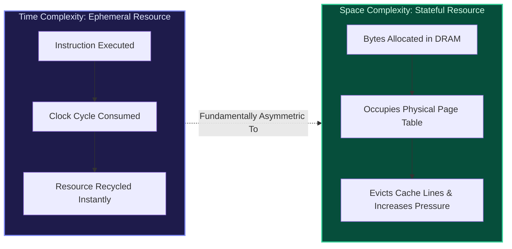
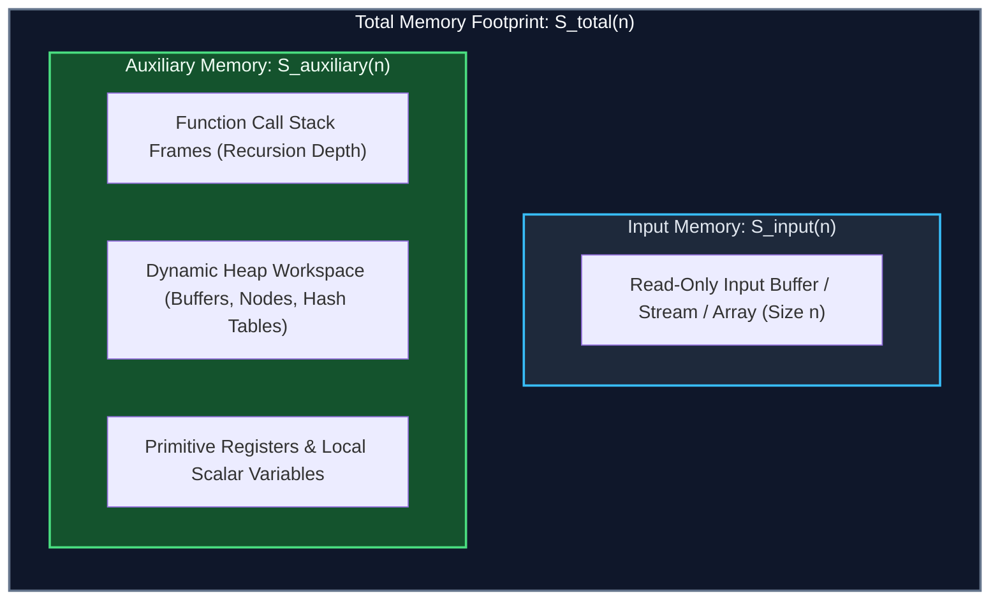
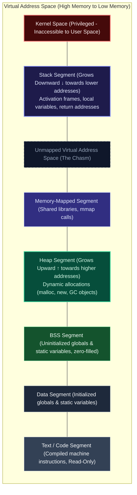
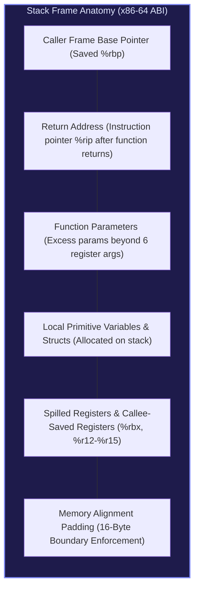
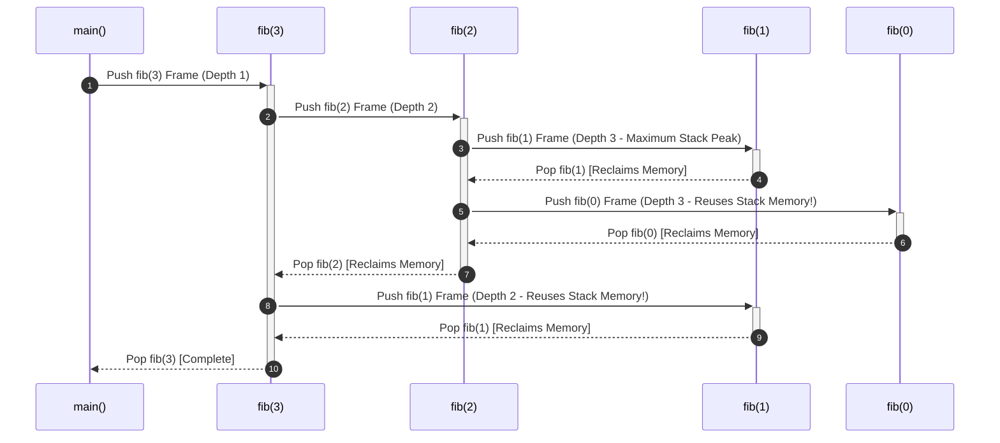
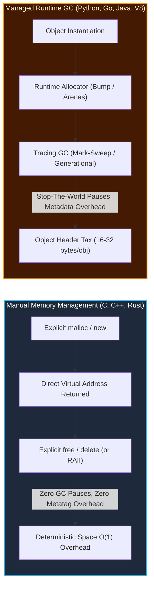
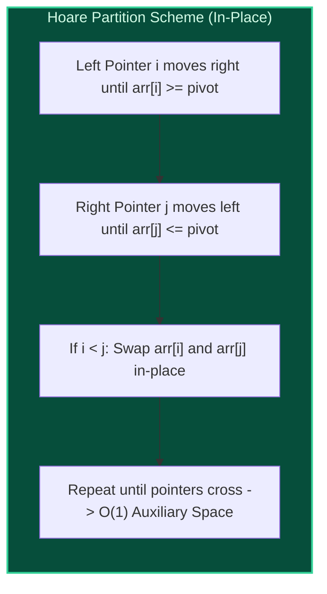

import { Callout } from "fumadocs-ui/components/callout";
import { Tabs, Tab } from "fumadocs-ui/components/tabs";
import { Steps, Step } from "fumadocs-ui/components/steps";
import { Cards, Card } from "fumadocs-ui/components/card";

## The Physical Reality of Memory

When software engineers discuss **time complexity**, they analyze the asymptotic growth of discrete CPU instructions. CPU clock cycles are ephemeral: once an instruction executes, its execution cycle is consumed and gone forever.

**Space complexity operates under radically different physical laws.** Memory is not transient—it is an allocated, stateful, physically bounded grid of silicon capacitors (DRAM cells) managed by the Operating System's Virtual Memory Manager (VMM). Every byte allocated by an algorithm occupies physical RAM or spills into swap space on disk. Memory allocated in one millisecond persists, exerting continuous spatial pressure on hardware caches, memory controllers, and the OS page table until it is explicitly freed or garbage-collected.



An algorithm with sub-optimal time complexity simply runs slowly. An algorithm with uncontrolled space complexity triggers an out-of-memory kernel panic (`OOMKilled`), causes catastrophic thrashing across swap disks, or crashes the runtime with a hardware segmentation fault (`SIGSEGV`).

---

## Total Space vs. Auxiliary Space Complexity

One of the most persistent ambiguities in computer science interviews and academic examinations is the distinction between **Total Space** and **Auxiliary Space**.

### Formal Mathematical Definition

The **Total Space Complexity** $S_{\text{total}}(n)$ of an algorithm is the total number of memory words or bytes required to execute as a function of input size $n$:

$$
S_{\text{total}}(n) = S_{\text{input}}(n) + S_{\text{auxiliary}}(n)
$$

Where:

- **$S_{\text{input}}(n)$**: The storage required to house the input data passed to the algorithm. For an input array of size $n$, $S_{\text{input}}(n) = \Theta(n)$.
- **$S_{\text{auxiliary}}(n)$**: The additional, temporary working memory allocated by the algorithm to perform its computations. This includes dynamic heap allocations, auxiliary buffers, and activation records (stack frames) on the call stack.



### Why Technical Assessments Focus Exclusively on Auxiliary Space

If algorithm evaluators measured **Total Space Complexity**, every algorithm that processes an array of size $n$ would trivially have at least $O(n)$ space complexity, rendering space classification useless:

$$
S_{\text{total}}(\text{Linear Search}) = \underbrace{O(n)}_{\text{Input Array}} + \underbrace{O(1)}_{\text{Loop Index}} = O(n)
$$

$$
S_{\text{total}}(\text{Naive Copy Reversal}) = \underbrace{O(n)}_{\text{Input Array}} + \underbrace{O(n)}_{\text{Cloned Output Array}} = O(n)
$$

Under a total space metric, in-place binary search and a memory-inefficient duplicate-cloning search look asymptotically identical!

Evaluating **Auxiliary Space** exposes the true algorithmic footprint:

- **In-place Two-Pointer Reversal**: Auxiliary Space = $O(1)$
- **Out-of-place Array Reversal**: Auxiliary Space = $O(n)$

<Callout type="info" title="The Industry Standard">
Unless explicitly prefixed as **Total Space**, when an interview prompt, academic paper, or competitive programming judge asks for the **Space Complexity** of an algorithm, they are almost universally asking for its **Auxiliary Space Complexity** $S_{\text{auxiliary}}(n)$.
</Callout>

### Read-Only Inputs vs. Mutable In-Place Inputs

The strictness of auxiliary space analysis depends directly on the caller contract:

| Input Contract                  | Description                                                                                                                   | Space Implication                                                                              |
| :------------------------------ | :---------------------------------------------------------------------------------------------------------------------------- | :--------------------------------------------------------------------------------------------- |
| **Immutable / Const Reference** | Input data resides in read-only memory or cannot be altered. Algorithms must create new data structures to represent changes. | Transformations strictly require $\Omega(n)$ auxiliary space.                                  |
| **Mutable / In-Place**          | Caller grants permission to overwrite the memory backing the input structure.                                                 | Optimal algorithms can achieve $O(1)$ auxiliary space by reusing input memory.                 |
| **Streaming / Online**          | Input arrives byte-by-byte or element-by-element over a socket or stream.                                                     | Algorithm never loads full input; auxiliary space may be $O(1)$ or $O(k)$ for window size $k$. |

---

## Process Memory Anatomy

To reason rigorously about memory complexity, we must discard abstract notions of variables and examine the **Virtual Address Space** of a modern operating system process (e.g., standard x86-64 Linux process layout).



### The Five Segments of Process Memory

<Steps>
### 1. Text / Code Segment
Contains the compiled executable machine code instructions. This segment is marked **read-only** and **executable** (`r-x`) by the MMU (Memory Management Unit) to prevent programs from accidentally or maliciously overwriting their own instructions. Its size is static and fixed at compile time.

### 2. Initialized Data Segment (`.data`)

Stores global, static, and constant variables that have been explicitly initialized with non-zero values before program launch (e.g., `static int max_retries = 5;`). Allocated at load time; persists for the lifetime of the process.

### 3. Uninitialized Data Segment (`.bss`)

Historically named _"Block Started by Symbol"_. Stores global and static variables that are declared without explicit initialization or initialized to zero (e.g., `static int counter;`). The OS does not store megabytes of zeros in the executable binary on disk; instead, the ELF loader simply records the required size and allocates a zeroed memory page when loaded into RAM.

### 4. Heap Segment

The realm of dynamic runtime allocation (`malloc`, `calloc`, `realloc`, C++ `new`, Python/Java object instantiations). The heap begins directly above `.bss` and **grows upward** toward higher memory addresses via the `brk`/`sbrk` system calls or large anonymous `mmap` allocations.

### 5. Stack Segment

Houses the **Call Stack**. The stack begins at high virtual memory addresses (just below the kernel boundary) and **grows downward** toward lower memory addresses with every function call. It manages activation records (stack frames), storing function parameters, return pointers, and local primitive variables.

</Steps>

---

## Stack Frame Allocation & Call Stack Mechanics

Every time a function is invoked, the CPU pushes a new **Activation Record** (commonly known as a **Stack Frame**) onto the stack. When the function returns, the CPU pops that frame by adjusting the Stack Pointer register (`%rsp` on x86-64).

### Anatomy of an x86-64 Stack Frame



On a 64-bit architecture:

- **Return address**: Consumes 8 bytes.
- **Saved base pointer (`%rbp`)**: Consumes 8 bytes.
- **Alignment padding**: The x86-64 System V ABI mandates that the stack pointer must be aligned to a **16-byte boundary** before any `call` instruction. This ensures high-performance SIMD instructions (`SSE`, `AVX`) do not fault on unaligned vector loads.

### Recursion Depth vs. Recursion Call Tree Size

A rampant misconception among developers is equating the **number of recursive calls made** with the **space complexity** of the algorithm.

Consider the naive recursive calculation of the $n$-th Fibonacci number:

```python
def fibonacci(n: int) -> int:
    if n <= 1:
        return n
    return fibonacci(n - 1) + fibonacci(n - 2)
```

**Time Complexity**: $O(2^n)$. The recursion tree branches exponentially, generating $2^{n+1} - 1$ total function call invocations.

**Space Complexity**: $O(n)$, **NOT** $O(2^n)$!

#### Why Stack Space is Strictly Determined by Maximum Recursion Depth

Stack memory is allocated along a single active execution branch. When `fibonacci(n - 1)` executes, its frames are pushed downward. Once the base case is reached, the function returns, and the frame is **popped and reclaimed immediately**. The subsequent call to `fibonacci(n - 2)` reuses the exact same physical stack memory addresses!



At any single point in time, the call stack contains at most $n$ activation frames. Therefore, auxiliary space is bounded by the **maximum height of the recursion tree**:

$$
S_{\text{auxiliary}}(n) = O(\text{max\_depth}) = O(n)
$$

---

## The Physics of Stack Overflow

What happens when recursion runs without bounded termination or exceeds hardware thresholds?

### Operating System Stack Limits

Unlike the heap, which can expand to consume all available physical RAM and swap space, the thread call stack is intentionally throttled by OS safety governors:

- **Linux**: Typically **8,192 KB (8 MB)** per thread (inspectable via `ulimit -s`).
- **Windows**: Typically **1,024 KB (1 MB)** by default (configured via the PE header executable flags).
- **Embedded RTOS / Microcontrollers**: Often constrained to **2 KB - 64 KB**.
- **Web Workers / Node.js V8**: Configurable, typically default ~984 KB.

### Calculating the Exact Recursion Depth Before SIGSEGV

Suppose a recursive C function declares a 128-byte local buffer, plus standard 64-bit frame overhead (8 bytes saved `%rbp`, 8 bytes return address `%rip`, 16 bytes spilled registers and padding), totaling **160 bytes per activation frame**.

On an 8 MB Linux stack:

$$
\text{Max Depth} = \frac{\text{Stack Capacity}}{\text{Bytes per Frame}} = \frac{8 \times 1024 \times 1024 \text{ bytes}}{160 \text{ bytes/frame}} \approx 52{,}428 \text{ recursive calls}
$$

When call number `52,429` executes, the CPU attempts to decrement `%rsp` into an unmapped **guard page** (a write-protected memory page placed directly beneath the stack). The MMU raises a page fault exception. Because the address lies in the guard zone, the Linux kernel refuses to allocate a new page and delivers a fatal signal:

```bash
Segmentation fault (core dumped) # SIGSEGV on Linux
STATUS_STACK_OVERFLOW (0xC00000FD) # Windows structured exception
```

---

## Tail Call Optimization (TCO)

Can a recursive function with depth $n$ execute in $O(1)$ auxiliary space? **Yes—if it satisfies Tail Call Optimization.**

A function call is a **tail call** if the caller performs no further computation after the callee returns; the return value of the callee is returned immediately by the caller.

### Non-Tail Recursive vs. Tail-Recursive Formulation

<Tabs items={["Non-Tail Recursive (O(n) Space)", "Tail-Recursive (O(1) with TCO)"]}>
<Tab value="Non-Tail Recursive (O(n) Space)">
```python
def factorial(n: int) -> int:
    if n <= 1:
        return 1
    # Multiplication occurs AFTER factorial(n - 1) returns.
    # The stack frame MUST be preserved to hold 'n'!
    return n * factorial(n - 1)
```

Because `n * ...` must be computed _after_ the recursive call completes, the CPU has no choice but to retain every activation record on the stack until the base case is reached. Stack space: $O(n)$.

</Tab>

<Tab value="Tail-Recursive (O(1) with TCO)">
```python
def factorial_tail(n: int, accumulator: int = 1) -> int:
    if n <= 1:
        return accumulator
    # The recursive call is the absolute LAST operation.
    # No local variables from the current frame are needed!
    return factorial_tail(n - 1, n * accumulator)
```

Because nothing needs to be calculated after the recursive call returns, an optimizing compiler can overwrite the current frame's arguments and emit an unconditional jump instruction (`jmp`) instead of pushing a new frame (`call`).

</Tab>
</Tabs>

### The Assembly Transformation

Under GCC or Clang with `-O2` optimization:

```assembly
# Non-Tail: Generates stack frame allocations
factorial:
    pushq   %rbx            # Save callee-saved register
    movq    %rdi, %rbx      # Store 'n'
    ...
    call    factorial       # Push new stack frame
    imulq   %rbx, %rax      # Multiply after return
    popq    %rbx
    ret

# Tail-Optimized: Compiler transforms recursion into an in-place loop!
factorial_tail:
.LFB0:
    cmpq    $1, %rdi
    jle     .L3
.L2:
    imulq   %rdi, %rsi      # accumulator *= n
    decq    %rdi            # n--
    cmpq    $1, %rdi
    jne     .L2             # JUMP to start! (0 new stack frames allocated)
.L3:
    movq    %rsi, %rax
    ret
```

### The Harsh Reality of Modern Language Runtimes

<Callout type="warn" title="Do Not Rely on TCO in Python or JavaScript!">
  - **Python**: Guido van Rossum explicitly rejected TCO in CPython. His
  rationale: TCO destroys stack trace visibility, rendering debugging and
  exception stack traces nearly impossible to decipher. Python recursion is
  hard-capped at 1,000 frames (`sys.getrecursionlimit()`). - **JavaScript (V8 /
  Node.js / SpiderMonkey)**: While ECMAScript 2015 (ES6) standardized Proper
  Tail Calls (PTC), all major browser engines (Chrome, Firefox, Edge) except
  Apple's Safari (JavaScriptCore) have disabled or refused to implement TCO due
  to performance regressions and debugging friction. - **C/C++, Rust, Haskell,
  Scala, Scheme**: Fully support and aggressively apply TCO under standard
  optimization flags.
</Callout>

---

## Heap Allocation Mechanics & Memory Bloat

While the stack is rigid, fast (pointer increment/decrement), and bounded, the **Heap** is flexible, dynamic, and fragmented. Every time an algorithm instantiates an object, dynamically resizes an array, or inserts into a tree, it interacts with the heap manager.

### Dynamic Memory Lifecycles: Manual vs. Managed



### Memory Alignment and Struct Padding

CPUs do not read single bytes from physical memory. They read memory in **word-sized blocks** (4 bytes on 32-bit systems, 8 bytes on 64-bit systems). If an 8-byte integer is stored at an unaligned memory address (e.g., an address not divisible by 8), the CPU must execute two memory cycles, shift bits, and stitch the data together.

To prevent this performance penalty, compilers insert **invisible padding bytes** into structs and objects:

```cpp
// Poorly Ordered Struct: 24 Bytes Total!
struct Inefficient {
    char a;       // 1 byte
    // [7 bytes of compiler padding inserted here!]
    double b;     // 8 bytes (must align to 8-byte boundary)
    int c;        // 4 bytes
    // [4 bytes of compiler padding inserted here!]
};

// Optimal Reordering: 16 Bytes Total (33% Memory Reduction!)
struct Efficient {
    double b;     // 8 bytes
    int c;        // 4 bytes
    char a;       // 1 byte
    // [3 bytes of padding to round struct size to multiple of 8]
};
```

When allocating an array of $10^7$ such structs, poor field ordering wastes **80 Megabytes** of physical RAM purely on padding bytes!

### Pointer Bloat & The Linked List Penalty

On 64-bit architectures, every memory address (pointer) consumes **8 bytes (64 bits)**. This fundamental physical fact imposes an astronomical memory penalty on node-based data structures compared to contiguous arrays:


1. **4x Memory Overhead**: A 4-byte integer in a linked list node requires 4 bytes of data + 4 bytes of alignment padding + 8 bytes for the pointer = **16 bytes per element** (or 24 bytes in a doubly-linked list!).
2. **Cache Obliteration**: Array elements reside contiguously in memory; fetching `arr[0]` loads a 64-byte L1 cache line containing `arr[0]` through `arr[15]`. Linked list nodes are scattered across the heap, causing an L1/L2/L3 cache miss on nearly every pointer dereference.

### The Python "PyObject Tax"

High-level interpreted languages wrap raw primitive values in rich runtime structures. In CPython, an integer is not a 4-byte CPU scalar—it is a full heap-allocated `PyLongObject`:

```c
// CPython's internal representation of an integer
struct _longobject {
    PyObject_VAR_HEAD
    // Expands to:
    // ssize_t ob_refcnt;   // 8 bytes (Garbage collection reference counter)
    // struct _typeobject *ob_type; // 8 bytes (Pointer to type object)
    // ssize_t ob_size;     // 8 bytes (Number of digits in arbitrary-precision int)
    digit ob_digit[1];      // 4 bytes (The actual integer value)
    // [4 bytes alignment padding]
};
```

$$
\text{Size of 1 Python Integer} = 8 + 8 + 8 + 4 + 4 = \mathbf{28 \text{ Bytes}}
$$

Storing $10{,}000{,}000$ integers:

- **C / C++ (`int32_t` array)**: $10^7 \times 4 \text{ bytes} \approx \mathbf{40 \text{ MB}}$
- **NumPy (`int32` contiguous array)**: $10^7 \times 4 \text{ bytes} \approx \mathbf{40 \text{ MB}}$
- **Standard Python `list` of `int`s**: $(10^7 \times 8 \text{ byte pointers}) + (10^7 \times 28 \text{ byte objects}) \approx \mathbf{360 \text{ MB}}$ (A 9x space penalty!).

---

## In-Place Algorithms

An algorithm is formally classified as **in-place** if it processes its input and produces its output using at most $O(1)$ (or $O(\log n)$ for recursive stack frames) **auxiliary space** beyond the input itself.

$$
S_{\text{auxiliary}}(n) \in O(1) \quad \text{or} \quad O(\log n)
$$

### Example 1: In-Place vs. Out-of-Place Array Reversal

<Tabs items={["In-Place (Two Pointers, O(1) Space)", "Out-of-Place (Cloning, O(n) Space)"]}>
<Tab value="In-Place (Two Pointers, O(1) Space)">
```python
def reverse_in_place(arr: list[int]) -> None:
    """
    Reverses an array in-place by mutating the input buffer.
    Auxiliary Space: O(1)
    Total Space: O(n) (input array)
    """
    left = 0
    right = len(arr) - 1
    
    while left < right:
        # Swap values using a single scalar register
        arr[left], arr[right] = arr[right], arr[left]
        left += 1
        right -= 1
```

**Memory behavior**: Only two integer pointer indices (`left`, `right`) and a temporary swap register are allocated on the stack frame. No heap allocations occur. Auxiliary space is strictly $O(1)$.

</Tab>

<Tab value="Out-of-Place (Cloning, O(n) Space)">
```python
def reverse_out_of_place(arr: list[int]) -> list[int]:
    """
    Reverses an array by constructing a newly allocated copy.
    Auxiliary Space: O(n)
    Total Space: O(n)
    """
    reversed_arr = []
    for i in range(len(arr) - 1, -1, -1):
        reversed_arr.append(arr[i])
    return reversed_arr
```

**Memory behavior**: Allocates a brand-new dynamic array on the heap of size $n$. At peak execution, both `arr` and `reversed_arr` co-exist in RAM. Auxiliary space is $O(n)$.

</Tab>
</Tabs>

### Example 2: In-Place Partitioning (Lomuto vs. Hoare)

Quicksort's partitioning step is a canonical example of in-place algorithms:



- **Lomuto Partition**: Uses two forward pointers (`i`, `j`). Simple to implement, but performs approximately $3 \times$ more swaps on average than Hoare's scheme.
- **Hoare Partition**: Uses two bidirectional inward-moving pointers (`left`, `right`). Performs on average $\frac{1}{3}$ the number of swaps and operates entirely within the input memory boundary with $O(1)$ auxiliary space.

### The Engineering Trade-offs of In-Place Algorithms

While achieving $O(1)$ auxiliary space is a primary goal in competitive programming and systems design, mutating input memory introduces severe software engineering trade-offs:

| Characteristic                  | In-Place Algorithm ($O(1)$ Space)                                            | Out-of-Place Algorithm ($O(n)$ Space)                                      |
| :------------------------------ | :--------------------------------------------------------------------------- | :------------------------------------------------------------------------- |
| **Memory Footprint**            | Minimal. Optimal for L1/L2 cache fits.                                       | Doubles memory usage during transformation.                                |
| **Idempotence & Purity**        | **Impure**. Calling the function multiple times corrupts original data.      | **Pure / Functional**. Safe for retry loops and functional pipelines.      |
| **Concurrency & Thread Safety** | **Dangerous**. Concurrent readers will read half-mutated data unless locked. | **Thread-Safe**. Input remains immutable; other threads read undisturbed.  |
| **Garbage Collector Stress**    | Zero heap churn. No GC allocation or collection passes triggered.            | High heap churn. Creates transient objects requiring GC collection cycles. |

---

## Hidden Space Complexity Traps in High-Level Languages

Engineers frequently introduce accidental $O(n)$ or $O(n^2)$ space complexity because high-level language abstractions conceal underlying memory allocations.

### Trap 1: String Slicing (Python vs. Go / C++)

In Python, strings are immutable heap objects. Slicing a string creates a **completely new copy** of the sliced substring:

```python
# Hidden O(k) Space Allocation!
s = "A" * 10_000_000  # 10 MB string
substring = s[100:1_000_100]  # Allocates a BRAND NEW 1 MB string on the heap!
```

If an algorithm recursively slices a string of length $n$ by dropping one character per call (`helper(s[1:])`), the space complexity is **not** $O(n)$—it is **$O(n^2)$** due to copying $n + (n-1) + (n-2) + \dots + 1$ bytes across the call stack!

**The Systems Solution**: In C++ (`std::string_view`) or Go (`slice`), a slice is a lightweight 16-byte struct holding only a pointer to the original memory buffer and an integer length. Creating a slice is strictly **$O(1)$ space**:

```cpp
// C++: Zero Allocations (O(1) Space)
std::string original = "Massive dataset string...";
std::string_view slice = std::string_view(original).substr(100, 500);
// 'slice' allocates 0 heap bytes! Just an 8-byte pointer + 8-byte size.
```

### Trap 2: Pass-by-Value vs. Pass-by-Reference in Recursion

Consider a recursive divide-and-conquer algorithm in C++:

```cpp
// DANGEROUS: Passed by Value (Clones vector on EVERY call!)
void traverse_bad(std::vector<int> data, int depth) {
    if (depth == 0) return;
    traverse_bad(data, depth - 1);
}
// Space Complexity: O(n * depth) -> O(n^2) auxiliary memory!

// CORRECT: Passed by Const Reference (Zero Copies!)
void traverse_good(const std::vector<int>& data, int depth) {
    if (depth == 0) return;
    traverse_good(data, depth - 1);
}
// Space Complexity: O(depth) -> O(n) stack frames only!
```

Passing a container by value silently copies the entire heap-allocated vector into the new activation frame on every recursion step.

### Trap 3: Closures Capturing Outer Lexical Scopes

In JavaScript and Python, a closure retains a live reference to its enclosing lexical scope. If a small inner function references an outer scope containing a massive buffer, the garbage collector **cannot free the massive buffer** as long as the inner function remains reachable:

```javascript
// Memory Leak via Lexical Scope Retention
function createFilter() {
  const massiveData = new Uint8Array(100 * 1024 * 1024); // 100 MB buffer

  // This closure captures the lexical environment containing massiveData!
  return function isPositive(number) {
    return number > 0; // Even though massiveData is not used, some engines retain it!
  };
}

const filterFn = createFilter();
// massiveData remains pinned in heap memory because filterFn holds a reference!
```

### Trap 4: List Comprehensions vs. Generators

Creating collections eagerly versus lazily represents one of the most dramatic space divergence vectors in modern programming:

```python
import sys

# Eager List Comprehension: Allocates full collection in RAM immediately
eager_list = [x * 2 for x in range(10_000_000)]
print(f"List Memory: {sys.getsizeof(eager_list) / (1024 * 1024):.2f} MB")
# Output: List Memory: ~80.00 MB (plus 280 MB of Python integer objects!)

# Lazy Generator Expression: Evaluates elements on-demand
lazy_gen = (x * 2 for x in range(10_000_000))
print(f"Generator Memory: {sys.getsizeof(lazy_gen)} Bytes")
# Output: Generator Memory: 112 Bytes!
```

The generator expression maintains only a single instruction pointer and current scalar state in an activation frame ($O(1)$ space), whereas the eager comprehension demands hundreds of megabytes ($O(n)$ space).

---

## Multi-Language Implementations & Benchmarks

Let's examine concrete implementations comparing in-place and out-of-place algorithms, memory profiling techniques, and stack frame observation across Python, TypeScript, and C++.

<Tabs items={["Python", "TypeScript", "C++"]}>
<Tab value="Python">
```python
import sys
import tracemalloc
from typing import List

# ==========================================

# 1. In-Place vs Out-of-Place Partition

# ==========================================

def hoare_partition_in_place(arr: List[int], low: int, high: int) -> int:
"""Hoare Partition: O(1) Auxiliary Space."""
pivot = arr[low + (high - low) // 2]
i = low - 1
j = high + 1
while True:
i += 1
while arr[i] < pivot:
i += 1
j -= 1
while arr[j] > pivot:
j -= 1
if i >= j:
return j
arr[i], arr[j] = arr[j], arr[i]

def partition_out_of_place(arr: List[int]) -> List[int]:
"""Out-of-Place: O(n) Auxiliary Space."""
if len(arr) <= 1:
return arr
pivot = arr[len(arr) // 2]
left = [x for x in arr if x < pivot]
middle = [x for x in arr if x == pivot]
right = [x for x in arr if x > pivot]
return left + middle + right

# ==========================================

# 2. Memory Profiling with tracemalloc

# ==========================================

def profile_space():
data = list(range(100_000, 0, -1))

    # Measure Out-of-Place Memory
    tracemalloc.start()
    _ = partition_out_of_place(data)
    current, peak = tracemalloc.get_traced_memory()
    tracemalloc.stop()
    print(f"[Out-of-Place] Peak Memory: {peak / 1024:.2f} KB")

    # Measure In-Place Memory
    tracemalloc.start()
    _ = hoare_partition_in_place(data, 0, len(data) - 1)
    current_ip, peak_ip = tracemalloc.get_traced_memory()
    tracemalloc.stop()
    print(f"[In-Place]     Peak Memory: {peak_ip / 1024:.2f} KB")

if **name** == "**main**":
profile_space() # Output: # [Out-of-Place] Peak Memory: ~3200.00 KB # [In-Place] Peak Memory: ~0.40 KB (Strictly O(1) auxiliary space!)

````
</Tab>

<Tab value="TypeScript">
```typescript
/**
 * TypeScript / Node.js Memory Profiling and In-Place Algorithms
 */

// ==========================================
// 1. In-Place vs Out-of-Place Two-Pointer Reversal
// ==========================================

function reverseInPlace(buffer: Int32Array): void {
  // Auxiliary Space: O(1)
  let left = 0;
  let right = buffer.length - 1;
  while (left < right) {
    const temp = buffer[left];
    buffer[left] = buffer[right];
    buffer[right] = temp;
    left++;
    right--;
  }
}

function reverseOutOfPlace(buffer: Int32Array): Int32Array {
  // Auxiliary Space: O(n)
  const cloned = new Int32Array(buffer.length);
  for (let i = 0; i < buffer.length; i++) {
    cloned[i] = buffer[buffer.length - 1 - i];
  }
  return cloned;
}

// ==========================================
// 2. Heap Profiling via process.memoryUsage()
// ==========================================

function benchmark() {
  const N = 5_000_000;
  const arr = new Int32Array(N);
  for (let i = 0; i < N; i++) arr[i] = i;

  const baseline = process.memoryUsage().heapUsed;

  // Measure Out-of-Place
  const copy = reverseOutOfPlace(arr);
  const afterCopy = process.memoryUsage().heapUsed;
  const outOfPlaceBytes = afterCopy - baseline;
  console.log(`[Out-of-Place] Allocated: ${(outOfPlaceBytes / 1024 / 1024).toFixed(2)} MB`);

  // Measure In-Place
  const beforeInPlace = process.memoryUsage().heapUsed;
  reverseInPlace(arr);
  const afterInPlace = process.memoryUsage().heapUsed;
  const inPlaceBytes = afterInPlace - beforeInPlace;
  console.log(`[In-Place]     Allocated: ${(inPlaceBytes / 1024).toFixed(2)} KB`);
}

benchmark();
// Output:
// [Out-of-Place] Allocated: ~20.00 MB (4 bytes * 5,000,000)
// [In-Place]     Allocated: ~0.00 KB (Zero dynamic heap allocations)
````

</Tab>

<Tab value="C++">
```cpp
#include <iostream>
#include <vector>
#include <string_view>
#include <chrono>

// ==========================================
// 1. Inspecting Recursion Stack Frame Footprint
// ==========================================

void inspect_stack_frame(int depth, uintptr_t parent_stack_addr = 0) {
volatile int local_var = 42;
uintptr_t current_stack_addr = reinterpret_cast<uintptr_t>(&local_var);

    if (parent_stack_addr != 0) {
        // Stack grows downward on x86-64: parent_addr > current_addr
        ptrdiff_t frame_size = parent_stack_addr - current_stack_addr;
        std::cout << "Depth " << depth
                  << " | Frame Size: " << frame_size << " bytes"
                  << " | Current %rsp: 0x" << std::hex << current_stack_addr << std::dec
                  << std::endl;
    }

    if (depth < 3) {
        inspect_stack_frame(depth + 1, current_stack_addr);
    }

}

// ==========================================
// 2. In-Place String Partition vs String View
// ==========================================

// O(1) Auxiliary Space: Uses lightweight string_view pointers
void process_view(std::string_view sv) {
std::cout << "Processing string_view: " << sv.substr(0, 5)
<< " | Size of view: " << sizeof(sv) << " bytes\n";
}

int main() {
std::cout << "--- Stack Frame Allocation Inspection ---\n";
inspect_stack_frame(1);

    std::cout << "\n--- Zero-Copy Slicing with string_view ---\n";
    std::string heavy_str = "High-performance computational engine";
    process_view(heavy_str);

    return 0;

}
// Sample Output:
// Depth 2 | Frame Size: 48 bytes | Current %rsp: 0x7ffd19b31270
// Depth 3 | Frame Size: 48 bytes | Current %rsp: 0x7ffd19b31240
// Size of view: 16 bytes (8-byte pointer + 8-byte length, zero heap allocation)

````
</Tab>
</Tabs>

---

## Space Complexity Classification Matrix

The following reference matrix categorizes common algorithms and patterns across the asymptotic space spectrum:

| Complexity | Auxiliary Space Class | Dominant Memory Mechanism | Canonical Algorithm Examples |
| :--- | :--- | :--- | :--- |
| **$O(1)$** | Constant | Fixed scalar registers, two pointers, in-place swaps | Two-pointer reversal, Kadane's Algorithm, Binary Search (iterative), Morris Traversal |
| **$O(\log n)$** | Logarithmic | Call stack frames in balanced divide-and-conquer | Quicksort (balanced call stack), Binary Search (recursive), Balanced BST search |
| **$O(n)$** | Linear | Dynamic buffers, hash tables, unbalanced recursion trees | Merge Sort (scratch buffer), DFS/BFS on graphs, Hash Map frequency counter, Quicksort (worst-case degenerated tree) |
| **$O(n \log n)$** | Linearithmic | Persistent data structures, segment trees with history | Immutable array persistence, suffix array construction (naive models) |
| **$O(n^2)$** | Quadratic | 2D matrices, dynamic programming tables, naive string slicing recursion | Matrix multiplication, Floyd-Warshall, Edit Distance / Longest Common Subsequence (naive 2D table) |
| **$O(2^n)$** | Exponential | Combinatorial state tracking, subsets generation | Power set enumeration, recursive backtracking with state cloning, Hamiltonian path verification |

---

## Production Systems Checklist: Memory Optimization Best Practices

When architecting high-throughput or memory-constrained backend systems, apply these production rules:

```mermaid
flowchart TD
    M1["1. Prefer Iteration over Recursion for Deep Trees"] --> M2["Avoids thread call stack exhaustion (SIGSEGV)"]
    M3["2. Replace Node-Based Structures with Flat Arrays"] --> M4["Eliminates pointer bloat & maximizes L1/L2 cache lines"]
    M5["3. Use Streaming / Chunking for Large Payloads"] --> M6["Keeps working memory bounded at O(chunk_size) vs O(total_file)"]
    M7["4. Leverage Struct Alignment & Field Ordering"] --> M8["Orders struct fields from largest to smallest to avoid padding"]
    M9["5. Audit Hidden Slices and Closures"] --> M10["Use string_view / spans / generators to prevent duplicate heap clones"]

    style M1 fill:#1e1b4b,stroke:#818cf8,stroke-width:1px,color:#e0e7ff
    style M3 fill:#064e3b,stroke:#34d399,stroke-width:1px,color:#d1fae5
    style M5 fill:#14532d,stroke:#86efac,stroke-width:1px,color:#f0fdf4
    style M7 fill:#1e293b,stroke:#94a3b8,stroke-width:1px,color:#f8fafc
    style M9 fill:#312e81,stroke:#a5b4fc,stroke-width:1px,color:#e0e7ff
````

<Steps>
### Step 1: Enforce Iteration or Bounded Recursion
If the input size can reach $n \ge 10^5$, never use unoptimized recursion. Either transform the algorithm into an iterative loop with an explicit heap-allocated stack (which can scale to available gigabytes of RAM without hitting the 8 MB OS stack limit) or guarantee tail recursion where supported.

### Step 2: Use Flat Contiguous Buffers Over Pointer Networks

Replace pointer-heavy linked graphs with contiguous index-backed arrays (Data-Oriented Design / Struct of Arrays). An `int32_t` array achieves $100\%$ spatial cache locality and zero pointer overhead.

### Step 3: Stream and Chunk I/O Operations

Never read an entire 2 GB file or query result into memory before processing. Read line-by-line or chunk-by-chunk using streams, generators, or memory-mapped files (`mmap`), reducing auxiliary space from $O(N)$ to $O(1)$.

### Step 4: Beware of Dynamic Container Reallocation Spikes

Dynamic arrays (`std::vector`, Python `list`, Java `ArrayList`) double their allocated capacity when full ($1 \to 2 \to 4 \to 8 \to \dots$). During a reallocation resize, the runtime allocates a new buffer of size $2n$, copies the old $n$ elements, and then frees the old buffer. At that instant, the process consumes **$3n$ memory**! Use `.reserve(n)` when the target size is known in advance.

</Steps>

---

## Conclusion & Next Steps

Space complexity is not an academic abstraction—it is the direct reflection of your code upon physical DRAM, CPU cache lines, and operating system virtual memory pages. By isolating **auxiliary space** from total space and mastering the distinction between **stack frame activation** and **dynamic heap management**, you write software that runs efficiently within hardware limits.

Now that we have analyzed both foundational computational axes—Time Complexity and Space Complexity—we turn to the rigorous mathematical language that bounds them both:

<Cards>
  <Card
    title="Next: 1.1.3 Asymptotic Notation"
    href="/docs/dsa/01-beginner/algorithmic-complexity-and-asymptotic-analysis/asymptotic-notation"
    description="Establish formal mathematical limit proofs and bounding envelopes for Big-O, Big-Omega, Big-Theta, Little-o, and Little-omega."
  />
  <Card
    title="Previous: 1.1.1 Time Complexity Analysis"
    href="/docs/dsa/01-beginner/algorithmic-complexity-and-asymptotic-analysis/time-complexity-analysis"
    description="Deconstruct instruction frequencies, nested loops, branching penalties, and worst/average/best case models."
  />
</Cards>
