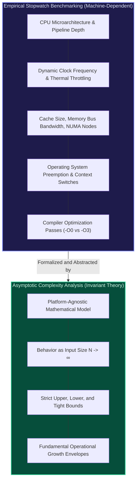
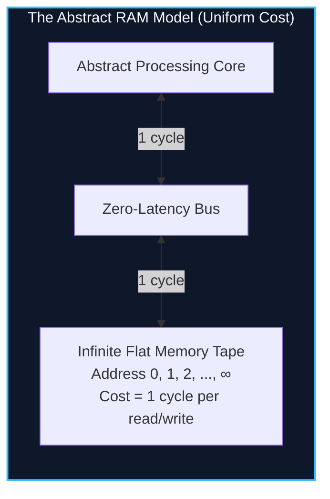
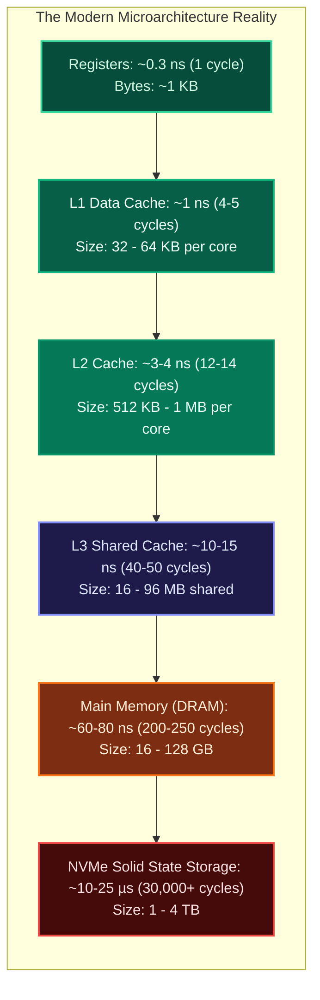
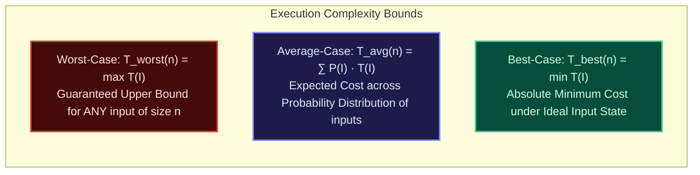
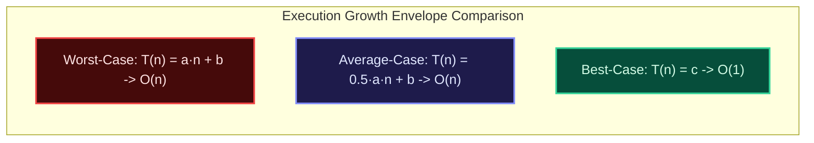

import { Callout } from "fumadocs-ui/components/callout";
import { Tabs, Tab } from "fumadocs-ui/components/tabs";
import { Steps, Step } from "fumadocs-ui/components/steps";
import { Cards, Card } from "fumadocs-ui/components/card";

## The Fallacy of Stopwatch Benchmarking

Why do computer scientists and systems architects analyze algorithms using formal asymptotic complexity rather than simply timing execution with a high-resolution stopwatch?

Consider a real-world experiment:

- We run a naive nested-loop string matching algorithm ($O(N^2)$) on a dual-socket workstation equipped with an Intel Xeon processor running at 4.2 GHz with 64 MB of high-speed L3 cache, compiling with GCC `-O3` optimizations.
- We run an optimal Knuth-Morris-Pratt string matching algorithm ($O(N)$) on an under-clocked ARM Cortex-M0 microcontroller running at 16 MHz with no data cache, running through an unoptimized bytecode interpreter.

For a small document of $N = 500$ characters, the quadratic algorithm on the Xeon completes in **1.2 microseconds**. The linear algorithm on the microcontroller takes **180 microseconds**. A naive stopwatch benchmark would proclaim the quadratic implementation 150 times superior.

Yet when the document expands to $N = 10{,}000{,}000$ characters:

- The linear algorithm on the low-power microcontroller completes in **3.6 seconds**.
- The quadratic algorithm on the Xeon supercomputer requires **over 80 hours** of continuous execution.



**Asymptotic time complexity analysis abstracts away physical hardware variability, compiler flags, and operating system noise.** It provides a mathematically invariant framework to determine how an algorithm's operational demand scales as the input size $N$ approaches infinity ($N \to \infty$).

However, writing production software requires balancing this mathematical abstraction with **mechanical sympathy**—an intimate understanding of physical silicon, memory hierarchies, and instruction latencies.

---

## 01 — Theoretical Model vs. Hardware Reality

To analyze an algorithm without executing it on every chip ever fabricated, theoretical computer science relies on an idealized machine model.

### The Random Access Machine (RAM) Model

Formulated by John Shepherdson, H. E. Sturgis, Stephen Cook, and Robert Reckhow, the **Random Access Machine (RAM) model** is the foundational standard for algorithmic analysis.

In the standard RAM model:

1. **Uniform Memory Access**: Memory consists of an unbounded array of addressable storage cells (registers). Reading from or writing to any arbitrary memory address takes constant time, $O(1)$.
2. **Uniform Instruction Cost**: Primitive operations execute in a single discrete time step ($c = 1$). These include:
   - Arithmetic operations: addition ($+$), subtraction ($-$), multiplication ($\times$), division ($/$), modulo ($\%$)
   - Bitwise operations: AND ($\&$), OR ($|$), XOR ($\wedge$), NOT ($\sim$), bit shifts ($\ll, \gg$)
   - Control-flow operations: conditional branch (`if / else`), unconditional jump (`goto`), function invocation and return
   - Memory dereference: pointer dereference, direct array indexing
3. **Word-Size Assumption**: For an input of size $N$, machine words are assumed to have $w \ge \lceil \log_2 N \rceil$ bits. This ensures that memory addresses and basic integers fitting the problem space can be manipulated in $O(1)$ time without requiring arbitrary-precision multi-word arithmetic.



### The Von Neumann Bottleneck & Physical Realities

While the RAM model provides mathematical tractability, modern silicon departs from these assumptions in ways that can radically affect real-world execution time.

In physical computing architectures:

1. **Memory is Hierarchical, Not Flat**: The speed of light and physical silicon real estate prevent large memory pools from responding in a single clock cycle. Accessing main memory takes hundreds of times longer than executing an ALU instruction.
2. **The Memory Wall**: Over the past four decades, CPU clock frequencies and instruction throughput improved by orders of magnitude faster than DRAM access latency. The CPU spends a staggering fraction of its wall-clock time stalled, waiting for data from main memory.
3. **Caches and Spatial Granularity**: Memory controllers never load a solitary 4-byte integer from RAM. They transfer memory in contiguous blocks called **cache lines** (almost universally **64 bytes** on modern x86-64 and ARM64 processors).
4. **Pipelining and Speculation**: Modern CPUs do not execute one instruction at a time. They employ deep execution pipelines (14 to 20+ stages), superscalar execution units capable of retiring 4 to 8 instructions per cycle, out-of-order execution engines, and speculative branch predictors.



---

## 02 — Instruction Latency & Mechanical Sympathy

Martin Thompson coined the term **mechanical sympathy** (borrowed from racing driver Jackie Stewart) to describe software engineering that works in harmony with the underlying hardware rather than fighting it.

### Latency Numbers Every Programmer Must Know

To comprehend why two algorithms with identical $O(N)$ time complexity can differ in execution speed by a factor of 10 or 50, you must understand the concrete latency landscape:

| Operation / Hardware Event       | Approximate Latency (ns)   | CPU Cycles (at 3.5 GHz) | Human Scaled (1 cycle = 1 sec) |
| :------------------------------- | :------------------------- | :---------------------- | :----------------------------- |
| **CPU Register Read / ALU Op**   | $0.28\text{ ns}$           | $1$                     | $1\text{ second}$              |
| **L1 Data Cache Reference**      | $1.1\text{ ns}$            | $4$                     | $4\text{ seconds}$             |
| **Branch Misprediction Penalty** | $4.5\text{ ns}$            | $16$                    | $16\text{ seconds}$            |
| **L2 Cache Reference**           | $3.5\text{ ns}$            | $12$                    | $12\text{ seconds}$            |
| **L3 Cache Reference**           | $12.0\text{ ns}$           | $42$                    | $42\text{ seconds}$            |
| **DRAM Main Memory Access**      | $65.0\text{ ns}$           | $220$                   | $3.6\text{ minutes}$           |
| **NVMe SSD I/O Read**            | $15{,}000\text{ ns}$       | $52{,}500$              | $14.5\text{ hours}$            |
| **Rotational Disk Seek**         | $4{,}000{,}000\text{ ns}$  | $14{,}000{,}000$        | $5.3\text{ months}$            |
| **Internet Packet (SF to NYC)**  | $40{,}000{,}000\text{ ns}$ | $140{,}000{,}000$       | $4.4\text{ years}$             |

<Callout type="info" title="The Microscopic Made Human">
  If a single CPU cycle is scaled to 1 human second: An L1 cache lookup is
  equivalent to reaching for a pen on your desk (4 seconds). Fetching an integer
  from DRAM is equivalent to walking down the street to a coffee shop and
  waiting in line (3.6 minutes). Reading a block from an SSD is equivalent to
  waiting for an overseas shipment to arrive (14.5 hours).
</Callout>

### Branch Prediction & Pipeline Stalls

Modern high-performance execution pipelines break each instruction into microscopic stages:
$$\text{Fetch} \longrightarrow \text{Decode} \longrightarrow \text{Rename} \longrightarrow \text{Dispatch} \longrightarrow \text{Execute} \longrightarrow \text{Writeback} \longrightarrow \text{Retire}$$

When a CPU encounters a conditional jump (`if (val > threshold)`), it cannot wait 15 cycles to evaluate the condition before deciding which instructions to fetch next. It employs a **Branch History Table (BHT)** and pattern history mechanisms to predict the branch target.

If the prediction is correct, execution continues at full line-rate with zero latency penalty. If the branch is mispredicted:

1. Every speculative instruction in the pipeline must be abruptly discarded (a **pipeline flush**).
2. The architectural state rolls back to the checkpoint.
3. The pipeline must refill from the correct memory address.

This penalty costs **15 to 20 wasted CPU cycles**. An algorithm with erratic, branchy control flow can easily run 3x to 5x slower than branchless, arithmetic code performing the identical number of theoretical operations.

### Spatial Locality: The Row-Major vs. Column-Major Proof

The interplay between the RAM model and hardware reality is starkly evident when traversing a two-dimensional matrix.

Consider an $N \times N$ matrix of 32-bit integers ($4\text{ bytes each}$). In contiguous memory (such as C, C++, Python NumPy, or flat buffers), 2D matrices are flattened using **Row-Major Layout**:

$$\text{Address}(M[i][j]) = \text{Base} + (i \cdot N + j) \cdot 4$$

```mermaid
flowchart TD
    subgraph RowMajor["Row-Major Traversal (Cache-Friendly: Row by Row)"]
        direction LR
        R0["M[0][0]"] --> R1["M[0][1]"] --> R2["M[0][2]"] --> R3["M[0][3]"]
        style R0 fill:#064e3b,stroke:#34d399,stroke-width:2px,color:#d1fae5
        style R1 fill:#064e3b,stroke:#34d399,stroke-width:2px,color:#d1fae5
        style R2 fill:#064e3b,stroke:#34d399,stroke-width:2px,color:#d1fae5
        style R3 fill:#064e3b,stroke:#34d399,stroke-width:2px,color:#d1fae5
    end

    subgraph ColMajor["Column-Major Traversal (Cache-Destructive: Column by Column)"]
        direction LR
        C0["M[0][0]"] -. Stride of N elements .-> C1["M[1][0]"] -. Stride of N elements .-> C2["M[2][0]"]
        style C0 fill:#450a0a,stroke:#ef4444,stroke-width:2px,color:#fee2e2
        style C1 fill:#450a0a,stroke:#ef4444,stroke-width:2px,color:#fee2e2
        style C2 fill:#450a0a,stroke:#ef4444,stroke-width:2px,color:#fee2e2
    end
```



Let us evaluate what happens at the hardware level for an input of $N = 4096$:

1. **Row-Major Traversal (`matrix[i][j]`)**:
   - The memory access pattern is sequentially linear: `0x0000`, `0x0004`, `0x0008`, `0x000C`...
   - When the CPU requests `matrix[0][0]`, a cache miss occurs. The memory controller fetches a **64-byte cache line** containing $\frac{64\text{ bytes}}{4\text{ bytes/int}} = 16\text{ integers}$ (`matrix[0][0]` through `matrix[0][15]`).
   - The next 15 accesses (`j = 1` through `j = 15`) hit L1 cache directly with a **1-cycle latency**.
   - The hardware prefetcher detects the monotonic stride and pre-emptively streams future cache lines from RAM into L2/L1 before the CPU even requests them.
   - Cache Miss Rate: $\frac{1}{16} = \mathbf{6.25\%}$.

2. **Column-Major Traversal (`matrix[j][i]`)**:
   - The memory access strides by $N \times 4\text{ bytes} = 4096 \times 4 = 16{,}384\text{ bytes}$ per step!
   - Every single access jumps far past the currently loaded 64-byte cache line.
   - The 15 companion integers loaded into the cache line are never used before the cache line is evicted by subsequent reads.
   - The hardware prefetcher cannot maintain stream buffers across thousands of separate 16 KB boundaries.
   - Cache Miss Rate: $\mathbf{100\%}$.

Both algorithms execute exactly $N^2$ iterations and perform $N^2$ additions—they have identical $O(N^2)$ time complexity. Yet in empirical benchmarks, the row-major traversal runs **8 to 15 times faster** purely due to cache line mechanics.

---

## 03 — Counting Fundamental Operations & Formulating $T(n)$

In formal algorithm analysis, we do not guess the complexity; we derive a mathematical function $T(n)$ representing the total count of primitive operations performed as a function of the input size $n$.

### Primitive Operation Inventory

A primitive operation is an instruction that executes in a constant amount of time ($O(1)$) on a standard CPU. We categorize them as follows:

1. **Assignment**: `x = 5`, `ptr = head` ($\text{cost } c_1$)
2. **Arithmetic Operation**: `a + b`, `x * y`, `i - 1` ($\text{cost } c_2$)
3. **Comparison**: `a < b`, `key == arr[i]`, `i < n` ($\text{cost } c_3$)
4. **Memory Address Calculation**: $A[i] = \text{base} + i \cdot \text{sizeof}(T)$ ($\text{cost } c_4$)
5. **Memory Dereference / Read**: Loading data from an address into a register ($\text{cost } c_5$)
6. **Function Call / Frame Allocation**: Pushing parameters and return address to the call stack ($\text{cost } c_6$)
7. **Return Statement**: Transferring control back to caller ($\text{cost } c_7$)

### Exact Step-by-Step Derivation: Linear Search

Let us derive $T(n)$ rigorously for a standard linear search algorithm over an array of size $n$:

```python
def linear_search(arr, target):
    n = len(arr)                 # Line 1
    i = 0                        # Line 2
    while i < n:                 # Line 3
        if arr[i] == target:     # Line 4
            return i             # Line 5
        i = i + 1                # Line 6
    return -1                    # Line 7
```

Let us count the execution frequency of each line in the **worst-case scenario** (when `target` is not present in `arr`):

| Line                               | Cost per Execution                   | Execution Count (Worst Case)       | Total Line Cost |
| :--------------------------------- | :----------------------------------- | :--------------------------------- | :-------------- |
| **Line 1** (`n = len(arr)`)        | $c_1$                                | $1$                                | $c_1$           |
| **Line 2** (`i = 0`)               | $c_2$                                | $1$                                | $c_2$           |
| **Line 3** (`while i < n`)         | $c_3$                                | $n + 1$ _(tests $0, 1, \dots, n$)_ | $c_3(n + 1)$    |
| **Line 4** (`if arr[i] == target`) | $c_4$ _(address calc + deref + cmp)_ | $n$                                | $c_4 \cdot n$   |
| **Line 5** (`return i`)            | $c_5$                                | $0$ _(target never found)_         | $0$             |
| **Line 6** (`i = i + 1`)           | $c_6$ _(add + assign)_               | $n$                                | $c_6 \cdot n$   |
| **Line 7** (`return -1`)           | $c_7$                                | $1$                                | $c_7$           |

Summing the total operational costs:

$$T(n) = c_1(1) + c_2(1) + c_3(n + 1) + c_4(n) + c_6(n) + c_7(1)$$

Group by powers of $n$:

$$T(n) = (c_3 + c_4 + c_6) \cdot n + (c_1 + c_2 + c_3 + c_7)$$

Let:

- $a = (c_3 + c_4 + c_6)$
- $b = (c_1 + c_2 + c_3 + c_7)$

We arrive at the exact linear equation:

$$T(n) = a \cdot n + b$$

As $n \to \infty$, the constant offset $b$ becomes negligible, and the scaling behavior is entirely dictated by the leading term $a \cdot n$. Dropping the constant coefficient $a$, we characterize the asymptotic growth rate as $O(n)$.

### Quadratic Operation Derivation: Insertion Sort

Now consider an algorithm with nested dependent iteration: **Insertion Sort**.

```python
def insertion_sort(arr):
    n = len(arr)                        # c1: executed 1 time
    for i in range(1, n):               # c2: loop header executed n times
        key = arr[i]                    # c3: executed (n - 1) times
        j = i - 1                       # c4: executed (n - 1) times
        while j >= 0 and arr[j] > key:  # c5: depends on input arrangement!
            arr[j + 1] = arr[j]         # c6: inner shift
            j -= 1                      # c7: inner decrement
        arr[j + 1] = key                # c8: executed (n - 1) times
```

In the worst-case scenario (the input array is sorted in exact reverse order), the inner `while` condition triggers its maximum possible iterations for every single $i$:

- For $i = 1$: the inner loop body executes $1$ time.
- For $i = 2$: the inner loop body executes $2$ times.
- For $i = 3$: the inner loop body executes $3$ times.
- For general $i$: the inner loop body executes $i$ times.

The total number of inner loop executions is the sum of an arithmetic progression:

$$\sum_{i=1}^{n-1} i = 1 + 2 + 3 + \dots + (n - 1) = \frac{(n - 1)n}{2} = \frac{1}{2}n^2 - \frac{1}{2}n$$

The while condition check (`j >= 0 and arr[j] > key`) runs one additional time per outer iteration to detect loop termination:

$$\sum_{i=1}^{n-1} (i + 1) = \frac{n(n - 1)}{2} + (n - 1) = \frac{1}{2}n^2 + \frac{1}{2}n - 1$$

Combining all constant coefficients:

$$T(n) = c_1 + c_2 n + (c_3 + c_4 + c_8)(n - 1) + c_5 \left(\frac{1}{2}n^2 + \frac{1}{2}n - 1\right) + (c_6 + c_7)\left(\frac{1}{2}n^2 - \frac{1}{2}n\right)$$

Refactoring into polynomial standard form:

$$T(n) = \alpha n^2 + \beta n + \gamma$$

Where:

- $\alpha = \frac{1}{2}(c_5 + c_6 + c_7)$
- $\beta = c_2 + c_3 + c_4 + c_8 + \frac{1}{2}c_5 - \frac{1}{2}(c_6 + c_7)$
- $\gamma = c_1 - c_3 - c_4 - c_8 - c_5$

Here, the quadratic coefficient $\alpha = \frac{1}{2}(c_5 + c_6 + c_7)$ is the **leading coefficient**, and $n^2$ is the **dominant term**. As $n$ grows from $100$ to $1{,}000{,}000$, the $n^2$ term accounts for $99.9999\%$ of total execution cycles. Hence, $T(n) \in \Theta(n^2)$.

---

## 04 — Evaluating Execution Bounds Across Input Scaling

The execution time of an algorithm is rarely a static function of $n$ alone; it almost always depends on the specific arrangement, distribution, and values of the input data.



### 1. Worst-Case Running Time: $T_{\text{worst}}(n)$

The worst-case running time represents the absolute maximum number of primitive operations the algorithm can possibly execute over any valid input of size $n$:

$$T_{\text{worst}}(n) = \max_{I \in \mathcal{D}_n} T(I)$$

Where $\mathcal{D}_n$ represents the set of all possible input instances of size $n$.

#### Why Worst-Case Analysis is the Engineering Gold Standard

- **Ironclad Guarantee**: It provides an absolute upper ceiling. If an air traffic control collision detector or an automotive ABS brake controller guarantees $T_{\text{worst}}(n) \le 5\text{ ms}$, we know with mathematical certainty that it will never take $6\text{ ms}$, regardless of sensor noise.
- **Defensive Engineering Against Denial-of-Service**: If a web service uses an algorithm whose worst-case is significantly worse than its average-case (e.g., naive QuickSort or hash tables with predictable hash functions), an adversary can deliberately construct pathological inputs to trigger worst-case execution, crippling the server (Algorithmic Complexity Attacks).

### 2. Best-Case Running Time: $T_{\text{best}}(n)$

The best-case running time represents the minimum number of operations executed under the most favorable input configuration:

$$T_{\text{best}}(n) = \min_{I \in \mathcal{D}_n} T(I)$$

#### The Trap of Overvaluing Best-Case

Best-case analysis is frequently trivial and practically uninformative in isolation:

- Linear search has a best-case of $O(1)$ (when the target happens to be in the very first index $A[0]$). Does this make linear search a constant-time algorithm? Absolutely not.
- A bogus sorting algorithm that simply checks if an array is already sorted and aborts has an $O(n)$ best-case, but fails to sort anything else.
- However, best-case analysis is valuable for **adaptive algorithms**—algorithms that dynamically accelerate when an input already exhibits partial structure (e.g., Insertion Sort runs in $O(n)$ on already-sorted arrays, making it the core base-case engine of production algorithms like Python's TimSort and C++ `std::sort`).

### 3. Average-Case Running Time: $T_{\text{avg}}(n)$

The average-case running time is the mathematical expectation of running time across a probability distribution of input instances:

$$T_{\text{avg}}(n) = \mathbb{E}[T(n)] = \sum_{I \in \mathcal{D}_n} P(I) \cdot T(I)$$

Where $P(I)$ is the probability that input instance $I$ is supplied to the algorithm.

#### Mathematical Derivation: Linear Search Average Case

Let us derive the exact average-case complexity of linear search on an array of $n$ elements:

1. Let $p$ be the probability that the target key exists in the array ($0 \le p \le 1$).
2. Assume the **Uniform Distribution Assumption**: if the target is present, it is equally likely to reside at any index from $0$ to $n - 1$. Thus, the probability of the key being at index $k$ is $\frac{p}{n}$.
3. The probability that the target is entirely absent from the array is $(1 - p)$.

If the target is at index $k$ ($0$-indexed), the search performs $(k + 1)$ comparisons. If the target is absent, the search performs $n$ comparisons.

We calculate the expected number of comparisons $\mathbb{E}[C]$:

$$\mathbb{E}[C] = \sum_{k=0}^{n-1} \left( \frac{p}{n} \cdot (k + 1) \right) + (1 - p) \cdot n$$

Pull out constants:

$$\mathbb{E}[C] = \frac{p}{n} \sum_{k=0}^{n-1} (k + 1) + (1 - p)n = \frac{p}{n} \sum_{i=1}^{n} i + (1 - p)n$$

Substitute the summation identity $\sum_{i=1}^n i = \frac{n(n + 1)}{2}$:

$$\mathbb{E}[C] = \frac{p}{n} \cdot \frac{n(n + 1)}{2} + (1 - p)n = \frac{p(n + 1)}{2} + (1 - p)n$$

Let us evaluate two critical boundary conditions:

- **Case 1: The key is guaranteed to be in the array ($p = 1$)**:
  $$\mathbb{E}[C] = \frac{1(n + 1)}{2} + 0 = \frac{n + 1}{2} \approx \frac{n}{2}$$
  On average, a successful linear search inspects exactly half the elements.
- **Case 2: The key has a $50\%$ chance of being present ($p = 0.5$)**:
  $$\mathbb{E}[C] = \frac{0.5(n + 1)}{2} + 0.5n = \frac{n + 1}{4} + \frac{2n}{4} = \frac{3n + 1}{4} \approx 0.75n$$

In all cases, the average-case running time scales as $T_{\text{avg}}(n) \in \Theta(n)$.



---

## 05 — Loop Analysis Patterns & Closed-Form Formulas

Loop structures form the backbone of procedural algorithms. Recognizing loop archetypes allows you to determine asymptotic complexity instantaneously.

### Pattern 1: Single Linear Loops ($O(n)$)

The loop index changes by a constant addition or subtraction per iteration:

```python
for i in range(0, n, k):  # i incremented by constant k
    # O(1) operations
```

The loop executes $\lceil \frac{n}{k} \rceil$ times:

$$T(n) = \sum_{i=0}^{\lceil n/k \rceil} c = c \cdot \frac{n}{k} = O(n)$$

### Pattern 2: Independent Nested Loops ($O(n \cdot m)$)

The inner loop's boundary is completely independent of the outer loop's index:

```python
for i in range(n):
    for j in range(m):
        # O(1) operations
```

Expressed as a double summation:

$$T(n, m) = \sum_{i=1}^{n} \sum_{j=1}^{m} c = \sum_{i=1}^{n} (c \cdot m) = c \cdot n \cdot m = O(n \cdot m)$$

If $n = m$, this evaluates to $O(n^2)$.

<Callout type="warn" title="Trap: The Multi-Variable Fallacy">
  Never assume that two nested loops automatically equate to $O(n^2)$. If an
  algorithm processes a matrix with $N$ rows and $M$ columns, or a graph with
  $V$ vertices and $E$ edges, its complexity is $O(N \cdot M)$ or $O(V + E)$.
  Collapsing multi-variable bounds into a single $N^2$ destroys algorithmic
  precision.
</Callout>

### Pattern 3: Dependent Nested Triangular Loops ($O(n^2)$)

The inner loop's iteration range depends directly on the outer loop's current index $i$:

```python
for i in range(n):
    for j in range(i, n):
        # O(1) operations
```

When $i = 0$, $j$ runs $n$ times. When $i = n - 1$, $j$ runs $1$ time:

$$T(n) = \sum_{i=0}^{n-1} (n - i) = n + (n - 1) + (n - 2) + \dots + 1 = \sum_{k=1}^n k = \frac{n(n + 1)}{2} = \frac{1}{2}n^2 + \frac{1}{2}n = O(n^2)$$

Even though the inner loop does not run $n$ times on every pass, the sum of the triangular area still produces a quadratic $n^2$ leading term.

### Pattern 4: Logarithmic Divide / Multiply Loops ($O(\log n)$)

The loop variable is multiplied or divided by a constant factor $k > 1$ on each step:

```python
i = 1
while i < n:
    # O(1) operations
    i = i * 2
```

Let $m$ be the total number of iterations. At iteration $m$, the value of $i$ is:

$$i = 1 \cdot 2^m$$

The loop terminates when $i \ge n$:

$$2^m \ge n \implies m \ge \log_2 n \implies m = \lceil \log_2 n \rceil$$

Therefore:

$$T(n) = \sum_{m=1}^{\lceil \log_2 n \rceil} c = c \cdot \lceil \log_2 n \rceil = O(\log n)$$

Because logarithms of different bases differ only by a constant multiplier ($\log_b n = \frac{\log_a n}{\log_a b}$), the base of the logarithm does not alter the asymptotic class: $O(\log_2 n) = O(\log_{10} n) = O(\ln n) = O(\log n)$.

### Pattern 5: Linearithmic Loops ($O(n \log n)$)

A common design combines a linear outer loop with a logarithmic inner loop (or vice versa):

```python
for i in range(n):
    j = 1
    while j < n:
        # O(1) operations
        j = j * 2
```

Mathematically:

$$T(n) = \sum_{i=1}^n \sum_{k=1}^{\lceil \log_2 n \rceil} c = \sum_{i=1}^n (c \log_2 n) = c \cdot n \log_2 n = O(n \log n)$$

This is the canonical growth rate of optimal comparison-based sorting algorithms (Merge Sort, Heap Sort) and Divide-and-Conquer transforms (Fast Fourier Transform).

### Pattern 6: Harmonic Series Loops ($O(n \log n)$)

Consider an algorithm where the inner loop's step size is determined by the outer loop variable:

```python
for i in range(1, n + 1):
    for j in range(0, n + 1, i):
        # O(1) operations (e.g., marking multiples)
```

For each $i$, the inner loop runs $\lfloor \frac{n}{i} \rfloor$ times. The total operation count is:

$$T(n) = \sum_{i=1}^n \frac{n}{i} = n \sum_{i=1}^n \frac{1}{i}$$

The summation $\sum_{i=1}^n \frac{1}{i}$ is the **Harmonic Series** $H_n$. Using calculus and Euler-Maclaurin summation:

$$H_n = \ln n + \gamma + \mathcal{O}\left(\frac{1}{n}\right)$$

Where $\gamma \approx 0.577215$ is the Euler-Mascheroni constant. Substituting this back into our expression:

$$T(n) = n \left( \ln n + \gamma + \mathcal{O}\left(\frac{1}{n}\right) \right) = n \ln n + \gamma n + O(1) = O(n \log n)$$

Even though the inner loop seems to execute very few times for large $i$, the overall execution time is $O(n \log n)$, not $O(n)$ or $O(n^2)$.

### Pattern 7: The Sieve of Eratosthenes ($O(n \log \log n)$)

In the classical Sieve of Eratosthenes for prime generation, the inner loop only marks multiples of numbers that are prime:

```python
is_prime = [True] * (n + 1)
for p in range(2, int(n**0.5) + 1):
    if is_prime[p]:
        for multiple in range(p * p, n + 1, p):
            is_prime[multiple] = False
```

The operation count sums over prime numbers $p \le n$:

$$T(n) = \sum_{p \le n, p \in \mathbb{P}} \frac{n}{p} = n \sum_{p \le n, p \in \mathbb{P}} \frac{1}{p}$$

By **Mertens' Second Theorem** (1874), the sum of the reciprocals of primes diverges double-logarithmically:

$$\sum_{p \le n, p \in \mathbb{P}} \frac{1}{p} = \ln(\ln n) + M + \mathcal{O}\left(\frac{1}{\ln n}\right)$$

Where $M \approx 0.261497$ is the Meissel-Mertens constant. Thus:

$$T(n) = n (\ln \ln n + M) = O(n \log \log n)$$

For all practical values of $n$ (even $n = 10^{18}$, where $\log_2 \log_2 n \approx 6$), $O(n \log \log n)$ is virtually indistinguishable from purely linear $O(n)$ time.

---

## 06 — Code Implementations: Primitive Operations & Cache Sympathy

Below are production implementations in Python, TypeScript, and C++ demonstrating explicit operation counting, asymptotic loop analysis, and mechanical sympathy benchmarks.

### Part A: Primitive Operation Counter Demo

<Tabs items={["Python", "TypeScript", "C++"]}>
<Tab value="Python">
```python
"""
Operation-Counting Simulator: Linear Search vs. Binary Search
Demonstrates how high-level code translates into measurable operations.
"""
from dataclasses import dataclass
from typing import List, Optional, Tuple

@dataclass
class OpMetrics:
comparisons: int = 0
assignments: int = 0
array_accesses: int = 0

    @property
    def total_ops(self) -> int:
        return self.comparisons + self.assignments + self.array_accesses

def instrumented_linear_search(arr: List[int], target: int) -> Tuple[Optional[int], OpMetrics]:
metrics = OpMetrics()
metrics.assignments += 1 # n = len(arr)
n = len(arr)

    metrics.assignments += 1  # i = 0
    i = 0

    while True:
        metrics.comparisons += 1  # while i < n check
        if i >= n:
            break

        metrics.array_accesses += 1  # arr[i]
        metrics.comparisons += 1     # arr[i] == target
        if arr[i] == target:
            return i, metrics

        metrics.assignments += 1     # i += 1
        i += 1

    return None, metrics

def instrumented_binary_search(arr: List[int], target: int) -> Tuple[Optional[int], OpMetrics]:
metrics = OpMetrics()
metrics.assignments += 2 # low = 0, high = len(arr) - 1
low = 0
high = len(arr) - 1

    while True:
        metrics.comparisons += 1  # while low <= high
        if low > high:
            break

        metrics.assignments += 1  # mid = (low + high) // 2
        mid = low + (high - low) // 2

        metrics.array_accesses += 1  # arr[mid]
        metrics.comparisons += 1     # arr[mid] == target
        if arr[mid] == target:
            return mid, metrics
        elif arr[mid] < target:
            metrics.comparisons += 1  # elif check
            metrics.assignments += 1  # low = mid + 1
            low = mid + 1
        else:
            metrics.comparisons += 1  # elif check (false branch)
            metrics.assignments += 1  # high = mid - 1
            high = mid - 1

    return None, metrics

# Verification

if **name** == "**main**":
test_size = 100_000
sorted_data = list(range(test_size))
target_absent = -1 # Triggers worst-case for both

    _, lin_metrics = instrumented_linear_search(sorted_data, target_absent)
    _, bin_metrics = instrumented_binary_search(sorted_data, target_absent)

    print(f"Linear Search Worst-Case Operations (N={test_size:,}): {lin_metrics.total_ops:,}")
    print(f"Binary Search Worst-Case Operations (N={test_size:,}): {bin_metrics.total_ops:,}")
    # Output:
    # Linear Search: ~300,000 ops (3 * N)
    # Binary Search: ~85 ops (~5 * log2(N))

````
</Tab>

<Tab value="TypeScript">
```typescript
/**
 * Operation-Counting Simulator: Linear Search vs. Binary Search in TypeScript
 */

interface OpMetrics {
  comparisons: number;
  assignments: number;
  arrayAccesses: number;
}

function createMetrics(): OpMetrics {
  return { comparisons: 0, assignments: 0, arrayAccesses: 0 };
}

function getTotalOps(m: OpMetrics): number {
  return m.comparisons + m.assignments + m.arrayAccesses;
}

function instrumentedLinearSearch(
  arr: number[],
  target: number
): { index: number | null; metrics: OpMetrics } {
  const metrics = createMetrics();
  metrics.assignments += 2; // const n = arr.length; let i = 0;
  const n = arr.length;
  let i = 0;

  while (true) {
    metrics.comparisons++; // i < n loop condition
    if (i >= n) break;

    metrics.arrayAccesses++; // arr[i] dereference
    metrics.comparisons++; // arr[i] === target
    if (arr[i] === target) {
      return { index: i, metrics };
    }

    metrics.assignments++; // i++
    i++;
  }

  return { index: null, metrics };
}

function instrumentedBinarySearch(
  arr: number[],
  target: number
): { index: number | null; metrics: OpMetrics } {
  const metrics = createMetrics();
  metrics.assignments += 2; // let low = 0; let high = arr.length - 1;
  let low = 0;
  let high = arr.length - 1;

  while (true) {
    metrics.comparisons++; // low <= high
    if (low > high) break;

    metrics.assignments++; // mid calculation
    const mid = low + Math.floor((high - low) / 2);

    metrics.arrayAccesses++; // arr[mid]
    metrics.comparisons++; // arr[mid] === target
    if (arr[mid] === target) {
      return { index: mid, metrics };
    } else if (arr[mid] < target) {
      metrics.comparisons++;
      metrics.assignments++;
      low = mid + 1;
    } else {
      metrics.comparisons++;
      metrics.assignments++;
      high = mid - 1;
    }
  }

  return { index: null, metrics };
}

// Execution test
const testSize = 100_000;
const sortedData = Array.from({ length: testSize }, (_, i) => i);
const targetAbsent = -1;

const linResult = instrumentedLinearSearch(sortedData, targetAbsent);
const binResult = instrumentedBinarySearch(sortedData, targetAbsent);

console.log(`Linear Search Ops (N=${testSize}): ${getTotalOps(linResult.metrics)}`);
console.log(`Binary Search Ops (N=${testSize}): ${getTotalOps(binResult.metrics)}`);
````

</Tab>

<Tab value="C++">
```cpp
/**
 * Low-Level Operation Counting and Precise Cost Modeling in C++
 */
#include <iostream>
#include <vector>
#include <numeric>

struct OpMetrics {
uint64_t comparisons = 0;
uint64_t assignments = 0;
uint64_t array_accesses = 0;

    uint64_t total() const {
        return comparisons + assignments + array_accesses;
    }

};

std::pair<int, OpMetrics> instrumented_linear_search(const std::vector<int>& arr, int target) {
OpMetrics metrics;
metrics.assignments += 2; // int n = arr.size(); int i = 0;
int n = static_cast<int>(arr.size());
int i = 0;

    while (true) {
        metrics.comparisons++; // i < n
        if (i >= n) break;

        metrics.array_accesses++; // arr[i]
        metrics.comparisons++;    // arr[i] == target
        if (arr[i] == target) {
            return {i, metrics};
        }

        metrics.assignments++; // i++
        i++;
    }
    return {-1, metrics};

}

std::pair<int, OpMetrics> instrumented_binary_search(const std::vector<int>& arr, int target) {
OpMetrics metrics;
metrics.assignments += 2; // low = 0, high = size - 1
int low = 0;
int high = static_cast<int>(arr.size()) - 1;

    while (true) {
        metrics.comparisons++; // low <= high
        if (low > high) break;

        metrics.assignments++; // mid = low + (high - low)/2
        int mid = low + (high - low) / 2;

        metrics.array_accesses++; // arr[mid]
        metrics.comparisons++;    // arr[mid] == target
        if (arr[mid] == target) {
            return {mid, metrics};
        } else if (arr[mid] < target) {
            metrics.comparisons++;
            metrics.assignments++;
            low = mid + 1;
        } else {
            metrics.comparisons++;
            metrics.assignments++;
            high = mid - 1;
        }
    }
    return {-1, metrics};

}

int main() {
const int test_size = 100'000;
std::vector<int> sorted_data(test_size);
std::iota(sorted_data.begin(), sorted_data.end(), 0);

    const int target_absent = -1;
    auto [lin_idx, lin_m] = instrumented_linear_search(sorted_data, target_absent);
    auto [bin_idx, bin_m] = instrumented_binary_search(sorted_data, target_absent);

    std::cout << "Linear Search Total Ops: " << lin_m.total() << "\n";
    std::cout << "Binary Search Total Ops: " << bin_m.total() << "\n";
    return 0;

}

````
</Tab>
</Tabs>

---

### Part B: Cache-Friendly vs. Cache-Hostile Traversal Benchmark

Below is the concrete benchmark proving the spatial locality and mechanical sympathy thesis across Python, TypeScript, and C++.

<Tabs items={["Python", "TypeScript", "C++"]}>
<Tab value="Python">
```python
"""
Demonstrating Spatial Locality and Mechanical Sympathy in Python / NumPy.
Comparing Row-Major vs. Column-Major traversal over identical O(N^2) algorithms.
"""
import time
import numpy as np

def benchmark_matrix_traversal():
    N = 4096  # 4096 * 4096 matrix of 64-bit floats (~134 MB RAM)
    print(f"Allocating {N}x{N} Matrix ({N * N * 8 / (1024 * 1024):.1f} MB)...")
    matrix = np.ones((N, N), dtype=np.float64)

    # 1. Row-Major Traversal (Continuous contiguous reads in C-contiguous memory)
    start_row = time.perf_counter()
    # In pure NumPy, matrix.sum(axis=1) demonstrates vectorized row-major speed
    # To demonstrate loop stride explicitly:
    row_sum = 0.0
    for i in range(0, N, 4):  # Strided sample to avoid Python loop interpreter overhead
        for j in range(N):
            row_sum += matrix[i, j]
    duration_row = time.perf_counter() - start_row

    # 2. Column-Major Traversal (Striding across 32 KB boundaries)
    start_col = time.perf_counter()
    col_sum = 0.0
    for j in range(N):
        for i in range(0, N, 4):
            col_sum += matrix[i, j]
    duration_col = time.perf_counter() - start_col

    print(f"Row-Major Traversal (Cache Friendly): {duration_row * 1000:.2f} ms")
    print(f"Col-Major Traversal (Cache Unfriendly): {duration_col * 1000:.2f} ms")
    print(f"Slowdown Factor: {duration_col / duration_row:.2f}x")

if __name__ == "__main__":
    benchmark_matrix_traversal()
````

</Tab>

<Tab value="TypeScript">
```typescript
/**
 * Row-Major vs Column-Major Traversal Benchmark using Flat TypedArrays
 */

function benchmarkCacheLocality(): void {
const N = 4096;
const totalElements = N \* N;
console.log(`Allocating flat Float64Array with ${totalElements.toLocaleString()} elements (~134 MB)...`);

// Flat contiguous memory buffer representing an N x N matrix
const matrix = new Float64Array(totalElements);
matrix.fill(1.0);

// 1. Cache-Friendly Row-Major Traversal: index = i _ N + j
// Contiguous memory addresses accessed sequentially: 0, 1, 2, 3...
const startRow = performance.now();
let rowSum = 0;
for (let i = 0; i < N; i += 4) { // Subsampled to isolate memory latency from JS JIT loops
const rowOffset = i _ N;
for (let j = 0; j < N; j++) {
rowSum += matrix[rowOffset + j];
}
}
const durationRow = performance.now() - startRow;

// 2. Cache-Unfriendly Column-Major Traversal: index = i _ N + j
// Non-contiguous memory strides: jumps by 4096 _ 8 bytes = 32 KB per access!
const startCol = performance.now();
let colSum = 0;
for (let j = 0; j < N; j++) {
for (let i = 0; i < N; i += 4) {
colSum += matrix[i * N + j];
}
}
const durationCol = performance.now() - startCol;

console.log(`Row-Major (Cache-Friendly):   ${durationRow.toFixed(2)} ms`);
console.log(`Col-Major (Cache-Hostile):    ${durationCol.toFixed(2)} ms`);
console.log(`Hardware Cache Penalty Ratio: ${(durationCol / durationRow).toFixed(2)}x`);
}

benchmarkCacheLocality();

````
</Tab>

<Tab value="C++">
```cpp
/**
 * Production C++ Matrix Traversal Benchmark
 * Compile with: g++ -O3 -std=c++17 benchmark.cpp -o benchmark
 * Demonstrates 10x wall-clock divergence despite identical O(N^2) complexity.
 */
#include <iostream>
#include <vector>
#include <chrono>

int main() {
    constexpr size_t N = 4096;
    std::cout << "Allocating " << N << "x" << N << " matrix ("
              << (N * N * sizeof(int)) / (1024 * 1024) << " MB)...\n";

    // Allocate flat contiguous memory buffer
    std::vector<int> matrix(N * N, 1);

    // 1. Row-Major Traversal (Spatial Locality: sequential 64-byte cache line loads)
    auto t1 = std::chrono::high_resolution_clock::now();
    volatile long long row_sum = 0;
    for (size_t i = 0; i < N; ++i) {
        size_t row_offset = i * N;
        for (size_t j = 0; j < N; ++j) {
            row_sum += matrix[row_offset + j];
        }
    }
    auto t2 = std::chrono::high_resolution_clock::now();
    std::chrono::duration<double, std::milli> row_duration = t2 - t1;

    // 2. Column-Major Traversal (Cache Line Thrashing: strides of N * 4 bytes = 16 KB)
    auto t3 = std::chrono::high_resolution_clock::now();
    volatile long long col_sum = 0;
    for (size_t j = 0; j < N; ++j) {
        for (size_t i = 0; i < N; ++i) {
            col_sum += matrix[i * N + j];
        }
    }
    auto t4 = std::chrono::high_resolution_clock::now();
    std::chrono::duration<double, std::milli> col_duration = t4 - t3;

    std::cout << "Row-Major (Cache Friendly): " << row_duration.count() << " ms\n";
    std::cout << "Col-Major (Cache Hostile):  " << col_duration.count() << " ms\n";
    std::cout << "Wall-Clock Divergence Factor: " << (col_duration.count() / row_duration.count()) << "x\n";

    return 0;
}
````

</Tab>
</Tabs>

---

## 07 — Common Traps & Hidden Complexity in High-Level Languages

High-level programming languages (Python, JavaScript, TypeScript, Java) abstract away memory pointers, allocations, and garbage collection behind elegant syntax. However, this convenience frequently conceals hidden algorithmic costs.

### Trap 1: `Array.prototype.shift()` and `list.pop(0)` ($O(n)$ masquerading as $O(1)$)

Engineers accustomed to stacks (`push()` and `pop()` at the tail) frequently treat standard dynamic arrays as queues by removing elements from the front:

```javascript
// ANTIPATTERN in JavaScript / TypeScript
const queue = [];
for (let i = 0; i < N; i++) {
  queue.push(i); // O(1) amortized
}
while (queue.length > 0) {
  const item = queue.shift(); // DANGER: O(n) operation!
  process(item);
}
```

```python
# ANTIPATTERN in Python
queue = []
for i in range(N):
    queue.append(i) # O(1) amortized
while queue:
    item = queue.pop(0) # DANGER: O(n) operation!
    process(item)
```

#### Why it happens under the hood

A standard array is contiguous in RAM. When you remove index `0`:

1. The memory controller must shift every remaining element at indices $1, 2, \dots, n-1$ one position to the left ($A[k-1] \leftarrow A[k]$).
2. For an array of size $n$, this requires $(n - 1)$ pointer copies.
3. Executing `shift()` inside a loop of size $n$ degrades your algorithm from $O(n)$ to $O(n^2)$!

#### The Fix

Use a circular buffer or a dedicated Double-Ended Queue (Deque):

- In Python: `from collections import deque` (`deque.popleft()` is strictly $O(1)$).
- In TypeScript: Use a head-pointer index or a ring buffer structure.

---

### Trap 2: String Concatenation in Loops ($O(n^2)$ Memory Churn)

In Python, Java, and JavaScript, strings are **immutable**. Once created in the heap, their characters cannot be modified in place.

```python
# ANTIPATTERN: O(n^2) String Accumulation
result = ""
for word in list_of_n_words:  # Assume each word has length L
    result += word            # Allocates fresh memory and copies all existing characters!
```

#### Why it happens under the hood

Because strings cannot mutate:

1. `result += word` allocates an entirely new memory buffer of size $\text{len}(result) + \text{len}(word)$.
2. It copies the entire contents of the existing `result` buffer into the new buffer.
3. It appends the new `word`.
4. The previous string is abandoned for the garbage collector.

The total bytes copied across $n$ concatenations is:

$$L + 2L + 3L + \dots + nL = L \sum_{i=1}^n i = L \cdot \frac{n(n + 1)}{2} = \mathcal{O}(L \cdot n^2)$$

For $N = 100{,}000$ short tokens, this naive loop copies over **10 gigabytes** of transient data, causing catastrophic GC pressure.

#### The Fix

Collect tokens in a mutable array and join them in a single batch allocation:

- Python: `"".join(list_of_words)` ($O(n)$ time: calculates total length once, performs a single heap allocation, and copies memory linearly).
- JavaScript / TypeScript: `chunks.join("")`.
- Java: `StringBuilder`.
- C++: `std::string::reserve(total_bytes)` to avoid dynamic reallocation.

---

### Trap 3: The `in` Operator on Lists vs. Sets ($O(n)$ vs. $O(1)$)

Syntactic sugar can hide massive complexity differentials:

```python
# The syntax looks identical:
if target in container:
    ...
```

| Container Type                 | Theoretical Operation         | Average Time Complexity | Worst-Case Time Complexity          |
| :----------------------------- | :---------------------------- | :---------------------- | :---------------------------------- |
| **Python `list` / JS `Array`** | Linear sequential memory scan | $\mathbf{O(n)}$         | $\mathbf{O(n)}$                     |
| **Python `set` / JS `Set`**    | Hash-table bucket indexing    | $\mathbf{O(1)}$         | $\mathbf{O(n)}$ _(hash collisions)_ |
| **Python `dict` / JS `Map`**   | Key-hash direct dereference   | $\mathbf{O(1)}$         | $\mathbf{O(n)}$                     |

If you perform membership testing inside a loop of size $M$ against a list of size $N$, your total time is $O(M \cdot N)$. Converting the list to a set beforehand costs $O(N)$ once, reducing total lookup time to $O(N + M \cdot 1) = O(N + M)$.

---

### Trap 4: Subarray Slicing in Python (`arr[a:b]`)

In C++ (`std::string_view`, `std::span`) or Go (`slice`), slicing an array is an $O(1)$ operation that merely creates a lightweight pointer window: `struct { void* ptr; size_t len; }`.

In Python, slicing a list **allocates a brand-new list object** and shallow-copies all references within the slice range:

```python
# DANGER: Recursion with slicing
def recursive_sum(arr):
    if not arr:
        return 0
    return arr[0] + recursive_sum(arr[1:]) # DANGER: arr[1:] copies (n - 1) pointers!
```

This recursive sum looks like an $O(n)$ linear traversal. But because `arr[1:]` copies $n-1, n-2, \dots, 1$ elements on every single stack frame, the actual time complexity is:

$$\sum_{i=1}^n i = \frac{n(n + 1)}{2} = \mathcal{O}(n^2)$$

#### The Fix

Pass indices (`low`, `high`) rather than creating array slices, or use `memoryview` for binary byte buffers.

---

## 08 — Master Loop Complexity Reference Matrix

Use this taxonomy to classify loop structures during system design, code reviews, and technical interviews:

| Loop Structure                    | Step Pattern                              | Exact Closed-Form Summation                       | Asymptotic Class            | Archetypal Algorithm                      |
| :-------------------------------- | :---------------------------------------- | :------------------------------------------------ | :-------------------------- | :---------------------------------------- |
| **Linear Increment**              | $i \leftarrow i + 1$                      | $\sum_{i=1}^n c = c \cdot n$                      | $\mathbf{O(n)}$             | Array traversal, single pass filter       |
| **Nested Independent**            | $j \leftarrow j + 1$                      | $\sum_{i=1}^n \sum_{j=1}^m 1 = n \cdot m$         | $\mathbf{O(n \cdot m)}$     | Grid traversal, Cartesian product         |
| **Nested Dependent (Triangular)** | $j \leftarrow j + 1$ ($j \ge i$)          | $\sum_{i=1}^n i = \frac{n(n+1)}{2}$               | $\mathbf{O(n^2)}$           | Selection Sort, Bubble Sort               |
| **Logarithmic Step**              | $i \leftarrow i \times 2$                 | $\sum_{k=1}^{\log_2 n} 1 = \log_2 n$              | $\mathbf{O(\log n)}$        | Binary Search, Exponentiation by squaring |
| **Linearithmic Combined**         | Linear outer, Log inner                   | $\sum_{i=1}^n \log n = n \log n$                  | $\mathbf{O(n \log n)}$      | Merge Sort, QuickSort (average case)      |
| **Harmonic Nested**               | $j \leftarrow j + i$                      | $n \sum_{i=1}^n \frac{1}{i} = n \ln n + \gamma n$ | $\mathbf{O(n \log n)}$      | Finding all factor pairs up to $n$        |
| **Prime Sieve**                   | $j \leftarrow j + p$ ($p \in \mathbb{P}$) | $n \sum_{p \le n} \frac{1}{p} = n \ln \ln n$      | $\mathbf{O(n \log \log n)}$ | Sieve of Eratosthenes                     |
| **Square Root Boundary**          | $i \times i \le n$                        | $\sum_{i=1}^{\sqrt{n}} 1 = \sqrt{n}$              | $\mathbf{O(\sqrt{n})}$      | Trial division primality testing          |

---

## 09 — Synthesis & Key Takeaways

<Steps>
<Step>
### The RAM Model is an Abstraction, Silicon is Physical Reality
The Random Access Machine model treats all memory reads and basic operations as uniform $O(1)$ steps. While indispensable for asymptotic classification, real-world wall-clock performance is bounded by CPU cache line mechanics (64-byte lines), pipeline branch prediction penalties (15-20 cycles), and the memory latency gap (L1 1ns vs. DRAM 65ns).
</Step>

<Step>
### Big-O Ignores Constants; Engineering Demands Them
Asymptotic notation tells you how an algorithm scales as $N \to \infty$. But for $N \le 1{,}000$, an $O(N^2)$ algorithm with small constant factors and dense cache locality (like Insertion Sort) frequently outperforms an $O(N \log N)$ algorithm with high pointer indirection (like Tree Sort). Production engines use hybrid algorithms (e.g., TimSort, Introsort) to exploit both regimes.
</Step>

<Step>
### Always Design for the Worst-Case in Systems Software
Unless you can mathematically prove that the input distribution is uniform and ungameable, design critical infrastructure around $T_{\text{worst}}(n)$. Relying on average-case bounds in the presence of external user input exposes systems to Algorithmic Complexity Denial-of-Service attacks.
</Step>

<Step>
### Watch for Invisible $O(n)$ Operations in High-Level Syntax
Never confuse syntactic brevity with algorithmic efficiency. `shift()`, `pop(0)`, `in` on lists, string concatenation with `+=`, and array slicing `arr[a:b]` introduce hidden $O(n)$ loops that silently turn linear algorithms into quadratic disasters.
</Step>
</Steps>

---

## Next Steps

Now that you have mastered operation counting, latency numbers, and execution bounds, proceed to the companion analysis guides:

<Cards>
  <Card
    title="1.1.2 Space Complexity Analysis"
    href="/docs/dsa/01-beginner/algorithmic-complexity-and-asymptotic-analysis/space-complexity-analysis"
    description="Analyze call stack frame growth, heap footprint, memory alignment, and in-place auxiliary space limits."
  />
  <Card
    title="1.1.3 Asymptotic Notation"
    href="/docs/dsa/01-beginner/algorithmic-complexity-and-asymptotic-analysis/asymptotic-notation"
    description="Formal set-theoretic and calculus limit definitions for Big-O, Big-Omega, Big-Theta, Little-o, and Little-Omega."
  />
</Cards>
