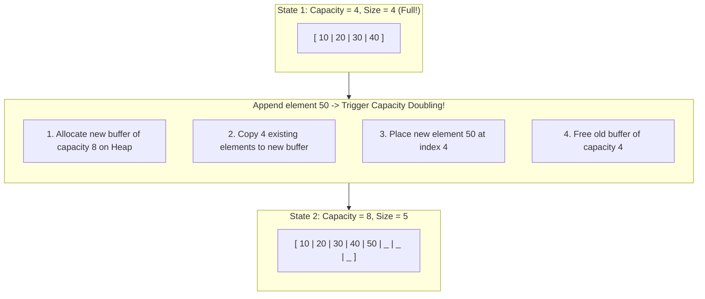

import { Callout } from "fumadocs-ui/components/callout";
import { Tabs, Tab } from "fumadocs-ui/components/tabs";
import { Steps, Step } from "fumadocs-ui/components/steps";
import { Cards, Card } from "fumadocs-ui/components/card";

## The Moving Day Protocol

Static arrays suffer from an insurmountable limitation: **fixed capacity**. In practical software engineering, data volumes expand and contract unpredictably.

A **Dynamic Array** (such as `std::vector` in C++, `ArrayList` in Java, or the internal implementation of Python's `list` and JavaScript's `Array`) solves this by wrapping a static heap-allocated buffer with automatic geometric growth.

A dynamic array maintains three internal pointer variables:

1. `data`: Pointer to the heap-allocated contiguous block.
2. `size`: The count of actively stored elements.
3. `capacity`: The total number of available slots in the current allocation.



---

## Geometric Growth: Why 2x or 1.5x?

Why must dynamic arrays grow geometrically (multiplying by a factor $g > 1$) rather than arithmetically (adding a fixed increment, like $+100$ slots)?

<Callout type="warn" title="The Pitfall of Additive Growth (+C)">
  If an array increases capacity by a constant $C = 100$ whenever full:
  - Inserting $N$ items requires $N / C$ reallocations.
  - The total elements copied is:
    $$
    \sum_{k=1}^{N/C} k \cdot C = C \cdot \frac{(N/C)(N/C + 1)}{2} \approx \frac{N^2}{2C} = \mathcal{O}(N^2)
    $$
  - Every append operation degrades to an average of $\mathcal{O}(N)$ time!
</Callout>

Under **geometric growth** with growth factor $g = 2$:

- To insert $N$ items (starting from capacity 1), reallocations happen at sizes $1, 2, 4, 8, \dots, 2^k$.
- The total elements copied during all reallocations is:
  $$
  1 + 2 + 4 + 8 + \dots + \frac{N}{2} = N - 1 < N
  $$
- The total copying cost across all $N$ operations is bounded by $N$. Averaged over $N$ pushes, each push costs **$\mathcal{O}(1)$ amortized time**!

### Why $1.5\times$ (Golden Ratio) vs $2\times$?

| Growth Factor   | Used By                             | Advantage                                      | Memory Allocator Impact                                                                                                   |
| :-------------- | :---------------------------------- | :--------------------------------------------- | :------------------------------------------------------------------------------------------------------------------------ |
| **$2.0\times$** | GCC `libstdc++`, Go slices, Python  | Fastest capacity growth, minimum reallocations | Can never reuse previously deallocated contiguous heap space because $\sum_{i=0}^{k-1} 2^i = 2^k - 1 < 2^k$.              |
| **$1.5\times$** | MSVC STL, Facebook Folly `fbvector` | Memory-allocator friendly                      | After several expansions, newly requested blocks fit into the aggregated memory previously freed, avoiding fragmentation! |

---

## Amortized Analysis: Banker's Accounting Method

To formally prove that appending is $\mathcal{O}(1)$ amortized, we use the **Banker's Accounting Method**:

1. Imagine every elementary operation costs **\$1 coin**.
2. For each standard `push_back` operation, we charge an **amortized cost of \$3 coins**:
   - **\$1** pays for the immediate write into the empty slot.
   - **\$1** is deposited as credit onto the newly added element.
   - **\$1** is deposited as credit onto an older element that was moved during the previous resizing.
3. When the array reaches full capacity $N$ and must double to $2N$:
   - Exactly $N$ elements are in the array.
   - Every single one of the $N$ elements holds \$1 of prepaid credit.
   - Total prepaid credit = **\$N**, which exactly covers the $N$ copying operations needed to transfer the elements to the new buffer!
4. The bank balance never drops below zero. Hence, the amortized cost per append is strictly **$\mathcal{O}(1)$**.

---

## Shrink Policies and Memory Thrashing

When elements are popped from a dynamic array, should we shrink capacity immediately when `size == capacity / 2`?

<Callout type="error" title="The Pathological Thrashing Anti-Pattern">
  If you double capacity at $N$ and halve capacity at $N-1$: - A sequence of
  alternating `push()` and `pop()` calls at the boundary forces an $\mathcal{O}
  (N)$ reallocation on **every single operation**! - **Solution (Hysteresis):**
  Only halve capacity when size drops to **$\frac{1}
  {4}$ of capacity** (e.g., in Python and Java). This preserves a wide cushion
  between expansions and contractions.
</Callout>

---

## Polyglot Custom Vector Implementation

<Tabs items={["C++", "TypeScript", "Python"]}>
  <Tab value="C++">
```cpp
#include <iostream>
#include <stdexcept>
#include <algorithm>

template <typename T>
class DynamicArray {
private:
T\* data;
size_t length;
size_t capacity;

    void reallocate(size_t newCapacity) {
        T* newBuffer = new T[newCapacity];
        for (size_t i = 0; i < length; ++i) {
            newBuffer[i] = std::move(data[i]);
        }
        delete[] data;
        data = newBuffer;
        capacity = newCapacity;
    }

public:
DynamicArray() : data(new T[2]), length(0), capacity(2) {}

    ~DynamicArray() {
        delete[] data;
    }

    void push_back(const T& value) {
        if (length == capacity) {
            reallocate(capacity * 2); // 2x geometric growth
        }
        data[length++] = value;
    }

    void pop_back() {
        if (length == 0) throw std::underflow_error("Array is empty");
        length--;
        // Hysteresis shrink policy
        if (length > 0 && length <= capacity / 4) {
            reallocate(capacity / 2);
        }
    }

    T& operator[](size_t index) {
        if (index >= length) throw std::out_of_range("Index out of bounds");
        return data[index];
    }

    size_t size() const { return length; }
    size_t get_capacity() const { return capacity; }

};

````
  </Tab>
  <Tab value="TypeScript">
```typescript
export class DynamicVector<T> {
  private buffer: (T | undefined)[];
  private count = 0;

  constructor(initialCapacity = 2) {
    this.buffer = new Array(Math.max(1, initialCapacity));
  }

  public get size(): number {
    return this.count;
  }

  public get capacity(): number {
    return this.buffer.length;
  }

  public get(index: number): T {
    if (index < 0 || index >= this.count) throw new RangeError("Index out of bounds");
    return this.buffer[index]!;
  }

  public push(value: T): void {
    if (this.count === this.buffer.length) {
      this.resize(this.buffer.length * 2); // 2x geometric growth
    }
    this.buffer[this.count++] = value;
  }

  public pop(): T {
    if (this.count === 0) throw new Error("Underflow: Vector is empty");
    const val = this.buffer[--this.count]!;
    this.buffer[this.count] = undefined; // Garbage collection hint

    // Hysteresis: shrink when size drops to 1/4 of capacity
    if (this.count > 0 && this.count <= Math.floor(this.buffer.length / 4)) {
      this.resize(Math.floor(this.buffer.length / 2));
    }
    return val;
  }

  private resize(newCapacity: number): void {
    const newBuf = new Array<T | undefined>(newCapacity);
    for (let i = 0; i < this.count; i++) {
      newBuf[i] = this.buffer[i];
    }
    this.buffer = newBuf;
  }
}
````

  </Tab>
  <Tab value="Python">
```python
class DynamicVector:
    """Demonstrates geometric capacity expansion matching CPython list mechanics."""
    def __init__(self):
        self._capacity = 2
        self._size = 0
        self._data = [None] * self._capacity

    def __len__(self):
        return self._size

    def __getitem__(self, index):
        if not 0 <= index < self._size:
            raise IndexError("Index out of bounds")
        return self._data[index]

    def append(self, val):
        if self._size == self._capacity:
            self._resize(self._capacity * 2)
        self._data[self._size] = val
        self._size += 1

    def pop(self):
        if self._size == 0:
            raise IndexError("pop from empty list")
        self._size -= 1
        val = self._data[self._size]
        self._data[self._size] = None
        # Shrink with hysteresis
        if 0 < self._size <= self._capacity // 4:
            self._resize(self._capacity // 2)
        return val

    def _resize(self, new_cap):
        new_data = [None] * new_cap
        for i in range(self._size):
            new_data[i] = self._data[i]
        self._data = new_data
        self._capacity = new_cap

```
  </Tab>
</Tabs>
```
