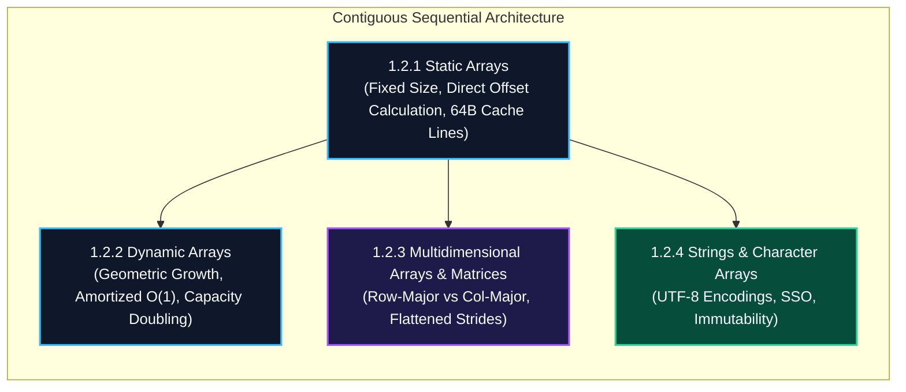

import { Callout } from "fumadocs-ui/components/callout";
import { Tabs, Tab } from "fumadocs-ui/components/tabs";
import { Steps, Step } from "fumadocs-ui/components/steps";
import { Cards, Card } from "fumadocs-ui/components/card";

## The Physical Bedrock of Silicon Computing

Contiguous data structures form the absolute foundation of modern computer architecture. At the silicon level, physical RAM is indexed sequentially, and CPU cache hierarchies (L1, L2, L3) are specifically engineered to prefetch unbroken, continuous blocks of memory into high-speed 64-byte cache lines.

When data elements reside next to one another in memory:

1. **$O(1)$ Address Calculation:** The CPU computes the exact physical address of the $i$-th element via a single multiply-add cycle ($Base + i \times Size$).
2. **Spatial Locality:** Accessing element $A[0]$ automatically fetches $A[1], A[2], \dots$ into the 64-byte L1 CPU cache, dropping access latency from ~100 nanoseconds (DRAM) to ~1 nanosecond (L1 cache).
3. **Zero Pointer Overhead:** Every byte of allocated space stores payload rather than pointer metadata.

---

## Architectural Comparison Matrix

| Structure                  | Fixed vs Dynamic      | Memory Layout                 | Indexing Bound                                    | Resizing Overhead                                     | Typical Hardware Utilization         |
| :------------------------- | :-------------------- | :---------------------------- | :------------------------------------------------ | :---------------------------------------------------- | :----------------------------------- |
| **Static Array**           | Fixed compile-time    | Contiguous Stack/Heap         | $\mathcal{O}(1)$                                  | Impossible                                            | Optimal (100% cache-line fill)       |
| **Dynamic Array (Vector)** | Dynamically resizable | Contiguous Heap block         | $\mathcal{O}(1)$                                  | $\mathcal{O}(N)$ realloc (amortized $\mathcal{O}(1)$) | High (occasional slack capacity)     |
| **Matrix (2D/3D)**         | Fixed or Dynamic      | Flattened Contiguous / Jagged | $\mathcal{O}(1)$                                  | Dependent on row structure                            | High in row-major iteration          |
| **String**                 | Typically Immutable   | Contiguous byte buffer        | $\mathcal{O}(1)$ byte / $\mathcal{O}(N)$ grapheme | New allocation on modification                        | SSO bypasses heap for $\le 23$ bytes |

---

## Stage 1.2 Curriculum Modules

Explore each dedicated topic module:

<Cards>
  <Card
    title="1.2.1 Static Arrays"
    href="/docs/dsa/01-beginner/contiguous-and-sequential-data-structures/static-arrays"
    description="Fixed-size contiguous memory blocks, pointer arithmetic, hardware cache line utilization, and access bounds."
  />
  <Card
    title="1.2.2 Dynamic Arrays"
    href="/docs/dsa/01-beginner/contiguous-and-sequential-data-structures/dynamic-arrays"
    description="Resizable vector internals, geometric expansion factors (1.5x vs 2x), and amortized analysis."
  />
  <Card
    title="1.2.3 Multidimensional Arrays and Matrices"
    href="/docs/dsa/01-beginner/contiguous-and-sequential-data-structures/multidimensional-arrays-and-matrices"
    description="Row-major vs column-major layouts, stride indexing formulas, and cache-friendly matrix traversal."
  />
  <Card
    title="1.2.4 Strings and Character Arrays"
    href="/docs/dsa/01-beginner/contiguous-and-sequential-data-structures/strings-and-character-arrays"
    description="Character encodings (ASCII, UTF-8, UTF-16), Small String Optimization (SSO), and string immutability."
  />
</Cards>
