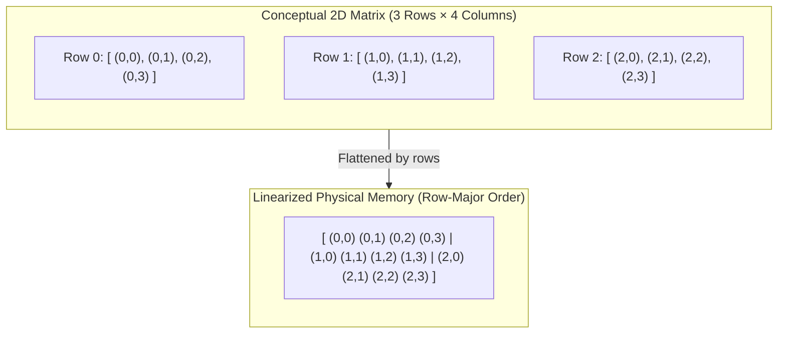
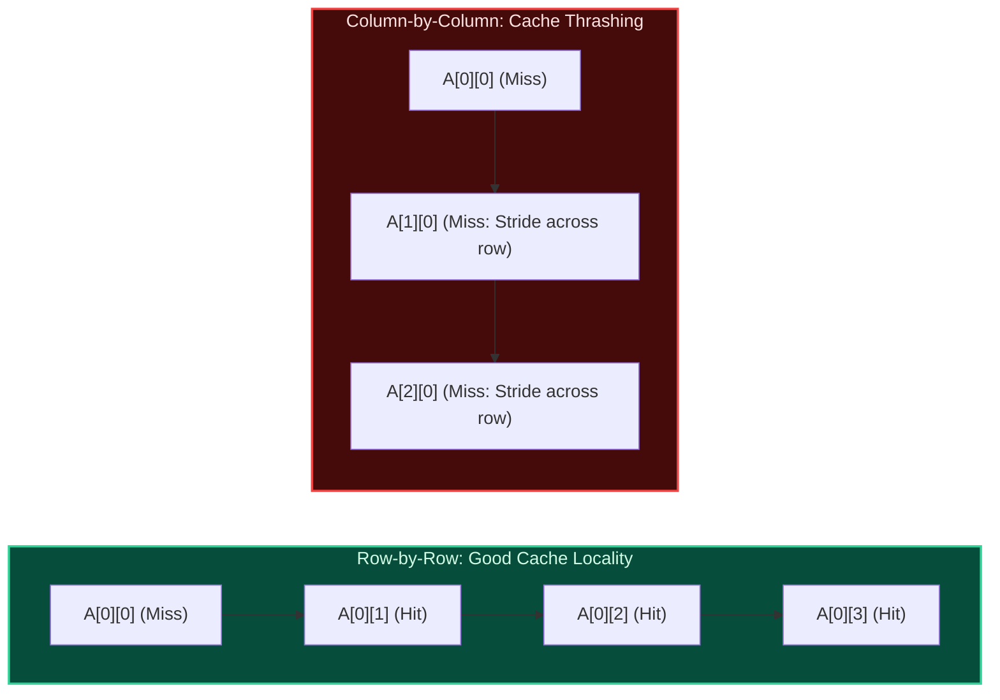

import { Callout } from "fumadocs-ui/components/callout";
import { Tabs, Tab } from "fumadocs-ui/components/tabs";
import { Steps, Step } from "fumadocs-ui/components/steps";
import { Cards, Card } from "fumadocs-ui/components/card";

## The Linearization of 2D/3D Space

Physical computer memory (RAM) is strictly one-dimensional. There are no two-dimensional grids or three-dimensional cubes etched onto silicon wafers. Every matrix must be **linearized** (flattened) into a continuous sequence of memory addresses.



---

## Memory Layouts: Row-Major vs. Column-Major

There are two primary paradigms for ordering multidimensional elements in memory:

### 1. Row-Major Order (C, C++, Python, Java, Rust)

Elements of the first row are placed consecutively, followed by all elements of the second row, and so on.

- Moving from $(i, j)$ to $(i, j+1)$ shifts forward by $1$ element.
- Moving from $(i, j)$ to $(i+1, j)$ shifts forward by $\text{Cols}$ elements.

**Row-Major Indexing Formula:**

$$
\text{Index}(i, j) = i \times \text{Cols} + j
$$

$$
\text{Address}(A[i][j]) = \text{Base} + (i \times \text{Cols} + j) \times S
$$

### 2. Column-Major Order (Fortran, MATLAB, R, Julia)

Elements of the first column are placed consecutively, followed by the second column, and so on.

**Column-Major Indexing Formula:**

$$
\text{Index}(i, j) = j \times \text{Rows} + i
$$

---

## 3D Tensor Flattening Formula

For a 3D matrix of dimensions $\text{Depths} \times \text{Rows} \times \text{Cols}$ accessed as $A[d][r][c]$:

$$
\text{Index}(d, r, c) = d \times (\text{Rows} \times \text{Cols}) + r \times \text{Cols} + c
$$

Each dimension corresponds to a **stride** (the number of memory positions stepped over to increment that dimension's index by 1):

- $\text{stride}_d = \text{Rows} \times \text{Cols}$
- $\text{stride}_r = \text{Cols}$
- $\text{stride}_c = 1$

---

## Cache-Stride Effects: The 10x Performance Trap

Because CPUs fetch memory in 64-byte cache lines, traversing a row-major matrix along rows versus along columns exhibits catastrophic performance discrepancies.



When iterating column-first on a large $10{,}000 \times 10{,}000$ integer matrix:

- Each step jumps $10{,}000 \times 4\text{ bytes} = 40\text{ KB}$ ahead in memory.
- $40\text{ KB}$ exceeds the size of standard L1 CPU caches (32 KB).
- **Every single iteration causes an L1 cache miss!** Row-by-row traversal can be **$5\times$ to $20\times$ faster** for identical mathematical operations.

---

## Submatrix Coordinates & Bounding Boxes

Given a bounding box defined by top-left $(r_1, c_1)$ and bottom-right $(r_2, c_2)$:

- Total rows in submatrix: $r_2 - r_1 + 1$
- Total columns in submatrix: $c_2 - c_1 + 1$
- Total cell count: $(r_2 - r_1 + 1) \times (c_2 - c_1 + 1)$

---

## Polyglot Matrix Implementations

<Tabs items={["C++", "TypeScript", "Python"]}>
  <Tab value="C++">
```cpp
#include <iostream>
#include <vector>

// High-performance 1D-flattened 2D Matrix
template <typename T>
class Matrix2D {
private:
size_t rows;
size_t cols;
std::vector<T> buffer;

public:
Matrix2D(size_t r, size_t c, T initVal = T())
: rows(r), cols(c), buffer(r \* c, initVal) {}

    // Inline flattened index access: O(1)
    inline T& at(size_t r, size_t c) {
        return buffer[r * cols + c];
    }

    inline const T& at(size_t r, size_t c) const {
        return buffer[r * cols + c];
    }

    size_t get_rows() const { return rows; }
    size_t get_cols() const { return cols; }

};

int main() {
Matrix2D<int> mat(3, 4, 0);
mat.at(1, 2) = 42; // Row 1, Col 2 -> Index: 1 \* 4 + 2 = 6
std::cout << "Value at (1, 2): " << mat.at(1, 2) << "\n";
return 0;
}

````
  </Tab>
  <Tab value="TypeScript">
```typescript
export class FlattenedMatrix<T> {
  public readonly rows: number;
  public readonly cols: number;
  private readonly buffer: T[];

  constructor(rows: number, cols: number, initialValue: T) {
    this.rows = rows;
    this.cols = cols;
    this.buffer = new Array<T>(rows * cols).fill(initialValue);
  }

  public get(r: number, c: number): T {
    return this.buffer[r * this.cols + c];
  }

  public set(r: number, c: number, value: T): void {
    this.buffer[r * this.cols + c] = value;
  }
}

const grid = new FlattenedMatrix<number>(3, 4, 0);
grid.set(1, 2, 42);
console.log("Val at (1, 2):", grid.get(1, 2));
````

  </Tab>
  <Tab value="Python">
```python
class Matrix2D:
    """1D-flattened list for cache-optimal matrix representation in Python."""
    def __init__(self, rows: int, cols: int, fill=0):
        self.rows = rows
        self.cols = cols
        self.buffer = [fill] * (rows * cols)

    def get(self, r: int, c: int):
        return self.buffer[r * self.cols + c]

    def set(self, r: int, c: int, val):
        self.buffer[r * self.cols + c] = val

mat = Matrix2D(3, 4)
mat.set(1, 2, 42)
print("Val at (1, 2):", mat.get(1, 2))

```
  </Tab>
</Tabs>
```
