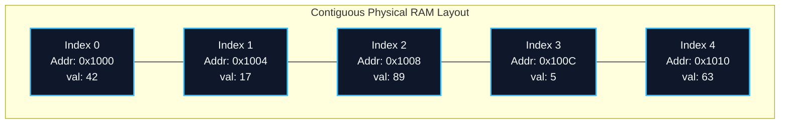
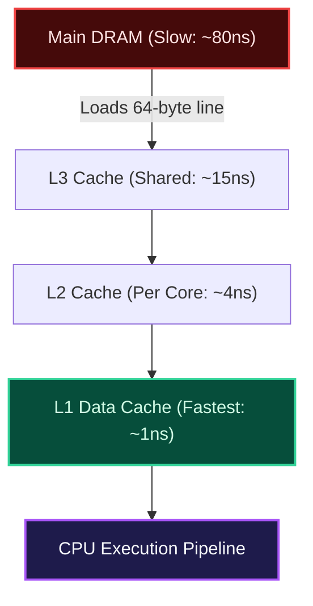

import { Callout } from "fumadocs-ui/components/callout";
import { Tabs, Tab } from "fumadocs-ui/components/tabs";
import { Steps, Step } from "fumadocs-ui/components/steps";
import { Cards, Card } from "fumadocs-ui/components/card";

## Hardware Grounding: Contiguous Allocation

A **Static Array** is a fixed-size, sequential collection of elements of identical data type stored in an unbroken, contiguous segment of physical memory.

When a program requests a static array of size $N$, the operating system and memory allocator reserve a single uninterrupted slice of $N \times S$ bytes, where $S$ is the size in bytes of a single element (e.g., 4 bytes for a 32-bit integer, 8 bytes for a 64-bit float).



---

## Direct Addressing and Pointer Arithmetic

The defining power of an array is its ability to access any arbitrary index in strictly **$\mathcal{O}(1)$ constant time**. The CPU does not scan or count through predecessor elements; it calculates the target memory address directly using the **Addressing Formula**:

$$
\text{Address}(A[i]) = \text{Base Address} + i \times \text{Element Size}
$$

Where:

- $\text{Base Address}$ ($B$): The starting memory pointer of the array ($A[0]$).
- $i$: The 0-based index of the requested element.
- $\text{Element Size}$ ($S$): The size of each data element in bytes (e.g., $4$ for `int32`).

Because multiplication and addition are single-cycle ALU instructions, evaluating $\text{Address}(A[i])$ requires identical time whether $i = 0$ or $i = 10{,}000{,}000$.

<Callout type="info" title="Why 0-Indexed Arrays?">
  0-based indexing is not an arbitrary aesthetic choice—it represents the exact
  mathematical **offset** (distance in elements) from the base pointer. Element
  $0$ has an offset of $0 \times S = 0$ bytes from the start. A 1-based indexing
  scheme would force the CPU to perform an unnecessary subtraction $(i - 1)
  \times S$ on every memory access.
</Callout>

---

## Mechanical Sympathy: 64-Byte Cache Lines

Modern processors are dramatically faster than main system memory (DRAM). To bridge this speed gap, CPUs use multi-level cache hierarchies:

- **L1 Data Cache:** ~0.5–1.5 nanoseconds (32–64 KB per core)
- **L2 Cache:** ~3–5 nanoseconds (512 KB–1 MB per core)
- **L3 Cache:** ~10–20 nanoseconds (shared, 16–64 MB)
- **Main DRAM:** ~60–100 nanoseconds

CPUs never fetch individual bytes from DRAM. Instead, they always transfer memory in fixed **64-byte chunks called Cache Lines**.



When your code reads $A[0]$ (a 4-byte integer):

1. The hardware cache controller fetches a full 64-byte line from DRAM containing $A[0]$ through $A[15]$ ($64 / 4 = 16$ integers).
2. The initial read of $A[0]$ is a **Cache Miss** (~80ns).
3. The subsequent accesses to $A[1], A[2], \dots, A[15]$ are instantaneous **Cache Hits** (~1ns)!

This hardware phenomenon is called **Spatial Locality**. Contiguous static arrays leverage 100% of spatial locality, making them the most hardware-efficient data structure in existence.

---

## Complexity Profile

| Operation                        | Best Case        | Average Case          | Worst Case            | Auxiliary Space  | Notes                              |
| :------------------------------- | :--------------- | :-------------------- | :-------------------- | :--------------- | :--------------------------------- |
| **Lookup by Index ($A[i]$)**     | $\mathcal{O}(1)$ | $\mathcal{O}(1)$      | $\mathcal{O}(1)$      | $\mathcal{O}(1)$ | Direct pointer calculation         |
| **Lookup by Value (Unsorted)**   | $\mathcal{O}(1)$ | $\mathcal{O}(N)$      | $\mathcal{O}(N)$      | $\mathcal{O}(1)$ | Linear scan required               |
| **Lookup by Value (Sorted)**     | $\mathcal{O}(1)$ | $\mathcal{O}(\log N)$ | $\mathcal{O}(\log N)$ | $\mathcal{O}(1)$ | Binary search                      |
| **In-Place Update ($A[i] = v$)** | $\mathcal{O}(1)$ | $\mathcal{O}(1)$      | $\mathcal{O}(1)$      | $\mathcal{O}(1)$ | Direct write to address            |
| **Insert / Delete**              | N/A              | N/A                   | N/A                   | N/A              | Fixed size: capacity cannot change |

---

## Polyglot Implementations

<Tabs items={["C++", "TypeScript", "Python"]}>
  <Tab value="C++">
```cpp
#include <iostream>
#include <array>
#include <cstdint>

int main() {
// Stack-allocated fixed static array of 5 32-bit integers
std::array<int32_t, 5> staticArr = {42, 17, 89, 5, 63};

    // Constant-time O(1) random access
    std::cout << "Element at index 2: " << staticArr[2] << "\n";

    // Direct pointer arithmetic proof
    int32_t* basePtr = staticArr.data();
    for (size_t i = 0; i < staticArr.size(); ++i) {
        uintptr_t addr = reinterpret_cast<uintptr_t>(basePtr + i);
        std::cout << "Index " << i << " | Address: 0x" << std::hex << addr
                  << std::dec << " | Value: " << *(basePtr + i) << "\n";
    }

    return 0;

}

````
  </Tab>
  <Tab value="TypeScript">
```typescript
// Using typed array to simulate fixed contiguous memory allocation
const STATIC_SIZE = 5;
const staticArray = new Int32Array(STATIC_SIZE);

// Initialize elements
staticArray[0] = 42;
staticArray[1] = 17;
staticArray[2] = 89;
staticArray[3] = 5;
staticArray[4] = 63;

// Direct O(1) index access
console.log("Element at index 2:", staticArray[2]);
console.log("Byte length in RAM:", staticArray.byteLength); // 20 bytes (5 * 4 bytes)
console.log("Bytes per element:", staticArray.BYTES_PER_ELEMENT); // 4 bytes
````

  </Tab>
  <Tab value="Python">
```python
import array

# Python's built-in array module provides genuine C-style contiguous static arrays

# 'i' represents signed 32-bit integer (4 bytes)

static_arr = array.array('i', [42, 17, 89, 5, 63])

print(f"Element at index 2: {static_arr[2]}")
print(f"Memory buffer address & size: {static_arr.buffer_info()}")
print(f"Item size in bytes: {static_arr.itemsize}")

```
  </Tab>
</Tabs>
```
