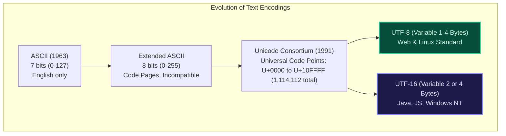
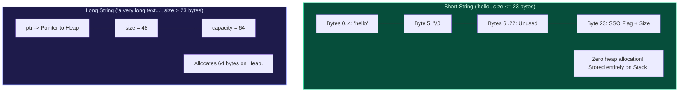

import { Callout } from "fumadocs-ui/components/callout";
import { Tabs, Tab } from "fumadocs-ui/components/tabs";
import { Steps, Step } from "fumadocs-ui/components/steps";
import { Cards, Card } from "fumadocs-ui/components/card";

## The Architectural Reality of Strings

In systems programming, a string is simply a contiguous array of byte values paired with an **encoding rule** that dictates how binary integers map to human glyphs.

Unlike numerical arrays, strings introduce unique architectural complexities:

1. **Encoding Variable Lengths:** One character does not always equal one byte.
2. **Immutability:** Most modern high-level runtimes (Java, Python, JavaScript, C#) enforce string immutability.
3. **Small String Optimization (SSO):** Low-level engines (C++ `std::string`) avoid heap allocations for short strings by storing data directly inside the pointer object!

---

## Character Encodings: From ASCII to UTF-8



### UTF-8 Variable-Length Encoding Rules

UTF-8 encodes every Unicode code point into $1$ to $4$ bytes:

- **1 Byte ($0x00$ to $0x7F$):** `0xxxxxxx` (100% identical to 7-bit ASCII!)
- **2 Bytes ($0x80$ to $0x7FF$):** `110xxxxx 10xxxxxx`
- **3 Bytes ($0x800$ to $0xFFFF$):** `1110xxxx 10xxxxxx 10xxxxxx`
- **4 Bytes ($0x10000$ to $0x10FFFF$):** `11110xxx 10xxxxxx 10xxxxxx 10xxxxxx`

<Callout type="warn" title="The Emoji Trap: Bytes != Code Points != Graphemes">
  Consider the family emoji: `👨‍👩‍👧‍👦` - **Grapheme Clusters (What the user sees):**
  Exactly $1$ visual character. - **Unicode Code Points:** $7$ code points
  combined with Zero-Width Joiners (`U+200D`). - **UTF-16 Code Units (JavaScript
  `str.length`):** $11$ code units! - **UTF-8 Bytes:** $25$ bytes! In
  JavaScript, `"👨‍👩‍👧‍👦".length` returns `11`, **not 1**!
</Callout>

---

## Small String Optimization (SSO)

In 64-bit systems, a standard string object contains three 8-byte pointer members ($3 \times 8 = 24$ bytes total):

- Pointer to buffer: `char* ptr` (8 bytes)
- Length: `size_t size` (8 bytes)
- Capacity: `size_t capacity` (8 bytes)

Allocating a tiny 5-byte string like `"hello"` on the heap costs:

1. $24$ bytes on the stack for the object.
2. A separate 16-32 byte heap allocation from `malloc`.
3. An expensive heap allocation syscall and pointer indirection.

**Small String Optimization (SSO)** solves this:
When `size <= 23` (or 15 in some libraries), the string object overlays an internal `char buffer[24]` directly on top of the pointer fields using a C++ `union`. **No heap allocation occurs!**



---

## Why String Immutability?

Runtimes like Python, Java, and JavaScript enforce string immutability for three critical reasons:

1. **Security & Validation:** URLs, database connection strings, and file paths cannot be altered between authorization verification and execution (preventing Time-of-Check to Time-of-Use TOCTOU attacks).
2. **Safe Hash Map Keys:** If a string's characters could mutate, its hash code would change, permanently corrupting the internal bucket index inside hash tables.
3. **String Interning:** Identical string literals can safely share a single physical memory instance across the entire runtime.

<Callout type="tip" title="Building Large Strings">
  Because strings are immutable, repeatedly concatenating in a loop (`s += c`)
  creates a new string on every step, producing an accidental $\mathcal{O}(N^2)$
  algorithm. Always use a dynamic character buffer (`StringBuilder` in Java/C#,
  `list.join()` in Python, or an array of chunks in TypeScript).
</Callout>

---

## Polyglot String Architecture Code

<Tabs items={["C++ (SSO Verification)", "TypeScript (Graphemes)", "Python"]}>
  <Tab value="C++ (SSO Verification)">
```cpp
#include <iostream>
#include <string>

int main() {
// Short string: Fits inside SSO internal buffer
std::string shortStr = "Hello";

    // Long string: Exceeds 23 bytes, forced onto the heap
    std::string longStr = "This is a remarkably long string that exceeds the internal SSO buffer capacity";

    std::cout << "Short string address: " << (void*)shortStr.data() << "\n";
    std::cout << "Short string obj ptr: " << (void*)&shortStr << "\n";
    // If shortStr.data() is close to &shortStr, SSO is ACTIVE!

    std::cout << "Long string address:  " << (void*)longStr.data() << "\n";
    std::cout << "Long string obj ptr:  " << (void*)&longStr << "\n";
    return 0;

}

````
  </Tab>
  <Tab value="TypeScript (Graphemes)">
```typescript
const emoji = "👨‍👩‍👧‍👦";

console.log("Visual grapheme count: 1");
console.log("JavaScript UTF-16 code units (str.length):", emoji.length); // 11

// Correct modern segmentation using Intl.Segmenter
const segmenter = new Intl.Segmenter("en", { granularity: "grapheme" });
const graphemes = Array.from(segmenter.segment(emoji));
console.log("Intl Segmenter true grapheme count:", graphemes.length); // 1
````

  </Tab>
  <Tab value="Python">
```python
# String interning demonstration
s1 = "hello_world"
s2 = "hello_world"

# Both variables point to the exact same memory address in CPython

print(f"s1 id: {id(s1)}, s2 id: {id(s2)}")
print(f"s1 is s2: {s1 is s2}") # True (interned)

# UTF-8 byte representation

text = "café"
encoded = text.encode("utf-8")
print(f"Text length: {len(text)}") # 4 characters
print(f"UTF-8 byte length: {len(encoded)}") # 5 bytes ('é' takes 2 bytes: 0xC3 0xA9)

```
  </Tab>
</Tabs>
```
