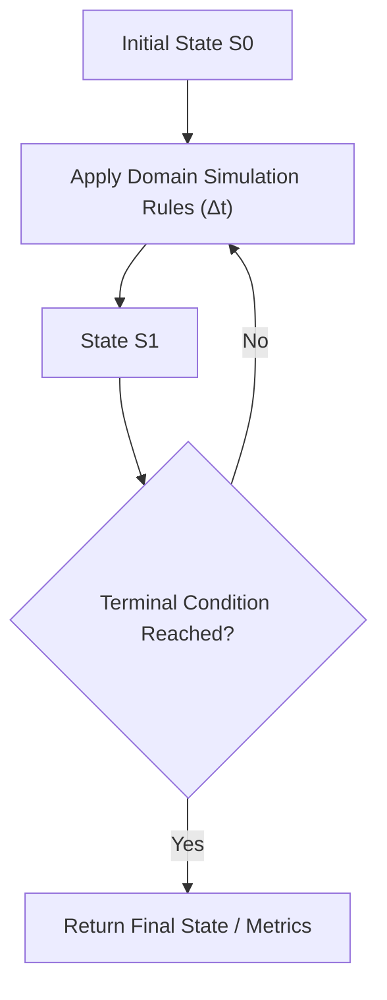

import { Callout } from "fumadocs-ui/components/callout";
import { Tabs, Tab } from "fumadocs-ui/components/tabs";
import { Steps, Step } from "fumadocs-ui/components/steps";
import { Cards, Card } from "fumadocs-ui/components/card";

## The Ground Truth Baseline: Exhaustion & Simulation

Before applying complex optimizations, an engineer must first formulate the problem's **ground truth**.

**Complete Search** (or Brute-Force Exhaustion) visits every valid configuration in the search space to find an optimal solution or verify a predicate. **Simulation** directly mirrors the physical rules of an environment step-by-step (e.g. robot grid navigation, Conway's Game of Life, cellular automata).



---

## When is Complete Search Feasible?

Complete search is optimal and required when the problem constraints guarantee that the total state space size $S$ is small enough for the CPU to exhaust within a typical 1.0-second time limit (~$10^8$ operations):

| Complexity         | Maximum $N$ for 1.0s Budget | Example Problem Domain                          |
| :----------------- | :-------------------------- | :---------------------------------------------- |
| $\mathcal{O}(N!)$  | $N \le 11$                  | Permutations, Traveling Salesperson brute-force |
| $\mathcal{O}(2^N)$ | $N \le 22$                  | Generating all subsets, 0/1 knapsack exhaustion |
| $\mathcal{O}(N^3)$ | $N \le 500$                 | Triple-nested loop submatrix searches           |
| $\mathcal{O}(N^2)$ | $N \le 5{,}000$             | All-pairs comparisons                           |
| $\mathcal{O}(N)$   | $N \le 10^8$                | Linear array simulation, step-by-step walks     |

---

## Simulation Mechanics: Direction Vectors

In 2D grid simulations (such as a robot moving North, East, South, West or a chess knight moving across a board), avoid multiple messy `if-else` branches by defining **Delta Direction Vectors**:

```cpp
// 4-directional cardinal shifts: Up, Right, Down, Left
const int dr[] = {-1, 0, 1, 0};
const int dc[] = {0, 1, 0, -1};

// Move to neighbor
for (int d = 0; d < 4; ++d) {
    int nextR = r + dr[d];
    int nextC = c + dc[d];
    if (nextR >= 0 && nextR < ROWS && nextC >= 0 && nextC < COLS) {
        // Safe within boundaries!
    }
}
```

---

## Polyglot Implementations (Spiral Matrix Simulation)

<Tabs items={["C++", "TypeScript", "Python"]}>
  <Tab value="C++">
```cpp
#include <iostream>
#include <vector>

std::vector<int> spiralOrder(const std::vector<std::vector<int>>& matrix) {
if (matrix.empty()) return {};
std::vector<int> res;
int top = 0, bottom = matrix.size() - 1;
int left = 0, right = matrix[0].size() - 1;

    while (top <= bottom && left <= right) {
        for (int c = left; c <= right; ++c) res.push_back(matrix[top][c]);
        top++;
        for (int r = top; r <= bottom; ++r) res.push_back(matrix[r][right]);
        right--;

        if (top <= bottom) {
            for (int c = right; c >= left; --c) res.push_back(matrix[bottom][c]);
            bottom--;
        }
        if (left <= right) {
            for (int r = bottom; r >= top; --r) res.push_back(matrix[r][left]);
            left++;
        }
    }
    return res;

}

````
  </Tab>
  <Tab value="TypeScript">
```typescript
export function spiralOrder(matrix: number[][]): number[] {
  if (matrix.length === 0) return [];
  const res: number[] = [];
  let top = 0, bottom = matrix.length - 1;
  let left = 0, right = matrix[0].length - 1;

  while (top <= bottom && left <= right) {
    for (let c = left; c <= right; c++) res.push(matrix[top][c]);
    top++;
    for (let r = top; r <= bottom; r++) res.push(matrix[r][right]);
    right--;

    if (top <= bottom) {
      for (let c = right; c >= left; c--) res.push(matrix[bottom][c]);
      bottom--;
    }
    if (left <= right) {
      for (let r = bottom; r >= top; r--) res.push(matrix[r][left]);
      left++;
    }
  }
  return res;
}
````

  </Tab>
  <Tab value="Python">
```python
def spiral_order(matrix: list[list[int]]) -> list[int]:
    if not matrix:
        return []
    res = []
    top, bottom = 0, len(matrix) - 1
    left, right = 0, len(matrix[0]) - 1

    while top <= bottom and left <= right:
        for c in range(left, right + 1):
            res.append(matrix[top][c])
        top += 1
        for r in range(top, bottom + 1):
            res.append(matrix[r][right])
        right -= 1

        if top <= bottom:
            for c in range(right, left - 1, -1):
                res.append(matrix[bottom][c])
            bottom -= 1
        if left <= right:
            for r in range(bottom, top - 1, -1):
                res.append(matrix[r][left])
            left += 1

    return res

```
  </Tab>
</Tabs>
```
