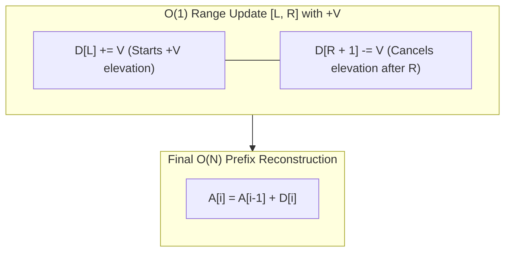

import { Callout } from "fumadocs-ui/components/callout";
import { Tabs, Tab } from "fumadocs-ui/components/tabs";
import { Steps, Step } from "fumadocs-ui/components/steps";
import { Cards, Card } from "fumadocs-ui/components/card";

## The Inverse of Prefix Sums

While prefix sums optimize range queries over a static array, **Difference Arrays** optimize offline batch range **updates**.

Suppose you start with an array of zeros of size $N$ and need to execute $K$ operations of the form:

$$
\text{Add value } V \text{ to every index in range } [L, R]
$$

- A naive loop takes $\mathcal{O}(R - L + 1) = \mathcal{O}(N)$ per update, resulting in $\mathcal{O}(K \cdot N)$ total time. For $K = 100{,}000$ and $N = 100{,}000$, this requires $10^{10}$ operations!

A **Difference Array** $D$ records only the _derivatives_ (rate of change between adjacent elements), allowing each range update to be executed in strictly **$\mathcal{O}(1)$ time**.



---

## The Two-Point Delta Invariant

Let difference array $D$ be defined such that $A[i] = \sum_{j=0}^i D[j]$.

When adding $+V$ to all elements in $[L, R]$:

1. $A[L]$ increases by $+V$ relative to $A[L-1]$ $\implies D[L] \mathrel{+}= V$.
2. Inside $[L+1 \dots R]$, adjacent elements all increase by $+V$, so their relative difference does not change!
3. $A[R+1]$ does _not_ receive $+V$, so relative to $A[R]$ it drops by $V$ $\implies D[R+1] \mathrel{-}= V$ (if $R+1 < N$).

After processing all $K$ updates in $\mathcal{O}(K)$ time, compute the prefix sums of $D$ in a single $\mathcal{O}(N)$ pass to reconstruct the final array.

$$
\text{Total Time} = \mathcal{O}(N + K) \quad \text{vs. naive } \mathcal{O}(N \cdot K)
$$

---

## Polyglot Implementations

<Tabs items={["C++", "TypeScript", "Python"]}>
  <Tab value="C++">
```cpp
#include <iostream>
#include <vector>

class DifferenceArray {
private:
std::vector<int> diff;

public:
DifferenceArray(size_t n) : diff(n + 1, 0) {}

    // O(1) range increment
    void addRange(size_t L, size_t R, int val) {
        diff[L] += val;
        diff[R + 1] -= val;
    }

    // O(N) reconstruction of the final array
    std::vector<int> build(size_t n) {
        std::vector<int> res(n);
        res[0] = diff[0];
        for (size_t i = 1; i < n; ++i) {
            res[i] = res[i - 1] + diff[i];
        }
        return res;
    }

};

int main() {
DifferenceArray da(5);
da.addRange(1, 3, 10); // add 10 to [1..3]
da.addRange(2, 4, 5); // add 5 to [2..4]

    std::vector<int> res = da.build(5);
    // Index 0: 0
    // Index 1: 10
    // Index 2: 15
    // Index 3: 15
    // Index 4: 5
    for (int x : res) std::cout << x << " ";
    std::cout << "\n";
    return 0;

}

````
  </Tab>
  <Tab value="TypeScript">
```typescript
export class DifferenceArray {
  private diff: number[];

  constructor(private n: number) {
    this.diff = new Array(n + 1).fill(0);
  }

  addRange(L: number, R: number, val: number): void {
    this.diff[L] += val;
    this.diff[R + 1] -= val;
  }

  build(): number[] {
    const res = new Array(this.n);
    res[0] = this.diff[0];
    for (let i = 1; i < this.n; i++) {
      res[i] = res[i - 1] + this.diff[i];
    }
    return res;
  }
}
````

  </Tab>
  <Tab value="Python">
```python
class DifferenceArray:
    def __init__(self, n: int):
        self.n = n
        self.diff = [0] * (n + 1)

    def add_range(self, L: int, R: int, val: int):
        self.diff[L] += val
        self.diff[R + 1] -= val

    def build(self) -> list[int]:
        res = [0] * self.n
        res[0] = self.diff[0]
        for i in range(1, self.n):
            res[i] = res[i - 1] + self.diff[i]
        return res

da = DifferenceArray(5)
da.add_range(1, 3, 10)
da.add_range(2, 4, 5)
print("Result array:", da.build()) # [0, 10, 15, 15, 5]

```
  </Tab>
</Tabs>
```
